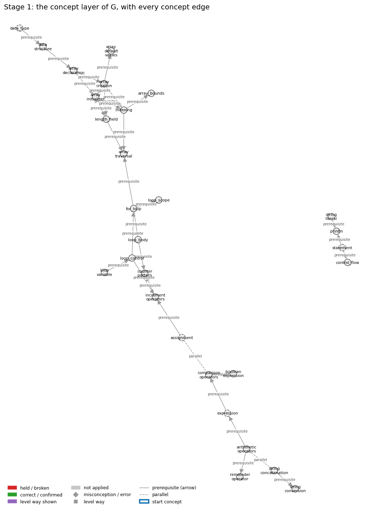
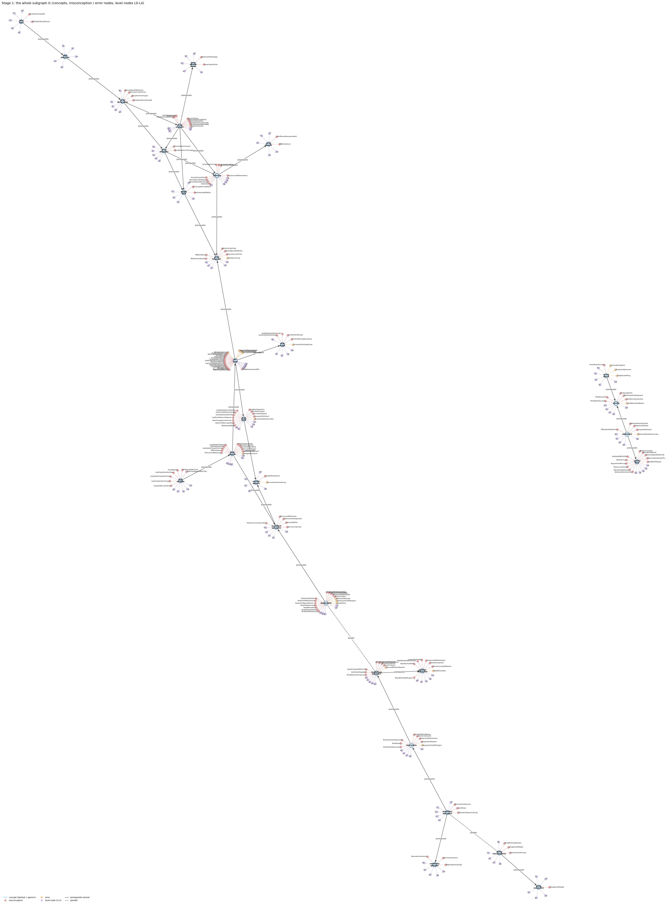
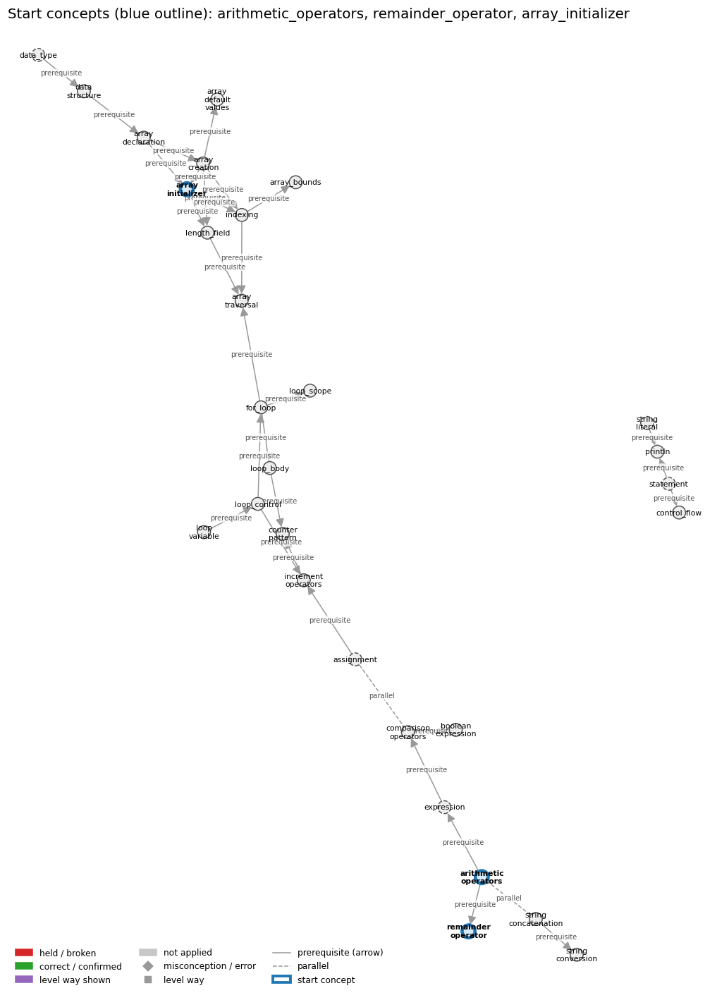
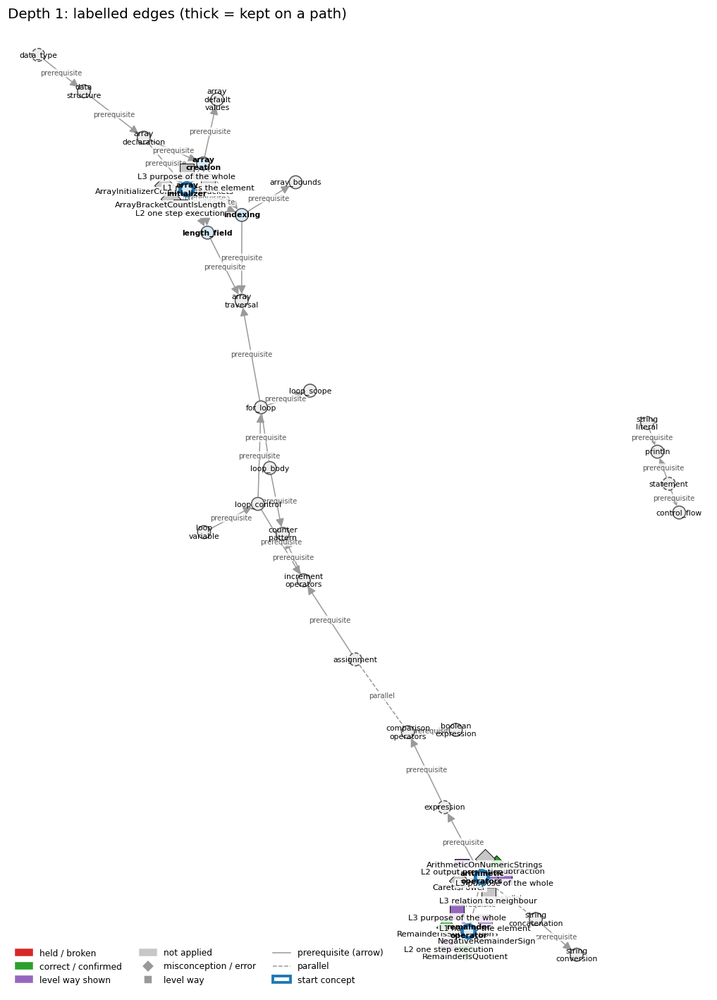
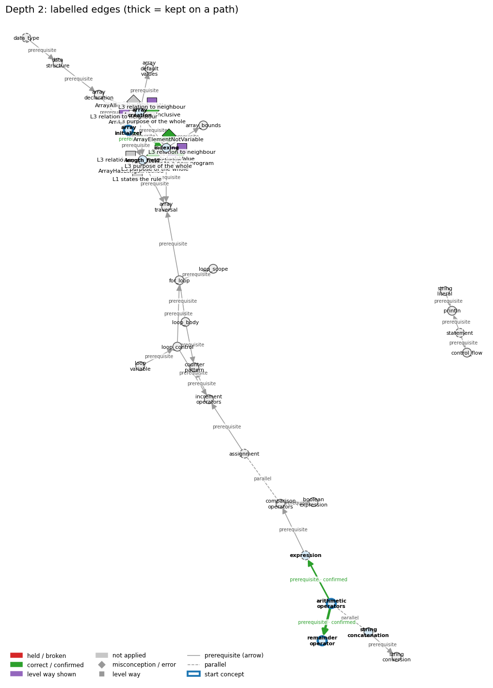
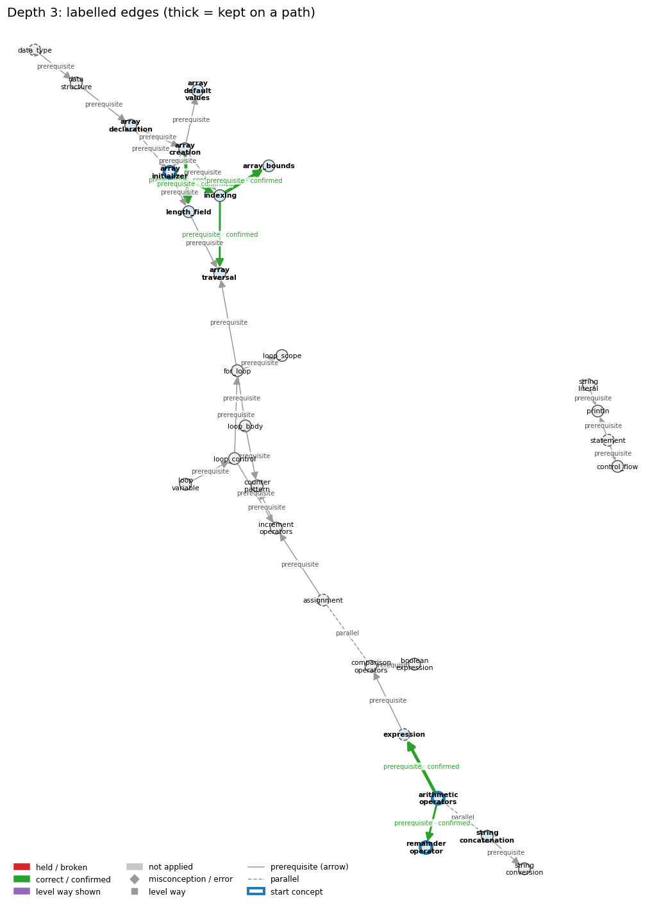
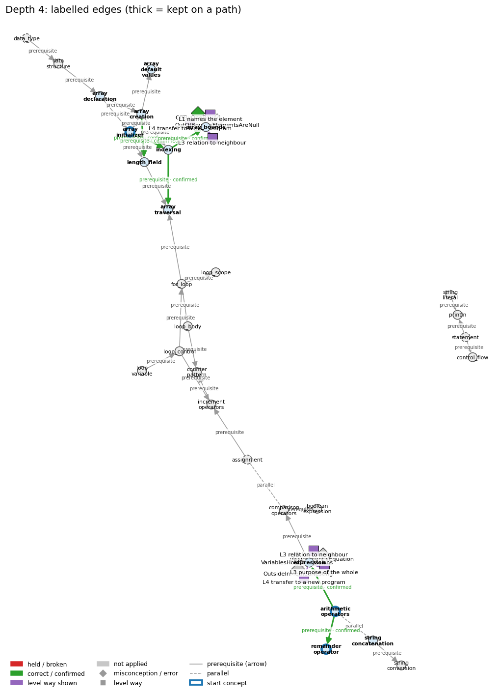
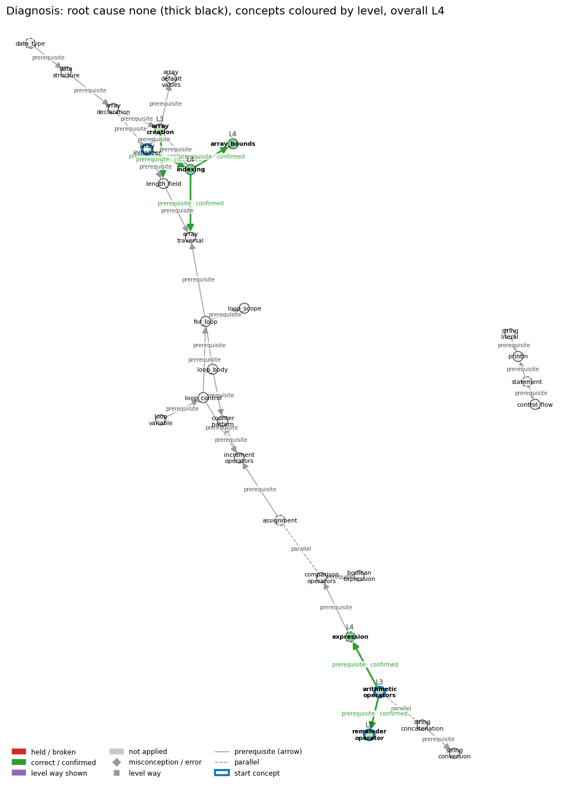

# Think on the Graph: every output of the run MY38

Files of this scenario: `input.json` (program, question, answer), `diagnosis.json`, `subgraph.json`, `traverse_log.txt`, `report.html` (this report as one full-page file, with the interactive graph `MY38_G.html`), `MY38.ipynb` (this report as a notebook).

## 0. Input
Program:
```java
int[] data = {4, 7, 2, 9, 5, 3};
int[] counts = new int[3];
for (int i = 0; i < data.length; i++) {
    counts[data[i] % 3]++;
}
for (int r = 0; r < 3; r++) {
    System.out.println(r + ": " + counts[r]);
}
```
Question: Without tracing line by line, explain what counts holds at the end and why the code uses % 3

Student's answer: counts[r] is how many numbers leave remainder r when divided by 3. The % 3 turns each number into an index 0, 1 or 2, so it fits the array.”
Settings: width 3, depth 3, prune llm, backend claude-cli, model claude-opus-5-5
## 1. Stage 1: the subgraph G from the code (no model)
Masked code (string and char literals and comments blanked; this is what the patterns see):
```
int[] data = {4, 7, 2, 9, 5, 3};
int[] counts = new int[3];
for (int i = 0; i < data.length; i++) {
    counts[data[i] % 3]++;
}
for (int r = 0; r < 3; r++) {
    System.out.println(r + "  " + counts[r]);
}
```
Which code text tagged which concept (a generic concept fires on almost any Java line; it starts the walk only if the answer repeats its tag):
| concept | generic | channel | matched text | line |
|---|---|---|---|---|
| arithmetic_operators | False | pattern | '] % 3' | 4 |
| array_bounds | False | pattern | 'i < data.length' | 3 |
| array_creation | False | pattern | 'new int[' | 2 |
| array_declaration | False | pattern | 'int[] data' | 1 |
| array_default_values | False | pattern | 'new int[3];' | 2 |
| array_initializer | False | pattern | '= {' | 1 |
| array_traversal | False | pattern | 'for (int i = 0; i < data.length' | 3 |
| array_traversal | False | pattern | 'for (int i = 0; i < data.length; i++) {\n    counts[data[i]' | 3 |
| assignment | True | pattern | '=' | 1 |
| boolean_expression | False | pattern | 'for (int i = 0; i < data.length;' | 3 |
| comparison_operators | False | pattern | 'for (int i = 0; i <' | 3 |
| control_flow | False | pattern | 'for (' | 3 |
| counter_pattern | False | pattern | ']++' | 4 |
| data_structure | False | pattern | 'int[]' | 1 |
| data_type | True | pattern | 'int' | 1 |
| expression | True | pattern | 'i <' | 3 |
| expression | True | pattern | '= {4, 7, 2, 9, 5, 3};' | 1 |
| for_loop | False | pattern | 'for (' | 3 |
| increment_operators | False | pattern | '++' | 3 |
| indexing | False | pattern | 't[3]' | 2 |
| length_field | False | pattern | '.length' | 3 |
| loop_body | False | pattern | 'for (' | 3 |
| loop_control | False | signal | 'for (int i = 0; i < data.length; i++)' | 3 |
| loop_scope | False | pattern | 'for (int i' | 3 |
| loop_variable | False | pattern | 'for (int i =' | 3 |
| println | False | pattern | 'System.out.println(' | 7 |
| remainder_operator | False | pattern | '] %' | 4 |
| statement | True | pattern | ';' | 1 |
| string_concatenation | False | pattern | '+ ": "' | 7 |
| string_conversion | False | pattern | '" + counts' | 7 |
| string_conversion | False | pattern | 'r + "' | 7 |
| string_literal | True | pattern | '": "' | 7 |

G: 29 concept nodes (5 generic), 32 concept edges, 175 misconception / error edges, 126 misconception / error nodes, 145 level nodes, 195 level-misconception links, 2 connected piece(s).
Note: concept nodes form 2 pieces (the KG has no edge between them): arithmetic_operators,array_bounds,array_creation,array_declaration,array_default_values,array_initializer,array_traversal,assignment,boolean_expression,comparison_operators,counter_pattern,data_structure,data_type,expression,for_loop,increment_operators,indexing,length_field,loop_body,loop_control,loop_scope,loop_variable,remainder_operator,string_concatenation,string_conversion | control_flow,println,statement,string_literal

Concept edges of G (the links the walk can read; `pre:` = prerequisite A -> B, `par:` = parallel):
| edge | type | rule (logic) |
|---|---|---|
| par:assignment~comparison_operators | parallel | x = y stores the value of y in x (a statement with a side effect); x == y only tests whether the two values are equal and gives a boolean. Writing = where == is meant is a compile error with int operands and a silent bug with boolean operands. |
| par:string_concatenation~arithmetic_operators | parallel | + adds when both operands are numbers and concatenates when either operand is a String, converting the other operand to a String. It is left-associative, so 1 + 2 + "3" is "33" but "1" + 2 + 3 is "123". |
| pre:arithmetic_operators->expression | prerequisite | An operator combines operand values a and b into a new value, so operators build larger expressions from smaller ones. |
| pre:arithmetic_operators->remainder_operator | prerequisite | % is one of the int arithmetic operators; it gives the remainder of the division. |
| pre:array_creation->array_default_values | prerequisite | new fills every slot with the type's default value: 0, 0.0, false or null. |
| pre:array_creation->array_initializer | prerequisite | {v0, v1, ..., vk} is a shorthand that creates an array of length k + 1 and fills it in one step. |
| pre:array_creation->indexing | prerequisite | An array must be created with new before any of its elements a[i] can be accessed. |
| pre:array_creation->length_field | prerequisite | The size n given to new becomes a.length and stays fixed for the array's lifetime. |
| pre:array_declaration->array_creation | prerequisite | double[] a; declares the array name and type; a = new double[N]; then creates the array. |
| pre:array_declaration->array_initializer | prerequisite | int[] a = {1, 2, 3}; declares the array variable and creates and fills the array in one statement. |
| pre:array_initializer->indexing | prerequisite | The values listed in braces are stored at indices 0, 1, 2, ... in order, and a[i] reads the value at index i. |
| pre:array_initializer->length_field | prerequisite | An array made from a literal has as many elements as values listed, and a.length gives that number. |
| pre:assignment->increment_operators | prerequisite | i++ is shorthand for the assignment i = i + 1. |
| pre:comparison_operators->boolean_expression | prerequisite | A comparison such as x < y produces a boolean result; comparisons together with boolean logic provide the basis for decision-making. |
| pre:data_structure->array_declaration | prerequisite | An array is a data structure: one name for a sequence of values of the same type, organised by index. |
| pre:data_type->data_structure | prerequisite | A data structure organizes many values of a data type; the array holds a sequence of values of one type. |
| pre:expression->comparison_operators | prerequisite | Comparison operators build expressions whose value is a boolean, so one must already know what an expression is to understand a < b. |
| pre:for_loop->array_traversal | prerequisite | for (int i = 0; i < a.length; i++) gives i every valid index exactly once, in increasing order. |
| pre:for_loop->loop_body | prerequisite | The statements in braces after the for header are the loop body; they run once on every pass, between the test and the increment, exactly as in a while loop. |
| pre:for_loop->loop_scope | prerequisite | A variable declared in the for header exists only from its declaration to the end of the for statement's block. |
| pre:increment_operators->counter_pattern | prerequisite | A counter is updated with count++, adding one on each pass that matches. |
| pre:indexing->array_bounds | prerequisite | Valid indexes run from 0 to a.length - 1; any other index throws an exception when it is used. |
| pre:indexing->array_traversal | prerequisite | A traversal uses the loop variable i as the index, so a[i] reaches a different element on each pass. |
| pre:length_field->array_traversal | prerequisite | A traversal loop runs its index from 0 while it is below a.length, so it visits every element once. |
| pre:loop_body->counter_pattern | prerequisite | count++ sits inside the body, usually under an if, so it runs once on every pass that matches. |
| pre:loop_control->for_loop | prerequisite | The for header is exactly the three control slots, and the body runs after the test and before the update on each pass. |
| pre:loop_control->increment_operators | prerequisite | The loop update i = i + 1 comes first; ++ (and +=) are then introduced as shorthand for that update. |
| pre:loop_variable->loop_control | prerequisite | The init, condition and update all act on the loop variable: the init sets it, the condition tests it, the update changes it. |
| pre:statement->control_flow | prerequisite | Control flow is the order in which statements run. |
| pre:statement->println | prerequisite | System.out.println(s); is itself a statement, so its line of output appears at its own place in the sequence. |
| pre:string_concatenation->string_conversion | prerequisite | When one operand of + is a String, Java converts the other operand to a String before concatenating. |
| pre:string_literal->println | prerequisite | println("s") outputs exactly the characters between the quotes and then ends the line. |

Misconception / error edges per concept (count), and level ways per concept (count):
| concept | misconception / error edges | level ways (L1-L4 + L0 non-misconception) |
|---|---|---|
| arithmetic_operators | 3 | 18 |
| array_bounds | 2 | 14 |
| array_creation | 9 | 21 |
| array_declaration | 4 | 13 |
| array_default_values | 2 | 15 |
| array_initializer | 2 | 14 |
| array_traversal | 6 | 22 |
| assignment | 15 | 24 |
| boolean_expression | 8 | 19 |
| comparison_operators | 8 | 20 |
| control_flow | 11 | 15 |
| counter_pattern | 2 | 16 |
| data_structure | 0 | 11 |
| data_type | 2 | 14 |
| expression | 8 | 19 |
| for_loop | 21 | 24 |
| increment_operators | 5 | 16 |
| indexing | 8 | 21 |
| length_field | 2 | 15 |
| loop_body | 12 | 14 |
| loop_control | 11 | 19 |
| loop_scope | 5 | 14 |
| loop_variable | 7 | 13 |
| println | 6 | 17 |
| remainder_operator | 3 | 14 |
| statement | 5 | 19 |
| string_concatenation | 3 | 16 |
| string_conversion | 1 | 13 |
| string_literal | 4 | 16 |

**Figure 1**


**Figure 2**


## 2. Clauses and start concepts (no model)
The answer split into clauses (at sentence ends, ';', and before 'because' / 'so'; quotes removed):
| clause | text |
|---|---|
| c1 | counts[r] is how many numbers leave remainder r when divided by 3 |
| c2 | The % 3 turns each number into an index 0, 1 or 2 |
| c3 | so it fits the array |

start: BM25 of the answer against each tagged concept: arithmetic_operators 25.38 (hits 1), remainder_operator 21.09 (hits 1), array_initializer 17.98 (hits 1), string_concatenation 15.94 (hits 1), array_declaration 15.93 (hits 1), indexing 15.45 (hits 1), for_loop 15.43 (hits 1), loop_control 13.59 (hits 1), loop_body 13.53 (hits 1), array_traversal 12.55 (hits 2), length_field 12.35 (hits 1), array_creation 12.19 (hits 1), loop_variable 11.32 (hits 1), array_bounds 9.99 (hits 1), increment_operators 9.70 (hits 1), string_conversion 9.27 (hits 2), array_default_values 7.80 (hits 1), control_flow 7.48 (hits 1), data_structure 6.97 (hits 1), boolean_expression 4.52 (hits 1), comparison_operators 4.08 (hits 1), counter_pattern 3.56 (hits 1), loop_scope 2.52 (hits 1), println 1.77 (hits 1)

start: chosen arithmetic_operators, remainder_operator, array_initializer

start concepts (3): arithmetic_operators, remainder_operator, array_initializer

Start concepts: arithmetic_operators, remainder_operator, array_initializer

**Figure 3**


## 3. The walk, depth by depth
At each depth, for each current concept: the edges offered (a concept entering as a start concept offers its misconception / error edges and its level ways, as two families; otherwise it offers its concept edges), the prune prompt and the model's reply, then the label prompt(s) and the model's reply, parsed into label / clauses / confidence. Score = prune score x confidence.

### Depth 1: current concepts 'arithmetic_operators', 'remainder_operator', 'array_initializer'

#### arithmetic_operators, misconceptions: 3 edges offered
Edges offered:
| edge |
|---|
| mis:arithmetic_operators->ArithmeticOnNumericStrings \| wrong rule: "10" - 1 or "6" * "2" works because the strings look like numbers. \| right rule: Arithmetic operators other than + are not defined for Strings; a String of digits must first be converted to a number, e.g. with Integer.parseInt. |
| mis:arithmetic_operators->CaretIsPower \| wrong rule: a^2 computes a squared. \| right rule: Java has no exponent operator; ^ is exclusive or, and a * a or Math.pow(a, 2) computes a squared. |
| mis:arithmetic_operators->RemainderIsSubtraction \| wrong rule: 9 % 5 means 9 minus 5 (a % b subtracts b from a). \| right rule: % gives the remainder after integer division: 9 % 5 is 4 because 9 = 1 * 5 + 4, and 17 % 5 is 2, not 12. |

Prune: the model's reply (edge id and score; the kept edges sum to 1):
```
mis:arithmetic_operators->RemainderIsSubtraction (0.90), mis:arithmetic_operators->CaretIsPower (0.05), mis:arithmetic_operators->ArithmeticOnNumericStrings (0.05)
```
Kept by pruning: mis:arithmetic_operators->RemainderIsSubtraction (0.90), mis:arithmetic_operators->CaretIsPower (0.05), mis:arithmetic_operators->ArithmeticOnNumericStrings (0.05)

Label prompt for the misconception / error edges (judged together). The model saw the program, the question, the numbered clauses, and these edges with their wrong rule and right rule:
| edge |
|---|
| mis:arithmetic_operators->RemainderIsSubtraction \| wrong rule: 9 % 5 means 9 minus 5 (a % b subtracts b from a). \| right rule: % gives the remainder after integer division: 9 % 5 is 4 because 9 = 1 * 5 + 4, and 17 % 5 is 2, not 12. |
| mis:arithmetic_operators->CaretIsPower \| wrong rule: a^2 computes a squared. \| right rule: Java has no exponent operator; ^ is exclusive or, and a * a or Math.pow(a, 2) computes a squared. |
| mis:arithmetic_operators->ArithmeticOnNumericStrings \| wrong rule: "10" - 1 or "6" * "2" works because the strings look like numbers. \| right rule: Arithmetic operators other than + are not defined for Strings; a String of digits must first be converted to a number, e.g. with Integer.parseInt. |
Model's reply:
```
mis:arithmetic_operators->RemainderIsSubtraction | correct | clauses: 1, 2 | confidence: 0.9
mis:arithmetic_operators->CaretIsPower | not applied | clauses: none | confidence: 0.95
mis:arithmetic_operators->ArithmeticOnNumericStrings | not applied | clauses: none | confidence: 0.95
```

Parsed labels:
| edge | label | prune score | confidence | score | clauses | words |
|---|---|---|---|---|---|---|
| mis:arithmetic_operators->RemainderIsSubtraction | correct | 0.9 | 0.9 | 0.81 | c1, c2 | counts[r] is how many numbers leave remainder r when divided by 3; The % 3 turns each number into an index 0, 1 or 2 |
| mis:arithmetic_operators->CaretIsPower | not applied |  |  | 0.0 |  |  |
| mis:arithmetic_operators->ArithmeticOnNumericStrings | not applied |  |  | 0.0 |  |  |

#### arithmetic_operators, level ways: 18 edges offered
Edges offered:
| edge |
|---|
| lvl:arithmetic_operators@L0#0 \| level L0 way everyday_reading: In maths notation, multiplication can be implicit (2x), ^ or a superscript means a power, ÷ is exact division, and % means percent. In Java * must be written, / depends on the operand types, % is the remainder, and there is no power operator (^ is exclusive or). |
| lvl:arithmetic_operators@L0#2 \| level L0 way inconsistent_trace: Points to LT (evaluate operands, then apply the operator in the promoted type). Applied unevenly, a student uses integer division for one / and real division for another / in the same int expression. (here mixing in: "a^2 computes a squared") |
| lvl:arithmetic_operators@L1#0 \| level L1 way names_the_element: Arithmetic operators: the binary operators + - * / % that combine two numeric operands into a numeric result. |
| lvl:arithmetic_operators@L1#1 \| level L1 way states_the_rule: Both operands must be numeric, and the result has the promoted type (int, long or double). * / % bind tighter than + -, all group left to right, and int / or % by zero throws ArithmeticException. Unary minus negates its operand (-x) and unary plus leaves it unchanged; they bind more tightly than * and /, so -a * b is (-a) * b. |
| lvl:arithmetic_operators@L2#0 \| level L2 way line_by_line_trace: The left operand is evaluated fully, then the right operand, and then the operator is applied in the promoted type. |
| lvl:arithmetic_operators@L2#1 \| level L2 way output_prediction: With ints, 17 / 3 is 5 and 17 % 3 is 2. With doubles, 5.0 / 3.0 is 1.6666666666666667. With mixed operands, the int is promoted first (10 / 3.0 is 3.333...). |
| lvl:arithmetic_operators@L2#2 \| level L2 way one_step_execution: An arithmetic operator never changes its operands. Each variable is replaced by its value, and only an assignment (or ++ or op=) stores the result. |
| lvl:arithmetic_operators@L3#0 \| level L3 way relation_to_neighbour: Operators build larger expressions from smaller ones, and each operand can itself be any expression. |
| lvl:arithmetic_operators@L3#1 \| level L3 way relation_to_neighbour: For ints, / gives the truncated quotient and % the remainder, so (a / b) * b + a % b == a. |
| lvl:arithmetic_operators@L3#2 \| level L3 way relation_to_neighbour: int / or % by zero throws a run-time exception, while floating-point division by zero gives Infinity or NaN. |
| lvl:arithmetic_operators@L3#3 \| level L3 way relation_to_neighbour: + adds when both operands are numbers and concatenates when either operand is a String, converting the other operand to a String. It is left-associative, so 1 + 2 + "3" is "33" but "1" + 2 + 3 is "123". |
| lvl:arithmetic_operators@L3#4 \| level L3 way purpose_of_the_whole: Arithmetic operators turn formulas into code: totals, averages, unit conversions (inch * CM_PER_INCH), and digit extraction (n % 10, n / 10). |
| lvl:arithmetic_operators@L4#0 \| level L4 way predict_a_change: Changing an operand's type changes the operator's meaning (int / versus double /). Reordering * and / changes integer results (59 * 100 / 60 is 98, 59 / 60 * 100 is 0). Replacing ^ with Math.pow gives a real power. |
| lvl:arithmetic_operators@L4#1 \| level L4 way transfer_to_a_new_program: Use the operators for arithmetic on numeric types. Use the Math library for powers, roots and absolute values, and parse numeric Strings before computing with them. |
| lvl:arithmetic_operators@L4#2 \| level L4 way diagnose_an_error: rule broken: int / and % by zero are undefined. Kind: run-time exception. Trigger class: A divisor that evaluates to 0 (empty count, zero input): ArithmeticException: / by zero. |
| lvl:arithmetic_operators@L4#3 \| level L4 way diagnose_an_error: rule broken: Arithmetic operators other than + are not defined for Strings. Kind: compile-time. Trigger class: "10" - 1 or "6" * "2": 'bad operand types for binary operator'. |
| lvl:arithmetic_operators@L4#4 \| level L4 way diagnose_an_error: rule broken: ^ is not exponentiation. Kind: silent logic error. Trigger class: Writing x^2 or 10^6 for a power (10^6 is 12). |
| lvl:arithmetic_operators@L4#5 \| level L4 way diagnose_an_error: rule broken: int arithmetic wraps silently on overflow. Kind: silent logic error. Trigger class: Results outside the int range. |

Prune: the model's reply (edge id and score; the kept edges sum to 1):
```
{lvl:arithmetic_operators@L3#4 (Score: 0.5)}
{lvl:arithmetic_operators@L3#1 (Score: 0.3)}
{lvl:arithmetic_operators@L2#1 (Score: 0.2)}
```
Kept by pruning: lvl:arithmetic_operators@L3#4 (0.50), lvl:arithmetic_operators@L3#1 (0.30), lvl:arithmetic_operators@L2#1 (0.20)

Label prompt for level way lvl:arithmetic_operators@L3#4 (the model saw only the concept, the way's name 'purpose of the whole' and its text; no level):
> Arithmetic operators turn formulas into code: totals, averages, unit conversions (inch * CM_PER_INCH), and digit extraction (n % 10, n / 10).

Model's reply:
```
Label: shown
Clauses: 1, 2, 3
Confidence: 0.75
```

Label prompt for level way lvl:arithmetic_operators@L3#1 (the model saw only the concept, the way's name 'relation to neighbour' and its text; no level):
> For ints, / gives the truncated quotient and % the remainder, so (a / b) * b + a % b == a.

Model's reply:
```
Label: not shown
Clauses: none
Confidence: 0.85
```

Label prompt for level way lvl:arithmetic_operators@L2#1 (the model saw only the concept, the way's name 'output prediction' and its text; no level):
> With ints, 17 / 3 is 5 and 17 % 3 is 2. With doubles, 5.0 / 3.0 is 1.6666666666666667. With mixed operands, the int is promoted first (10 / 3.0 is 3.333...).

Model's reply:
```
Label: shown
Clauses: 1, 2
Confidence: 0.6
```

Parsed labels:
| edge | label | prune score | confidence | score | clauses | words |
|---|---|---|---|---|---|---|
| lvl:arithmetic_operators@L3#4 | shown | 0.5 | 0.75 | 0.38 | c1, c2, c3 | counts[r] is how many numbers leave remainder r when divided by 3; The % 3 turns each number into an index 0, 1 or 2; so it fits the array |
| lvl:arithmetic_operators@L3#1 | not applied |  |  | 0.0 |  |  |
| lvl:arithmetic_operators@L2#1 | shown | 0.2 | 0.6 | 0.12 | c1, c2 | counts[r] is how many numbers leave remainder r when divided by 3; The % 3 turns each number into an index 0, 1 or 2 |

#### remainder_operator, misconceptions: 3 edges offered
Edges offered:
| edge |
|---|
| mis:remainder_operator->NegativeRemainderSign \| wrong rule: a % b is never negative, and integer division of a negative number rounds down. \| right rule: a / b rounds toward 0 and a % b takes the sign of a: -14 / 3 is -4 and -14 % 3 is -2. |
| mis:remainder_operator->RemainderIsQuotient \| wrong rule: 17 % 5 is 3 (the quotient). \| right rule: % returns the remainder, so 17 % 5 is 2. |
| mis:remainder_operator->RemainderIsSubtraction \| wrong rule: 9 % 5 means 9 minus 5 (a % b subtracts b from a). \| right rule: % gives the remainder after integer division: 9 % 5 is 4 because 9 = 1 * 5 + 4, and 17 % 5 is 2, not 12. |

Prune: the model's reply (edge id and score; the kept edges sum to 1):
```
{mis:remainder_operator->RemainderIsQuotient (Score: 0.45)}
{mis:remainder_operator->RemainderIsSubtraction (Score: 0.4)}
{mis:remainder_operator->NegativeRemainderSign (Score: 0.15)}
```
Kept by pruning: mis:remainder_operator->RemainderIsQuotient (0.45), mis:remainder_operator->RemainderIsSubtraction (0.40), mis:remainder_operator->NegativeRemainderSign (0.15)

Label prompt for the misconception / error edges (judged together). The model saw the program, the question, the numbered clauses, and these edges with their wrong rule and right rule:
| edge |
|---|
| mis:remainder_operator->RemainderIsQuotient \| wrong rule: 17 % 5 is 3 (the quotient). \| right rule: % returns the remainder, so 17 % 5 is 2. |
| mis:remainder_operator->RemainderIsSubtraction \| wrong rule: 9 % 5 means 9 minus 5 (a % b subtracts b from a). \| right rule: % gives the remainder after integer division: 9 % 5 is 4 because 9 = 1 * 5 + 4, and 17 % 5 is 2, not 12. |
| mis:remainder_operator->NegativeRemainderSign \| wrong rule: a % b is never negative, and integer division of a negative number rounds down. \| right rule: a / b rounds toward 0 and a % b takes the sign of a: -14 / 3 is -4 and -14 % 3 is -2. |
Model's reply:
```
mis:remainder_operator->RemainderIsQuotient | correct | clauses: 1, 2 | confidence: 0.8
mis:remainder_operator->RemainderIsSubtraction | correct | clauses: 1, 2 | confidence: 0.75
mis:remainder_operator->NegativeRemainderSign | not applied | clauses: none | confidence: 0.9
```

Parsed labels:
| edge | label | prune score | confidence | score | clauses | words |
|---|---|---|---|---|---|---|
| mis:remainder_operator->RemainderIsQuotient | correct | 0.45 | 0.8 | 0.36 | c1, c2 | counts[r] is how many numbers leave remainder r when divided by 3; The % 3 turns each number into an index 0, 1 or 2 |
| mis:remainder_operator->RemainderIsSubtraction | correct | 0.4 | 0.75 | 0.3 | c1, c2 | counts[r] is how many numbers leave remainder r when divided by 3; The % 3 turns each number into an index 0, 1 or 2 |
| mis:remainder_operator->NegativeRemainderSign | not applied |  |  | 0.0 |  |  |

#### remainder_operator, level ways: 14 edges offered
Edges offered:
| edge |
|---|
| lvl:remainder_operator@L0#0 \| level L0 way everyday_reading: In everyday use % means percent (50% of x), and in maths 'mod' always gives a non-negative result. In Java % is the remainder of truncating division, and its sign follows the left operand (-14 % 3 is -2). |
| lvl:remainder_operator@L0#3 \| level L0 way inconsistent_trace: Points to LT (compute the truncated quotient, then the remainder). Applied unevenly, a student gives the remainder for positive operands but the mathematical mod for negatives, or swaps quotient and remainder (17 % 5 as 3). (here mixing in: "17 % 5 is 3 (the quotient)") |
| lvl:remainder_operator@L1#0 \| level L1 way names_the_element: Remainder operator %: the binary operator that gives the remainder after dividing a by b. |
| lvl:remainder_operator@L1#1 \| level L1 way states_the_rule: For ints, a % b is defined so that (a / b) * b + a % b equals a. The result takes the sign of a, % by zero throws ArithmeticException, and % also works on doubles. |
| lvl:remainder_operator@L2#0 \| level L2 way line_by_line_trace: Evaluate a, then b, take the quotient rounded toward 0, and give what is left over. % has the same precedence as * and /, and they group left to right. |
| lvl:remainder_operator@L2#1 \| level L2 way output_prediction: 17 % 3 is 2, 76 % 12 is 4, 1234 % 99 is 46, -14 % 3 is -2, and 14 % -3 is 2. |
| lvl:remainder_operator@L2#2 \| level L2 way one_step_execution: r = a % b stores a remainder smaller in size than b and leaves a and b unchanged. If b is 0, ArithmeticException is thrown before anything is stored. |
| lvl:remainder_operator@L3#0 \| level L3 way relation_to_neighbour: % is the companion of integer division, since a == (a / b) * b + a % b. Both use the same quotient rounded toward 0. |
| lvl:remainder_operator@L3#1 \| level L3 way purpose_of_the_whole: Plans: divisibility and parity tests (x % 2 == 0), digit extraction (x % 10), cyclic wrap-around ((i + 1) % n), leap-year rules, and splitting units (76 % 12 inches). |
| lvl:remainder_operator@L4#0 \| level L4 way predict_a_change: Negating a flips the remainder's sign, so n % 2 == 1 fails for negative odd n while n % 2 != 0 still works. Changing the divisor changes the cycle length. Swapping % with / swaps the remainder for the quotient. |
| lvl:remainder_operator@L4#1 \| level L4 way transfer_to_a_new_program: Use % for divisibility, parity, digits, cyclic indices and unit splitting. Do not use it for percentages (use * / 100.0), and do not use it where a non-negative mathematical mod is needed for negative values (adjust the result or use Math.floorMod). |
| lvl:remainder_operator@L4#2 \| level L4 way diagnose_an_error: rule broken: int remainder by zero is undefined. Kind: run-time exception. Trigger class: x % 0, or a divisor variable that is 0: ArithmeticException: / by zero. |
| lvl:remainder_operator@L4#3 \| level L4 way diagnose_an_error: rule broken: The remainder takes the sign of the dividend. Kind: silent logic error. Trigger class: Negative inputs in an odd test written as x % 2 == 1, or in a wrap-around index computed as (i - 1) % n. |
| lvl:remainder_operator@L4#4 \| level L4 way diagnose_an_error: rule broken: % is the remainder, not a percentage. Kind: silent logic error. Trigger class: Writing price % 15 for 15 percent of price. |

Prune: the model's reply (edge id and score; the kept edges sum to 1):
```
{lvl:remainder_operator@L3#1 (Score: 0.5)}
{lvl:remainder_operator@L1#0 (Score: 0.3)}
{lvl:remainder_operator@L2#2 (Score: 0.2)}
```
Kept by pruning: lvl:remainder_operator@L3#1 (0.50), lvl:remainder_operator@L1#0 (0.30), lvl:remainder_operator@L2#2 (0.20)

Label prompt for level way lvl:remainder_operator@L3#1 (the model saw only the concept, the way's name 'purpose of the whole' and its text; no level):
> Plans: divisibility and parity tests (x % 2 == 0), digit extraction (x % 10), cyclic wrap-around ((i + 1) % n), leap-year rules, and splitting units (76 % 12 inches).

Model's reply:
```
Label: shown
Clauses: 1, 2, 3
Confidence: 0.85
```

Label prompt for level way lvl:remainder_operator@L1#0 (the model saw only the concept, the way's name 'names the element' and its text; no level):
> Remainder operator %: the binary operator that gives the remainder after dividing a by b.

Model's reply:
```
Label: shown
Clauses: 1, 2
Confidence: 0.8
```

Label prompt for level way lvl:remainder_operator@L2#2 (the model saw only the concept, the way's name 'one step execution' and its text; no level):
> r = a % b stores a remainder smaller in size than b and leaves a and b unchanged. If b is 0, ArithmeticException is thrown before anything is stored.

Model's reply:
```
Label: shown
Clauses: 2, 3
Confidence: 0.72
```

Parsed labels:
| edge | label | prune score | confidence | score | clauses | words |
|---|---|---|---|---|---|---|
| lvl:remainder_operator@L3#1 | shown | 0.5 | 0.85 | 0.42 | c1, c2, c3 | counts[r] is how many numbers leave remainder r when divided by 3; The % 3 turns each number into an index 0, 1 or 2; so it fits the array |
| lvl:remainder_operator@L1#0 | shown | 0.3 | 0.8 | 0.24 | c1, c2 | counts[r] is how many numbers leave remainder r when divided by 3; The % 3 turns each number into an index 0, 1 or 2 |
| lvl:remainder_operator@L2#2 | shown | 0.2 | 0.72 | 0.14 | c2, c3 | The % 3 turns each number into an index 0, 1 or 2; so it fits the array |

#### array_initializer, misconceptions: 2 edges offered
Edges offered:
| edge |
|---|
| mis:array_initializer->ArrayBracketCountIsLength \| wrong rule: The number of brackets in an array type or initializer is the array's length. \| right rule: Brackets give the number of dimensions; the length is set at creation. |
| mis:array_initializer->ArrayInitializerContentsInBrackets \| wrong rule: Starting values go in square brackets, like int[] a = [v0, v1];. \| right rule: Starting values go in braces, like int[] a = {v0, v1};. |

Prune: the model's reply (edge id and score; the kept edges sum to 1):
```
mis:array_initializer->ArrayBracketCountIsLength (0.60), mis:array_initializer->ArrayInitializerContentsInBrackets (0.40)
```
Kept by pruning: mis:array_initializer->ArrayBracketCountIsLength (0.60), mis:array_initializer->ArrayInitializerContentsInBrackets (0.40)

Label prompt for the misconception / error edges (judged together). The model saw the program, the question, the numbered clauses, and these edges with their wrong rule and right rule:
| edge |
|---|
| mis:array_initializer->ArrayBracketCountIsLength \| wrong rule: The number of brackets in an array type or initializer is the array's length. \| right rule: Brackets give the number of dimensions; the length is set at creation. |
| mis:array_initializer->ArrayInitializerContentsInBrackets \| wrong rule: Starting values go in square brackets, like int[] a = [v0, v1];. \| right rule: Starting values go in braces, like int[] a = {v0, v1};. |
Model's reply:
```
mis:array_initializer->ArrayBracketCountIsLength | not applied | clauses: none | confidence: 0.9
mis:array_initializer->ArrayInitializerContentsInBrackets | not applied | clauses: none | confidence: 0.92
```

Parsed labels:
| edge | label | prune score | confidence | score | clauses | words |
|---|---|---|---|---|---|---|
| mis:array_initializer->ArrayBracketCountIsLength | not applied |  |  | 0.0 |  |  |
| mis:array_initializer->ArrayInitializerContentsInBrackets | not applied |  |  | 0.0 |  |  |

#### array_initializer, level ways: 14 edges offered
Edges offered:
| edge |
|---|
| lvl:array_initializer@L0#0 \| level L0 way everyday_reading: Folk meaning: in maths, braces {1, 2, 3} denote a set (unordered, no repeats) and brackets [1, 2, 3] a list, so novices write int[] a = [1, 2, 3] or expect {1, 1, 2} to have 2 elements. Java rule: braces enclose an ordered, comma-separated list whose count (repeats included) is the length. |
| lvl:array_initializer@L0#2 \| level L0 way inconsistent_trace: Points to LT: an array of length k+1 is created, then v0..vk are stored at indices 0..k in order. Inconsistent application: the trace puts the first value at index 1 for one initializer but at index 0 for another, or counts the length differently. (here mixing in: "initializer values go in [] instead of {}") |
| lvl:array_initializer@L1#0 \| level L1 way names_the_element: Identity: an array initializer is a brace-enclosed, comma-separated list of values that creates and fills an array in one step. |
| lvl:array_initializer@L1#1 \| level L1 way states_the_rule: Declarative: 'T[] a = {v0, ..., vk};' declares, creates (no new needed) and initializes an array of length k+1. For 2-D arrays each row is its own brace list. The bare form is legal only in a declaration; elsewhere write new T[]{...}. |
| lvl:array_initializer@L2#0 \| level L2 way line_by_line_trace: Sequencing: the array of length k+1 is created, the initializer expressions are evaluated left to right and stored in a[0], a[1], ..., a[k], and then the reference is assigned to a. |
| lvl:array_initializer@L2#1 \| level L2 way output_prediction: Result: int[] a = {1, 2, 3}; gives a.length == 3, a[0] == 1, a[2] == 3. String[] suit = {"Clubs", "Diamonds", "Hearts", "Spades"}; gives suit.length == 4. |
| lvl:array_initializer@L2#2 \| level L2 way one_step_execution: State transition: one execution creates one array holding the listed values and sets the variable to its reference. |
| lvl:array_initializer@L3#0 \| level L3 way relation_to_neighbour: An initializer implies array creation: it is shorthand for new T[k+1] followed by k+1 element assignments, so new is not written. |
| lvl:array_initializer@L3#1 \| level L3 way purpose_of_the_whole: Plan/role: build small fixed tables of constants known when the program is written (suits, ranks, month names), usually used as fixed-value lookup tables. |
| lvl:array_initializer@L4#0 \| level L4 way predict_a_change: Conservation: adding or removing a value changes the length. Code that uses a.length (e.g. rank.length) adapts, while code with a hard-coded size breaks. Reordering values changes which index holds which value. |
| lvl:array_initializer@L4#1 \| level L4 way transfer_to_a_new_program: Applicability: use an initializer when all values are known at compile time and the array is small. When the values must be computed at run time, create the array with new and fill it in a loop. |
| lvl:array_initializer@L4#2 \| level L4 way diagnose_an_error: rule broken: Initializer values are enclosed in braces. Kind: compile-time. Trigger class: brackets are used, as in int[] a = [1, 2, 3]; (illegal start of expression) |
| lvl:array_initializer@L4#3 \| level L4 way diagnose_an_error: rule broken: The bare {...} form is allowed only in a declaration. Kind: compile-time. Trigger class: a = {1, 2, 3}; used as a later assignment (array constants can only be used in initializers) |
| lvl:array_initializer@L4#4 \| level L4 way diagnose_an_error: rule broken: Each value must be assignable to the element type. Kind: compile-time. Trigger class: int[] a = {1, 2.5}; (incompatible types: possible lossy conversion from double to int) |

Prune: the model's reply (edge id and score; the kept edges sum to 1):
```
{lvl:array_initializer@L2#2 (Score: 0.4)}
{lvl:array_initializer@L1#0 (Score: 0.3)}
{lvl:array_initializer@L3#1 (Score: 0.3)}
```
Kept by pruning: lvl:array_initializer@L2#2 (0.40), lvl:array_initializer@L1#0 (0.30), lvl:array_initializer@L3#1 (0.30)

Label prompt for level way lvl:array_initializer@L2#2 (the model saw only the concept, the way's name 'one step execution' and its text; no level):
> State transition: one execution creates one array holding the listed values and sets the variable to its reference.

Model's reply:
```
Label: not shown
Clauses: none
Confidence: 0.9
```

Label prompt for level way lvl:array_initializer@L1#0 (the model saw only the concept, the way's name 'names the element' and its text; no level):
> Identity: an array initializer is a brace-enclosed, comma-separated list of values that creates and fills an array in one step.

Model's reply:
```
Label: not shown
Clauses: none
Confidence: 0.9
```

Label prompt for level way lvl:array_initializer@L3#1 (the model saw only the concept, the way's name 'purpose of the whole' and its text; no level):
> Plan/role: build small fixed tables of constants known when the program is written (suits, ranks, month names), usually used as fixed-value lookup tables.

Model's reply:
```
Label: not shown
Clauses: none
Confidence: 0.85
```

Parsed labels:
| edge | label | prune score | confidence | score | clauses | words |
|---|---|---|---|---|---|---|
| lvl:array_initializer@L2#2 | not applied |  |  | 0.0 |  |  |
| lvl:array_initializer@L1#0 | not applied |  |  | 0.0 |  |  |
| lvl:array_initializer@L3#1 | not applied |  |  | 0.0 |  |  |

**Kept on a path at this depth** (best N in tiers: held misconception / broken edge, then held error, then correct / confirmed / shown):

mis:arithmetic_operators->RemainderIsSubtraction [correct, tier 2, 0.81], lvl:remainder_operator@L3#1 [shown, tier 2, 0.42], lvl:arithmetic_operators@L3#4 [shown, tier 2, 0.38]

**Clause coverage after this depth:**
| clause | text | covered by |
|---|---|---|
| c1 | counts[r] is how many numbers leave remainder r when divided by 3 | mis:arithmetic_operators->RemainderIsSubtraction |
| c2 | The % 3 turns each number into an index 0, 1 or 2 | mis:arithmetic_operators->RemainderIsSubtraction |
| c3 | so it fits the array | not covered yet |

**Uncovered clauses bring in (BM25 of the uncovered clauses against unvisited concepts):** length_field (2.50), array_creation (2.48), indexing (2.38)

**Graph check, not yet read (the walk may not stop while these remain):** own edges of array_creation, own edges of indexing, own edges of length_field, par:string_concatenation~arithmetic_operators, pre:arithmetic_operators->expression, pre:arithmetic_operators->remainder_operator, pre:array_creation->array_initializer, pre:array_declaration->array_initializer, pre:array_initializer->indexing, pre:array_initializer->length_field

**Figure 4 (the graph after depth 1)**


### Depth 2: current concepts 'arithmetic_operators', 'remainder_operator', 'array_initializer', 'length_field', 'array_creation', 'indexing'

#### arithmetic_operators, concept edges: 3 edges offered
Edges offered:
| edge |
|---|
| par:string_concatenation~arithmetic_operators \| rule: + adds when both operands are numbers and concatenates when either operand is a String, converting the other operand to a String. It is left-associative, so 1 + 2 + "3" is "33" but "1" + 2 + 3 is "123". |
| pre:arithmetic_operators->expression \| rule: An operator combines operand values a and b into a new value, so operators build larger expressions from smaller ones. |
| pre:arithmetic_operators->remainder_operator \| rule: % is one of the int arithmetic operators; it gives the remainder of the division. |

Prune: the model's reply (edge id and score; the kept edges sum to 1):
```
{pre:arithmetic_operators->remainder_operator (Score: 0.75)}
{pre:arithmetic_operators->expression (Score: 0.2)}
{par:string_concatenation~arithmetic_operators (Score: 0.05)}
```
Kept by pruning: pre:arithmetic_operators->remainder_operator (0.75), pre:arithmetic_operators->expression (0.20), par:string_concatenation~arithmetic_operators (0.05)

Label prompt for concept edge pre:arithmetic_operators->remainder_operator (arithmetic_operators -> remainder_operator, prerequisite):
> % is one of the int arithmetic operators; it gives the remainder of the division.

Model's reply:
```
Label: confirmed
Clauses: 1, 2
Confidence: 0.85
```

Label prompt for concept edge pre:arithmetic_operators->expression (arithmetic_operators -> expression, prerequisite):
> An operator combines operand values a and b into a new value, so operators build larger expressions from smaller ones.

Model's reply:
```
Label: confirmed
Clauses: 2, 3
Confidence: 0.8
```

Label prompt for concept edge par:string_concatenation~arithmetic_operators (string_concatenation -> arithmetic_operators, parallel):
> + adds when both operands are numbers and concatenates when either operand is a String, converting the other operand to a String. It is left-associative, so 1 + 2 + "3" is "33" but "1" + 2 + 3 is "123".

Model's reply:
```
Label: not applied
Clauses: none
Confidence: 0.9
```

Parsed labels:
| edge | label | prune score | confidence | score | clauses | words |
|---|---|---|---|---|---|---|
| pre:arithmetic_operators->remainder_operator | confirmed | 0.75 | 0.85 | 0.64 | c1, c2 | counts[r] is how many numbers leave remainder r when divided by 3; The % 3 turns each number into an index 0, 1 or 2 |
| pre:arithmetic_operators->expression | confirmed | 0.2 | 0.8 | 0.16 | c2, c3 | The % 3 turns each number into an index 0, 1 or 2; so it fits the array |
| par:string_concatenation~arithmetic_operators | not applied |  |  | 0.0 |  |  |

#### array_initializer, concept edges: 4 edges offered
Edges offered:
| edge |
|---|
| pre:array_creation->array_initializer \| rule: {v0, v1, ..., vk} is a shorthand that creates an array of length k + 1 and fills it in one step. |
| pre:array_declaration->array_initializer \| rule: int[] a = {1, 2, 3}; declares the array variable and creates and fills the array in one statement. |
| pre:array_initializer->indexing \| rule: The values listed in braces are stored at indices 0, 1, 2, ... in order, and a[i] reads the value at index i. |
| pre:array_initializer->length_field \| rule: An array made from a literal has as many elements as values listed, and a.length gives that number. |

Prune: the model's reply (edge id and score; the kept edges sum to 1):
```
{pre:array_initializer->indexing (Score: 0.5)}
{pre:array_initializer->length_field (Score: 0.35)}
{pre:array_creation->array_initializer (Score: 0.15)}
```
Kept by pruning: pre:array_initializer->indexing (0.50), pre:array_initializer->length_field (0.35), pre:array_creation->array_initializer (0.15)

Label prompt for concept edge pre:array_initializer->indexing (array_initializer -> indexing, prerequisite):
> The values listed in braces are stored at indices 0, 1, 2, ... in order, and a[i] reads the value at index i.

Model's reply:
```
Label: confirmed
Clauses: 1, 2
Confidence: 0.55
```

Label prompt for concept edge pre:array_initializer->length_field (array_initializer -> length_field, prerequisite):
> An array made from a literal has as many elements as values listed, and a.length gives that number.

Model's reply:
```
Label: not applied
Clauses: none
Confidence: 0.85
```

Label prompt for concept edge pre:array_creation->array_initializer (array_creation -> array_initializer, prerequisite):
> {v0, v1, ..., vk} is a shorthand that creates an array of length k + 1 and fills it in one step.

Model's reply:
```
Label: not applied
Clauses: none
Confidence: 0.88
```

Parsed labels:
| edge | label | prune score | confidence | score | clauses | words |
|---|---|---|---|---|---|---|
| pre:array_initializer->indexing | confirmed | 0.5 | 0.55 | 0.28 | c1, c2 | counts[r] is how many numbers leave remainder r when divided by 3; The % 3 turns each number into an index 0, 1 or 2 |
| pre:array_initializer->length_field | not applied |  |  | 0.0 |  |  |
| pre:array_creation->array_initializer | not applied |  |  | 0.0 |  |  |

#### length_field, misconceptions: 2 edges offered
Edges offered:
| edge |
|---|
| mis:length_field->ArrayHasLengthMethod \| wrong rule: The size of an array is found by calling a.length(). \| right rule: An array's size is the field a.length, written without parentheses. |
| mis:length_field->ArrayLengthCannotBeZero \| wrong rule: An array cannot have length 0. \| right rule: new int[0] is a legal array of length 0. |

Prune: the model's reply (edge id and score; the kept edges sum to 1):
```
{mis:length_field->ArrayHasLengthMethod (Score: 0.6)}
{mis:length_field->ArrayLengthCannotBeZero (Score: 0.4)}
```
Kept by pruning: mis:length_field->ArrayHasLengthMethod (0.60), mis:length_field->ArrayLengthCannotBeZero (0.40)

Label prompt for the misconception / error edges (judged together). The model saw the program, the question, the numbered clauses, and these edges with their wrong rule and right rule:
| edge |
|---|
| mis:length_field->ArrayHasLengthMethod \| wrong rule: The size of an array is found by calling a.length(). \| right rule: An array's size is the field a.length, written without parentheses. |
| mis:length_field->ArrayLengthCannotBeZero \| wrong rule: An array cannot have length 0. \| right rule: new int[0] is a legal array of length 0. |
Model's reply:
```
mis:length_field->ArrayHasLengthMethod | not applied | clauses: none | confidence: 0.9
mis:length_field->ArrayLengthCannotBeZero | not applied | clauses: none | confidence: 0.92
```

Parsed labels:
| edge | label | prune score | confidence | score | clauses | words |
|---|---|---|---|---|---|---|
| mis:length_field->ArrayHasLengthMethod | not applied |  |  | 0.0 |  |  |
| mis:length_field->ArrayLengthCannotBeZero | not applied |  |  | 0.0 |  |  |

#### length_field, level ways: 15 edges offered
Edges offered:
| edge |
|---|
| lvl:length_field@L0#0 \| level L0 way everyday_reading: Folk meaning: 'length' is something you ask for, like s.length() for a String, and in everyday counting 'length 10' suggests the last item is number 10. Java rule: a.length is a final field written without parentheses, equal to the number of elements, so the last index is a.length-1. |
| lvl:length_field@L0#2 \| level L0 way inconsistent_trace: Points to LT: a.length is read every time the loop test i < a.length runs. Inconsistent application: the trace uses a.length as the last valid index on some passes (as if the test were <=). (here mixing in: "you call length() instead of using the length field") |
| lvl:length_field@L1#0 \| level L1 way names_the_element: Identity: a.length is the public final instance field that every array has, holding its number of elements. |
| lvl:length_field@L1#1 \| level L1 way states_the_rule: Declarative: the length of array a is written a.length (no parentheses); it equals the size given at creation, may be zero, cannot be assigned, and the last element is a[a.length-1]. |
| lvl:length_field@L2#0 \| level L2 way line_by_line_trace: Sequencing: a is evaluated first (a null a throws NullPointerException), then the length field of the array a refers to now is read. In 'for (int i = 0; i < a.length; i++)' it is re-read at each test. |
| lvl:length_field@L2#1 \| level L2 way output_prediction: Result: an int >= 0 equal to the number of elements: new double[8].length is 8, {1, 2, 3}.length is 3, and the last element is a[a.length-1]. |
| lvl:length_field@L2#2 \| level L2 way one_step_execution: State transition: reading a.length changes nothing. Assigning 'a.length = 5' is impossible (a final field), so only making a refer to a different array changes the value later read as a.length. |
| lvl:length_field@L3#0 \| level L3 way relation_to_neighbour: The n given to new becomes a.length and stays fixed for that array object. |
| lvl:length_field@L3#1 \| level L3 way relation_to_neighbour: args is an ordinary String[], so args.length is its length field and counts the command-line arguments (0 when none are typed). |
| lvl:length_field@L3#2 \| level L3 way purpose_of_the_whole: Plan/role: a fixed value (Sajaniemi) that lets code adapt to any array size instead of a hard-coded magic number, e.g. loop bounds and the last element. |
| lvl:length_field@L4#0 \| level L4 way predict_a_change: Conservation: for a given array object a.length never changes, so loops bounded by a.length stay correct when the array is created with a different size. Reassigning a to another array changes a.length. |
| lvl:length_field@L4#1 \| level L4 way transfer_to_a_new_program: Applicability: use a.length wherever code must follow the array's real size (loop bounds, last element, copying); use a[i].length for each row of a possibly ragged 2-D array; use s.length() for Strings. |
| lvl:length_field@L4#2 \| level L4 way diagnose_an_error: rule broken: length is a field, not a method. Kind: compile-time. Trigger class: a.length() is written for an array (cannot find symbol: method length()) |
| lvl:length_field@L4#3 \| level L4 way diagnose_an_error: rule broken: length is final and cannot be assigned. Kind: compile-time. Trigger class: 'a.length = n;' (cannot assign a value to final variable length) |
| lvl:length_field@L4#4 \| level L4 way diagnose_an_error: rule broken: The last valid index is a.length-1. Kind: run-time exception. Trigger class: a[a.length] or a loop with i <= a.length (ArrayIndexOutOfBoundsException) |

Prune: the model's reply (edge id and score; the kept edges sum to 1):
```
{lvl:length_field@L3#0 (Score: 0.4)}
{lvl:length_field@L1#1 (Score: 0.35)}
{lvl:length_field@L3#2 (Score: 0.25)}
```
Kept by pruning: lvl:length_field@L3#0 (0.40), lvl:length_field@L1#1 (0.35), lvl:length_field@L3#2 (0.25)

Label prompt for level way lvl:length_field@L3#0 (the model saw only the concept, the way's name 'relation to neighbour' and its text; no level):
> The n given to new becomes a.length and stays fixed for that array object.

Model's reply:
```
Label: not shown
Clauses: none
Confidence: 0.6
```

Label prompt for level way lvl:length_field@L1#1 (the model saw only the concept, the way's name 'states the rule' and its text; no level):
> Declarative: the length of array a is written a.length (no parentheses); it equals the size given at creation, may be zero, cannot be assigned, and the last element is a[a.length-1].

Model's reply:
```
Label: not shown
Clauses: none
Confidence: 0.85
```

Label prompt for level way lvl:length_field@L3#2 (the model saw only the concept, the way's name 'purpose of the whole' and its text; no level):
> Plan/role: a fixed value (Sajaniemi) that lets code adapt to any array size instead of a hard-coded magic number, e.g. loop bounds and the last element.

Model's reply:
```
Label: not shown
Clauses: none
Confidence: 0.9
```

Parsed labels:
| edge | label | prune score | confidence | score | clauses | words |
|---|---|---|---|---|---|---|
| lvl:length_field@L3#0 | not applied |  |  | 0.0 |  |  |
| lvl:length_field@L1#1 | not applied |  |  | 0.0 |  |  |
| lvl:length_field@L3#2 | not applied |  |  | 0.0 |  |  |

#### array_creation, misconceptions: 9 edges offered
Edges offered:
| edge |
|---|
| err:array_creation->NegativeArraySize \| wrong rule: new int[n] with a negative n creates an empty array. \| right rule: Creating an array with a negative length throws NegativeArraySizeException at run time. |
| mis:array_creation->ArrayAllocationWithoutNew \| wrong rule: Arrays are created without the new keyword. \| right rule: An array is created with new (or with an initializer list in a declaration). |
| mis:array_creation->ArrayBracketCountIsLength \| wrong rule: The number of brackets in an array type or initializer is the array's length. \| right rule: Brackets give the number of dimensions; the length is set at creation. |
| mis:array_creation->ArrayCreationIsFree \| wrong rule: Creating a big array with new takes no time because the elements are not set yet. \| right rule: Java initializes every element when the array is created, so creation takes time proportional to its length. |
| mis:array_creation->ArrayLengthCannotBeZero \| wrong rule: An array cannot have length 0. \| right rule: new int[0] is a legal array of length 0. |
| mis:array_creation->ArrayListIsArray \| wrong rule: an ArrayList is an array (borderline; beyond Chapter 1 CS1) \| right rule: An array has a fixed length and uses [] and .length; an ArrayList can grow and uses get, set and size(). |
| mis:array_creation->ArrayRangeInclusive \| wrong rule: new int[n] has slots 0 to n, inclusive. \| right rule: The slots are 0 to n - 1. |
| mis:array_creation->ArraysGrow \| wrong rule: Storing a value at a[n] in an array of length n makes the array grow. \| right rule: An array's length is fixed when it is created, so a[n] throws an exception. |
| mis:array_creation->DeclarationCreatesArray \| wrong rule: int[] a; already makes an array that can be indexed. \| right rule: The declaration only names the array; until new (or an initializer) creates it, using a[i] gives a 'variable might not have been initialized' compile-time error. |

Prune: the model's reply (edge id and score; the kept edges sum to 1):
```
mis:array_creation->ArrayRangeInclusive (0.60), mis:array_creation->ArraysGrow (0.25), mis:array_creation->ArrayAllocationWithoutNew (0.15)
```
Kept by pruning: mis:array_creation->ArrayRangeInclusive (0.60), mis:array_creation->ArraysGrow (0.25), mis:array_creation->ArrayAllocationWithoutNew (0.15)

Label prompt for the misconception / error edges (judged together). The model saw the program, the question, the numbered clauses, and these edges with their wrong rule and right rule:
| edge |
|---|
| mis:array_creation->ArrayRangeInclusive \| wrong rule: new int[n] has slots 0 to n, inclusive. \| right rule: The slots are 0 to n - 1. |
| mis:array_creation->ArraysGrow \| wrong rule: Storing a value at a[n] in an array of length n makes the array grow. \| right rule: An array's length is fixed when it is created, so a[n] throws an exception. |
| mis:array_creation->ArrayAllocationWithoutNew \| wrong rule: Arrays are created without the new keyword. \| right rule: An array is created with new (or with an initializer list in a declaration). |
Model's reply:
```
mis:array_creation->ArrayRangeInclusive | correct | clauses: 2, 3 | confidence: 0.8
mis:array_creation->ArraysGrow | not applied | clauses: none | confidence: 0.75
mis:array_creation->ArrayAllocationWithoutNew | not applied | clauses: none | confidence: 0.9
```

Parsed labels:
| edge | label | prune score | confidence | score | clauses | words |
|---|---|---|---|---|---|---|
| mis:array_creation->ArrayRangeInclusive | correct | 0.6 | 0.8 | 0.48 | c2, c3 | The % 3 turns each number into an index 0, 1 or 2; so it fits the array |
| mis:array_creation->ArraysGrow | not applied |  |  | 0.0 |  |  |
| mis:array_creation->ArrayAllocationWithoutNew | not applied |  |  | 0.0 |  |  |

#### array_creation, level ways: 21 edges offered
Edges offered:
| edge |
|---|
| lvl:array_creation@L0#0 \| level L0 way everyday_reading: Folk meaning: in maths, a[5] or a_5 names element 5, and 'new' means 'fresh, empty, ready to fill', so 'new int[5]' is read as 'element 5' or as an empty list that grows. Java rule: new int[n] allocates exactly n elements, indexed 0 to n-1, each already set to the default value, and the length can never change. |
| lvl:array_creation@L0#5 \| level L0 way inconsistent_trace: Points to LT: evaluate the size, allocate the array, fill it with defaults, return the reference, then assign it. Inconsistent application: the size n is treated as the last index on some lines, or the array is assumed to exist already at its declaration. (here mixing in: "an array grows as you add elements") |
| lvl:array_creation@L1#0 \| level L1 way names_the_element: Identity: an array creation expression; new T[n] makes a new array object with n elements of type T and yields a reference to it. |
| lvl:array_creation@L1#1 \| level L1 way states_the_rule: Declarative: 'new T[expr]', where expr is any int-valued expression evaluated at run time; the resulting length is fixed for the array's lifetime. |
| lvl:array_creation@L2#0 \| level L2 way line_by_line_trace: Sequencing: (1) the dimension expression is evaluated; (2) if it is negative, NegativeArraySizeException is thrown; (3) space for n elements is reserved and every element is set to its default; (4) the expression yields the reference, which an enclosing assignment then stores. |
| lvl:array_creation@L2#1 \| level L2 way output_prediction: Result: a value of type T[], namely a reference to a new array of length n whose elements all hold the default (0, 0.0, false or null). It produces no output; printing it shows an address, not the elements. |
| lvl:array_creation@L2#2 \| level L2 way one_step_execution: State transition: one execution creates one new array object (n new element variables at their defaults) and returns its reference. No existing variable changes until that reference is assigned. |
| lvl:array_creation@L3#0 \| level L3 way relation_to_neighbour: The declared element type must match the created one; in 'double[] a = new double[N];' the left side is the declaration and the right side is the creation. |
| lvl:array_creation@L3#1 \| level L3 way relation_to_neighbour: Elements can be indexed only after creation, and the n given to new fixes the valid index range 0..n-1. |
| lvl:array_creation@L3#2 \| level L3 way relation_to_neighbour: Creation is what puts the default value (0, 0.0, false, null) in every slot; each execution of new gives fresh defaults. |
| lvl:array_creation@L3#3 \| level L3 way relation_to_neighbour: The size n given to new becomes a.length and never changes for that array object. |
| lvl:array_creation@L3#4 \| level L3 way relation_to_neighbour: An initializer {v0, ..., vk} implies creation of an array of length k+1, so new is not written. |
| lvl:array_creation@L3#5 \| level L3 way relation_to_neighbour: Only new makes a distinct array. Assignment copies the reference, so a separate copy needs new plus an element-by-element copy. |
| lvl:array_creation@L3#6 \| level L3 way relation_to_neighbour: new yields the reference (address) of the array, and the array variable stores that reference, not the elements. |
| lvl:array_creation@L3#7 \| level L3 way purpose_of_the_whole: Plan/role: reserve storage for a number of values that may be known only at run time (e.g. N from the command line), before any value is stored. |
| lvl:array_creation@L4#0 \| level L4 way predict_a_change: Conservation: changing n changes a.length and the valid index range but not the element type. Moving 'new' inside a loop gives a fresh array of defaults on every pass (SelfAvoidingWalk relies on this). Re-creating an array never changes arrays that other variables already refer to. |
| lvl:array_creation@L4#1 \| level L4 way diagnose_an_error: rule broken: The dimension expression of new must be >= 0. Kind: run-time exception. Trigger class: the size evaluates to a negative int, e.g. a negative command-line value, or int overflow such as new int[N*N*N*N] with N = 1000 (NegativeArraySizeException) |
| lvl:array_creation@L4#2 \| level L4 way transfer_to_a_new_program: Applicability: use new T[n] when the number of values is known (at least at run time) before they are stored and stays fixed. Use an initializer when the values are compile-time constants, and a resizing structure when the count is unknown in advance. |
| lvl:array_creation@L4#3 \| level L4 way diagnose_an_error: rule broken: An array must be allocated with new before its elements are accessed. Kind: compile-time. Trigger class: 'int[] a;' followed by a[i] = ... with no creation (variable a might not have been initialized) |
| lvl:array_creation@L4#4 \| level L4 way diagnose_an_error: rule broken: The dimension expression must have an integral type (int after promotion). Kind: compile-time. Trigger class: a double or long size such as new int[2.5] or new int[n] with long n (incompatible types: possible lossy conversion) |
| lvl:array_creation@L4#5 \| level L4 way diagnose_an_error: rule broken: The requested array must fit in the memory available to Java. Kind: run-time exception. Trigger class: a very large n such as new boolean[N+1] for huge N in PrimeSieve (OutOfMemoryError) |

Prune: the model's reply (edge id and score; the kept edges sum to 1):
```
{lvl:array_creation@L3#1 (Score: 0.6)}
{lvl:array_creation@L3#7 (Score: 0.25)}
{lvl:array_creation@L3#3 (Score: 0.15)}
```
Kept by pruning: lvl:array_creation@L3#1 (0.60), lvl:array_creation@L3#7 (0.25), lvl:array_creation@L3#3 (0.15)

Label prompt for level way lvl:array_creation@L3#1 (the model saw only the concept, the way's name 'relation to neighbour' and its text; no level):
> Elements can be indexed only after creation, and the n given to new fixes the valid index range 0..n-1.

Model's reply:
```
Label: shown
Clauses: 2, 3
Confidence: 0.8
```

Label prompt for level way lvl:array_creation@L3#7 (the model saw only the concept, the way's name 'purpose of the whole' and its text; no level):
> Plan/role: reserve storage for a number of values that may be known only at run time (e.g. N from the command line), before any value is stored.

Model's reply:
```
Label: not shown
Clauses: none
Confidence: 0.7
```

Label prompt for level way lvl:array_creation@L3#3 (the model saw only the concept, the way's name 'relation to neighbour' and its text; no level):
> The size n given to new becomes a.length and never changes for that array object.

Model's reply:
```
Label: shown
Clauses: 2, 3
Confidence: 0.55
```

Parsed labels:
| edge | label | prune score | confidence | score | clauses | words |
|---|---|---|---|---|---|---|
| lvl:array_creation@L3#1 | shown | 0.6 | 0.8 | 0.48 | c2, c3 | The % 3 turns each number into an index 0, 1 or 2; so it fits the array |
| lvl:array_creation@L3#7 | not applied |  |  | 0.0 |  |  |
| lvl:array_creation@L3#3 | shown | 0.15 | 0.55 | 0.08 | c2, c3 | The % 3 turns each number into an index 0, 1 or 2; so it fits the array |

#### indexing, misconceptions: 8 edges offered
Edges offered:
| edge |
|---|
| mis:indexing->ArrayAccessWithParentheses \| wrong rule: a(i) accesses element i of an array. \| right rule: Array elements are accessed with square brackets, a[i]. |
| mis:indexing->ArrayElementNotVariable \| wrong rule: An array element a[i] is not a variable, so it cannot be read into directly or used inside another index, as in a[a[i]]. \| right rule: Each element a[i] is a variable of the element type and can be used anywhere a variable of that type can, including as an index. |
| mis:indexing->ArrayIndexStartsAtOne \| wrong rule: The first element of a is a[1]. \| right rule: Numbering begins with 0; the first element is a[0]. |
| mis:indexing->ArrayRangeInclusive \| wrong rule: new int[n] has slots 0 to n, inclusive. \| right rule: The slots are 0 to n - 1. |
| mis:indexing->ArrayUseScansAllCells \| wrong rule: Using an array means every cell must be scanned. \| right rule: Arrays allow random access: a[i] reaches one element directly, and a loop visits only the elements the task needs. |
| mis:indexing->ElementBoundToOldIndex \| wrong rule: After i changes, X[i] still refers to the element at the old value of i. \| right rule: a[i] is evaluated with the current value of i each time it is used. |
| mis:indexing->ElementNameIsWholeArray \| wrong rule: X[i] names the whole array, not one element. \| right rule: The array is a; a[i] is the single element at index i. |
| mis:indexing->IndexIsValue \| wrong rule: i and a[i] are the same thing, so the position is the stored value. \| right rule: i is a position; a[i] is the value stored at that position. |

Prune: the model's reply (edge id and score; the kept edges sum to 1):
```
mis:indexing->IndexIsValue (0.40), mis:indexing->ArrayRangeInclusive (0.35), mis:indexing->ArrayElementNotVariable (0.25)
```
Kept by pruning: mis:indexing->IndexIsValue (0.40), mis:indexing->ArrayRangeInclusive (0.35), mis:indexing->ArrayElementNotVariable (0.25)

Label prompt for the misconception / error edges (judged together). The model saw the program, the question, the numbered clauses, and these edges with their wrong rule and right rule:
| edge |
|---|
| mis:indexing->IndexIsValue \| wrong rule: i and a[i] are the same thing, so the position is the stored value. \| right rule: i is a position; a[i] is the value stored at that position. |
| mis:indexing->ArrayRangeInclusive \| wrong rule: new int[n] has slots 0 to n, inclusive. \| right rule: The slots are 0 to n - 1. |
| mis:indexing->ArrayElementNotVariable \| wrong rule: An array element a[i] is not a variable, so it cannot be read into directly or used inside another index, as in a[a[i]]. \| right rule: Each element a[i] is a variable of the element type and can be used anywhere a variable of that type can, including as an index. |
Model's reply:
```
mis:indexing->IndexIsValue | correct | clauses: 1 | confidence: 0.8
mis:indexing->ArrayRangeInclusive | correct | clauses: 2, 3 | confidence: 0.8
mis:indexing->ArrayElementNotVariable | correct | clauses: 2 | confidence: 0.6
```

Parsed labels:
| edge | label | prune score | confidence | score | clauses | words |
|---|---|---|---|---|---|---|
| mis:indexing->IndexIsValue | correct | 0.4 | 0.8 | 0.32 | c1 | counts[r] is how many numbers leave remainder r when divided by 3 |
| mis:indexing->ArrayRangeInclusive | correct | 0.35 | 0.8 | 0.28 | c2, c3 | The % 3 turns each number into an index 0, 1 or 2; so it fits the array |
| mis:indexing->ArrayElementNotVariable | correct | 0.25 | 0.6 | 0.15 | c2 | The % 3 turns each number into an index 0, 1 or 2 |

#### indexing, level ways: 21 edges offered
Edges offered:
| edge |
|---|
| lvl:indexing@L0#0 \| level L0 way everyday_reading: Folk meaning: everyday counting starts at 1 (first = number 1), maths subscripts a_1..a_n run from 1, and f(i) with parentheses means 'apply to i'. Java rule: a[i] uses square brackets and is 0-origin, so the first element is a[0] and the last is a[a.length-1]. |
| lvl:indexing@L0#8 \| level L0 way inconsistent_trace: Points to LT: in a[i], a is evaluated, then i with its current value, then the bounds check, then the element is read or written. Inconsistent application: i is updated on one line, but a later a[i] is traced with the old i. (here mixing in: "i and a[i] are the same thing, so the position is the stored value") |
| lvl:indexing@L1#0 \| level L1 way names_the_element: Identity: an array access expression; a[i] names the single element variable at position i of the array a refers to. |
| lvl:indexing@L1#1 \| level L1 way states_the_rule: Declarative: the index is any int-valued expression in square brackets; the valid indices of an array of length n are 0 to n-1, and an access outside that range throws ArrayIndexOutOfBoundsException. |
| lvl:indexing@L2#0 \| level L2 way line_by_line_trace: Sequencing: the array reference is evaluated before the index; the index expression is fully evaluated with current variable values; the bounds are checked; then the element is fetched or, on the left of =, becomes the target. In a[i] = a[j], the target a[i] is located before a[j] is read. |
| lvl:indexing@L2#1 \| level L2 way output_prediction: Result: a[i] has the element type and the value currently stored at position i. For int[] a = {5, 7, 9}, a[1] is 7 and a[0] + a[2] is 14. |
| lvl:indexing@L2#2 \| level L2 way one_step_execution: State transition: reading a[i] changes nothing. a[i] = v changes only element i (i, a and all other elements are unchanged), and a[i]++ adds 1 to that one element. |
| lvl:indexing@L3#0 \| level L3 way relation_to_neighbour: An element can be indexed only after the array is created, and the n given to new sets the valid indices 0..n-1. |
| lvl:indexing@L3#1 \| level L3 way relation_to_neighbour: A traversal uses the loop variable as the index, so the same expression a[i] reaches a different element on each pass. |
| lvl:indexing@L3#2 \| level L3 way relation_to_neighbour: Every index value is checked against 0 and a.length at run time; any other value throws. |
| lvl:indexing@L3#3 \| level L3 way relation_to_neighbour: a[i] on a 2-D array yields row i (itself a 1-D array), and a[i][j] then indexes into that row. |
| lvl:indexing@L3#4 \| level L3 way relation_to_neighbour: The exchange reads and writes elements only through their indices: t = a[i]; a[i] = a[j]; a[j] = t. |
| lvl:indexing@L3#5 \| level L3 way relation_to_neighbour: A lookup table uses a data value as the index (months[m]), so the data must lie in 0..length-1. |
| lvl:indexing@L3#6 \| level L3 way relation_to_neighbour: Indices start at 0, so the last element is a[N-1]; misreading this convention is the usual source of off-by-one errors. |
| lvl:indexing@L3#7 \| level L3 way purpose_of_the_whole: Plan/role: random access, reaching any element directly by its position in constant time (address plus index), so code touches only the elements it needs. |
| lvl:indexing@L4#0 \| level L4 way predict_a_change: Conservation: changing the index expression (i to i+1 or i-1) shifts which element is touched and can leave the bounds at the ends. Writing a[a[i]] instead of a[i] uses an element value as the index, a different access entirely. Changing what is stored never changes the positions. |
| lvl:indexing@L4#1 \| level L4 way transfer_to_a_new_program: Applicability: index when you need a particular element by position, or when the position is computed from data (counts[score]++, months[m]). When every value is processed in order and the position is never needed, an enhanced for loop is simpler. |
| lvl:indexing@L4#2 \| level L4 way diagnose_an_error: rule broken: The index must be in 0..a.length-1. Kind: run-time exception. Trigger class: index < 0 or >= a.length, e.g. a[a.length], a[i+1] on the last pass, a[i-1] at i = 0, a[0] of an empty array (ArrayIndexOutOfBoundsException) |
| lvl:indexing@L4#3 \| level L4 way diagnose_an_error: rule broken: The index must have type int (after promotion); long or double indices are rejected. Kind: compile-time. Trigger class: a[1.5], a[x] with double x, or a[n] with long n (incompatible types: possible lossy conversion) |
| lvl:indexing@L4#4 \| level L4 way diagnose_an_error: rule broken: Elements are selected with brackets, not parentheses. Kind: compile-time. Trigger class: a(i) is written for a[i] (cannot find symbol: method a) |
| lvl:indexing@L4#5 \| level L4 way diagnose_an_error: rule broken: An index is a position, not the stored value. Kind: silent logic error. Trigger class: code uses i where a[i] is meant (or a[i] where i is meant), e.g. returning i as the maximum value or comparing positions instead of contents |

Prune: the model's reply (edge id and score; the kept edges sum to 1):
```
{lvl:indexing@L3#5 (Score: 0.5)}
{lvl:indexing@L4#1 (Score: 0.3)}
{lvl:indexing@L3#7 (Score: 0.2)}
```
Kept by pruning: lvl:indexing@L3#5 (0.50), lvl:indexing@L4#1 (0.30), lvl:indexing@L3#7 (0.20)

Label prompt for level way lvl:indexing@L3#5 (the model saw only the concept, the way's name 'relation to neighbour' and its text; no level):
> A lookup table uses a data value as the index (months[m]), so the data must lie in 0..length-1.

Model's reply:
```
Label: shown
Clauses: 1, 2, 3
Confidence: 0.85
```

Label prompt for level way lvl:indexing@L4#1 (the model saw only the concept, the way's name 'transfer to a new program' and its text; no level):
> Applicability: index when you need a particular element by position, or when the position is computed from data (counts[score]++, months[m]). When every value is processed in order and the position is never needed, an enhanced for loop is simpler.

Model's reply:
```
Label: shown
Clauses: 1, 2, 3
Confidence: 0.75
```

Label prompt for level way lvl:indexing@L3#7 (the model saw only the concept, the way's name 'purpose of the whole' and its text; no level):
> Plan/role: random access, reaching any element directly by its position in constant time (address plus index), so code touches only the elements it needs.

Model's reply:
```
Label: shown
Clauses: 1, 2
Confidence: 0.6
```

Parsed labels:
| edge | label | prune score | confidence | score | clauses | words |
|---|---|---|---|---|---|---|
| lvl:indexing@L3#5 | shown | 0.5 | 0.85 | 0.42 | c1, c2, c3 | counts[r] is how many numbers leave remainder r when divided by 3; The % 3 turns each number into an index 0, 1 or 2; so it fits the array |
| lvl:indexing@L4#1 | shown | 0.3 | 0.75 | 0.22 | c1, c2, c3 | counts[r] is how many numbers leave remainder r when divided by 3; The % 3 turns each number into an index 0, 1 or 2; so it fits the array |
| lvl:indexing@L3#7 | shown | 0.2 | 0.6 | 0.12 | c1, c2 | counts[r] is how many numbers leave remainder r when divided by 3; The % 3 turns each number into an index 0, 1 or 2 |

**Kept on a path at this depth** (best N in tiers: held misconception / broken edge, then held error, then correct / confirmed / shown):

pre:arithmetic_operators->remainder_operator [confirmed, tier 2, 0.64], mis:array_creation->ArrayRangeInclusive [correct, tier 2, 0.48], lvl:array_creation@L3#1 [shown, tier 2, 0.48]

**Clause coverage after this depth:**
| clause | text | covered by |
|---|---|---|
| c1 | counts[r] is how many numbers leave remainder r when divided by 3 | mis:arithmetic_operators->RemainderIsSubtraction |
| c2 | The % 3 turns each number into an index 0, 1 or 2 | mis:arithmetic_operators->RemainderIsSubtraction |
| c3 | so it fits the array | pre:arithmetic_operators->expression |

**Graph check, not yet read (the walk may not stop while these remain):** pre:array_creation->array_default_values, pre:array_creation->indexing, pre:array_creation->length_field, pre:array_declaration->array_creation, pre:indexing->array_bounds, pre:indexing->array_traversal, pre:length_field->array_traversal

**Figure 5 (the graph after depth 2)**


### Depth 3: current concepts 'remainder_operator', 'arithmetic_operators', 'length_field', 'array_creation', 'indexing'

#### arithmetic_operators, concept edges: 2 edges offered
Edges offered:
| edge |
|---|
| par:string_concatenation~arithmetic_operators \| rule: + adds when both operands are numbers and concatenates when either operand is a String, converting the other operand to a String. It is left-associative, so 1 + 2 + "3" is "33" but "1" + 2 + 3 is "123". |
| pre:arithmetic_operators->expression \| rule: An operator combines operand values a and b into a new value, so operators build larger expressions from smaller ones. |
| pre:arithmetic_operators->remainder_operator \| rule: % is one of the int arithmetic operators; it gives the remainder of the division. |

Prune: the model's reply (edge id and score; the kept edges sum to 1):
```
{pre:arithmetic_operators->expression (Score: 0.85)}
{par:string_concatenation~arithmetic_operators (Score: 0.15)}
```
Kept by pruning: pre:arithmetic_operators->expression (0.85), par:string_concatenation~arithmetic_operators (0.15)

Label prompt for concept edge pre:arithmetic_operators->expression (arithmetic_operators -> expression, prerequisite):
> An operator combines operand values a and b into a new value, so operators build larger expressions from smaller ones.

Model's reply:
```
Label: confirmed
Clauses: 2, 3
Confidence: 0.8
```

Label prompt for concept edge par:string_concatenation~arithmetic_operators (string_concatenation -> arithmetic_operators, parallel):
> + adds when both operands are numbers and concatenates when either operand is a String, converting the other operand to a String. It is left-associative, so 1 + 2 + "3" is "33" but "1" + 2 + 3 is "123".

Model's reply:
```
Label: not applied
Clauses: none
Confidence: 0.9
```

Parsed labels:
| edge | label | prune score | confidence | score | clauses | words |
|---|---|---|---|---|---|---|
| pre:arithmetic_operators->expression | confirmed | 0.85 | 0.8 | 0.68 | c2, c3 | The % 3 turns each number into an index 0, 1 or 2; so it fits the array |
| par:string_concatenation~arithmetic_operators | not applied |  |  | 0.0 |  |  |

#### length_field, concept edges: 3 edges offered
Edges offered:
| edge |
|---|
| pre:array_creation->length_field \| rule: The size n given to new becomes a.length and stays fixed for the array's lifetime. |
| pre:array_initializer->length_field \| rule: An array made from a literal has as many elements as values listed, and a.length gives that number. |
| pre:length_field->array_traversal \| rule: A traversal loop runs its index from 0 while it is below a.length, so it visits every element once. |

Prune: the model's reply (edge id and score; the kept edges sum to 1):
```
{pre:array_creation->length_field (Score: 0.6)}
{pre:length_field->array_traversal (Score: 0.25)}
{pre:array_initializer->length_field (Score: 0.15)}
```
Kept by pruning: pre:array_creation->length_field (0.60), pre:length_field->array_traversal (0.25), pre:array_initializer->length_field (0.15)

Label prompt for concept edge pre:array_creation->length_field (array_creation -> length_field, prerequisite):
> The size n given to new becomes a.length and stays fixed for the array's lifetime.

Model's reply:
```
Label: confirmed
Clauses: 2, 3
Confidence: 0.7
```

Label prompt for concept edge pre:length_field->array_traversal (length_field -> array_traversal, prerequisite):
> A traversal loop runs its index from 0 while it is below a.length, so it visits every element once.

Model's reply:
```
Label: not applied
Clauses: none
Confidence: 0.7
```

Label prompt for concept edge pre:array_initializer->length_field (array_initializer -> length_field, prerequisite):
> An array made from a literal has as many elements as values listed, and a.length gives that number.

Model's reply:
```
Label: not applied
Clauses: none
Confidence: 0.85
```

Parsed labels:
| edge | label | prune score | confidence | score | clauses | words |
|---|---|---|---|---|---|---|
| pre:array_creation->length_field | confirmed | 0.6 | 0.7 | 0.42 | c2, c3 | The % 3 turns each number into an index 0, 1 or 2; so it fits the array |
| pre:length_field->array_traversal | not applied |  |  | 0.0 |  |  |
| pre:array_initializer->length_field | not applied |  |  | 0.0 |  |  |

#### array_creation, concept edges: 4 edges offered
Edges offered:
| edge |
|---|
| pre:array_creation->array_default_values \| rule: new fills every slot with the type's default value: 0, 0.0, false or null. |
| pre:array_creation->array_initializer \| rule: {v0, v1, ..., vk} is a shorthand that creates an array of length k + 1 and fills it in one step. |
| pre:array_creation->indexing \| rule: An array must be created with new before any of its elements a[i] can be accessed. |
| pre:array_creation->length_field \| rule: The size n given to new becomes a.length and stays fixed for the array's lifetime. |
| pre:array_declaration->array_creation \| rule: double[] a; declares the array name and type; a = new double[N]; then creates the array. |

Prune: the model's reply (edge id and score; the kept edges sum to 1):
```
pre:array_creation->indexing (0.50), pre:array_creation->array_default_values (0.35), pre:array_declaration->array_creation (0.15)
```
Kept by pruning: pre:array_creation->indexing (0.50), pre:array_creation->array_default_values (0.35), pre:array_declaration->array_creation (0.15)

Label prompt for concept edge pre:array_creation->indexing (array_creation -> indexing, prerequisite):
> An array must be created with new before any of its elements a[i] can be accessed.

Model's reply:
```
Label: not applied
Clauses: none
Confidence: 0.8
```

Label prompt for concept edge pre:array_creation->array_default_values (array_creation -> array_default_values, prerequisite):
> new fills every slot with the type's default value: 0, 0.0, false or null.

Model's reply:
```
Label: not applied
Clauses: none
Confidence: 0.7
```

Label prompt for concept edge pre:array_declaration->array_creation (array_declaration -> array_creation, prerequisite):
> double[] a; declares the array name and type; a = new double[N]; then creates the array.

Model's reply:
```
Label: not applied
Clauses: none
Confidence: 0.85
```

Parsed labels:
| edge | label | prune score | confidence | score | clauses | words |
|---|---|---|---|---|---|---|
| pre:array_creation->indexing | not applied |  |  | 0.0 |  |  |
| pre:array_creation->array_default_values | not applied |  |  | 0.0 |  |  |
| pre:array_declaration->array_creation | not applied |  |  | 0.0 |  |  |

#### indexing, concept edges: 3 edges offered
Edges offered:
| edge |
|---|
| pre:array_creation->indexing \| rule: An array must be created with new before any of its elements a[i] can be accessed. |
| pre:array_initializer->indexing \| rule: The values listed in braces are stored at indices 0, 1, 2, ... in order, and a[i] reads the value at index i. |
| pre:indexing->array_bounds \| rule: Valid indexes run from 0 to a.length - 1; any other index throws an exception when it is used. |
| pre:indexing->array_traversal \| rule: A traversal uses the loop variable i as the index, so a[i] reaches a different element on each pass. |

Prune: the model's reply (edge id and score; the kept edges sum to 1):
```
pre:indexing->array_bounds (0.60), pre:indexing->array_traversal (0.20), pre:array_initializer->indexing (0.20)
```
Kept by pruning: pre:indexing->array_bounds (0.60), pre:indexing->array_traversal (0.20), pre:array_initializer->indexing (0.20)

Label prompt for concept edge pre:indexing->array_bounds (indexing -> array_bounds, prerequisite):
> Valid indexes run from 0 to a.length - 1; any other index throws an exception when it is used.

Model's reply:
```
Label: confirmed
Clauses: 2, 3
Confidence: 0.85
```

Label prompt for concept edge pre:indexing->array_traversal (indexing -> array_traversal, prerequisite):
> A traversal uses the loop variable i as the index, so a[i] reaches a different element on each pass.

Model's reply:
```
Label: confirmed
Clauses: 1, 2
Confidence: 0.6
```

Label prompt for concept edge pre:array_initializer->indexing (array_initializer -> indexing, prerequisite):
> The values listed in braces are stored at indices 0, 1, 2, ... in order, and a[i] reads the value at index i.

Model's reply:
```
Label: confirmed
Clauses: 1, 2
Confidence: 0.55
```

Parsed labels:
| edge | label | prune score | confidence | score | clauses | words |
|---|---|---|---|---|---|---|
| pre:indexing->array_bounds | confirmed | 0.6 | 0.85 | 0.51 | c2, c3 | The % 3 turns each number into an index 0, 1 or 2; so it fits the array |
| pre:indexing->array_traversal | confirmed | 0.2 | 0.6 | 0.12 | c1, c2 | counts[r] is how many numbers leave remainder r when divided by 3; The % 3 turns each number into an index 0, 1 or 2 |
| pre:array_initializer->indexing | confirmed | 0.2 | 0.55 | 0.11 | c1, c2 | counts[r] is how many numbers leave remainder r when divided by 3; The % 3 turns each number into an index 0, 1 or 2 |

**Kept on a path at this depth** (best N in tiers: held misconception / broken edge, then held error, then correct / confirmed / shown):

pre:arithmetic_operators->expression [confirmed, tier 2, 0.68], pre:indexing->array_bounds [confirmed, tier 2, 0.51], pre:array_creation->length_field [confirmed, tier 2, 0.42]

reached across pre:arithmetic_operators->expression, entered next: expression

reached across pre:indexing->array_bounds, entered next: array_bounds

**Clause coverage after this depth:**
| clause | text | covered by |
|---|---|---|
| c1 | counts[r] is how many numbers leave remainder r when divided by 3 | mis:arithmetic_operators->RemainderIsSubtraction |
| c2 | The % 3 turns each number into an index 0, 1 or 2 | mis:arithmetic_operators->RemainderIsSubtraction |
| c3 | so it fits the array | pre:arithmetic_operators->expression |

**Graph check, not yet read (the walk may not stop while these remain):** own edges of array_bounds, own edges of expression

**Figure 6 (the graph after depth 3)**


### Depth 4: current concepts 'expression', 'array_bounds'

#### expression, misconceptions: 8 edges offered
Edges offered:
| edge |
|---|
| err:expression->ExpressionOnLeftOfAssignment \| wrong rule: Writes a + b = c; or 7 = a; as if = were a math equation. \| right rule: The left side of an assignment must be a single variable; only the right side can be an expression. |
| mis:expression->AssignmentIsEquation \| wrong rule: An assignment states a lasting equality between its two sides, so y = x - y can be solved like the equation x = 2y and x = x + 5 relates two equal quantities. \| right rule: An assignment is a one-time action: evaluate the right side with current values, then store the result in the left variable. |
| mis:expression->AssignmentNotExpression \| wrong rule: An assignment cannot be used inside a larger expression, so a condition like (x = read()) != v is not allowed. \| right rule: An assignment is an expression whose value is the value assigned, so (x = v) both stores v in x and gives v. |
| mis:expression->NoAtomicExpression \| wrong rule: A single variable x or a literal on its own is not an expression. \| right rule: A single variable or literal is an expression whose value is just that value. |
| mis:expression->OutsideInMethodNesting \| wrong rule: In f(g(x)), f runs first and then g runs. \| right rule: In f(g(x)), g(x) is evaluated first and its result is passed to f. |
| mis:expression->ParenthesesOnlyIfArgument \| wrong rule: () are optional on a no-argument call like println \| right rule: A method call always needs parentheses, so an empty line is printed with System.out.println();. |
| mis:expression->TargetTyping \| wrong rule: The type of a numerical expression depends on the type expected by the surrounding context, so double d = a / b; keeps the fraction. \| right rule: The type of a numerical expression is determined by the expression, so double d = a / b; with int a and b still divides as ints. |
| mis:expression->VariablesHoldExpressions \| wrong rule: = stores the expression itself, not its computed value \| right rule: y = x + k; stores the value that x + k has at that moment, so later changes to x do not change y. |

Prune: the model's reply (edge id and score; the kept edges sum to 1):
```
mis:expression->OutsideInMethodNesting (0.50), mis:expression->AssignmentIsEquation (0.25), mis:expression->VariablesHoldExpressions (0.25)
```
Kept by pruning: mis:expression->OutsideInMethodNesting (0.50), mis:expression->AssignmentIsEquation (0.25), mis:expression->VariablesHoldExpressions (0.25)

Label prompt for the misconception / error edges (judged together). The model saw the program, the question, the numbered clauses, and these edges with their wrong rule and right rule:
| edge |
|---|
| mis:expression->OutsideInMethodNesting \| wrong rule: In f(g(x)), f runs first and then g runs. \| right rule: In f(g(x)), g(x) is evaluated first and its result is passed to f. |
| mis:expression->AssignmentIsEquation \| wrong rule: An assignment states a lasting equality between its two sides, so y = x - y can be solved like the equation x = 2y and x = x + 5 relates two equal quantities. \| right rule: An assignment is a one-time action: evaluate the right side with current values, then store the result in the left variable. |
| mis:expression->VariablesHoldExpressions \| wrong rule: = stores the expression itself, not its computed value \| right rule: y = x + k; stores the value that x + k has at that moment, so later changes to x do not change y. |
Model's reply:
```
mis:expression->OutsideInMethodNesting | not applied | clauses: none | confidence: 0.7
mis:expression->AssignmentIsEquation | not applied | clauses: none | confidence: 0.9
mis:expression->VariablesHoldExpressions | not applied | clauses: none | confidence: 0.9
```

Parsed labels:
| edge | label | prune score | confidence | score | clauses | words |
|---|---|---|---|---|---|---|
| mis:expression->OutsideInMethodNesting | not applied |  |  | 0.0 |  |  |
| mis:expression->AssignmentIsEquation | not applied |  |  | 0.0 |  |  |
| mis:expression->VariablesHoldExpressions | not applied |  |  | 0.0 |  |  |

#### expression, level ways: 19 edges offered
Edges offered:
| edge |
|---|
| lvl:expression@L0#0 \| level L0 way everyday_reading: In maths an expression such as 7/2 or x + y names an exact number, and 'expression' means a formula with operators. In Java, any code that evaluates to a typed value is an expression, including a lone literal or variable, and with ints 7/2 evaluates to 3. |
| lvl:expression@L0#2 \| level L0 way inconsistent_trace: Points to LT (replace each variable with its current value, then apply operators in precedence order). Applied unevenly, a student substitutes current values for some variables and old or future values for others, or respects precedence in one subexpression only. (here mixing in: "a single literal or variable "isn't an expression"") |
| lvl:expression@L1#0 \| level L1 way names_the_element: Expression: a literal, a variable, or a sequence of operations (operators, method calls) on them that produces one value. |
| lvl:expression@L1#1 \| level L1 way states_the_rule: Each operand of an operator can itself be any expression, and a parenthesized expression has the same value as the expression inside. Every expression has a type, determined by its operators and operands. |
| lvl:expression@L2#0 \| level L2 way line_by_line_trace: Operands are evaluated left to right, each fully before its operator is applied. Precedence and parentheses decide the grouping, and a method's arguments are all evaluated before the method is called. |
| lvl:expression@L2#1 \| level L2 way output_prediction: An expression produces one value of a type fixed by its operands: hour * 60 + minute with hour = 11 and minute = 59 is the int 719. |
| lvl:expression@L2#2 \| level L2 way one_step_execution: Evaluating an expression changes no variable unless it contains an assignment, ++/-- or a method with side effects. The value goes to the enclosing statement, and an expression statement discards it. |
| lvl:expression@L3#0 \| level L3 way relation_to_neighbour: A variable name inside an expression contributes the variable's value at the moment of evaluation. |
| lvl:expression@L3#1 \| level L3 way relation_to_neighbour: Operators combine operand values into a new value, and the operand types choose the operation (int / truncates, double / does not). |
| lvl:expression@L3#2 \| level L3 way relation_to_neighbour: With several operators, precedence and left associativity decide the grouping, and parentheses override both. |
| lvl:expression@L3#3 \| level L3 way relation_to_neighbour: A comparison takes numeric expressions and yields a boolean expression, and it has lower precedence than arithmetic, so a + b < c compares the sum. |
| lvl:expression@L3#4 \| level L3 way relation_to_neighbour: A method call is an expression usable wherever a value of its return type is, and its arguments are expressions evaluated before the call. |
| lvl:expression@L3#5 \| level L3 way purpose_of_the_whole: Expressions compute new values from existing ones. They form the right side of every assignment, every condition, every method argument and every printed value. |
| lvl:expression@L4#0 \| level L4 way predict_a_change: Adding parentheses that match the default grouping keeps the value, and rewriting with an equivalent formula (4 * (x - 3) as 4*x - 12) keeps it for ints. Changing one operand's type (3 to 3.0) can change both the result's type and its value. |
| lvl:expression@L4#1 \| level L4 way transfer_to_a_new_program: Use an expression wherever a value is needed. Split a long or unclear expression into named intermediate variables, and add parentheses wherever the grouping is not obvious. |
| lvl:expression@L4#2 \| level L4 way diagnose_an_error: rule broken: The left-hand side of = must be a single variable; only the right-hand side may be an arbitrary expression. Kind: compile-time. Trigger class: Any assignment whose left side is a literal or compound expression (7 = a; a + b = c;): 'unexpected type, required: variable'. |
| lvl:expression@L4#3 \| level L4 way diagnose_an_error: rule broken: Only assignments, increments, method calls and object creation can stand alone as statements. Kind: compile-time. Trigger class: A bare expression line such as x + 1; or a == b;: 'not a statement'. |
| lvl:expression@L4#4 \| level L4 way diagnose_an_error: rule broken: Operators accept only operands of suitable types. Kind: compile-time. Trigger class: Applying arithmetic to Strings ("Hello" - 1) or comparing booleans with <: 'bad operand types'. |
| lvl:expression@L4#5 \| level L4 way diagnose_an_error: rule broken: An int division or remainder by zero cannot be evaluated. Kind: run-time exception. Trigger class: Any int / or % whose right operand evaluates to 0: ArithmeticException. |

Prune: the model's reply (edge id and score; the kept edges sum to 1):
```
{lvl:expression@L3#5 (Score: 0.4)}
{lvl:expression@L3#1 (Score: 0.35)}
{lvl:expression@L4#1 (Score: 0.25)}
```
Kept by pruning: lvl:expression@L3#5 (0.40), lvl:expression@L3#1 (0.35), lvl:expression@L4#1 (0.25)

Label prompt for level way lvl:expression@L3#5 (the model saw only the concept, the way's name 'purpose of the whole' and its text; no level):
> Expressions compute new values from existing ones. They form the right side of every assignment, every condition, every method argument and every printed value.

Model's reply:
```
Label: shown
Clauses: 2, 3
Confidence: 0.8
```

Label prompt for level way lvl:expression@L3#1 (the model saw only the concept, the way's name 'relation to neighbour' and its text; no level):
> Operators combine operand values into a new value, and the operand types choose the operation (int / truncates, double / does not).

Model's reply:
```
Label: shown
Clauses: 2, 3
Confidence: 0.7
```

Label prompt for level way lvl:expression@L4#1 (the model saw only the concept, the way's name 'transfer to a new program' and its text; no level):
> Use an expression wherever a value is needed. Split a long or unclear expression into named intermediate variables, and add parentheses wherever the grouping is not obvious.

Model's reply:
```
Label: shown
Clauses: 2, 3
Confidence: 0.6
```

Parsed labels:
| edge | label | prune score | confidence | score | clauses | words |
|---|---|---|---|---|---|---|
| lvl:expression@L3#5 | shown | 0.4 | 0.8 | 0.32 | c2, c3 | The % 3 turns each number into an index 0, 1 or 2; so it fits the array |
| lvl:expression@L3#1 | shown | 0.35 | 0.7 | 0.24 | c2, c3 | The % 3 turns each number into an index 0, 1 or 2; so it fits the array |
| lvl:expression@L4#1 | shown | 0.25 | 0.6 | 0.15 | c2, c3 | The % 3 turns each number into an index 0, 1 or 2; so it fits the array |

#### array_bounds, misconceptions: 2 edges offered
Edges offered:
| edge |
|---|
| mis:array_bounds->OffByOneBound \| wrong rule: < vs <= and 0..n vs 0..n-1 are interchangeable \| right rule: for (i = 0; i < n; i++) runs n times with i going up to n - 1; with <= it runs n + 1 times and reaches i = n. |
| mis:array_bounds->OutOfBoundsElementsAreNull \| wrong rule: Reading a[a.length] just gives null or 0. \| right rule: Reading any index outside 0 to a.length - 1 throws ArrayIndexOutOfBoundsException. |

Prune: the model's reply (edge id and score; the kept edges sum to 1):
```
mis:array_bounds->OutOfBoundsElementsAreNull (0.60), mis:array_bounds->OffByOneBound (0.40)
```
Kept by pruning: mis:array_bounds->OutOfBoundsElementsAreNull (0.60), mis:array_bounds->OffByOneBound (0.40)

Label prompt for the misconception / error edges (judged together). The model saw the program, the question, the numbered clauses, and these edges with their wrong rule and right rule:
| edge |
|---|
| mis:array_bounds->OutOfBoundsElementsAreNull \| wrong rule: Reading a[a.length] just gives null or 0. \| right rule: Reading any index outside 0 to a.length - 1 throws ArrayIndexOutOfBoundsException. |
| mis:array_bounds->OffByOneBound \| wrong rule: < vs <= and 0..n vs 0..n-1 are interchangeable \| right rule: for (i = 0; i < n; i++) runs n times with i going up to n - 1; with <= it runs n + 1 times and reaches i = n. |
Model's reply:
```
mis:array_bounds->OutOfBoundsElementsAreNull | not applied | clauses: none | confidence: 0.6
mis:array_bounds->OffByOneBound | correct | clauses: 2, 3 | confidence: 0.6
```

Parsed labels:
| edge | label | prune score | confidence | score | clauses | words |
|---|---|---|---|---|---|---|
| mis:array_bounds->OutOfBoundsElementsAreNull | not applied |  |  | 0.0 |  |  |
| mis:array_bounds->OffByOneBound | correct | 0.4 | 0.6 | 0.24 | c2, c3 | The % 3 turns each number into an index 0, 1 or 2; so it fits the array |

#### array_bounds, level ways: 14 edges offered
Edges offered:
| edge |
|---|
| lvl:array_bounds@L0#0 \| level L0 way everyday_reading: Folk meaning: in English, 'items 1 to 10' or 'up to n' includes the end point, and reading past the end of a list just gives 'nothing'. Java rule: the legal indices are 0..length-1, and any other index throws ArrayIndexOutOfBoundsException instead of returning a value. |
| lvl:array_bounds@L0#2 \| level L0 way inconsistent_trace: Points to LT: the bounds check runs at every access, at run time. Inconsistent application: the trace accepts an index of a.length on the last pass (or -1 on the first) but rejects it elsewhere, or reads 'some value' there. (here mixing in: "an out-of-bounds read returns null (it throws)") |
| lvl:array_bounds@L1#0 \| level L1 way names_the_element: Identity: the bounds of an array are its legal index range, 0 to length-1. |
| lvl:array_bounds@L1#1 \| level L1 way states_the_rule: Declarative: an index less than 0 or greater than length-1 makes the program terminate with an ArrayIndexOutOfBoundsException; it is the programmer's responsibility to use legal indices. |
| lvl:array_bounds@L2#0 \| level L2 way line_by_line_trace: Sequencing: at each access the index expression is evaluated first and then compared with 0 and a.length. Only if it is in range is the element read or written; otherwise the exception is thrown before any element changes. |
| lvl:array_bounds@L2#1 \| level L2 way output_prediction: Result: a legal access yields the element. An illegal one yields no value; the program stops with ArrayIndexOutOfBoundsException naming the bad index (old JVMs print ': 10', current ones 'Index 10 out of bounds for length 10'). |
| lvl:array_bounds@L2#2 \| level L2 way one_step_execution: State transition: an out-of-bounds write changes no element, because the exception is raised before the store. Control leaves the statement, and main terminates unless the exception is caught. |
| lvl:array_bounds@L3#0 \| level L3 way relation_to_neighbour: Every index value used in a[i] must satisfy 0 <= i <= a.length-1; the last element is a[a.length-1]. |
| lvl:array_bounds@L3#1 \| level L3 way relation_to_neighbour: Because an out-of-bounds index stops the program, the loop test checks the bounds before the body uses the index (e.g. x > 0 && x < N-1 before a[x-1], a[x+1]). |
| lvl:array_bounds@L3#2 \| level L3 way purpose_of_the_whole: Plan/role: run-time bounds checking makes an indexing mistake a visible error instead of silent memory corruption (buffer overflow). |
| lvl:array_bounds@L4#0 \| level L4 way predict_a_change: Conservation: a loop bounded by i < a.length stays within bounds when the array size changes. Changing < to <= adds one pass that throws, and starting at 1 or ending at a.length-1 silently skips an element. |
| lvl:array_bounds@L4#1 \| level L4 way transfer_to_a_new_program: Applicability: check indices explicitly (or restrict the loop range) whenever an index is computed from data, a random number or a neighbour (i-1, i+1). A plain i < a.length traversal or an enhanced for loop needs no extra check. |
| lvl:array_bounds@L4#2 \| level L4 way diagnose_an_error: rule broken: Indices must be in 0..a.length-1. Kind: run-time exception. Trigger class: index >= a.length or < 0: i <= a.length, a[i+1] on the last pass, a[i-1] at i = 0, a[0] on an empty array, or the Sample program run with M > N (ArrayIndexOutOfBoundsException) |
| lvl:array_bounds@L4#3 \| level L4 way diagnose_an_error: rule broken: A traversal must reach the last valid index a.length-1. Kind: silent logic error. Trigger class: the loop stops one short (i < a.length-1) or starts at 1, so the last or first element is never processed |

Prune: the model's reply (edge id and score; the kept edges sum to 1):
```
{lvl:array_bounds@L3#0 (Score: 0.45)}
{lvl:array_bounds@L4#1 (Score: 0.35)}
{lvl:array_bounds@L1#0 (Score: 0.2)}
```
Kept by pruning: lvl:array_bounds@L3#0 (0.45), lvl:array_bounds@L4#1 (0.35), lvl:array_bounds@L1#0 (0.20)

Label prompt for level way lvl:array_bounds@L3#0 (the model saw only the concept, the way's name 'relation to neighbour' and its text; no level):
> Every index value used in a[i] must satisfy 0 <= i <= a.length-1; the last element is a[a.length-1].

Model's reply:
```
Label: shown
Clauses: 2, 3
Confidence: 0.72
```

Label prompt for level way lvl:array_bounds@L4#1 (the model saw only the concept, the way's name 'transfer to a new program' and its text; no level):
> Applicability: check indices explicitly (or restrict the loop range) whenever an index is computed from data, a random number or a neighbour (i-1, i+1). A plain i < a.length traversal or an enhanced for loop needs no extra check.

Model's reply:
```
Label: shown
Clauses: 2, 3
Confidence: 0.7
```

Label prompt for level way lvl:array_bounds@L1#0 (the model saw only the concept, the way's name 'names the element' and its text; no level):
> Identity: the bounds of an array are its legal index range, 0 to length-1.

Model's reply:
```
Label: shown
Clauses: 2, 3
Confidence: 0.8
```

Parsed labels:
| edge | label | prune score | confidence | score | clauses | words |
|---|---|---|---|---|---|---|
| lvl:array_bounds@L3#0 | shown | 0.45 | 0.72 | 0.32 | c2, c3 | The % 3 turns each number into an index 0, 1 or 2; so it fits the array |
| lvl:array_bounds@L4#1 | shown | 0.35 | 0.7 | 0.24 | c2, c3 | The % 3 turns each number into an index 0, 1 or 2; so it fits the array |
| lvl:array_bounds@L1#0 | shown | 0.2 | 0.8 | 0.16 | c2, c3 | The % 3 turns each number into an index 0, 1 or 2; so it fits the array |

**Kept on a path at this depth** (best N in tiers: held misconception / broken edge, then held error, then correct / confirmed / shown):

lvl:array_bounds@L3#0 [shown, tier 2, 0.32], lvl:expression@L3#5 [shown, tier 2, 0.32], lvl:expression@L3#1 [shown, tier 2, 0.24]

**Clause coverage after this depth:**
| clause | text | covered by |
|---|---|---|
| c1 | counts[r] is how many numbers leave remainder r when divided by 3 | mis:arithmetic_operators->RemainderIsSubtraction |
| c2 | The % 3 turns each number into an index 0, 1 or 2 | mis:arithmetic_operators->RemainderIsSubtraction |
| c3 | so it fits the array | pre:arithmetic_operators->expression |

**Graph check, not yet read (the walk may not stop while these remain):** pre:expression->comparison_operators

**Figure 7 (the graph after depth 4)**


## 4. Diagnosis (rules over the labelled graph, no model)
Root-cause walk: held on [], broken at [], prerequisites {'expression': ['arithmetic_operators'], 'remainder_operator': ['arithmetic_operators'], 'array_default_values': ['array_creation'], 'array_initializer': ['array_creation', 'array_declaration'], 'indexing': ['array_creation', 'array_initializer'], 'length_field': ['array_creation', 'array_initializer'], 'array_creation': ['array_declaration'], 'increment_operators': ['assignment', 'loop_control'], 'boolean_expression': ['comparison_operators'], 'array_declaration': ['data_structure'], 'data_structure': ['data_type'], 'comparison_operators': ['expression'], 'array_traversal': ['for_loop', 'indexing', 'length_field'], 'loop_body': ['for_loop'], 'loop_scope': ['for_loop'], 'counter_pattern': ['increment_operators', 'loop_body'], 'array_bounds': ['indexing'], 'for_loop': ['loop_control'], 'loop_control': ['loop_variable'], 'control_flow': ['statement'], 'println': ['statement', 'string_literal'], 'string_conversion': ['string_concatenation']}
- arithmetic_operators: L3 via purpose_of_the_whole "counts[r] is how many numbers leave remainder r when divided by 3; The % 3 turns each number into an index 0, 1 or 2; so it fits the array"
- array_bounds: L4 via transfer_to_a_new_program "The % 3 turns each number into an index 0, 1 or 2; so it fits the array"
- array_creation: L3 via relation_to_neighbour "The % 3 turns each number into an index 0, 1 or 2; so it fits the array"
- expression: L4 via transfer_to_a_new_program "The % 3 turns each number into an index 0, 1 or 2; so it fits the array"
- indexing: L4 via transfer_to_a_new_program "counts[r] is how many numbers leave remainder r when divided by 3; The % 3 turns each number into an index 0, 1 or 2; so it fits the array"
- remainder_operator: L3 via purpose_of_the_whole "counts[r] is how many numbers leave remainder r when divided by 3; The % 3 turns each number into an index 0, 1 or 2; so it fits the array"

**Stop:** max depth at depth 4; prompts {'prune': 22, 'label': 49}, fresh model calls 0, cache hits 71

### Held misconceptions
(none)

### Broken concept edges
(none)

### Root cause: none

### Level per concept
| concept | level | way | misconception | source | quote | rule | also | note |
|---|---|---|---|---|---|---|---|---|
| arithmetic_operators | L3 | purpose_of_the_whole |  | level_way | counts[r] is how many numbers leave remainder r when divided by 3; The % 3 turns each number into an index 0, 1 or 2; so it fits the array |  | L2 output_prediction |  |
| array_bounds | L4 | transfer_to_a_new_program |  | level_way | The % 3 turns each number into an index 0, 1 or 2; so it fits the array |  | L3 relation_to_neighbour, L1 names_the_element |  |
| array_creation | L3 | relation_to_neighbour |  | level_way | The % 3 turns each number into an index 0, 1 or 2; so it fits the array |  | L3 relation_to_neighbour |  |
| expression | L4 | transfer_to_a_new_program |  | level_way | The % 3 turns each number into an index 0, 1 or 2; so it fits the array |  | L3 purpose_of_the_whole, L3 relation_to_neighbour |  |
| indexing | L4 | transfer_to_a_new_program |  | level_way | counts[r] is how many numbers leave remainder r when divided by 3; The % 3 turns each number into an index 0, 1 or 2; so it fits the array |  | L3 relation_to_neighbour, L3 purpose_of_the_whole |  |
| remainder_operator | L3 | purpose_of_the_whole |  | level_way | counts[r] is how many numbers leave remainder r when divided by 3; The % 3 turns each number into an index 0, 1 or 2; so it fits the array |  | L2 one_step_execution, L1 names_the_element |  |

### Overall level: L4

Clause coverage (final):
| clause | covered by |
|---|---|
| counts[r] is how many numbers leave remainder r when divided by 3 | mis:arithmetic_operators->RemainderIsSubtraction |
| The % 3 turns each number into an index 0, 1 or 2 | mis:arithmetic_operators->RemainderIsSubtraction |
| so it fits the array | lvl:arithmetic_operators@L3#4 |

**Figure 8 (final picture)**


## 5. Every labelled edge (the evidence list, kept or not)
| depth | source | edge | kind | label | prune_score | confidence | score | clauses | quote |
|---|---|---|---|---|---|---|---|---|---|
| 1 | arithmetic_operators | mis:arithmetic_operators->RemainderIsSubtraction | misconception | correct | 0.9 | 0.9 | 0.81 | [1, 2] | counts[r] is how many numbers leave remainder r when divided by 3; The % 3 turns each number into an index 0, 1 or 2 |
| 1 | arithmetic_operators | lvl:arithmetic_operators@L3#4 | level | shown | 0.5 | 0.75 | 0.375 | [1, 2, 3] | counts[r] is how many numbers leave remainder r when divided by 3; The % 3 turns each number into an index 0, 1 or 2; so it fits the array |
| 1 | arithmetic_operators | lvl:arithmetic_operators@L2#1 | level | shown | 0.2 | 0.6 | 0.12 | [1, 2] | counts[r] is how many numbers leave remainder r when divided by 3; The % 3 turns each number into an index 0, 1 or 2 |
| 1 | remainder_operator | mis:remainder_operator->RemainderIsQuotient | misconception | correct | 0.45 | 0.8 | 0.36 | [1, 2] | counts[r] is how many numbers leave remainder r when divided by 3; The % 3 turns each number into an index 0, 1 or 2 |
| 1 | remainder_operator | mis:remainder_operator->RemainderIsSubtraction | misconception | correct | 0.4 | 0.75 | 0.3 | [1, 2] | counts[r] is how many numbers leave remainder r when divided by 3; The % 3 turns each number into an index 0, 1 or 2 |
| 1 | remainder_operator | lvl:remainder_operator@L3#1 | level | shown | 0.5 | 0.85 | 0.425 | [1, 2, 3] | counts[r] is how many numbers leave remainder r when divided by 3; The % 3 turns each number into an index 0, 1 or 2; so it fits the array |
| 1 | remainder_operator | lvl:remainder_operator@L1#0 | level | shown | 0.3 | 0.8 | 0.24 | [1, 2] | counts[r] is how many numbers leave remainder r when divided by 3; The % 3 turns each number into an index 0, 1 or 2 |
| 1 | remainder_operator | lvl:remainder_operator@L2#2 | level | shown | 0.2 | 0.72 | 0.144 | [2, 3] | The % 3 turns each number into an index 0, 1 or 2; so it fits the array |
| 2 | arithmetic_operators | pre:arithmetic_operators->remainder_operator | prerequisite | confirmed | 0.75 | 0.85 | 0.6375 | [1, 2] | counts[r] is how many numbers leave remainder r when divided by 3; The % 3 turns each number into an index 0, 1 or 2 |
| 2 | arithmetic_operators | pre:arithmetic_operators->expression | prerequisite | confirmed | 0.2 | 0.8 | 0.16 | [2, 3] | The % 3 turns each number into an index 0, 1 or 2; so it fits the array |
| 2 | array_initializer | pre:array_initializer->indexing | prerequisite | confirmed | 0.5 | 0.55 | 0.275 | [1, 2] | counts[r] is how many numbers leave remainder r when divided by 3; The % 3 turns each number into an index 0, 1 or 2 |
| 2 | array_creation | mis:array_creation->ArrayRangeInclusive | misconception | correct | 0.6 | 0.8 | 0.48 | [2, 3] | The % 3 turns each number into an index 0, 1 or 2; so it fits the array |
| 2 | array_creation | lvl:array_creation@L3#1 | level | shown | 0.6 | 0.8 | 0.48 | [2, 3] | The % 3 turns each number into an index 0, 1 or 2; so it fits the array |
| 2 | array_creation | lvl:array_creation@L3#3 | level | shown | 0.15 | 0.55 | 0.0825 | [2, 3] | The % 3 turns each number into an index 0, 1 or 2; so it fits the array |
| 2 | indexing | mis:indexing->IndexIsValue | misconception | correct | 0.4 | 0.8 | 0.32 | [1] | counts[r] is how many numbers leave remainder r when divided by 3 |
| 2 | indexing | mis:indexing->ArrayRangeInclusive | misconception | correct | 0.35 | 0.8 | 0.28 | [2, 3] | The % 3 turns each number into an index 0, 1 or 2; so it fits the array |
| 2 | indexing | mis:indexing->ArrayElementNotVariable | misconception | correct | 0.25 | 0.6 | 0.15 | [2] | The % 3 turns each number into an index 0, 1 or 2 |
| 2 | indexing | lvl:indexing@L3#5 | level | shown | 0.5 | 0.85 | 0.425 | [1, 2, 3] | counts[r] is how many numbers leave remainder r when divided by 3; The % 3 turns each number into an index 0, 1 or 2; so it fits the array |
| 2 | indexing | lvl:indexing@L4#1 | level | shown | 0.3 | 0.75 | 0.225 | [1, 2, 3] | counts[r] is how many numbers leave remainder r when divided by 3; The % 3 turns each number into an index 0, 1 or 2; so it fits the array |
| 2 | indexing | lvl:indexing@L3#7 | level | shown | 0.2 | 0.6 | 0.12 | [1, 2] | counts[r] is how many numbers leave remainder r when divided by 3; The % 3 turns each number into an index 0, 1 or 2 |
| 3 | arithmetic_operators | pre:arithmetic_operators->expression | prerequisite | confirmed | 0.85 | 0.8 | 0.68 | [2, 3] | The % 3 turns each number into an index 0, 1 or 2; so it fits the array |
| 3 | length_field | pre:array_creation->length_field | prerequisite | confirmed | 0.6 | 0.7 | 0.42 | [2, 3] | The % 3 turns each number into an index 0, 1 or 2; so it fits the array |
| 3 | indexing | pre:indexing->array_bounds | prerequisite | confirmed | 0.6 | 0.85 | 0.51 | [2, 3] | The % 3 turns each number into an index 0, 1 or 2; so it fits the array |
| 3 | indexing | pre:indexing->array_traversal | prerequisite | confirmed | 0.2 | 0.6 | 0.12 | [1, 2] | counts[r] is how many numbers leave remainder r when divided by 3; The % 3 turns each number into an index 0, 1 or 2 |
| 3 | indexing | pre:array_initializer->indexing | prerequisite | confirmed | 0.2 | 0.55 | 0.11 | [1, 2] | counts[r] is how many numbers leave remainder r when divided by 3; The % 3 turns each number into an index 0, 1 or 2 |
| 4 | expression | lvl:expression@L3#5 | level | shown | 0.4 | 0.8 | 0.32 | [2, 3] | The % 3 turns each number into an index 0, 1 or 2; so it fits the array |
| 4 | expression | lvl:expression@L3#1 | level | shown | 0.35 | 0.7 | 0.245 | [2, 3] | The % 3 turns each number into an index 0, 1 or 2; so it fits the array |
| 4 | expression | lvl:expression@L4#1 | level | shown | 0.25 | 0.6 | 0.15 | [2, 3] | The % 3 turns each number into an index 0, 1 or 2; so it fits the array |
| 4 | array_bounds | mis:array_bounds->OffByOneBound | misconception | correct | 0.4 | 0.6 | 0.24 | [2, 3] | The % 3 turns each number into an index 0, 1 or 2; so it fits the array |
| 4 | array_bounds | lvl:array_bounds@L3#0 | level | shown | 0.45 | 0.72 | 0.324 | [2, 3] | The % 3 turns each number into an index 0, 1 or 2; so it fits the array |
| 4 | array_bounds | lvl:array_bounds@L4#1 | level | shown | 0.35 | 0.7 | 0.245 | [2, 3] | The % 3 turns each number into an index 0, 1 or 2; so it fits the array |
| 4 | array_bounds | lvl:array_bounds@L1#0 | level | shown | 0.2 | 0.8 | 0.16 | [2, 3] | The % 3 turns each number into an index 0, 1 or 2; so it fits the array |

## 6. The paths (what the keep step kept, depth by depth)
| depth | source | edge | kind | label | score | clauses |
|---|---|---|---|---|---|---|
| 1 | arithmetic_operators | mis:arithmetic_operators->RemainderIsSubtraction | misconception | correct | 0.81 | [1, 2] |
| 1 | remainder_operator | lvl:remainder_operator@L3#1 | level | shown | 0.425 | [1, 2, 3] |
| 1 | arithmetic_operators | lvl:arithmetic_operators@L3#4 | level | shown | 0.375 | [1, 2, 3] |
| 2 | arithmetic_operators | pre:arithmetic_operators->remainder_operator | prerequisite | confirmed | 0.6375 | [1, 2] |
| 2 | array_creation | mis:array_creation->ArrayRangeInclusive | misconception | correct | 0.48 | [2, 3] |
| 2 | array_creation | lvl:array_creation@L3#1 | level | shown | 0.48 | [2, 3] |
| 3 | arithmetic_operators | pre:arithmetic_operators->expression | prerequisite | confirmed | 0.68 | [2, 3] |
| 3 | indexing | pre:indexing->array_bounds | prerequisite | confirmed | 0.51 | [2, 3] |
| 3 | length_field | pre:array_creation->length_field | prerequisite | confirmed | 0.42 | [2, 3] |
| 4 | array_bounds | lvl:array_bounds@L3#0 | level | shown | 0.324 | [2, 3] |
| 4 | expression | lvl:expression@L3#5 | level | shown | 0.32 | [2, 3] |
| 4 | expression | lvl:expression@L3#1 | level | shown | 0.245 | [2, 3] |

## 7. Raw traversal log
```
clauses: counts[r] is how many numbers leave remainder r when divided by 3 | The % 3 turns each number into an index 0, 1 or 2 | so it fits the array
start: BM25 of the answer against each tagged concept: arithmetic_operators 25.38 (hits 1), remainder_operator 21.09 (hits 1), array_initializer 17.98 (hits 1), string_concatenation 15.94 (hits 1), array_declaration 15.93 (hits 1), indexing 15.45 (hits 1), for_loop 15.43 (hits 1), loop_control 13.59 (hits 1), loop_body 13.53 (hits 1), array_traversal 12.55 (hits 2), length_field 12.35 (hits 1), array_creation 12.19 (hits 1), loop_variable 11.32 (hits 1), array_bounds 9.99 (hits 1), increment_operators 9.70 (hits 1), string_conversion 9.27 (hits 2), array_default_values 7.80 (hits 1), control_flow 7.48 (hits 1), data_structure 6.97 (hits 1), boolean_expression 4.52 (hits 1), comparison_operators 4.08 (hits 1), counter_pattern 3.56 (hits 1), loop_scope 2.52 (hits 1), println 1.77 (hits 1)
start: chosen arithmetic_operators, remainder_operator, array_initializer
start concepts (3): arithmetic_operators, remainder_operator, array_initializer
--- depth 1: current concepts ['arithmetic_operators', 'remainder_operator', 'array_initializer']
  arithmetic_operators (misconceptions): 3 candidates -> kept mis:arithmetic_operators->RemainderIsSubtraction (0.90), mis:arithmetic_operators->CaretIsPower (0.05), mis:arithmetic_operators->ArithmeticOnNumericStrings (0.05)
    mis:arithmetic_operators->RemainderIsSubtraction -> correct (0.81) "counts[r] is how many numbers leave remainder r when divided by 3; The % 3 turns each number into an index 0, 1 or 2"
    mis:arithmetic_operators->CaretIsPower -> not applied (0.00) ""
    mis:arithmetic_operators->ArithmeticOnNumericStrings -> not applied (0.00) ""
  arithmetic_operators (level ways): 18 candidates -> kept lvl:arithmetic_operators@L3#4 (0.50), lvl:arithmetic_operators@L3#1 (0.30), lvl:arithmetic_operators@L2#1 (0.20)
    lvl:arithmetic_operators@L3#4 -> shown (0.38) "counts[r] is how many numbers leave remainder r when divided by 3; The % 3 turns each number into an index 0, 1 or 2; so it fits the array"
    lvl:arithmetic_operators@L3#1 -> not applied (0.00) ""
    lvl:arithmetic_operators@L2#1 -> shown (0.12) "counts[r] is how many numbers leave remainder r when divided by 3; The % 3 turns each number into an index 0, 1 or 2"
  remainder_operator (misconceptions): 3 candidates -> kept mis:remainder_operator->RemainderIsQuotient (0.45), mis:remainder_operator->RemainderIsSubtraction (0.40), mis:remainder_operator->NegativeRemainderSign (0.15)
    mis:remainder_operator->RemainderIsQuotient -> correct (0.36) "counts[r] is how many numbers leave remainder r when divided by 3; The % 3 turns each number into an index 0, 1 or 2"
    mis:remainder_operator->RemainderIsSubtraction -> correct (0.30) "counts[r] is how many numbers leave remainder r when divided by 3; The % 3 turns each number into an index 0, 1 or 2"
    mis:remainder_operator->NegativeRemainderSign -> not applied (0.00) ""
  remainder_operator (level ways): 14 candidates -> kept lvl:remainder_operator@L3#1 (0.50), lvl:remainder_operator@L1#0 (0.30), lvl:remainder_operator@L2#2 (0.20)
    lvl:remainder_operator@L3#1 -> shown (0.42) "counts[r] is how many numbers leave remainder r when divided by 3; The % 3 turns each number into an index 0, 1 or 2; so it fits the array"
    lvl:remainder_operator@L1#0 -> shown (0.24) "counts[r] is how many numbers leave remainder r when divided by 3; The % 3 turns each number into an index 0, 1 or 2"
    lvl:remainder_operator@L2#2 -> shown (0.14) "The % 3 turns each number into an index 0, 1 or 2; so it fits the array"
  array_initializer (misconceptions): 2 candidates -> kept mis:array_initializer->ArrayBracketCountIsLength (0.60), mis:array_initializer->ArrayInitializerContentsInBrackets (0.40)
    mis:array_initializer->ArrayBracketCountIsLength -> not applied (0.00) ""
    mis:array_initializer->ArrayInitializerContentsInBrackets -> not applied (0.00) ""
  array_initializer (level ways): 14 candidates -> kept lvl:array_initializer@L2#2 (0.40), lvl:array_initializer@L1#0 (0.30), lvl:array_initializer@L3#1 (0.30)
    lvl:array_initializer@L2#2 -> not applied (0.00) ""
    lvl:array_initializer@L1#0 -> not applied (0.00) ""
    lvl:array_initializer@L3#1 -> not applied (0.00) ""
  kept: mis:arithmetic_operators->RemainderIsSubtraction [correct, tier 2, 0.81], lvl:remainder_operator@L3#1 [shown, tier 2, 0.42], lvl:arithmetic_operators@L3#4 [shown, tier 2, 0.38]
  clause coverage: c1 <- mis:arithmetic_operators->RemainderIsSubtraction; c2 <- mis:arithmetic_operators->RemainderIsSubtraction; c3 uncovered
  uncovered clauses bring in: length_field (2.50), array_creation (2.48), indexing (2.38)
  not yet read: own edges of array_creation, own edges of indexing, own edges of length_field, par:string_concatenation~arithmetic_operators, pre:arithmetic_operators->expression, pre:arithmetic_operators->remainder_operator, pre:array_creation->array_initializer, pre:array_declaration->array_initializer, pre:array_initializer->indexing, pre:array_initializer->length_field
--- depth 2: current concepts ['arithmetic_operators', 'remainder_operator', 'array_initializer', 'length_field', 'array_creation', 'indexing']
  arithmetic_operators (concept edges): 3 candidates -> kept pre:arithmetic_operators->remainder_operator (0.75), pre:arithmetic_operators->expression (0.20), par:string_concatenation~arithmetic_operators (0.05)
    pre:arithmetic_operators->remainder_operator -> confirmed (0.64) "counts[r] is how many numbers leave remainder r when divided by 3; The % 3 turns each number into an index 0, 1 or 2"
    pre:arithmetic_operators->expression -> confirmed (0.16) "The % 3 turns each number into an index 0, 1 or 2; so it fits the array"
    par:string_concatenation~arithmetic_operators -> not applied (0.00) ""
  array_initializer (concept edges): 4 candidates -> kept pre:array_initializer->indexing (0.50), pre:array_initializer->length_field (0.35), pre:array_creation->array_initializer (0.15)
    pre:array_initializer->indexing -> confirmed (0.28) "counts[r] is how many numbers leave remainder r when divided by 3; The % 3 turns each number into an index 0, 1 or 2"
    pre:array_initializer->length_field -> not applied (0.00) ""
    pre:array_creation->array_initializer -> not applied (0.00) ""
  length_field (misconceptions): 2 candidates -> kept mis:length_field->ArrayHasLengthMethod (0.60), mis:length_field->ArrayLengthCannotBeZero (0.40)
    mis:length_field->ArrayHasLengthMethod -> not applied (0.00) ""
    mis:length_field->ArrayLengthCannotBeZero -> not applied (0.00) ""
  length_field (level ways): 15 candidates -> kept lvl:length_field@L3#0 (0.40), lvl:length_field@L1#1 (0.35), lvl:length_field@L3#2 (0.25)
    lvl:length_field@L3#0 -> not applied (0.00) ""
    lvl:length_field@L1#1 -> not applied (0.00) ""
    lvl:length_field@L3#2 -> not applied (0.00) ""
  array_creation (misconceptions): 9 candidates -> kept mis:array_creation->ArrayRangeInclusive (0.60), mis:array_creation->ArraysGrow (0.25), mis:array_creation->ArrayAllocationWithoutNew (0.15)
    mis:array_creation->ArrayRangeInclusive -> correct (0.48) "The % 3 turns each number into an index 0, 1 or 2; so it fits the array"
    mis:array_creation->ArraysGrow -> not applied (0.00) ""
    mis:array_creation->ArrayAllocationWithoutNew -> not applied (0.00) ""
  array_creation (level ways): 21 candidates -> kept lvl:array_creation@L3#1 (0.60), lvl:array_creation@L3#7 (0.25), lvl:array_creation@L3#3 (0.15)
    lvl:array_creation@L3#1 -> shown (0.48) "The % 3 turns each number into an index 0, 1 or 2; so it fits the array"
    lvl:array_creation@L3#7 -> not applied (0.00) ""
    lvl:array_creation@L3#3 -> shown (0.08) "The % 3 turns each number into an index 0, 1 or 2; so it fits the array"
  indexing (misconceptions): 8 candidates -> kept mis:indexing->IndexIsValue (0.40), mis:indexing->ArrayRangeInclusive (0.35), mis:indexing->ArrayElementNotVariable (0.25)
    mis:indexing->IndexIsValue -> correct (0.32) "counts[r] is how many numbers leave remainder r when divided by 3"
    mis:indexing->ArrayRangeInclusive -> correct (0.28) "The % 3 turns each number into an index 0, 1 or 2; so it fits the array"
    mis:indexing->ArrayElementNotVariable -> correct (0.15) "The % 3 turns each number into an index 0, 1 or 2"
  indexing (level ways): 21 candidates -> kept lvl:indexing@L3#5 (0.50), lvl:indexing@L4#1 (0.30), lvl:indexing@L3#7 (0.20)
    lvl:indexing@L3#5 -> shown (0.42) "counts[r] is how many numbers leave remainder r when divided by 3; The % 3 turns each number into an index 0, 1 or 2; so it fits the array"
    lvl:indexing@L4#1 -> shown (0.22) "counts[r] is how many numbers leave remainder r when divided by 3; The % 3 turns each number into an index 0, 1 or 2; so it fits the array"
    lvl:indexing@L3#7 -> shown (0.12) "counts[r] is how many numbers leave remainder r when divided by 3; The % 3 turns each number into an index 0, 1 or 2"
  kept: pre:arithmetic_operators->remainder_operator [confirmed, tier 2, 0.64], mis:array_creation->ArrayRangeInclusive [correct, tier 2, 0.48], lvl:array_creation@L3#1 [shown, tier 2, 0.48]
  clause coverage: c1 <- mis:arithmetic_operators->RemainderIsSubtraction; c2 <- mis:arithmetic_operators->RemainderIsSubtraction; c3 <- pre:arithmetic_operators->expression
  not yet read: pre:array_creation->array_default_values, pre:array_creation->indexing, pre:array_creation->length_field, pre:array_declaration->array_creation, pre:indexing->array_bounds, pre:indexing->array_traversal, pre:length_field->array_traversal
--- depth 3: current concepts ['remainder_operator', 'arithmetic_operators', 'length_field', 'array_creation', 'indexing']
  arithmetic_operators (concept edges): 2 candidates -> kept pre:arithmetic_operators->expression (0.85), par:string_concatenation~arithmetic_operators (0.15)
    pre:arithmetic_operators->expression -> confirmed (0.68) "The % 3 turns each number into an index 0, 1 or 2; so it fits the array"
    par:string_concatenation~arithmetic_operators -> not applied (0.00) ""
  length_field (concept edges): 3 candidates -> kept pre:array_creation->length_field (0.60), pre:length_field->array_traversal (0.25), pre:array_initializer->length_field (0.15)
    pre:array_creation->length_field -> confirmed (0.42) "The % 3 turns each number into an index 0, 1 or 2; so it fits the array"
    pre:length_field->array_traversal -> not applied (0.00) ""
    pre:array_initializer->length_field -> not applied (0.00) ""
  array_creation (concept edges): 4 candidates -> kept pre:array_creation->indexing (0.50), pre:array_creation->array_default_values (0.35), pre:array_declaration->array_creation (0.15)
    pre:array_creation->indexing -> not applied (0.00) ""
    pre:array_creation->array_default_values -> not applied (0.00) ""
    pre:array_declaration->array_creation -> not applied (0.00) ""
  indexing (concept edges): 3 candidates -> kept pre:indexing->array_bounds (0.60), pre:indexing->array_traversal (0.20), pre:array_initializer->indexing (0.20)
    pre:indexing->array_bounds -> confirmed (0.51) "The % 3 turns each number into an index 0, 1 or 2; so it fits the array"
    pre:indexing->array_traversal -> confirmed (0.12) "counts[r] is how many numbers leave remainder r when divided by 3; The % 3 turns each number into an index 0, 1 or 2"
    pre:array_initializer->indexing -> confirmed (0.11) "counts[r] is how many numbers leave remainder r when divided by 3; The % 3 turns each number into an index 0, 1 or 2"
  kept: pre:arithmetic_operators->expression [confirmed, tier 2, 0.68], pre:indexing->array_bounds [confirmed, tier 2, 0.51], pre:array_creation->length_field [confirmed, tier 2, 0.42]
  reached across pre:arithmetic_operators->expression, entered next: expression
  reached across pre:indexing->array_bounds, entered next: array_bounds
  clause coverage: c1 <- mis:arithmetic_operators->RemainderIsSubtraction; c2 <- mis:arithmetic_operators->RemainderIsSubtraction; c3 <- pre:arithmetic_operators->expression
  not yet read: own edges of array_bounds, own edges of expression
--- depth 4: current concepts ['expression', 'array_bounds'] (closing round: own edges only)
  expression (misconceptions): 8 candidates -> kept mis:expression->OutsideInMethodNesting (0.50), mis:expression->AssignmentIsEquation (0.25), mis:expression->VariablesHoldExpressions (0.25)
    mis:expression->OutsideInMethodNesting -> not applied (0.00) ""
    mis:expression->AssignmentIsEquation -> not applied (0.00) ""
    mis:expression->VariablesHoldExpressions -> not applied (0.00) ""
  expression (level ways): 19 candidates -> kept lvl:expression@L3#5 (0.40), lvl:expression@L3#1 (0.35), lvl:expression@L4#1 (0.25)
    lvl:expression@L3#5 -> shown (0.32) "The % 3 turns each number into an index 0, 1 or 2; so it fits the array"
    lvl:expression@L3#1 -> shown (0.24) "The % 3 turns each number into an index 0, 1 or 2; so it fits the array"
    lvl:expression@L4#1 -> shown (0.15) "The % 3 turns each number into an index 0, 1 or 2; so it fits the array"
  array_bounds (misconceptions): 2 candidates -> kept mis:array_bounds->OutOfBoundsElementsAreNull (0.60), mis:array_bounds->OffByOneBound (0.40)
    mis:array_bounds->OutOfBoundsElementsAreNull -> not applied (0.00) ""
    mis:array_bounds->OffByOneBound -> correct (0.24) "The % 3 turns each number into an index 0, 1 or 2; so it fits the array"
  array_bounds (level ways): 14 candidates -> kept lvl:array_bounds@L3#0 (0.45), lvl:array_bounds@L4#1 (0.35), lvl:array_bounds@L1#0 (0.20)
    lvl:array_bounds@L3#0 -> shown (0.32) "The % 3 turns each number into an index 0, 1 or 2; so it fits the array"
    lvl:array_bounds@L4#1 -> shown (0.24) "The % 3 turns each number into an index 0, 1 or 2; so it fits the array"
    lvl:array_bounds@L1#0 -> shown (0.16) "The % 3 turns each number into an index 0, 1 or 2; so it fits the array"
  kept: lvl:array_bounds@L3#0 [shown, tier 2, 0.32], lvl:expression@L3#5 [shown, tier 2, 0.32], lvl:expression@L3#1 [shown, tier 2, 0.24]
  clause coverage: c1 <- mis:arithmetic_operators->RemainderIsSubtraction; c2 <- mis:arithmetic_operators->RemainderIsSubtraction; c3 <- pre:arithmetic_operators->expression
  not yet read: pre:expression->comparison_operators
  root-cause walk: held on [], broken at [], prerequisites {'expression': ['arithmetic_operators'], 'remainder_operator': ['arithmetic_operators'], 'array_default_values': ['array_creation'], 'array_initializer': ['array_creation', 'array_declaration'], 'indexing': ['array_creation', 'array_initializer'], 'length_field': ['array_creation', 'array_initializer'], 'array_creation': ['array_declaration'], 'increment_operators': ['assignment', 'loop_control'], 'boolean_expression': ['comparison_operators'], 'array_declaration': ['data_structure'], 'data_structure': ['data_type'], 'comparison_operators': ['expression'], 'array_traversal': ['for_loop', 'indexing', 'length_field'], 'loop_body': ['for_loop'], 'loop_scope': ['for_loop'], 'counter_pattern': ['increment_operators', 'loop_body'], 'array_bounds': ['indexing'], 'for_loop': ['loop_control'], 'loop_control': ['loop_variable'], 'control_flow': ['statement'], 'println': ['statement', 'string_literal'], 'string_conversion': ['string_concatenation']}
  level arithmetic_operators: L3 via purpose_of_the_whole "counts[r] is how many numbers leave remainder r when divided by 3; The % 3 turns each number into an index 0, 1 or 2; so it fits the array"
  level array_bounds: L4 via transfer_to_a_new_program "The % 3 turns each number into an index 0, 1 or 2; so it fits the array"
  level array_creation: L3 via relation_to_neighbour "The % 3 turns each number into an index 0, 1 or 2; so it fits the array"
  level expression: L4 via transfer_to_a_new_program "The % 3 turns each number into an index 0, 1 or 2; so it fits the array"
  level indexing: L4 via transfer_to_a_new_program "counts[r] is how many numbers leave remainder r when divided by 3; The % 3 turns each number into an index 0, 1 or 2; so it fits the array"
  level remainder_operator: L3 via purpose_of_the_whole "counts[r] is how many numbers leave remainder r when divided by 3; The % 3 turns each number into an index 0, 1 or 2; so it fits the array"
```

## 8. Full diagnosis JSON
```json
{
 "scenario": "MY38",
 "settings": {
  "width": 3,
  "depth": 3,
  "prune_tools": "llm",
  "model": "claude-opus-5-5",
  "backend": "claude-cli"
 },
 "clauses": [
  "counts[r] is how many numbers leave remainder r when divided by 3",
  "The % 3 turns each number into an index 0, 1 or 2",
  "so it fits the array"
 ],
 "start_concepts": [
  "arithmetic_operators",
  "remainder_operator",
  "array_initializer"
 ],
 "held_misconceptions": [],
 "error_evidence": [],
 "shadowed": [],
 "broken_edges": [],
 "root_cause": null,
 "levels": {
  "arithmetic_operators": {
   "level": "L3",
   "way": "purpose_of_the_whole",
   "quote": "counts[r] is how many numbers leave remainder r when divided by 3; The % 3 turns each number into an index 0, 1 or 2; so it fits the array",
   "edge": "lvl:arithmetic_operators@L3#4",
   "source": "level_way",
   "also_shown": [
    "L2 output_prediction"
   ]
  },
  "array_bounds": {
   "level": "L4",
   "way": "transfer_to_a_new_program",
   "quote": "The % 3 turns each number into an index 0, 1 or 2; so it fits the array",
   "edge": "lvl:array_bounds@L4#1",
   "source": "level_way",
   "also_shown": [
    "L3 relation_to_neighbour",
    "L1 names_the_element"
   ]
  },
  "array_creation": {
   "level": "L3",
   "way": "relation_to_neighbour",
   "quote": "The % 3 turns each number into an index 0, 1 or 2; so it fits the array",
   "edge": "lvl:array_creation@L3#1",
   "source": "level_way",
   "also_shown": [
    "L3 relation_to_neighbour"
   ]
  },
  "expression": {
   "level": "L4",
   "way": "transfer_to_a_new_program",
   "quote": "The % 3 turns each number into an index 0, 1 or 2; so it fits the array",
   "edge": "lvl:expression@L4#1",
   "source": "level_way",
   "also_shown": [
    "L3 purpose_of_the_whole",
    "L3 relation_to_neighbour"
   ]
  },
  "indexing": {
   "level": "L4",
   "way": "transfer_to_a_new_program",
   "quote": "counts[r] is how many numbers leave remainder r when divided by 3; The % 3 turns each number into an index 0, 1 or 2; so it fits the array",
   "edge": "lvl:indexing@L4#1",
   "source": "level_way",
   "also_shown": [
    "L3 relation_to_neighbour",
    "L3 purpose_of_the_whole"
   ]
  },
  "remainder_operator": {
   "level": "L3",
   "way": "purpose_of_the_whole",
   "quote": "counts[r] is how many numbers leave remainder r when divided by 3; The % 3 turns each number into an index 0, 1 or 2; so it fits the array",
   "edge": "lvl:remainder_operator@L3#1",
   "source": "level_way",
   "also_shown": [
    "L2 one_step_execution",
    "L1 names_the_element"
   ]
  }
 },
 "overall_level": "L4",
 "paths": [
  {
   "depth": 1,
   "source": "arithmetic_operators",
   "edge": "mis:arithmetic_operators->RemainderIsSubtraction",
   "target": "RemainderIsSubtraction",
   "kind": "misconception",
   "label": "correct",
   "clauses": [
    1,
    2
   ],
   "quote": "counts[r] is how many numbers leave remainder r when divided by 3; The % 3 turns each number into an index 0, 1 or 2",
   "confidence": 0.9,
   "prune_score": 0.9,
   "score": 0.81,
   "logic": "9 % 5 means 9 minus 5 (a % b subtracts b from a).",
   "twin_logic": "% gives the remainder after integer division: 9 % 5 is 4 because 9 = 1 * 5 + 4, and 17 % 5 is 2, not 12.",
   "role": "context"
  },
  {
   "depth": 1,
   "source": "remainder_operator",
   "edge": "lvl:remainder_operator@L3#1",
   "target": "remainder_operator@L3",
   "kind": "level",
   "label": "shown",
   "clauses": [
    1,
    2,
    3
   ],
   "quote": "counts[r] is how many numbers leave remainder r when divided by 3; The % 3 turns each number into an index 0, 1 or 2; so it fits the array",
   "confidence": 0.85,
   "prune_score": 0.5,
   "score": 0.425,
   "logic": "Plans: divisibility and parity tests (x % 2 == 0), digit extraction (x % 10), cyclic wrap-around ((i + 1) % n), leap-year rules, and splitting units (76 % 12 inches).",
   "twin_logic": null,
   "level": "L3",
   "way": "purpose_of_the_whole"
  },
  {
   "depth": 1,
   "source": "arithmetic_operators",
   "edge": "lvl:arithmetic_operators@L3#4",
   "target": "arithmetic_operators@L3",
   "kind": "level",
   "label": "shown",
   "clauses": [
    1,
    2,
    3
   ],
   "quote": "counts[r] is how many numbers leave remainder r when divided by 3; The % 3 turns each number into an index 0, 1 or 2; so it fits the array",
   "confidence": 0.75,
   "prune_score": 0.5,
   "score": 0.375,
   "logic": "Arithmetic operators turn formulas into code: totals, averages, unit conversions (inch * CM_PER_INCH), and digit extraction (n % 10, n / 10).",
   "twin_logic": null,
   "level": "L3",
   "way": "purpose_of_the_whole"
  },
  {
   "depth": 2,
   "source": "arithmetic_operators",
   "edge": "pre:arithmetic_operators->remainder_operator",
   "target": "remainder_operator",
   "kind": "prerequisite",
   "label": "confirmed",
   "clauses": [
    1,
    2
   ],
   "quote": "counts[r] is how many numbers leave remainder r when divided by 3; The % 3 turns each number into an index 0, 1 or 2",
   "confidence": 0.85,
   "prune_score": 0.75,
   "score": 0.6375,
   "logic": "% is one of the int arithmetic operators; it gives the remainder of the division.",
   "twin_logic": null
  },
  {
   "depth": 2,
   "source": "array_creation",
   "edge": "mis:array_creation->ArrayRangeInclusive",
   "target": "ArrayRangeInclusive",
   "kind": "misconception",
   "label": "correct",
   "clauses": [
    2,
    3
   ],
   "quote": "The % 3 turns each number into an index 0, 1 or 2; so it fits the array",
   "confidence": 0.8,
   "prune_score": 0.6,
   "score": 0.48,
   "logic": "new int[n] has slots 0 to n, inclusive.",
   "twin_logic": "The slots are 0 to n - 1.",
   "role": "context"
  },
  {
   "depth": 2,
   "source": "array_creation",
   "edge": "lvl:array_creation@L3#1",
   "target": "array_creation@L3",
   "kind": "level",
   "label": "shown",
   "clauses": [
    2,
    3
   ],
   "quote": "The % 3 turns each number into an index 0, 1 or 2; so it fits the array",
   "confidence": 0.8,
   "prune_score": 0.6,
   "score": 0.48,
   "logic": "Elements can be indexed only after creation, and the n given to new fixes the valid index range 0..n-1.",
   "twin_logic": null,
   "level": "L3",
   "way": "relation_to_neighbour"
  },
  {
   "depth": 3,
   "source": "arithmetic_operators",
   "edge": "pre:arithmetic_operators->expression",
   "target": "expression",
   "kind": "prerequisite",
   "label": "confirmed",
   "clauses": [
    2,
    3
   ],
   "quote": "The % 3 turns each number into an index 0, 1 or 2; so it fits the array",
   "confidence": 0.8,
   "prune_score": 0.85,
   "score": 0.68,
   "logic": "An operator combines operand values a and b into a new value, so operators build larger expressions from smaller ones.",
   "twin_logic": null
  },
  {
   "depth": 3,
   "source": "indexing",
   "edge": "pre:indexing->array_bounds",
   "target": "array_bounds",
   "kind": "prerequisite",
   "label": "confirmed",
   "clauses": [
    2,
    3
   ],
   "quote": "The % 3 turns each number into an index 0, 1 or 2; so it fits the array",
   "confidence": 0.85,
   "prune_score": 0.6,
   "score": 0.51,
   "logic": "Valid indexes run from 0 to a.length - 1; any other index throws an exception when it is used.",
   "twin_logic": null
  },
  {
   "depth": 3,
   "source": "length_field",
   "edge": "pre:array_creation->length_field",
   "target": "array_creation",
   "kind": "prerequisite",
   "label": "confirmed",
   "clauses": [
    2,
    3
   ],
   "quote": "The % 3 turns each number into an index 0, 1 or 2; so it fits the array",
   "confidence": 0.7,
   "prune_score": 0.6,
   "score": 0.42,
   "logic": "The size n given to new becomes a.length and stays fixed for the array's lifetime.",
   "twin_logic": null
  },
  {
   "depth": 4,
   "source": "array_bounds",
   "edge": "lvl:array_bounds@L3#0",
   "target": "array_bounds@L3",
   "kind": "level",
   "label": "shown",
   "clauses": [
    2,
    3
   ],
   "quote": "The % 3 turns each number into an index 0, 1 or 2; so it fits the array",
   "confidence": 0.72,
   "prune_score": 0.45,
   "score": 0.324,
   "logic": "Every index value used in a[i] must satisfy 0 <= i <= a.length-1; the last element is a[a.length-1].",
   "twin_logic": null,
   "level": "L3",
   "way": "relation_to_neighbour"
  },
  {
   "depth": 4,
   "source": "expression",
   "edge": "lvl:expression@L3#5",
   "target": "expression@L3",
   "kind": "level",
   "label": "shown",
   "clauses": [
    2,
    3
   ],
   "quote": "The % 3 turns each number into an index 0, 1 or 2; so it fits the array",
   "confidence": 0.8,
   "prune_score": 0.4,
   "score": 0.32,
   "logic": "Expressions compute new values from existing ones. They form the right side of every assignment, every condition, every method argument and every printed value.",
   "twin_logic": null,
   "level": "L3",
   "way": "purpose_of_the_whole"
  },
  {
   "depth": 4,
   "source": "expression",
   "edge": "lvl:expression@L3#1",
   "target": "expression@L3",
   "kind": "level",
   "label": "shown",
   "clauses": [
    2,
    3
   ],
   "quote": "The % 3 turns each number into an index 0, 1 or 2; so it fits the array",
   "confidence": 0.7,
   "prune_score": 0.35,
   "score": 0.245,
   "logic": "Operators combine operand values into a new value, and the operand types choose the operation (int / truncates, double / does not).",
   "twin_logic": null,
   "level": "L3",
   "way": "relation_to_neighbour"
  }
 ],
 "evidence": [
  {
   "depth": 1,
   "source": "arithmetic_operators",
   "edge": "mis:arithmetic_operators->RemainderIsSubtraction",
   "target": "RemainderIsSubtraction",
   "kind": "misconception",
   "label": "correct",
   "clauses": [
    1,
    2
   ],
   "quote": "counts[r] is how many numbers leave remainder r when divided by 3; The % 3 turns each number into an index 0, 1 or 2",
   "confidence": 0.9,
   "prune_score": 0.9,
   "score": 0.81,
   "logic": "9 % 5 means 9 minus 5 (a % b subtracts b from a).",
   "twin_logic": "% gives the remainder after integer division: 9 % 5 is 4 because 9 = 1 * 5 + 4, and 17 % 5 is 2, not 12.",
   "role": "context"
  },
  {
   "depth": 1,
   "source": "arithmetic_operators",
   "edge": "lvl:arithmetic_operators@L3#4",
   "target": "arithmetic_operators@L3",
   "kind": "level",
   "label": "shown",
   "clauses": [
    1,
    2,
    3
   ],
   "quote": "counts[r] is how many numbers leave remainder r when divided by 3; The % 3 turns each number into an index 0, 1 or 2; so it fits the array",
   "confidence": 0.75,
   "prune_score": 0.5,
   "score": 0.375,
   "logic": "Arithmetic operators turn formulas into code: totals, averages, unit conversions (inch * CM_PER_INCH), and digit extraction (n % 10, n / 10).",
   "twin_logic": null,
   "level": "L3",
   "way": "purpose_of_the_whole"
  },
  {
   "depth": 1,
   "source": "arithmetic_operators",
   "edge": "lvl:arithmetic_operators@L2#1",
   "target": "arithmetic_operators@L2",
   "kind": "level",
   "label": "shown",
   "clauses": [
    1,
    2
   ],
   "quote": "counts[r] is how many numbers leave remainder r when divided by 3; The % 3 turns each number into an index 0, 1 or 2",
   "confidence": 0.6,
   "prune_score": 0.2,
   "score": 0.12,
   "logic": "With ints, 17 / 3 is 5 and 17 % 3 is 2. With doubles, 5.0 / 3.0 is 1.6666666666666667. With mixed operands, the int is promoted first (10 / 3.0 is 3.333...).",
   "twin_logic": null,
   "level": "L2",
   "way": "output_prediction"
  },
  {
   "depth": 1,
   "source": "remainder_operator",
   "edge": "mis:remainder_operator->RemainderIsQuotient",
   "target": "RemainderIsQuotient",
   "kind": "misconception",
   "label": "correct",
   "clauses": [
    1,
    2
   ],
   "quote": "counts[r] is how many numbers leave remainder r when divided by 3; The % 3 turns each number into an index 0, 1 or 2",
   "confidence": 0.8,
   "prune_score": 0.45,
   "score": 0.36,
   "logic": "17 % 5 is 3 (the quotient).",
   "twin_logic": "% returns the remainder, so 17 % 5 is 2.",
   "role": "primary"
  },
  {
   "depth": 1,
   "source": "remainder_operator",
   "edge": "mis:remainder_operator->RemainderIsSubtraction",
   "target": "RemainderIsSubtraction",
   "kind": "misconception",
   "label": "correct",
   "clauses": [
    1,
    2
   ],
   "quote": "counts[r] is how many numbers leave remainder r when divided by 3; The % 3 turns each number into an index 0, 1 or 2",
   "confidence": 0.75,
   "prune_score": 0.4,
   "score": 0.3,
   "logic": "9 % 5 means 9 minus 5 (a % b subtracts b from a).",
   "twin_logic": "% gives the remainder after integer division: 9 % 5 is 4 because 9 = 1 * 5 + 4, and 17 % 5 is 2, not 12.",
   "role": "primary"
  },
  {
   "depth": 1,
   "source": "remainder_operator",
   "edge": "lvl:remainder_operator@L3#1",
   "target": "remainder_operator@L3",
   "kind": "level",
   "label": "shown",
   "clauses": [
    1,
    2,
    3
   ],
   "quote": "counts[r] is how many numbers leave remainder r when divided by 3; The % 3 turns each number into an index 0, 1 or 2; so it fits the array",
   "confidence": 0.85,
   "prune_score": 0.5,
   "score": 0.425,
   "logic": "Plans: divisibility and parity tests (x % 2 == 0), digit extraction (x % 10), cyclic wrap-around ((i + 1) % n), leap-year rules, and splitting units (76 % 12 inches).",
   "twin_logic": null,
   "level": "L3",
   "way": "purpose_of_the_whole"
  },
  {
   "depth": 1,
   "source": "remainder_operator",
   "edge": "lvl:remainder_operator@L1#0",
   "target": "remainder_operator@L1",
   "kind": "level",
   "label": "shown",
   "clauses": [
    1,
    2
   ],
   "quote": "counts[r] is how many numbers leave remainder r when divided by 3; The % 3 turns each number into an index 0, 1 or 2",
   "confidence": 0.8,
   "prune_score": 0.3,
   "score": 0.24,
   "logic": "Remainder operator %: the binary operator that gives the remainder after dividing a by b.",
   "twin_logic": null,
   "level": "L1",
   "way": "names_the_element"
  },
  {
   "depth": 1,
   "source": "remainder_operator",
   "edge": "lvl:remainder_operator@L2#2",
   "target": "remainder_operator@L2",
   "kind": "level",
   "label": "shown",
   "clauses": [
    2,
    3
   ],
   "quote": "The % 3 turns each number into an index 0, 1 or 2; so it fits the array",
   "confidence": 0.72,
   "prune_score": 0.2,
   "score": 0.144,
   "logic": "r = a % b stores a remainder smaller in size than b and leaves a and b unchanged. If b is 0, ArithmeticException is thrown before anything is stored.",
   "twin_logic": null,
   "level": "L2",
   "way": "one_step_execution"
  },
  {
   "depth": 2,
   "source": "arithmetic_operators",
   "edge": "pre:arithmetic_operators->remainder_operator",
   "target": "remainder_operator",
   "kind": "prerequisite",
   "label": "confirmed",
   "clauses": [
    1,
    2
   ],
   "quote": "counts[r] is how many numbers leave remainder r when divided by 3; The % 3 turns each number into an index 0, 1 or 2",
   "confidence": 0.85,
   "prune_score": 0.75,
   "score": 0.6375,
   "logic": "% is one of the int arithmetic operators; it gives the remainder of the division.",
   "twin_logic": null
  },
  {
   "depth": 2,
   "source": "arithmetic_operators",
   "edge": "pre:arithmetic_operators->expression",
   "target": "expression",
   "kind": "prerequisite",
   "label": "confirmed",
   "clauses": [
    2,
    3
   ],
   "quote": "The % 3 turns each number into an index 0, 1 or 2; so it fits the array",
   "confidence": 0.8,
   "prune_score": 0.2,
   "score": 0.16,
   "logic": "An operator combines operand values a and b into a new value, so operators build larger expressions from smaller ones.",
   "twin_logic": null
  },
  {
   "depth": 2,
   "source": "array_initializer",
   "edge": "pre:array_initializer->indexing",
   "target": "indexing",
   "kind": "prerequisite",
   "label": "confirmed",
   "clauses": [
    1,
    2
   ],
   "quote": "counts[r] is how many numbers leave remainder r when divided by 3; The % 3 turns each number into an index 0, 1 or 2",
   "confidence": 0.55,
   "prune_score": 0.5,
   "score": 0.275,
   "logic": "The values listed in braces are stored at indices 0, 1, 2, ... in order, and a[i] reads the value at index i.",
   "twin_logic": null
  },
  {
   "depth": 2,
   "source": "array_creation",
   "edge": "mis:array_creation->ArrayRangeInclusive",
   "target": "ArrayRangeInclusive",
   "kind": "misconception",
   "label": "correct",
   "clauses": [
    2,
    3
   ],
   "quote": "The % 3 turns each number into an index 0, 1 or 2; so it fits the array",
   "confidence": 0.8,
   "prune_score": 0.6,
   "score": 0.48,
   "logic": "new int[n] has slots 0 to n, inclusive.",
   "twin_logic": "The slots are 0 to n - 1.",
   "role": "context"
  },
  {
   "depth": 2,
   "source": "array_creation",
   "edge": "lvl:array_creation@L3#1",
   "target": "array_creation@L3",
   "kind": "level",
   "label": "shown",
   "clauses": [
    2,
    3
   ],
   "quote": "The % 3 turns each number into an index 0, 1 or 2; so it fits the array",
   "confidence": 0.8,
   "prune_score": 0.6,
   "score": 0.48,
   "logic": "Elements can be indexed only after creation, and the n given to new fixes the valid index range 0..n-1.",
   "twin_logic": null,
   "level": "L3",
   "way": "relation_to_neighbour"
  },
  {
   "depth": 2,
   "source": "array_creation",
   "edge": "lvl:array_creation@L3#3",
   "target": "array_creation@L3",
   "kind": "level",
   "label": "shown",
   "clauses": [
    2,
    3
   ],
   "quote": "The % 3 turns each number into an index 0, 1 or 2; so it fits the array",
   "confidence": 0.55,
   "prune_score": 0.15,
   "score": 0.0825,
   "logic": "The size n given to new becomes a.length and never changes for that array object.",
   "twin_logic": null,
   "level": "L3",
   "way": "relation_to_neighbour"
  },
  {
   "depth": 2,
   "source": "indexing",
   "edge": "mis:indexing->IndexIsValue",
   "target": "IndexIsValue",
   "kind": "misconception",
   "label": "correct",
   "clauses": [
    1
   ],
   "quote": "counts[r] is how many numbers leave remainder r when divided by 3",
   "confidence": 0.8,
   "prune_score": 0.4,
   "score": 0.32,
   "logic": "i and a[i] are the same thing, so the position is the stored value.",
   "twin_logic": "i is a position; a[i] is the value stored at that position.",
   "role": "primary"
  },
  {
   "depth": 2,
   "source": "indexing",
   "edge": "mis:indexing->ArrayRangeInclusive",
   "target": "ArrayRangeInclusive",
   "kind": "misconception",
   "label": "correct",
   "clauses": [
    2,
    3
   ],
   "quote": "The % 3 turns each number into an index 0, 1 or 2; so it fits the array",
   "confidence": 0.8,
   "prune_score": 0.35,
   "score": 0.28,
   "logic": "new int[n] has slots 0 to n, inclusive.",
   "twin_logic": "The slots are 0 to n - 1.",
   "role": "primary"
  },
  {
   "depth": 2,
   "source": "indexing",
   "edge": "mis:indexing->ArrayElementNotVariable",
   "target": "ArrayElementNotVariable",
   "kind": "misconception",
   "label": "correct",
   "clauses": [
    2
   ],
   "quote": "The % 3 turns each number into an index 0, 1 or 2",
   "confidence": 0.6,
   "prune_score": 0.25,
   "score": 0.15,
   "logic": "An array element a[i] is not a variable, so it cannot be read into directly or used inside another index, as in a[a[i]].",
   "twin_logic": "Each element a[i] is a variable of the element type and can be used anywhere a variable of that type can, including as an index.",
   "role": "primary"
  },
  {
   "depth": 2,
   "source": "indexing",
   "edge": "lvl:indexing@L3#5",
   "target": "indexing@L3",
   "kind": "level",
   "label": "shown",
   "clauses": [
    1,
    2,
    3
   ],
   "quote": "counts[r] is how many numbers leave remainder r when divided by 3; The % 3 turns each number into an index 0, 1 or 2; so it fits the array",
   "confidence": 0.85,
   "prune_score": 0.5,
   "score": 0.425,
   "logic": "A lookup table uses a data value as the index (months[m]), so the data must lie in 0..length-1.",
   "twin_logic": null,
   "level": "L3",
   "way": "relation_to_neighbour"
  },
  {
   "depth": 2,
   "source": "indexing",
   "edge": "lvl:indexing@L4#1",
   "target": "indexing@L4",
   "kind": "level",
   "label": "shown",
   "clauses": [
    1,
    2,
    3
   ],
   "quote": "counts[r] is how many numbers leave remainder r when divided by 3; The % 3 turns each number into an index 0, 1 or 2; so it fits the array",
   "confidence": 0.75,
   "prune_score": 0.3,
   "score": 0.225,
   "logic": "Applicability: index when you need a particular element by position, or when the position is computed from data (counts[score]++, months[m]). When every value is processed in order and the position is never needed, an enhanced for loop is simpler.",
   "twin_logic": null,
   "level": "L4",
   "way": "transfer_to_a_new_program"
  },
  {
   "depth": 2,
   "source": "indexing",
   "edge": "lvl:indexing@L3#7",
   "target": "indexing@L3",
   "kind": "level",
   "label": "shown",
   "clauses": [
    1,
    2
   ],
   "quote": "counts[r] is how many numbers leave remainder r when divided by 3; The % 3 turns each number into an index 0, 1 or 2",
   "confidence": 0.6,
   "prune_score": 0.2,
   "score": 0.12,
   "logic": "Plan/role: random access, reaching any element directly by its position in constant time (address plus index), so code touches only the elements it needs.",
   "twin_logic": null,
   "level": "L3",
   "way": "purpose_of_the_whole"
  },
  {
   "depth": 3,
   "source": "arithmetic_operators",
   "edge": "pre:arithmetic_operators->expression",
   "target": "expression",
   "kind": "prerequisite",
   "label": "confirmed",
   "clauses": [
    2,
    3
   ],
   "quote": "The % 3 turns each number into an index 0, 1 or 2; so it fits the array",
   "confidence": 0.8,
   "prune_score": 0.85,
   "score": 0.68,
   "logic": "An operator combines operand values a and b into a new value, so operators build larger expressions from smaller ones.",
   "twin_logic": null
  },
  {
   "depth": 3,
   "source": "length_field",
   "edge": "pre:array_creation->length_field",
   "target": "array_creation",
   "kind": "prerequisite",
   "label": "confirmed",
   "clauses": [
    2,
    3
   ],
   "quote": "The % 3 turns each number into an index 0, 1 or 2; so it fits the array",
   "confidence": 0.7,
   "prune_score": 0.6,
   "score": 0.42,
   "logic": "The size n given to new becomes a.length and stays fixed for the array's lifetime.",
   "twin_logic": null
  },
  {
   "depth": 3,
   "source": "indexing",
   "edge": "pre:indexing->array_bounds",
   "target": "array_bounds",
   "kind": "prerequisite",
   "label": "confirmed",
   "clauses": [
    2,
    3
   ],
   "quote": "The % 3 turns each number into an index 0, 1 or 2; so it fits the array",
   "confidence": 0.85,
   "prune_score": 0.6,
   "score": 0.51,
   "logic": "Valid indexes run from 0 to a.length - 1; any other index throws an exception when it is used.",
   "twin_logic": null
  },
  {
   "depth": 3,
   "source": "indexing",
   "edge": "pre:indexing->array_traversal",
   "target": "array_traversal",
   "kind": "prerequisite",
   "label": "confirmed",
   "clauses": [
    1,
    2
   ],
   "quote": "counts[r] is how many numbers leave remainder r when divided by 3; The % 3 turns each number into an index 0, 1 or 2",
   "confidence": 0.6,
   "prune_score": 0.2,
   "score": 0.12,
   "logic": "A traversal uses the loop variable i as the index, so a[i] reaches a different element on each pass.",
   "twin_logic": null
  },
  {
   "depth": 3,
   "source": "indexing",
   "edge": "pre:array_initializer->indexing",
   "target": "array_initializer",
   "kind": "prerequisite",
   "label": "confirmed",
   "clauses": [
    1,
    2
   ],
   "quote": "counts[r] is how many numbers leave remainder r when divided by 3; The % 3 turns each number into an index 0, 1 or 2",
   "confidence": 0.55,
   "prune_score": 0.2,
   "score": 0.11,
   "logic": "The values listed in braces are stored at indices 0, 1, 2, ... in order, and a[i] reads the value at index i.",
   "twin_logic": null
  },
  {
   "depth": 4,
   "source": "expression",
   "edge": "lvl:expression@L3#5",
   "target": "expression@L3",
   "kind": "level",
   "label": "shown",
   "clauses": [
    2,
    3
   ],
   "quote": "The % 3 turns each number into an index 0, 1 or 2; so it fits the array",
   "confidence": 0.8,
   "prune_score": 0.4,
   "score": 0.32,
   "logic": "Expressions compute new values from existing ones. They form the right side of every assignment, every condition, every method argument and every printed value.",
   "twin_logic": null,
   "level": "L3",
   "way": "purpose_of_the_whole"
  },
  {
   "depth": 4,
   "source": "expression",
   "edge": "lvl:expression@L3#1",
   "target": "expression@L3",
   "kind": "level",
   "label": "shown",
   "clauses": [
    2,
    3
   ],
   "quote": "The % 3 turns each number into an index 0, 1 or 2; so it fits the array",
   "confidence": 0.7,
   "prune_score": 0.35,
   "score": 0.245,
   "logic": "Operators combine operand values into a new value, and the operand types choose the operation (int / truncates, double / does not).",
   "twin_logic": null,
   "level": "L3",
   "way": "relation_to_neighbour"
  },
  {
   "depth": 4,
   "source": "expression",
   "edge": "lvl:expression@L4#1",
   "target": "expression@L4",
   "kind": "level",
   "label": "shown",
   "clauses": [
    2,
    3
   ],
   "quote": "The % 3 turns each number into an index 0, 1 or 2; so it fits the array",
   "confidence": 0.6,
   "prune_score": 0.25,
   "score": 0.15,
   "logic": "Use an expression wherever a value is needed. Split a long or unclear expression into named intermediate variables, and add parentheses wherever the grouping is not obvious.",
   "twin_logic": null,
   "level": "L4",
   "way": "transfer_to_a_new_program"
  },
  {
   "depth": 4,
   "source": "array_bounds",
   "edge": "mis:array_bounds->OffByOneBound",
   "target": "OffByOneBound",
   "kind": "misconception",
   "label": "correct",
   "clauses": [
    2,
    3
   ],
   "quote": "The % 3 turns each number into an index 0, 1 or 2; so it fits the array",
   "confidence": 0.6,
   "prune_score": 0.4,
   "score": 0.24,
   "logic": "< vs <= and 0..n vs 0..n-1 are interchangeable",
   "twin_logic": "for (i = 0; i < n; i++) runs n times with i going up to n - 1; with <= it runs n + 1 times and reaches i = n.",
   "role": "context"
  },
  {
   "depth": 4,
   "source": "array_bounds",
   "edge": "lvl:array_bounds@L3#0",
   "target": "array_bounds@L3",
   "kind": "level",
   "label": "shown",
   "clauses": [
    2,
    3
   ],
   "quote": "The % 3 turns each number into an index 0, 1 or 2; so it fits the array",
   "confidence": 0.72,
   "prune_score": 0.45,
   "score": 0.324,
   "logic": "Every index value used in a[i] must satisfy 0 <= i <= a.length-1; the last element is a[a.length-1].",
   "twin_logic": null,
   "level": "L3",
   "way": "relation_to_neighbour"
  },
  {
   "depth": 4,
   "source": "array_bounds",
   "edge": "lvl:array_bounds@L4#1",
   "target": "array_bounds@L4",
   "kind": "level",
   "label": "shown",
   "clauses": [
    2,
    3
   ],
   "quote": "The % 3 turns each number into an index 0, 1 or 2; so it fits the array",
   "confidence": 0.7,
   "prune_score": 0.35,
   "score": 0.245,
   "logic": "Applicability: check indices explicitly (or restrict the loop range) whenever an index is computed from data, a random number or a neighbour (i-1, i+1). A plain i < a.length traversal or an enhanced for loop needs no extra check.",
   "twin_logic": null,
   "level": "L4",
   "way": "transfer_to_a_new_program"
  },
  {
   "depth": 4,
   "source": "array_bounds",
   "edge": "lvl:array_bounds@L1#0",
   "target": "array_bounds@L1",
   "kind": "level",
   "label": "shown",
   "clauses": [
    2,
    3
   ],
   "quote": "The % 3 turns each number into an index 0, 1 or 2; so it fits the array",
   "confidence": 0.8,
   "prune_score": 0.2,
   "score": 0.16,
   "logic": "Identity: the bounds of an array are its legal index range, 0 to length-1.",
   "twin_logic": null,
   "level": "L1",
   "way": "names_the_element"
  }
 ],
 "clause_coverage": {
  "counts[r] is how many numbers leave remainder r when divided by 3": "mis:arithmetic_operators->RemainderIsSubtraction",
  "The % 3 turns each number into an index 0, 1 or 2": "mis:arithmetic_operators->RemainderIsSubtraction",
  "so it fits the array": "lvl:arithmetic_operators@L3#4"
 },
 "unexplained_clauses": [],
 "stop_reason": "max depth",
 "depth_reached": 4,
 "llm_calls": 0,
 "llm_cache_hits": 71,
 "llm_calls_by_step": {
  "prune": 22,
  "label": 49
 }
}
```
