# LP Classifier: all 100 scenarios (live run, student-stated edges)

Final level matches `classify_100_classified.xlsx` on **75 of 100** answers; within one level on 88 of 95. Claude levelled the right concept in **38 of 41** hand-checked answers. The classified levels were generated by an LLM, not by people.

| Level | Correct |
| --- | --- |
| L0 | 26 / 31 |
| L1 | 16 / 20 |
| L2 | 6 / 8 |
| L3 | 13 / 22 |
| L4 | 10 / 15 |
| none | 4 / 4 |

## Methodology

1. **Gates.** Fewer than 3 words → too short, Claude not called. A real question or a help request → level none.
2. **Score every concept.** All 173 concepts: 2·code cues (max 2) + 1·cue only in the question's code + 1·cue in the part asked + word cues (max 3) + 4·max(0, meaning − 0.40) + 3·max(0, misconception − 0.50); similarity is MiniLM cosine.
3. **Shortlist.** Concepts scoring 1.0 and above, best first, top 8, plus 1 extra concept (closest L1–L4 level descriptions).
4. **Run the code.** Each value the answer states is marked confirmed or wrong.
5. **Claude judge.** One call per answer: rubric, run output, and for each concept its has_level edge logic with way ids plus prerequisite, parallel and misconception edges. Claude levels only the concepts the answer is about.
6. **Concept map.** A node is stored when Claude levelled it and the answer gave graph evidence for it.
6b. **Student-stated edges.** In the same call, for every prerequisite or parallel edge between two shortlisted concepts, Claude says whether the student's own words state that relation, with a quote. An edge is the student's own when Claude says stated, the quote is found in the answer, and both ends are stored nodes. On the map it is drawn green; every other edge is a grey graph edge only.
7. **Final level (max_level).** The highest has_level triple among the stored nodes; L0 if a stored node holds a wrong rule; Claude's overall level if nothing is stored.

**Node, edge and triple logic.** A node is a stored concept; its level is Claude's level on one has_level way (`concept@Lk#n`). Edges come from `data/chapter1_kg.json`: prerequisite, parallel, misconception and error, each with its logic text. Every fact in the map is a triple (subject, relation, object), e.g. (println, has_level, println@L1), (statement, prerequisite, println), (print, parallel, println).

## Scenarios

### S001 · final L1 · reference L1

**Question:** What is the exact output, including line breaks? Explain how you got it.

```java
System.out.print("Welcome to Java. This is ");
System.out.println("A nice programming language ");
System.out.print("that I have to learn.");
```

**Student answer:** println adds a newline after the text and print does not.

**Concept scoring and shortlist.** 33 of the 173 concepts scored above 0. Every concept scoring at least 1.0 is shortlisted, best first, top 8; Claude then chooses which of them the answer is about.

| Rank | Concept | Link score | Filter result |
| --- | --- | --- | --- |
| 1 | println | 4.68 | **shortlisted** |
| 2 | standard_output | 3.74 | **shortlisted** |
| 3 | print | 3.40 | **shortlisted** |
| 4 | formatted_output | 1.55 | **shortlisted** |
| 5 | statement | 1.45 | **shortlisted** |
| 6 | string_literal | 1.33 | **shortlisted** |
| 7 | method_call | 1.30 | **shortlisted** |
| 8 | logical_error | 1.15 | **shortlisted** |
| 9 | empty_statement | 1.00 | not shortlisted: only the top 8 are sent |
| 10 | break_statement | 1.00 | not shortlisted: only the top 8 are sent |
| 11 | stream_model | 0.92 | not shortlisted: below 1.0 |

**Extra concept:** stream_model (Claude: no level).

**Sent to Claude:** println, standard_output, print, formatted_output, statement, string_literal, method_call, logical_error, stream_model.

**Claude chose:** println, standard_output, print.

**What happened to each shortlisted concept:**

- println: stored; Claude L1
- standard_output: stored; Claude L1
- print: stored; Claude L1
- formatted_output: no graph evidence and no level from Claude; not stored
- statement: no graph evidence and no level from Claude; not stored
- string_literal: no graph evidence and no level from Claude; not stored
- method_call: no graph evidence and no level from Claude; not stored
- logical_error: no graph evidence and no level from Claude; not stored

**Claude's verdict, traced to the graph's edge logic:**

| Concept | Claude level | Way id | Edge logic of that way |
| --- | --- | --- | --- |
| println | L1 | println@L1#2 | println(String x) behaves as though it calls print(x) and then println(); println() terminates the current line by writing the line separator string. |
| standard_output | L1 | standard_output@L1#2 | print(s) writes s. println(s) writes s and then the line separator. println() only ends the line. A null String prints as "null". By default the stream goes to the terminal window. |
| print | L1 | print@L1#2 | print(String s) prints the string (or "null" for a null reference); print(int) etc. print the value's string form; no line terminator is written. |

**Graph edge logic of the levelled concepts** (has_level, misconception and error edges Claude was shown):

| Concept | Edge | Edge logic |
| --- | --- | --- |
| println | println → println@L1 (has_level) | println -> L1 (Unistructural): the answer states one correct rule without applying it (2 ways). |
| println | println → ParenthesesOnlyIfArgument (misconception) | wrong rule: println with nothing to print can be written System.out.println; without the parentheses. / right rule: A method call always needs parentheses, so an empty line is printed with System.out.println();. |
| println | println → PrintEqualsPrintln (misconception) | wrong rule: print and println do the same thing, so print(s1); print(s2); puts s1 and s2 on separate lines. / right rule: println ends the line after printing and print does not, so print(s1); print(s2); puts s1 and s2 on the same line. |
| println | println → IdentifierCaseInsensitive (misconception) | wrong rule: System.out.Println and System.out.println name the same method. / right rule: Java is case-sensitive: names of variables, methods and classes that differ only in capitalization are different names. |
| println | println → PrintWithoutFinalNewline (error) | wrong rule: Ends the output with print and expects it to appear right away. / right rule: Finish a line of print calls with println; some systems hold print output until a newline is printed. |
| standard_output | standard_output → standard_output@L1 (has_level) | standard output -> L1 (Unistructural): the answer states one correct rule without applying it (2 ways). |
| standard_output | standard_output → PrintEqualsPrintln (misconception) | wrong rule: print and println behave the same (no newline difference) / right rule: println ends the line after printing and print does not, so print(s1); print(s2); puts s1 and s2 on the same line. |
| standard_output | standard_output → PrintfAddsNewline (misconception) | wrong rule: printf() ends the line like println(). / right rule: printf() does not add a newline; put \n in the format string to end the line. |
| standard_output | standard_output → RepeatedOutputVariablePrintedOnce (misconception) | wrong rule: An output statement that names the same variable twice (WRITE y, x, y) prints it only once. / right rule: Each expression in the output list is printed, so a repeated variable prints its value each time. |
| print | print → print@L1 (has_level) | print -> L1 (Unistructural): the answer states one correct rule without applying it (2 ways). |
| print | print → ParenthesesOnlyIfArgument (misconception) | wrong rule: println with nothing to print can be written System.out.println; without the parentheses. / right rule: A method call always needs parentheses, so an empty line is printed with System.out.println();. |
| print | print → PrintWithoutFinalNewline (error) | wrong rule: Ends the output with print and expects it to appear right away. / right rule: Finish a line of print calls with println; some systems hold print output until a newline is printed. |
| print | print → RepeatedOutputVariablePrintedOnce (misconception) | wrong rule: An output statement that names the same variable twice (WRITE y, x, y) prints it only once. / right rule: Each expression in the output list is printed, so a repeated variable prints its value each time. |

**Claude's overall level:** L1 (main concept println). The student correctly states the general rule that println ends the line and print does not, but never applies it to the three calls to work out the exact output.

| Step | What happened |
| --- | --- |
| Step 1. Gates | Gates: none. |
| Step 2. Score every concept | 33 of 173 scored above 0. Shortlisted: println = 4.68; standard_output = 3.74; print = 3.40; formatted_output = 1.55; statement = 1.45; string_literal = 1.33; method_call = 1.30; logical_error = 1.15. |
| Step 3. Shortlist and Claude's choice | Top 8 at 1.0 or above: println, standard_output, print, formatted_output, statement, string_literal, method_call, logical_error. Claude chose: println, standard_output, print. |
| Step 4. Concept map | 3 stored + 7 neighbours. Stored: println, standard_output, print. |
| Step 5. Run the code | No value to check. |
| Step 6. LLM judge | Claude gives println L1; standard_output L1; print L1; formatted_output no level; statement no level; string_literal no level; method_call no level; logical_error no level; stream_model no level; overall L1. |
| Step 7. Final level | max_level, the highest level among the stored concepts (L0 if one holds a wrong rule) = L1; Claude's overall level was L1. Final L1 (reference L1). |

**Trace of the student's concept map:**

| Node | Role | Evidence traced from the answer | Rule level | Claude level and level logic |
| --- | --- | --- | --- | --- |
| println | chosen, stored | E1 reference: "println: System.out.println -- output with a trailing newline" (0.782) | L1 | L1 via println@L1#2: L1 (Unistructural): the answer states one correct rule without applying it (2 ways). |
| standard_output | chosen, stored | E1 reference: "standard output: StdOut / System.out" (0.797) | L1 | L1 via standard_output@L1#2: L1 (Unistructural): the answer states one correct rule without applying it (2 ways). |
| print | chosen, stored | E1 reference: "print: System.out.print -- output with no newline" (0.692) | L1 | L1 via print@L1#2: L1 (Unistructural): the answer states one correct rule without applying it (2 ways). |
| shortlisted, not chosen | not stored | formatted_output, statement, string_literal, method_call, logical_error | - | Claude: none |
| neighbours | not assessed | string_literal, statement, formatted_output, standard_input, standard_drawing, stream_model, redirection | - | - |

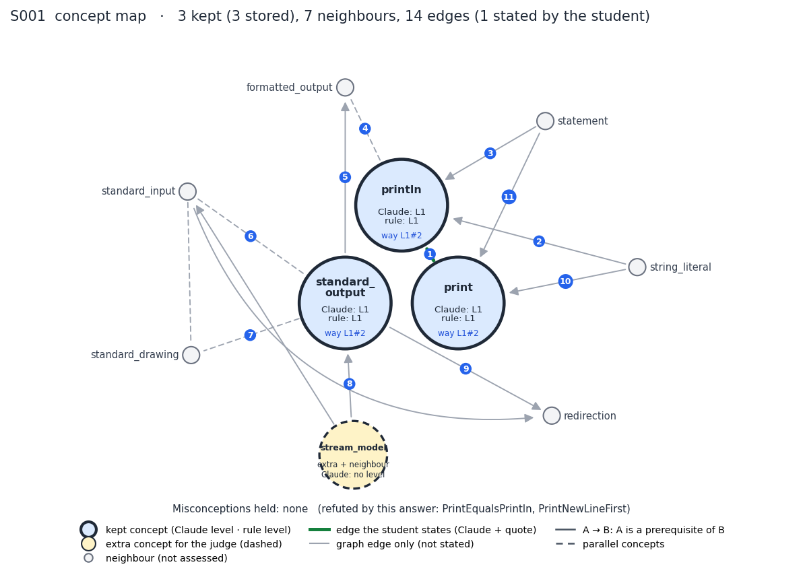

**Triples of the student's concept map** (subject, relation, object, with the logic of each):

| # | Subject | Relation | Object | Logic |
| --- | --- | --- | --- | --- |
| has_level | println | has_level | println@L1 | println@L1#2: println(String x) behaves as though it calls print(x) and then println(); println() terminates the current line by writing the line separator string. |
| misconception (refuted) | println | misconception | PrintNewLineFirst | the answer refuted this wrong rule |
| misconception (refuted) | println | misconception | PrintEqualsPrintln | the answer refuted this wrong rule |
| has_level | standard_output | has_level | standard_output@L1 | standard_output@L1#2: print(s) writes s. println(s) writes s and then the line separator. println() only ends the line. A null String prints as "null". By default the stream goes to... |
| misconception (refuted) | standard_output | misconception | PrintEqualsPrintln | the answer refuted this wrong rule |
| has_level | print | has_level | print@L1 | print@L1#2: print(String s) prints the string (or "null" for a null reference); print(int) etc. print the value's string form; no line terminator is written. |
| edge 1 | print | parallel | println | print leaves the cursor on the same line after printing; println moves the cursor to the next line after printing. — **stated by the student**: "println adds a newline after the text and print does not." |
| edge 2 | string_literal | prerequisite | println | println("s") outputs exactly the characters between the quotes and then ends the line. — graph only: the answer does not state it |
| edge 3 | statement | prerequisite | println | System.out.println(s); is itself a statement, so its line of output appears at its own place in the sequence. — graph only: the answer does not state it |
| edge 4 | println | parallel | formatted_output | println prints each number with all its digits and ends the line; printf formats each value by its conversion code and starts a new line only when \n is in the format string. — graph only: the answer does not state it |
| edge 5 | standard_output | prerequisite | formatted_output | printf writes to standard output, like print, but formats each value first. — graph only: the answer does not state it |
| edge 6 | standard_input | parallel | standard_output | StdIn takes values in from the input stream; StdOut sends values out to the output stream. — graph only: not checked (a neighbour) |
| edge 7 | standard_output | parallel | standard_drawing | StdOut writes text to the output stream; StdDraw draws shapes at (x, y) coordinates in a window. — graph only: not checked (a neighbour) |
| edge 8 | stream_model | prerequisite | standard_output | StdOut writes a stream: each print appends its text to the end of the output. — graph only: the answer does not state it |
| edge 9 | standard_output | prerequisite | redirection | > file sends everything written to standard output into the file instead of the screen. — graph only: not checked (a neighbour) |
| edge 10 | string_literal | prerequisite | print | print("s") outputs exactly the characters between the quotes, without the quotes. — graph only: the answer does not state it |
| edge 11 | statement | prerequisite | print | System.out.print(s); is itself a statement, so it runs at its own place in the sequence of statements. — graph only: the answer does not state it |


### S002 · final L1 · reference L1

**Question:** What is the exact output, including line breaks? Explain how you got it.

```java
System.out.print("Welcome to Java. This is ");
System.out.println("A nice programming language ");
System.out.print("that I have to learn.");
```

**Student answer:** Welcome to Java. This is A nice programming language that I have to learn.

**Concept scoring and shortlist.** 64 of the 173 concepts scored above 0. Every concept scoring at least 1.0 is shortlisted, best first, top 8; Claude then chooses which of them the answer is about.

| Rank | Concept | Link score | Filter result |
| --- | --- | --- | --- |
| 1 | println | 1.33 | **shortlisted** |
| 2 | method_call | 1.10 | **shortlisted** |
| 3 | statement | 1.02 | **shortlisted** |
| 4 | empty_statement | 1.00 | **shortlisted** |
| 5 | standard_output | 1.00 | **shortlisted** |
| 6 | print | 1.00 | **shortlisted** |
| 7 | break_statement | 1.00 | **shortlisted** |
| 8 | string_literal | 1.00 | **shortlisted** |
| 9 | escape_sequences | 0.62 | not shortlisted: below 1.0 |
| 10 | primitive_vs_reference | 0.62 | not shortlisted: below 1.0 |
| 11 | stream_model | 0.61 | not shortlisted: below 1.0 |

**Extra concept:** stream_model (Claude: no level).

**Sent to Claude:** println, method_call, statement, empty_statement, standard_output, print, break_statement, string_literal, stream_model.

**Claude chose:** println, print.

**What happened to each shortlisted concept:**

- println: stored; Claude L1
- method_call: no graph evidence and no level from Claude; not stored
- statement: no graph evidence and no level from Claude; not stored
- empty_statement: no graph evidence and no level from Claude; not stored
- standard_output: no graph evidence and no level from Claude; not stored
- print: no graph evidence; Claude L1; reported, not stored
- break_statement: no graph evidence and no level from Claude; not stored
- string_literal: no graph evidence and no level from Claude; not stored

**Claude's verdict, traced to the graph's edge logic:**

| Concept | Claude level | Way id | Edge logic of that way |
| --- | --- | --- | --- |
| println | L1 | println@L2#2 | Output is the value's characters followed by a line break: println("Hello, "); println("World!"); prints two lines. |
| print | L1 | print@L2#2 | Output is exactly the characters of the value (a string literal without its quotes, a number in decimal) and nothing else: print("Goodbye, "); println("cruel world"); prints Goodbye, cruel world on one line. |

**Graph edge logic of the levelled concepts** (has_level, misconception and error edges Claude was shown):

| Concept | Edge | Edge logic |
| --- | --- | --- |
| println | println → println@L1 (has_level) | println -> L1 (Unistructural): the answer states one correct rule without applying it (2 ways). |
| println | println → ParenthesesOnlyIfArgument (misconception) | wrong rule: println with nothing to print can be written System.out.println; without the parentheses. / right rule: A method call always needs parentheses, so an empty line is printed with System.out.println();. |
| println | println → PrintEqualsPrintln (misconception) | wrong rule: print and println do the same thing, so print(s1); print(s2); puts s1 and s2 on separate lines. / right rule: println ends the line after printing and print does not, so print(s1); print(s2); puts s1 and s2 on the same line. |
| println | println → IdentifierCaseInsensitive (misconception) | wrong rule: System.out.Println and System.out.println name the same method. / right rule: Java is case-sensitive: names of variables, methods and classes that differ only in capitalization are different names. |
| println | println → PrintWithoutFinalNewline (error) | wrong rule: Ends the output with print and expects it to appear right away. / right rule: Finish a line of print calls with println; some systems hold print output until a newline is printed. |
| print | print → print@L1 (has_level) | print -> L1 (Unistructural): the answer states one correct rule without applying it (2 ways). |
| print | print → ParenthesesOnlyIfArgument (misconception) | wrong rule: println with nothing to print can be written System.out.println; without the parentheses. / right rule: A method call always needs parentheses, so an empty line is printed with System.out.println();. |
| print | print → PrintWithoutFinalNewline (error) | wrong rule: Ends the output with print and expects it to appear right away. / right rule: Finish a line of print calls with println; some systems hold print output until a newline is printed. |
| print | print → RepeatedOutputVariablePrintedOnce (misconception) | wrong rule: An output statement that names the same variable twice (WRITE y, x, y) prints it only once. / right rule: Each expression in the output list is printed, so a repeated variable prints its value each time. |

**Claude's overall level:** L1 (main concept println). The student gives the correct output, with the line break after the println text, but does not explain how they got it, so it counts as a bare correct result (L1).

| Step | What happened |
| --- | --- |
| Step 1. Gates | Gates: none. |
| Step 2. Score every concept | 64 of 173 scored above 0. Shortlisted: println = 1.33; method_call = 1.10; statement = 1.02; empty_statement = 1.00; standard_output = 1.00; print = 1.00; break_statement = 1.00; string_literal = 1.00. |
| Step 3. Shortlist and Claude's choice | Top 8 at 1.0 or above: println, method_call, statement, empty_statement, standard_output, print, break_statement, string_literal. Claude chose: println, print. |
| Step 4. Concept map | 1 stored + 4 neighbours. Stored: println. |
| Step 5. Run the code | No value to check. |
| Step 6. LLM judge | Claude gives println L1; method_call no level; statement no level; empty_statement no level; standard_output no level; print L1; break_statement no level; string_literal no level; stream_model no level; overall L1. |
| Step 7. Final level | max_level, the highest level among the stored concepts (L0 if one holds a wrong rule) = L1; Claude's overall level was L1. Final L1 (reference L1). |

**Trace of the student's concept map:**

| Node | Role | Evidence traced from the answer | Rule level | Claude level and level logic |
| --- | --- | --- | --- | --- |
| println | chosen, stored | E1 reference: "println: System.out.println -- output with a trailing newline" (0.483) | L1 | L1 via println@L2#2: L1 (Unistructural): the answer states one correct rule without applying it (2 ways). |
| print | chosen, not stored | - | - | L1 via print@L2#2: L1 (Unistructural): the answer states one correct rule without applying it (2 ways). |
| shortlisted, not chosen | not stored | method_call, statement, empty_statement, standard_output, break_statement, string_literal | - | Claude: none |
| neighbours | not assessed | string_literal, statement, formatted_output, print | - | - |

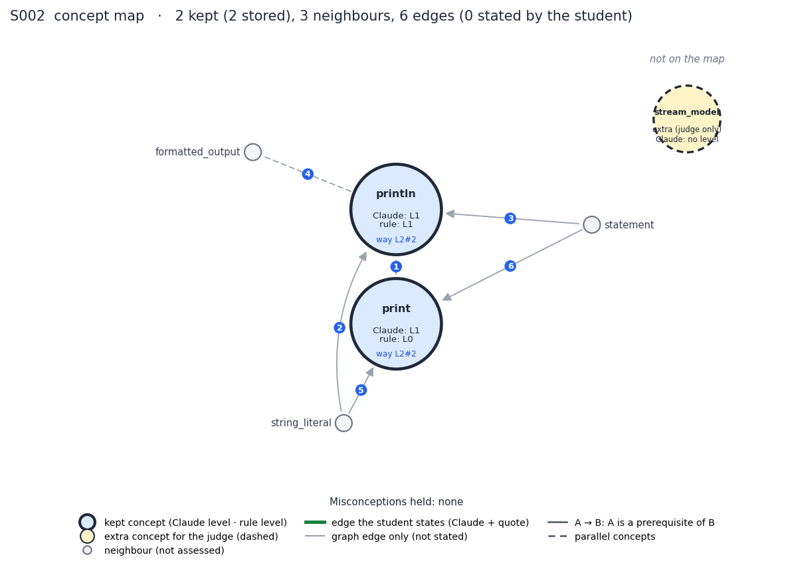

**Triples of the student's concept map** (subject, relation, object, with the logic of each):

| # | Subject | Relation | Object | Logic |
| --- | --- | --- | --- | --- |
| has_level | println | has_level | println@L1 | println@L2#2: Output is the value's characters followed by a line break: println("Hello, "); println("World!"); prints two lines. |
| edge 1 | print | parallel | println | print leaves the cursor on the same line after printing; println moves the cursor to the next line after printing. — graph only: the answer does not state it |
| edge 2 | string_literal | prerequisite | println | println("s") outputs exactly the characters between the quotes and then ends the line. — graph only: the answer does not state it |
| edge 3 | statement | prerequisite | println | System.out.println(s); is itself a statement, so its line of output appears at its own place in the sequence. — graph only: the answer does not state it |
| edge 4 | println | parallel | formatted_output | println prints each number with all its digits and ends the line; printf formats each value by its conversion code and starts a new line only when \n is in the format string. — graph only: not checked (a neighbour) |
| edge 5 | string_literal | prerequisite | print | print("s") outputs exactly the characters between the quotes, without the quotes. — graph only: the answer does not state it |
| edge 6 | statement | prerequisite | print | System.out.print(s); is itself a statement, so it runs at its own place in the sequence of statements. — graph only: the answer does not state it |


### S004 · final L1 · reference L1

**Question:** What is printed when x = 17? Explain.

```java
System.out.print("A");
if (x % 2 == 0) {
  System.out.print("B");
  if (x % 5 == 2) { System.out.print("C"); } else { System.out.print("D"); }
} else {
  if (x % 5 == 2) { System.out.print("E"); } else { System.out.print("F"); }
  System.out.print("G");
}
```

**Student answer:** It prints A, goes to the odd part and prints the letters there.

**Concept scoring and shortlist.** 36 of the 173 concepts scored above 0. Every concept scoring at least 1.0 is shortlisted, best first, top 8; Claude then chooses which of them the answer is about.

| Rank | Concept | Link score | Filter result |
| --- | --- | --- | --- |
| 1 | print | 2.17 | **shortlisted** |
| 2 | assignment | 1.24 | **shortlisted** |
| 3 | standard_output | 1.11 | **shortlisted** |
| 4 | arithmetic_operators | 1.00 | **shortlisted** |
| 5 | statement | 1.00 | **shortlisted** |
| 6 | string_literal | 1.00 | **shortlisted** |
| 7 | method_call | 1.00 | **shortlisted** |
| 8 | empty_statement | 1.00 | **shortlisted** |
| 9 | block | 1.00 | not shortlisted: only the top 8 are sent |
| 10 | remainder_operator | 1.00 | not shortlisted: only the top 8 are sent |
| 11 | if_statement | 1.00 | not shortlisted: only the top 8 are sent |

**Extra concept:** char_arithmetic (Claude: no level).

**Sent to Claude:** print, assignment, standard_output, arithmetic_operators, statement, string_literal, method_call, empty_statement, char_arithmetic.

**Claude chose:** print.

**What happened to each shortlisted concept:**

- print: stored; Claude L1
- assignment: Claude did not choose it (no level), so it is not stored
- standard_output: no graph evidence and no level from Claude; not stored
- arithmetic_operators: no graph evidence and no level from Claude; not stored
- statement: no graph evidence and no level from Claude; not stored
- string_literal: no graph evidence and no level from Claude; not stored
- method_call: no graph evidence and no level from Claude; not stored
- empty_statement: no graph evidence and no level from Claude; not stored

**Claude's verdict, traced to the graph's edge logic:**

| Concept | Claude level | Way id | Edge logic of that way |
| --- | --- | --- | --- |
| print | L1 | print@L1#1 | System.out.print(x) is a library method call (on the PrintStream System.out) that displays x in the terminal without ending the line. |

**Graph edge logic of the levelled concepts** (has_level, misconception and error edges Claude was shown):

| Concept | Edge | Edge logic |
| --- | --- | --- |
| print | print → print@L1 (has_level) | print -> L1 (Unistructural): the answer states one correct rule without applying it (2 ways). |
| print | print → ParenthesesOnlyIfArgument (misconception) | wrong rule: println with nothing to print can be written System.out.println; without the parentheses. / right rule: A method call always needs parentheses, so an empty line is printed with System.out.println();. |
| print | print → PrintWithoutFinalNewline (error) | wrong rule: Ends the output with print and expects it to appear right away. / right rule: Finish a line of print calls with println; some systems hold print output until a newline is printed. |
| print | print → RepeatedOutputVariablePrintedOnce (misconception) | wrong rule: An output statement that names the same variable twice (WRITE y, x, y) prints it only once. / right rule: Each expression in the output list is printed, so a repeated variable prints its value each time. |

**Claude's overall level:** L1 (main concept print). The answer gets the first output (A) and the odd branch right, but it never works out which letters that branch prints (E, then G), so it covers only one part of the output and gives no final result.

| Step | What happened |
| --- | --- |
| Step 1. Gates | Gates: none. |
| Step 2. Score every concept | 36 of 173 scored above 0. Shortlisted: print = 2.17; assignment = 1.24; standard_output = 1.11; arithmetic_operators = 1.00; statement = 1.00; string_literal = 1.00; method_call = 1.00; empty_statement = 1.00. |
| Step 3. Shortlist and Claude's choice | Top 8 at 1.0 or above: print, assignment, standard_output, arithmetic_operators, statement, string_literal, method_call, empty_statement. Claude chose: print. |
| Step 4. Concept map | 1 stored + 3 neighbours. Stored: print. |
| Step 5. Run the code | No value to check. |
| Step 6. LLM judge | Claude gives print L1; assignment no level; standard_output no level; arithmetic_operators no level; statement no level; string_literal no level; method_call no level; empty_statement no level; char_arithmetic no level; overall L1. |
| Step 7. Final level | max_level, the highest level among the stored concepts (L0 if one holds a wrong rule) = L1; Claude's overall level was L1. Final L1 (reference L1). |

**Trace of the student's concept map:**

| Node | Role | Evidence traced from the answer | Rule level | Claude level and level logic |
| --- | --- | --- | --- | --- |
| print | chosen, stored | E1 reference: "print: System.out.print -- output with no newline" (0.441) | L1 | L1 via print@L1#1: L1 (Unistructural): the answer states one correct rule without applying it (2 ways). |
| shortlisted, not chosen | not stored | assignment, standard_output, arithmetic_operators, statement, string_literal, method_call, empty_statement | - | Claude: none |
| neighbours | not assessed | statement, println, string_literal | - | - |

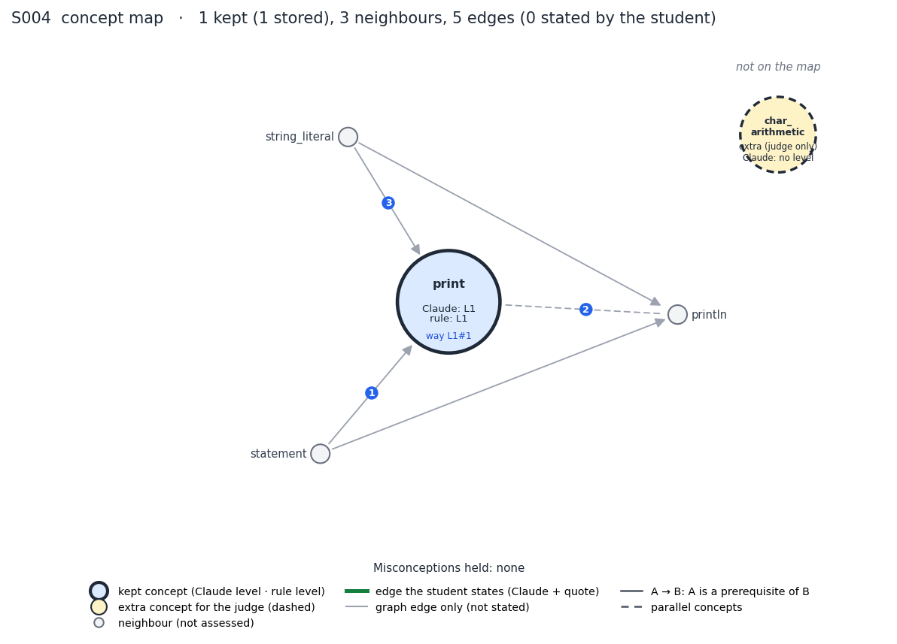

**Triples of the student's concept map** (subject, relation, object, with the logic of each):

| # | Subject | Relation | Object | Logic |
| --- | --- | --- | --- | --- |
| has_level | print | has_level | print@L1 | print@L1#1: System.out.print(x) is a library method call (on the PrintStream System.out) that displays x in the terminal without ending the line. |
| edge 1 | statement | prerequisite | print | System.out.print(s); is itself a statement, so it runs at its own place in the sequence of statements. — graph only: the answer does not state it |
| edge 2 | print | parallel | println | print leaves the cursor on the same line after printing; println moves the cursor to the next line after printing. — graph only: not checked (a neighbour) |
| edge 3 | string_literal | prerequisite | print | print("s") outputs exactly the characters between the quotes, without the quotes. — graph only: the answer does not state it |


### S005 · final L4 · reference L4

**Question:** What is the output? Explain. (b) What if i started at 61?

```java
int i = 81;
do {
  if (i % 2 == 1 && i != 73) {
    System.out.printf("%d ", i);
  }
  i--;
} while (i >= 70);
```

**Student answer:** With a while loop the output is the same here, because 81 >= 70 is true at the start; it would only differ if i started below 70.

**Concept scoring and shortlist.** 64 of the 173 concepts scored above 0. Every concept scoring at least 1.0 is shortlisted, best first, top 8; Claude then chooses which of them the answer is about.

| Rank | Concept | Link score | Filter result |
| --- | --- | --- | --- |
| 1 | while_loop | 4.83 | **shortlisted** |
| 2 | comparison_operators | 2.27 | **shortlisted** |
| 3 | if_statement | 1.61 | **shortlisted** |
| 4 | do_while_loop | 1.35 | **shortlisted** |
| 5 | loop_control | 1.34 | **shortlisted** |
| 6 | increment_operators | 1.30 | **shortlisted** |
| 7 | empty_statement | 1.28 | **shortlisted** |
| 8 | assignment | 1.25 | **shortlisted** |
| 9 | block | 1.21 | not shortlisted: only the top 8 are sent |
| 10 | short_circuit | 1.12 | not shortlisted: only the top 8 are sent |
| 11 | int | 1.04 | not shortlisted: only the top 8 are sent |

**Extra concept:** boolean_expression (Claude: no level).

**Sent to Claude:** while_loop, comparison_operators, if_statement, do_while_loop, loop_control, increment_operators, empty_statement, assignment, boolean_expression.

**Claude chose:** comparison_operators, do_while_loop.

**What happened to each shortlisted concept:**

- while_loop: Claude did not choose it (no level), so it is not stored
- comparison_operators: stored; Claude L2
- if_statement: Claude did not choose it (no level), so it is not stored
- do_while_loop: stored; Claude L4
- loop_control: Claude did not choose it (no level), so it is not stored
- increment_operators: Claude did not choose it (no level), so it is not stored
- empty_statement: no graph evidence and no level from Claude; not stored
- assignment: no graph evidence and no level from Claude; not stored

**Claude's verdict, traced to the graph's edge logic:**

| Concept | Claude level | Way id | Edge logic of that way |
| --- | --- | --- | --- |
| comparison_operators | L2 | comparison_operators@L2#2 | The result is a boolean: (2 <= 2) is true, 2 < 2 is false, (x < 3.1) is true for int x = 3; any comparison involving NaN, even NaN == NaN, is false. |
| do_while_loop | L4 | do_while_loop@L4#1 | Converting do-while to while keeps behaviour whenever the condition is true before the first pass, and breaks it (0 passes vs 1) when it is false. Moving the body's variables out of the block doesn't change the passes, but it is n... |

**Graph edge logic of the levelled concepts** (has_level, misconception and error edges Claude was shown):

| Concept | Edge | Edge logic |
| --- | --- | --- |
| comparison_operators | comparison_operators → comparison_operators@L2 (has_level) | comparison operators -> L2 (Multistructural): the answer applies the rules of comparison operators to every part of the code, in order (3 ways). |
| comparison_operators | comparison_operators → AssignCompares (misconception) | wrong rule: = compares two values instead of assigning / right rule: x = y copies the value of y into x; x == y is what compares them. |
| comparison_operators | comparison_operators → EqualsComparesReferences (misconception) | wrong rule: .equals() compares references, not contents / right rule: s.equals(t) checks whether the two Strings contain the same characters. |
| comparison_operators | comparison_operators → ComparisonWithBooleanLiteral (misconception) | wrong rule: you must write == true / == false to test a boolean / right rule: if (b) already tests b, so writing == true adds nothing. |
| comparison_operators | comparison_operators → ChainedComparison (misconception) | wrong rule: 90 <= grade <= 100 tests whether grade is between 90 and 100. / right rule: a < b < c does not compile (a < b is a boolean); a range test is written 90 <= grade && grade <= 100. |
| do_while_loop | do_while_loop → do_while_loop@L4 (has_level) | do while loop -> L4 (Extended abstract): the answer reasons beyond the given code (5 ways). |
| do_while_loop | do_while_loop → DoWhileTestsFirst (misconception) | wrong rule: A do-while whose condition starts false runs its body zero times. / right rule: The statements within the do block are always executed at least once. |

**Claude's overall level:** L4 (main concept do_while_loop). The student predicts what happens if the do-while becomes a while loop: the output stays the same because 81 >= 70 is true at the start, and the two loops would differ only when i starts below 70. This correctly reasons about changed code and a class of inputs. However, it never gives the actual output for i = 61, which is "61 ".

| Step | What happened |
| --- | --- |
| Step 1. Gates | Gates: none. |
| Step 2. Score every concept | 64 of 173 scored above 0. Shortlisted: while_loop = 4.83; comparison_operators = 2.27; if_statement = 1.61; do_while_loop = 1.35; loop_control = 1.34; increment_operators = 1.30; empty_statement = 1.28; assignment = 1.25. |
| Step 3. Shortlist and Claude's choice | Top 8 at 1.0 or above: while_loop, comparison_operators, if_statement, do_while_loop, loop_control, increment_operators, empty_statement, assignment. Claude chose: comparison_operators, do_while_loop. |
| Step 4. Concept map | 2 stored + 6 neighbours. Stored: comparison_operators, do_while_loop. |
| Step 5. Run the code | No value to check. |
| Step 6. LLM judge | Claude gives while_loop no level; comparison_operators L2; if_statement no level; do_while_loop L4; loop_control no level; increment_operators no level; empty_statement no level; assignment no level; boolean_expression no level; overall L4. |
| Step 7. Final level | max_level, the highest level among the stored concepts (L0 if one holds a wrong rule) = L4; Claude's overall level was L4. Final L4 (reference L4). |

**Trace of the student's concept map:**

| Node | Role | Evidence traced from the answer | Rule level | Claude level and level logic |
| --- | --- | --- | --- | --- |
| comparison_operators | chosen, stored | E1 reference: "comparison operators: == != < > <= >=" (0.467) | L1 | L2 via comparison_operators@L2#2: L2 (Multistructural): the answer applies the rules of comparison operators to every part of the code, in order... |
| do_while_loop | chosen, stored | E1 reference: "do while loop: do { body } while (c); -- body first, test after" (0.487); E3 integration: "edge do_while_loop - while_loop" (1.0) | L3 provisional | L4 via do_while_loop@L4#1: L4 (Extended abstract): the answer reasons beyond the given code (5 ways). |
| shortlisted, not chosen | not stored | while_loop, if_statement, loop_control, increment_operators, empty_statement, assignment | - | Claude: none |
| neighbours | not assessed | while_loop, boolean, expression, boolean_expression, logical_operators, assignment | - | - |

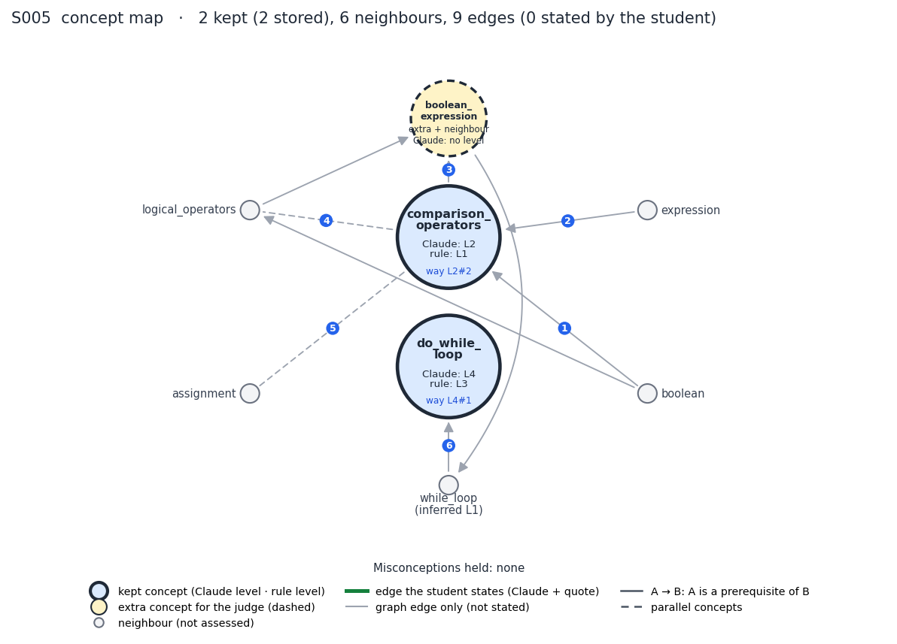

**Triples of the student's concept map** (subject, relation, object, with the logic of each):

| # | Subject | Relation | Object | Logic |
| --- | --- | --- | --- | --- |
| has_level | comparison_operators | has_level | comparison_operators@L2 | comparison_operators@L2#2: The result is a boolean: (2 <= 2) is true, 2 < 2 is false, (x < 3.1) is true for int x = 3; any comparison involving NaN, even NaN == NaN, is false. |
| has_level | do_while_loop | has_level | do_while_loop@L4 | do_while_loop@L4#1: Converting do-while to while keeps behaviour whenever the condition is true before the first pass, and breaks it (0 passes vs 1) when it is false. Moving the bo... |
| edge 1 | boolean | prerequisite | comparison_operators | A comparison such as a < b takes two numbers and produces a boolean result. — graph only: not checked (a neighbour) |
| edge 2 | expression | prerequisite | comparison_operators | Comparison operators build expressions whose value is a boolean, so one must already know what an expression is to understand a < b. — graph only: not checked (a neighbour) |
| edge 3 | comparison_operators | prerequisite | boolean_expression | A comparison such as x < y produces a boolean result; comparisons together with boolean logic provide the basis for decision-making. — graph only: the answer does not state it |
| edge 4 | comparison_operators | parallel | logical_operators | Relational operators compare two numbers to give a boolean; logical operators combine booleans into one boolean. — graph only: not checked (a neighbour) |
| edge 5 | assignment | parallel | comparison_operators | x = y stores the value of y in x (a statement with a side effect); x == y only tests whether the two values are equal and gives a boolean. Writing = where == is meant is a compile error with int operands and a silent bug with boolean operands. — graph only: the answer does not state it |
| edge 6 | while_loop | prerequisite | do_while_loop | do { body } while (c); is a while loop whose test is moved to the bottom. — graph only: the answer does not state it |


### S007 · final L2 · reference L0

**Question:** Give the exact output, including spacing and empty lines. Explain.

```java
for (int i = 3; i >= 0; i--) {
  for (int j = i; j > 0; j--) {
    System.out.printf("%d ", j);
  }
  System.out.println();
}
```

**Student answer:** 3 2 1 / 2 1 / 1" (no empty line at the end), "because the loop stops at 1.

**Concept scoring and shortlist.** 48 of the 173 concepts scored above 0. Every concept scoring at least 1.0 is shortlisted, best first, top 8; Claude then chooses which of them the answer is about.

| Rank | Concept | Link score | Filter result |
| --- | --- | --- | --- |
| 1 | integer_division | 2.00 | **shortlisted** |
| 2 | arithmetic_operators | 2.00 | **shortlisted** |
| 3 | expression | 2.00 | **shortlisted** |
| 4 | string_literal | 2.00 | **shortlisted** |
| 5 | int | 1.44 | **shortlisted** |
| 6 | loop_variable | 1.44 | **shortlisted** |
| 7 | nested_loops | 1.22 | **shortlisted** |
| 8 | block | 1.21 | **shortlisted** |
| 9 | loop_control | 1.03 | not shortlisted: only the top 8 are sent |
| 10 | for_loop | 1.00 | not shortlisted: only the top 8 are sent |
| 11 | increment_operators | 1.00 | not shortlisted: only the top 8 are sent |

**Extra concept:** convergence_test (Claude: no level).

**Sent to Claude:** integer_division, arithmetic_operators, expression, string_literal, int, loop_variable, nested_loops, block, convergence_test.

**Claude chose:** loop_variable, nested_loops.

**What happened to each shortlisted concept:**

- integer_division: Claude did not choose it (no level), so it is not stored
- arithmetic_operators: Claude did not choose it (no level), so it is not stored
- expression: Claude did not choose it (no level), so it is not stored
- string_literal: Claude did not choose it (no level), so it is not stored
- int: Claude did not choose it (no level), so it is not stored
- loop_variable: stored; Claude L2
- nested_loops: stored; Claude L2
- block: Claude did not choose it (no level), so it is not stored

**Claude's verdict, traced to the graph's edge logic:**

| Concept | Claude level | Way id | Edge logic of that way |
| --- | --- | --- | --- |
| loop_variable | L2 | loop_variable@L2#2 | Across passes the loop variable takes a predictable sequence of values, e.g. 4, 5, ..., 10 in TenHellos, and after a while loop it holds the first value that failed the test (11). |
| nested_loops | L2 | nested_loops@L2#2 | The inner body runs (outer passes) x (inner passes) times: two loops of 1..10 call printf 100 times; DivisorPattern 3 prints 3 rows of 3 entries, each row ending with its row number. |

**Graph edge logic of the levelled concepts** (has_level, misconception and error edges Claude was shown):

| Concept | Edge | Edge logic |
| --- | --- | --- |
| loop_variable | loop_variable → loop_variable@L2 (has_level) | loop variable -> L2 (Multistructural): the answer applies the rules of loop variable to every part of the code, in order (3 ways). |
| loop_variable | loop_variable → LoopVariableLifetimeScope (misconception) | wrong rule: The for variable i is a new variable on every pass rather than one variable changed by the update. / right rule: The for variable i is created once by the init, and the update changes that same variable on every pass. |
| loop_variable | loop_variable → DoubleLoopIndexCount (misconception) | wrong rule: for (double x = 0.0; x <= 1.0; x += 0.1) runs exactly 11 times. / right rule: Using a double as a for-loop index is legal but bad practice: the number of iterations depends on an equality test between double values, which may not give the... |
| loop_variable | loop_variable → ForInitRepeats (misconception) | wrong rule: The initialization of a for loop runs again after a pass of the body. / right rule: The initialization runs exactly once, before the first condition test. |
| loop_variable | loop_variable → LoopUpdateChangesDirection (misconception) | wrong rule: The update of the loop variable can change from pass to pass (e.g. switch direction) although the code is the same. / right rule: The update expression is the same on every pass; the loop variable changes by the rule written in the update. |
| nested_loops | nested_loops → nested_loops@L2 (has_level) | nested loops -> L2 (Multistructural): the answer applies the rules of nested loops to every part of the code, in order (3 ways). |
| nested_loops | nested_loops → NestedLoopsSequential (misconception) | wrong rule: The outer loop runs completely, then the inner loop runs completely. / right rule: The inner loop runs all its passes during each single pass of the outer loop. |
| nested_loops | nested_loops → InnerOuterSwapped (misconception) | wrong rule: The inner loop's variable changes more slowly than the outer loop's. / right rule: The inner loop runs all its passes for each single pass of the outer loop. |
| nested_loops | nested_loops → InconsistentIndentation (misconception) | wrong rule: Indents nested blocks inconsistently, so the visual nesting differs from the real nesting. / right rule: Indent consistently, one level deeper for each nested block, so the layout shows the real nesting; the compiler ignores indentation. |
| nested_loops | nested_loops → BracelessMultiStatementBody (error) | wrong rule: Indenting several statements under an if or for makes them all part of its body, even without braces. / right rule: Without braces only the first statement belongs to the if/for; the rest run once, after it. |

**Claude's overall level:** L2 (main concept nested_loops). The student gets the values in every printed row right, but the prediction is wrong in two places: it leaves out the empty line printed on the last outer pass (i = 0), because the student says the loop 'stops at 1', and it drops the space after each number.

| Step | What happened |
| --- | --- |
| Step 1. Gates | Gates: none. |
| Step 2. Score every concept | 48 of 173 scored above 0. Shortlisted: integer_division = 2.00; arithmetic_operators = 2.00; expression = 2.00; string_literal = 2.00; int = 1.44; loop_variable = 1.44; nested_loops = 1.22; block = 1.21. |
| Step 3. Shortlist and Claude's choice | Top 8 at 1.0 or above: integer_division, arithmetic_operators, expression, string_literal, int, loop_variable, nested_loops, block. Claude chose: loop_variable, nested_loops. |
| Step 4. Concept map | 2 stored + 6 neighbours. Stored: loop_variable, nested_loops. |
| Step 5. Run the code | No value to check. |
| Step 6. LLM judge | Claude gives integer_division no level; arithmetic_operators no level; expression no level; string_literal no level; int no level; loop_variable L2; nested_loops L2; block no level; convergence_test no level; overall L2. |
| Step 7. Final level | max_level, the highest level among the stored concepts (L0 if one holds a wrong rule) = L2; Claude's overall level was L2. Final L2 (reference L0). |

**Trace of the student's concept map:**

| Node | Role | Evidence traced from the answer | Rule level | Claude level and level logic |
| --- | --- | --- | --- | --- |
| loop_variable | chosen, stored | E1 reference: "loop variable: the counter that drives the loop" (0.49) | L1 | L2 via loop_variable@L2#2: L2 (Multistructural): the answer applies the rules of loop variable to every part of the code, in order (3 way... |
| nested_loops | chosen, stored | E1 reference: "nested loops: a loop inside a loop" (0.456) | L1 | L2 via nested_loops@L2#2: L2 (Multistructural): the answer applies the rules of nested loops to every part of the code, in order (3 ways... |
| shortlisted, not chosen | not stored | integer_division, arithmetic_operators, expression, string_literal, int, block | - | Claude: none |
| neighbours | not assessed | loop_control, while_loop, for_loop, row_major_order, matrix_operations, labeled_break | - | - |

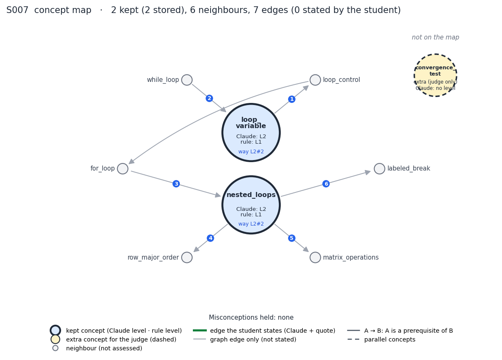

**Triples of the student's concept map** (subject, relation, object, with the logic of each):

| # | Subject | Relation | Object | Logic |
| --- | --- | --- | --- | --- |
| has_level | loop_variable | has_level | loop_variable@L2 | loop_variable@L2#2: Across passes the loop variable takes a predictable sequence of values, e.g. 4, 5, ..., 10 in TenHellos, and after a while loop it holds the first value that fa... |
| has_level | nested_loops | has_level | nested_loops@L2 | nested_loops@L2#2: The inner body runs (outer passes) x (inner passes) times: two loops of 1..10 call printf 100 times; DivisorPattern 3 prints 3 rows of 3 entries, each row endin... |
| edge 1 | loop_variable | prerequisite | loop_control | The init, condition and update all act on the loop variable: the init sets it, the condition tests it, the update changes it. — graph only: not checked (a neighbour) |
| edge 2 | while_loop | prerequisite | loop_variable | A loop variable is a counter that the loop initializes, tests in its condition and increments on each pass. — graph only: not checked (a neighbour) |
| edge 3 | for_loop | prerequisite | nested_loops | In nested loops the inner for runs its complete set of passes for every single pass of the outer for. — graph only: not checked (a neighbour) |
| edge 4 | nested_loops | prerequisite | row_major_order | Which loop is outside decides whether the entries are processed row by row or column by column. — graph only: not checked (a neighbour) |
| edge 5 | nested_loops | prerequisite | matrix_operations | Matrix addition uses two nested loops over i and j, and matrix multiplication adds a third inner loop over k to compute each dot product c[i][j]. — graph only: not checked (a neighbour) |
| edge 6 | nested_loops | prerequisite | labeled_break | A labeled break is needed only when a loop is nested inside another and the inner loop must end the outer one. — graph only: not checked (a neighbour) |


### S008 · final L2 · reference L2

**Question:** What is the output? Trace i, num1 and num2. (b) Rewrite it with a for loop.

```java
int num = 8, num1 = num + 1, num2 = num1 + 3;
int i = num;
do {
  if (i != num1 && i != num2) {
    System.out.printf("%d, ", i);
  } else {
    num2--;
  }
  i++;
} while (i < 14);
```

**Student answer:** num1 is 9 and num2 starts at 12. At i = 9 num2 drops to 11; at i = 11 it drops to 10. So it prints 8, 10, 12, 13,

**Concept scoring and shortlist.** 47 of the 173 concepts scored above 0. Every concept scoring at least 1.0 is shortlisted, best first, top 8; Claude then chooses which of them the answer is about.

| Rank | Concept | Link score | Filter result |
| --- | --- | --- | --- |
| 1 | assignment | 2.12 | **shortlisted** |
| 2 | increment_operators | 1.50 | **shortlisted** |
| 3 | formatted_output | 1.33 | **shortlisted** |
| 4 | standard_output | 1.30 | **shortlisted** |
| 5 | arithmetic_operators | 1.14 | **shortlisted** |
| 6 | print | 1.10 | **shortlisted** |
| 7 | loop_control | 1.00 | **shortlisted** |
| 8 | while_loop | 1.00 | **shortlisted** |
| 9 | statement | 1.00 | not shortlisted: only the top 8 are sent |
| 10 | if_statement | 1.00 | not shortlisted: only the top 8 are sent |
| 11 | int | 1.00 | not shortlisted: only the top 8 are sent |

**Extra concept:** number_conversion (Claude: no level).

**Sent to Claude:** assignment, increment_operators, formatted_output, standard_output, arithmetic_operators, print, loop_control, while_loop, number_conversion.

**Claude chose:** assignment, increment_operators, formatted_output, while_loop.

**What happened to each shortlisted concept:**

- assignment: stored; Claude L2
- increment_operators: stored; Claude L2
- formatted_output: stored; Claude L2
- standard_output: Claude did not choose it (no level), so it is not stored
- arithmetic_operators: Claude did not choose it (no level), so it is not stored
- print: Claude did not choose it (no level), so it is not stored
- loop_control: no graph evidence and no level from Claude; not stored
- while_loop: no graph evidence; Claude L2; reported, not stored

**Claude's verdict, traced to the graph's edge logic:**

| Concept | Claude level | Way id | Edge logic of that way |
| --- | --- | --- | --- |
| assignment | L2 | assignment@L2#1 | First the right-hand side is fully evaluated using the variables' current values (left to right). Then that value is stored in the left-hand variable, replacing its old value, and execution moves to the next statement. |
| increment_operators | L2 | increment_operators@L2#1 | i++: fetch the value of i (that is the expression's value), then store i + 1 into i. ++i: store i + 1 into i, and the new value is the expression's value. Both happen before the rest of the enclosing expression continues. |
| formatted_output | L2 | formatted_output@L2#2 | The output is the formatted text. printf("%7.5f", Math.PI) gives 3.14159, printf("PI is approximately %.2f\n", Math.PI) gives `PI is approximately 3.14` and a newline, and printf("%5d", 42) gives ` 42`. Rounding is half-up. |
| while_loop | L2 | while_loop@L2#1 | 1. Evaluate the condition. 2. If false, skip the body and continue after the loop. 3. If true, execute the whole body, then go back to step 1. |

**Graph edge logic of the levelled concepts** (has_level, misconception and error edges Claude was shown):

| Concept | Edge | Edge logic |
| --- | --- | --- |
| assignment | assignment → assignment@L2 (has_level) | assignment -> L2 (Multistructural): the answer applies the rules of assignment to every part of the code, in order (3 ways). |
| assignment | assignment → VariablesHoldExpressions (misconception) | wrong rule: y = x + k; makes y always equal to x + k, so when x changes later, y changes too. / right rule: y = x + k; stores the value that x + k has at that moment, so later changes to x do not change y. |
| assignment | assignment → AssignCompares (misconception) | wrong rule: x = y checks whether x and y are equal. / right rule: x = y copies the value of y into x; x == y is what compares them. |
| assignment | assignment → AssignmentNotExpression (misconception) | wrong rule: An assignment cannot be used inside a larger expression, so a condition like (x = read()) != v is not allowed. / right rule: An assignment is an expression whose value is the value assigned, so (x = v) both stores v in x and gives v. |
| assignment | assignment → SwapWithoutTemp (misconception) | wrong rule: a[i] = a[j]; a[j] = a[i]; exchanges the two values. / right rule: A temporary variable must save a[i] before it is overwritten. |
| increment_operators | increment_operators → increment_operators@L2 (has_level) | increment operators -> L2 (Multistructural): the answer applies the rules of increment operators to every part of the code, in order (3 ways). |
| increment_operators | increment_operators → PreIncrementBeforeLoop (misconception) | wrong rule: ++i in the for-update runs before the body each pass / right rule: The update runs after each pass of the body, so with either ++i or i++ the first pass uses i = s. |
| increment_operators | increment_operators → PostIncrementAssignsLater (misconception) | wrong rule: i = i++ increases i by 1. / right rule: i++ evaluates to the old value, so i = i++ stores the old value back. |
| increment_operators | increment_operators → PrePostIncrementSameValue (misconception) | wrong rule: x = i++ and x = ++i store the same value in x. / right rule: Both increment i, but ++i has the value after the increment and i++ the value before. |
| increment_operators | increment_operators → IdiomOverridesCode (misconception) | wrong rule: An array loop processes the whole array from index 0 to length-1 and increments its index at the end of the body, whatever the code says. / right rule: The loop visits exactly the indices that its initialisation, guard and update produce, in the order in which its statements are written. |
| formatted_output | formatted_output → formatted_output@L2 (has_level) | formatted output -> L2 (Multistructural): the answer applies the rules of formatted output to every part of the code, in order (3 ways). |
| formatted_output | formatted_output → PrintfAnyConversion (misconception) | wrong rule: Any conversion code (%d, %f, %s) works with any argument type. / right rule: Each conversion code must match its argument's type (any type works with %s); %d with a double or %f with an int throws an IllegalFormatConversionException at r... |
| formatted_output | formatted_output → FieldWidthIsIntegerDigits (misconception) | wrong rule: %2.4f prints two digits before the decimal point and four after. / right rule: The number before the point is the width of the whole field; %7.2f means 7 characters in total with 2 digits after the decimal point. |
| formatted_output | formatted_output → PrintfAddsNewline (misconception) | wrong rule: printf() ends the line like println(). / right rule: printf() does not add a newline; put \n in the format string to end the line. |
| formatted_output | formatted_output → ManyDigitsMeanAccurate (misconception) | wrong rule: A result printed with many decimal places must be accurate to those places. / right rule: A program does not produce accurate answers simply because it can print numbers to many decimal places of precision; ensuring accuracy is often the most difficu... |
| while_loop | while_loop → while_loop@L2 (has_level) | while loop -> L2 (Multistructural): the answer applies the rules of while loop to every part of the code, in order (3 ways). |
| while_loop | while_loop → IfIsLoop (misconception) | wrong rule: A while loop runs its body once when the condition is true, just like an if. / right rule: A while tests its condition again after every pass and keeps repeating while the condition stays true. |
| while_loop | while_loop → LoopTerminatingCondition (misconception) | wrong rule: For and while loops end when the condition becomes true. / right rule: A for or while loop ends when its condition becomes false. |
| while_loop | while_loop → WhileStopsMidBody (misconception) | wrong rule: The loop stops the moment the condition becomes false, even in the middle of the body. / right rule: The condition is tested only before each pass, so the whole body finishes before the loop can stop. |
| while_loop | while_loop → SemicolonAfterIfHeader (error) | wrong rule: if (x > 0); System.out.println("positive"); prints only for positive x. / right rule: The ; ends the if with an empty statement, so the next line always runs. |

**Claude's overall level:** L2 (main concept while_loop). The student follows the do-while loop with the real values: num1 = 9, num2 = 12, num2 drops at i = 9 and at i = 11, and the output is 8, 10, 12, 13. All of this matches the run, but it is a value-by-value trace that never says what the loop is for, and part (b), the for-loop rewrite, is not answered.

| Step | What happened |
| --- | --- |
| Step 1. Gates | Gates: none. |
| Step 2. Score every concept | 47 of 173 scored above 0. Shortlisted: assignment = 2.12; increment_operators = 1.50; formatted_output = 1.33; standard_output = 1.30; arithmetic_operators = 1.14; print = 1.10; loop_control = 1.00; while_loop = 1.00. |
| Step 3. Shortlist and Claude's choice | Top 8 at 1.0 or above: assignment, increment_operators, formatted_output, standard_output, arithmetic_operators, print, loop_control, while_loop. Claude chose: assignment, increment_operators, formatted_output, while_loop. |
| Step 4. Concept map | 3 stored + 12 neighbours. Stored: assignment, increment_operators, formatted_output. |
| Step 5. Run the code | confirmed by the run: i = 9; confirmed by the run: i = 11; confirmed by the run: prints 8 10 12 13; confirmed by the run: num1 = 9 (final) |
| Step 6. LLM judge | Claude gives assignment L2; increment_operators L2; formatted_output L2; standard_output no level; arithmetic_operators no level; print no level; loop_control no level; while_loop L2; number_conversion no level; overall L2. |
| Step 7. Final level | max_level, the highest level among the stored concepts (L0 if one holds a wrong rule) = L2; Claude's overall level was L2. Final L2 (reference L2). |

**Trace of the student's concept map:**

| Node | Role | Evidence traced from the answer | Rule level | Claude level and level logic |
| --- | --- | --- | --- | --- |
| assignment | chosen, stored | E1 reference: "assignment: = stores the computed value of the right side" (0.291); E2 execution: "confirmed by the run: i = 9" (1.0) | L2 provisional | L2 via assignment@L2#1: L2 (Multistructural): the answer applies the rules of assignment to every part of the code, in order (3 ways). |
| increment_operators | chosen, stored | E1 reference: "increment operators: ++ / -- (and +=)" (0.494); E2 execution: "confirmed by the run: i = 9" (1.0) | L2 provisional | L2 via increment_operators@L2#1: L2 (Multistructural): the answer applies the rules of increment operators to every part of the code, in order... |
| formatted_output | chosen, stored | E1 reference: "formatted output: printf with a format string such as %d, %.2f, %s" (0.483); E2 execution: "confirmed by the run: prints 8 10 12 13" (1.0) | L2 provisional | L2 via formatted_output@L2#2: L2 (Multistructural): the answer applies the rules of formatted output to every part of the code, in order (3... |
| while_loop | chosen, not stored | - | - | L2 via while_loop@L2#1: L2 (Multistructural): the answer applies the rules of while loop to every part of the code, in order (3 ways). |
| shortlisted, not chosen | not stored | standard_output, arithmetic_operators, print, loop_control | - | Claude: none |
| neighbours | not assessed | variable, declaration, loop_control, standard_output, program_trace, array_exchange, chained_assignment, variable_swap, compound_assignment, comparison_operators, side_effect_order, println | - | - |

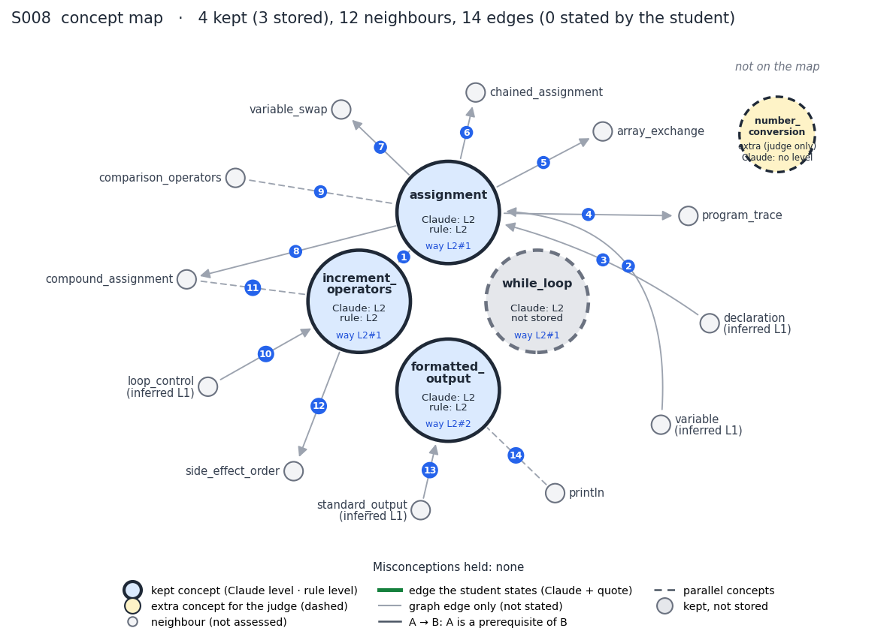

**Triples of the student's concept map** (subject, relation, object, with the logic of each):

| # | Subject | Relation | Object | Logic |
| --- | --- | --- | --- | --- |
| has_level | assignment | has_level | assignment@L2 | assignment@L2#1: First the right-hand side is fully evaluated using the variables' current values (left to right). Then that value is stored in the left-hand variable, replacing... |
| has_level | increment_operators | has_level | increment_operators@L2 | increment_operators@L2#1: i++: fetch the value of i (that is the expression's value), then store i + 1 into i. ++i: store i + 1 into i, and the new value is the expression's value. Both... |
| has_level | formatted_output | has_level | formatted_output@L2 | formatted_output@L2#2: The output is the formatted text. printf("%7.5f", Math.PI) gives 3.14159, printf("PI is approximately %.2f\n", Math.PI) gives `PI is approximately 3.14` and a n... |
| edge 1 | assignment | prerequisite | increment_operators | i++ is shorthand for the assignment i = i + 1. — graph only: the answer does not state it |
| edge 2 | variable | prerequisite | assignment | Assignment needs a declared variable on its left side to store the computed value into. — graph only: not checked (a neighbour) |
| edge 3 | declaration | prerequisite | assignment | A variable must be declared before an assignment can store a value into it. — graph only: not checked (a neighbour) |
| edge 4 | assignment | prerequisite | program_trace | A trace records the value each variable holds after each assignment statement runs. — graph only: not checked (a neighbour) |
| edge 5 | assignment | prerequisite | array_exchange | The exchange is three assignments in a fixed order through a temporary variable. — graph only: not checked (a neighbour) |
| edge 6 | assignment | prerequisite | chained_assignment | An assignment such as x = y is treated as an expression: it assigns the value of y to x and evaluates to that value. — graph only: not checked (a neighbour) |
| edge 7 | assignment | prerequisite | variable_swap | The three assignments int t = a; a = b; b = t; exchange the values of a and b, as a trace of the variable values after each statement shows. — graph only: not checked (a neighbour) |
| edge 8 | assignment | prerequisite | compound_assignment | x op= e is shorthand for the assignment x = x op e. — graph only: not checked (a neighbour) |
| edge 9 | assignment | parallel | comparison_operators | x = y stores the value of y in x (a statement with a side effect); x == y only tests whether the two values are equal and gives a boolean. Writing = where == is meant is a compile error with int operands and a silent bug with boolean operands. — graph only: not checked (a neighbour) |
| edge 10 | loop_control | prerequisite | increment_operators | The loop update i = i + 1 comes first; ++ (and +=) are then introduced as shorthand for that update. — graph only: the answer does not state it |
| edge 11 | increment_operators | parallel | compound_assignment | i++, ++i and i += 1 all add 1 to i; ++ and -- change a variable only by one and are normally used for integers, while i += k works for any amount and with any arithmetic operator (-=, *=, /=, %=). — graph only: not checked (a neighbour) |
| edge 12 | increment_operators | prerequisite | side_effect_order | The result depends on the value an increment expression evaluates to. — graph only: not checked (a neighbour) |
| edge 13 | standard_output | prerequisite | formatted_output | printf writes to standard output, like print, but formats each value first. — graph only: the answer does not state it |
| edge 14 | println | parallel | formatted_output | println prints each number with all its digits and ends the line; printf formats each value by its conversion code and starts a new line only when \n is in the format string. — graph only: not checked (a neighbour) |


### S009 · final L3 · reference L4

**Question:** Assign 7.9 to the next-to-last position without hard-coding the index.

```java
(writing task) double array sensorReadings already exists
```

**Student answer:** sensorReadings[sensorReadings.length - 2] = 7.9; — the last index is length - 1, so next-to-last is length - 2.

**Concept scoring and shortlist.** 53 of the 173 concepts scored above 0. Every concept scoring at least 1.0 is shortlisted, best first, top 8; Claude then chooses which of them the answer is about.

| Rank | Concept | Link score | Filter result |
| --- | --- | --- | --- |
| 1 | double | 4.00 | **shortlisted** |
| 2 | length_field | 3.57 | **shortlisted** |
| 3 | expression | 3.18 | **shortlisted** |
| 4 | arithmetic_operators | 3.00 | **shortlisted** |
| 5 | indexing | 2.37 | **shortlisted** |
| 6 | assignment | 1.00 | **shortlisted** |
| 7 | primitive_type | 1.00 | **shortlisted** |
| 8 | array_bounds | 0.84 | not shortlisted: below 1.0 |
| 9 | two_dimensional_array | 0.45 | not shortlisted: below 1.0 |
| 10 | ragged_array | 0.45 | not shortlisted: below 1.0 |

**Extra concept:** array_bounds (Claude: L1).

**Sent to Claude:** double, length_field, expression, arithmetic_operators, indexing, assignment, primitive_type, array_bounds.

**Claude chose:** length_field, indexing.

**What happened to each shortlisted concept:**

- double: Claude did not choose it (no level), so it is not stored
- length_field: stored; Claude L3
- expression: Claude did not choose it (no level), so it is not stored
- arithmetic_operators: Claude did not choose it (no level), so it is not stored
- indexing: stored; Claude L2
- assignment: no graph evidence and no level from Claude; not stored
- primitive_type: no graph evidence and no level from Claude; not stored

**Claude's verdict, traced to the graph's edge logic:**

| Concept | Claude level | Way id | Edge logic of that way |
| --- | --- | --- | --- |
| length_field | L3 | length_field@L3#3 | Plan/role: a fixed value (Sajaniemi) that lets code adapt to any array size instead of a hard-coded magic number, e.g. loop bounds and the last element. |
| indexing | L2 | indexing@L2#3 | State transition: reading a[i] changes nothing. a[i] = v changes only element i (i, a and all other elements are unchanged), and a[i]++ adds 1 to that one element. |
| array_bounds | L1 | array_bounds@L1#1 | Identity: the bounds of an array are its legal index range, 0 to length-1. |

**Graph edge logic of the levelled concepts** (has_level, misconception and error edges Claude was shown):

| Concept | Edge | Edge logic |
| --- | --- | --- |
| length_field | length_field → length_field@L3 (has_level) | length field -> L3 (Relational): the answer relates the parts (3 ways). |
| length_field | length_field → ArrayHasLengthMethod (misconception) | wrong rule: The size of an array is found by calling a.length(). / right rule: An array's size is the field a.length, written without parentheses. |
| length_field | length_field → ArrayLengthCannotBeZero (misconception) | wrong rule: An array cannot have length 0. / right rule: new int[0] is a legal array of length 0. |
| indexing | indexing → indexing@L2 (has_level) | indexing -> L2 (Multistructural): the answer applies the rules of indexing to every part of the code, in order (3 ways). |
| indexing | indexing → IndexIsValue (misconception) | wrong rule: i and a[i] are the same thing, so the position is the stored value. / right rule: i is a position; a[i] is the value stored at that position. |
| indexing | indexing → ArrayIndexStartsAtOne (misconception) | wrong rule: The first element of a is a[1]. / right rule: Numbering begins with 0; the first element is a[0]. |
| indexing | indexing → ArrayRangeInclusive (misconception) | wrong rule: new int[n] has slots 0 to n, inclusive. / right rule: The slots are 0 to n - 1. |
| indexing | indexing → ArrayAccessWithParentheses (misconception) | wrong rule: a(i) accesses element i of an array. / right rule: Array elements are accessed with square brackets, a[i]. |
| array_bounds | array_bounds → array_bounds@L1 (has_level) | array bounds -> L1 (Unistructural): the answer states one correct rule without applying it (2 ways). |
| array_bounds | array_bounds → OutOfBoundsElementsAreNull (misconception) | wrong rule: Reading a[a.length] just gives null or 0. / right rule: Reading any index outside 0 to a.length - 1 throws ArrayIndexOutOfBoundsException. |
| array_bounds | array_bounds → OffByOneBound (misconception) | wrong rule: < vs <= and 0..n vs 0..n-1 are interchangeable / right rule: for (i = 0; i < n; i++) runs n times with i going up to n - 1; with <= it runs n + 1 times and reaches i = n. |

**Claude's overall level:** L3 (main concept length_field). The student uses sensorReadings.length - 2 so the code works for any array size instead of a hard-coded index, and gives a reason: the last index is length - 1. That is the purpose of the length field, so L3.

| Step | What happened |
| --- | --- |
| Step 1. Gates | Gates: none. |
| Step 2. Score every concept | 53 of 173 scored above 0. Shortlisted: double = 4.00; length_field = 3.57; expression = 3.18; arithmetic_operators = 3.00; indexing = 2.37; assignment = 1.00; primitive_type = 1.00. |
| Step 3. Shortlist and Claude's choice | Top 8 at 1.0 or above: double, length_field, expression, arithmetic_operators, indexing, assignment, primitive_type. Claude chose: length_field, indexing. |
| Step 4. Concept map | 2 stored + 8 neighbours. Stored: length_field, indexing. |
| Step 5. Run the code | No value to check. |
| Step 6. LLM judge | Claude gives double no level; length_field L3; expression no level; arithmetic_operators no level; indexing L2; assignment no level; primitive_type no level; array_bounds L1; overall L3. |
| Step 7. Final level | max_level, the highest level among the stored concepts (L0 if one holds a wrong rule) = L3; Claude's overall level was L3. Final L3 (reference L4). |

**Trace of the student's concept map:**

| Node | Role | Evidence traced from the answer | Rule level | Claude level and level logic |
| --- | --- | --- | --- | --- |
| length_field | chosen, stored | E1 reference: "length field: a.length is a field, not a method" (0.371) | L1 | L3 via length_field@L3#3: L3 (Relational): the answer relates the parts (3 ways). |
| indexing | chosen, stored | E1 reference: "indexing: a[i] -- 0-based access" (0.491) | L1 | L2 via indexing@L2#3: L2 (Multistructural): the answer applies the rules of indexing to every part of the code, in order (3 ways). |
| shortlisted, not chosen | not stored | double, expression, arithmetic_operators, assignment, primitive_type | - | Claude: none |
| neighbours | not assessed | array_creation, args_length, array_exchange, array_bounds, lookup_table, off_by_one_error, array_traversal, two_dimensional_array | - | - |

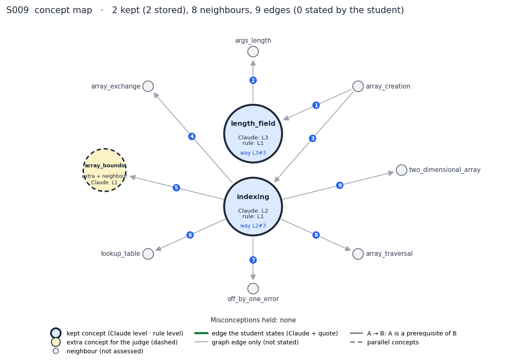

**Triples of the student's concept map** (subject, relation, object, with the logic of each):

| # | Subject | Relation | Object | Logic |
| --- | --- | --- | --- | --- |
| has_level | length_field | has_level | length_field@L3 | length_field@L3#3: Plan/role: a fixed value (Sajaniemi) that lets code adapt to any array size instead of a hard-coded magic number, e.g. loop bounds and the last element. |
| has_level | indexing | has_level | indexing@L2 | indexing@L2#3: State transition: reading a[i] changes nothing. a[i] = v changes only element i (i, a and all other elements are unchanged), and a[i]++ adds 1 to that one eleme... |
| edge 1 | array_creation | prerequisite | length_field | The size n given to new becomes a.length and stays fixed for the array's lifetime. — graph only: not checked (a neighbour) |
| edge 2 | length_field | prerequisite | args_length | args is an ordinary String array, so args.length is its length field and counts the command-line arguments. — graph only: not checked (a neighbour) |
| edge 3 | array_creation | prerequisite | indexing | An array must be created with new before any of its elements a[i] can be accessed. — graph only: not checked (a neighbour) |
| edge 4 | indexing | prerequisite | array_exchange | An exchange reads and writes a[i] and a[j] by index. — graph only: not checked (a neighbour) |
| edge 5 | indexing | prerequisite | array_bounds | Valid indexes run from 0 to a.length - 1; any other index throws an exception when it is used. — graph only: the answer does not state it |
| edge 6 | indexing | prerequisite | lookup_table | A lookup table is read by index, a[i]. — graph only: not checked (a neighbour) |
| edge 7 | indexing | prerequisite | off_by_one_error | Indices start at 0, so the last element is a[N-1]; misreading this convention is the usual source of off-by-one errors. — graph only: not checked (a neighbour) |
| edge 8 | indexing | prerequisite | array_traversal | A traversal uses the loop variable i as the index, so a[i] reaches a different element on each pass. — graph only: not checked (a neighbour) |
| edge 9 | indexing | prerequisite | two_dimensional_array | A 1-D array uses one index a[i]; a 2-D array uses two, a[i][j], where the first index chooses the row array. — graph only: not checked (a neighbour) |


### S010 · final L0 · reference L0

**Question:** Make an exact copy of data2 (no System.arraycopy).

```java
(writing task) int array data2 already exists
```

**Student answer:** for (int i = 0; i <= data2.length; i++) copy[i] = data2[i];

**Concept scoring and shortlist.** 83 of the 173 concepts scored above 0. Every concept scoring at least 1.0 is shortlisted, best first, top 8; Claude then chooses which of them the answer is about.

| Rank | Concept | Link score | Filter result |
| --- | --- | --- | --- |
| 1 | int | 4.21 | **shortlisted** |
| 2 | length_field | 3.88 | **shortlisted** |
| 3 | for_loop | 3.60 | **shortlisted** |
| 4 | increment_operators | 3.35 | **shortlisted** |
| 5 | array_copy | 3.10 | **shortlisted** |
| 6 | off_by_one_error | 3.02 | **shortlisted** |
| 7 | primitive_type | 3.00 | **shortlisted** |
| 8 | loop_control | 2.98 | **shortlisted** |
| 9 | assignment | 2.80 | not shortlisted: only the top 8 are sent |
| 10 | array_aliasing | 2.62 | not shortlisted: only the top 8 are sent |
| 11 | indexing | 2.17 | not shortlisted: only the top 8 are sent |

**Extra concept:** array_aliasing (Claude: no level).

**Sent to Claude:** int, length_field, for_loop, increment_operators, array_copy, off_by_one_error, primitive_type, loop_control, array_aliasing.

**Claude chose:** length_field, for_loop, array_copy, off_by_one_error, loop_control.

**What happened to each shortlisted concept:**

- int: Claude did not choose it (no level), so it is not stored
- length_field: stored; Claude L0
- for_loop: stored; Claude L2
- increment_operators: Claude did not choose it (no level), so it is not stored
- array_copy: stored; Claude L2
- off_by_one_error: stored; Claude L0
- primitive_type: Claude did not choose it (no level), so it is not stored
- loop_control: stored; Claude L0

**Claude's verdict, traced to the graph's edge logic:**

| Concept | Claude level | Way id | Edge logic of that way |
| --- | --- | --- | --- |
| length_field | L0 | length_field@L0#1 | Folk meaning: 'length' is something you ask for, like s.length() for a String, and in everyday counting 'length 10' suggests the last item is number 10. Java rule: a.length is a final field written without parentheses, equal to th... |
| for_loop | L2 | for_loop@L2#1 | Run the initializer once; then repeatedly: test the condition (stop if false), execute the body, run the update. |
| array_copy | L2 | array_copy@L2#1 | Sequencing: new creates the second array first, then the loop copies a[0], a[1], ... in order into b[0], b[1], ...; after the loop, a and b are separate arrays with equal elements. |
| off_by_one_error | L0 | off_by_one_error@L0#2 | wrong rule: < and <= (and 0..n versus 0..n-1) are interchangeable in a loop bound. Right rule: i < N runs N times from 0 and i <= N runs N+1 times; with an array of length N only i < N stays inside the indices 0..N-1. |
| loop_control | L0 | loop_control@L0#3 | wrong rule: < vs <= and 0..n vs 0..n-1 are interchangeable. Right rule: for (i = 0; i < n; i++) runs n times with i going up to n - 1; with <= it runs n + 1 times and reaches i = n. |

**Graph edge logic of the levelled concepts** (has_level, misconception and error edges Claude was shown):

| Concept | Edge | Edge logic |
| --- | --- | --- |
| length_field | length_field → length_field@L0 (has_level) | length field -> L0 (Prestructural): the answer holds a rule that contradicts Java (4 ways). |
| length_field | length_field → ArrayHasLengthMethod (misconception) | wrong rule: The size of an array is found by calling a.length(). / right rule: An array's size is the field a.length, written without parentheses. |
| length_field | length_field → ArrayLengthCannotBeZero (misconception) | wrong rule: An array cannot have length 0. / right rule: new int[0] is a legal array of length 0. |
| for_loop | for_loop → for_loop@L2 (has_level) | for loop -> L2 (Multistructural): the answer applies the rules of for loop to every part of the code, in order (3 ways). |
| for_loop | for_loop → ForIsConditional (misconception) | wrong rule: The body of a for statement executes at most once. / right rule: The body of a for statement runs once for every pass on which the condition is true, which can be many times. |
| for_loop | for_loop → SemicolonAfterIfHeader (error) | wrong rule: if (x > 0); System.out.println("positive"); prints only for positive x. / right rule: The ; ends the if with an empty statement, so the next line always runs. |
| for_loop | for_loop → MissingBraces (misconception) | wrong rule: Omits braces around a single-statement body of if, for or while. / right rule: Braces are optional for a single-statement body, but using them anyway avoids bugs when statements are added later. |
| for_loop | for_loop → WrongIterationCount (error) | wrong rule: Updates the loop counter so that the loop runs the wrong number of times. / right rule: The init, test and update together decide the number of passes; trace them to check the count. |
| array_copy | array_copy → array_copy@L2 (has_level) | array copy -> L2 (Multistructural): the answer applies the rules of array copy to every part of the code, in order (3 ways). |
| array_copy | array_copy → AssignmentCopiesObject (misconception) | wrong rule: assigning a reference copies the object / right rule: b = a; copies only the reference, so a and b refer to the same array and b[i] = v also changes a[i]. |
| array_copy | array_copy → ArrayEqualityComparesValues (misconception) | wrong rule: a == b is true when a and b hold the same values. / right rule: == compares whether the two arrays are the same array, not whether their values are equal. |
| off_by_one_error | off_by_one_error → off_by_one_error@L0 (has_level) | off by one error -> L0 (Prestructural): the answer holds a rule that contradicts Java (3 ways). |
| off_by_one_error | off_by_one_error → OffByOneBound (misconception) | wrong rule: < vs <= and 0..n vs 0..n-1 are interchangeable / right rule: for (i = 0; i < n; i++) runs n times with i going up to n - 1; with <= it runs n + 1 times and reaches i = n. |
| off_by_one_error | off_by_one_error → DoubleLoopIndexCount (misconception) | wrong rule: for (double x = 0.0; x <= 1.0; x += 0.1) runs exactly 11 times. / right rule: Using a double as a for-loop index is legal but bad practice: the number of iterations depends on an equality test between double values, which may not give the... |
| off_by_one_error | off_by_one_error → WrongIterationCount (error) | wrong rule: Updates the loop counter so that the loop runs the wrong number of times. / right rule: The init, test and update together decide the number of passes; trace them to check the count. |
| off_by_one_error | off_by_one_error → FencepostExtraSeparator (error) | wrong rule: Prints item and separator together in the loop, leaving an extra separator at the end. / right rule: Handle one item outside the loop so n items get n - 1 separators. |
| loop_control | loop_control → loop_control@L0 (has_level) | loop control -> L0 (Prestructural): the answer holds a rule that contradicts Java (12 ways). |
| loop_control | loop_control → PreIncrementBeforeLoop (misconception) | wrong rule: With ++i in the update of for (int i = s; i < n; ++i), i is increased before the body runs, so the first pass uses s + 1. / right rule: The update runs after each pass of the body, so with either ++i or i++ the first pass uses i = s. |
| loop_control | loop_control → OffByOneBound (misconception) | wrong rule: i < n and i <= n mean the same, so the loop runs until i equals n and the last pass can use a[n]. / right rule: for (i = 0; i < n; i++) runs n times with i going up to n - 1; with <= it runs n + 1 times and reaches i = n. |
| loop_control | loop_control → WrongIterationCount (error) | wrong rule: Updates the loop counter so that the loop runs the wrong number of times. / right rule: The init, test and update together decide the number of passes; trace them to check the count. |
| loop_control | loop_control → InfiniteLoopUnnoticed (misconception) | wrong rule: A while loop always stops on its own, even if nothing in its body can make the condition false. / right rule: A while loop stops only when its condition is false at a check, so if no pass changes the variables in the condition, it never stops. |

**Claude's overall level:** L2 (main concept array_copy). The student copies the array one element at a time in a loop, which is the right approach, but the code has two faults: i <= data2.length goes one index too far and throws ArrayIndexOutOfBoundsException, and copy is never created with new int[data2.length].

| Step | What happened |
| --- | --- |
| Step 1. Gates | Gates: none. |
| Step 2. Score every concept | 83 of 173 scored above 0. Shortlisted: int = 4.21; length_field = 3.88; for_loop = 3.60; increment_operators = 3.35; array_copy = 3.10; off_by_one_error = 3.02; primitive_type = 3.00; loop_control = 2.98. |
| Step 3. Shortlist and Claude's choice | Top 8 at 1.0 or above: int, length_field, for_loop, increment_operators, array_copy, off_by_one_error, primitive_type, loop_control. Claude chose: length_field, for_loop, array_copy, off_by_one_error, loop_control. |
| Step 4. Concept map | 5 stored + 15 neighbours. Stored: length_field, for_loop, array_copy, off_by_one_error, loop_control. |
| Step 5. Run the code | No value to check. |
| Step 6. LLM judge | Claude gives int no level; length_field L0; for_loop L2; increment_operators no level; array_copy L2; off_by_one_error L0; primitive_type no level; loop_control L0; array_aliasing no level; overall L2. |
| Step 7. Final level | max_level, the highest level among the stored concepts (L0 if one holds a wrong rule) = L0; Claude's overall level was L2. Final L0 (reference L0). |

**Trace of the student's concept map:**

| Node | Role | Evidence traced from the answer | Rule level | Claude level and level logic |
| --- | --- | --- | --- | --- |
| length_field | chosen, stored | E1 reference: "length field: a.length is a field, not a method" (0.62); E2 execution: "In 'for (int i = 0; i < a.length; i++)' it is re-read at each test." (0.62) | L2 provisional | L0 via length_field@L0#1: L0 (Prestructural): the answer holds a rule that contradicts Java (4 ways). |
| for_loop | chosen, stored | E1 reference: "for loop: a while with init/condition/update packaged together" (0.636); E2 execution: "A for statement has no value; the passes it makes are fixed by its hea..." (0.636) | L2 provisional | L2 via for_loop@L2#1: L2 (Multistructural): the answer applies the rules of for loop to every part of the code, in order (3 ways). |
| array_copy | chosen, stored | E1 reference: "array copy: making a second, independent array with the same elements:..." (0.676) | L1 | L2 via array_copy@L2#1: L2 (Multistructural): the answer applies the rules of array copy to every part of the code, in order (3 ways). |
| off_by_one_error | chosen, stored | E1 reference: "off by one error: a loop or index that runs one time too many or too f..." (0.654); E2 execution: "Indices run from 0 to N-1; a loop for (int i = 0; i < N; i++) runs exa..." (0.654) | L2 provisional | L0 via off_by_one_error@L0#2: L0 (Prestructural): the answer holds a rule that contradicts Java (3 ways). |
| loop_control | chosen, stored | E1 reference: "loop control: the three slots: init ; condition ; update" (0.633); E2 execution: "for (i = 0; i < n; i++) runs n times with i going up to n - 1; with <=..." (0.633) | L2 provisional | L0 via loop_control@L0#3: L0 (Prestructural): the answer holds a rule that contradicts Java (12 ways). |
| shortlisted, not chosen | not stored | int, increment_operators, primitive_type | - | Claude: none |
| neighbours | not assessed | array_creation, indexing, loop_variable, args_length, flag_search_loop, nested_loops, simulation_loop, loop_scope, array_traversal, fencepost_loop, continue_statement, array_aliasing, loop_performance, infinite_loop, increment_operators | - | - |

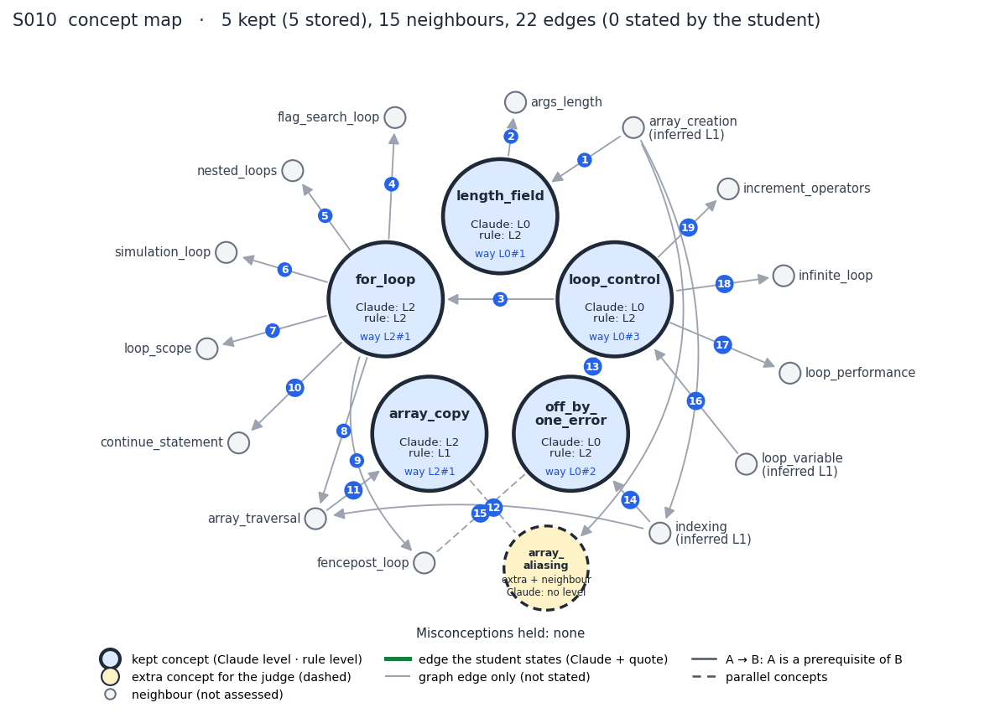

**Triples of the student's concept map** (subject, relation, object, with the logic of each):

| # | Subject | Relation | Object | Logic |
| --- | --- | --- | --- | --- |
| has_level | length_field | has_level | length_field@L0 | length_field@L0#1: Folk meaning: 'length' is something you ask for, like s.length() for a String, and in everyday counting 'length 10' suggests the last item is number 10. Java ru... |
| has_level | for_loop | has_level | for_loop@L2 | for_loop@L2#1: Run the initializer once; then repeatedly: test the condition (stop if false), execute the body, run the update. |
| has_level | array_copy | has_level | array_copy@L2 | array_copy@L2#1: Sequencing: new creates the second array first, then the loop copies a[0], a[1], ... in order into b[0], b[1], ...; after the loop, a and b are separate arrays... |
| has_level | off_by_one_error | has_level | off_by_one_error@L0 | off_by_one_error@L0#2: wrong rule: < and <= (and 0..n versus 0..n-1) are interchangeable in a loop bound. Right rule: i < N runs N times from 0 and i <= N runs N+1 times; with an arra... |
| has_level | loop_control | has_level | loop_control@L0 | loop_control@L0#3: wrong rule: < vs <= and 0..n vs 0..n-1 are interchangeable. Right rule: for (i = 0; i < n; i++) runs n times with i going up to n - 1; with <= it runs n + 1 tim... |
| edge 1 | array_creation | prerequisite | length_field | The size n given to new becomes a.length and stays fixed for the array's lifetime. — graph only: not checked (a neighbour) |
| edge 2 | length_field | prerequisite | args_length | args is an ordinary String array, so args.length is its length field and counts the command-line arguments. — graph only: not checked (a neighbour) |
| edge 3 | loop_control | prerequisite | for_loop | The for header is exactly the three control slots, and the body runs after the test and before the update on each pass. — graph only: the answer does not state it |
| edge 4 | for_loop | prerequisite | flag_search_loop | A flag search loop sets a boolean flag inside a loop when a pass finds the condition, and leaves it set afterwards. — graph only: not checked (a neighbour) |
| edge 5 | for_loop | prerequisite | nested_loops | In nested loops the inner for runs its complete set of passes for every single pass of the outer for. — graph only: not checked (a neighbour) |
| edge 6 | for_loop | prerequisite | simulation_loop | The simulation is a for loop over t = 0 ... T - 1 that makes one random move per pass. — graph only: not checked (a neighbour) |
| edge 7 | for_loop | prerequisite | loop_scope | A variable declared in the for header exists only from its declaration to the end of the for statement's block. — graph only: not checked (a neighbour) |
| edge 8 | for_loop | prerequisite | array_traversal | for (int i = 0; i < a.length; i++) gives i every valid index exactly once, in increasing order. — graph only: not checked (a neighbour) |
| edge 9 | for_loop | prerequisite | fencepost_loop | A fencepost loop is a for loop with one item handled outside it. — graph only: not checked (a neighbour) |
| edge 10 | for_loop | prerequisite | continue_statement | continue skips the rest of the loop body; in a for loop control goes straight to the increment statement and then the next test. — graph only: not checked (a neighbour) |
| edge 11 | array_traversal | prerequisite | array_copy | The elements are copied one at a time by a loop over every index. — graph only: not checked (a neighbour) |
| edge 12 | array_copy | parallel | array_aliasing | b = a makes a second name for the same array (an alias); copying makes a second array: after a copy, changing b[i] leaves a[i] unchanged. — graph only: the answer does not state it |
| edge 13 | loop_control | prerequisite | off_by_one_error | The initialization and the condition of a loop fix how many times it runs; one wrong bound makes it run once too many or too few. — graph only: the answer does not state it |
| edge 14 | indexing | prerequisite | off_by_one_error | Indices start at 0, so the last element is a[N-1]; misreading this convention is the usual source of off-by-one errors. — graph only: not checked (a neighbour) |
| edge 15 | off_by_one_error | parallel | fencepost_loop | An off-by-one error is a loop that runs once too many or too few; a fencepost loop is the correct plan for the case that needs one action more than the other. — graph only: not checked (a neighbour) |
| edge 16 | loop_variable | prerequisite | loop_control | The init, condition and update all act on the loop variable: the init sets it, the condition tests it, the update changes it. — graph only: not checked (a neighbour) |
| edge 17 | loop_control | prerequisite | loop_performance | The loop condition decides how many iterations run, so a better test (i <= n/i instead of i < n) makes the program much faster. — graph only: not checked (a neighbour) |
| edge 18 | loop_control | prerequisite | infinite_loop | A loop is infinite when its update never moves the condition towards false. — graph only: not checked (a neighbour) |
| edge 19 | loop_control | prerequisite | increment_operators | The loop update i = i + 1 comes first; ++ (and +=) are then introduced as shorthand for that update. — graph only: the answer does not state it |


### S012 · final none · reference none

**Question:** Show three different statements that add 1 to count and store the result in count.

```java
(writing task) int variable count already exists
```

**Student answer:** Is count++ the same as count += 1?

**Gate:** no_claim. The message makes no claim to assess, so no concepts are scored, Claude is not called and the level is none.


### S013 · final L3 · reference L4

**Question:** Rewrite this if-else as one line using the conditional operator.

```java
if (inValue >= 0) {
  outputValue = 100;
} else {
  outputValue = -50;
}
```

**Student answer:** outputValue = (inValue >= 0) ? 100 : -50;

**Concept scoring and shortlist.** 65 of the 173 concepts scored above 0. Every concept scoring at least 1.0 is shortlisted, best first, top 8; Claude then chooses which of them the answer is about.

| Rank | Concept | Link score | Filter result |
| --- | --- | --- | --- |
| 1 | conditional_operator | 3.18 | **shortlisted** |
| 2 | statement | 2.61 | **shortlisted** |
| 3 | assignment | 2.49 | **shortlisted** |
| 4 | comparison_operators | 2.38 | **shortlisted** |
| 5 | if_else_statement | 2.17 | **shortlisted** |
| 6 | expression | 1.61 | **shortlisted** |
| 7 | if_statement | 1.58 | **shortlisted** |
| 8 | array_aliasing | 1.29 | **shortlisted** |
| 9 | arithmetic_operators | 1.17 | not shortlisted: only the top 8 are sent |
| 10 | block | 1.02 | not shortlisted: only the top 8 are sent |
| 11 | print | 0.56 | not shortlisted: below 1.0 |

**Extra concept:** filter (Claude: no level).

**Sent to Claude:** conditional_operator, statement, assignment, comparison_operators, if_else_statement, expression, if_statement, array_aliasing, filter.

**Claude chose:** conditional_operator.

**What happened to each shortlisted concept:**

- conditional_operator: no graph evidence; Claude L3; reported, not stored
- statement: Claude did not choose it (no level), so it is not stored
- assignment: Claude did not choose it (no level), so it is not stored
- comparison_operators: Claude did not choose it (no level), so it is not stored
- if_else_statement: no graph evidence and no level from Claude; not stored
- expression: Claude did not choose it (no level), so it is not stored
- if_statement: Claude did not choose it (no level), so it is not stored
- array_aliasing: Claude did not choose it (no level), so it is not stored

**Claude's verdict, traced to the graph's edge logic:**

| Concept | Claude level | Way id | Edge logic of that way |
| --- | --- | --- | --- |
| conditional_operator | L3 | conditional_operator@L3#1 | `v = c ? a : b;` is the expression form of `if (c) v = a; else v = b;`. It can be used inside a larger expression (an argument or concatenation), but it cannot replace an if-else whose branches are statements without values. |

**Graph edge logic of the levelled concepts** (has_level, misconception and error edges Claude was shown):

| Concept | Edge | Edge logic |
| --- | --- | --- |
| conditional_operator | conditional_operator → conditional_operator@L3 (has_level) | conditional operator -> L3 (Relational): the answer relates the parts (2 ways). |
| conditional_operator | conditional_operator → MapToBooleanWithConditionalOperator (misconception) | wrong rule: you need ? : to do the same / right rule: ok = (x > y); already gives the boolean, so the ? : is unnecessary. |

**Claude's overall level:** L3 (main concept conditional_operator). The rewrite correctly turns the whole if-else into its expression form: the single assignment `outputValue = ...` is taken out of both branches, the condition becomes the first operand, the then-value becomes the second and the else-value the third, so the conditional operator is related to the if-else it replaces.

| Step | What happened |
| --- | --- |
| Step 1. Gates | Gates: none. |
| Step 2. Score every concept | 65 of 173 scored above 0. Shortlisted: conditional_operator = 3.18; statement = 2.61; assignment = 2.49; comparison_operators = 2.38; if_else_statement = 2.17; expression = 1.61; if_statement = 1.58; array_aliasing = 1.29. |
| Step 3. Shortlist and Claude's choice | Top 8 at 1.0 or above: conditional_operator, statement, assignment, comparison_operators, if_else_statement, expression, if_statement, array_aliasing. Claude chose: conditional_operator. |
| Step 4. Concept map | 0 stored + 0 neighbours. Stored: none. |
| Step 5. Run the code | the student's code runs; it changes no variable |
| Step 6. LLM judge | Claude gives conditional_operator L3; statement no level; assignment no level; comparison_operators no level; if_else_statement no level; expression no level; if_statement no level; array_aliasing no level; filter no level; overall L3. |
| Step 7. Final level | max_level, the highest level among the stored concepts (L0 if one holds a wrong rule) = L3; Claude's overall level was L3. Final L3 (reference L4). |

**Trace of the student's concept map:**

| Node | Role | Evidence traced from the answer | Rule level | Claude level and level logic |
| --- | --- | --- | --- | --- |
| conditional_operator | chosen, not stored | - | - | L3 via conditional_operator@L3#1: L3 (Relational): the answer relates the parts (2 ways). |
| shortlisted, not chosen | not stored | statement, assignment, comparison_operators, if_else_statement, expression, if_statement, array_aliasing | - | Claude: none |

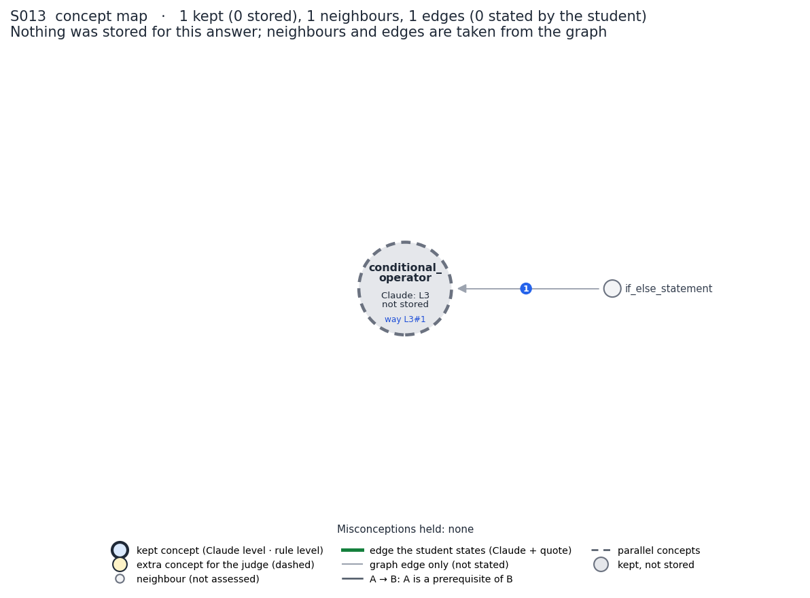

**Triples of the student's concept map** (subject, relation, object, with the logic of each):

| # | Subject | Relation | Object | Logic |
| --- | --- | --- | --- | --- |
| edge 1 | if_else_statement | prerequisite | conditional_operator | c ? a : b is the expression form of if (c) ... else .... — graph only: the answer does not state it |


### S014 · final L1 · reference L1

**Question:** Which values of p and q make p && q true? Which make p \|\| q false? Explain.

```java
(boolean variables p and q exist)
```

**Student answer:** p && q is true only when both are true; p \|\| q is false only when both are false.

**Concept scoring and shortlist.** 17 of the 173 concepts scored above 0. Every concept scoring at least 1.0 is shortlisted, best first, top 8; Claude then chooses which of them the answer is about.

| Rank | Concept | Link score | Filter result |
| --- | --- | --- | --- |
| 1 | logical_operators | 5.86 | **shortlisted** |
| 2 | short_circuit | 4.74 | **shortlisted** |
| 3 | primitive_type | 2.00 | **shortlisted** |
| 4 | control_flow | 1.66 | **shortlisted** |
| 5 | boolean | 1.43 | **shortlisted** |
| 6 | variable | 1.00 | **shortlisted** |
| 7 | comparison_operators | 0.49 | not shortlisted: below 1.0 |
| 8 | loop_guard | 0.49 | not shortlisted: below 1.0 |
| 9 | exclusive_or | 0.47 | not shortlisted: below 1.0 |

**Extra concept:** if_else_statement (Claude: no level).

**Sent to Claude:** logical_operators, short_circuit, primitive_type, control_flow, boolean, variable, if_else_statement.

**Claude chose:** logical_operators.

**What happened to each shortlisted concept:**

- logical_operators: stored; Claude L1
- short_circuit: Claude did not choose it (no level), so it is not stored
- primitive_type: no graph evidence and no level from Claude; not stored
- control_flow: Claude did not choose it (no level), so it is not stored
- boolean: no graph evidence and no level from Claude; not stored
- variable: no graph evidence and no level from Claude; not stored

**Claude's verdict, traced to the graph's edge logic:**

| Concept | Claude level | Way id | Edge logic of that way |
| --- | --- | --- | --- |
| logical_operators | L1 | logical_operators@L1#2 | a && b is true if both operands are true and false otherwise; a \|\| b is false if both are false and true otherwise; !a is the opposite of a; these definitions are given in full by truth tables. |

**Graph edge logic of the levelled concepts** (has_level, misconception and error edges Claude was shown):

| Concept | Edge | Edge logic |
| --- | --- | --- |
| logical_operators | logical_operators → logical_operators@L1 (has_level) | logical operators -> L1 (Unistructural): the answer states one correct rule without applying it (2 ways). |
| logical_operators | logical_operators → NoSingleLogicAnd (misconception) | wrong rule: & only works on bits, so p & q cannot be used with booleans. / right rule: Java also has a & operator, which the book does not use; logical and is written &&. |
| logical_operators | logical_operators → BooleanPrecedence (misconception) | wrong rule: a \|\| b && c is evaluated left to right as (a \|\| b) && c. / right rule: && binds tighter than \|\|, so it is a \|\| (b && c). |
| logical_operators | logical_operators → NestedIfsInsteadOfLogicalOperators (misconception) | wrong rule: A condition on several values has to be written as nested if statements, one value per if. / right rule: Several conditions combine into one boolean expression with && and \|\|, e.g. if (x == 0 && y == 0). |
| logical_operators | logical_operators → SingleAmpersandForAnd (misconception) | wrong rule: & and \| are the same as && and \|\| for conditions, so either can be used. / right rule: && and \|\| skip the right operand when the left decides the result; & and \| always evaluate both, which fails when the right side depends on the left (e.g. x !=... |

**Claude's overall level:** L1 (main concept logical_operators). The answer correctly gives the truth-table rule for && and \|\| (true only when both are true; false only when both are false), but it only states the rule and does not explain or work through the four value combinations.

| Step | What happened |
| --- | --- |
| Step 1. Gates | Gates: none. |
| Step 2. Score every concept | 17 of 173 scored above 0. Shortlisted: logical_operators = 5.86; short_circuit = 4.74; primitive_type = 2.00; control_flow = 1.66; boolean = 1.43; variable = 1.00. |
| Step 3. Shortlist and Claude's choice | Top 8 at 1.0 or above: logical_operators, short_circuit, primitive_type, control_flow, boolean, variable. Claude chose: logical_operators. |
| Step 4. Concept map | 1 stored + 6 neighbours. Stored: logical_operators. |
| Step 5. Run the code | No value to check. |
| Step 6. LLM judge | Claude gives logical_operators L1; short_circuit no level; primitive_type no level; control_flow no level; boolean no level; variable no level; if_else_statement no level; overall L1. |
| Step 7. Final level | max_level, the highest level among the stored concepts (L0 if one holds a wrong rule) = L1; Claude's overall level was L1. Final L1 (reference L1). |

**Trace of the student's concept map:**

| Node | Role | Evidence traced from the answer | Rule level | Claude level and level logic |
| --- | --- | --- | --- | --- |
| logical_operators | chosen, stored | E1 reference: "logical operators: && \|\| !" (0.544) | L1 | L1 via logical_operators@L1#2: L1 (Unistructural): the answer states one correct rule without applying it (2 ways). |
| shortlisted, not chosen | not stored | short_circuit, primitive_type, control_flow, boolean, variable | - | Claude: none |
| neighbours | not assessed | boolean, exclusive_or, boolean_expression, de_morgan, short_circuit, comparison_operators | - | - |

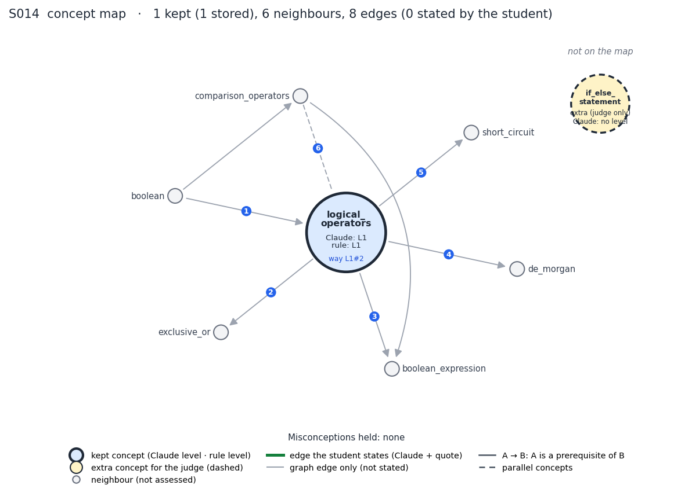

**Triples of the student's concept map** (subject, relation, object, with the logic of each):

| # | Subject | Relation | Object | Logic |
| --- | --- | --- | --- | --- |
| has_level | logical_operators | has_level | logical_operators@L1 | logical_operators@L1#2: a && b is true if both operands are true and false otherwise; a \|\| b is false if both are false and true otherwise; !a is the opposite of a; these definitions a... |
| edge 1 | boolean | prerequisite | logical_operators | &&, \|\| and ! are the operations defined on the boolean type: they take booleans and give a boolean. — graph only: the answer does not state it |
| edge 2 | logical_operators | prerequisite | exclusive_or | ^ on booleans is another logical operator, defined by a truth table like &&, \|\| and !: true exactly when its operands differ. — graph only: not checked (a neighbour) |
| edge 3 | logical_operators | prerequisite | boolean_expression | &&, \|\| and ! combine conditions p and q into one larger condition that is still true or false. — graph only: not checked (a neighbour) |
| edge 4 | logical_operators | prerequisite | de_morgan | De Morgan's laws rewrite expressions built from && , \|\| and !. — graph only: not checked (a neighbour) |
| edge 5 | logical_operators | prerequisite | short_circuit | && and \|\| evaluate their second operand only when the first has not already decided the result (false && x is false, true \|\| x is true). — graph only: the answer does not state it |
| edge 6 | comparison_operators | parallel | logical_operators | Relational operators compare two numbers to give a boolean; logical operators combine booleans into one boolean. — graph only: not checked (a neighbour) |


### S015 · final L2 · reference L0

**Question:** Declare a variable named singleLetter that holds one letter, with initial value Q, following Java convention.

```java
(writing task)
```

**Student answer:** char SingleLetter = 'Q';

**Concept scoring and shortlist.** 15 of the 173 concepts scored above 0. Every concept scoring at least 1.0 is shortlisted, best first, top 8; Claude then chooses which of them the answer is about.

| Rank | Concept | Link score | Filter result |
| --- | --- | --- | --- |
| 1 | char | 5.78 | **shortlisted** |
| 2 | statement | 2.00 | **shortlisted** |
| 3 | primitive_type | 2.00 | **shortlisted** |
| 4 | assignment | 2.00 | **shortlisted** |
| 5 | variable | 1.00 | **shortlisted** |
| 6 | declaration | 1.00 | **shortlisted** |
| 7 | char_arithmetic | 0.60 | not shortlisted: below 1.0 |
| 8 | explicit_cast | 0.36 | not shortlisted: below 1.0 |
| 9 | string_type | 0.28 | not shortlisted: below 1.0 |

**Extra concept:** string_type (Claude: no level).

**Sent to Claude:** char, statement, primitive_type, assignment, variable, declaration, string_type.

**Claude chose:** char, declaration.

**What happened to each shortlisted concept:**

- char: stored; Claude L2
- statement: Claude did not choose it (no level), so it is not stored
- primitive_type: Claude did not choose it (no level), so it is not stored
- assignment: Claude did not choose it (no level), so it is not stored
- variable: no graph evidence and no level from Claude; not stored
- declaration: no graph evidence; Claude L2; reported, not stored

**Claude's verdict, traced to the graph's edge logic:**

| Concept | Claude level | Way id | Edge logic of that way |
| --- | --- | --- | --- |
| char | L2 | char@L2#3 | c++ on char c = 'A' makes c 'B', because increment works on chars directly. c = c + 1; does not compile, because the right side is an int. |
| declaration | L2 | declaration@L2#3 | int x; adds x to the program state with an undefined (unassigned) value. int x = 5; adds x holding 5. |

**Graph edge logic of the levelled concepts** (has_level, misconception and error edges Claude was shown):

| Concept | Edge | Edge logic |
| --- | --- | --- |
| char | char → char@L2 (has_level) | char -> L2 (Multistructural): the answer applies the rules of char to every part of the code, in order (3 ways). |
| char | char → CharNotNumeric (misconception) | wrong rule: A char is only a letter, so c + k is an error. / right rule: A char is encoded as a 16-bit integer, so arithmetic such as 'b' + 'c' or 'a' + 4 works on the character codes. |
| declaration | declaration → declaration@L2 (has_level) | declaration -> L2 (Multistructural): the answer applies the rules of declaration to every part of the code, in order (3 ways). |
| declaration | declaration → RedeclareToReassign (error) | wrong rule: Writes int x = 5; ... int x = 10; to change x. / right rule: A declaration gives a variable its name and type; a later change of value is an assignment statement such as x = 10;, not a second declaration. |
| declaration | declaration → DeclarationWithoutType (error) | wrong rule: Writes name = value; to declare a new variable. / right rule: A declaration needs a type: type name = value; |
| declaration | declaration → UndeclaredOrRenamedVariable (error) | wrong rule: Uses a variable that was never declared, or under a different name (studentTotal vs total). / right rule: Every variable must be declared, and used with exactly the declared name. |
| declaration | declaration → AnyValueInAnyVariable (misconception) | wrong rule: A variable declared int can hold 2.5 or "hi"; the type is only a label. / right rule: A data type is a set of values and a set of operations defined on them, so an int variable holds only int values. |

**Claude's overall level:** L2 (main concept declaration). The student wrote a full, compilable declaration with the right type and initializer for this task, but the name is SingleLetter instead of singleLetter, which breaks lowerCamelCase. That makes this a correct application of the rule with one slip (L2 with an error), not a misconception.

| Step | What happened |
| --- | --- |
| Step 1. Gates | Gates: none. |
| Step 2. Score every concept | 15 of 173 scored above 0. Shortlisted: char = 5.78; statement = 2.00; primitive_type = 2.00; assignment = 2.00; variable = 1.00; declaration = 1.00. |
| Step 3. Shortlist and Claude's choice | Top 8 at 1.0 or above: char, statement, primitive_type, assignment, variable, declaration. Claude chose: char, declaration. |
| Step 4. Concept map | 1 stored + 6 neighbours. Stored: char. |
| Step 5. Run the code | No value to check. |
| Step 6. LLM judge | Claude gives char L2; statement no level; primitive_type no level; assignment no level; variable no level; declaration L2; string_type no level; overall L2. |
| Step 7. Final level | max_level, the highest level among the stored concepts (L0 if one holds a wrong rule) = L2; Claude's overall level was L2. Final L2 (reference L0). |

**Trace of the student's concept map:**

| Node | Role | Evidence traced from the answer | Rule level | Claude level and level logic |
| --- | --- | --- | --- | --- |
| char | chosen, stored | E1 reference: "char: 16-bit character primitive" (0.578) | L1 | L2 via char@L2#3: L2 (Multistructural): the answer applies the rules of char to every part of the code, in order (3 ways). |
| declaration | chosen, not stored | - | - | L2 via declaration@L2#3: L2 (Multistructural): the answer applies the rules of declaration to every part of the code, in order (3 ways)... |
| shortlisted, not chosen | not stored | statement, primitive_type, assignment, variable | - | Claude: none |
| neighbours | not assessed | string_type, double, boolean, int, primitive_type, char_arithmetic | - | - |

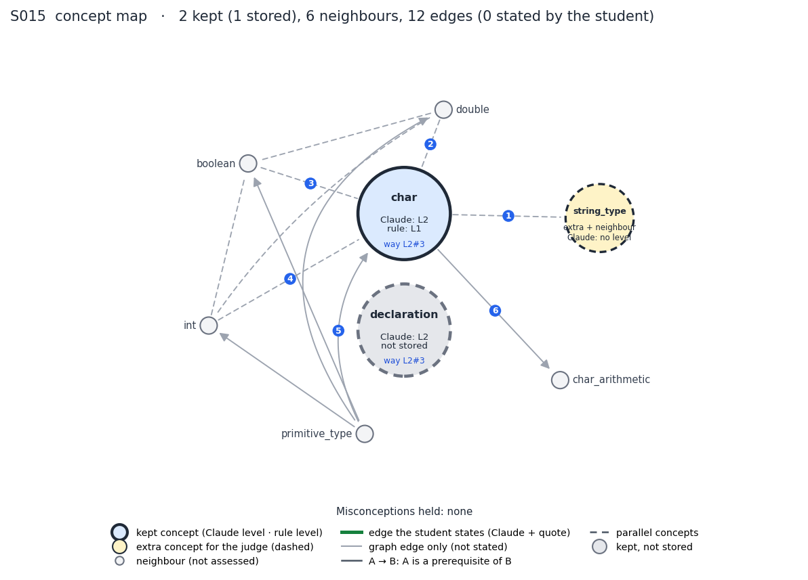

**Triples of the student's concept map** (subject, relation, object, with the logic of each):

| # | Subject | Relation | Object | Logic |
| --- | --- | --- | --- | --- |
| has_level | char | has_level | char@L2 | char@L2#3: c++ on char c = 'A' makes c 'B', because increment works on chars directly. c = c + 1; does not compile, because the right side is an int. |
| edge 1 | char | parallel | string_type | 'a' is a char (one 16-bit character code, a primitive); "a" is a String (a sequence of characters, an object). 'a' + 'b' is the int 195, while "a" + "b" is "ab". — graph only: the answer does not state it |
| edge 2 | double | parallel | char | A double holds a number with a fractional part; a char holds one character code, which is a whole number. — graph only: not checked (a neighbour) |
| edge 3 | boolean | parallel | char | A boolean holds true or false; a char holds a single character such as 'c'. — graph only: not checked (a neighbour) |
| edge 4 | int | parallel | char | An int holds a whole number; a char holds one character, which Java stores as its numeric code. — graph only: not checked (a neighbour) |
| edge 5 | primitive_type | prerequisite | char | char is one of the eight primitive types, the one used for single characters. — graph only: the answer does not state it |
| edge 6 | char | prerequisite | char_arithmetic | Char arithmetic uses the numeric code stored for each char. — graph only: not checked (a neighbour) |


### S016 · final L0 · reference L0

**Question:** What is the exact output? Explain how num4 is computed.

```java
int num1 = 9, num2 = 5;
double num3 = 26.3;
double num4 = (num1 % num2) + num3;
System.out.println("Result is ");
System.out.println("num4 = " + num4);
```

**Student answer:** num4 = 30.3, because 9 % 5 means 9 minus 5, which is 4.

**Concept scoring and shortlist.** 23 of the 173 concepts scored above 0. Every concept scoring at least 1.0 is shortlisted, best first, top 8; Claude then chooses which of them the answer is about.

| Rank | Concept | Link score | Filter result |
| --- | --- | --- | --- |
| 1 | arithmetic_operators | 4.28 | **shortlisted** |
| 2 | double | 4.04 | **shortlisted** |
| 3 | remainder_operator | 3.64 | **shortlisted** |
| 4 | assignment | 3.00 | **shortlisted** |
| 5 | expression | 3.00 | **shortlisted** |
| 6 | method_call | 2.00 | **shortlisted** |
| 7 | variable | 2.00 | **shortlisted** |
| 8 | standard_output | 2.00 | **shortlisted** |
| 9 | string_concatenation | 2.00 | not shortlisted: only the top 8 are sent |
| 10 | string_conversion | 2.00 | not shortlisted: only the top 8 are sent |
| 11 | primitive_type | 2.00 | not shortlisted: only the top 8 are sent |

**Extra concept:** integer_division (Claude: no level).

**Sent to Claude:** arithmetic_operators, double, remainder_operator, assignment, expression, method_call, variable, standard_output, integer_division.

**Claude chose:** remainder_operator.

**What happened to each shortlisted concept:**

- arithmetic_operators: Claude did not choose it (no level), so it is not stored
- double: Claude did not choose it (no level), so it is not stored
- remainder_operator: stored; Claude L0
- assignment: Claude did not choose it (no level), so it is not stored
- expression: Claude did not choose it (no level), so it is not stored
- method_call: no graph evidence and no level from Claude; not stored
- variable: no graph evidence and no level from Claude; not stored
- standard_output: no graph evidence and no level from Claude; not stored

**Claude's verdict, traced to the graph's edge logic:**

| Concept | Claude level | Way id | Edge logic of that way |
| --- | --- | --- | --- |
| remainder_operator | L0 | remainder_operator@L0#1 | In everyday use % means percent (50% of x), and in maths 'mod' always gives a non-negative result. In Java % is the remainder of truncating division, and its sign follows the left operand (-14 % 3 is -2). |

**Graph edge logic of the levelled concepts** (has_level, misconception and error edges Claude was shown):

| Concept | Edge | Edge logic |
| --- | --- | --- |
| remainder_operator | remainder_operator → remainder_operator@L0 (has_level) | remainder operator -> L0 (Prestructural): the answer holds a rule that contradicts Java (4 ways). |
| remainder_operator | remainder_operator → RemainderIsQuotient (misconception) | wrong rule: 17 % 5 is 3 (the quotient). / right rule: % returns the remainder, so 17 % 5 is 2. |
| remainder_operator | remainder_operator → NegativeRemainderSign (misconception) | wrong rule: a % b is never negative, and integer division of a negative number rounds down. / right rule: a / b rounds toward 0 and a % b takes the sign of a: -14 / 3 is -4 and -14 % 3 is -2. |

**Claude's overall level:** L0 (main concept remainder_operator). The value 30.3 is right only by coincidence: the student says 9 % 5 means 9 minus 5, a rule that contradicts Java, where % gives the remainder. That rule gives 4 here only because 9 / 5 has quotient 1. The answer also leaves out the first output line, "Result is ".

| Step | What happened |
| --- | --- |
| Step 1. Gates | Gates: none. |
| Step 2. Score every concept | 23 of 173 scored above 0. Shortlisted: arithmetic_operators = 4.28; double = 4.04; remainder_operator = 3.64; assignment = 3.00; expression = 3.00; method_call = 2.00; variable = 2.00; standard_output = 2.00. |
| Step 3. Shortlist and Claude's choice | Top 8 at 1.0 or above: arithmetic_operators, double, remainder_operator, assignment, expression, method_call, variable, standard_output. Claude chose: remainder_operator. |
| Step 4. Concept map | 1 stored + 1 neighbours. Stored: remainder_operator. |
| Step 5. Run the code | confirmed by the run: num4 = 30.3 |
| Step 6. LLM judge | Claude gives arithmetic_operators no level; double no level; remainder_operator L0; assignment no level; expression no level; method_call no level; variable no level; standard_output no level; integer_division no level; overall L0. |
| Step 7. Final level | max_level, the highest level among the stored concepts (L0 if one holds a wrong rule) = L0; Claude's overall level was L0. Final L0 (reference L0). |

**Trace of the student's concept map:**

| Node | Role | Evidence traced from the answer | Rule level | Claude level and level logic |
| --- | --- | --- | --- | --- |
| remainder_operator | chosen, stored | E1 reference: "remainder operator: % gives the remainder of integer division" (0.526); E2 execution: "confirmed by the run: num4 = 30.3" (1.0) | L2 provisional | L0 via remainder_operator@L0#1: L0 (Prestructural): the answer holds a rule that contradicts Java (4 ways). |
| shortlisted, not chosen | not stored | arithmetic_operators, double, assignment, expression, method_call, variable, standard_output | - | Claude: none |
| neighbours | not assessed | integer_division | - | - |

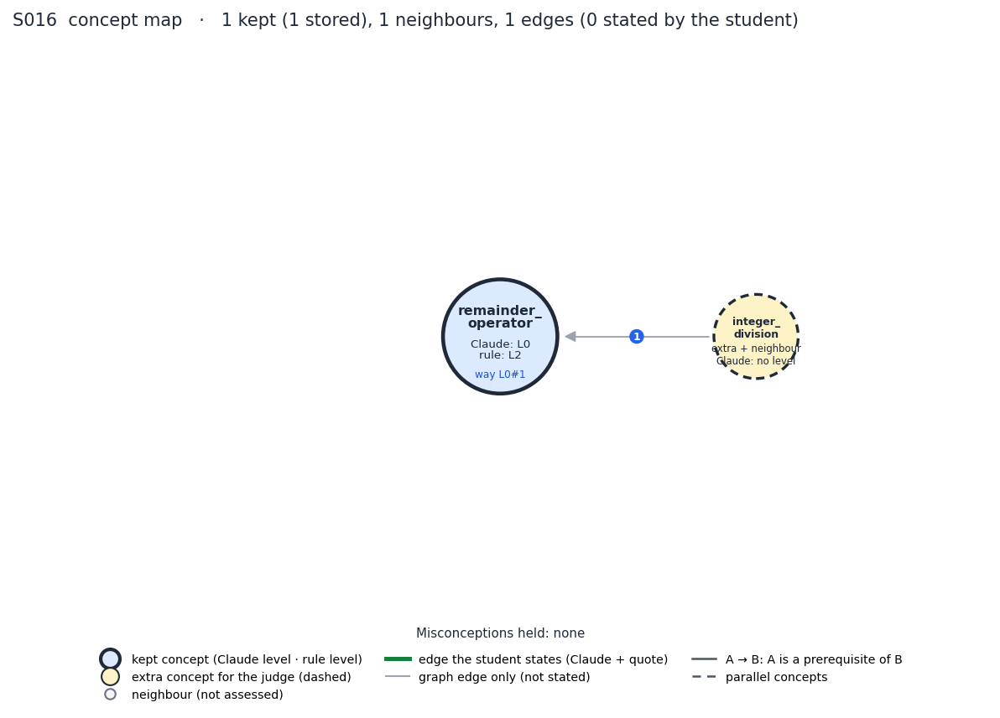

**Triples of the student's concept map** (subject, relation, object, with the logic of each):

| # | Subject | Relation | Object | Logic |
| --- | --- | --- | --- | --- |
| has_level | remainder_operator | has_level | remainder_operator@L0 | remainder_operator@L0#1: In everyday use % means percent (50% of x), and in maths 'mod' always gives a non-negative result. In Java % is the remainder of truncating division, and its si... |
| edge 1 | integer_division | prerequisite | remainder_operator | % is the companion of integer division: a = (a / b) * b + a % b. — graph only: the answer does not state it |


### S017 · final L1 · reference L1

**Question:** Give the exact output, including spacing and empty lines. Explain.

```java
for (int i = 3; i >= 0; i--) {
  for (int j = i; j > 0; j--) {
    System.out.printf("%d ", j);
  }
  System.out.println();
}
```

**Student answer:** i = 3 prints 3 2 1, i = 2 prints 2 1, and so on.

**Concept scoring and shortlist.** 68 of the 173 concepts scored above 0. Every concept scoring at least 1.0 is shortlisted, best first, top 8; Claude then chooses which of them the answer is about.

| Rank | Concept | Link score | Filter result |
| --- | --- | --- | --- |
| 1 | assignment | 2.48 | **shortlisted** |
| 2 | increment_operators | 2.35 | **shortlisted** |
| 3 | for_loop | 1.69 | **shortlisted** |
| 4 | loop_control | 1.52 | **shortlisted** |
| 5 | print | 1.49 | **shortlisted** |
| 6 | nested_loops | 1.47 | **shortlisted** |
| 7 | variable | 1.17 | **shortlisted** |
| 8 | int | 1.09 | **shortlisted** |
| 9 | standard_output | 1.00 | not shortlisted: only the top 8 are sent |
| 10 | method_call | 1.00 | not shortlisted: only the top 8 are sent |
| 11 | array_aliasing | 1.00 | not shortlisted: only the top 8 are sent |

**Extra concept:** fencepost_loop (Claude: no level).

**Sent to Claude:** assignment, increment_operators, for_loop, loop_control, print, nested_loops, variable, int, fencepost_loop.

**Claude chose:** nested_loops.

**What happened to each shortlisted concept:**

- assignment: Claude did not choose it (no level), so it is not stored
- increment_operators: Claude did not choose it (no level), so it is not stored
- for_loop: Claude did not choose it (no level), so it is not stored
- loop_control: Claude did not choose it (no level), so it is not stored
- print: Claude did not choose it (no level), so it is not stored
- nested_loops: no graph evidence; Claude L1; reported, not stored
- variable: no graph evidence and no level from Claude; not stored
- int: no graph evidence and no level from Claude; not stored

**Claude's verdict, traced to the graph's edge logic:**

| Concept | Claude level | Way id | Edge logic of that way |
| --- | --- | --- | --- |
| nested_loops | L1 | nested_loops@L1#2 | Because loops are statements, one can be the body of another; the inner loop iterates all the way through for each iteration of the outer loop. |

**Graph edge logic of the levelled concepts** (has_level, misconception and error edges Claude was shown):

| Concept | Edge | Edge logic |
| --- | --- | --- |
| nested_loops | nested_loops → nested_loops@L1 (has_level) | nested loops -> L1 (Unistructural): the answer states one correct rule without applying it (2 ways). |
| nested_loops | nested_loops → NestedLoopsSequential (misconception) | wrong rule: The outer loop runs completely, then the inner loop runs completely. / right rule: The inner loop runs all its passes during each single pass of the outer loop. |
| nested_loops | nested_loops → InnerOuterSwapped (misconception) | wrong rule: The inner loop's variable changes more slowly than the outer loop's. / right rule: The inner loop runs all its passes for each single pass of the outer loop. |
| nested_loops | nested_loops → InconsistentIndentation (misconception) | wrong rule: Indents nested blocks inconsistently, so the visual nesting differs from the real nesting. / right rule: Indent consistently, one level deeper for each nested block, so the layout shows the real nesting; the compiler ignores indentation. |
| nested_loops | nested_loops → BracelessMultiStatementBody (error) | wrong rule: Indenting several statements under an if or for makes them all part of its body, even without braces. / right rule: Without braces only the first statement belongs to the if/for; the rest run once, after it. |

**Claude's overall level:** L1 (main concept nested_loops). The answer gives correct output for two outer passes (i = 3 and i = 2) and then says "and so on", but it never covers i = 1 or i = 0 (the empty line), the trailing spaces, or the println, and it gives no explanation, so it is a correct but partial and unexplained result rather than a full trace.

| Step | What happened |
| --- | --- |
| Step 1. Gates | Gates: none. |
| Step 2. Score every concept | 68 of 173 scored above 0. Shortlisted: assignment = 2.48; increment_operators = 2.35; for_loop = 1.69; loop_control = 1.52; print = 1.49; nested_loops = 1.47; variable = 1.17; int = 1.09. |
| Step 3. Shortlist and Claude's choice | Top 8 at 1.0 or above: assignment, increment_operators, for_loop, loop_control, print, nested_loops, variable, int. Claude chose: nested_loops. |
| Step 4. Concept map | 0 stored + 0 neighbours. Stored: none. |
| Step 5. Run the code | confirmed by the run: i = 3; i = 2 |
| Step 6. LLM judge | Claude gives assignment no level; increment_operators no level; for_loop no level; loop_control no level; print no level; nested_loops L1; variable no level; int no level; fencepost_loop no level; overall L1. |
| Step 7. Final level | max_level, the highest level among the stored concepts (L0 if one holds a wrong rule) = L1; Claude's overall level was L1. Final L1 (reference L1). |

**Trace of the student's concept map:**

| Node | Role | Evidence traced from the answer | Rule level | Claude level and level logic |
| --- | --- | --- | --- | --- |
| nested_loops | chosen, not stored | - | - | L1 via nested_loops@L1#2: L1 (Unistructural): the answer states one correct rule without applying it (2 ways). |
| shortlisted, not chosen | not stored | assignment, increment_operators, for_loop, loop_control, print, variable, int | - | Claude: none |

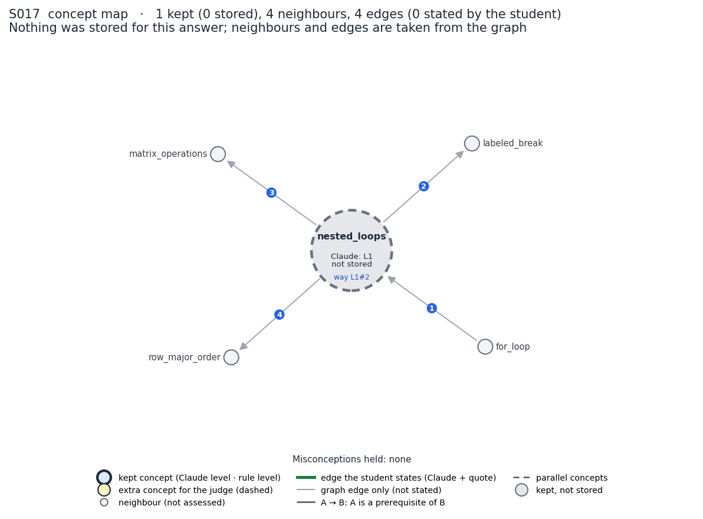

**Triples of the student's concept map** (subject, relation, object, with the logic of each):

| # | Subject | Relation | Object | Logic |
| --- | --- | --- | --- | --- |
| edge 1 | for_loop | prerequisite | nested_loops | In nested loops the inner for runs its complete set of passes for every single pass of the outer for. — graph only: the answer does not state it |
| edge 2 | nested_loops | prerequisite | labeled_break | A labeled break is needed only when a loop is nested inside another and the inner loop must end the outer one. — graph only: not checked (a neighbour) |
| edge 3 | nested_loops | prerequisite | matrix_operations | Matrix addition uses two nested loops over i and j, and matrix multiplication adds a third inner loop over k to compute each dot product c[i][j]. — graph only: not checked (a neighbour) |
| edge 4 | nested_loops | prerequisite | row_major_order | Which loop is outside decides whether the entries are processed row by row or column by column. — graph only: not checked (a neighbour) |


### S020 · final L3 · reference L3

**Question:** Find and print the smallest value in data.

```java
(writing task) double array data already exists
```

**Student answer:** best = first; for each element: if smaller than best → best = element; print best

**Concept scoring and shortlist.** 19 of the 173 concepts scored above 0. Every concept scoring at least 1.0 is shortlisted, best first, top 8; Claude then chooses which of them the answer is about.

| Rank | Concept | Link score | Filter result |
| --- | --- | --- | --- |
| 1 | print | 2.37 | **shortlisted** |
| 2 | assignment | 2.00 | **shortlisted** |
| 3 | array_aliasing | 2.00 | **shortlisted** |
| 4 | enhanced_for | 2.00 | **shortlisted** |
| 5 | primitive_type | 2.00 | **shortlisted** |
| 6 | double | 2.00 | **shortlisted** |
| 7 | running_extreme | 1.52 | **shortlisted** |
| 8 | indexing | 1.00 | **shortlisted** |
| 9 | escape_sequences | 0.32 | not shortlisted: below 1.0 |
| 10 | formatted_output | 0.29 | not shortlisted: below 1.0 |
| 11 | continue_statement | 0.26 | not shortlisted: below 1.0 |

**Extra concept:** stream_model (Claude: no level).

**Sent to Claude:** print, assignment, array_aliasing, enhanced_for, primitive_type, double, running_extreme, indexing, stream_model.

**Claude chose:** running_extreme.

**What happened to each shortlisted concept:**

- print: Claude did not choose it (no level), so it is not stored
- assignment: Claude did not choose it (no level), so it is not stored
- array_aliasing: Claude did not choose it (no level), so it is not stored
- enhanced_for: Claude did not choose it (no level), so it is not stored
- primitive_type: no graph evidence and no level from Claude; not stored
- double: no graph evidence and no level from Claude; not stored
- running_extreme: stored; Claude L3
- indexing: Claude did not choose it (no level), so it is not stored

**Claude's verdict, traced to the graph's edge logic:**

| Concept | Claude level | Way id | Edge logic of that way |
| --- | --- | --- | --- |
| running_extreme | L3 | running_extreme@L3#3 | Plan/role: most-wanted holder (Sajaniemi). It finds the extreme in one pass with constant extra memory; the same plan tracks the minimum with <. |

**Graph edge logic of the levelled concepts** (has_level, misconception and error edges Claude was shown):

| Concept | Edge | Edge logic |
| --- | --- | --- |
| running_extreme | running_extreme → running_extreme@L3 (has_level) | running extreme -> L3 (Relational): the answer relates the parts (3 ways). |
| running_extreme | running_extreme → ExtremeStartsAtZero (misconception) | wrong rule: The running maximum can always start at 0. / right rule: Start the running maximum at the most negative possible value (Double.NEGATIVE_INFINITY, or the smallest int), so that the first value read replaces it. |

**Claude's overall level:** L3 (main concept running_extreme). The student writes a correct pseudocode plan for finding the minimum in one pass (start from the first element, replace best whenever a smaller element appears, print it after the loop), which solves the task as a whole; it is a familiar pattern, so it counts as the running-extreme plan used for the minimum (L3), not transfer to a new problem (L4).

| Step | What happened |
| --- | --- |
| Step 1. Gates | Gates: none. |
| Step 2. Score every concept | 19 of 173 scored above 0. Shortlisted: print = 2.37; assignment = 2.00; array_aliasing = 2.00; enhanced_for = 2.00; primitive_type = 2.00; double = 2.00; running_extreme = 1.52; indexing = 1.00. |
| Step 3. Shortlist and Claude's choice | Top 8 at 1.0 or above: print, assignment, array_aliasing, enhanced_for, primitive_type, double, running_extreme, indexing. Claude chose: running_extreme. |
| Step 4. Concept map | 1 stored + 2 neighbours. Stored: running_extreme. |
| Step 5. Run the code | No value to check. |
| Step 6. LLM judge | Claude gives print no level; assignment no level; array_aliasing no level; enhanced_for no level; primitive_type no level; double no level; running_extreme L3; indexing no level; stream_model no level; overall L3. |
| Step 7. Final level | max_level, the highest level among the stored concepts (L0 if one holds a wrong rule) = L3; Claude's overall level was L3. Final L3 (reference L3). |

**Trace of the student's concept map:**

| Node | Role | Evidence traced from the answer | Rule level | Claude level and level logic |
| --- | --- | --- | --- | --- |
| running_extreme | chosen, stored | E1 reference: "running extreme: tracking the max or min of a stream" (0.529) | L1 | L3 via running_extreme@L3#3: L3 (Relational): the answer relates the parts (3 ways). |
| shortlisted, not chosen | not stored | print, assignment, array_aliasing, enhanced_for, primitive_type, double, indexing | - | Claude: none |
| neighbours | not assessed | accumulator_pattern, array_traversal | - | - |


**Triples of the student's concept map** (subject, relation, object, with the logic of each):

| # | Subject | Relation | Object | Logic |
| --- | --- | --- | --- | --- |
| has_level | running_extreme | has_level | running_extreme@L3 | running_extreme@L3#3: Plan/role: most-wanted holder (Sajaniemi). It finds the extreme in one pass with constant extra memory; the same plan tracks the minimum with <. |
| edge 1 | running_extreme | parallel | accumulator_pattern | Both make one pass over the values with one variable kept across passes. An accumulator (gatherer role) combines every value into it (sum += a[i]), so it starts at the identity 0.0; a running extreme (most-wanted holder) replaces it only when a better value is found (if (a[i] > max) max = a[i]), so it starts at Double.NEGATIVE_INFINITY or the first value. — graph only: not checked (a neighbour) |
| edge 2 | array_traversal | prerequisite | running_extreme | The running maximum is found by traversing the array once, keeping the largest value seen so far (starting from Double.NEGATIVE_INFINITY). — graph only: not checked (a neighbour) |


### S021 · final L4 · reference L2

**Question:** What is printed when x = 17? Explain.

```java
System.out.print("A");
if (x % 2 == 0) {
  System.out.print("B");
  if (x % 5 == 2) { System.out.print("C"); } else { System.out.print("D"); }
} else {
  if (x % 5 == 2) { System.out.print("E"); } else { System.out.print("F"); }
  System.out.print("G");
}
```

**Student answer:** So first Java looks at the code and the first thing it does is print A, which always happens no matter what x is, and then it checks whether x is even, and 17 is not even because 17 divided by 2 leaves 1, so it skips the whole first part with B, C and D, and goes to the else part, where it checks 17 % 5, which is 2, so it prints E, and then after that inner if-else it prints G, so overall I think the answer would be AEG, which makes sense because…

**Concept scoring and shortlist.** 57 of the 173 concepts scored above 0. Every concept scoring at least 1.0 is shortlisted, best first, top 8; Claude then chooses which of them the answer is about.

| Rank | Concept | Link score | Filter result |
| --- | --- | --- | --- |
| 1 | if_else_statement | 4.00 | **shortlisted** |
| 2 | remainder_operator | 2.70 | **shortlisted** |
| 3 | arithmetic_operators | 2.33 | **shortlisted** |
| 4 | expression | 2.00 | **shortlisted** |
| 5 | print | 2.00 | **shortlisted** |
| 6 | assignment | 1.41 | **shortlisted** |
| 7 | standard_output | 1.36 | **shortlisted** |
| 8 | if_statement | 1.00 | **shortlisted** |
| 9 | method_call | 1.00 | not shortlisted: only the top 8 are sent |
| 10 | empty_statement | 1.00 | not shortlisted: only the top 8 are sent |
| 11 | statement | 1.00 | not shortlisted: only the top 8 are sent |

**Extra concept:** division_by_zero (Claude: no level).

**Sent to Claude:** if_else_statement, remainder_operator, arithmetic_operators, expression, print, assignment, standard_output, if_statement, division_by_zero.

**Claude chose:** if_else_statement, remainder_operator, print.

**What happened to each shortlisted concept:**

- if_else_statement: stored; Claude L2
- remainder_operator: stored; Claude L2
- arithmetic_operators: Claude did not choose it (no level), so it is not stored
- expression: Claude did not choose it (no level), so it is not stored
- print: stored; Claude L2
- assignment: Claude did not choose it (no level), so it is not stored
- standard_output: Claude did not choose it (no level), so it is not stored
- if_statement: no graph evidence and no level from Claude; not stored

**Claude's verdict, traced to the graph's edge logic:**

| Concept | Claude level | Way id | Edge logic of that way |
| --- | --- | --- | --- |
| if_else_statement | L2 | if_else_statement@L2#1 | Evaluate the condition once; if true execute the then branch, otherwise execute the else branch; then continue with the statement after the whole if-else (the condition is not re-tested). |
| remainder_operator | L2 | remainder_operator@L2#1 | Evaluate a, then b, take the quotient rounded toward 0, and give what is left over. % has the same precedence as * and /, and they group left to right. |
| print | L2 | print@L2#2 | Output is exactly the characters of the value (a string literal without its quotes, a number in decimal) and nothing else: print("Goodbye, "); println("cruel world"); prints Goodbye, cruel world on one line. |

**Graph edge logic of the levelled concepts** (has_level, misconception and error edges Claude was shown):

| Concept | Edge | Edge logic |
| --- | --- | --- |
| if_else_statement | if_else_statement → if_else_statement@L2 (has_level) | if else statement -> L2 (Multistructural): the answer applies the rules of if else statement to every part of the code, in order (3 ways). |
| if_else_statement | if_else_statement → ConditionalIsSequence (misconception) | wrong rule: if (c) A else B is the same as if (c) A followed by if (!c) B. / right rule: In if-else, c is tested once and exactly one of A or B runs, even if A changes the variables that c uses. |
| if_else_statement | if_else_statement → ElseAlwaysExecutes (misconception) | wrong rule: The else branch of an if-else statement always executes. / right rule: The else branch runs only when the if condition is false. |
| if_else_statement | if_else_statement → ElseWithCondition (error) | wrong rule: Writes else (x > 0) with a condition but no if. / right rule: else takes no condition; use else if (x > 0). |
| if_else_statement | if_else_statement → BothBranchesExecute (misconception) | wrong rule: Both the then branch and the else branch run. / right rule: Exactly one of the two branches runs. |
| remainder_operator | remainder_operator → remainder_operator@L2 (has_level) | remainder operator -> L2 (Multistructural): the answer applies the rules of remainder operator to every part of the code, in order (3 ways). |
| remainder_operator | remainder_operator → RemainderIsQuotient (misconception) | wrong rule: 17 % 5 is 3 (the quotient). / right rule: % returns the remainder, so 17 % 5 is 2. |
| remainder_operator | remainder_operator → NegativeRemainderSign (misconception) | wrong rule: a % b is never negative, and integer division of a negative number rounds down. / right rule: a / b rounds toward 0 and a % b takes the sign of a: -14 / 3 is -4 and -14 % 3 is -2. |
| print | print → print@L2 (has_level) | print -> L2 (Multistructural): the answer applies the rules of print to every part of the code, in order (3 ways). |
| print | print → ParenthesesOnlyIfArgument (misconception) | wrong rule: println with nothing to print can be written System.out.println; without the parentheses. / right rule: A method call always needs parentheses, so an empty line is printed with System.out.println();. |
| print | print → PrintWithoutFinalNewline (error) | wrong rule: Ends the output with print and expects it to appear right away. / right rule: Finish a line of print calls with println; some systems hold print output until a newline is printed. |
| print | print → RepeatedOutputVariablePrintedOnce (misconception) | wrong rule: An output statement that names the same variable twice (WRITE y, x, y) prints it only once. / right rule: Each expression in the output list is printed, so a repeated variable prints its value each time. |

**Claude's overall level:** L2 (main concept if_else_statement). The student follows the code in order with x = 17. They work out each condition, pick the right branch of both the outer and inner if-else, and keep going after the inner if-else, which gives AEG. The sentence giving a purpose is cut off, so the answer never says what the code is for.

| Step | What happened |
| --- | --- |
| Step 1. Gates | Gates: none. |
| Step 2. Score every concept | 57 of 173 scored above 0. Shortlisted: if_else_statement = 4.00; remainder_operator = 2.70; arithmetic_operators = 2.33; expression = 2.00; print = 2.00; assignment = 1.41; standard_output = 1.36; if_statement = 1.00. |
| Step 3. Shortlist and Claude's choice | Top 8 at 1.0 or above: if_else_statement, remainder_operator, arithmetic_operators, expression, print, assignment, standard_output, if_statement. Claude chose: if_else_statement, remainder_operator, print. |
| Step 4. Concept map | 3 stored + 8 neighbours. Stored: if_else_statement, remainder_operator, print. |
| Step 5. Run the code | No value to check. |
| Step 6. LLM judge | Claude gives if_else_statement L2; remainder_operator L2; arithmetic_operators no level; expression no level; print L2; assignment no level; standard_output no level; if_statement no level; division_by_zero no level; overall L2. |
| Step 7. Final level | max_level, the highest level among the stored concepts (L0 if one holds a wrong rule) = L4; Claude's overall level was L2. Final L4 (reference L2). |

**Trace of the student's concept map:**

| Node | Role | Evidence traced from the answer | Rule level | Claude level and level logic |
| --- | --- | --- | --- | --- |
| if_else_statement | chosen, stored | E1 reference: "if else statement: choose one of two blocks" (0.373); E3 integration: "overall purpose" (1.0); E4 transfer: "change predicted" (1.0) | L4 provisional | L2 via if_else_statement@L2#1: L2 (Multistructural): the answer applies the rules of if else statement to every part of the code, in order (3... |
| remainder_operator | chosen, stored | E1 reference: "remainder operator: % gives the remainder of integer division" (0.576); E3 integration: "overall purpose" (1.0); E4 transfer: "change predicted" (1.0) | L4 provisional | L2 via remainder_operator@L2#1: L2 (Multistructural): the answer applies the rules of remainder operator to every part of the code, in order (... |
| print | chosen, stored | E1 reference: "print: System.out.print -- output with no newline" (0.391); E3 integration: "overall purpose" (1.0); E4 transfer: "change predicted" (1.0) | L4 provisional | L2 via print@L2#2: L2 (Multistructural): the answer applies the rules of print to every part of the code, in order (3 ways). |
| shortlisted, not chosen | not stored | arithmetic_operators, expression, assignment, standard_output, if_statement | - | Claude: none |
| neighbours | not assessed | if_statement, integer_division, statement, string_literal, nested_conditionals, else_if_chain, conditional_operator, println | - | - |

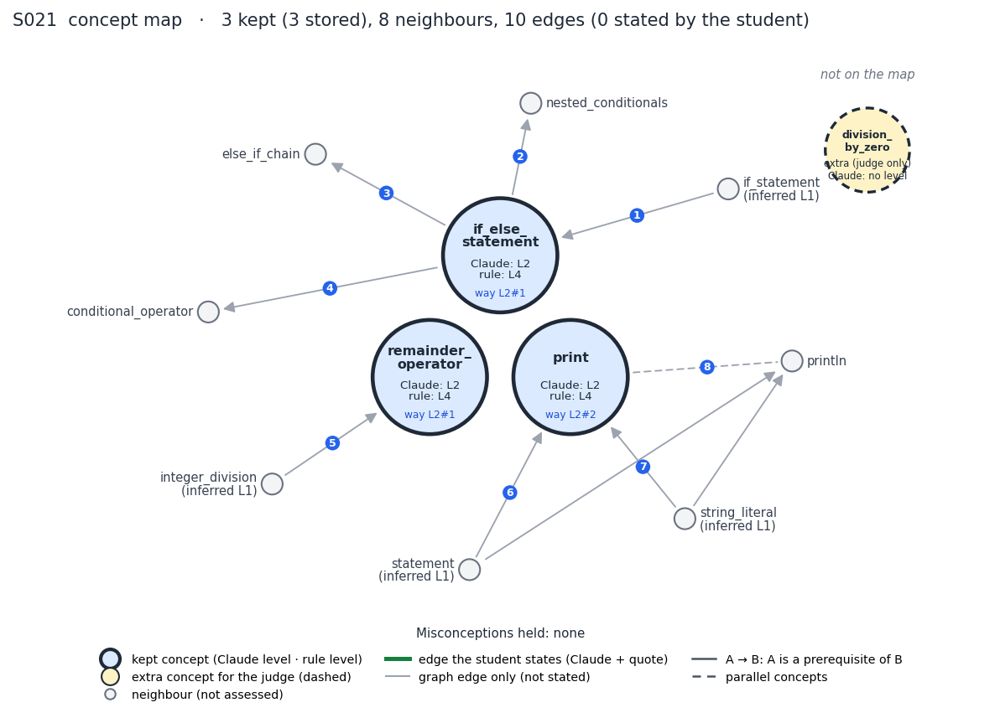

**Triples of the student's concept map** (subject, relation, object, with the logic of each):

| # | Subject | Relation | Object | Logic |
| --- | --- | --- | --- | --- |
| has_level | if_else_statement | has_level | if_else_statement@L2 | if_else_statement@L2#1: Evaluate the condition once; if true execute the then branch, otherwise execute the else branch; then continue with the statement after the whole if-else (the c... |
| has_level | remainder_operator | has_level | remainder_operator@L2 | remainder_operator@L2#1: Evaluate a, then b, take the quotient rounded toward 0, and give what is left over. % has the same precedence as * and /, and they group left to right. |
| has_level | print | has_level | print@L2 | print@L2#2: Output is exactly the characters of the value (a string literal without its quotes, a number in decimal) and nothing else: print("Goodbye, "); println("cruel wo... |
| edge 1 | if_statement | prerequisite | if_else_statement | if-else extends if with a second block that runs exactly when the condition is false. — graph only: the answer does not state it |
| edge 2 | if_else_statement | prerequisite | nested_conditionals | Nesting puts an if or if-else inside a branch of another if-else; an else-if chain is the common case where the else branch is itself an if. — graph only: not checked (a neighbour) |
| edge 3 | if_else_statement | prerequisite | else_if_chain | An else-if chain is an if-else whose else part is another if. — graph only: not checked (a neighbour) |
| edge 4 | if_else_statement | prerequisite | conditional_operator | c ? a : b is the expression form of if (c) ... else .... — graph only: not checked (a neighbour) |
| edge 5 | integer_division | prerequisite | remainder_operator | % is the companion of integer division: a = (a / b) * b + a % b. — graph only: not checked (a neighbour) |
| edge 6 | statement | prerequisite | print | System.out.print(s); is itself a statement, so it runs at its own place in the sequence of statements. — graph only: not checked (a neighbour) |
| edge 7 | string_literal | prerequisite | print | print("s") outputs exactly the characters between the quotes, without the quotes. — graph only: not checked (a neighbour) |
| edge 8 | print | parallel | println | print leaves the cursor on the same line after printing; println moves the cursor to the next line after printing. — graph only: not checked (a neighbour) |


### S022 · final L3 · reference L3

**Question:** What is the output? Explain when the loop stops.

```java
int i = 1;
boolean isDone = false;
while (i < 100 && !isDone) {
  System.out.print(i + " ");
  if (i % 5 == 0) { isDone = true; }
  i = i + 3;
}
```

**Student answer:** It keeps jumping up by 3 and quits after the pass where it hits a multiple of 5.

**Concept scoring and shortlist.** 34 of the 173 concepts scored above 0. Every concept scoring at least 1.0 is shortlisted, best first, top 8; Claude then chooses which of them the answer is about.

| Rank | Concept | Link score | Filter result |
| --- | --- | --- | --- |
| 1 | while_loop | 1.34 | **shortlisted** |
| 2 | loop_control | 1.04 | **shortlisted** |
| 3 | statement | 1.00 | **shortlisted** |
| 4 | if_statement | 1.00 | **shortlisted** |
| 5 | block | 1.00 | **shortlisted** |
| 6 | variable | 1.00 | **shortlisted** |
| 7 | standard_output | 1.00 | **shortlisted** |
| 8 | assignment | 1.00 | **shortlisted** |
| 9 | empty_statement | 1.00 | not shortlisted: only the top 8 are sent |
| 10 | int | 1.00 | not shortlisted: only the top 8 are sent |
| 11 | remainder_operator | 1.00 | not shortlisted: only the top 8 are sent |

**Extra concept:** off_by_one_error (Claude: no level).

**Sent to Claude:** while_loop, loop_control, statement, if_statement, block, variable, standard_output, assignment, off_by_one_error.

**Claude chose:** while_loop, loop_control.

**What happened to each shortlisted concept:**

- while_loop: stored; Claude L3
- loop_control: no graph evidence; Claude L1; reported, not stored
- statement: no graph evidence and no level from Claude; not stored
- if_statement: no graph evidence and no level from Claude; not stored
- block: no graph evidence and no level from Claude; not stored
- variable: no graph evidence and no level from Claude; not stored
- standard_output: no graph evidence and no level from Claude; not stored
- assignment: no graph evidence and no level from Claude; not stored

**Claude's verdict, traced to the graph's edge logic:**

| Concept | Claude level | Way id | Edge logic of that way |
| --- | --- | --- | --- |
| while_loop | L3 | while_loop@L3#6 | The body is the block that the while repeats; it runs only after a true test and is completed before the next test. |
| loop_control | L1 | loop_control@L1#1 | Loop control is the init / continuation condition / increment scheme on an index variable that decides how many passes a loop makes and with which values. |

**Graph edge logic of the levelled concepts** (has_level, misconception and error edges Claude was shown):

| Concept | Edge | Edge logic |
| --- | --- | --- |
| while_loop | while_loop → while_loop@L3 (has_level) | while loop -> L3 (Relational): the answer relates the parts (11 ways). |
| while_loop | while_loop → IfIsLoop (misconception) | wrong rule: A while loop runs its body once when the condition is true, just like an if. / right rule: A while tests its condition again after every pass and keeps repeating while the condition stays true. |
| while_loop | while_loop → LoopTerminatingCondition (misconception) | wrong rule: For and while loops end when the condition becomes true. / right rule: A for or while loop ends when its condition becomes false. |
| while_loop | while_loop → WhileStopsMidBody (misconception) | wrong rule: The loop stops the moment the condition becomes false, even in the middle of the body. / right rule: The condition is tested only before each pass, so the whole body finishes before the loop can stop. |
| while_loop | while_loop → SemicolonAfterIfHeader (error) | wrong rule: if (x > 0); System.out.println("positive"); prints only for positive x. / right rule: The ; ends the if with an empty statement, so the next line always runs. |
| loop_control | loop_control → loop_control@L1 (has_level) | loop control -> L1 (Unistructural): the answer states one correct rule without applying it (2 ways). |
| loop_control | loop_control → PreIncrementBeforeLoop (misconception) | wrong rule: With ++i in the update of for (int i = s; i < n; ++i), i is increased before the body runs, so the first pass uses s + 1. / right rule: The update runs after each pass of the body, so with either ++i or i++ the first pass uses i = s. |
| loop_control | loop_control → OffByOneBound (misconception) | wrong rule: i < n and i <= n mean the same, so the loop runs until i equals n and the last pass can use a[n]. / right rule: for (i = 0; i < n; i++) runs n times with i going up to n - 1; with <= it runs n + 1 times and reaches i = n. |
| loop_control | loop_control → WrongIterationCount (error) | wrong rule: Updates the loop counter so that the loop runs the wrong number of times. / right rule: The init, test and update together decide the number of passes; trace them to check the count. |
| loop_control | loop_control → InfiniteLoopUnnoticed (misconception) | wrong rule: A while loop always stops on its own, even if nothing in its body can make the condition false. / right rule: A while loop stops only when its condition is false at a check, so if no pass changes the variables in the condition, it never stops. |

**Claude's overall level:** L3 (main concept while_loop). In one sentence the student correctly ties the multiple-of-5 check inside the body to when the loop ends: after that pass finishes, not partway through it. They don't list the output (1 4 7 10), but their stopping explanation is relational and taken from the code.

| Step | What happened |
| --- | --- |
| Step 1. Gates | Gates: none. |
| Step 2. Score every concept | 34 of 173 scored above 0. Shortlisted: while_loop = 1.34; loop_control = 1.04; statement = 1.00; if_statement = 1.00; block = 1.00; variable = 1.00; standard_output = 1.00; assignment = 1.00. |
| Step 3. Shortlist and Claude's choice | Top 8 at 1.0 or above: while_loop, loop_control, statement, if_statement, block, variable, standard_output, assignment. Claude chose: while_loop, loop_control. |
| Step 4. Concept map | 1 stored + 10 neighbours. Stored: while_loop. |
| Step 5. Run the code | No value to check. |
| Step 6. LLM judge | Claude gives while_loop L3; loop_control L1; statement no level; if_statement no level; block no level; variable no level; standard_output no level; assignment no level; off_by_one_error no level; overall L3. |
| Step 7. Final level | max_level, the highest level among the stored concepts (L0 if one holds a wrong rule) = L3; Claude's overall level was L3. Final L3 (reference L3). |

**Trace of the student's concept map:**

| Node | Role | Evidence traced from the answer | Rule level | Claude level and level logic |
| --- | --- | --- | --- | --- |
| while_loop | chosen, stored | E1 reference: "while loop: repeat a block while a condition holds" (0.485) | L1 | L3 via while_loop@L3#6: L3 (Relational): the answer relates the parts (11 ways). |
| loop_control | chosen, not stored | - | - | L1 via loop_control@L1#1: L1 (Unistructural): the answer states one correct rule without applying it (2 ways). |
| shortlisted, not chosen | not stored | statement, if_statement, block, variable, standard_output, assignment | - | Claude: none |
| neighbours | not assessed | animation, convergence_test, boolean_expression, do_while_loop, if_statement, loop_variable, loop_body, number_conversion, loop_invariant_reasoning, break_statement | - | - |

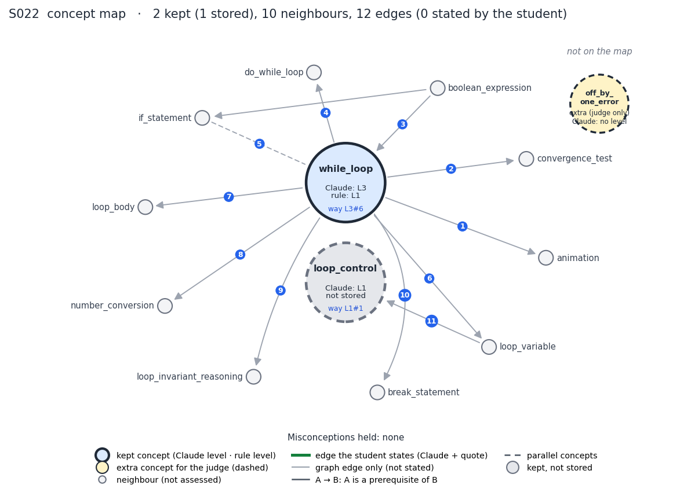

**Triples of the student's concept map** (subject, relation, object, with the logic of each):

| # | Subject | Relation | Object | Logic |
| --- | --- | --- | --- | --- |
| has_level | while_loop | has_level | while_loop@L3 | while_loop@L3#6: The body is the block that the while repeats; it runs only after a true test and is completed before the next test. |
| edge 1 | while_loop | prerequisite | animation | BouncingBall repeats erase, draw at the new position, and show with a pause inside a while (true) loop. — graph only: not checked (a neighbour) |
| edge 2 | while_loop | prerequisite | convergence_test | The convergence test is the condition of a while loop that keeps refining an estimate until the error is below a tolerance. — graph only: not checked (a neighbour) |
| edge 3 | boolean_expression | prerequisite | while_loop | A while tests its boolean condition before every pass and stops the first time it evaluates to false. — graph only: not checked (a neighbour) |
| edge 4 | while_loop | prerequisite | do_while_loop | do { body } while (c); is a while loop whose test is moved to the bottom. — graph only: not checked (a neighbour) |
| edge 5 | if_statement | parallel | while_loop | if and while have the same form, but if tests its condition once and runs the block at most once, while while tests again after every pass and repeats the block as long as the condition is true. — graph only: the answer does not state it |
| edge 6 | while_loop | prerequisite | loop_variable | A loop variable is a counter that the loop initializes, tests in its condition and increments on each pass. — graph only: not checked (a neighbour) |
| edge 7 | while_loop | prerequisite | loop_body | The loop body is the block of statements that a while (or for) loop repeats on each pass. — graph only: not checked (a neighbour) |
| edge 8 | while_loop | prerequisite | number_conversion | Binary conversion repeats one step in a while loop: find the largest power of 2 not above n, output a bit and subtract. — graph only: not checked (a neighbour) |
| edge 9 | while_loop | prerequisite | loop_invariant_reasoning | To reason about a while loop you state what stays true on every pass and why the condition eventually becomes false. — graph only: not checked (a neighbour) |
| edge 10 | while_loop | prerequisite | break_statement | break immediately exits a loop without letting it run to completion. — graph only: not checked (a neighbour) |
| edge 11 | loop_variable | prerequisite | loop_control | The init, condition and update all act on the loop variable: the init sets it, the condition tests it, the update changes it. — graph only: not checked (a neighbour) |


### S023 · final L2 · reference L3

**Question:** If value is 2, what is result after the switch? Explain.

```java
switch (value) {
case 1: result = 10;
case 2:
case 3: result = 20;
case 4: result = 40;
default: result = 50;
}
```

**Student answer:** the swich no have break so it go down all the case and result become 50

**Concept scoring and shortlist.** 7 of the 173 concepts scored above 0. Every concept scoring at least 1.0 is shortlisted, best first, top 8; Claude then chooses which of them the answer is about.

| Rank | Concept | Link score | Filter result |
| --- | --- | --- | --- |
| 1 | switch_statement | 2.18 | **shortlisted** |
| 2 | assignment | 2.00 | **shortlisted** |
| 3 | statement | 2.00 | **shortlisted** |
| 4 | array_aliasing | 2.00 | **shortlisted** |
| 5 | break_statement | 1.46 | **shortlisted** |
| 6 | block | 1.00 | **shortlisted** |
| 7 | conditional_operator | 1.00 | **shortlisted** |

**Extra concept:** variable_swap (Claude: no level).

**Sent to Claude:** switch_statement, assignment, statement, array_aliasing, break_statement, block, conditional_operator, variable_swap.

**Claude chose:** switch_statement, break_statement.

**What happened to each shortlisted concept:**

- switch_statement: no graph evidence; Claude L2; reported, not stored
- assignment: no graph evidence and no level from Claude; not stored
- statement: no graph evidence and no level from Claude; not stored
- array_aliasing: no graph evidence and no level from Claude; not stored
- break_statement: stored; Claude L1
- block: no graph evidence and no level from Claude; not stored
- conditional_operator: no graph evidence and no level from Claude; not stored

**Claude's verdict, traced to the graph's edge logic:**

| Concept | Claude level | Way id | Edge logic of that way |
| --- | --- | --- | --- |
| switch_statement | L2 | switch_statement@L2#2 | A switch statement has no value. Its result is the effect of the case(s) run: with `day = 3`, the S&W day switch prints Wed. Without breaks, day = 5 would print Fri, then Sat. |
| break_statement | L1 | break_statement@L1#2 | `break;` may appear only inside a loop or switch. When executed, it completes that innermost loop or switch at once, and control passes to the statement after it. (Spec: JLS §14.15.) |

**Graph edge logic of the levelled concepts** (has_level, misconception and error edges Claude was shown):

| Concept | Edge | Edge logic |
| --- | --- | --- |
| switch_statement | switch_statement → switch_statement@L2 (has_level) | switch statement -> L2 (Multistructural): the answer applies the rules of switch statement to every part of the code, in order (3 ways). |
| switch_statement | switch_statement → SwitchNoFallThrough (misconception) | wrong rule: After the matching case runs, the switch ends even without break. / right rule: Without break, statements in switch blocks fall through into the following cases. |
| break_statement | break_statement → break_statement@L1 (has_level) | break statement -> L1 (Unistructural): the answer states one correct rule without applying it (2 ways). |
| break_statement | break_statement → BreakExitsIf (misconception) | wrong rule: break leaves the if statement it is written in. / right rule: break immediately exits a loop without letting it run to completion, and in a switch it exits the switch body. |
| break_statement | break_statement → BreakIsContinue (misconception) | wrong rule: break starts the next iteration of the loop. / right rule: break exits the loop immediately; continue skips to the next iteration of the loop. |
| break_statement | break_statement → BreakEndsProgram (misconception) | wrong rule: break ends the whole program. / right rule: break ends only the innermost loop (or switch); execution continues after it. |
| break_statement | break_statement → BreakIgnored (misconception) | wrong rule: break has no effect; the loop body just carries on. / right rule: break leaves the innermost loop at once; the rest of the body and later passes do not run. |

**Claude's overall level:** L2 (main concept switch_statement). The student reaches the correct value of 50 for value = 2 by applying Java's fall-through rule: with no break, execution runs on to default. They justify the result but don't trace which cases run or say what the code is for.

| Step | What happened |
| --- | --- |
| Step 1. Gates | Gates: none. |
| Step 2. Score every concept | 7 of 173 scored above 0. Shortlisted: switch_statement = 2.18; assignment = 2.00; statement = 2.00; array_aliasing = 2.00; break_statement = 1.46; block = 1.00; conditional_operator = 1.00. |
| Step 3. Shortlist and Claude's choice | Top 8 at 1.0 or above: switch_statement, assignment, statement, array_aliasing, break_statement, block, conditional_operator. Claude chose: switch_statement, break_statement. |
| Step 4. Concept map | 1 stored + 5 neighbours. Stored: break_statement. |
| Step 5. Run the code | No value to check. |
| Step 6. LLM judge | Claude gives switch_statement L2; assignment no level; statement no level; array_aliasing no level; break_statement L1; block no level; conditional_operator no level; variable_swap no level; overall L2. |
| Step 7. Final level | max_level, the highest level among the stored concepts (L0 if one holds a wrong rule) = L2; Claude's overall level was L2. Final L2 (reference L3). |

**Trace of the student's concept map:**

| Node | Role | Evidence traced from the answer | Rule level | Claude level and level logic |
| --- | --- | --- | --- | --- |
| switch_statement | chosen, not stored | - | - | L2 via switch_statement@L2#2: L2 (Multistructural): the answer applies the rules of switch statement to every part of the code, in order (3... |
| break_statement | chosen, stored | E1 reference: "break statement: break -- immediately exits the innermost loop or swit..." (0.486) | L1 | L1 via break_statement@L1#2: L1 (Unistructural): the answer states one correct rule without applying it (2 ways). |
| shortlisted, not chosen | not stored | assignment, statement, array_aliasing, block, conditional_operator | - | Claude: none |
| neighbours | not assessed | switch_statement, flag_search_loop, while_loop, labeled_break, continue_statement | - | - |

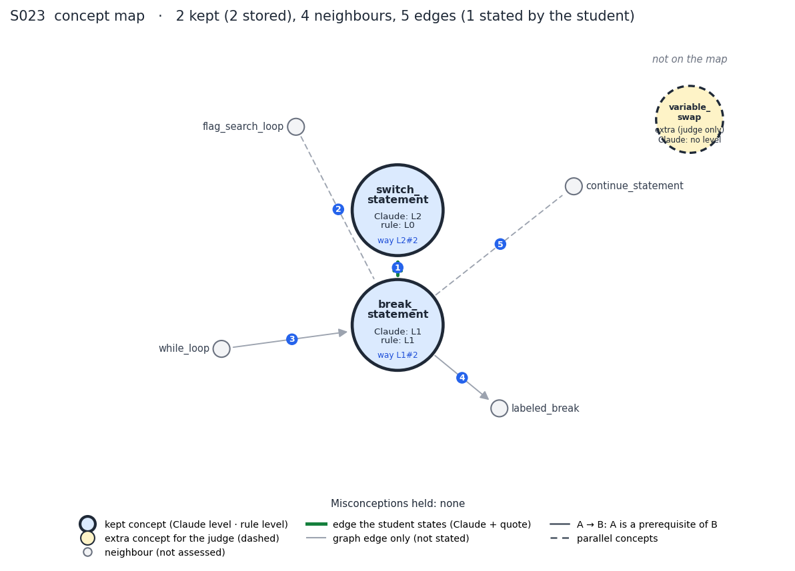

**Triples of the student's concept map** (subject, relation, object, with the logic of each):

| # | Subject | Relation | Object | Logic |
| --- | --- | --- | --- | --- |
| has_level | break_statement | has_level | break_statement@L1 | break_statement@L1#2: `break;` may appear only inside a loop or switch. When executed, it completes that innermost loop or switch at once, and control passes to the statement after i... |
| edge 1 | break_statement | prerequisite | switch_statement | Each case of a switch normally ends with break, which exits the switch body. — **stated by the student**: "the swich no have break so it go down all the case" |
| edge 2 | flag_search_loop | parallel | break_statement | Two ways to stop a search when the item is found: break leaves the loop at once, while a boolean flag is set and tested in the loop condition so the loop ends at its next test. After either, the code must tell the found case from the loop finishing normally. — graph only: not checked (a neighbour) |
| edge 3 | while_loop | prerequisite | break_statement | break immediately exits a loop without letting it run to completion. — graph only: not checked (a neighbour) |
| edge 4 | break_statement | prerequisite | labeled_break | Labeled break extends break to an outer loop. — graph only: not checked (a neighbour) |
| edge 5 | break_statement | parallel | continue_statement | break ends the whole loop; continue ends only the current pass. — graph only: not checked (a neighbour) |


### S026 · final none · reference L1

**Question:** Explain in plain English what these three lines do.

```java
int t = a;
a = b;
b = t;
```

**Student answer:** a becomes b and b becomes a.

**Concept scoring and shortlist.** 31 of the 173 concepts scored above 0. Every concept scoring at least 1.0 is shortlisted, best first, top 8; Claude then chooses which of them the answer is about.

| Rank | Concept | Link score | Filter result |
| --- | --- | --- | --- |
| 1 | assignment | 2.63 | **shortlisted** |
| 2 | array_aliasing | 1.87 | **shortlisted** |
| 3 | variable | 1.75 | **shortlisted** |
| 4 | variable_swap | 1.41 | **shortlisted** |
| 5 | primitive_type | 1.28 | **shortlisted** |
| 6 | statement | 1.00 | **shortlisted** |
| 7 | int | 1.00 | **shortlisted** |
| 8 | piping | 0.73 | not shortlisted: below 1.0 |
| 9 | de_morgan | 0.68 | not shortlisted: below 1.0 |
| 10 | array_copy | 0.64 | not shortlisted: below 1.0 |

**Sent to Claude:** nothing. The answer was too short to assess (content gate).

**What happened to each shortlisted concept:**

- assignment: answer too short to assess (content gate); not stored
- array_aliasing: answer too short to assess (content gate); not stored
- variable: answer too short to assess (content gate); not stored
- variable_swap: answer too short to assess (content gate); not stored
- primitive_type: answer too short to assess (content gate); not stored
- statement: answer too short to assess (content gate); not stored
- int: answer too short to assess (content gate); not stored

| Step | What happened |
| --- | --- |
| Step 1. Gates | Gates: content. |
| Step 2. Score every concept | 31 of 173 scored above 0. Shortlisted: assignment = 2.63; array_aliasing = 1.87; variable = 1.75; variable_swap = 1.41; primitive_type = 1.28; statement = 1.00; int = 1.00. |
| Step 3. Shortlist and Claude's choice | Top 8 at 1.0 or above: assignment, array_aliasing, variable, variable_swap, primitive_type, statement, int. Claude chose: none. |
| Step 4. Concept map | 0 stored + 0 neighbours. Stored: none. |
| Step 5. Run the code | No value to check. |
| Step 6. LLM judge | Not called (content gate). |
| Step 7. Final level | Content gate → none. Final none (reference L1). |

**Trace of the student's concept map:**

| Node | Role | Evidence traced from the answer | Rule level | Claude level and level logic |
| --- | --- | --- | --- | --- |
| shortlisted, not chosen | not stored | assignment, array_aliasing, variable, variable_swap, primitive_type, statement, int | - | Claude: none |

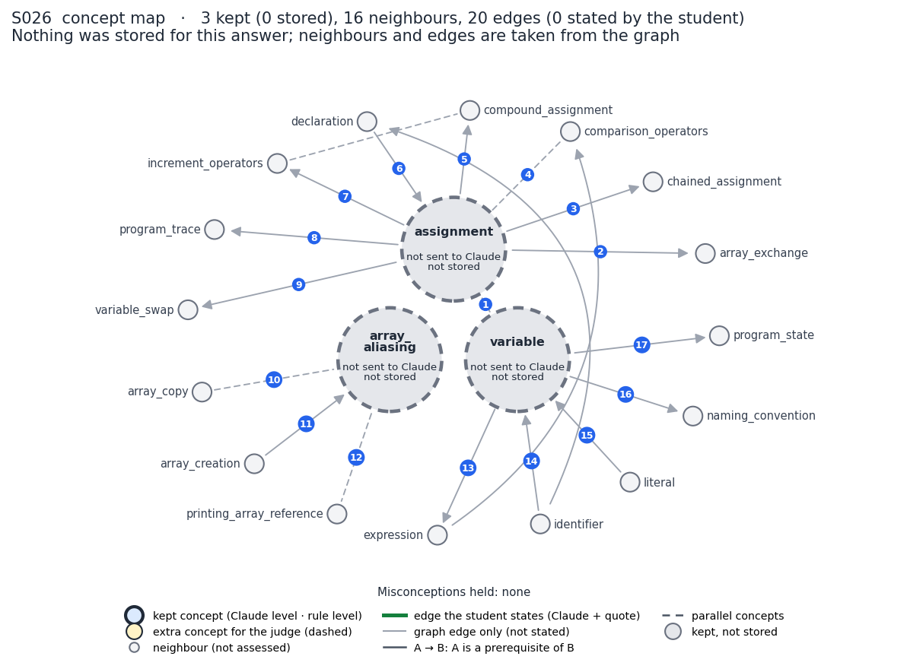

**Triples of the student's concept map** (subject, relation, object, with the logic of each):

| # | Subject | Relation | Object | Logic |
| --- | --- | --- | --- | --- |
| edge 1 | variable | prerequisite | assignment | Assignment needs a declared variable on its left side to store the computed value into. — graph only: not checked (a neighbour) |
| edge 2 | assignment | prerequisite | array_exchange | The exchange is three assignments in a fixed order through a temporary variable. — graph only: not checked (a neighbour) |
| edge 3 | assignment | prerequisite | chained_assignment | An assignment such as x = y is treated as an expression: it assigns the value of y to x and evaluates to that value. — graph only: not checked (a neighbour) |
| edge 4 | assignment | parallel | comparison_operators | x = y stores the value of y in x (a statement with a side effect); x == y only tests whether the two values are equal and gives a boolean. Writing = where == is meant is a compile error with int operands and a silent bug with boolean operands. — graph only: not checked (a neighbour) |
| edge 5 | assignment | prerequisite | compound_assignment | x op= e is shorthand for the assignment x = x op e. — graph only: not checked (a neighbour) |
| edge 6 | declaration | prerequisite | assignment | A variable must be declared before an assignment can store a value into it. — graph only: not checked (a neighbour) |
| edge 7 | assignment | prerequisite | increment_operators | i++ is shorthand for the assignment i = i + 1. — graph only: not checked (a neighbour) |
| edge 8 | assignment | prerequisite | program_trace | A trace records the value each variable holds after each assignment statement runs. — graph only: not checked (a neighbour) |
| edge 9 | assignment | prerequisite | variable_swap | The three assignments int t = a; a = b; b = t; exchange the values of a and b, as a trace of the variable values after each statement shows. — graph only: not checked (a neighbour) |
| edge 10 | array_copy | parallel | array_aliasing | b = a makes a second name for the same array (an alias); copying makes a second array: after a copy, changing b[i] leaves a[i] unchanged. — graph only: not checked (a neighbour) |
| edge 11 | array_creation | prerequisite | array_aliasing | Because new creates one array and the variable stores only a reference to it, assigning that variable to another makes both names refer to the same array. — graph only: not checked (a neighbour) |
| edge 12 | array_aliasing | parallel | printing_array_reference | Both follow from the array variable holding a reference (memory address): assignment and == act on that reference, and println(a) prints it. — graph only: not checked (a neighbour) |
| edge 13 | variable | prerequisite | expression | An expression can be a literal, a variable, or operations on them; we compute with a variable by using its name in an expression. — graph only: not checked (a neighbour) |
| edge 14 | identifier | prerequisite | variable | Every variable is named by an identifier that follows the naming rules. — graph only: not checked (a neighbour) |
| edge 15 | literal | prerequisite | variable | A variable of type t is given a value of type t, often written as a literal. — graph only: not checked (a neighbour) |
| edge 16 | variable | prerequisite | naming_convention | Each variable gets a name; the convention says the name should describe what the variable holds. — graph only: not checked (a neighbour) |
| edge 17 | variable | prerequisite | program_state | Without arrays, a program's state is the values of its variables plus the next statement to run. — graph only: not checked (a neighbour) |


### S028 · final L1 · reference L1

**Question:** What is the exact output? Explain how num4 is computed.

```java
int num1 = 9, num2 = 5;
double num3 = 26.3;
double num4 = (num1 % num2) + num3;
System.out.println("Result is ");
System.out.println("num4 = " + num4);
```

**Student answer:** remainder modulus widening double concatenation println newline

**Concept scoring and shortlist.** 25 of the 173 concepts scored above 0. Every concept scoring at least 1.0 is shortlisted, best first, top 8; Claude then chooses which of them the answer is about.

| Rank | Concept | Link score | Filter result |
| --- | --- | --- | --- |
| 1 | double | 5.00 | **shortlisted** |
| 2 | println | 3.75 | **shortlisted** |
| 3 | remainder_operator | 3.62 | **shortlisted** |
| 4 | string_concatenation | 3.39 | **shortlisted** |
| 5 | primitive_type | 3.00 | **shortlisted** |
| 6 | arithmetic_operators | 3.00 | **shortlisted** |
| 7 | standard_output | 2.53 | **shortlisted** |
| 8 | string_conversion | 2.10 | **shortlisted** |
| 9 | assignment | 2.00 | not shortlisted: only the top 8 are sent |
| 10 | string_literal | 2.00 | not shortlisted: only the top 8 are sent |
| 11 | statement | 2.00 | not shortlisted: only the top 8 are sent |

**Extra concept:** division_by_zero (Claude: no level).

**Sent to Claude:** double, println, remainder_operator, string_concatenation, primitive_type, arithmetic_operators, standard_output, string_conversion, division_by_zero.

**Claude chose:** double, println, remainder_operator, string_concatenation.

**What happened to each shortlisted concept:**

- double: stored; Claude L1
- println: stored; Claude L1
- remainder_operator: stored; Claude L1
- string_concatenation: stored; Claude L1
- primitive_type: Claude did not choose it (no level), so it is not stored
- arithmetic_operators: Claude did not choose it (no level), so it is not stored
- standard_output: Claude did not choose it (no level), so it is not stored
- string_conversion: no graph evidence and no level from Claude; not stored

**Claude's verdict, traced to the graph's edge logic:**

| Concept | Claude level | Way id | Edge logic of that way |
| --- | --- | --- | --- |
| double | L1 | double@L1#1 | double is a primitive data type: Java's 64-bit IEEE 754 floating-point type for representing real numbers. |
| println | L1 | println@L1#1 | System.out.println is a library method that prints its argument followed by a line terminator ('print line'). |
| remainder_operator | L1 | remainder_operator@L1#1 | Remainder operator %: the binary operator that gives the remainder after dividing a by b. |
| string_concatenation | L1 | string_concatenation@L1#1 | String concatenation: the + operator with a String operand, which joins two values end to end into a new String. |

**Graph edge logic of the levelled concepts** (has_level, misconception and error edges Claude was shown):

| Concept | Edge | Edge logic |
| --- | --- | --- |
| double | double → double@L1 (has_level) | double -> L1 (Unistructural): the answer states one correct rule without applying it (2 ways). |
| double | double → FloatingPointIsExact (misconception) | wrong rule: Math.sqrt(2) * Math.sqrt(2) == 2 is true. / right rule: A double is an approximation, so the product is close to 2 but not equal to 2. |
| double | double → WholeNumberLiteralIsInt (misconception) | wrong rule: 207. and 2.3e4 are int values because they are whole numbers. / right rule: A decimal point or scientific notation makes the literal a double. |
| println | println → println@L1 (has_level) | println -> L1 (Unistructural): the answer states one correct rule without applying it (2 ways). |
| println | println → ParenthesesOnlyIfArgument (misconception) | wrong rule: println with nothing to print can be written System.out.println; without the parentheses. / right rule: A method call always needs parentheses, so an empty line is printed with System.out.println();. |
| println | println → PrintEqualsPrintln (misconception) | wrong rule: print and println do the same thing, so print(s1); print(s2); puts s1 and s2 on separate lines. / right rule: println ends the line after printing and print does not, so print(s1); print(s2); puts s1 and s2 on the same line. |
| println | println → IdentifierCaseInsensitive (misconception) | wrong rule: System.out.Println and System.out.println name the same method. / right rule: Java is case-sensitive: names of variables, methods and classes that differ only in capitalization are different names. |
| println | println → PrintWithoutFinalNewline (error) | wrong rule: Ends the output with print and expects it to appear right away. / right rule: Finish a line of print calls with println; some systems hold print output until a newline is printed. |
| remainder_operator | remainder_operator → remainder_operator@L1 (has_level) | remainder operator -> L1 (Unistructural): the answer states one correct rule without applying it (2 ways). |
| remainder_operator | remainder_operator → RemainderIsQuotient (misconception) | wrong rule: 17 % 5 is 3 (the quotient). / right rule: % returns the remainder, so 17 % 5 is 2. |
| remainder_operator | remainder_operator → NegativeRemainderSign (misconception) | wrong rule: a % b is never negative, and integer division of a negative number rounds down. / right rule: a / b rounds toward 0 and a % b takes the sign of a: -14 / 3 is -4 and -14 % 3 is -2. |
| string_concatenation | string_concatenation → string_concatenation@L1 (has_level) | string concatenation -> L1 (Unistructural): the answer states one correct rule without applying it (2 ways). |
| string_concatenation | string_concatenation → ArithmeticPlusPrecedes (misconception) | wrong rule: In "s" + a + b, the numbers a and b are added first and their sum is joined to s. / right rule: Both uses of + have the same precedence and are evaluated left to right, so "s" + a + b joins a and then b as text; only "s" + (a + b) adds them first. |
| string_concatenation | string_concatenation → StringPlusStringifiesExpression (misconception) | wrong rule: In "s" + (a + b), the text a + b is joined to s instead of its value. / right rule: The expression (a + b) is evaluated first, and its value is then turned into text and joined to s. |
| string_concatenation | string_concatenation → StringPlusLeftToRight (misconception) | wrong rule: 2 + 3 + "bc" and "bc" + 2 + 3 give the same text. / right rule: + is evaluated left to right: 2 + 3 + "bc" is "5bc" but "bc" + 2 + 3 is "bc23". |

**Claude's overall level:** L1 (main concept remainder_operator). The answer is only a list of keywords (remainder, modulus, widening, double, concatenation, println, newline). It names the right parts but never applies them to 9, 5 or 26.3, never gives the output, and never explains how num4 = 30.3 is computed.

| Step | What happened |
| --- | --- |
| Step 1. Gates | Gates: none. |
| Step 2. Score every concept | 25 of 173 scored above 0. Shortlisted: double = 5.00; println = 3.75; remainder_operator = 3.62; string_concatenation = 3.39; primitive_type = 3.00; arithmetic_operators = 3.00; standard_output = 2.53; string_conversion = 2.10. |
| Step 3. Shortlist and Claude's choice | Top 8 at 1.0 or above: double, println, remainder_operator, string_concatenation, primitive_type, arithmetic_operators, standard_output, string_conversion. Claude chose: double, println, remainder_operator, string_concatenation. |
| Step 4. Concept map | 4 stored + 14 neighbours. Stored: double, println, remainder_operator, string_concatenation. |
| Step 5. Run the code | No value to check. |
| Step 6. LLM judge | Claude gives double L1; println L1; remainder_operator L1; string_concatenation L1; primitive_type no level; arithmetic_operators no level; standard_output no level; string_conversion no level; division_by_zero no level; overall L1. |
| Step 7. Final level | max_level, the highest level among the stored concepts (L0 if one holds a wrong rule) = L1; Claude's overall level was L1. Final L1 (reference L1). |

**Trace of the student's concept map:**

| Node | Role | Evidence traced from the answer | Rule level | Claude level and level logic |
| --- | --- | --- | --- | --- |
| double | chosen, stored | E1 reference: "double: 64-bit floating-point primitive" (0.312) | L1 | L1 via double@L1#1: L1 (Unistructural): the answer states one correct rule without applying it (2 ways). |
| println | chosen, stored | E1 reference: "println: System.out.println -- output with a trailing newline" (0.538) | L1 | L1 via println@L1#1: L1 (Unistructural): the answer states one correct rule without applying it (2 ways). |
| remainder_operator | chosen, stored | E1 reference: "remainder operator: % gives the remainder of integer division" (0.555) | L1 | L1 via remainder_operator@L1#1: L1 (Unistructural): the answer states one correct rule without applying it (2 ways). |
| string_concatenation | chosen, stored | E1 reference: "string concatenation: + with a String builds a new string" (0.497) | L1 | L1 via string_concatenation@L1#1: L1 (Unistructural): the answer states one correct rule without applying it (2 ways). |
| shortlisted, not chosen | not stored | primitive_type, arithmetic_operators, standard_output, string_conversion | - | Claude: none |
| neighbours | not assessed | floating_point_precision, division_by_zero, boolean, int, primitive_type, char, string_literal, statement, formatted_output, print, integer_division, string_type, arithmetic_operators, string_conversion | - | - |

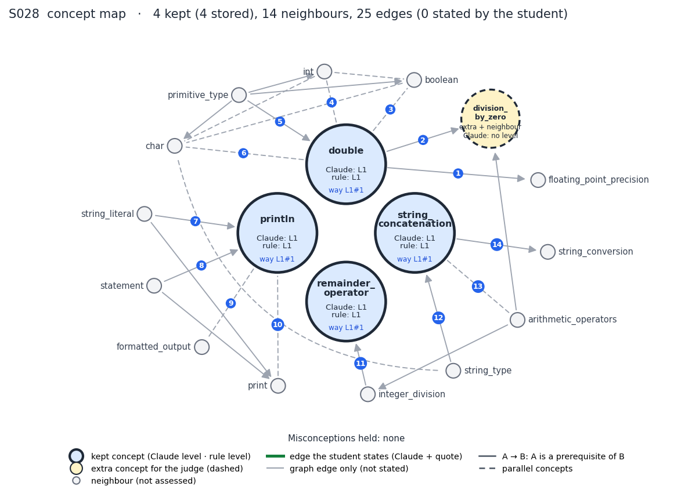

**Triples of the student's concept map** (subject, relation, object, with the logic of each):

| # | Subject | Relation | Object | Logic |
| --- | --- | --- | --- | --- |
| has_level | double | has_level | double@L1 | double@L1#1: double is a primitive data type: Java's 64-bit IEEE 754 floating-point type for representing real numbers. |
| has_level | println | has_level | println@L1 | println@L1#1: System.out.println is a library method that prints its argument followed by a line terminator ('print line'). |
| has_level | remainder_operator | has_level | remainder_operator@L1 | remainder_operator@L1#1: Remainder operator %: the binary operator that gives the remainder after dividing a by b. |
| has_level | string_concatenation | has_level | string_concatenation@L1 | string_concatenation@L1#1: String concatenation: the + operator with a String operand, which joins two values end to end into a new String. |
| edge 1 | double | prerequisite | floating_point_precision | A double approximates real numbers, so its arithmetic is not exact. — graph only: not checked (a neighbour) |
| edge 2 | double | prerequisite | division_by_zero | For doubles, 1.0/0.0 is legal and has the value Infinity; a double result can also be the special value NaN when the calculation is undefined. — graph only: the answer does not state it |
| edge 3 | double | parallel | boolean | A double holds a number with a fractional part; a boolean holds only true or false. — graph only: not checked (a neighbour) |
| edge 4 | int | parallel | double | With two ints, a / b drops the fractional part; if either a or b is a double, a / b keeps the fractional part. — graph only: not checked (a neighbour) |
| edge 5 | primitive_type | prerequisite | double | double is one of the eight primitive types, the one used for real (floating-point) numbers. — graph only: the answer does not state it |
| edge 6 | double | parallel | char | A double holds a number with a fractional part; a char holds one character code, which is a whole number. — graph only: not checked (a neighbour) |
| edge 7 | string_literal | prerequisite | println | println("s") outputs exactly the characters between the quotes and then ends the line. — graph only: not checked (a neighbour) |
| edge 8 | statement | prerequisite | println | System.out.println(s); is itself a statement, so its line of output appears at its own place in the sequence. — graph only: not checked (a neighbour) |
| edge 9 | println | parallel | formatted_output | println prints each number with all its digits and ends the line; printf formats each value by its conversion code and starts a new line only when \n is in the format string. — graph only: not checked (a neighbour) |
| edge 10 | print | parallel | println | print leaves the cursor on the same line after printing; println moves the cursor to the next line after printing. — graph only: not checked (a neighbour) |
| edge 11 | integer_division | prerequisite | remainder_operator | % is the companion of integer division: a = (a / b) * b + a % b. — graph only: not checked (a neighbour) |
| edge 12 | string_type | prerequisite | string_concatenation | + builds a new String whenever at least one of its operands is a String. — graph only: not checked (a neighbour) |
| edge 13 | string_concatenation | parallel | arithmetic_operators | + adds when both operands are numbers and concatenates when either operand is a String, converting the other operand to a String. It is left-associative, so 1 + 2 + "3" is "33" but "1" + 2 + 3 is "123". — graph only: the answer does not state it |
| edge 14 | string_concatenation | prerequisite | string_conversion | When one operand of + is a String, Java converts the other operand to a String before concatenating. — graph only: the answer does not state it |


### S034 · final none · reference none

**Question:** Declare a variable named singleLetter that holds one letter, with initial value Q, following Java convention.

```java
(writing task)
```

**Student answer:** Why does Java have both char and String?

**Gate:** no_claim. The message makes no claim to assess, so no concepts are scored, Claude is not called and the level is none.


### S036 · final L3 · reference L4

**Question:** Find and print the smallest value in data.

```java
(writing task) double array data already exists
```

**Student answer:** double min = data[0]; for (double v : data) min = Math.min(min, v); System.out.println(min);

**Concept scoring and shortlist.** 49 of the 173 concepts scored above 0. Every concept scoring at least 1.0 is shortlisted, best first, top 8; Claude then chooses which of them the answer is about.

| Rank | Concept | Link score | Filter result |
| --- | --- | --- | --- |
| 1 | println | 4.37 | **shortlisted** |
| 2 | double | 4.02 | **shortlisted** |
| 3 | running_extreme | 3.10 | **shortlisted** |
| 4 | primitive_type | 3.00 | **shortlisted** |
| 5 | standard_output | 2.70 | **shortlisted** |
| 6 | math_library | 2.70 | **shortlisted** |
| 7 | method_call | 2.62 | **shortlisted** |
| 8 | empty_statement | 2.27 | **shortlisted** |
| 9 | statement | 2.18 | not shortlisted: only the top 8 are sent |
| 10 | assignment | 2.00 | not shortlisted: only the top 8 are sent |
| 11 | loop_control | 2.00 | not shortlisted: only the top 8 are sent |

**Extra concept:** overflow (Claude: no level).

**Sent to Claude:** println, double, running_extreme, primitive_type, standard_output, math_library, method_call, empty_statement, overflow.

**Claude chose:** running_extreme, math_library.

**What happened to each shortlisted concept:**

- println: Claude did not choose it (no level), so it is not stored
- double: Claude did not choose it (no level), so it is not stored
- running_extreme: stored; Claude L3
- primitive_type: Claude did not choose it (no level), so it is not stored
- standard_output: Claude did not choose it (no level), so it is not stored
- math_library: stored; Claude L2
- method_call: Claude did not choose it (no level), so it is not stored
- empty_statement: Claude did not choose it (no level), so it is not stored

**Claude's verdict, traced to the graph's edge logic:**

| Concept | Claude level | Way id | Edge logic of that way |
| --- | --- | --- | --- |
| running_extreme | L3 | running_extreme@L3#3 | Plan/role: most-wanted holder (Sajaniemi). It finds the extreme in one pass with constant extra memory; the same plan tracks the minimum with <. |
| math_library | L2 | math_library@L2#1 | For Math.f(arg): evaluate arg (an int argument is widened to double), call the method, use the returned double in the enclosing expression; in nested calls the innermost runs first. |

**Graph edge logic of the levelled concepts** (has_level, misconception and error edges Claude was shown):

| Concept | Edge | Edge logic |
| --- | --- | --- |
| running_extreme | running_extreme → running_extreme@L3 (has_level) | running extreme -> L3 (Relational): the answer relates the parts (3 ways). |
| running_extreme | running_extreme → ExtremeStartsAtZero (misconception) | wrong rule: The running maximum can always start at 0. / right rule: Start the running maximum at the most negative possible value (Double.NEGATIVE_INFINITY, or the smallest int), so that the first value read replaces it. |
| math_library | math_library → math_library@L2 (has_level) | math library -> L2 (Multistructural): the answer applies the rules of math library to every part of the code, in order (3 ways). |
| math_library | math_library → CastRounds (misconception) | wrong rule: (int) 2.7 evaluates to 3. / right rule: A cast to int discards the fractional part (rounds toward zero, so (int) -2.7 is -2); Math.round rounds to the nearest integer. |
| math_library | math_library → MathMethodWithoutClassName (error) | wrong rule: sqrt(x) calls the square-root method. / right rule: Library methods are called with the class name, e.g. Math.sqrt(x). |
| math_library | math_library → WrongArgumentType (error) | wrong rule: Calls a method with arguments of the wrong type, e.g. Math.sqrt("2"). / right rule: Each argument must have the type the method's API lists. |
| math_library | math_library → AbsAlwaysNonNegative (misconception) | wrong rule: Math.abs always returns a non-negative number. / right rule: Math.abs(Integer.MIN_VALUE) returns Integer.MIN_VALUE, which is negative. |

**Claude's overall level:** L3 (main concept running_extreme). The code correctly combines a start value of data[0], a single for-each pass and Math.min into a running-minimum plan, then prints the result; it adapts the familiar running-extreme plan, which counts as L3, not L4.

| Step | What happened |
| --- | --- |
| Step 1. Gates | Gates: none. |
| Step 2. Score every concept | 49 of 173 scored above 0. Shortlisted: println = 4.37; double = 4.02; running_extreme = 3.10; primitive_type = 3.00; standard_output = 2.70; math_library = 2.70; method_call = 2.62; empty_statement = 2.27. |
| Step 3. Shortlist and Claude's choice | Top 8 at 1.0 or above: println, double, running_extreme, primitive_type, standard_output, math_library, method_call, empty_statement. Claude chose: running_extreme, math_library. |
| Step 4. Concept map | 2 stored + 9 neighbours. Stored: running_extreme, math_library. |
| Step 5. Run the code | No value to check. |
| Step 6. LLM judge | Claude gives println no level; double no level; running_extreme L3; primitive_type no level; standard_output no level; math_library L2; method_call no level; empty_statement no level; overflow no level; overall L3. |
| Step 7. Final level | max_level, the highest level among the stored concepts (L0 if one holds a wrong rule) = L3; Claude's overall level was L3. Final L3 (reference L4). |

**Trace of the student's concept map:**

| Node | Role | Evidence traced from the answer | Rule level | Claude level and level logic |
| --- | --- | --- | --- | --- |
| running_extreme | chosen, stored | E1 reference: "running extreme: tracking the max or min of a stream" (0.424) | L1 | L3 via running_extreme@L3#3: L3 (Relational): the answer relates the parts (3 ways). |
| math_library | chosen, stored | E1 reference: "math library: Math.abs, Math.sqrt, Math.max, Math.random, Math.round ...." (0.475) | L1 | L2 via math_library@L2#1: L2 (Multistructural): the answer applies the rules of math library to every part of the code, in order (3 ways... |
| shortlisted, not chosen | not stored | println, double, primitive_type, standard_output, method_call, empty_statement | - | Claude: none |
| neighbours | not assessed | accumulator_pattern, array_traversal, shuffle, math_random, standard_audio, trig_functions, random_move, math_round, method_call | - | - |

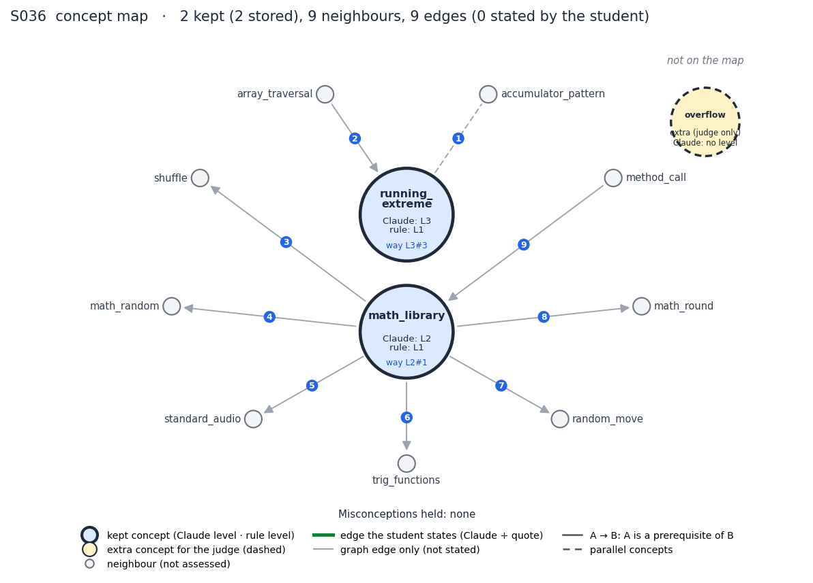

**Triples of the student's concept map** (subject, relation, object, with the logic of each):

| # | Subject | Relation | Object | Logic |
| --- | --- | --- | --- | --- |
| has_level | running_extreme | has_level | running_extreme@L3 | running_extreme@L3#3: Plan/role: most-wanted holder (Sajaniemi). It finds the extreme in one pass with constant extra memory; the same plan tracks the minimum with <. |
| has_level | math_library | has_level | math_library@L2 | math_library@L2#1: For Math.f(arg): evaluate arg (an int argument is widened to double), call the method, use the returned double in the enclosing expression; in nested calls the... |
| edge 1 | running_extreme | parallel | accumulator_pattern | Both make one pass over the values with one variable kept across passes. An accumulator (gatherer role) combines every value into it (sum += a[i]), so it starts at the identity 0.0; a running extreme (most-wanted holder) replaces it only when a better value is found (if (a[i] > max) max = a[i]), so it starts at Double.NEGATIVE_INFINITY or the first value. — graph only: not checked (a neighbour) |
| edge 2 | array_traversal | prerequisite | running_extreme | The running maximum is found by traversing the array once, keeping the largest value seen so far (starting from Double.NEGATIVE_INFINITY). — graph only: not checked (a neighbour) |
| edge 3 | math_library | prerequisite | shuffle | The random position r between i and N-1 is computed with Math.random(), so each remaining card is equally likely to be chosen. — graph only: not checked (a neighbour) |
| edge 4 | math_library | prerequisite | math_random | Math.random() is a Math library method; unlike the others it takes no argument and returns a random double in [0, 1). — graph only: not checked (a neighbour) |
| edge 5 | math_library | prerequisite | standard_audio | To play a tone, each sample a[i] of the sound array is computed with Math.sin at evenly spaced times. — graph only: not checked (a neighbour) |
| edge 6 | math_library | prerequisite | trig_functions | The trig functions are Math library methods. — graph only: not checked (a neighbour) |
| edge 7 | math_library | prerequisite | random_move | The random move draws r with Math.random() and then finds the interval of row p[page] that contains r. — graph only: not checked (a neighbour) |
| edge 8 | math_library | prerequisite | math_round | Math.round is a Math library method. — graph only: not checked (a neighbour) |
| edge 9 | method_call | prerequisite | math_library | Math.sqrt(x) and other Math methods are used through method calls. — graph only: the answer does not state it |


### S037 · final L2 · reference L3

**Question:** Give the output and explain it, addressing parameter passing.

```java
public static void swap(int num1, int num2) {
  int temp = num1; num1 = num2; num2 = temp;
  System.out.printf("in swap: num1 = %d num2 = %d%n", num1, num2);
}
// main: int num1 = 7; int num2 = 42; swap(num1, num2);
// System.out.printf("in main: num1 = %d num2 = %d", num1, num2);
```

**Student answer:** in swap: num1 = 42 num2 = 7, then in main: num1 = 7 num2 = 42. Java passes copies of the values, so main's variables do not change.

**Concept scoring and shortlist.** 87 of the 173 concepts scored above 0. Every concept scoring at least 1.0 is shortlisted, best first, top 8; Claude then chooses which of them the answer is about.

| Rank | Concept | Link score | Filter result |
| --- | --- | --- | --- |
| 1 | variable | 2.92 | **shortlisted** |
| 2 | assignment | 2.83 | **shortlisted** |
| 3 | variable_swap | 2.50 | **shortlisted** |
| 4 | arithmetic_operators | 1.65 | **shortlisted** |
| 5 | primitive_type | 1.63 | **shortlisted** |
| 6 | method_call | 1.62 | **shortlisted** |
| 7 | expression | 1.33 | **shortlisted** |
| 8 | standard_output | 1.32 | **shortlisted** |
| 9 | empty_statement | 1.28 | not shortlisted: only the top 8 are sent |
| 10 | formatted_output | 1.22 | not shortlisted: only the top 8 are sent |
| 11 | string_literal | 1.20 | not shortlisted: only the top 8 are sent |

**Extra concept:** standard_input (Claude: no level).

**Sent to Claude:** variable, assignment, variable_swap, arithmetic_operators, primitive_type, method_call, expression, standard_output, standard_input.

**Claude chose:** variable, variable_swap, method_call.

**What happened to each shortlisted concept:**

- variable: stored; Claude L2
- assignment: Claude did not choose it (no level), so it is not stored
- variable_swap: stored; Claude L1
- arithmetic_operators: Claude did not choose it (no level), so it is not stored
- primitive_type: Claude did not choose it (no level), so it is not stored
- method_call: stored; Claude L2
- expression: no graph evidence and no level from Claude; not stored
- standard_output: no graph evidence and no level from Claude; not stored

**Claude's verdict, traced to the graph's edge logic:**

| Concept | Claude level | Way id | Edge logic of that way |
| --- | --- | --- | --- |
| variable | L2 | variable@L2#3 | Only an assignment or an input read into the variable changes it, and it changes only that variable, replacing the old value. Other variables keep their values. |
| variable_swap | L1 | variable_swap@L1#1 | Variable swap: the three-assignment idiom that exchanges the values of two variables through a temporary variable. |
| method_call | L2 | method_call@L2#3 | Calling a Math method changes none of the caller's variables (arguments are passed as values); the program's state changes only if the returned value is stored or used, e.g. double d = Math.sqrt(x);. |

**Graph edge logic of the levelled concepts** (has_level, misconception and error edges Claude was shown):

| Concept | Edge | Edge logic |
| --- | --- | --- |
| variable | variable → variable@L2 (has_level) | variable -> L2 (Multistructural): the answer applies the rules of variable to every part of the code, in order (3 ways). |
| variable | variable → VariablesHoldObjects (misconception) | wrong rule: A String or array variable contains the whole object inside it. / right rule: A reference variable holds only a reference to the object, which is stored separately. |
| variable | variable → VariablesHoldExpressions (misconception) | wrong rule: = stores the expression itself, not its computed value / right rule: y = x + k; stores the value that x + k has at that moment, so later changes to x do not change y. |
| variable | variable → LoopBodyScopeImpliesLoopLifetime (misconception) | wrong rule: a variable declared in the loop body lives across all iterations / right rule: A variable declared inside the body is created anew on every pass and does not keep the previous pass's value. |
| variable | variable → MultiValueVariable (misconception) | wrong rule: A variable can contain more than one value. / right rule: A variable holds exactly one value at a time; assigning a new value replaces the old one. |
| variable_swap | variable_swap → variable_swap@L1 (has_level) | variable swap -> L1 (Unistructural): the answer states one correct rule without applying it (2 ways). |
| variable_swap | variable_swap → SwapWithoutTemp (misconception) | wrong rule: a[i] = a[j]; a[j] = a[i]; exchanges the two values. / right rule: A temporary variable must save a[i] before it is overwritten. |
| variable_swap | variable_swap → AssignmentExchangesValues (misconception) | wrong rule: b = a exchanges the values of a and b. / right rule: b = a copies a into b and leaves a unchanged; an exchange needs a temporary variable and three assignments. |
| method_call | method_call → method_call@L2 (has_level) | method call -> L2 (Multistructural): the answer applies the rules of method call to every part of the code, in order (3 ways). |
| method_call | method_call → ParenthesesOnlyIfArgument (misconception) | wrong rule: () are optional on a no-argument call like println / right rule: A method call always needs parentheses, so an empty line is printed with System.out.println();. |
| method_call | method_call → EqualsComparesReferences (misconception) | wrong rule: .equals() compares references, not contents / right rule: s.equals(t) checks whether the two Strings contain the same characters. |
| method_call | method_call → ArrayHasLengthMethod (misconception) | wrong rule: you call length() instead of using the length field / right rule: An array's size is the field a.length, written without parentheses. |
| method_call | method_call → MathMethodWithoutClassName (error) | wrong rule: sqrt(x) calls the square-root method. / right rule: Library methods are called with the class name, e.g. Math.sqrt(x). |

**Claude's overall level:** L2 (main concept method_call). The student gives both output lines correctly and explains them with the pass-by-value rule applied to this call, but does not trace the swap or relate parameter passing to another construct.

| Step | What happened |
| --- | --- |
| Step 1. Gates | Gates: none. |
| Step 2. Score every concept | 87 of 173 scored above 0. Shortlisted: variable = 2.92; assignment = 2.83; variable_swap = 2.50; arithmetic_operators = 1.65; primitive_type = 1.63; method_call = 1.62; expression = 1.33; standard_output = 1.32. |
| Step 3. Shortlist and Claude's choice | Top 8 at 1.0 or above: variable, assignment, variable_swap, arithmetic_operators, primitive_type, method_call, expression, standard_output. Claude chose: variable, variable_swap, method_call. |
| Step 4. Concept map | 3 stored + 8 neighbours. Stored: variable, variable_swap, method_call. |
| Step 5. Run the code | No value to check. |
| Step 6. LLM judge | Claude gives variable L2; assignment no level; variable_swap L1; arithmetic_operators no level; primitive_type no level; method_call L2; expression no level; standard_output no level; standard_input no level; overall L2. |
| Step 7. Final level | max_level, the highest level among the stored concepts (L0 if one holds a wrong rule) = L2; Claude's overall level was L2. Final L2 (reference L3). |

**Trace of the student's concept map:**

| Node | Role | Evidence traced from the answer | Rule level | Claude level and level logic |
| --- | --- | --- | --- | --- |
| variable | chosen, stored | E1 reference: "variable: a named, typed box that holds a value" (0.63) | L1 | L2 via variable@L2#3: L2 (Multistructural): the answer applies the rules of variable to every part of the code, in order (3 ways). |
| variable_swap | chosen, stored | E1 reference: "variable swap: exchanging two variables needs a temporary" (0.524) | L1 | L1 via variable_swap@L1#1: L1 (Unistructural): the answer states one correct rule without applying it (2 ways). |
| method_call | chosen, stored | E1 reference: "method call: name(arguments) -- invokes a library method and uses its..." (0.556) | L1 | L2 via method_call@L2#3: L2 (Multistructural): the answer applies the rules of method call to every part of the code, in order (3 ways)... |
| shortlisted, not chosen | not stored | assignment, arithmetic_operators, primitive_type, expression, standard_output | - | Claude: none |
| neighbours | not assessed | literal, expression, identifier, naming_convention, program_state, assignment, math_library, api | - | - |

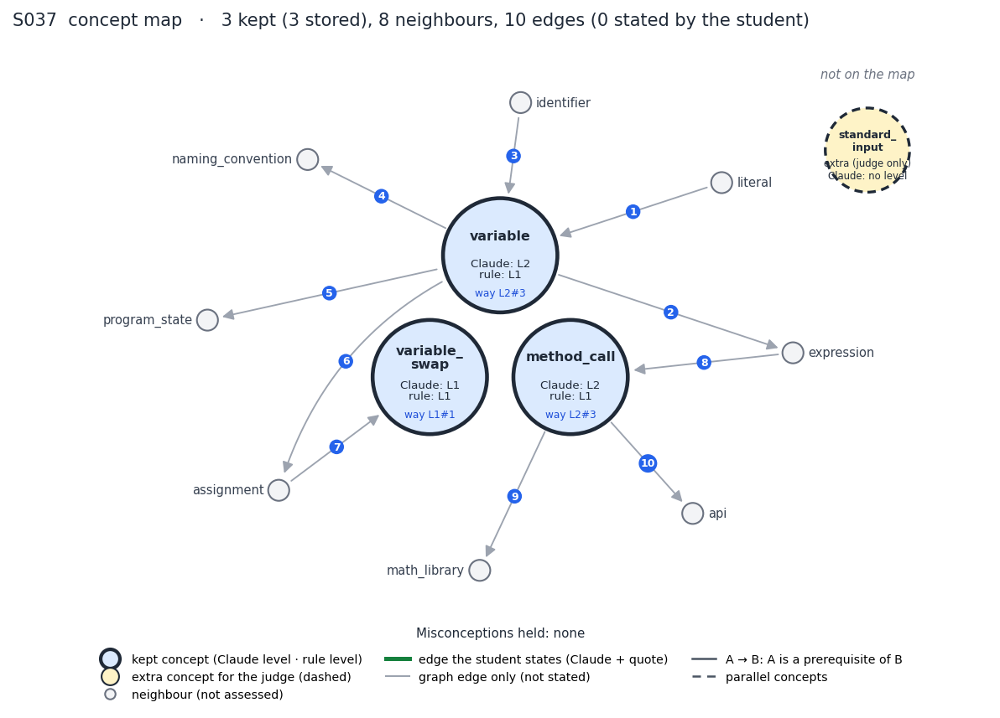

**Triples of the student's concept map** (subject, relation, object, with the logic of each):

| # | Subject | Relation | Object | Logic |
| --- | --- | --- | --- | --- |
| has_level | variable | has_level | variable@L2 | variable@L2#3: Only an assignment or an input read into the variable changes it, and it changes only that variable, replacing the old value. Other variables keep their values. |
| has_level | variable_swap | has_level | variable_swap@L1 | variable_swap@L1#1: Variable swap: the three-assignment idiom that exchanges the values of two variables through a temporary variable. |
| has_level | method_call | has_level | method_call@L2 | method_call@L2#3: Calling a Math method changes none of the caller's variables (arguments are passed as values); the program's state changes only if the returned value is stored... |
| edge 1 | literal | prerequisite | variable | A variable of type t is given a value of type t, often written as a literal. — graph only: not checked (a neighbour) |
| edge 2 | variable | prerequisite | expression | An expression can be a literal, a variable, or operations on them; we compute with a variable by using its name in an expression. — graph only: the answer does not state it |
| edge 3 | identifier | prerequisite | variable | Every variable is named by an identifier that follows the naming rules. — graph only: not checked (a neighbour) |
| edge 4 | variable | prerequisite | naming_convention | Each variable gets a name; the convention says the name should describe what the variable holds. — graph only: not checked (a neighbour) |
| edge 5 | variable | prerequisite | program_state | Without arrays, a program's state is the values of its variables plus the next statement to run. — graph only: not checked (a neighbour) |
| edge 6 | variable | prerequisite | assignment | Assignment needs a declared variable on its left side to store the computed value into. — graph only: the answer does not state it |
| edge 7 | assignment | prerequisite | variable_swap | The three assignments int t = a; a = b; b = t; exchange the values of a and b, as a trace of the variable values after each statement shows. — graph only: the answer does not state it |
| edge 8 | expression | prerequisite | method_call | Method arguments may be expressions, and a method call can be used in expressions in the same way as variables and literals. — graph only: the answer does not state it |
| edge 9 | method_call | prerequisite | math_library | Math.sqrt(x) and other Math methods are used through method calls. — graph only: not checked (a neighbour) |
| edge 10 | method_call | prerequisite | api | An API lists, for each library method, the signature you need in order to call it: name, argument types and return type. — graph only: not checked (a neighbour) |


### S038 · final L2 · reference L2

**Question:** Give the output. In what order are the methods called?

```java
int scaleValue = -11, total = 0;
total = update(scaleValue);
println("num1 = " + scaleValue); println("num2 = " + total);
// update(s): s = 25 + reCalculate(s); return s;
// reCalculate(v): v += 10; v = finalAdjust(v) / 2; return v;
// finalAdjust(v): v = (v >= 0) ? v + 6 : v - 9; return v;
```

**Student answer:** finalAdjust(-1) gives 5, so reCalculate returns 2 and num2 = 27.

**Concept scoring and shortlist.** 33 of the 173 concepts scored above 0. Every concept scoring at least 1.0 is shortlisted, best first, top 8; Claude then chooses which of them the answer is about.

| Rank | Concept | Link score | Filter result |
| --- | --- | --- | --- |
| 1 | assignment | 2.15 | **shortlisted** |
| 2 | increment_operators | 1.24 | **shortlisted** |
| 3 | int | 1.18 | **shortlisted** |
| 4 | string_concatenation | 1.03 | **shortlisted** |
| 5 | compound_assignment | 1.02 | **shortlisted** |
| 6 | conditional_operator | 1.00 | **shortlisted** |
| 7 | string_conversion | 1.00 | **shortlisted** |
| 8 | array_aliasing | 1.00 | **shortlisted** |
| 9 | variable | 1.00 | not shortlisted: only the top 8 are sent |
| 10 | primitive_type | 1.00 | not shortlisted: only the top 8 are sent |
| 11 | arithmetic_operators | 1.00 | not shortlisted: only the top 8 are sent |

**Extra concept:** integer_constants (Claude: no level).

**Sent to Claude:** assignment, increment_operators, int, string_concatenation, compound_assignment, conditional_operator, string_conversion, array_aliasing, integer_constants.

**Claude chose:** assignment, int, compound_assignment, conditional_operator.

**What happened to each shortlisted concept:**

- assignment: stored; Claude L2
- increment_operators: Claude did not choose it (no level), so it is not stored
- int: no graph evidence; Claude L2; reported, not stored
- string_concatenation: no graph evidence and no level from Claude; not stored
- compound_assignment: no graph evidence; Claude L2; reported, not stored
- conditional_operator: no graph evidence; Claude L2; reported, not stored
- string_conversion: no graph evidence and no level from Claude; not stored
- array_aliasing: no graph evidence and no level from Claude; not stored

**Claude's verdict, traced to the graph's edge logic:**

| Concept | Claude level | Way id | Edge logic of that way |
| --- | --- | --- | --- |
| assignment | L2 | assignment@L2#1 | First the right-hand side is fully evaluated using the variables' current values (left to right). Then that value is stored in the left-hand variable, replacing its old value, and execution moves to the next statement. |
| int | L2 | int@L2#2 | The result is an int: 5 + 3 is 8, 5 / 3 is 1, 5 % 3 is 2, 3 * 5 - 2 is 13, and 1 / 0 is a run-time error. |
| compound_assignment | L2 | compound_assignment@L2#3 | One execution changes exactly one variable, x, from its old value (sum += x[i] turns sum = 1 into 1 + 4 = 5). |
| conditional_operator | L2 | conditional_operator@L2#1 | Order: evaluate the condition first; then evaluate exactly one of the other operands (the second if true, the third if false); the unchosen operand is never evaluated. ? : groups right to left and has lower precedence than + and t... |

**Graph edge logic of the levelled concepts** (has_level, misconception and error edges Claude was shown):

| Concept | Edge | Edge logic |
| --- | --- | --- |
| assignment | assignment → assignment@L2 (has_level) | assignment -> L2 (Multistructural): the answer applies the rules of assignment to every part of the code, in order (3 ways). |
| assignment | assignment → VariablesHoldExpressions (misconception) | wrong rule: y = x + k; makes y always equal to x + k, so when x changes later, y changes too. / right rule: y = x + k; stores the value that x + k has at that moment, so later changes to x do not change y. |
| assignment | assignment → AssignCompares (misconception) | wrong rule: x = y checks whether x and y are equal. / right rule: x = y copies the value of y into x; x == y is what compares them. |
| assignment | assignment → AssignmentNotExpression (misconception) | wrong rule: An assignment cannot be used inside a larger expression, so a condition like (x = read()) != v is not allowed. / right rule: An assignment is an expression whose value is the value assigned, so (x = v) both stores v in x and gives v. |
| assignment | assignment → SwapWithoutTemp (misconception) | wrong rule: a[i] = a[j]; a[j] = a[i]; exchanges the two values. / right rule: A temporary variable must save a[i] before it is overwritten. |
| int | int → int@L2 (has_level) | int -> L2 (Multistructural): the answer applies the rules of int to every part of the code, in order (3 ways). |
| int | int → IntegerDivisionGivesFraction (misconception) | wrong rule: 10 / 3 evaluates to 3.333.... / right rule: Dividing two ints gives an int: the fractional part is discarded. |
| int | int → IntOverflowWidensAutomatically (misconception) | wrong rule: An int result that is too large is automatically stored as a bigger number. / right rule: int arithmetic is 32-bit; a result outside the range wraps around. |
| compound_assignment | compound_assignment → compound_assignment@L2 (has_level) | compound assignment -> L2 (Multistructural): the answer applies the rules of compound assignment to every part of the code, in order (3 ways). |
| compound_assignment | compound_assignment → CompoundAssignmentNoCast (misconception) | wrong rule: x += 0.5 adds one half to an int x. / right rule: x += 0.5 is x = (int) (x + 0.5), so an int x does not change. |
| compound_assignment | compound_assignment → CompoundSubtractIsAssignNegative (misconception) | wrong rule: x[i] -= y sets x[i] to -y (reads -= as assignment of a negated value). / right rule: x[i] -= y means x[i] = x[i] - y: it subtracts y from the current value. |
| conditional_operator | conditional_operator → conditional_operator@L2 (has_level) | conditional operator -> L2 (Multistructural): the answer applies the rules of conditional operator to every part of the code, in order (3 ways). |
| conditional_operator | conditional_operator → MapToBooleanWithConditionalOperator (misconception) | wrong rule: you need ? : to do the same / right rule: ok = (x > y); already gives the boolean, so the ? : is unnecessary. |

**Claude's overall level:** L2 (main concept conditional_operator). The student traces the calls in order with values (-1, then finalAdjust, then /2, then 25+...). But they pick the true branch for -1 >= 0, which is a slip in an otherwise rule-correct trace: finalAdjust(-1) is really -10, reCalculate returns -5, and num2 = 20. They also leave out num1 = -11 and never state the call order.

| Step | What happened |
| --- | --- |
| Step 1. Gates | Gates: none. |
| Step 2. Score every concept | 33 of 173 scored above 0. Shortlisted: assignment = 2.15; increment_operators = 1.24; int = 1.18; string_concatenation = 1.03; compound_assignment = 1.02; conditional_operator = 1.00; string_conversion = 1.00; array_aliasing = 1.00. |
| Step 3. Shortlist and Claude's choice | Top 8 at 1.0 or above: assignment, increment_operators, int, string_concatenation, compound_assignment, conditional_operator, string_conversion, array_aliasing. Claude chose: assignment, int, compound_assignment, conditional_operator. |
| Step 4. Concept map | 1 stored + 9 neighbours. Stored: assignment. |
| Step 5. Run the code | No value to check. |
| Step 6. LLM judge | Claude gives assignment L2; increment_operators no level; int L2; string_concatenation no level; compound_assignment L2; conditional_operator L2; string_conversion no level; array_aliasing no level; integer_constants no level; overall L2. |
| Step 7. Final level | max_level, the highest level among the stored concepts (L0 if one holds a wrong rule) = L2; Claude's overall level was L2. Final L2 (reference L2). |

**Trace of the student's concept map:**

| Node | Role | Evidence traced from the answer | Rule level | Claude level and level logic |
| --- | --- | --- | --- | --- |
| assignment | chosen, stored | E1 reference: "assignment: = stores the computed value of the right side" (0.437) | L1 | L2 via assignment@L2#1: L2 (Multistructural): the answer applies the rules of assignment to every part of the code, in order (3 ways). |
| int | chosen, not stored | - | - | L2 via int@L2#2: L2 (Multistructural): the answer applies the rules of int to every part of the code, in order (3 ways). |
| compound_assignment | chosen, not stored | - | - | L2 via compound_assignment@L2#3: L2 (Multistructural): the answer applies the rules of compound assignment to every part of the code, in order... |
| conditional_operator | chosen, not stored | - | - | L2 via conditional_operator@L2#1: L2 (Multistructural): the answer applies the rules of conditional operator to every part of the code, in order... |
| shortlisted, not chosen | not stored | increment_operators, string_concatenation, string_conversion, array_aliasing | - | Claude: none |
| neighbours | not assessed | program_trace, array_exchange, chained_assignment, variable_swap, increment_operators, compound_assignment, variable, declaration, comparison_operators | - | - |

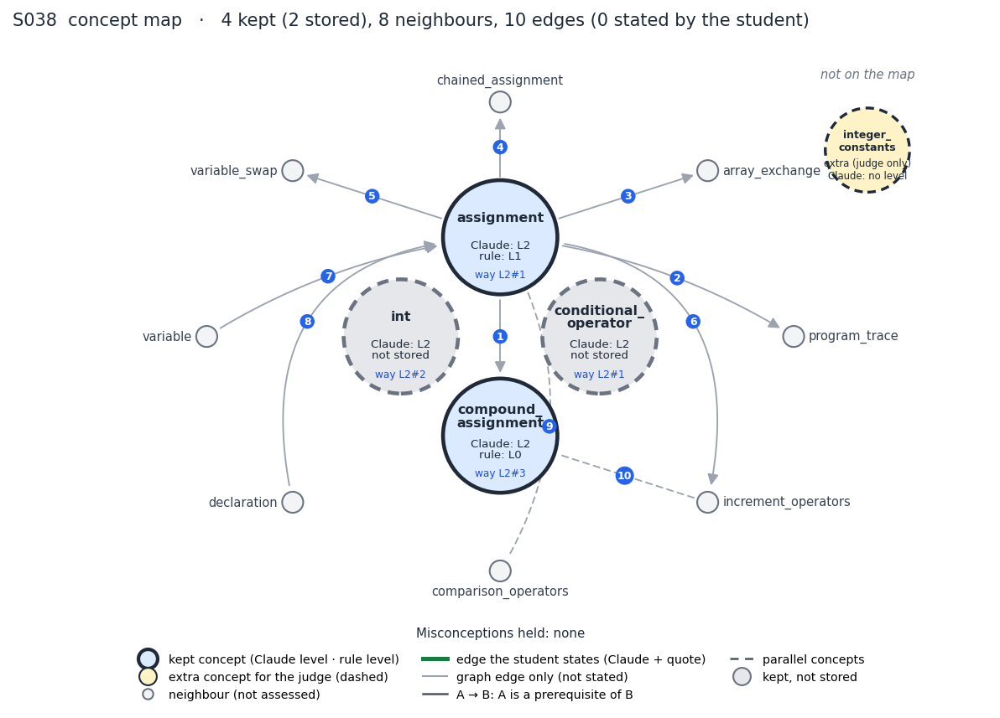

**Triples of the student's concept map** (subject, relation, object, with the logic of each):

| # | Subject | Relation | Object | Logic |
| --- | --- | --- | --- | --- |
| has_level | assignment | has_level | assignment@L2 | assignment@L2#1: First the right-hand side is fully evaluated using the variables' current values (left to right). Then that value is stored in the left-hand variable, replacing... |
| edge 1 | assignment | prerequisite | compound_assignment | x op= e is shorthand for the assignment x = x op e. — graph only: the answer does not state it |
| edge 2 | assignment | prerequisite | program_trace | A trace records the value each variable holds after each assignment statement runs. — graph only: not checked (a neighbour) |
| edge 3 | assignment | prerequisite | array_exchange | The exchange is three assignments in a fixed order through a temporary variable. — graph only: not checked (a neighbour) |
| edge 4 | assignment | prerequisite | chained_assignment | An assignment such as x = y is treated as an expression: it assigns the value of y to x and evaluates to that value. — graph only: not checked (a neighbour) |
| edge 5 | assignment | prerequisite | variable_swap | The three assignments int t = a; a = b; b = t; exchange the values of a and b, as a trace of the variable values after each statement shows. — graph only: not checked (a neighbour) |
| edge 6 | assignment | prerequisite | increment_operators | i++ is shorthand for the assignment i = i + 1. — graph only: the answer does not state it |
| edge 7 | variable | prerequisite | assignment | Assignment needs a declared variable on its left side to store the computed value into. — graph only: not checked (a neighbour) |
| edge 8 | declaration | prerequisite | assignment | A variable must be declared before an assignment can store a value into it. — graph only: not checked (a neighbour) |
| edge 9 | assignment | parallel | comparison_operators | x = y stores the value of y in x (a statement with a side effect); x == y only tests whether the two values are equal and gives a boolean. Writing = where == is meant is a compile error with int operands and a silent bug with boolean operands. — graph only: not checked (a neighbour) |
| edge 10 | increment_operators | parallel | compound_assignment | i++, ++i and i += 1 all add 1 to i; ++ and -- change a variable only by one and are normally used for integers, while i += k works for any amount and with any arithmetic operator (-=, *=, /=, %=). — graph only: the answer does not state it |


### S039 · final L0 · reference L0

**Question:** Return the index of the LAST occurrence of key, or -1 if it is not found.

```java
public static int linearSearch(int[] arr, double key) { ... }
```

**Student answer:** for (...) { if (arr[i] == key) return i; else return -1; }

**Concept scoring and shortlist.** 64 of the 173 concepts scored above 0. Every concept scoring at least 1.0 is shortlisted, best first, top 8; Claude then chooses which of them the answer is about.

| Rank | Concept | Link score | Filter result |
| --- | --- | --- | --- |
| 1 | if_else_statement | 3.67 | **shortlisted** |
| 2 | indexing | 3.64 | **shortlisted** |
| 3 | expression | 3.04 | **shortlisted** |
| 4 | block | 3.00 | **shortlisted** |
| 5 | arithmetic_operators | 3.00 | **shortlisted** |
| 6 | if_statement | 2.65 | **shortlisted** |
| 7 | array_declaration | 2.34 | **shortlisted** |
| 8 | loop_control | 2.29 | **shortlisted** |
| 9 | for_loop | 2.13 | not shortlisted: only the top 8 are sent |
| 10 | int | 2.03 | not shortlisted: only the top 8 are sent |
| 11 | primitive_type | 2.00 | not shortlisted: only the top 8 are sent |

**Extra concept:** for_loop (Claude: no level).

**Sent to Claude:** if_else_statement, indexing, expression, block, arithmetic_operators, if_statement, array_declaration, loop_control, for_loop.

**Claude chose:** indexing, block.

**What happened to each shortlisted concept:**

- if_else_statement: Claude did not choose it (no level), so it is not stored
- indexing: stored; Claude L1
- expression: Claude did not choose it (no level), so it is not stored
- block: no graph evidence; Claude L0; reported, not stored
- arithmetic_operators: Claude did not choose it (no level), so it is not stored
- if_statement: Claude did not choose it (no level), so it is not stored
- array_declaration: Claude did not choose it (no level), so it is not stored
- loop_control: Claude did not choose it (no level), so it is not stored

**Claude's verdict, traced to the graph's edge logic:**

| Concept | Claude level | Way id | Edge logic of that way |
| --- | --- | --- | --- |
| indexing | L1 | indexing@L1#1 | Identity: an array access expression; a[i] names the single element variable at position i of the array a refers to. |
| block | L0 | block@L0#5 | wrong rule: Some statements inside the loop braces are not repeated; they run once, before or after the loop. Right rule: Every statement inside the loop braces is part of the body and runs on every pass. |

**Graph edge logic of the levelled concepts** (has_level, misconception and error edges Claude was shown):

| Concept | Edge | Edge logic |
| --- | --- | --- |
| indexing | indexing → indexing@L1 (has_level) | indexing -> L1 (Unistructural): the answer states one correct rule without applying it (2 ways). |
| indexing | indexing → IndexIsValue (misconception) | wrong rule: i and a[i] are the same thing, so the position is the stored value. / right rule: i is a position; a[i] is the value stored at that position. |
| indexing | indexing → ArrayIndexStartsAtOne (misconception) | wrong rule: The first element of a is a[1]. / right rule: Numbering begins with 0; the first element is a[0]. |
| indexing | indexing → ArrayRangeInclusive (misconception) | wrong rule: new int[n] has slots 0 to n, inclusive. / right rule: The slots are 0 to n - 1. |
| indexing | indexing → ArrayAccessWithParentheses (misconception) | wrong rule: a(i) accesses element i of an array. / right rule: Array elements are accessed with square brackets, a[i]. |
| block | block → block@L0 (has_level) | block -> L0 (Prestructural): the answer holds a rule that contradicts Java (6 ways). |
| block | block → UnbalancedBraces (error) | wrong rule: A missing { or } is harmless. / right rule: Every { must be matched by a } so the class body and the method body are well formed. |
| block | block → MissingBraces (misconception) | wrong rule: Omits braces around a single-statement body of if, for or while. / right rule: Braces are optional for a single-statement body, but using them anyway avoids bugs when statements are added later. |
| block | block → LocalVarOutsideScope (misconception) | wrong rule: A variable declared inside a block can be used anywhere in the program, like a global. / right rule: A local variable exists only from its declaration to the end of its block. |
| block | block → InconsistentIndentation (misconception) | wrong rule: Indents nested blocks inconsistently, so the visual nesting differs from the real nesting. / right rule: Indent consistently, one level deeper for each nested block, so the layout shows the real nesting; the compiler ignores indentation. |

**Claude's overall level:** L0 (main concept block). The student's code puts `else return -1;` inside the loop body as if it ran once after the loop. In Java it runs on the first pass where the element does not match, so the method gives up after checking only arr[0]. Even when it does match, it returns the first index that matches, not the last.

| Step | What happened |
| --- | --- |
| Step 1. Gates | Gates: none. |
| Step 2. Score every concept | 64 of 173 scored above 0. Shortlisted: if_else_statement = 3.67; indexing = 3.64; expression = 3.04; block = 3.00; arithmetic_operators = 3.00; if_statement = 2.65; array_declaration = 2.34; loop_control = 2.29. |
| Step 3. Shortlist and Claude's choice | Top 8 at 1.0 or above: if_else_statement, indexing, expression, block, arithmetic_operators, if_statement, array_declaration, loop_control. Claude chose: indexing, block. |
| Step 4. Concept map | 1 stored + 7 neighbours. Stored: indexing. |
| Step 5. Run the code | No value to check. |
| Step 6. LLM judge | Claude gives if_else_statement no level; indexing L1; expression no level; block L0; arithmetic_operators no level; if_statement no level; array_declaration no level; loop_control no level; for_loop no level; overall L0. |
| Step 7. Final level | max_level, the highest level among the stored concepts (L0 if one holds a wrong rule) = L0; Claude's overall level was L0. Final L0 (reference L0). |

**Trace of the student's concept map:**

| Node | Role | Evidence traced from the answer | Rule level | Claude level and level logic |
| --- | --- | --- | --- | --- |
| indexing | chosen, stored | E1 reference: "indexing: a[i] -- 0-based access" (0.535) | L1 | L1 via indexing@L1#1: L1 (Unistructural): the answer states one correct rule without applying it (2 ways). |
| block | chosen, not stored | - | - | L0 via block@L0#5: L0 (Prestructural): the answer holds a rule that contradicts Java (6 ways). |
| shortlisted, not chosen | not stored | if_else_statement, expression, arithmetic_operators, if_statement, array_declaration, loop_control | - | Claude: none |
| neighbours | not assessed | array_exchange, array_bounds, array_creation, lookup_table, off_by_one_error, array_traversal, two_dimensional_array | - | - |

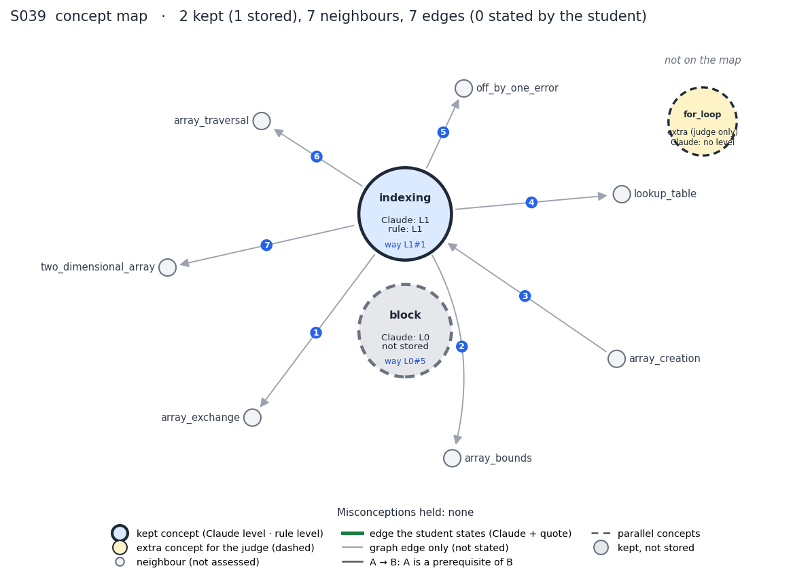

**Triples of the student's concept map** (subject, relation, object, with the logic of each):

| # | Subject | Relation | Object | Logic |
| --- | --- | --- | --- | --- |
| has_level | indexing | has_level | indexing@L1 | indexing@L1#1: Identity: an array access expression; a[i] names the single element variable at position i of the array a refers to. |
| edge 1 | indexing | prerequisite | array_exchange | An exchange reads and writes a[i] and a[j] by index. — graph only: not checked (a neighbour) |
| edge 2 | indexing | prerequisite | array_bounds | Valid indexes run from 0 to a.length - 1; any other index throws an exception when it is used. — graph only: not checked (a neighbour) |
| edge 3 | array_creation | prerequisite | indexing | An array must be created with new before any of its elements a[i] can be accessed. — graph only: not checked (a neighbour) |
| edge 4 | indexing | prerequisite | lookup_table | A lookup table is read by index, a[i]. — graph only: not checked (a neighbour) |
| edge 5 | indexing | prerequisite | off_by_one_error | Indices start at 0, so the last element is a[N-1]; misreading this convention is the usual source of off-by-one errors. — graph only: not checked (a neighbour) |
| edge 6 | indexing | prerequisite | array_traversal | A traversal uses the loop variable i as the index, so a[i] reaches a different element on each pass. — graph only: not checked (a neighbour) |
| edge 7 | indexing | prerequisite | two_dimensional_array | A 1-D array uses one index a[i]; a 2-D array uses two, a[i][j], where the first index chooses the row array. — graph only: not checked (a neighbour) |


### S041 · final L0 · reference L0

**Question:** What is printed? Explain.

```java
String name = "java";
name.toUpperCase();
System.out.println(name);
```

**Student answer:** JAVA, because toUpperCase changes name.

**Concept scoring and shortlist.** 24 of the 173 concepts scored above 0. Every concept scoring at least 1.0 is shortlisted, best first, top 8; Claude then chooses which of them the answer is about.

| Rank | Concept | Link score | Filter result |
| --- | --- | --- | --- |
| 1 | println | 2.59 | **shortlisted** |
| 2 | string_type | 2.30 | **shortlisted** |
| 3 | method_call | 1.62 | **shortlisted** |
| 4 | identifier | 1.36 | **shortlisted** |
| 5 | variable | 1.26 | **shortlisted** |
| 6 | standard_output | 1.00 | **shortlisted** |
| 7 | statement | 1.00 | **shortlisted** |
| 8 | string_literal | 1.00 | **shortlisted** |
| 9 | empty_statement | 1.00 | not shortlisted: only the top 8 are sent |
| 10 | assignment | 1.00 | not shortlisted: only the top 8 are sent |
| 11 | program_text | 0.87 | not shortlisted: below 1.0 |

**Extra concept:** program_text (Claude: no level).

**Sent to Claude:** println, string_type, method_call, identifier, variable, standard_output, statement, string_literal, program_text.

**Claude chose:** string_type, method_call.

**What happened to each shortlisted concept:**

- println: Claude did not choose it (no level), so it is not stored
- string_type: no graph evidence; Claude L0; reported, not stored
- method_call: no graph evidence; Claude L0; reported, not stored
- identifier: Claude did not choose it (no level), so it is not stored
- variable: no graph evidence and no level from Claude; not stored
- standard_output: no graph evidence and no level from Claude; not stored
- statement: no graph evidence and no level from Claude; not stored
- string_literal: no graph evidence and no level from Claude; not stored

**Claude's verdict, traced to the graph's edge logic:**

| Concept | Claude level | Way id | Edge logic of that way |
| --- | --- | --- | --- |
| string_type | L0 | string_type@L0#1 | In everyday writing, quotes only mark words, "10" is the number ten, and two texts are 'equal' when they read the same. In Java a String is an object reached through a reference: "10" is text, + concatenates, and == compares refer... |
| method_call | L0 | method_call@L0#1 | Folk meaning: maths function notation f(x) or sqrt(x), where the name alone suffices, a constant needs no brackets, and the reader infers which argument is which from meaning. Java rule: a library method is called as ClassName.nam... |

**Graph edge logic of the levelled concepts** (has_level, misconception and error edges Claude was shown):

| Concept | Edge | Edge logic |
| --- | --- | --- |
| string_type | string_type → string_type@L0 (has_level) | string type -> L0 (Prestructural): the answer holds a rule that contradicts Java (8 ways). |
| string_type | string_type → StringLiteralNoObject (misconception) | wrong rule: "text" is not a String object until new String(...) is called. / right rule: A string literal is already a String object, so "text".length() works directly. |
| string_type | string_type → EqualsComparesReferences (misconception) | wrong rule: s.equals(t) checks whether s and t are the same object. / right rule: s.equals(t) checks whether the two Strings contain the same characters. |
| string_type | string_type → NullIsObject (misconception) | wrong rule: null is an object, so a method can be called on a variable that is null. / right rule: null means the variable refers to no object, so calling a method on it throws an exception. |
| string_type | string_type → ObjectsMustBeNamed (misconception) | wrong rule: An object can only be created by first storing it in a variable. / right rule: An object can be created and used directly without a variable, as in "s".length() or passing new int[n] as an argument. |
| method_call | method_call → method_call@L0 (has_level) | method call -> L0 (Prestructural): the answer holds a rule that contradicts Java (8 ways). |
| method_call | method_call → ParenthesesOnlyIfArgument (misconception) | wrong rule: () are optional on a no-argument call like println / right rule: A method call always needs parentheses, so an empty line is printed with System.out.println();. |
| method_call | method_call → EqualsComparesReferences (misconception) | wrong rule: .equals() compares references, not contents / right rule: s.equals(t) checks whether the two Strings contain the same characters. |
| method_call | method_call → ArrayHasLengthMethod (misconception) | wrong rule: you call length() instead of using the length field / right rule: An array's size is the field a.length, written without parentheses. |
| method_call | method_call → MathMethodWithoutClassName (error) | wrong rule: sqrt(x) calls the square-root method. / right rule: Library methods are called with the class name, e.g. Math.sqrt(x). |

**Claude's overall level:** L0 (main concept string_type). The student predicts JAVA because they believe name.toUpperCase() changes name. In Java a String is immutable: toUpperCase returns a new String, the code throws it away, and name stays "java", so the program prints java.

| Step | What happened |
| --- | --- |
| Step 1. Gates | Gates: none. |
| Step 2. Score every concept | 24 of 173 scored above 0. Shortlisted: println = 2.59; string_type = 2.30; method_call = 1.62; identifier = 1.36; variable = 1.26; standard_output = 1.00; statement = 1.00; string_literal = 1.00. |
| Step 3. Shortlist and Claude's choice | Top 8 at 1.0 or above: println, string_type, method_call, identifier, variable, standard_output, statement, string_literal. Claude chose: string_type, method_call. |
| Step 4. Concept map | 0 stored + 0 neighbours. Stored: none. |
| Step 5. Run the code | No value to check. |
| Step 6. LLM judge | Claude gives println no level; string_type L0; method_call L0; identifier no level; variable no level; standard_output no level; statement no level; string_literal no level; program_text no level; overall L0. |
| Step 7. Final level | max_level, the highest level among the stored concepts (L0 if one holds a wrong rule) = L0; Claude's overall level was L0. Final L0 (reference L0). |

**Trace of the student's concept map:**

| Node | Role | Evidence traced from the answer | Rule level | Claude level and level logic |
| --- | --- | --- | --- | --- |
| string_type | chosen, not stored | - | - | L0 via string_type@L0#1: L0 (Prestructural): the answer holds a rule that contradicts Java (8 ways). |
| method_call | chosen, not stored | - | - | L0 via method_call@L0#1: L0 (Prestructural): the answer holds a rule that contradicts Java (8 ways). |
| shortlisted, not chosen | not stored | println, identifier, variable, standard_output, statement, string_literal | - | Claude: none |

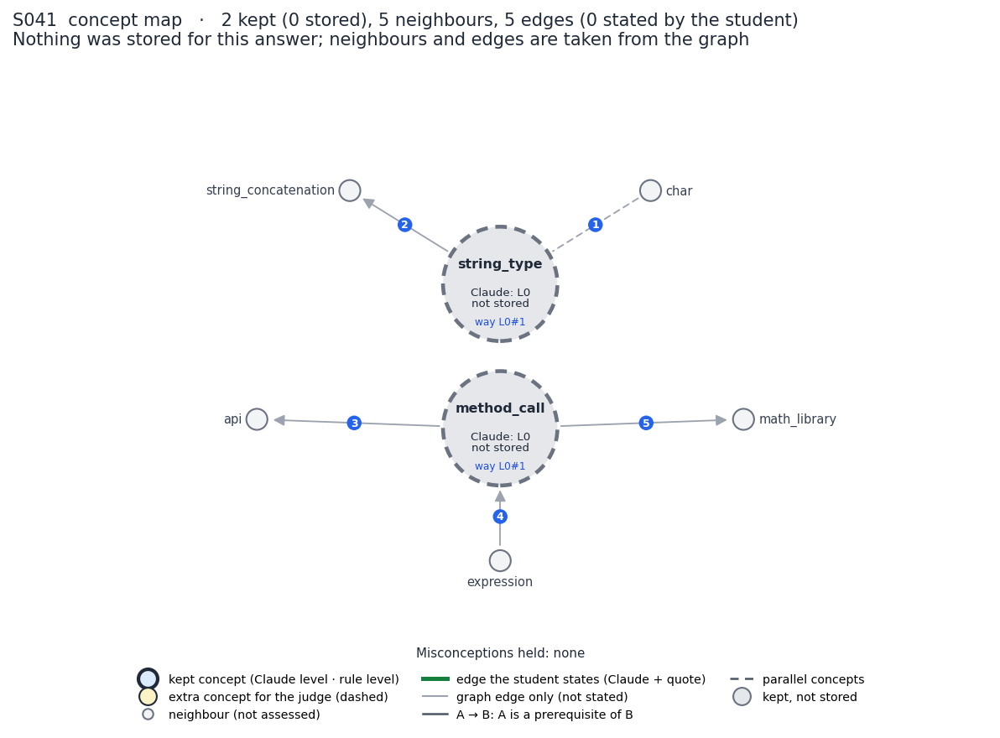

**Triples of the student's concept map** (subject, relation, object, with the logic of each):

| # | Subject | Relation | Object | Logic |
| --- | --- | --- | --- | --- |
| edge 1 | char | parallel | string_type | 'a' is a char (one 16-bit character code, a primitive); "a" is a String (a sequence of characters, an object). 'a' + 'b' is the int 195, while "a" + "b" is "ab". — graph only: not checked (a neighbour) |
| edge 2 | string_type | prerequisite | string_concatenation | + builds a new String whenever at least one of its operands is a String. — graph only: not checked (a neighbour) |
| edge 3 | method_call | prerequisite | api | An API lists, for each library method, the signature you need in order to call it: name, argument types and return type. — graph only: not checked (a neighbour) |
| edge 4 | expression | prerequisite | method_call | Method arguments may be expressions, and a method call can be used in expressions in the same way as variables and literals. — graph only: not checked (a neighbour) |
| edge 5 | method_call | prerequisite | math_library | Math.sqrt(x) and other Math methods are used through method calls. — graph only: not checked (a neighbour) |


### S042 · final L3 · reference L0

**Question:** Write calculateMPG that returns miles per gallon.

```java
(writing task) calculateMPG(double miles, double gallons)
```

**Student answer:** public static double calculateMPG(double miles, double gallons) { double mpg = miles / gallons; }

**Concept scoring and shortlist.** 18 of the 173 concepts scored above 0. Every concept scoring at least 1.0 is shortlisted, best first, top 8; Claude then chooses which of them the answer is about.

| Rank | Concept | Link score | Filter result |
| --- | --- | --- | --- |
| 1 | double | 4.24 | **shortlisted** |
| 2 | primitive_type | 3.00 | **shortlisted** |
| 3 | expression | 2.00 | **shortlisted** |
| 4 | arithmetic_operators | 2.00 | **shortlisted** |
| 5 | variable | 2.00 | **shortlisted** |
| 6 | assignment | 2.00 | **shortlisted** |
| 7 | block | 2.00 | **shortlisted** |
| 8 | remainder_operator | 0.31 | not shortlisted: below 1.0 |
| 9 | math_library | 0.26 | not shortlisted: below 1.0 |
| 10 | floating_point_precision | 0.25 | not shortlisted: below 1.0 |

**Extra concept:** remainder_operator (Claude: no level).

**Sent to Claude:** double, primitive_type, expression, arithmetic_operators, variable, assignment, block, remainder_operator.

**Claude chose:** double, arithmetic_operators, variable, assignment.

**What happened to each shortlisted concept:**

- double: no graph evidence; Claude L2; reported, not stored
- primitive_type: no graph evidence and no level from Claude; not stored
- expression: no graph evidence and no level from Claude; not stored
- arithmetic_operators: no graph evidence; Claude L3; reported, not stored
- variable: no graph evidence; Claude L2; reported, not stored
- assignment: no graph evidence; Claude L2; reported, not stored
- block: no graph evidence and no level from Claude; not stored

**Claude's verdict, traced to the graph's edge logic:**

| Concept | Claude level | Way id | Edge logic of that way |
| --- | --- | --- | --- |
| double | L2 | double@L2#3 | An assignment to a double variable stores the nearest representable value (x = x + 0.1 replaces x with the rounded sum); no double operation throws an exception, so the variable may end up holding Infinity or NaN. |
| arithmetic_operators | L3 | arithmetic_operators@L3#5 | Arithmetic operators turn formulas into code: totals, averages, unit conversions (inch * CM_PER_INCH), and digit extraction (n % 10, n / 10). |
| variable | L2 | variable@L2#3 | Only an assignment or an input read into the variable changes it, and it changes only that variable, replacing the old value. Other variables keep their values. |
| assignment | L2 | assignment@L2#3 | Exactly one variable, the left one, changes, and its old value is lost. Variables on the right keep their values: x = x + 5; with x = 5 makes x 10. |

**Graph edge logic of the levelled concepts** (has_level, misconception and error edges Claude was shown):

| Concept | Edge | Edge logic |
| --- | --- | --- |
| double | double → double@L2 (has_level) | double -> L2 (Multistructural): the answer applies the rules of double to every part of the code, in order (3 ways). |
| double | double → FloatingPointIsExact (misconception) | wrong rule: Math.sqrt(2) * Math.sqrt(2) == 2 is true. / right rule: A double is an approximation, so the product is close to 2 but not equal to 2. |
| double | double → WholeNumberLiteralIsInt (misconception) | wrong rule: 207. and 2.3e4 are int values because they are whole numbers. / right rule: A decimal point or scientific notation makes the literal a double. |
| arithmetic_operators | arithmetic_operators → arithmetic_operators@L3 (has_level) | arithmetic operators -> L3 (Relational): the answer relates the parts (5 ways). |
| arithmetic_operators | arithmetic_operators → CaretIsPower (misconception) | wrong rule: a^2 computes a squared. / right rule: Java has no exponent operator; ^ is exclusive or, and a * a or Math.pow(a, 2) computes a squared. |
| arithmetic_operators | arithmetic_operators → ArithmeticOnNumericStrings (misconception) | wrong rule: "10" - 1 or "6" * "2" works because the strings look like numbers. / right rule: Arithmetic operators other than + are not defined for Strings; a String of digits must first be converted to a number, e.g. with Integer.parseInt. |
| variable | variable → variable@L2 (has_level) | variable -> L2 (Multistructural): the answer applies the rules of variable to every part of the code, in order (3 ways). |
| variable | variable → VariablesHoldObjects (misconception) | wrong rule: A String or array variable contains the whole object inside it. / right rule: A reference variable holds only a reference to the object, which is stored separately. |
| variable | variable → VariablesHoldExpressions (misconception) | wrong rule: = stores the expression itself, not its computed value / right rule: y = x + k; stores the value that x + k has at that moment, so later changes to x do not change y. |
| variable | variable → LoopBodyScopeImpliesLoopLifetime (misconception) | wrong rule: a variable declared in the loop body lives across all iterations / right rule: A variable declared inside the body is created anew on every pass and does not keep the previous pass's value. |
| variable | variable → MultiValueVariable (misconception) | wrong rule: A variable can contain more than one value. / right rule: A variable holds exactly one value at a time; assigning a new value replaces the old one. |
| assignment | assignment → assignment@L2 (has_level) | assignment -> L2 (Multistructural): the answer applies the rules of assignment to every part of the code, in order (3 ways). |
| assignment | assignment → VariablesHoldExpressions (misconception) | wrong rule: y = x + k; makes y always equal to x + k, so when x changes later, y changes too. / right rule: y = x + k; stores the value that x + k has at that moment, so later changes to x do not change y. |
| assignment | assignment → AssignCompares (misconception) | wrong rule: x = y checks whether x and y are equal. / right rule: x = y copies the value of y into x; x == y is what compares them. |
| assignment | assignment → AssignmentNotExpression (misconception) | wrong rule: An assignment cannot be used inside a larger expression, so a condition like (x = read()) != v is not allowed. / right rule: An assignment is an expression whose value is the value assigned, so (x = v) both stores v in x and gives v. |
| assignment | assignment → SwapWithoutTemp (misconception) | wrong rule: a[i] = a[j]; a[j] = a[i]; exchanges the two values. / right rule: A temporary variable must save a[i] before it is overwritten. |

**Claude's overall level:** L3 (main concept arithmetic_operators). The student turns the MPG formula into Java code correctly with a double division, double mpg = miles / gallons. However, the method never returns mpg, so it fails to compile with a 'missing return statement' error and does not do what was asked. New code must be correct to reach L4, so this is an L3 answer with an error.

| Step | What happened |
| --- | --- |
| Step 1. Gates | Gates: none. |
| Step 2. Score every concept | 18 of 173 scored above 0. Shortlisted: double = 4.24; primitive_type = 3.00; expression = 2.00; arithmetic_operators = 2.00; variable = 2.00; assignment = 2.00; block = 2.00. |
| Step 3. Shortlist and Claude's choice | Top 8 at 1.0 or above: double, primitive_type, expression, arithmetic_operators, variable, assignment, block. Claude chose: double, arithmetic_operators, variable, assignment. |
| Step 4. Concept map | 0 stored + 0 neighbours. Stored: none. |
| Step 5. Run the code | No value to check. |
| Step 6. LLM judge | Claude gives double L2; primitive_type no level; expression no level; arithmetic_operators L3; variable L2; assignment L2; block no level; remainder_operator no level; overall L3. |
| Step 7. Final level | max_level, the highest level among the stored concepts (L0 if one holds a wrong rule) = L3; Claude's overall level was L3. Final L3 (reference L0). |

**Trace of the student's concept map:**

| Node | Role | Evidence traced from the answer | Rule level | Claude level and level logic |
| --- | --- | --- | --- | --- |
| double | chosen, not stored | - | - | L2 via double@L2#3: L2 (Multistructural): the answer applies the rules of double to every part of the code, in order (3 ways). |
| arithmetic_operators | chosen, not stored | - | - | L3 via arithmetic_operators@L3#5: L3 (Relational): the answer relates the parts (5 ways). |
| variable | chosen, not stored | - | - | L2 via variable@L2#3: L2 (Multistructural): the answer applies the rules of variable to every part of the code, in order (3 ways). |
| assignment | chosen, not stored | - | - | L2 via assignment@L2#3: L2 (Multistructural): the answer applies the rules of assignment to every part of the code, in order (3 ways). |
| shortlisted, not chosen | not stored | primitive_type, expression, block | - | Claude: none |

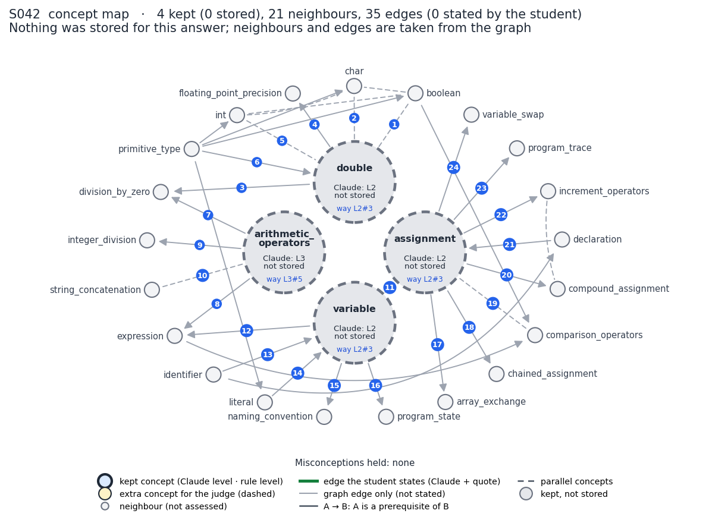

**Triples of the student's concept map** (subject, relation, object, with the logic of each):

| # | Subject | Relation | Object | Logic |
| --- | --- | --- | --- | --- |
| edge 1 | double | parallel | boolean | A double holds a number with a fractional part; a boolean holds only true or false. — graph only: not checked (a neighbour) |
| edge 2 | double | parallel | char | A double holds a number with a fractional part; a char holds one character code, which is a whole number. — graph only: not checked (a neighbour) |
| edge 3 | double | prerequisite | division_by_zero | For doubles, 1.0/0.0 is legal and has the value Infinity; a double result can also be the special value NaN when the calculation is undefined. — graph only: not checked (a neighbour) |
| edge 4 | double | prerequisite | floating_point_precision | A double approximates real numbers, so its arithmetic is not exact. — graph only: not checked (a neighbour) |
| edge 5 | int | parallel | double | With two ints, a / b drops the fractional part; if either a or b is a double, a / b keeps the fractional part. — graph only: not checked (a neighbour) |
| edge 6 | primitive_type | prerequisite | double | double is one of the eight primitive types, the one used for real (floating-point) numbers. — graph only: the answer does not state it |
| edge 7 | arithmetic_operators | prerequisite | division_by_zero | Integer division by zero (1/0) generates a run-time exception, while floating-point 1.0/0.0 is legal and has the value Infinity. — graph only: not checked (a neighbour) |
| edge 8 | arithmetic_operators | prerequisite | expression | An operator combines operand values a and b into a new value, so operators build larger expressions from smaller ones. — graph only: the answer does not state it |
| edge 9 | arithmetic_operators | prerequisite | integer_division | For ints a and b, / gives the whole quotient q and % gives the remainder r, so that a = b * q + r. — graph only: not checked (a neighbour) |
| edge 10 | string_concatenation | parallel | arithmetic_operators | + adds when both operands are numbers and concatenates when either operand is a String, converting the other operand to a String. It is left-associative, so 1 + 2 + "3" is "33" but "1" + 2 + 3 is "123". — graph only: not checked (a neighbour) |
| edge 11 | variable | prerequisite | assignment | Assignment needs a declared variable on its left side to store the computed value into. — graph only: the answer does not state it |
| edge 12 | variable | prerequisite | expression | An expression can be a literal, a variable, or operations on them; we compute with a variable by using its name in an expression. — graph only: the answer does not state it |
| edge 13 | identifier | prerequisite | variable | Every variable is named by an identifier that follows the naming rules. — graph only: not checked (a neighbour) |
| edge 14 | literal | prerequisite | variable | A variable of type t is given a value of type t, often written as a literal. — graph only: not checked (a neighbour) |
| edge 15 | variable | prerequisite | naming_convention | Each variable gets a name; the convention says the name should describe what the variable holds. — graph only: not checked (a neighbour) |
| edge 16 | variable | prerequisite | program_state | Without arrays, a program's state is the values of its variables plus the next statement to run. — graph only: not checked (a neighbour) |
| edge 17 | assignment | prerequisite | array_exchange | The exchange is three assignments in a fixed order through a temporary variable. — graph only: not checked (a neighbour) |
| edge 18 | assignment | prerequisite | chained_assignment | An assignment such as x = y is treated as an expression: it assigns the value of y to x and evaluates to that value. — graph only: not checked (a neighbour) |
| edge 19 | assignment | parallel | comparison_operators | x = y stores the value of y in x (a statement with a side effect); x == y only tests whether the two values are equal and gives a boolean. Writing = where == is meant is a compile error with int operands and a silent bug with boolean operands. — graph only: not checked (a neighbour) |
| edge 20 | assignment | prerequisite | compound_assignment | x op= e is shorthand for the assignment x = x op e. — graph only: not checked (a neighbour) |
| edge 21 | declaration | prerequisite | assignment | A variable must be declared before an assignment can store a value into it. — graph only: not checked (a neighbour) |
| edge 22 | assignment | prerequisite | increment_operators | i++ is shorthand for the assignment i = i + 1. — graph only: not checked (a neighbour) |
| edge 23 | assignment | prerequisite | program_trace | A trace records the value each variable holds after each assignment statement runs. — graph only: not checked (a neighbour) |
| edge 24 | assignment | prerequisite | variable_swap | The three assignments int t = a; a = b; b = t; exchange the values of a and b, as a trace of the variable values after each statement shows. — graph only: not checked (a neighbour) |


### S043 · final L3 · reference L3

**Question:** A classmate says both i and c break the naming convention. Is that right? Rename only what needs renaming, and say whether the output changes.

```java
int[] scores = {72, 45, 90, 60};
int c = 0;
for (int i = 0; i < scores.length; i++) {
  if (scores[i] >= 60) { c++; }
}
System.out.println(c);
```

**Student answer:** i is fine because it is only the loop index. c should be passCount, since it counts the passing scores. It still prints 3.

**Concept scoring and shortlist.** 54 of the 173 concepts scored above 0. Every concept scoring at least 1.0 is shortlisted, best first, top 8; Claude then chooses which of them the answer is about.

| Rank | Concept | Link score | Filter result |
| --- | --- | --- | --- |
| 1 | indexing | 2.21 | **shortlisted** |
| 2 | for_loop | 1.61 | **shortlisted** |
| 3 | loop_control | 1.47 | **shortlisted** |
| 4 | loop_variable | 1.47 | **shortlisted** |
| 5 | increment_operators | 1.38 | **shortlisted** |
| 6 | array_traversal | 1.38 | **shortlisted** |
| 7 | counter_pattern | 1.29 | **shortlisted** |
| 8 | variable | 1.21 | **shortlisted** |
| 9 | comparison_operators | 1.11 | not shortlisted: only the top 8 are sent |
| 10 | block | 1.08 | not shortlisted: only the top 8 are sent |
| 11 | print | 1.00 | not shortlisted: only the top 8 are sent |

**Extra concept:** loop_invariant_reasoning (Claude: no level).

**Sent to Claude:** indexing, for_loop, loop_control, loop_variable, increment_operators, array_traversal, counter_pattern, variable, loop_invariant_reasoning.

**Claude chose:** loop_variable, counter_pattern, variable.

**What happened to each shortlisted concept:**

- indexing: Claude did not choose it (no level), so it is not stored
- for_loop: Claude did not choose it (no level), so it is not stored
- loop_control: Claude did not choose it (no level), so it is not stored
- loop_variable: stored; Claude L1
- increment_operators: Claude did not choose it (no level), so it is not stored
- array_traversal: Claude did not choose it (no level), so it is not stored
- counter_pattern: stored; Claude L3
- variable: stored; Claude L3

**Claude's verdict, traced to the graph's edge logic:**

| Concept | Claude level | Way id | Edge logic of that way |
| --- | --- | --- | --- |
| loop_variable | L1 | loop_variable@L1#1 | A loop variable (loop-control counter, index) is a variable that is initialized, tested and updated in order to control a loop. |
| counter_pattern | L3 | counter_pattern@L3#4 | Plan: counting plan; the counter variable plays a Sajaniemi 'stepper'-like counting role (Soloway's counter variable). Its job is to answer 'how many passes satisfied P?', e.g. wins or number of bets. |
| variable | L3 | variable@L3#5 | A variable's name should describe what it holds (lowerCamelCase), but the name has no effect on its value. |

**Graph edge logic of the levelled concepts** (has_level, misconception and error edges Claude was shown):

| Concept | Edge | Edge logic |
| --- | --- | --- |
| loop_variable | loop_variable → loop_variable@L1 (has_level) | loop variable -> L1 (Unistructural): the answer states one correct rule without applying it (2 ways). |
| loop_variable | loop_variable → LoopVariableLifetimeScope (misconception) | wrong rule: The for variable i is a new variable on every pass rather than one variable changed by the update. / right rule: The for variable i is created once by the init, and the update changes that same variable on every pass. |
| loop_variable | loop_variable → DoubleLoopIndexCount (misconception) | wrong rule: for (double x = 0.0; x <= 1.0; x += 0.1) runs exactly 11 times. / right rule: Using a double as a for-loop index is legal but bad practice: the number of iterations depends on an equality test between double values, which may not give the... |
| loop_variable | loop_variable → ForInitRepeats (misconception) | wrong rule: The initialization of a for loop runs again after a pass of the body. / right rule: The initialization runs exactly once, before the first condition test. |
| loop_variable | loop_variable → LoopUpdateChangesDirection (misconception) | wrong rule: The update of the loop variable can change from pass to pass (e.g. switch direction) although the code is the same. / right rule: The update expression is the same on every pass; the loop variable changes by the rule written in the update. |
| counter_pattern | counter_pattern → counter_pattern@L3 (has_level) | counter pattern -> L3 (Relational): the answer relates the parts (4 ways). |
| counter_pattern | counter_pattern → AccumulatorDeclaredInLoop (error) | wrong rule: Declaring sum inside the loop body keeps a running total across passes. / right rule: The accumulator must be declared and initialised before the loop. |
| counter_pattern | counter_pattern → VariableRolesInferred (misconception) | wrong rule: The computer recognises that one variable plays two roles, e.g. input value and running total, and keeps the values apart; it knows which variable is the counter and which the sum. / right rule: A variable holds one value at a time; each role (input, counter, running total) needs its own variable and explicit update. |
| variable | variable → variable@L3 (has_level) | variable -> L3 (Relational): the answer relates the parts (7 ways). |
| variable | variable → VariablesHoldObjects (misconception) | wrong rule: A String or array variable contains the whole object inside it. / right rule: A reference variable holds only a reference to the object, which is stored separately. |
| variable | variable → VariablesHoldExpressions (misconception) | wrong rule: = stores the expression itself, not its computed value / right rule: y = x + k; stores the value that x + k has at that moment, so later changes to x do not change y. |
| variable | variable → LoopBodyScopeImpliesLoopLifetime (misconception) | wrong rule: a variable declared in the loop body lives across all iterations / right rule: A variable declared inside the body is created anew on every pass and does not keep the previous pass's value. |
| variable | variable → MultiValueVariable (misconception) | wrong rule: A variable can contain more than one value. / right rule: A variable holds exactly one value at a time; assigning a new value replaces the old one. |

**Claude's overall level:** L3 (main concept variable). The student renames only c, giving a name based on what the code makes it hold ('it counts the passing scores'), and keeps i as the loop index, so they link each name to its role; 'It still prints 3' is correct but is not explained by the rule that names do not affect values, so it stays at L3.

| Step | What happened |
| --- | --- |
| Step 1. Gates | Gates: none. |
| Step 2. Score every concept | 54 of 173 scored above 0. Shortlisted: indexing = 2.21; for_loop = 1.61; loop_control = 1.47; loop_variable = 1.47; increment_operators = 1.38; array_traversal = 1.38; counter_pattern = 1.29; variable = 1.21. |
| Step 3. Shortlist and Claude's choice | Top 8 at 1.0 or above: indexing, for_loop, loop_control, loop_variable, increment_operators, array_traversal, counter_pattern, variable. Claude chose: loop_variable, counter_pattern, variable. |
| Step 4. Concept map | 3 stored + 11 neighbours. Stored: loop_variable, counter_pattern, variable. |
| Step 5. Run the code | confirmed by the run: prints 3 |
| Step 6. LLM judge | Claude gives indexing no level; for_loop no level; loop_control no level; loop_variable L1; increment_operators no level; array_traversal no level; counter_pattern L3; variable L3; loop_invariant_reasoning no level; overall L3. |
| Step 7. Final level | max_level, the highest level among the stored concepts (L0 if one holds a wrong rule) = L3; Claude's overall level was L3. Final L3 (reference L3). |

**Trace of the student's concept map:**

| Node | Role | Evidence traced from the answer | Rule level | Claude level and level logic |
| --- | --- | --- | --- | --- |
| loop_variable | chosen, stored | E1 reference: "loop variable: the counter that drives the loop" (0.517); E2 execution: "confirmed by the run: prints 3" (1.0) | L2 provisional | L1 via loop_variable@L1#1: L1 (Unistructural): the answer states one correct rule without applying it (2 ways). |
| counter_pattern | chosen, stored | E1 reference: "counter pattern: counting occurrences across passes" (0.474); E3 integration: "overall purpose" (1.0) | L3 provisional | L3 via counter_pattern@L3#4: L3 (Relational): the answer relates the parts (4 ways). |
| variable | chosen, stored | E1 reference: "variable: a named, typed box that holds a value" (0.453) | L1 | L3 via variable@L3#5: L3 (Relational): the answer relates the parts (7 ways). |
| shortlisted, not chosen | not stored | indexing, for_loop, loop_control, increment_operators, array_traversal | - | Claude: none |
| neighbours | not assessed | while_loop, loop_body, loop_control, monte_carlo_simulation, accumulator_pattern, literal, expression, identifier, naming_convention, program_state, assignment | - | - |

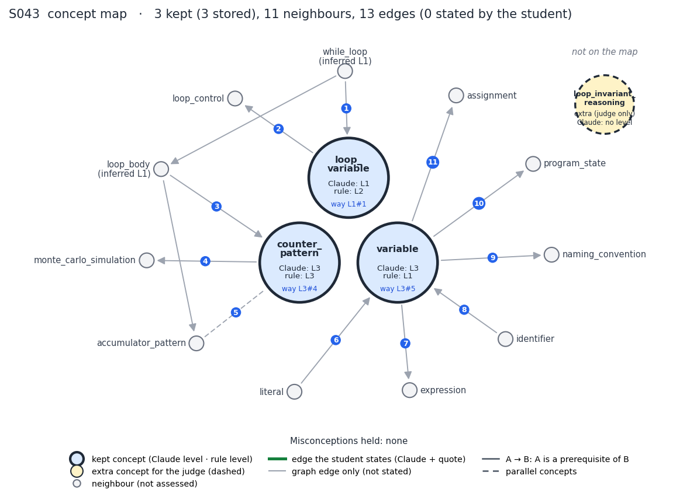

**Triples of the student's concept map** (subject, relation, object, with the logic of each):

| # | Subject | Relation | Object | Logic |
| --- | --- | --- | --- | --- |
| has_level | loop_variable | has_level | loop_variable@L1 | loop_variable@L1#1: A loop variable (loop-control counter, index) is a variable that is initialized, tested and updated in order to control a loop. |
| has_level | counter_pattern | has_level | counter_pattern@L3 | counter_pattern@L3#4: Plan: counting plan; the counter variable plays a Sajaniemi 'stepper'-like counting role (Soloway's counter variable). Its job is to answer 'how many passes sat... |
| has_level | variable | has_level | variable@L3 | variable@L3#5: A variable's name should describe what it holds (lowerCamelCase), but the name has no effect on its value. |
| edge 1 | while_loop | prerequisite | loop_variable | A loop variable is a counter that the loop initializes, tests in its condition and increments on each pass. — graph only: not checked (a neighbour) |
| edge 2 | loop_variable | prerequisite | loop_control | The init, condition and update all act on the loop variable: the init sets it, the condition tests it, the update changes it. — graph only: the answer does not state it |
| edge 3 | loop_body | prerequisite | counter_pattern | count++ sits inside the body, usually under an if, so it runs once on every pass that matches. — graph only: not checked (a neighbour) |
| edge 4 | counter_pattern | prerequisite | monte_carlo_simulation | Counting successes is the counter pattern. — graph only: not checked (a neighbour) |
| edge 5 | accumulator_pattern | parallel | counter_pattern | An accumulator adds the current value itself on each pass (sum += x); a counter adds 1 on each pass that matches (count++). — graph only: not checked (a neighbour) |
| edge 6 | literal | prerequisite | variable | A variable of type t is given a value of type t, often written as a literal. — graph only: not checked (a neighbour) |
| edge 7 | variable | prerequisite | expression | An expression can be a literal, a variable, or operations on them; we compute with a variable by using its name in an expression. — graph only: not checked (a neighbour) |
| edge 8 | identifier | prerequisite | variable | Every variable is named by an identifier that follows the naming rules. — graph only: not checked (a neighbour) |
| edge 9 | variable | prerequisite | naming_convention | Each variable gets a name; the convention says the name should describe what the variable holds. — graph only: not checked (a neighbour) |
| edge 10 | variable | prerequisite | program_state | Without arrays, a program's state is the values of its variables plus the next statement to run. — graph only: not checked (a neighbour) |
| edge 11 | variable | prerequisite | assignment | Assignment needs a declared variable on its left side to store the computed value into. — graph only: not checked (a neighbour) |


### S047 · final L4 · reference L4

**Question:** What is printed, exactly (count the spaces)? Explain each format specifier.

```java
double price = 3.14159;
System.out.printf("%6.2f", price);
System.out.printf("|%d items%n", 4);
```

**Student answer:** With %.3f it would print 3.142 and no spaces. price itself is still 3.14159; only the printed digits change.

**Concept scoring and shortlist.** 46 of the 173 concepts scored above 0. Every concept scoring at least 1.0 is shortlisted, best first, top 8; Claude then chooses which of them the answer is about.

| Rank | Concept | Link score | Filter result |
| --- | --- | --- | --- |
| 1 | formatted_output | 5.56 | **shortlisted** |
| 2 | double | 3.17 | **shortlisted** |
| 3 | arithmetic_operators | 1.27 | **shortlisted** |
| 4 | standard_output | 1.22 | **shortlisted** |
| 5 | assignment | 1.20 | **shortlisted** |
| 6 | string_literal | 1.15 | **shortlisted** |
| 7 | variable | 1.10 | **shortlisted** |
| 8 | remainder_operator | 1.00 | **shortlisted** |
| 9 | method_call | 1.00 | not shortlisted: only the top 8 are sent |
| 10 | print | 1.00 | not shortlisted: only the top 8 are sent |
| 11 | statement | 1.00 | not shortlisted: only the top 8 are sent |

**Extra concept:** floating_point_precision (Claude: no level).

**Sent to Claude:** formatted_output, double, arithmetic_operators, standard_output, assignment, string_literal, variable, remainder_operator, floating_point_precision.

**Claude chose:** formatted_output.

**What happened to each shortlisted concept:**

- formatted_output: stored; Claude L4
- double: Claude did not choose it (no level), so it is not stored
- arithmetic_operators: Claude did not choose it (no level), so it is not stored
- standard_output: no graph evidence and no level from Claude; not stored
- assignment: no graph evidence and no level from Claude; not stored
- string_literal: no graph evidence and no level from Claude; not stored
- variable: no graph evidence and no level from Claude; not stored
- remainder_operator: no graph evidence and no level from Claude; not stored

**Claude's verdict, traced to the graph's edge logic:**

| Concept | Claude level | Way id | Edge logic of that way |
| --- | --- | --- | --- |
| formatted_output | L4 | formatted_output@L4#1 | Changing the precision changes only the printed digits, not the stored value. Changing the width changes only the padding. A width smaller than the converted text is ignored, so nothing is truncated. |

**Graph edge logic of the levelled concepts** (has_level, misconception and error edges Claude was shown):

| Concept | Edge | Edge logic |
| --- | --- | --- |
| formatted_output | formatted_output → formatted_output@L4 (has_level) | formatted output -> L4 (Extended abstract): the answer reasons beyond the given code (5 ways). |
| formatted_output | formatted_output → PrintfAnyConversion (misconception) | wrong rule: Any conversion code (%d, %f, %s) works with any argument type. / right rule: Each conversion code must match its argument's type (any type works with %s); %d with a double or %f with an int throws an IllegalFormatConversionException at r... |
| formatted_output | formatted_output → FieldWidthIsIntegerDigits (misconception) | wrong rule: %2.4f prints two digits before the decimal point and four after. / right rule: The number before the point is the width of the whole field; %7.2f means 7 characters in total with 2 digits after the decimal point. |
| formatted_output | formatted_output → PrintfAddsNewline (misconception) | wrong rule: printf() ends the line like println(). / right rule: printf() does not add a newline; put \n in the format string to end the line. |
| formatted_output | formatted_output → ManyDigitsMeanAccurate (misconception) | wrong rule: A result printed with many decimal places must be accurate to those places. / right rule: A program does not produce accurate answers simply because it can print numbers to many decimal places of precision; ensuring accuracy is often the most difficu... |

**Claude's overall level:** L4 (main concept formatted_output). The student doesn't trace the given %6.2f call. Instead they correctly predict what a precision change to %.3f would print (3.142, no padding) and say what stays the same: the stored value of price is unchanged and only the printed digits differ.

| Step | What happened |
| --- | --- |
| Step 1. Gates | Gates: none. |
| Step 2. Score every concept | 46 of 173 scored above 0. Shortlisted: formatted_output = 5.56; double = 3.17; arithmetic_operators = 1.27; standard_output = 1.22; assignment = 1.20; string_literal = 1.15; variable = 1.10; remainder_operator = 1.00. |
| Step 3. Shortlist and Claude's choice | Top 8 at 1.0 or above: formatted_output, double, arithmetic_operators, standard_output, assignment, string_literal, variable, remainder_operator. Claude chose: formatted_output. |
| Step 4. Concept map | 1 stored + 2 neighbours. Stored: formatted_output. |
| Step 5. Run the code | No value to check. |
| Step 6. LLM judge | Claude gives formatted_output L4; double no level; arithmetic_operators no level; standard_output no level; assignment no level; string_literal no level; variable no level; remainder_operator no level; floating_point_precision no level; overall L4. |
| Step 7. Final level | max_level, the highest level among the stored concepts (L0 if one holds a wrong rule) = L4; Claude's overall level was L4. Final L4 (reference L4). |

**Trace of the student's concept map:**

| Node | Role | Evidence traced from the answer | Rule level | Claude level and level logic |
| --- | --- | --- | --- | --- |
| formatted_output | chosen, stored | E1 reference: "formatted output: printf with a format string such as %d, %.2f, %s" (0.655); E2 execution: "The output is the formatted text. printf("%7.5f", Math.PI) gives 3.141..." (0.655); E4 transfer: "change predicted" (1.0) | L4 provisional | L4 via formatted_output@L4#1: L4 (Extended abstract): the answer reasons beyond the given code (5 ways). |
| shortlisted, not chosen | not stored | double, arithmetic_operators, standard_output, assignment, string_literal, variable, remainder_operator | - | Claude: none |
| neighbours | not assessed | standard_output, println | - | - |

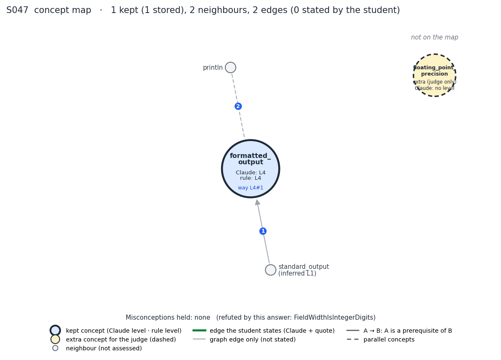

**Triples of the student's concept map** (subject, relation, object, with the logic of each):

| # | Subject | Relation | Object | Logic |
| --- | --- | --- | --- | --- |
| has_level | formatted_output | has_level | formatted_output@L4 | formatted_output@L4#1: Changing the precision changes only the printed digits, not the stored value. Changing the width changes only the padding. A width smaller than the converted te... |
| misconception (refuted) | formatted_output | misconception | FieldWidthIsIntegerDigits | the answer refuted this wrong rule |
| edge 1 | standard_output | prerequisite | formatted_output | printf writes to standard output, like print, but formats each value first. — graph only: the answer does not state it |
| edge 2 | println | parallel | formatted_output | println prints each number with all its digits and ends the line; printf formats each value by its conversion code and starts a new line only when \n is in the format string. — graph only: not checked (a neighbour) |


### S048 · final L0 · reference L0

**Question:** (a) What is printed for the input 5 3 8? (b) For empty input? (c) For the input 5 3 abc?

```java
int sum = 0, count = 0;
while (!StdIn.isEmpty()) {
  int x = StdIn.readInt();
  sum += x;
  count++;
}
StdOut.println(sum + " " + count);
```

**Student answer:** (c) It prints 8 2 and skips abc.

**Concept scoring and shortlist.** 65 of the 173 concepts scored above 0. Every concept scoring at least 1.0 is shortlisted, best first, top 8; Claude then chooses which of them the answer is about.

| Rank | Concept | Link score | Filter result |
| --- | --- | --- | --- |
| 1 | assignment | 1.48 | **shortlisted** |
| 2 | string_conversion | 1.30 | **shortlisted** |
| 3 | string_concatenation | 1.27 | **shortlisted** |
| 4 | statement | 1.08 | **shortlisted** |
| 5 | logical_operators | 1.07 | **shortlisted** |
| 6 | print | 1.04 | **shortlisted** |
| 7 | standard_output | 1.04 | **shortlisted** |
| 8 | block | 1.03 | **shortlisted** |
| 9 | while_loop | 1.00 | not shortlisted: only the top 8 are sent |
| 10 | standard_input | 1.00 | not shortlisted: only the top 8 are sent |
| 11 | array_aliasing | 1.00 | not shortlisted: only the top 8 are sent |

**Extra concept:** char_arithmetic (Claude: no level).

**Sent to Claude:** assignment, string_conversion, string_concatenation, statement, logical_operators, print, standard_output, block, char_arithmetic.

**Claude chose:** statement.

**What happened to each shortlisted concept:**

- assignment: Claude did not choose it (no level), so it is not stored
- string_conversion: Claude did not choose it (no level), so it is not stored
- string_concatenation: Claude did not choose it (no level), so it is not stored
- statement: no graph evidence; Claude L0; reported, not stored
- logical_operators: no graph evidence and no level from Claude; not stored
- print: Claude did not choose it (no level), so it is not stored
- standard_output: no graph evidence and no level from Claude; not stored
- block: no graph evidence and no level from Claude; not stored

**Claude's verdict, traced to the graph's edge logic:**

| Concept | Claude level | Way id | Edge logic of that way |
| --- | --- | --- | --- |
| statement | L0 | statement@L0#2 | wrong rule: The computer fills in omitted steps or values the programmer meant. Right rule: The computer executes only the statements written; every needed step and value must be written. |

**Graph edge logic of the levelled concepts** (has_level, misconception and error edges Claude was shown):

| Concept | Edge | Edge logic |
| --- | --- | --- |
| statement | statement → statement@L0 (has_level) | statement -> L0 (Prestructural): the answer holds a rule that contradicts Java (6 ways). |
| statement | statement → StatementNeedsNoTerminator (error) | wrong rule: A statement still compiles and runs if the semicolon at its end is left out, or if a stray ; is put right after if (c) or for (...). / right rule: Each statement must end with ;, otherwise javac reports ';' expected. |
| statement | statement → StatementsRunInAnyOrder (misconception) | wrong rule: Statements in a program can run in any order. / right rule: Without control statements, statements run once each, top to bottom. |
| statement | statement → WhitespaceIsSignificant (misconception) | wrong rule: Line breaks and indentation change what the program does, so each statement must be on its own line. / right rule: Java compilers consider all whitespace in program text (outside quotation marks) to be equivalent; layout is for human readers. |
| statement | statement → ProgramLooksAhead (misconception) | wrong rule: The program knows or sees what later lines will do and acts on those goals at the current line, e.g. it stops 'at ten' because it wants to draw a box. / right rule: Each statement executes using only the current state; later lines have no effect until control reaches them. |

**Claude's overall level:** L0 (main concept statement). The student claims the program prints 8 2 by skipping abc, but StdIn.readInt() on the token abc throws an InputMismatchException; the loop stops abruptly, so the println is never reached and the student's rule that bad input is quietly ignored contradicts Java.

| Step | What happened |
| --- | --- |
| Step 1. Gates | Gates: none. |
| Step 2. Score every concept | 65 of 173 scored above 0. Shortlisted: assignment = 1.48; string_conversion = 1.30; string_concatenation = 1.27; statement = 1.08; logical_operators = 1.07; print = 1.04; standard_output = 1.04; block = 1.03. |
| Step 3. Shortlist and Claude's choice | Top 8 at 1.0 or above: assignment, string_conversion, string_concatenation, statement, logical_operators, print, standard_output, block. Claude chose: statement. |
| Step 4. Concept map | 0 stored + 0 neighbours. Stored: none. |
| Step 5. Run the code | No value to check. |
| Step 6. LLM judge | Claude gives assignment no level; string_conversion no level; string_concatenation no level; statement L0; logical_operators no level; print no level; standard_output no level; block no level; char_arithmetic no level; overall L0. |
| Step 7. Final level | max_level, the highest level among the stored concepts (L0 if one holds a wrong rule) = L0; Claude's overall level was L0. Final L0 (reference L0). |

**Trace of the student's concept map:**

| Node | Role | Evidence traced from the answer | Rule level | Claude level and level logic |
| --- | --- | --- | --- | --- |
| statement | chosen, not stored | - | - | L0 via statement@L0#2: L0 (Prestructural): the answer holds a rule that contradicts Java (6 ways). |
| shortlisted, not chosen | not stored | assignment, string_conversion, string_concatenation, logical_operators, print, standard_output, block | - | Claude: none |

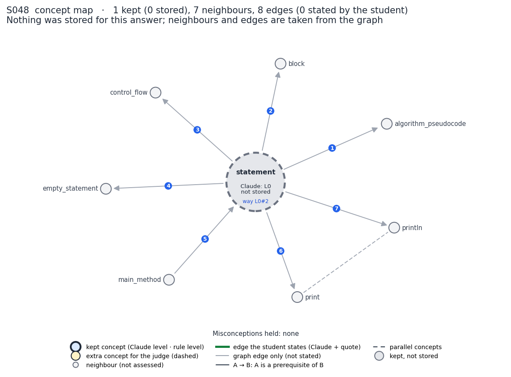

**Triples of the student's concept map** (subject, relation, object, with the logic of each):

| # | Subject | Relation | Object | Logic |
| --- | --- | --- | --- | --- |
| edge 1 | statement | prerequisite | algorithm_pseudocode | An algorithm becomes a program as a sequence of statements, executed once each in the order given. — graph only: not checked (a neighbour) |
| edge 2 | statement | prerequisite | block | A statement block is a sequence of statements, each terminated by a semicolon, enclosed in braces; the body of main() is such a sequence. — graph only: the answer does not state it |
| edge 3 | statement | prerequisite | control_flow | Control flow is the order in which statements run. — graph only: not checked (a neighbour) |
| edge 4 | statement | prerequisite | empty_statement | Any part of a for loop, including its body, can be left empty (a null statement, a lone ;); the book prefers a while loop to null statements. — graph only: not checked (a neighbour) |
| edge 5 | main_method | prerequisite | statement | Statements are written in main's body, and running the program executes main's statements in order, one by one. — graph only: not checked (a neighbour) |
| edge 6 | statement | prerequisite | print | System.out.print(s); is itself a statement, so it runs at its own place in the sequence of statements. — graph only: the answer does not state it |
| edge 7 | statement | prerequisite | println | System.out.println(s); is itself a statement, so its line of output appears at its own place in the sequence. — graph only: not checked (a neighbour) |


### S049 · final none · reference none

**Question:** (a) What is printed for the input 5 3 8? (b) For empty input? (c) For the input 5 3 abc?

```java
int sum = 0, count = 0;
while (!StdIn.isEmpty()) {
  int x = StdIn.readInt();
  sum += x;
  count++;
}
StdOut.println(sum + " " + count);
```

**Student answer:** I read two numbers in each pass and with 5 3 8 it crashes at the end. Why?

**Gate:** no_claim. The message makes no claim to assess, so no concepts are scored, Claude is not called and the level is none.


### S050 · final L0 · reference L0

**Question:** (a) What is printed for the input 5 3 8? (b) For empty input? (c) For the input 5 3 abc?

```java
int sum = 0, count = 0;
while (!StdIn.isEmpty()) {
  int x = StdIn.readInt();
  sum += x;
  count++;
}
StdOut.println(sum + " " + count);
```

**Student answer:** StdIn is a variable that holds all the numbers, like an array.

**Concept scoring and shortlist.** 52 of the 173 concepts scored above 0. Every concept scoring at least 1.0 is shortlisted, best first, top 8; Claude then chooses which of them the answer is about.

| Rank | Concept | Link score | Filter result |
| --- | --- | --- | --- |
| 1 | standard_input | 3.84 | **shortlisted** |
| 2 | variable | 2.18 | **shortlisted** |
| 3 | read_loop_idiom | 1.96 | **shortlisted** |
| 4 | end_of_input | 1.49 | **shortlisted** |
| 5 | accumulator_pattern | 1.18 | **shortlisted** |
| 6 | assignment | 1.16 | **shortlisted** |
| 7 | standard_output | 1.14 | **shortlisted** |
| 8 | while_loop | 1.06 | **shortlisted** |
| 9 | token_vs_line_input | 1.05 | not shortlisted: only the top 8 are sent |
| 10 | loop_control | 1.01 | not shortlisted: only the top 8 are sent |
| 11 | increment_operators | 1.01 | not shortlisted: only the top 8 are sent |

**Extra concept:** stream_model (Claude: L0).

**Sent to Claude:** standard_input, variable, read_loop_idiom, end_of_input, accumulator_pattern, assignment, standard_output, while_loop, stream_model.

**Claude chose:** standard_input, variable.

**What happened to each shortlisted concept:**

- standard_input: stored; Claude L0
- variable: stored; Claude L0
- read_loop_idiom: no graph evidence and no level from Claude; not stored
- end_of_input: no graph evidence and no level from Claude; not stored
- accumulator_pattern: no graph evidence and no level from Claude; not stored
- assignment: no graph evidence and no level from Claude; not stored
- standard_output: no graph evidence and no level from Claude; not stored
- while_loop: no graph evidence and no level from Claude; not stored

**Claude's verdict, traced to the graph's edge logic:**

| Concept | Claude level | Way id | Edge logic of that way |
| --- | --- | --- | --- |
| standard_input | L0 | standard_input@L0#1 | In everyday reading of `INPUT A` or `readInt`, the command looks like it inputs the letter A, or 'looks at' a number without using it up. In fact a read takes the next token from the input stream, converts it, and returns the valu... |
| variable | L0 | variable@L0#3 | wrong rule: A variable can contain more than one value. Right rule: A variable holds exactly one value at a time; assigning a new value replaces the old one. |
| stream_model | L0 | stream_model@L0#1 | Everyday 'reading' (a page, a list) leaves the text in place so you can glance back at it; a Java input stream is consumed: each read removes the next value, and there is no going back. |

**Graph edge logic of the levelled concepts** (has_level, misconception and error edges Claude was shown):

| Concept | Edge | Edge logic |
| --- | --- | --- |
| standard_input | standard_input → standard_input@L0 (has_level) | standard input -> L0 (Prestructural): the answer holds a rule that contradicts Java (6 ways). |
| standard_input | standard_input → StdInRereads (misconception) | wrong rule: Calling StdIn.readInt() twice returns the same value twice. / right rule: The program consumes values when it reads them, so each call returns the next value. |
| standard_input | standard_input → NextLineAfterNextInt (misconception) | wrong rule: A line read after a number read returns the next line typed. / right rule: The number read leaves the newline, so the line read returns "" unless the newline is consumed first. |
| standard_input | standard_input → InputTypeMismatch (error) | wrong rule: StdIn.readInt() accepts any typed text such as abc or 12.2. / right rule: If the next token is not an int (e.g. abc, 12.2, true), StdIn.readInt() throws a NumberFormatException at run time (Scanner.nextInt throws InputMismatchExceptio... |
| standard_input | standard_input → ReadPastEndOfInput (error) | wrong rule: Calls StdIn.readInt() again after the input has run out. / right rule: Reading after standard input is exhausted is a run-time error; test StdIn.isEmpty() before each read. |
| variable | variable → variable@L0 (has_level) | variable -> L0 (Prestructural): the answer holds a rule that contradicts Java (16 ways). |
| variable | variable → VariablesHoldObjects (misconception) | wrong rule: A String or array variable contains the whole object inside it. / right rule: A reference variable holds only a reference to the object, which is stored separately. |
| variable | variable → VariablesHoldExpressions (misconception) | wrong rule: = stores the expression itself, not its computed value / right rule: y = x + k; stores the value that x + k has at that moment, so later changes to x do not change y. |
| variable | variable → LoopBodyScopeImpliesLoopLifetime (misconception) | wrong rule: a variable declared in the loop body lives across all iterations / right rule: A variable declared inside the body is created anew on every pass and does not keep the previous pass's value. |
| variable | variable → MultiValueVariable (misconception) | wrong rule: A variable can contain more than one value. / right rule: A variable holds exactly one value at a time; assigning a new value replaces the old one. |
| stream_model | stream_model → stream_model@L0 (has_level) | stream model -> L0 (Prestructural): the answer holds a rule that contradicts Java (3 ways). |
| stream_model | stream_model → StdInRereads (misconception) | wrong rule: Calling StdIn.readInt() twice returns the same value twice. / right rule: The program consumes values when it reads them, so each call returns the next value. |

**Claude's overall level:** L0 (main concept standard_input). The student does not answer (a), (b) or (c); they only say StdIn is a variable that stores all the numbers like an array, which is wrong because StdIn is a library whose reads take each token from a stream once.

| Step | What happened |
| --- | --- |
| Step 1. Gates | Gates: none. |
| Step 2. Score every concept | 52 of 173 scored above 0. Shortlisted: standard_input = 3.84; variable = 2.18; read_loop_idiom = 1.96; end_of_input = 1.49; accumulator_pattern = 1.18; assignment = 1.16; standard_output = 1.14; while_loop = 1.06. |
| Step 3. Shortlist and Claude's choice | Top 8 at 1.0 or above: standard_input, variable, read_loop_idiom, end_of_input, accumulator_pattern, assignment, standard_output, while_loop. Claude chose: standard_input, variable. |
| Step 4. Concept map | 2 stored + 16 neighbours. Stored: standard_input, variable. |
| Step 5. Run the code | No value to check. |
| Step 6. LLM judge | Claude gives standard_input L0; variable L0; read_loop_idiom no level; end_of_input no level; accumulator_pattern no level; assignment no level; standard_output no level; while_loop no level; stream_model L0; overall L0. |
| Step 7. Final level | max_level, the highest level among the stored concepts (L0 if one holds a wrong rule) = L0; Claude's overall level was L0. Final L0 (reference L0). |

**Trace of the student's concept map:**

| Node | Role | Evidence traced from the answer | Rule level | Claude level and level logic |
| --- | --- | --- | --- | --- |
| standard_input | chosen, stored | E1 reference: "standard input: StdIn -- reading a stream of values" (0.803) | L1 | L0 via standard_input@L0#1: L0 (Prestructural): the answer holds a rule that contradicts Java (6 ways). |
| variable | chosen, stored | E1 reference: "variable: a named, typed box that holds a value" (0.446) | L1 | L0 via variable@L0#3: L0 (Prestructural): the answer holds a rule that contradicts Java (16 ways). |
| shortlisted, not chosen | not stored | read_loop_idiom, end_of_input, accumulator_pattern, assignment, standard_output, while_loop | - | Claude: none |
| neighbours | not assessed | input_format, command_line_args, interactive_input, read_loop_idiom, standard_drawing, redirection, token_vs_line_input, input_graph, stream_model, standard_output, literal, expression, identifier, naming_convention, program_state, assignment | - | - |

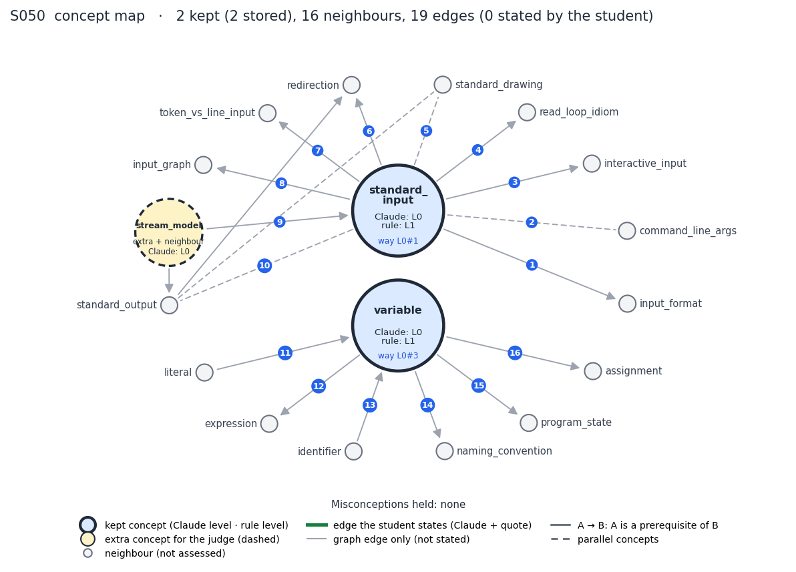

**Triples of the student's concept map** (subject, relation, object, with the logic of each):

| # | Subject | Relation | Object | Logic |
| --- | --- | --- | --- | --- |
| has_level | standard_input | has_level | standard_input@L0 | standard_input@L0#1: In everyday reading of `INPUT A` or `readInt`, the command looks like it inputs the letter A, or 'looks at' a number without using it up. In fact a read takes t... |
| has_level | variable | has_level | variable@L0 | variable@L0#3: wrong rule: A variable can contain more than one value. Right rule: A variable holds exactly one value at a time; assigning a new value replaces the old one. |
| edge 1 | standard_input | prerequisite | input_format | Input format rules apply to every StdIn read. — graph only: not checked (a neighbour) |
| edge 2 | standard_input | parallel | command_line_args | Command-line arguments are a fixed number of strings given once when the program starts (args[]); standard input is a stream of any length read while the program runs (StdIn.readInt()). Both arrive as text and must be parsed into numbers. — graph only: not checked (a neighbour) |
| edge 3 | standard_input | prerequisite | interactive_input | Standard input can be read at any time while the program runs, so the user can type values that change its control flow during execution. — graph only: not checked (a neighbour) |
| edge 4 | standard_input | prerequisite | read_loop_idiom | The read loop repeats StdIn reads until StdIn.isEmpty() returns true. — graph only: the answer does not state it |
| edge 5 | standard_input | parallel | standard_drawing | Like StdIn, StdDraw is a library downloaded from the booksite; StdIn brings values into the program, while StdDraw produces drawings as output. — graph only: not checked (a neighbour) |
| edge 6 | standard_input | prerequisite | redirection | < file makes the contents of the file the standard input stream. — graph only: not checked (a neighbour) |
| edge 7 | standard_input | prerequisite | token_vs_line_input | They are standard-input operations. — graph only: not checked (a neighbour) |
| edge 8 | standard_input | prerequisite | input_graph | The graph is read from standard input: first the number of pages n, then the link pairs i j. — graph only: not checked (a neighbour) |
| edge 9 | stream_model | prerequisite | standard_input | StdIn reads a stream: values arrive in order and each value is consumed once. — graph only: the answer does not state it |
| edge 10 | standard_input | parallel | standard_output | StdIn takes values in from the input stream; StdOut sends values out to the output stream. — graph only: the answer does not state it |
| edge 11 | literal | prerequisite | variable | A variable of type t is given a value of type t, often written as a literal. — graph only: not checked (a neighbour) |
| edge 12 | variable | prerequisite | expression | An expression can be a literal, a variable, or operations on them; we compute with a variable by using its name in an expression. — graph only: not checked (a neighbour) |
| edge 13 | identifier | prerequisite | variable | Every variable is named by an identifier that follows the naming rules. — graph only: not checked (a neighbour) |
| edge 14 | variable | prerequisite | naming_convention | Each variable gets a name; the convention says the name should describe what the variable holds. — graph only: not checked (a neighbour) |
| edge 15 | variable | prerequisite | program_state | Without arrays, a program's state is the values of its variables plus the next statement to run. — graph only: not checked (a neighbour) |
| edge 16 | variable | prerequisite | assignment | Assignment needs a declared variable on its left side to store the computed value into. — graph only: the answer does not state it |


### S051 · final L0 · reference L0

**Question:** What is printed for the input 4 -2 6 99999 3? (b) What if the first value is 99999?

```java
int sum = 0, count = 0;
int v = StdIn.readInt();
while (v != 99999) {
  if (v >= 0) { sum += v; count++; }
  v = StdIn.readInt();
}
if (count > 0) { StdOut.println((double) sum / count); }
```

**Student answer:** I removed if (v >= 0) because rain values are always fine.

**Concept scoring and shortlist.** 25 of the 173 concepts scored above 0. Every concept scoring at least 1.0 is shortlisted, best first, top 8; Claude then chooses which of them the answer is about.

| Rank | Concept | Link score | Filter result |
| --- | --- | --- | --- |
| 1 | comparison_operators | 2.00 | **shortlisted** |
| 2 | if_statement | 2.00 | **shortlisted** |
| 3 | assignment | 1.00 | **shortlisted** |
| 4 | empty_statement | 1.00 | **shortlisted** |
| 5 | while_loop | 1.00 | **shortlisted** |
| 6 | standard_input | 1.00 | **shortlisted** |
| 7 | variable | 1.00 | **shortlisted** |
| 8 | block | 1.00 | **shortlisted** |
| 9 | standard_output | 1.00 | not shortlisted: only the top 8 are sent |
| 10 | statement | 1.00 | not shortlisted: only the top 8 are sent |
| 11 | loop_control | 1.00 | not shortlisted: only the top 8 are sent |

**Extra concept:** sentinel_loop (Claude: L0).

**Sent to Claude:** comparison_operators, if_statement, assignment, empty_statement, while_loop, standard_input, variable, block, sentinel_loop.

**Claude chose:** none.

**What happened to each shortlisted concept:**

- comparison_operators: Claude did not choose it (no level), so it is not stored
- if_statement: Claude did not choose it (no level), so it is not stored
- assignment: Claude did not choose it (no level), so it is not stored
- empty_statement: no graph evidence and no level from Claude; not stored
- while_loop: no graph evidence and no level from Claude; not stored
- standard_input: no graph evidence and no level from Claude; not stored
- variable: no graph evidence and no level from Claude; not stored
- block: no graph evidence and no level from Claude; not stored

**Claude's verdict, traced to the graph's edge logic:**

| Concept | Claude level | Way id | Edge logic of that way |
| --- | --- | --- | --- |
| sentinel_loop | L0 | sentinel_loop@L0#1 | In everyday lists the last number written is part of the data. A sentinel such as 99999 is a stop marker, not data, so it must not be summed or counted. |

**Graph edge logic of the levelled concepts** (has_level, misconception and error edges Claude was shown):

| Concept | Edge | Edge logic |
| --- | --- | --- |
| sentinel_loop | sentinel_loop → sentinel_loop@L0 (has_level) | sentinel loop -> L0 (Prestructural): the answer holds a rule that contradicts Java (3 ways). |
| sentinel_loop | sentinel_loop → SentinelProcessed (misconception) | wrong rule: The sentinel value (e.g. 999999) is added to the total like the other values. / right rule: The loop stops at the sentinel without processing it. |
| sentinel_loop | sentinel_loop → AverageWithoutZeroGuard (error) | wrong rule: Computes sum / count without checking that count is above 0. / right rule: If no value was read (count is 0), do not compute the average: with int operands sum / count is a division by zero, a run-time exception that stops the program;... |
| sentinel_loop | sentinel_loop → NegativeNotFiltered (error) | wrong rule: Adds negative rainfall values to the total. / right rule: Values outside the range of interest must be filtered out (for example with if (t >= lo && t <= hi)) before they are processed. |

**Claude's overall level:** L0 (main concept sentinel_loop). The student does not trace the code or say what it prints. Instead they delete the v >= 0 filter on the everyday assumption that rain values are always fine, even though the given input contains -2, so negative values would be added to sum and count and the average would be wrong.

| Step | What happened |
| --- | --- |
| Step 1. Gates | Gates: none. |
| Step 2. Score every concept | 25 of 173 scored above 0. Shortlisted: comparison_operators = 2.00; if_statement = 2.00; assignment = 1.00; empty_statement = 1.00; while_loop = 1.00; standard_input = 1.00; variable = 1.00; block = 1.00. |
| Step 3. Shortlist and Claude's choice | Top 8 at 1.0 or above: comparison_operators, if_statement, assignment, empty_statement, while_loop, standard_input, variable, block. Claude chose: none. |
| Step 4. Concept map | 0 stored + 0 neighbours. Stored: none. |
| Step 5. Run the code | No value to check. |
| Step 6. LLM judge | Claude gives comparison_operators no level; if_statement no level; assignment no level; empty_statement no level; while_loop no level; standard_input no level; variable no level; block no level; sentinel_loop L0; overall L0. |
| Step 7. Final level | max_level, the highest level among the stored concepts (L0 if one holds a wrong rule) = L0; Claude's overall level was L0. Final L0 (reference L0). |

**Trace of the student's concept map:**

| Node | Role | Evidence traced from the answer | Rule level | Claude level and level logic |
| --- | --- | --- | --- | --- |
| shortlisted, not chosen | not stored | comparison_operators, if_statement, assignment, empty_statement, while_loop, standard_input, variable, block | - | Claude: none |

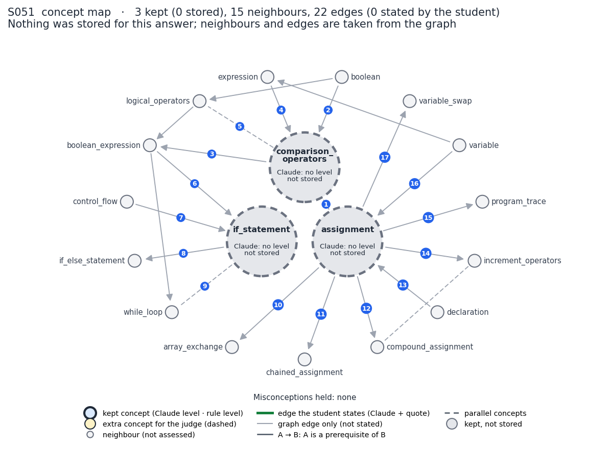

**Triples of the student's concept map** (subject, relation, object, with the logic of each):

| # | Subject | Relation | Object | Logic |
| --- | --- | --- | --- | --- |
| edge 1 | assignment | parallel | comparison_operators | x = y stores the value of y in x (a statement with a side effect); x == y only tests whether the two values are equal and gives a boolean. Writing = where == is meant is a compile error with int operands and a silent bug with boolean operands. — graph only: the answer does not state it |
| edge 2 | boolean | prerequisite | comparison_operators | A comparison such as a < b takes two numbers and produces a boolean result. — graph only: not checked (a neighbour) |
| edge 3 | comparison_operators | prerequisite | boolean_expression | A comparison such as x < y produces a boolean result; comparisons together with boolean logic provide the basis for decision-making. — graph only: not checked (a neighbour) |
| edge 4 | expression | prerequisite | comparison_operators | Comparison operators build expressions whose value is a boolean, so one must already know what an expression is to understand a < b. — graph only: not checked (a neighbour) |
| edge 5 | comparison_operators | parallel | logical_operators | Relational operators compare two numbers to give a boolean; logical operators combine booleans into one boolean. — graph only: not checked (a neighbour) |
| edge 6 | boolean_expression | prerequisite | if_statement | An if runs its block only when its boolean expression evaluates to true. — graph only: not checked (a neighbour) |
| edge 7 | control_flow | prerequisite | if_statement | An if changes the default top-to-bottom flow by running a block only when its condition is true. — graph only: not checked (a neighbour) |
| edge 8 | if_statement | prerequisite | if_else_statement | if-else extends if with a second block that runs exactly when the condition is false. — graph only: not checked (a neighbour) |
| edge 9 | if_statement | parallel | while_loop | if and while have the same form, but if tests its condition once and runs the block at most once, while while tests again after every pass and repeats the block as long as the condition is true. — graph only: the answer does not state it |
| edge 10 | assignment | prerequisite | array_exchange | The exchange is three assignments in a fixed order through a temporary variable. — graph only: not checked (a neighbour) |
| edge 11 | assignment | prerequisite | chained_assignment | An assignment such as x = y is treated as an expression: it assigns the value of y to x and evaluates to that value. — graph only: not checked (a neighbour) |
| edge 12 | assignment | prerequisite | compound_assignment | x op= e is shorthand for the assignment x = x op e. — graph only: not checked (a neighbour) |
| edge 13 | declaration | prerequisite | assignment | A variable must be declared before an assignment can store a value into it. — graph only: not checked (a neighbour) |
| edge 14 | assignment | prerequisite | increment_operators | i++ is shorthand for the assignment i = i + 1. — graph only: not checked (a neighbour) |
| edge 15 | assignment | prerequisite | program_trace | A trace records the value each variable holds after each assignment statement runs. — graph only: not checked (a neighbour) |
| edge 16 | variable | prerequisite | assignment | Assignment needs a declared variable on its left side to store the computed value into. — graph only: the answer does not state it |
| edge 17 | assignment | prerequisite | variable_swap | The three assignments int t = a; a = b; b = t; exchange the values of a and b, as a trace of the variable values after each statement shows. — graph only: not checked (a neighbour) |


### S052 · final L2 · reference L3

**Question:** What appears in the terminal after each command? What does args[] contain when Average runs?

```java
% java RandomSeq 5 > data.txt
% java Average < data.txt
% java RandomSeq 5 | java Average
(RandomSeq N prints N random numbers; Average reads numbers from standard input and prints their average)
```

**Student answer:** 1: nothing, the numbers go into data.txt. 2: the average. 3: an average of 5 new numbers, no file. args is empty.

**Concept scoring and shortlist.** 46 of the 173 concepts scored above 0. Every concept scoring at least 1.0 is shortlisted, best first, top 8; Claude then chooses which of them the answer is about.

| Rank | Concept | Link score | Filter result |
| --- | --- | --- | --- |
| 1 | command_line_args | 3.20 | **shortlisted** |
| 2 | redirection | 2.71 | **shortlisted** |
| 3 | piping | 2.31 | **shortlisted** |
| 4 | arithmetic_operators | 2.12 | **shortlisted** |
| 5 | expression | 2.00 | **shortlisted** |
| 6 | remainder_operator | 2.00 | **shortlisted** |
| 7 | run | 2.00 | **shortlisted** |
| 8 | args_length | 1.50 | **shortlisted** |
| 9 | random_move | 1.06 | not shortlisted: only the top 8 are sent |
| 10 | print | 1.00 | not shortlisted: only the top 8 are sent |
| 11 | standard_input | 1.00 | not shortlisted: only the top 8 are sent |

**Extra concept:** read_loop_idiom (Claude: no level).

**Sent to Claude:** command_line_args, redirection, piping, arithmetic_operators, expression, remainder_operator, run, args_length, read_loop_idiom.

**Claude chose:** command_line_args, redirection, piping.

**What happened to each shortlisted concept:**

- command_line_args: stored; Claude L1
- redirection: stored; Claude L2
- piping: stored; Claude L2
- arithmetic_operators: no graph evidence and no level from Claude; not stored
- expression: no graph evidence and no level from Claude; not stored
- remainder_operator: no graph evidence and no level from Claude; not stored
- run: no graph evidence and no level from Claude; not stored
- args_length: Claude did not choose it (no level), so it is not stored

**Claude's verdict, traced to the graph's edge logic:**

| Concept | Claude level | Way id | Edge logic of that way |
| --- | --- | --- | --- |
| command_line_args | L1 | command_line_args@L1#2 | args[0] represents the first string typed on the command line, args[1] the second, and so on (counting starts at 0); every element is a String. |
| redirection | L2 | redirection@L2#2 | `java RandomSeq 1000 > data.txt` prints nothing in the terminal and leaves a file of 1,000 values. `java Average < data.txt` prints their average. |
| piping | L2 | piping@L2#2 | Only the last program's standard output appears. `java RandomSeq 100000 \| java Average` prints a single line such as Average is 0.5000499417963857. |

**Graph edge logic of the levelled concepts** (has_level, misconception and error edges Claude was shown):

| Concept | Edge | Edge logic |
| --- | --- | --- |
| command_line_args | command_line_args → command_line_args@L1 (has_level) | command line args -> L1 (Unistructural): the answer states one correct rule without applying it (2 ways). |
| command_line_args | command_line_args → ArgsAreNumbers (misconception) | wrong rule: If a number is typed when the program is launched, args[0] is already an int and can be used in arithmetic. / right rule: args[0] is always a String, so Integer.parseInt(args[0]) is needed to get its number. |
| command_line_args | command_line_args → ArgsAlwaysPresent (error) | wrong rule: args[0] can always be read. / right rule: If you run the program without typing the command-line argument it expects, reading args[0] fails with java.lang.ArrayIndexOutOfBoundsException: 0. |
| command_line_args | command_line_args → FirstArgIsArgsOne (error) | wrong rule: The first command-line argument is args[1]. / right rule: Counting starts at 0: the first argument is args[0], the second args[1]. |
| redirection | redirection → redirection@L2 (has_level) | redirection -> L2 (Multistructural): the answer applies the rules of redirection to every part of the code, in order (3 ways). |
| redirection | redirection → RedirectionIsArgument (misconception) | wrong rule: java Prog < in.txt puts the name in.txt into args[0]. / right rule: With < data.txt the operating system implements the standard input stream by reading from the file; the program just reads standard input and has no dependence... |
| redirection | redirection → ReadPastEndOfInput (error) | wrong rule: Calls StdIn.readInt() again after the input has run out. / right rule: Reading after standard input is exhausted is a run-time error; test StdIn.isEmpty() before each read. |
| piping | piping → piping@L2 (has_level) | piping -> L2 (Multistructural): the answer applies the rules of piping to every part of the code, in order (3 ways). |
| piping | piping → RedirectionIsArgument (misconception) | wrong rule: a redirected file shows up in args[] / right rule: With < data.txt the operating system implements the standard input stream by reading from the file; the program just reads standard input and has no dependence... |

**Claude's overall level:** L2 (main concept redirection). The answer gives the right terminal result for each of the three commands, with a short reason for each (output goes to data.txt, no file is made), and correctly says args is empty, but it never connects the parts into one structure.

| Step | What happened |
| --- | --- |
| Step 1. Gates | Gates: none. |
| Step 2. Score every concept | 46 of 173 scored above 0. Shortlisted: command_line_args = 3.20; redirection = 2.71; piping = 2.31; arithmetic_operators = 2.12; expression = 2.00; remainder_operator = 2.00; run = 2.00; args_length = 1.50. |
| Step 3. Shortlist and Claude's choice | Top 8 at 1.0 or above: command_line_args, redirection, piping, arithmetic_operators, expression, remainder_operator, run, args_length. Claude chose: command_line_args, redirection, piping. |
| Step 4. Concept map | 3 stored + 8 neighbours. Stored: command_line_args, redirection, piping. |
| Step 5. Run the code | No value to check. |
| Step 6. LLM judge | Claude gives command_line_args L1; redirection L2; piping L2; arithmetic_operators no level; expression no level; remainder_operator no level; run no level; args_length no level; read_loop_idiom no level; overall L2. |
| Step 7. Final level | max_level, the highest level among the stored concepts (L0 if one holds a wrong rule) = L2; Claude's overall level was L2. Final L2 (reference L3). |

**Trace of the student's concept map:**

| Node | Role | Evidence traced from the answer | Rule level | Claude level and level logic |
| --- | --- | --- | --- | --- |
| command_line_args | chosen, stored | E1 reference: "command line args: args[] -- strings passed at launch" (0.543) | L1 | L1 via command_line_args@L1#2: L1 (Unistructural): the answer states one correct rule without applying it (2 ways). |
| redirection | chosen, stored | E1 reference: "redirection: < / > send a file in/out as standard input/output" (0.569) | L1 | L2 via redirection@L2#2: L2 (Multistructural): the answer applies the rules of redirection to every part of the code, in order (3 ways)... |
| piping | chosen, stored | E1 reference: "piping: \| connects one program's output to another's input" (0.47) | L1 | L2 via piping@L2#2: L2 (Multistructural): the answer applies the rules of piping to every part of the code, in order (3 ways). |
| shortlisted, not chosen | not stored | arithmetic_operators, expression, remainder_operator, run, args_length | - | Claude: none |
| neighbours | not assessed | standard_input, black_box_model, parsing, args_length, main_method, data_driven_code, standard_output, filter | - | - |

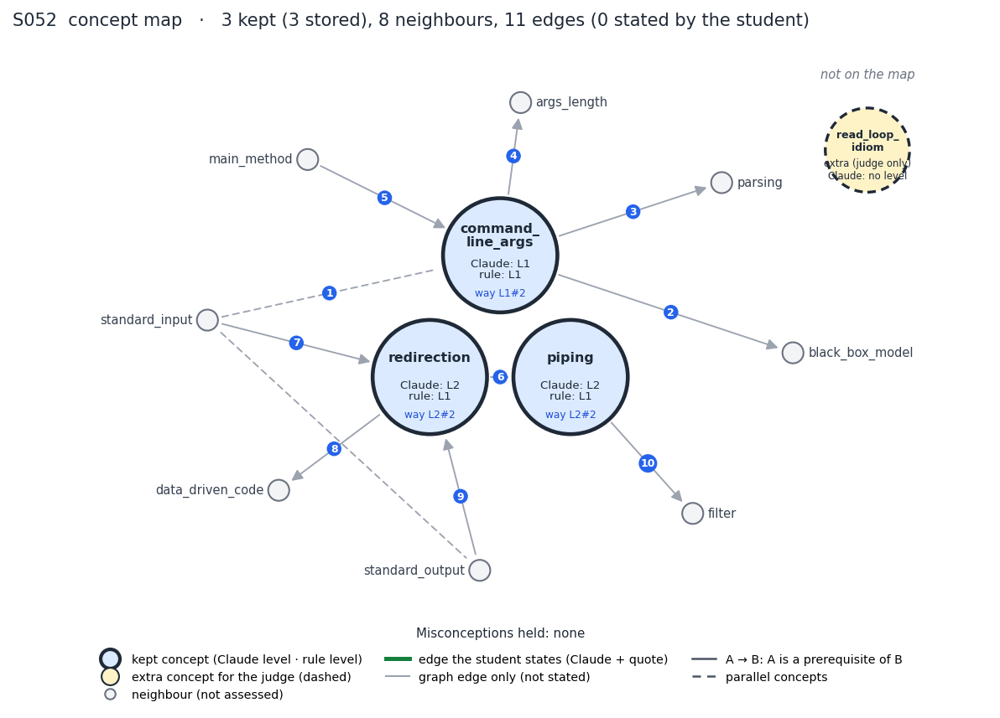

**Triples of the student's concept map** (subject, relation, object, with the logic of each):

| # | Subject | Relation | Object | Logic |
| --- | --- | --- | --- | --- |
| has_level | command_line_args | has_level | command_line_args@L1 | command_line_args@L1#2: args[0] represents the first string typed on the command line, args[1] the second, and so on (counting starts at 0); every element is a String. |
| has_level | redirection | has_level | redirection@L2 | redirection@L2#2: `java RandomSeq 1000 > data.txt` prints nothing in the terminal and leaves a file of 1,000 values. `java Average < data.txt` prints their average. |
| has_level | piping | has_level | piping@L2 | piping@L2#2: Only the last program's standard output appears. `java RandomSeq 100000 \| java Average` prints a single line such as Average is 0.5000499417963857. |
| edge 1 | standard_input | parallel | command_line_args | Command-line arguments are a fixed number of strings given once when the program starts (args[]); standard input is a stream of any length read while the program runs (StdIn.readInt()). Both arrive as text and must be parsed into numbers. — graph only: not checked (a neighbour) |
| edge 2 | command_line_args | prerequisite | black_box_model | The black-box view treats the command-line argument as the input string and what the program prints as the output string. — graph only: not checked (a neighbour) |
| edge 3 | command_line_args | prerequisite | parsing | args[k] is always a String, so Integer.parseInt(args[k]) is needed before it can be used as a number. — graph only: not checked (a neighbour) |
| edge 4 | command_line_args | prerequisite | args_length | args is the array of command-line arguments. — graph only: the answer does not state it |
| edge 5 | main_method | prerequisite | command_line_args | The command-line arguments arrive in main's parameter args, an array of Strings. — graph only: not checked (a neighbour) |
| edge 6 | redirection | prerequisite | piping | A pipe A \| B connects A's standard output directly to B's standard input, with no file in between. — graph only: the answer does not state it |
| edge 7 | standard_input | prerequisite | redirection | < file makes the contents of the file the standard input stream. — graph only: not checked (a neighbour) |
| edge 8 | redirection | prerequisite | data_driven_code | Redirecting a file to standard input lets the same program process different data files without being changed. — graph only: not checked (a neighbour) |
| edge 9 | standard_output | prerequisite | redirection | > file sends everything written to standard output into the file instead of the screen. — graph only: not checked (a neighbour) |
| edge 10 | piping | prerequisite | filter | A filter converts a standard input stream to a standard output stream, and piping is the mechanism that connects filters together. — graph only: not checked (a neighbour) |


### S054 · final none · reference none

**Question:** What appears in the terminal after each command? What does args[] contain when Average runs?

```java
% java RandomSeq 5 > data.txt
% java Average < data.txt
% java RandomSeq 5 | java Average
(RandomSeq N prints N random numbers; Average reads numbers from standard input and prints their average)
```

**Student answer:** Do I need to change my program to read from a file?

**Gate:** no_claim. The message makes no claim to assess, so no concepts are scored, Claude is not called and the level is none.


### S057 · final L3 · reference L3

**Question:** What does p hold after the loop? Is it a probability row? Fix it if needed.

```java
int[] counts = {0, 0, 2, 2, 1};
int outDegree = 5;
double[] p = new double[5];
for (int j = 0; j < 5; j++) {
  p[j] = counts[j] / outDegree;
}
```

**Student answer:** All zeros, because int / int is integer division. Cast: (double) counts[j] / outDegree gives 0, 0, 0.4, 0.4, 0.2, which sums to 1.

**Concept scoring and shortlist.** 70 of the 173 concepts scored above 0. Every concept scoring at least 1.0 is shortlisted, best first, top 8; Claude then chooses which of them the answer is about.

| Rank | Concept | Link score | Filter result |
| --- | --- | --- | --- |
| 1 | int | 4.78 | **shortlisted** |
| 2 | explicit_cast | 4.01 | **shortlisted** |
| 3 | type_conversion | 3.40 | **shortlisted** |
| 4 | double | 3.34 | **shortlisted** |
| 5 | integer_division | 2.92 | **shortlisted** |
| 6 | expression | 2.31 | **shortlisted** |
| 7 | arithmetic_operators | 2.26 | **shortlisted** |
| 8 | primitive_type | 2.20 | **shortlisted** |
| 9 | indexing | 2.00 | not shortlisted: only the top 8 are sent |
| 10 | division_by_zero | 1.43 | not shortlisted: only the top 8 are sent |
| 11 | array_creation | 1.29 | not shortlisted: only the top 8 are sent |

**Extra concept:** normalization (Claude: L3).

**Sent to Claude:** int, explicit_cast, type_conversion, double, integer_division, expression, arithmetic_operators, primitive_type, normalization.

**Claude chose:** int, explicit_cast, type_conversion, double, integer_division.

**What happened to each shortlisted concept:**

- int: stored; Claude L3
- explicit_cast: stored; Claude L2
- type_conversion: stored; Claude L2
- double: stored; Claude L3
- integer_division: stored; Claude L3
- expression: Claude did not choose it (no level), so it is not stored
- arithmetic_operators: Claude did not choose it (no level), so it is not stored
- primitive_type: Claude did not choose it (no level), so it is not stored

**Claude's verdict, traced to the graph's edge logic:**

| Concept | Claude level | Way id | Edge logic of that way |
| --- | --- | --- | --- |
| int | L3 | int@L3#1 | int op double promotes the int and gives a double. A double becomes an int only through a cast, which truncates toward zero. |
| explicit_cast | L2 | explicit_cast@L2#2 | (int) 2.71828 is int 2; (int) -2.7 is -2; (int) 11 * 0.3 is double 3.3; (int) (11 * 0.3) is int 3; (double) 3 / 5 is 0.6 but (double) (3 / 5) is 0.0; (char) ('a' + 4) is 'e'. |
| type_conversion | L2 | type_conversion@L2#2 | Typical results: "1234" + 99 is the String "123499"; Integer.parseInt("123") is int 123; (int) 2.71828 is int 2; Math.round(2.71828) is long 3; 11 * 0.3 is double 3.3; 11 * (int) 0.3 is int 0; (int) (11 * 0.3) is int 3. |
| double | L3 | double@L3#1 | Type flow decides the division: with two int operands a / b discards the fraction (10/3 is 3, and double d = 10/3; stores 3.0); if either operand is double the other is promoted and the fraction is kept (10/3.0 is 3.33333333333333... |
| integer_division | L3 | integer_division@L3#2 | Normalizing counts must divide as doubles. With two ints, counts / total truncates to 0 whenever counts < total. |
| normalization | L3 | normalization@L3#2 | Type flow decides the result: with a double operand anywhere to the left (.90*...) the division is floating-point; with two ints it truncates (2/5 == 0). |

**Graph edge logic of the levelled concepts** (has_level, misconception and error edges Claude was shown):

| Concept | Edge | Edge logic |
| --- | --- | --- |
| int | int → int@L3 (has_level) | int -> L3 (Relational): the answer relates the parts (8 ways). |
| int | int → IntegerDivisionGivesFraction (misconception) | wrong rule: 10 / 3 evaluates to 3.333.... / right rule: Dividing two ints gives an int: the fractional part is discarded. |
| int | int → IntOverflowWidensAutomatically (misconception) | wrong rule: An int result that is too large is automatically stored as a bigger number. / right rule: int arithmetic is 32-bit; a result outside the range wraps around. |
| explicit_cast | explicit_cast → explicit_cast@L2 (has_level) | explicit cast -> L2 (Multistructural): the answer applies the rules of explicit cast to every part of the code, in order (3 ways). |
| explicit_cast | explicit_cast → CastRounds (misconception) | wrong rule: (int) 2.7 evaluates to 3. / right rule: A cast to int discards the fractional part (rounds toward zero, so (int) -2.7 is -2); Math.round rounds to the nearest integer. |
| explicit_cast | explicit_cast → CastParsesString (misconception) | wrong rule: (int) args[0] converts the text "34" into the number 34. / right rule: A String argument that represents a number must be converted with a method such as Integer.parseInt. |
| explicit_cast | explicit_cast → CastAfterIntDivision (misconception) | wrong rule: (double) (3 / 5) is 0.6. / right rule: The integer division 3 / 5 = 0 happens before the cast, so the result is 0.0. |
| explicit_cast | explicit_cast → CastAppliesToWholeExpression (misconception) | wrong rule: (int) 2.5 / 0.15 casts the whole quotient to int. / right rule: The cast applies only to what comes right after it, here 2.5. |
| type_conversion | type_conversion → type_conversion@L2 (has_level) | type conversion -> L2 (Multistructural): the answer applies the rules of type conversion to every part of the code, in order (3 ways). |
| type_conversion | type_conversion → TargetTyping (misconception) | wrong rule: The type of a numerical expression depends on the type expected by the surrounding context, so double d = a / b; keeps the fraction. / right rule: The type of a numerical expression is determined by the expression, so double d = a / b; with int a and b still divides as ints. |
| type_conversion | type_conversion → NoCastIfSameSize (misconception) | wrong rule: If a variable is at least as big as a value, no cast is needed to assign the value. / right rule: Assigning a double to an int needs a cast even when the value would fit, because a conversion that might involve loss of information leads to a compile-time err... |
| type_conversion | type_conversion → NarrowingAssignmentAllowed (misconception) | wrong rule: A double value can be stored in an int variable like an int in a double. / right rule: int to double is automatic; double to int needs a cast. |
| double | double → double@L3 (has_level) | double -> L3 (Relational): the answer relates the parts (7 ways). |
| double | double → FloatingPointIsExact (misconception) | wrong rule: Math.sqrt(2) * Math.sqrt(2) == 2 is true. / right rule: A double is an approximation, so the product is close to 2 but not equal to 2. |
| double | double → WholeNumberLiteralIsInt (misconception) | wrong rule: 207. and 2.3e4 are int values because they are whole numbers. / right rule: A decimal point or scientific notation makes the literal a double. |
| integer_division | integer_division → integer_division@L3 (has_level) | integer division -> L3 (Relational): the answer relates the parts (4 ways). |
| integer_division | integer_division → TargetTyping (misconception) | wrong rule: The type of a numerical expression depends on the type expected by the surrounding context, so double d = a / b; keeps the fraction. / right rule: The type of a numerical expression is determined by the expression, so double d = a / b; with int a and b still divides as ints. |
| integer_division | integer_division → IntegerDivisionGivesFraction (misconception) | wrong rule: 10 / 3 evaluates to 3.333.... / right rule: Dividing two ints gives an int: the fractional part is discarded. |
| integer_division | integer_division → CastAfterIntDivision (misconception) | wrong rule: (double) (3 / 5) is 0.6. / right rule: The integer division 3 / 5 = 0 happens before the cast, so the result is 0.0. |
| integer_division | integer_division → LaterDoubleLiteralFixesDivision (misconception) | wrong rule: Changing a later literal to 100.0 fixes an earlier int division. / right rule: The int division happens first; the double must be in the division itself. |
| normalization | normalization → normalization@L3 (has_level) | normalization -> L3 (Relational): the answer relates the parts (3 ways). |
| normalization | normalization → IntegerProbability (misconception) | wrong rule: counts[i][j] / degree[i] gives the correct probability because the result is stored in a double. / right rule: counts[i][j] / outDegree[i] with two int operands is integer division and gives 0 whenever counts < outDegree; SW's Transition avoids it by multiplying by .90 f... |
| normalization | normalization → RowsNeedNotSumToOne (misconception) | wrong rule: A page with no outgoing links can have an all-zero row. / right rule: Each row is a probability distribution; a page with no links is made equally likely to move to every page. |

**Claude's overall level:** L3 (main concept normalization). The student says p ends up all zeros because int / int is integer division, so it is not a probability row, and fixes it with a cast to double that gives 0, 0, 0.4, 0.4, 0.2, which sums to 1; finding and fixing one given failing case is L3.

| Step | What happened |
| --- | --- |
| Step 1. Gates | Gates: none. |
| Step 2. Score every concept | 70 of 173 scored above 0. Shortlisted: int = 4.78; explicit_cast = 4.01; type_conversion = 3.40; double = 3.34; integer_division = 2.92; expression = 2.31; arithmetic_operators = 2.26; primitive_type = 2.20. |
| Step 3. Shortlist and Claude's choice | Top 8 at 1.0 or above: int, explicit_cast, type_conversion, double, integer_division, expression, arithmetic_operators, primitive_type. Claude chose: int, explicit_cast, type_conversion, double, integer_division. |
| Step 4. Concept map | 5 stored + 16 neighbours. Stored: int, explicit_cast, type_conversion, double, integer_division. |
| Step 5. Run the code | No value to check. |
| Step 6. LLM judge | Claude gives int L3; explicit_cast L2; type_conversion L2; double L3; integer_division L3; expression no level; arithmetic_operators no level; primitive_type no level; normalization L3; overall L3. |
| Step 7. Final level | max_level, the highest level among the stored concepts (L0 if one holds a wrong rule) = L3; Claude's overall level was L3. Final L3 (reference L3). |

**Trace of the student's concept map:**

| Node | Role | Evidence traced from the answer | Rule level | Claude level and level logic |
| --- | --- | --- | --- | --- |
| int | chosen, stored | E1 reference: "int: 32-bit integer primitive" (0.595); E3 integration: "edge int - primitive_type" (1.0) | L3 provisional | L3 via int@L3#1: L3 (Relational): the answer relates the parts (8 ways). |
| explicit_cast | chosen, stored | E1 reference: "explicit cast: (int) x -- converts between numeric types, truncating t..." (0.572); E2 execution: "The cast applies only to what comes right after it, here 2.5, so the e..." (0.615); E3 integration: "answers: What does p hold after the loop? Is it a probability row? Fix..." (1.0) | L3 provisional | L2 via explicit_cast@L2#2: L2 (Multistructural): the answer applies the rules of explicit cast to every part of the code, in order (3 way... |
| type_conversion | chosen, stored | E1 reference: "type conversion: implicit widening and explicit (cast)" (0.501); E3 integration: "edge type_conversion - primitive_type" (1.0) | L3 provisional | L2 via type_conversion@L2#2: L2 (Multistructural): the answer applies the rules of type conversion to every part of the code, in order (3 w... |
| double | chosen, stored | E1 reference: "double: 64-bit floating-point primitive" (0.478); E3 integration: "answers: What does p hold after the loop? Is it a probability row? Fix..." (1.0) | L3 provisional | L3 via double@L3#1: L3 (Relational): the answer relates the parts (7 ways). |
| integer_division | chosen, stored | E1 reference: "integer division: / on two ints truncates; % is the remainder" (0.59); E3 integration: "edge integer_division - arithmetic_operators" (1.0) | L3 provisional | L3 via integer_division@L3#2: L3 (Relational): the answer relates the parts (4 ways). |
| shortlisted, not chosen | not stored | expression, arithmetic_operators, primitive_type | - | Claude: none |
| neighbours | not assessed | primitive_type, parsing, arithmetic_operators, boolean, long_type, overflow, int_literal_limit, char, math_round, math_random, compound_assignment, widening_conversion, floating_point_precision, division_by_zero, normalization, remainder_operator | - | - |

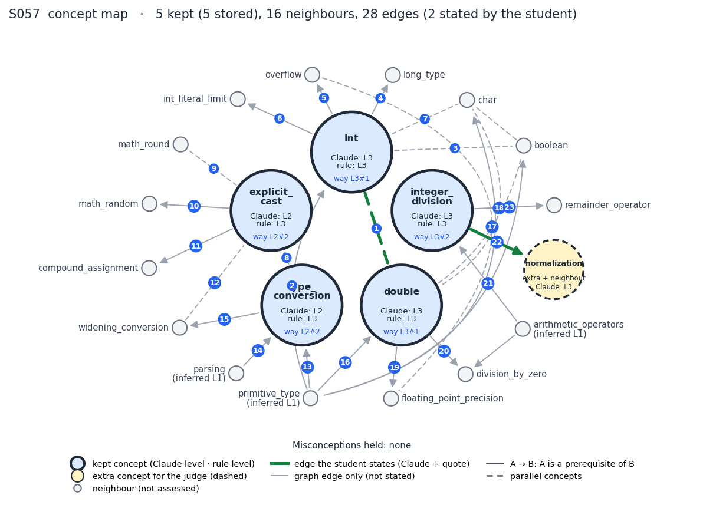

**Triples of the student's concept map** (subject, relation, object, with the logic of each):

| # | Subject | Relation | Object | Logic |
| --- | --- | --- | --- | --- |
| has_level | int | has_level | int@L3 | int@L3#1: int op double promotes the int and gives a double. A double becomes an int only through a cast, which truncates toward zero. |
| has_level | explicit_cast | has_level | explicit_cast@L2 | explicit_cast@L2#2: (int) 2.71828 is int 2; (int) -2.7 is -2; (int) 11 * 0.3 is double 3.3; (int) (11 * 0.3) is int 3; (double) 3 / 5 is 0.6 but (double) (3 / 5) is 0.0; (char) ('a... |
| has_level | type_conversion | has_level | type_conversion@L2 | type_conversion@L2#2: Typical results: "1234" + 99 is the String "123499"; Integer.parseInt("123") is int 123; (int) 2.71828 is int 2; Math.round(2.71828) is long 3; 11 * 0.3 is doub... |
| has_level | double | has_level | double@L3 | double@L3#1: Type flow decides the division: with two int operands a / b discards the fraction (10/3 is 3, and double d = 10/3; stores 3.0); if either operand is double the... |
| has_level | integer_division | has_level | integer_division@L3 | integer_division@L3#2: Normalizing counts must divide as doubles. With two ints, counts / total truncates to 0 whenever counts < total. |
| edge 1 | int | parallel | double | With two ints, a / b drops the fractional part; if either a or b is a double, a / b keeps the fractional part. — **stated by the student**: "int / int is integer division. Cast: (double) counts[j] / outDegree gives 0, 0, 0.4, 0.4, 0.2" |
| edge 2 | primitive_type | prerequisite | int | int is one of the eight primitive types, the one used for integers. — graph only: the answer does not state it |
| edge 3 | int | parallel | boolean | An int holds an integer and is a numeric type for computing with numbers; a boolean holds only true or false and is used for computing with logical values. — graph only: not checked (a neighbour) |
| edge 4 | int | prerequisite | long_type | long is the wider integer type used when int's range is too small. — graph only: not checked (a neighbour) |
| edge 5 | int | prerequisite | overflow | Overflow happens because an int has a fixed 32-bit range. — graph only: not checked (a neighbour) |
| edge 6 | int | prerequisite | int_literal_limit | The limit on int literals is int's 32-bit range, -2147483648 to 2147483647. — graph only: not checked (a neighbour) |
| edge 7 | int | parallel | char | An int holds a whole number; a char holds one character, which Java stores as its numeric code. — graph only: not checked (a neighbour) |
| edge 8 | type_conversion | prerequisite | explicit_cast | A cast is the explicit form of type conversion between primitive types, required when the conversion may lose information (e.g. (int) 2.71828 is 2). — graph only: the answer does not state it |
| edge 9 | math_round | parallel | explicit_cast | (int) 2.71828 truncates toward zero and gives 2; Math.round(2.71828) rounds to the nearest integer and gives 3, as a long that needs (int) to become an int. — graph only: not checked (a neighbour) |
| edge 10 | explicit_cast | prerequisite | math_random | To turn Math.random()'s double in [0, 1) into a random int from 0 to N-1, multiply it by N and cast the result to int. — graph only: not checked (a neighbour) |
| edge 11 | explicit_cast | prerequisite | compound_assignment | x op= e means x = (T)(x op e), where T is the type of x, so the result is cast back to the type of x. — graph only: not checked (a neighbour) |
| edge 12 | widening_conversion | parallel | explicit_cast | Widening (promotion) happens automatically when a value goes to a type with a larger range (int to double) and loses nothing; a narrowing conversion (double to int) is never automatic and needs an explicit cast, which truncates toward zero. — graph only: not checked (a neighbour) |
| edge 13 | primitive_type | prerequisite | type_conversion | Conversion moves a value between primitive types: int to double happens automatically, while double to int needs a cast that drops the fraction. — graph only: the answer does not state it |
| edge 14 | parsing | prerequisite | type_conversion | Integer.parseInt(s) converts the String s into an int; SW later classifies such methods as explicit type conversion. — graph only: not checked (a neighbour) |
| edge 15 | type_conversion | prerequisite | widening_conversion | Widening is the automatic kind of type conversion. — graph only: not checked (a neighbour) |
| edge 16 | primitive_type | prerequisite | double | double is one of the eight primitive types, the one used for real (floating-point) numbers. — graph only: the answer does not state it |
| edge 17 | double | parallel | boolean | A double holds a number with a fractional part; a boolean holds only true or false. — graph only: not checked (a neighbour) |
| edge 18 | double | parallel | char | A double holds a number with a fractional part; a char holds one character code, which is a whole number. — graph only: not checked (a neighbour) |
| edge 19 | double | prerequisite | floating_point_precision | A double approximates real numbers, so its arithmetic is not exact. — graph only: not checked (a neighbour) |
| edge 20 | double | prerequisite | division_by_zero | For doubles, 1.0/0.0 is legal and has the value Infinity; a double result can also be the special value NaN when the calculation is undefined. — graph only: not checked (a neighbour) |
| edge 21 | arithmetic_operators | prerequisite | integer_division | For ints a and b, / gives the whole quotient q and % gives the remainder r, so that a = b * q + r. — graph only: the answer does not state it |
| edge 22 | integer_division | prerequisite | normalization | Normalising must divide as doubles, because with two ints counts / total truncates to 0 whenever counts < total. — **stated by the student**: "All zeros, because int / int is integer division. Cast: (double) counts[j] / outDegree gives 0, 0, 0.4, 0.4, 0.2, which..." |
| edge 23 | integer_division | prerequisite | remainder_operator | % is the companion of integer division: a = (a / b) * b + a % b. — graph only: not checked (a neighbour) |


### S060 · final L0 · reference L0

**Question:** What does p hold after the loop? Is it a probability row? Fix it if needed.

```java
int[] counts = {0, 0, 2, 2, 1};
int outDegree = 5;
double[] p = new double[5];
for (int j = 0; j < 5; j++) {
  p[j] = counts[j] / outDegree;
}
```

**Student answer:** An all-zero row is fine; it just means the page has no links.

**Concept scoring and shortlist.** 29 of the 173 concepts scored above 0. Every concept scoring at least 1.0 is shortlisted, best first, top 8; Claude then chooses which of them the answer is about.

| Rank | Concept | Link score | Filter result |
| --- | --- | --- | --- |
| 1 | arithmetic_operators | 2.00 | **shortlisted** |
| 2 | expression | 2.00 | **shortlisted** |
| 3 | dangling_pages | 1.54 | **shortlisted** |
| 4 | input_graph | 1.31 | **shortlisted** |
| 5 | primitive_type | 1.00 | **shortlisted** |
| 6 | indexing | 1.00 | **shortlisted** |
| 7 | block | 1.00 | **shortlisted** |
| 8 | array_creation | 1.00 | **shortlisted** |
| 9 | array_initializer | 1.00 | not shortlisted: only the top 8 are sent |
| 10 | loop_control | 1.00 | not shortlisted: only the top 8 are sent |
| 11 | statement | 1.00 | not shortlisted: only the top 8 are sent |

**Extra concept:** transition_matrix (Claude: L0).

**Sent to Claude:** arithmetic_operators, expression, dangling_pages, input_graph, primitive_type, indexing, block, array_creation, transition_matrix.

**Claude chose:** dangling_pages.

**What happened to each shortlisted concept:**

- arithmetic_operators: Claude did not choose it (no level), so it is not stored
- expression: Claude did not choose it (no level), so it is not stored
- dangling_pages: stored; Claude L0
- input_graph: Claude did not choose it (no level), so it is not stored
- primitive_type: no graph evidence and no level from Claude; not stored
- indexing: no graph evidence and no level from Claude; not stored
- block: no graph evidence and no level from Claude; not stored
- array_creation: no graph evidence and no level from Claude; not stored

**Claude's verdict, traced to the graph's edge logic:**

| Concept | Claude level | Way id | Edge logic of that way |
| --- | --- | --- | --- |
| dangling_pages | L0 | dangling_pages@L0#2 | wrong rule: A page with no outgoing links can have an all-zero row. Right rule: Every row must sum to 1; fill the row of a page with no outgoing links with 1/N (equally likely to go to every page). |
| transition_matrix | L0 | transition_matrix@L0#4 | wrong rule: A page with no outgoing links can have an all-zero row. Right rule: Every row must be a probability distribution summing to 1; a page with no links gets 1/N in every column. |

**Graph edge logic of the levelled concepts** (has_level, misconception and error edges Claude was shown):

| Concept | Edge | Edge logic |
| --- | --- | --- |
| dangling_pages | dangling_pages → dangling_pages@L0 (has_level) | dangling pages -> L0 (Prestructural): the answer holds a rule that contradicts Java (3 ways). |
| dangling_pages | dangling_pages → RowsNeedNotSumToOne (misconception) | wrong rule: A page with no outgoing links can have an all-zero row. / right rule: Each row is a probability distribution; a page with no links is made equally likely to move to every page. |
| transition_matrix | transition_matrix → transition_matrix@L0 (has_level) | transition matrix -> L0 (Prestructural): the answer holds a rule that contradicts Java (4 ways). |
| transition_matrix | transition_matrix → MultidimensionalArray (misconception) | wrong rule: The transition matrix is one block of n * n numbers, so p[i] on its own means nothing. / right rule: p[i] is the row array of page i, holding the probabilities of moving from page i to every page. |
| transition_matrix | transition_matrix → NoJaggedArrays (misconception) | wrong rule: Every row of the transition matrix must be stored with the same length because 2-D arrays are always rectangular. / right rule: Each p[i] is its own row array; the surfer's matrix is square only because every page has a row of n probabilities. |
| transition_matrix | transition_matrix → RowsNeedNotSumToOne (misconception) | wrong rule: A page with no outgoing links can have an all-zero row. / right rule: Each row is a probability distribution; a page with no links is made equally likely to move to every page. |

**Claude's overall level:** L0 (main concept transition_matrix). The student says an all-zero row is an acceptable probability row, which is the documented misconception RowsNeedNotSumToOne. They also miss that the zeros come from integer division (0/5, 2/5 and 1/5 are all 0 in int arithmetic), since this page has outDegree 5 and is not a page without links.

| Step | What happened |
| --- | --- |
| Step 1. Gates | Gates: none. |
| Step 2. Score every concept | 29 of 173 scored above 0. Shortlisted: arithmetic_operators = 2.00; expression = 2.00; dangling_pages = 1.54; input_graph = 1.31; primitive_type = 1.00; indexing = 1.00; block = 1.00; array_creation = 1.00. |
| Step 3. Shortlist and Claude's choice | Top 8 at 1.0 or above: arithmetic_operators, expression, dangling_pages, input_graph, primitive_type, indexing, block, array_creation. Claude chose: dangling_pages. |
| Step 4. Concept map | 1 stored + 1 neighbours. Stored: dangling_pages. |
| Step 5. Run the code | No value to check. |
| Step 6. LLM judge | Claude gives arithmetic_operators no level; expression no level; dangling_pages L0; input_graph no level; primitive_type no level; indexing no level; block no level; array_creation no level; transition_matrix L0; overall L0. |
| Step 7. Final level | max_level, the highest level among the stored concepts (L0 if one holds a wrong rule) = L0; Claude's overall level was L0. Final L0 (reference L0). |

**Trace of the student's concept map:**

| Node | Role | Evidence traced from the answer | Rule level | Claude level and level logic |
| --- | --- | --- | --- | --- |
| dangling_pages | chosen, stored | E1 reference: "dangling pages: pages with no outgoing links" (0.657) | L1 | L0 via dangling_pages@L0#2: L0 (Prestructural): the answer holds a rule that contradicts Java (3 ways). |
| shortlisted, not chosen | not stored | arithmetic_operators, expression, input_graph, primitive_type, indexing, block, array_creation | - | Claude: none |
| neighbours | not assessed | transition_matrix | - | - |


**Triples of the student's concept map** (subject, relation, object, with the logic of each):

| # | Subject | Relation | Object | Logic |
| --- | --- | --- | --- | --- |
| has_level | dangling_pages | has_level | dangling_pages@L0 | dangling_pages@L0#2: wrong rule: A page with no outgoing links can have an all-zero row. Right rule: Every row must sum to 1; fill the row of a page with no outgoing links with 1/N... |
| edge 1 | transition_matrix | prerequisite | dangling_pages | Transition assumes that every page has an outgoing link; Exercise 1.6.3 handles a page with no outgoing links by filling its row of the transition matrix with 1/N. — graph only: the answer does not state it |


### S061 · final L2 · reference L3

**Question:** What is next? (b) What if row were {0.1, 0.3, 0.5} and r = 0.95?

```java
double[] row = {0.1, 0.3, 0.6};
double r = 0.35;
double sum = 0.0;
int next = -1;
for (int j = 0; j < row.length; j++) {
  sum += row[j];
  if (r < sum) { next = j; break; }
}
```

**Student answer:** sum is 0.1 then 0.4; 0.35 < 0.4 so next = 1. (b) the sums only reach 0.9, so next stays -1 because the row does not add to 1.

**Concept scoring and shortlist.** 61 of the 173 concepts scored above 0. Every concept scoring at least 1.0 is shortlisted, best first, top 8; Claude then chooses which of them the answer is about.

| Rank | Concept | Link score | Filter result |
| --- | --- | --- | --- |
| 1 | double | 3.18 | **shortlisted** |
| 2 | arithmetic_operators | 2.35 | **shortlisted** |
| 3 | accumulator_pattern | 2.25 | **shortlisted** |
| 4 | assignment | 2.00 | **shortlisted** |
| 5 | expression | 2.00 | **shortlisted** |
| 6 | compound_assignment | 1.71 | **shortlisted** |
| 7 | int | 1.34 | **shortlisted** |
| 8 | increment_operators | 1.15 | **shortlisted** |
| 9 | indexing | 1.11 | not shortlisted: only the top 8 are sent |
| 10 | for_loop | 1.08 | not shortlisted: only the top 8 are sent |
| 11 | floating_point_precision | 1.08 | not shortlisted: only the top 8 are sent |

**Extra concept:** dangling_pages (Claude: no level).

**Sent to Claude:** double, arithmetic_operators, accumulator_pattern, assignment, expression, compound_assignment, int, increment_operators, dangling_pages.

**Claude chose:** accumulator_pattern.

**What happened to each shortlisted concept:**

- double: Claude did not choose it (no level), so it is not stored
- arithmetic_operators: Claude did not choose it (no level), so it is not stored
- accumulator_pattern: stored; Claude L4
- assignment: Claude did not choose it (no level), so it is not stored
- expression: Claude did not choose it (no level), so it is not stored
- compound_assignment: Claude did not choose it (no level), so it is not stored
- int: Claude did not choose it (no level), so it is not stored
- increment_operators: no graph evidence and no level from Claude; not stored

**Claude's verdict, traced to the graph's edge logic:**

| Concept | Claude level | Way id | Edge logic of that way |
| --- | --- | --- | --- |
| accumulator_pattern | L4 | accumulator_pattern@L4#1 | Changing the initial value shifts the result by that amount (sum starts at 1 gives sum + 1); a product starting at 0 stays 0; reordering the items does not change an integer sum (addition is commutative) but may change a floating-... |

**Graph edge logic of the levelled concepts** (has_level, misconception and error edges Claude was shown):

| Concept | Edge | Edge logic |
| --- | --- | --- |
| accumulator_pattern | accumulator_pattern → accumulator_pattern@L4 (has_level) | accumulator pattern -> L4 (Extended abstract): the answer reasons beyond the given code (5 ways). |
| accumulator_pattern | accumulator_pattern → LoopBodyScopeImpliesLoopLifetime (misconception) | wrong rule: a variable declared in the loop body lives across all iterations / right rule: A variable declared inside the body is created anew on every pass and does not keep the previous pass's value. |
| accumulator_pattern | accumulator_pattern → AccumulatorDeclaredInLoop (error) | wrong rule: Declaring sum inside the loop body keeps a running total across passes. / right rule: The accumulator must be declared and initialised before the loop. |
| accumulator_pattern | accumulator_pattern → VariableRolesInferred (misconception) | wrong rule: The computer recognises that one variable plays two roles, e.g. input value and running total, and keeps the values apart; it knows which variable is the counter and which the sum. / right rule: A variable holds one value at a time; each role (input, counter, running total) needs its own variable and explicit update. |
| accumulator_pattern | accumulator_pattern → StateChangeIgnoredAcrossPasses (misconception) | wrong rule: Values changed by one pass of a loop (other than the loop variable) do not affect later passes. / right rule: Each pass starts from the state left by the previous pass, so a change in one pass carries into the next ones. |

**Claude's overall level:** L4 (main concept accumulator_pattern). For the changed row the student does more than re-trace: they say why next stays -1. The running sum ends at 0.9, which is below r = 0.95, so r < sum never holds, and that happens because the row does not add up to 1.

| Step | What happened |
| --- | --- |
| Step 1. Gates | Gates: none. |
| Step 2. Score every concept | 61 of 173 scored above 0. Shortlisted: double = 3.18; arithmetic_operators = 2.35; accumulator_pattern = 2.25; assignment = 2.00; expression = 2.00; compound_assignment = 1.71; int = 1.34; increment_operators = 1.15. |
| Step 3. Shortlist and Claude's choice | Top 8 at 1.0 or above: double, arithmetic_operators, accumulator_pattern, assignment, expression, compound_assignment, int, increment_operators. Claude chose: accumulator_pattern. |
| Step 4. Concept map | 1 stored + 4 neighbours. Stored: accumulator_pattern. |
| Step 5. Run the code | confirmed by the run: sum = 0.1; confirmed by the run: next = 1; confirmed by the run: next = -1 |
| Step 6. LLM judge | Claude gives double no level; arithmetic_operators no level; accumulator_pattern L4; assignment no level; expression no level; compound_assignment no level; int no level; increment_operators no level; dangling_pages no level; overall L4. |
| Step 7. Final level | max_level, the highest level among the stored concepts (L0 if one holds a wrong rule) = L2; Claude's overall level was L4. Final L2 (reference L3). |

**Trace of the student's concept map:**

| Node | Role | Evidence traced from the answer | Rule level | Claude level and level logic |
| --- | --- | --- | --- | --- |
| accumulator_pattern | chosen, stored | E1 reference: "accumulator pattern: building up a running total/result" (0.463); E2 execution: "confirmed by the run: sum = 0.1" (1.0) | L2 provisional | L4 via accumulator_pattern@L4#1: L4 (Extended abstract): the answer reasons beyond the given code (5 ways). |
| shortlisted, not chosen | not stored | double, arithmetic_operators, assignment, expression, compound_assignment, int, increment_operators | - | Claude: none |
| neighbours | not assessed | loop_body, sentinel_loop, counter_pattern, running_extreme | - | - |

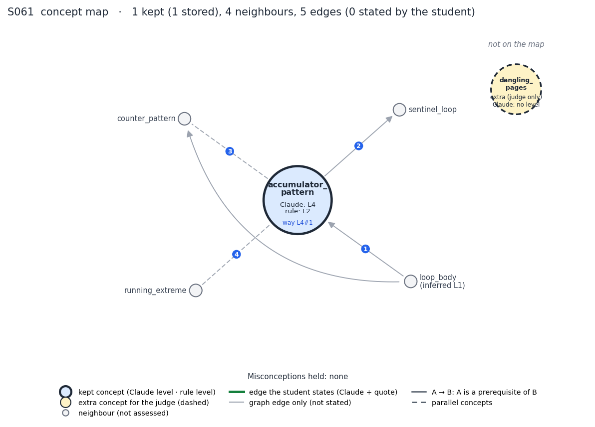

**Triples of the student's concept map** (subject, relation, object, with the logic of each):

| # | Subject | Relation | Object | Logic |
| --- | --- | --- | --- | --- |
| has_level | accumulator_pattern | has_level | accumulator_pattern@L4 | accumulator_pattern@L4#1: Changing the initial value shifts the result by that amount (sum starts at 1 gives sum + 1); a product starting at 0 stays 0; reordering the items does not chan... |
| edge 1 | loop_body | prerequisite | accumulator_pattern | The accumulator update sum += x sits inside the body, so it runs once on every pass. — graph only: not checked (a neighbour) |
| edge 2 | accumulator_pattern | prerequisite | sentinel_loop | Sum and count are accumulators. — graph only: not checked (a neighbour) |
| edge 3 | accumulator_pattern | parallel | counter_pattern | An accumulator adds the current value itself on each pass (sum += x); a counter adds 1 on each pass that matches (count++). — graph only: not checked (a neighbour) |
| edge 4 | running_extreme | parallel | accumulator_pattern | Both make one pass over the values with one variable kept across passes. An accumulator (gatherer role) combines every value into it (sum += a[i]), so it starts at the identity 0.0; a running extreme (most-wanted holder) replaces it only when a better value is found (if (a[i] > max) max = a[i]), so it starts at Double.NEGATIVE_INFINITY or the first value. — graph only: not checked (a neighbour) |


### S065 · final L4 · reference L4

**Question:** Are these the page ranks? Would starting at page 3 change them?

```java
RandomSurfer was run for 100 moves starting at page 0 and printed:
0.31000 0.25000 0.14000 0.24000 0.06000
```

**Student answer:** Only estimates; 100 moves is far too few and the zeros mean nothing. In the long run the start page does not matter.

**Concept scoring and shortlist.** 11 of the 173 concepts scored above 0. Every concept scoring at least 1.0 is shortlisted, best first, top 8; Claude then chooses which of them the answer is about.

| Rank | Concept | Link score | Filter result |
| --- | --- | --- | --- |
| 1 | long_type | 3.00 | **shortlisted** |
| 2 | run | 2.00 | **shortlisted** |
| 3 | primitive_type | 2.00 | **shortlisted** |
| 4 | power_method | 1.00 | **shortlisted** |
| 5 | frequency_counting | 1.00 | **shortlisted** |
| 6 | double | 1.00 | **shortlisted** |
| 7 | conditional_operator | 1.00 | **shortlisted** |
| 8 | simulation_loop | 0.63 | not shortlisted: below 1.0 |
| 9 | markov_chain | 0.38 | not shortlisted: below 1.0 |
| 10 | monte_carlo_simulation | 0.32 | not shortlisted: below 1.0 |

**Extra concept:** simulation_loop (Claude: L4).

**Sent to Claude:** long_type, run, primitive_type, power_method, frequency_counting, double, conditional_operator, simulation_loop.

**Claude chose:** frequency_counting.

**What happened to each shortlisted concept:**

- long_type: Claude did not choose it (no level), so it is not stored
- run: Claude did not choose it (no level), so it is not stored
- primitive_type: Claude did not choose it (no level), so it is not stored
- power_method: no graph evidence and no level from Claude; not stored
- frequency_counting: no graph evidence; Claude L1; reported, not stored
- double: no graph evidence and no level from Claude; not stored
- conditional_operator: no graph evidence and no level from Claude; not stored

**Claude's verdict, traced to the graph's edge logic:**

| Concept | Claude level | Way id | Edge logic of that way |
| --- | --- | --- | --- |
| frequency_counting | L1 | frequency_counting@L1#2 | RandomSurfer counts the number of times the surfer visits each page; dividing that count by the number of moves estimates the probability of ending on the page (its rank). |
| simulation_loop | L4 | simulation_loop@L4#1 | Changing the start page keeps the limit (mixing); increasing T keeps the estimates but makes them more accurate (about 10x moves per extra digit); changing < to <= or the division by T breaks the normalisation. |

**Graph edge logic of the levelled concepts** (has_level, misconception and error edges Claude was shown):

| Concept | Edge | Edge logic |
| --- | --- | --- |
| frequency_counting | frequency_counting → frequency_counting@L1 (has_level) | frequency counting -> L1 (Unistructural): the answer states one correct rule without applying it (2 ways). |
| frequency_counting | frequency_counting → FewTrialsAreExact (misconception) | wrong rule: A short simulation gives the exact page ranks. / right rule: A simulation only estimates the page ranks: RandomSurfer needs 10^n moves to get answers precise to n decimal places and many more moves for those answers to be... |
| frequency_counting | frequency_counting → ManyDigitsMeanAccurate (misconception) | wrong rule: A result printed with many decimal places must be accurate to those places. / right rule: A program does not produce accurate answers simply because it can print numbers to many decimal places of precision; ensuring accuracy is often the most difficu... |
| simulation_loop | simulation_loop → simulation_loop@L4 (has_level) | simulation loop -> L4 (Extended abstract): the answer reasons beyond the given code (6 ways). |
| simulation_loop | simulation_loop → LoopBodyScopeImpliesLoopLifetime (misconception) | wrong rule: Declaring page inside the simulation loop still lets the surfer continue from the previous page. / right rule: If page is declared inside the loop body it is recreated each pass, so it must be declared before the loop to carry the walk forward. |
| simulation_loop | simulation_loop → OffByOneBound (misconception) | wrong rule: t < T and t <= T give the same number of moves. / right rule: for (t = 0; t < T; t++) makes exactly T moves; with <= it makes T + 1. |
| simulation_loop | simulation_loop → FewTrialsAreExact (misconception) | wrong rule: A short simulation gives the exact page ranks. / right rule: A simulation only estimates the page ranks: RandomSurfer needs 10^n moves to get answers precise to n decimal places and many more moves for those answers to be... |

**Claude's overall level:** L4 (main concept simulation_loop). The student correctly says the 100-move output is only a rough estimate, not the true ranks, and predicts that starting at page 3 would not change the long-run ranks. That is a correct prediction about a change to the given run, which is L4.

| Step | What happened |
| --- | --- |
| Step 1. Gates | Gates: none. |
| Step 2. Score every concept | 11 of 173 scored above 0. Shortlisted: long_type = 3.00; run = 2.00; primitive_type = 2.00; power_method = 1.00; frequency_counting = 1.00; double = 1.00; conditional_operator = 1.00. |
| Step 3. Shortlist and Claude's choice | Top 8 at 1.0 or above: long_type, run, primitive_type, power_method, frequency_counting, double, conditional_operator. Claude chose: frequency_counting. |
| Step 4. Concept map | 0 stored + 0 neighbours. Stored: none. |
| Step 5. Run the code | No value to check. |
| Step 6. LLM judge | Claude gives long_type no level; run no level; primitive_type no level; power_method no level; frequency_counting L1; double no level; conditional_operator no level; simulation_loop L4; overall L4. |
| Step 7. Final level | max_level, the highest level among the stored concepts (L0 if one holds a wrong rule) = L4; Claude's overall level was L4. Final L4 (reference L4). |

**Trace of the student's concept map:**

| Node | Role | Evidence traced from the answer | Rule level | Claude level and level logic |
| --- | --- | --- | --- | --- |
| frequency_counting | chosen, not stored | - | - | L1 via frequency_counting@L1#2: L1 (Unistructural): the answer states one correct rule without applying it (2 ways). |
| shortlisted, not chosen | not stored | long_type, run, primitive_type, power_method, double, conditional_operator | - | Claude: none |

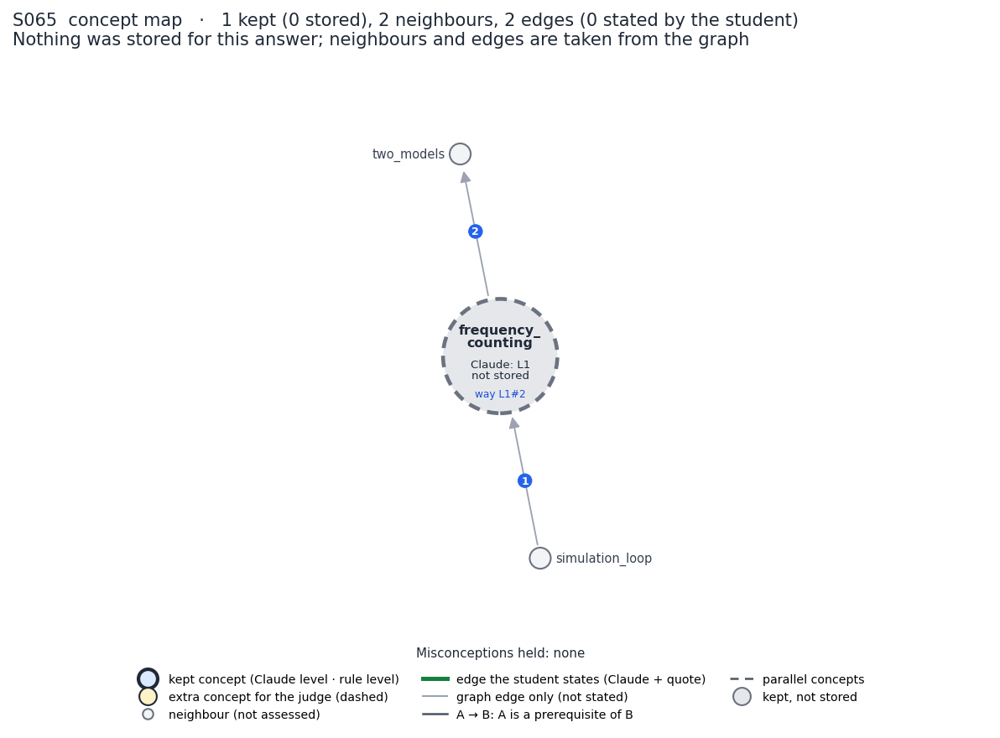

**Triples of the student's concept map** (subject, relation, object, with the logic of each):

| # | Subject | Relation | Object | Logic |
| --- | --- | --- | --- | --- |
| edge 1 | simulation_loop | prerequisite | frequency_counting | On each pass the simulation adds 1 to freq[page] for the page just reached. — graph only: the answer does not state it |
| edge 2 | frequency_counting | prerequisite | two_models | The visit fractions freq[j] / T estimate the same page ranks that repeated matrix multiplication computes. — graph only: not checked (a neighbour) |


### S068 · final L0 · reference L0

**Question:** Are these the page ranks? Would starting at page 3 change them?

```java
RandomSurfer was run for 100 moves starting at page 0 and printed:
0.31000 0.25000 0.14000 0.24000 0.06000
```

**Student answer:** They are estimates. But starting at page 3 would change the ranks.

**Concept scoring and shortlist.** 10 of the 173 concepts scored above 0. Every concept scoring at least 1.0 is shortlisted, best first, top 8; Claude then chooses which of them the answer is about.

| Rank | Concept | Link score | Filter result |
| --- | --- | --- | --- |
| 1 | frequency_counting | 1.71 | **shortlisted** |
| 2 | power_method | 1.51 | **shortlisted** |
| 3 | run | 1.00 | **shortlisted** |
| 4 | double | 1.00 | **shortlisted** |
| 5 | conditional_operator | 1.00 | **shortlisted** |
| 6 | two_models | 0.95 | not shortlisted: below 1.0 |
| 7 | monte_carlo_simulation | 0.67 | not shortlisted: below 1.0 |
| 8 | simulation_loop | 0.61 | not shortlisted: below 1.0 |

**Extra concept:** markov_chain (Claude: L0).

**Sent to Claude:** frequency_counting, power_method, run, double, conditional_operator, markov_chain.

**Claude chose:** frequency_counting.

**What happened to each shortlisted concept:**

- frequency_counting: stored; Claude L1
- power_method: Claude did not choose it (no level), so it is not stored
- run: no graph evidence and no level from Claude; not stored
- double: no graph evidence and no level from Claude; not stored
- conditional_operator: no graph evidence and no level from Claude; not stored

**Claude's verdict, traced to the graph's edge logic:**

| Concept | Claude level | Way id | Edge logic of that way |
| --- | --- | --- | --- |
| frequency_counting | L1 | frequency_counting@L1#2 | RandomSurfer counts the number of times the surfer visits each page; dividing that count by the number of moves estimates the probability of ending on the page (its rank). |
| markov_chain | L0 | markov_chain@L0#2 | wrong rule: The page ranks depend on which page the surfer starts from. Right rule: For the random-surfer chain the long-run probabilities are the same for all starting pages (basic limit theorem); that is why RandomSurfer can sta... |

**Graph edge logic of the levelled concepts** (has_level, misconception and error edges Claude was shown):

| Concept | Edge | Edge logic |
| --- | --- | --- |
| frequency_counting | frequency_counting → frequency_counting@L1 (has_level) | frequency counting -> L1 (Unistructural): the answer states one correct rule without applying it (2 ways). |
| frequency_counting | frequency_counting → FewTrialsAreExact (misconception) | wrong rule: A short simulation gives the exact page ranks. / right rule: A simulation only estimates the page ranks: RandomSurfer needs 10^n moves to get answers precise to n decimal places and many more moves for those answers to be... |
| frequency_counting | frequency_counting → ManyDigitsMeanAccurate (misconception) | wrong rule: A result printed with many decimal places must be accurate to those places. / right rule: A program does not produce accurate answers simply because it can print numbers to many decimal places of precision; ensuring accuracy is often the most difficu... |
| markov_chain | markov_chain → markov_chain@L0 (has_level) | markov chain -> L0 (Prestructural): the answer holds a rule that contradicts Java (3 ways). |
| markov_chain | markov_chain → StartPageMatters (misconception) | wrong rule: The page ranks depend on which page the surfer starts from. / right rule: For the random-surfer chain the long-run probabilities do not depend on the starting page. |

**Claude's overall level:** L0 (main concept markov_chain). The student is right that the printed values are only estimates, but says that starting at page 3 would change the ranks. That is the StartPageMatters misconception: the random-surfer chain mixes, so its long-run probabilities are the same from every starting page.

| Step | What happened |
| --- | --- |
| Step 1. Gates | Gates: none. |
| Step 2. Score every concept | 10 of 173 scored above 0. Shortlisted: frequency_counting = 1.71; power_method = 1.51; run = 1.00; double = 1.00; conditional_operator = 1.00. |
| Step 3. Shortlist and Claude's choice | Top 8 at 1.0 or above: frequency_counting, power_method, run, double, conditional_operator. Claude chose: frequency_counting. |
| Step 4. Concept map | 1 stored + 2 neighbours. Stored: frequency_counting. |
| Step 5. Run the code | No value to check. |
| Step 6. LLM judge | Claude gives frequency_counting L1; power_method no level; run no level; double no level; conditional_operator no level; markov_chain L0; overall L0. |
| Step 7. Final level | max_level, the highest level among the stored concepts (L0 if one holds a wrong rule) = L0; Claude's overall level was L0. Final L0 (reference L0). |

**Trace of the student's concept map:**

| Node | Role | Evidence traced from the answer | Rule level | Claude level and level logic |
| --- | --- | --- | --- | --- |
| frequency_counting | chosen, stored | E1 reference: "frequency counting: tally visits to estimate page rank" (0.477) | L1 | L1 via frequency_counting@L1#2: L1 (Unistructural): the answer states one correct rule without applying it (2 ways). |
| shortlisted, not chosen | not stored | power_method, run, double, conditional_operator | - | Claude: none |
| neighbours | not assessed | simulation_loop, two_models | - | - |


**Triples of the student's concept map** (subject, relation, object, with the logic of each):

| # | Subject | Relation | Object | Logic |
| --- | --- | --- | --- | --- |
| has_level | frequency_counting | has_level | frequency_counting@L1 | frequency_counting@L1#2: RandomSurfer counts the number of times the surfer visits each page; dividing that count by the number of moves estimates the probability of ending on the page... |
| edge 1 | simulation_loop | prerequisite | frequency_counting | On each pass the simulation adds 1 to freq[page] for the page just reached. — graph only: not checked (a neighbour) |
| edge 2 | frequency_counting | prerequisite | two_models | The visit fractions freq[j] / T estimate the same page ranks that repeated matrix multiplication computes. — graph only: not checked (a neighbour) |


### S069 · final L2 · reference L3

**Question:** (a) Does page 1 link to page 0? (b) Is newRank the page rank?

```java
tiny.txt contains the line  0 1
rank = {1, 0, 0, 0, 0};  after one vector-matrix multiplication, newRank equals row 0 of p
```

**Student answer:** (a) No, 0 1 is only a link from 0 to 1. (b) No, it is where you are after one move; you keep multiplying until it stops changing.

**Concept scoring and shortlist.** 45 of the 173 concepts scored above 0. Every concept scoring at least 1.0 is shortlisted, best first, top 8; Claude then chooses which of them the answer is about.

| Rank | Concept | Link score | Filter result |
| --- | --- | --- | --- |
| 1 | assignment | 1.48 | **shortlisted** |
| 2 | expression | 1.38 | **shortlisted** |
| 3 | arithmetic_operators | 1.30 | **shortlisted** |
| 4 | input_graph | 1.00 | **shortlisted** |
| 5 | array_initializer | 1.00 | **shortlisted** |
| 6 | block | 1.00 | **shortlisted** |
| 7 | increment_operators | 0.45 | not shortlisted: below 1.0 |
| 8 | side_effect_order | 0.45 | not shortlisted: below 1.0 |
| 9 | variable | 0.38 | not shortlisted: below 1.0 |

**Extra concept:** simulation_loop (Claude: no level).

**Sent to Claude:** assignment, expression, arithmetic_operators, input_graph, array_initializer, block, simulation_loop.

**Claude chose:** input_graph.

**What happened to each shortlisted concept:**

- assignment: Claude did not choose it (no level), so it is not stored
- expression: Claude did not choose it (no level), so it is not stored
- arithmetic_operators: Claude did not choose it (no level), so it is not stored
- input_graph: stored; Claude L2
- array_initializer: no graph evidence and no level from Claude; not stored
- block: no graph evidence and no level from Claude; not stored

**Claude's verdict, traced to the graph's edge logic:**

| Concept | Claude level | Way id | Edge logic of that way |
| --- | --- | --- | --- |
| input_graph | L2 | input_graph@L2#3 | One pass consumes exactly two tokens (i, j) from standard input and adds 1 to outDegree[i] and to counts[i][j]; no other entry changes and the tokens cannot be read again. |

**Graph edge logic of the levelled concepts** (has_level, misconception and error edges Claude was shown):

| Concept | Edge | Edge logic |
| --- | --- | --- |
| input_graph | input_graph → input_graph@L2 (has_level) | input graph -> L2 (Multistructural): the answer applies the rules of input graph to every part of the code, in order (3 ways). |
| input_graph | input_graph → LinksAreSymmetric (misconception) | wrong rule: The pair i j in the input means pages i and j link to each other. / right rule: Each link is an ordered pair: i j means a link from page i to page j only. |

**Claude's overall level:** L2 (main concept input_graph). The student applies the ordered-pair rule to the line in tiny.txt and correctly says one multiplication gives the distribution after one move, not the page rank, but does not go on to state the purpose of the whole program.

| Step | What happened |
| --- | --- |
| Step 1. Gates | Gates: none. |
| Step 2. Score every concept | 45 of 173 scored above 0. Shortlisted: assignment = 1.48; expression = 1.38; arithmetic_operators = 1.30; input_graph = 1.00; array_initializer = 1.00; block = 1.00. |
| Step 3. Shortlist and Claude's choice | Top 8 at 1.0 or above: assignment, expression, arithmetic_operators, input_graph, array_initializer, block. Claude chose: input_graph. |
| Step 4. Concept map | 1 stored + 2 neighbours. Stored: input_graph. |
| Step 5. Run the code | No value to check. |
| Step 6. LLM judge | Claude gives assignment no level; expression no level; arithmetic_operators no level; input_graph L2; array_initializer no level; block no level; simulation_loop no level; overall L2. |
| Step 7. Final level | max_level, the highest level among the stored concepts (L0 if one holds a wrong rule) = L2; Claude's overall level was L2. Final L2 (reference L3). |

**Trace of the student's concept map:**

| Node | Role | Evidence traced from the answer | Rule level | Claude level and level logic |
| --- | --- | --- | --- | --- |
| input_graph | chosen, stored | E1 reference: "input graph: read the page links from input" (0.65) | L1 | L2 via input_graph@L2#3: L2 (Multistructural): the answer applies the rules of input graph to every part of the code, in order (3 ways)... |
| shortlisted, not chosen | not stored | assignment, expression, arithmetic_operators, array_initializer, block | - | Claude: none |
| neighbours | not assessed | standard_input, transition_matrix | - | - |

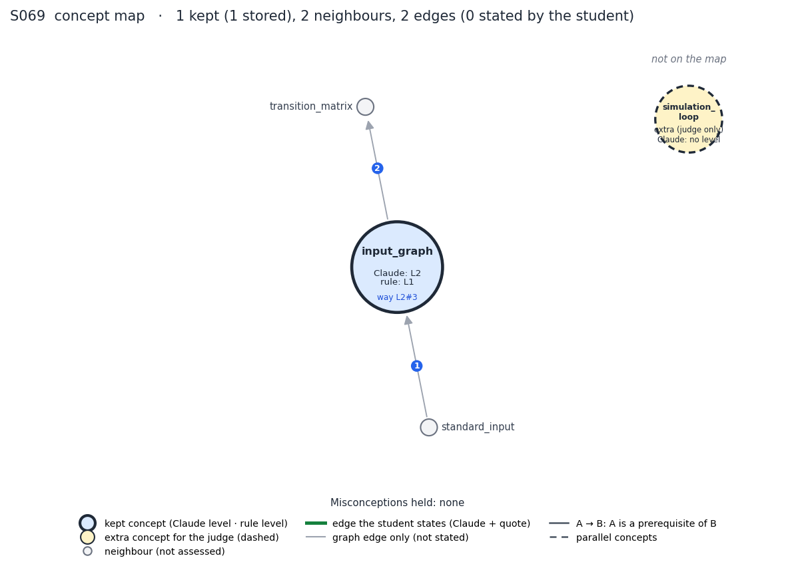

**Triples of the student's concept map** (subject, relation, object, with the logic of each):

| # | Subject | Relation | Object | Logic |
| --- | --- | --- | --- | --- |
| has_level | input_graph | has_level | input_graph@L2 | input_graph@L2#3: One pass consumes exactly two tokens (i, j) from standard input and adds 1 to outDegree[i] and to counts[i][j]; no other entry changes and the tokens cannot be... |
| edge 1 | standard_input | prerequisite | input_graph | The graph is read from standard input: first the number of pages n, then the link pairs i j. — graph only: not checked (a neighbour) |
| edge 2 | input_graph | prerequisite | transition_matrix | The links read from input fill counts[i][j], and each row of the transition matrix is built from those counts. — graph only: not checked (a neighbour) |


### S073 · final L0 · reference L2

**Question:** If value is 2, what is result after the switch? Explain.

```java
switch (value) {
case 1: result = 10;
case 2:
case 3: result = 20;
case 4: result = 40;
default: result = 50;
}
```

**Student answer:** Turn 1: "result is 20." Probe: "If value is 1, what is result?" Turn 2: "10. Oh wait, then 20, 40, 50… so for 2 it is 50 too."

**Concept scoring and shortlist.** 33 of the 173 concepts scored above 0. Every concept scoring at least 1.0 is shortlisted, best first, top 8; Claude then chooses which of them the answer is about.

| Rank | Concept | Link score | Filter result |
| --- | --- | --- | --- |
| 1 | conditional_operator | 3.24 | **shortlisted** |
| 2 | assignment | 2.07 | **shortlisted** |
| 3 | statement | 2.01 | **shortlisted** |
| 4 | array_aliasing | 2.00 | **shortlisted** |
| 5 | string_literal | 2.00 | **shortlisted** |
| 6 | switch_statement | 2.00 | **shortlisted** |
| 7 | block | 1.00 | **shortlisted** |
| 8 | if_statement | 0.44 | not shortlisted: below 1.0 |
| 9 | while_loop | 0.44 | not shortlisted: below 1.0 |
| 10 | interactive_input | 0.34 | not shortlisted: below 1.0 |

**Extra concept:** primitive_type (Claude: no level).

**Sent to Claude:** conditional_operator, assignment, statement, array_aliasing, string_literal, switch_statement, block, primitive_type.

**Claude chose:** switch_statement.

**What happened to each shortlisted concept:**

- conditional_operator: Claude did not choose it (no level), so it is not stored
- assignment: no graph evidence and no level from Claude; not stored
- statement: no graph evidence and no level from Claude; not stored
- array_aliasing: no graph evidence and no level from Claude; not stored
- string_literal: Claude did not choose it (no level), so it is not stored
- switch_statement: no graph evidence; Claude L2; reported, not stored
- block: no graph evidence and no level from Claude; not stored

**Claude's verdict, traced to the graph's edge logic:**

| Concept | Claude level | Way id | Edge logic of that way |
| --- | --- | --- | --- |
| switch_statement | L2 | switch_statement@L2#1 | Order: evaluate the selector once; compare it with the case constants; jump to the matching label (else default, else skip the switch). Then execute the statements from there in order, through later labels, until a break or the cl... |

**Graph edge logic of the levelled concepts** (has_level, misconception and error edges Claude was shown):

| Concept | Edge | Edge logic |
| --- | --- | --- |
| switch_statement | switch_statement → switch_statement@L2 (has_level) | switch statement -> L2 (Multistructural): the answer applies the rules of switch statement to every part of the code, in order (3 ways). |
| switch_statement | switch_statement → SwitchNoFallThrough (misconception) | wrong rule: After the matching case runs, the switch ends even without break. / right rule: Without break, statements in switch blocks fall through into the following cases. |

**Claude's overall level:** L2 (main concept switch_statement). The student first applied the no-fall-through rule and said 20, then traced value 1 through 10, 20, 40, 50, saw that execution falls through, and correctly concluded that for value 2 the result is also 50.

| Step | What happened |
| --- | --- |
| Step 1. Gates | Gates: none. |
| Step 2. Score every concept | 33 of 173 scored above 0. Shortlisted: conditional_operator = 3.24; assignment = 2.07; statement = 2.01; array_aliasing = 2.00; string_literal = 2.00; switch_statement = 2.00; block = 1.00. |
| Step 3. Shortlist and Claude's choice | Top 8 at 1.0 or above: conditional_operator, assignment, statement, array_aliasing, string_literal, switch_statement, block. Claude chose: switch_statement. |
| Step 4. Concept map | 0 stored + 0 neighbours. Stored: none. |
| Step 5. Run the code | stated result = 20 (final); the code gives result = 50 |
| Step 6. LLM judge | Claude gives conditional_operator no level; assignment no level; statement no level; array_aliasing no level; string_literal no level; switch_statement L2; block no level; primitive_type no level; overall L2. |
| Step 7. Final level | max_level, the highest level among the stored concepts (L0 if one holds a wrong rule) = L0; Claude's overall level was L2. Final L0 (reference L2). |

**Trace of the student's concept map:**

| Node | Role | Evidence traced from the answer | Rule level | Claude level and level logic |
| --- | --- | --- | --- | --- |
| switch_statement | chosen, not stored | - | - | L2 via switch_statement@L2#1: L2 (Multistructural): the answer applies the rules of switch statement to every part of the code, in order (3... |
| shortlisted, not chosen | not stored | conditional_operator, assignment, statement, array_aliasing, string_literal, block | - | Claude: none |

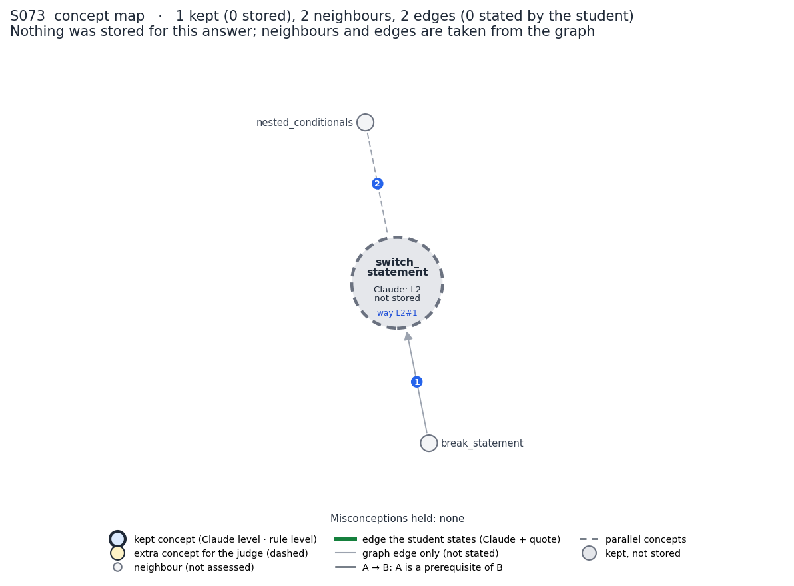

**Triples of the student's concept map** (subject, relation, object, with the logic of each):

| # | Subject | Relation | Object | Logic |
| --- | --- | --- | --- | --- |
| edge 1 | break_statement | prerequisite | switch_statement | Each case of a switch normally ends with break, which exits the switch body. — graph only: not checked (a neighbour) |
| edge 2 | nested_conditionals | parallel | switch_statement | When there are more than two mutually exclusive alternatives, a chain of if-else statements works, but a switch statement provides a direct solution that evaluates one expression against many possible values. — graph only: not checked (a neighbour) |


### S076 · final L0 · reference L0

**Question:** Make an exact copy of data2 (no System.arraycopy).

```java
(writing task) int array data2 already exists
```

**Student answer:** int[] copy = new int[data2.length()]; for (int i = 0; i < data2.length(); i++) copy[i] = data2[i];

**Concept scoring and shortlist.** 84 of the 173 concepts scored above 0. Every concept scoring at least 1.0 is shortlisted, best first, top 8; Claude then chooses which of them the answer is about.

| Rank | Concept | Link score | Filter result |
| --- | --- | --- | --- |
| 1 | array_creation | 4.70 | **shortlisted** |
| 2 | int | 4.21 | **shortlisted** |
| 3 | for_loop | 3.60 | **shortlisted** |
| 4 | increment_operators | 3.35 | **shortlisted** |
| 5 | primitive_type | 3.17 | **shortlisted** |
| 6 | array_copy | 3.10 | **shortlisted** |
| 7 | loop_control | 2.98 | **shortlisted** |
| 8 | array_traversal | 2.93 | **shortlisted** |
| 9 | assignment | 2.80 | not shortlisted: only the top 8 are sent |
| 10 | array_aliasing | 2.62 | not shortlisted: only the top 8 are sent |
| 11 | array_declaration | 2.35 | not shortlisted: only the top 8 are sent |

**Extra concept:** length_field (Claude: L0).

**Sent to Claude:** array_creation, int, for_loop, increment_operators, primitive_type, array_copy, loop_control, array_traversal, length_field.

**Claude chose:** array_creation, array_copy, array_traversal.

**What happened to each shortlisted concept:**

- array_creation: stored; Claude L1
- int: Claude did not choose it (no level), so it is not stored
- for_loop: Claude did not choose it (no level), so it is not stored
- increment_operators: Claude did not choose it (no level), so it is not stored
- primitive_type: Claude did not choose it (no level), so it is not stored
- array_copy: stored; Claude L2
- loop_control: Claude did not choose it (no level), so it is not stored
- array_traversal: stored; Claude L2

**Claude's verdict, traced to the graph's edge logic:**

| Concept | Claude level | Way id | Edge logic of that way |
| --- | --- | --- | --- |
| array_creation | L1 | array_creation@L1#1 | Identity: an array creation expression; new T[n] makes a new array object with n elements of type T and yields a reference to it. |
| array_copy | L2 | array_copy@L2#1 | Sequencing: new creates the second array first, then the loop copies a[0], a[1], ... in order into b[0], b[1], ...; after the loop, a and b are separate arrays with equal elements. |
| array_traversal | L2 | array_traversal@L2#1 | Sequencing: i = 0; test i < a.length; body using a[i]; i++; test; ... When i == a.length the test fails and the body is not executed, so a[a.length] is never touched. |
| length_field | L0 | length_field@L0#2 | wrong rule: You call length() instead of using the length field. Right rule: An array's size is the field a.length, written without parentheses; length() is a String method. |

**Graph edge logic of the levelled concepts** (has_level, misconception and error edges Claude was shown):

| Concept | Edge | Edge logic |
| --- | --- | --- |
| array_creation | array_creation → array_creation@L1 (has_level) | array creation -> L1 (Unistructural): the answer states one correct rule without applying it (2 ways). |
| array_creation | array_creation → ArraysGrow (misconception) | wrong rule: Storing a value at a[n] in an array of length n makes the array grow. / right rule: An array's length is fixed when it is created, so a[n] throws an exception. |
| array_creation | array_creation → ArrayListIsArray (misconception) | wrong rule: an ArrayList is an array (borderline; beyond Chapter 1 CS1) / right rule: An array has a fixed length and uses [] and .length; an ArrayList can grow and uses get, set and size(). |
| array_creation | array_creation → DeclarationCreatesArray (misconception) | wrong rule: int[] a; already makes an array that can be indexed. / right rule: The declaration only names the array; until new (or an initializer) creates it, using a[i] gives a 'variable might not have been initialized' compile-time error... |
| array_creation | array_creation → NegativeArraySize (error) | wrong rule: new int[n] with a negative n creates an empty array. / right rule: Creating an array with a negative length throws NegativeArraySizeException at run time. |
| array_copy | array_copy → array_copy@L2 (has_level) | array copy -> L2 (Multistructural): the answer applies the rules of array copy to every part of the code, in order (3 ways). |
| array_copy | array_copy → AssignmentCopiesObject (misconception) | wrong rule: assigning a reference copies the object / right rule: b = a; copies only the reference, so a and b refer to the same array and b[i] = v also changes a[i]. |
| array_copy | array_copy → ArrayEqualityComparesValues (misconception) | wrong rule: a == b is true when a and b hold the same values. / right rule: == compares whether the two arrays are the same array, not whether their values are equal. |
| array_traversal | array_traversal → array_traversal@L2 (has_level) | array traversal -> L2 (Multistructural): the answer applies the rules of array traversal to every part of the code, in order (3 ways). |
| array_traversal | array_traversal → OffByOneBound (misconception) | wrong rule: < vs <= and 0..n vs 0..n-1 are interchangeable / right rule: for (i = 0; i < n; i++) runs n times with i going up to n - 1; with <= it runs n + 1 times and reaches i = n. |
| array_traversal | array_traversal → EarlyReturnInLoop (error) | wrong rule: Leaves a traversal loop with return before every element has been processed. / right rule: A result that depends on all elements is known only after the loop ends. |
| array_traversal | array_traversal → WholeArrayArithmetic (misconception) | wrong rule: a = a + b adds the arrays element by element. / right rule: Java has no arithmetic on whole arrays; write a loop that adds a[i] + b[i] for each i. |
| array_traversal | array_traversal → IdiomOverridesCode (misconception) | wrong rule: An array loop processes the whole array from index 0 to length-1 and increments its index at the end of the body, whatever the code says. / right rule: The loop visits exactly the indices that its initialisation, guard and update produce, in the order in which its statements are written. |
| length_field | length_field → length_field@L0 (has_level) | length field -> L0 (Prestructural): the answer holds a rule that contradicts Java (4 ways). |
| length_field | length_field → ArrayHasLengthMethod (misconception) | wrong rule: The size of an array is found by calling a.length(). / right rule: An array's size is the field a.length, written without parentheses. |
| length_field | length_field → ArrayLengthCannotBeZero (misconception) | wrong rule: An array cannot have length 0. / right rule: new int[0] is a legal array of length 0. |

**Claude's overall level:** L2 (main concept array_copy). The answer makes a new array and copies data2 into it one element at a time, which is the right plan; but it writes data2.length(), which is wrong because length is a field, not a method, so the code does not compile. That makes this an L2 answer with an error.

| Step | What happened |
| --- | --- |
| Step 1. Gates | Gates: none. |
| Step 2. Score every concept | 84 of 173 scored above 0. Shortlisted: array_creation = 4.70; int = 4.21; for_loop = 3.60; increment_operators = 3.35; primitive_type = 3.17; array_copy = 3.10; loop_control = 2.98; array_traversal = 2.93. |
| Step 3. Shortlist and Claude's choice | Top 8 at 1.0 or above: array_creation, int, for_loop, increment_operators, primitive_type, array_copy, loop_control, array_traversal. Claude chose: array_creation, array_copy, array_traversal. |
| Step 4. Concept map | 3 stored + 13 neighbours. Stored: array_creation, array_copy, array_traversal. |
| Step 5. Run the code | No value to check. |
| Step 6. LLM judge | Claude gives array_creation L1; int no level; for_loop no level; increment_operators no level; primitive_type no level; array_copy L2; loop_control no level; array_traversal L2; length_field L0; overall L2. |
| Step 7. Final level | max_level, the highest level among the stored concepts (L0 if one holds a wrong rule) = L0; Claude's overall level was L2. Final L0 (reference L0). |

**Trace of the student's concept map:**

| Node | Role | Evidence traced from the answer | Rule level | Claude level and level logic |
| --- | --- | --- | --- | --- |
| array_creation | chosen, stored | E1 reference: "array creation: new int[n] -- allocates n slots" (0.429) | L1 | L1 via array_creation@L1#1: L1 (Unistructural): the answer states one correct rule without applying it (2 ways). |
| array_copy | chosen, stored | E1 reference: "array copy: making a second, independent array with the same elements:..." (0.628) | L1 | L2 via array_copy@L2#1: L2 (Multistructural): the answer applies the rules of array copy to every part of the code, in order (3 ways). |
| array_traversal | chosen, stored | E1 reference: "array traversal: walking the array with an index loop" (0.633); E2 execution: "for (i = 0; i < n; i++) runs n times with i going up to n - 1; with <=..." (0.633) | L2 provisional | L2 via array_traversal@L2#1: L2 (Multistructural): the answer applies the rules of array traversal to every part of the code, in order (3 w... |
| shortlisted, not chosen | not stored | int, for_loop, increment_operators, primitive_type, loop_control | - | Claude: none |
| neighbours | not assessed | indexing, for_loop, array_aliasing, array_default_values, array_reference, array_initializer, array_declaration, length_field, function_plotting, running_extreme, enhanced_for, boolean_flag_array, array_reversal | - | - |

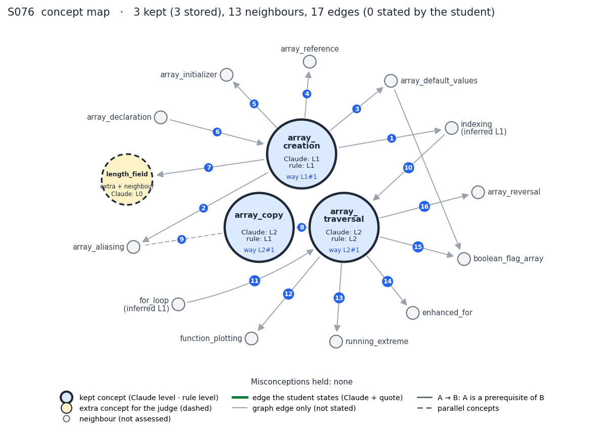

**Triples of the student's concept map** (subject, relation, object, with the logic of each):

| # | Subject | Relation | Object | Logic |
| --- | --- | --- | --- | --- |
| has_level | array_creation | has_level | array_creation@L1 | array_creation@L1#1: Identity: an array creation expression; new T[n] makes a new array object with n elements of type T and yields a reference to it. |
| has_level | array_copy | has_level | array_copy@L2 | array_copy@L2#1: Sequencing: new creates the second array first, then the loop copies a[0], a[1], ... in order into b[0], b[1], ...; after the loop, a and b are separate arrays... |
| has_level | array_traversal | has_level | array_traversal@L2 | array_traversal@L2#1: Sequencing: i = 0; test i < a.length; body using a[i]; i++; test; ... When i == a.length the test fails and the body is not executed, so a[a.length] is never to... |
| edge 1 | array_creation | prerequisite | indexing | An array must be created with new before any of its elements a[i] can be accessed. — graph only: not checked (a neighbour) |
| edge 2 | array_creation | prerequisite | array_aliasing | Because new creates one array and the variable stores only a reference to it, assigning that variable to another makes both names refer to the same array. — graph only: not checked (a neighbour) |
| edge 3 | array_creation | prerequisite | array_default_values | new fills every slot with the type's default value: 0, 0.0, false or null. — graph only: not checked (a neighbour) |
| edge 4 | array_creation | prerequisite | array_reference | When an array is created, the array name stores the memory address of its values; a[i] is found by adding i to that address. — graph only: not checked (a neighbour) |
| edge 5 | array_creation | prerequisite | array_initializer | {v0, v1, ..., vk} is a shorthand that creates an array of length k + 1 and fills it in one step. — graph only: not checked (a neighbour) |
| edge 6 | array_declaration | prerequisite | array_creation | double[] a; declares the array name and type; a = new double[N]; then creates the array. — graph only: not checked (a neighbour) |
| edge 7 | array_creation | prerequisite | length_field | The size n given to new becomes a.length and stays fixed for the array's lifetime. — graph only: the answer does not state it |
| edge 8 | array_traversal | prerequisite | array_copy | The elements are copied one at a time by a loop over every index. — graph only: the answer does not state it |
| edge 9 | array_copy | parallel | array_aliasing | b = a makes a second name for the same array (an alias); copying makes a second array: after a copy, changing b[i] leaves a[i] unchanged. — graph only: not checked (a neighbour) |
| edge 10 | indexing | prerequisite | array_traversal | A traversal uses the loop variable i as the index, so a[i] reaches a different element on each pass. — graph only: not checked (a neighbour) |
| edge 11 | for_loop | prerequisite | array_traversal | for (int i = 0; i < a.length; i++) gives i every valid index exactly once, in increasing order. — graph only: the answer does not state it |
| edge 12 | array_traversal | prerequisite | function_plotting | The sample points are kept in arrays and traversed. — graph only: not checked (a neighbour) |
| edge 13 | array_traversal | prerequisite | running_extreme | The running maximum is found by traversing the array once, keeping the largest value seen so far (starting from Double.NEGATIVE_INFINITY). — graph only: not checked (a neighbour) |
| edge 14 | array_traversal | prerequisite | enhanced_for | for (int x : a) is a traversal that hands the body each value a[i] instead of the index i. — graph only: not checked (a neighbour) |
| edge 15 | array_traversal | prerequisite | boolean_flag_array | The sieve traverses isPrime[] to set every flag to true and later traverses it again to count the flags that are still true. — graph only: not checked (a neighbour) |
| edge 16 | array_traversal | prerequisite | array_reversal | Reversal traverses only the first half of the array (i < N/2), exchanging each a[i] with its mirror a[N-1-i]. — graph only: not checked (a neighbour) |


### S080 · final L3 · reference L3

**Question:** What goes wrong, and in what order will the student meet each problem? Which line(s) never run?

```java
// saved as Hello.java, run as:  java Greeting Ann
public class Greeting {
  public static void main(String[] args) {
    System.out.println("Hi, " + args[1])
    // System.out.println("Bye");
  }
}
```

**Student answer:** Two compile errors first: the class must be in Greeting.java and the ; is missing. After that it compiles, but args[1] crashes at run time because Ann is args[0]. The comment never runs.

**Concept scoring and shortlist.** 59 of the 173 concepts scored above 0. Every concept scoring at least 1.0 is shortlisted, best first, top 8; Claude then chooses which of them the answer is about.

| Rank | Concept | Link score | Filter result |
| --- | --- | --- | --- |
| 1 | command_line_args | 4.28 | **shortlisted** |
| 2 | compile | 4.02 | **shortlisted** |
| 3 | program_text | 3.57 | **shortlisted** |
| 4 | run | 3.43 | **shortlisted** |
| 5 | comment | 3.36 | **shortlisted** |
| 6 | compile_time_error | 3.06 | **shortlisted** |
| 7 | run_time_error | 2.23 | **shortlisted** |
| 8 | indexing | 2.00 | **shortlisted** |
| 9 | class_declaration | 1.71 | not shortlisted: only the top 8 are sent |
| 10 | main_method | 1.48 | not shortlisted: only the top 8 are sent |
| 11 | args_length | 1.27 | not shortlisted: only the top 8 are sent |

**Extra concept:** args_length (Claude: no level).

**Sent to Claude:** command_line_args, compile, program_text, run, comment, compile_time_error, run_time_error, indexing, args_length.

**Claude chose:** command_line_args, program_text, comment, compile_time_error, run_time_error, indexing.

**What happened to each shortlisted concept:**

- command_line_args: stored; Claude L2
- compile: Claude did not choose it (no level), so it is not stored
- program_text: stored; Claude L3
- run: Claude did not choose it (no level), so it is not stored
- comment: stored; Claude L2
- compile_time_error: stored; Claude L3
- run_time_error: stored; Claude L3
- indexing: stored; Claude L2

**Claude's verdict, traced to the graph's edge logic:**

| Concept | Claude level | Way id | Edge logic of that way |
| --- | --- | --- | --- |
| command_line_args | L2 | command_line_args@L2#2 | args[k] evaluates to the k-th typed string, e.g. java UseArgument Alice gives args[0] = "Alice" and prints Hi, Alice. How are you? |
| program_text | L3 | program_text@L3#1 | The name after 'public class' constrains the file name: public class Name must be in Name.java, or javac rejects it. |
| comment | L2 | comment@L2#1 | Comments are removed when the source is read by the compiler, so they never take part in execution order; tracing skips them. |
| compile_time_error | L3 | compile_time_error@L3#3 | A compile-time error is found by javac before the program runs; a run-time error only while it runs, so code that compiles can still crash. |
| run_time_error | L3 | run_time_error@L3#1 | A run-time error appears only while java Name executes, after compiling has succeeded. |
| indexing | L2 | indexing@L2#2 | Result: a[i] has the element type and the value currently stored at position i. For int[] a = {5, 7, 9}, a[1] is 7 and a[0] + a[2] is 14. |

**Graph edge logic of the levelled concepts** (has_level, misconception and error edges Claude was shown):

| Concept | Edge | Edge logic |
| --- | --- | --- |
| command_line_args | command_line_args → command_line_args@L2 (has_level) | command line args -> L2 (Multistructural): the answer applies the rules of command line args to every part of the code, in order (3 ways). |
| command_line_args | command_line_args → ArgsAreNumbers (misconception) | wrong rule: If a number is typed when the program is launched, args[0] is already an int and can be used in arithmetic. / right rule: args[0] is always a String, so Integer.parseInt(args[0]) is needed to get its number. |
| command_line_args | command_line_args → ArgsAlwaysPresent (error) | wrong rule: args[0] can always be read. / right rule: If you run the program without typing the command-line argument it expects, reading args[0] fails with java.lang.ArrayIndexOutOfBoundsException: 0. |
| command_line_args | command_line_args → FirstArgIsArgsOne (error) | wrong rule: The first command-line argument is args[1]. / right rule: Counting starts at 0: the first argument is args[0], the second args[1]. |
| program_text | program_text → program_text@L3 (has_level) | program text -> L3 (Relational): the answer relates the parts (4 ways). |
| program_text | program_text → ClassNameMatchesFile (misconception) | wrong rule: class name and filename are independent / right rule: A public class Name must be saved in a file called Name.java. |
| program_text | program_text → ComputerFillsInIntent (misconception) | wrong rule: The computer fills in omitted steps or values that the programmer meant, e.g. REPEAT 4 [FORWARD 30] draws a square without a turn command. / right rule: The computer executes only what the code states; every needed step and value must be written. |
| comment | comment → comment@L2 (has_level) | comment -> L2 (Multistructural): the answer applies the rules of comment to every part of the code, in order (3 ways). |
| comment | comment → CommentIsExecuted (misconception) | wrong rule: A comment line is run like a statement. / right rule: The compiler ignores comments: everything from // to the end of the line and everything between /* and */. |
| comment | comment → UnclosedComment (error) | wrong rule: Opens a comment with /* and never closes it. / right rule: A /* comment is the text between /* and */, so the closing */ is required. |
| comment | comment → SpacedCommentDelimiter (error) | wrong rule: Writes / * comment * / with spaces inside the delimiters. / right rule: The delimiters /* and */ must be written without spaces. |
| compile_time_error | compile_time_error → compile_time_error@L3 (has_level) | compile time error -> L3 (Relational): the answer relates the parts (4 ways). |
| compile_time_error | compile_time_error → StatementNeedsNoTerminator (error) | wrong rule: a statement runs without the ; / right rule: Each statement must end with ;, otherwise javac reports ';' expected. |
| compile_time_error | compile_time_error → CompilesMeansWorks (misconception) | wrong rule: Code that compiles is code that works. / right rule: Code that compiles can still have run-time and logical errors. |
| compile_time_error | compile_time_error → UnbalancedBraces (error) | wrong rule: A missing { or } is harmless. / right rule: Every { must be matched by a } so the class body and the method body are well formed. |
| compile_time_error | compile_time_error → UnclosedStringLiteral (error) | wrong rule: A string literal can be left without its closing quote. / right rule: A String literal is enclosed in a pair of double quotes. |
| run_time_error | run_time_error → run_time_error@L3 (has_level) | run time error -> L3 (Relational): the answer relates the parts (4 ways). |
| run_time_error | run_time_error → CompilesMeansWorks (misconception) | wrong rule: Code that compiles is code that works. / right rule: Code that compiles can still have run-time and logical errors. |
| run_time_error | run_time_error → MainWithoutStringArgs (error) | wrong rule: public static void main() is an acceptable entry point. / right rule: main is written public static void main(String[] args); these keywords and the args parameter are required. |
| run_time_error | run_time_error → NegativeArraySize (error) | wrong rule: new int[n] with a negative n creates an empty array. / right rule: Creating an array with a negative length throws NegativeArraySizeException at run time. |
| run_time_error | run_time_error → ArgsAlwaysPresent (error) | wrong rule: args[0] can always be read. / right rule: If you run the program without typing the command-line argument it expects, reading args[0] fails with java.lang.ArrayIndexOutOfBoundsException: 0. |
| indexing | indexing → indexing@L2 (has_level) | indexing -> L2 (Multistructural): the answer applies the rules of indexing to every part of the code, in order (3 ways). |
| indexing | indexing → IndexIsValue (misconception) | wrong rule: i and a[i] are the same thing, so the position is the stored value. / right rule: i is a position; a[i] is the value stored at that position. |
| indexing | indexing → ArrayIndexStartsAtOne (misconception) | wrong rule: The first element of a is a[1]. / right rule: Numbering begins with 0; the first element is a[0]. |
| indexing | indexing → ArrayRangeInclusive (misconception) | wrong rule: new int[n] has slots 0 to n, inclusive. / right rule: The slots are 0 to n - 1. |
| indexing | indexing → ArrayAccessWithParentheses (misconception) | wrong rule: a(i) accesses element i of an array. / right rule: Array elements are accessed with square brackets, a[i]. |

**Claude's overall level:** L3 (main concept compile_time_error). The answer finds both compile-time errors in the given code, says they must be fixed before the program can run, and then names the run-time crash at args[1]; this ties compile-time and run-time errors together for this one program, which is L3, but it doesn't say which compile error javac reports first (it would report the missing ; before the file-name error).

| Step | What happened |
| --- | --- |
| Step 1. Gates | Gates: none. |
| Step 2. Score every concept | 59 of 173 scored above 0. Shortlisted: command_line_args = 4.28; compile = 4.02; program_text = 3.57; run = 3.43; comment = 3.36; compile_time_error = 3.06; run_time_error = 2.23; indexing = 2.00. |
| Step 3. Shortlist and Claude's choice | Top 8 at 1.0 or above: command_line_args, compile, program_text, run, comment, compile_time_error, run_time_error, indexing. Claude chose: command_line_args, program_text, comment, compile_time_error, run_time_error, indexing. |
| Step 4. Concept map | 6 stored + 17 neighbours. Stored: command_line_args, program_text, comment, compile_time_error, run_time_error, indexing. |
| Step 5. Run the code | No value to check. |
| Step 6. LLM judge | Claude gives command_line_args L2; compile no level; program_text L3; run no level; comment L2; compile_time_error L3; run_time_error L3; indexing L2; args_length no level; overall L3. |
| Step 7. Final level | max_level, the highest level among the stored concepts (L0 if one holds a wrong rule) = L3; Claude's overall level was L3. Final L3 (reference L3). |

**Trace of the student's concept map:**

| Node | Role | Evidence traced from the answer | Rule level | Claude level and level logic |
| --- | --- | --- | --- | --- |
| command_line_args | chosen, stored | E1 reference: "command line args: args[] -- strings passed at launch" (0.587) | L1 | L2 via command_line_args@L2#2: L2 (Multistructural): the answer applies the rules of command line args to every part of the code, in order (3... |
| program_text | chosen, stored | E1 reference: "program text: the source file; class name must match the filename" (0.543) | L1 | L3 via program_text@L3#1: L3 (Relational): the answer relates the parts (4 ways). |
| comment | chosen, stored | E1 reference: "comment: // and /* */ text that the compiler ignores" (0.485) | L1 | L2 via comment@L2#1: L2 (Multistructural): the answer applies the rules of comment to every part of the code, in order (3 ways). |
| compile_time_error | chosen, stored | E1 reference: "compile time error: an error javac reports before the program can run..." (0.563) | L1 | L3 via compile_time_error@L3#3: L3 (Relational): the answer relates the parts (4 ways). |
| run_time_error | chosen, stored | E1 reference: "run time error: an error raised while the program executes (e.g. Array..." (0.496); E3 integration: "edge run_time_error - run" (1.0) | L3 provisional | L3 via run_time_error@L3#1: L3 (Relational): the answer relates the parts (4 ways). |
| indexing | chosen, stored | E1 reference: "indexing: a[i] -- 0-based access" (0.322) | L1 | L2 via indexing@L2#2: L2 (Multistructural): the answer applies the rules of indexing to every part of the code, in order (3 ways). |
| shortlisted, not chosen | not stored | compile, run | - | Claude: none |
| neighbours | not assessed | run, standard_input, black_box_model, parsing, args_length, main_method, compile, class_declaration, reading_error_messages, logical_error, array_exchange, array_bounds, array_creation, lookup_table, off_by_one_error, array_traversal, two_dimensional_array | - | - |

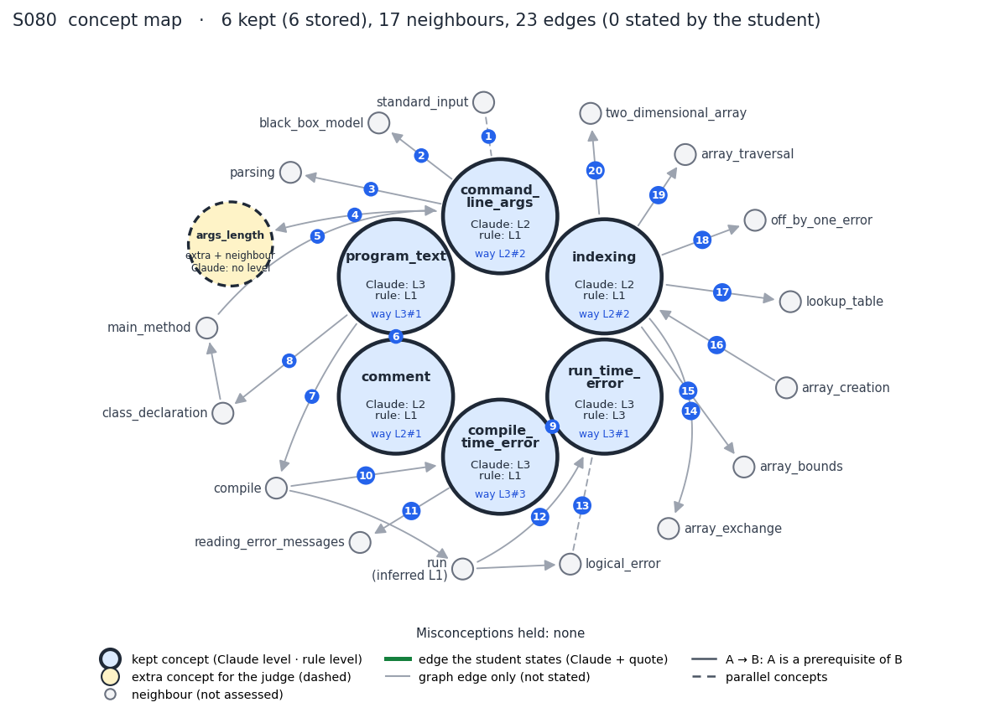

**Triples of the student's concept map** (subject, relation, object, with the logic of each):

| # | Subject | Relation | Object | Logic |
| --- | --- | --- | --- | --- |
| has_level | command_line_args | has_level | command_line_args@L2 | command_line_args@L2#2: args[k] evaluates to the k-th typed string, e.g. java UseArgument Alice gives args[0] = "Alice" and prints Hi, Alice. How are you? |
| has_level | program_text | has_level | program_text@L3 | program_text@L3#1: The name after 'public class' constrains the file name: public class Name must be in Name.java, or javac rejects it. |
| has_level | comment | has_level | comment@L2 | comment@L2#1: Comments are removed when the source is read by the compiler, so they never take part in execution order; tracing skips them. |
| has_level | compile_time_error | has_level | compile_time_error@L3 | compile_time_error@L3#3: A compile-time error is found by javac before the program runs; a run-time error only while it runs, so code that compiles can still crash. |
| has_level | run_time_error | has_level | run_time_error@L3 | run_time_error@L3#1: A run-time error appears only while java Name executes, after compiling has succeeded. |
| has_level | indexing | has_level | indexing@L2 | indexing@L2#2: Result: a[i] has the element type and the value currently stored at position i. For int[] a = {5, 7, 9}, a[1] is 7 and a[0] + a[2] is 14. |
| edge 1 | standard_input | parallel | command_line_args | Command-line arguments are a fixed number of strings given once when the program starts (args[]); standard input is a stream of any length read while the program runs (StdIn.readInt()). Both arrive as text and must be parsed into numbers. — graph only: not checked (a neighbour) |
| edge 2 | command_line_args | prerequisite | black_box_model | The black-box view treats the command-line argument as the input string and what the program prints as the output string. — graph only: not checked (a neighbour) |
| edge 3 | command_line_args | prerequisite | parsing | args[k] is always a String, so Integer.parseInt(args[k]) is needed before it can be used as a number. — graph only: not checked (a neighbour) |
| edge 4 | command_line_args | prerequisite | args_length | args is the array of command-line arguments. — graph only: the answer does not state it |
| edge 5 | main_method | prerequisite | command_line_args | The command-line arguments arrive in main's parameter args, an array of Strings. — graph only: not checked (a neighbour) |
| edge 6 | program_text | prerequisite | comment | Comments are part of the program text in Name.java but are ignored when it is compiled. — graph only: the answer does not state it |
| edge 7 | program_text | prerequisite | compile | javac takes the program file Name.java as input and translates it into Name.class. — graph only: the answer does not state it |
| edge 8 | program_text | prerequisite | class_declaration | The source file Name.java holds the public class, and that class must be named Name. — graph only: not checked (a neighbour) |
| edge 9 | compile_time_error | parallel | run_time_error | A compile-time error is found by javac before the program runs; a run-time error is found while it runs. — graph only: the answer does not state it |
| edge 10 | compile | prerequisite | compile_time_error | A compile-time error is reported while javac compiles Name.java, so no Name.class is produced. — graph only: the answer does not state it |
| edge 11 | compile_time_error | prerequisite | reading_error_messages | Reading error messages is how compile-time errors are found and fixed. — graph only: not checked (a neighbour) |
| edge 12 | run | prerequisite | run_time_error | A run-time error appears only while java Name executes, after compiling has succeeded. — graph only: the answer does not state it |
| edge 13 | run_time_error | parallel | logical_error | A run-time error stops the program with an exception; a logical error lets it finish with wrong output. — graph only: not checked (a neighbour) |
| edge 14 | indexing | prerequisite | array_exchange | An exchange reads and writes a[i] and a[j] by index. — graph only: not checked (a neighbour) |
| edge 15 | indexing | prerequisite | array_bounds | Valid indexes run from 0 to a.length - 1; any other index throws an exception when it is used. — graph only: not checked (a neighbour) |
| edge 16 | array_creation | prerequisite | indexing | An array must be created with new before any of its elements a[i] can be accessed. — graph only: not checked (a neighbour) |
| edge 17 | indexing | prerequisite | lookup_table | A lookup table is read by index, a[i]. — graph only: not checked (a neighbour) |
| edge 18 | indexing | prerequisite | off_by_one_error | Indices start at 0, so the last element is a[N-1]; misreading this convention is the usual source of off-by-one errors. — graph only: not checked (a neighbour) |
| edge 19 | indexing | prerequisite | array_traversal | A traversal uses the loop variable i as the index, so a[i] reaches a different element on each pass. — graph only: not checked (a neighbour) |
| edge 20 | indexing | prerequisite | two_dimensional_array | A 1-D array uses one index a[i]; a 2-D array uses two, a[i][j], where the first index chooses the row array. — graph only: not checked (a neighbour) |


### S084 · final L0 · reference L0

**Question:** What is printed by java Order 3 ? By java Order five ?

```java
public class Order {
  public static void main(String[] args) {
    int n = Integer.parseInt(args[0]);
    System.out.println("start");
    if (n > 5)
      System.out.println("big");
      System.out.println("done");
  }
}
```

**Student answer:** Only start, because done is inside the if and 3 is not > 5.

**Concept scoring and shortlist.** 54 of the 173 concepts scored above 0. Every concept scoring at least 1.0 is shortlisted, best first, top 8; Claude then chooses which of them the answer is about.

| Rank | Concept | Link score | Filter result |
| --- | --- | --- | --- |
| 1 | if_statement | 3.76 | **shortlisted** |
| 2 | class_declaration | 2.00 | **shortlisted** |
| 3 | main_method | 1.59 | **shortlisted** |
| 4 | block | 1.25 | **shortlisted** |
| 5 | statement | 1.24 | **shortlisted** |
| 6 | run | 1.11 | **shortlisted** |
| 7 | variable | 1.00 | **shortlisted** |
| 8 | int | 1.00 | **shortlisted** |
| 9 | assignment | 1.00 | not shortlisted: only the top 8 are sent |
| 10 | empty_statement | 1.00 | not shortlisted: only the top 8 are sent |
| 11 | indexing | 1.00 | not shortlisted: only the top 8 are sent |

**Extra concept:** array_default_values (Claude: no level).

**Sent to Claude:** if_statement, class_declaration, main_method, block, statement, run, variable, int, array_default_values.

**Claude chose:** if_statement, block.

**What happened to each shortlisted concept:**

- if_statement: stored; Claude L1
- class_declaration: no graph evidence and no level from Claude; not stored
- main_method: Claude did not choose it (no level), so it is not stored
- block: stored; Claude L0
- statement: Claude did not choose it (no level), so it is not stored
- run: no graph evidence and no level from Claude; not stored
- variable: no graph evidence and no level from Claude; not stored
- int: no graph evidence and no level from Claude; not stored

**Claude's verdict, traced to the graph's edge logic:**

| Concept | Claude level | Way id | Edge logic of that way |
| --- | --- | --- | --- |
| if_statement | L1 | if_statement@L1#2 | Syntax: if (<boolean expression>) <statement or { block }>; the braces are optional when the body is a single statement. The expression must have type boolean (or Boolean), and the body is executed if and only if the expression is... |
| block | L0 | block@L0#4 | wrong rule: A statement placed after the if statement belongs to its branch, so it runs only when the condition is true. Right rule: The branch ends at its closing brace (or after its single statement); the next statement runs wha... |

**Graph edge logic of the levelled concepts** (has_level, misconception and error edges Claude was shown):

| Concept | Edge | Edge logic |
| --- | --- | --- |
| if_statement | if_statement → if_statement@L1 (has_level) | if statement -> L1 (Unistructural): the answer states one correct rule without applying it (2 ways). |
| if_statement | if_statement → IfIsLoop (misconception) | wrong rule: The if body keeps repeating as long as its condition stays true. / right rule: An if body runs at most once; only a loop repeats its body. |
| if_statement | if_statement → AssignCompares (misconception) | wrong rule: = compares two values instead of assigning / right rule: x = y copies the value of y into x; x == y is what compares them. |
| if_statement | if_statement → MapToBooleanWithIf (misconception) | wrong rule: you need an if to turn a boolean expression into a boolean / right rule: ok = (x > y); stores the result of the comparison directly. |
| if_statement | if_statement → IfRequiresElse (misconception) | wrong rule: Every if statement requires an else. / right rule: An if statement may stand alone; the else part is optional. |
| block | block → block@L0 (has_level) | block -> L0 (Prestructural): the answer holds a rule that contradicts Java (6 ways). |
| block | block → UnbalancedBraces (error) | wrong rule: A missing { or } is harmless. / right rule: Every { must be matched by a } so the class body and the method body are well formed. |
| block | block → MissingBraces (misconception) | wrong rule: Omits braces around a single-statement body of if, for or while. / right rule: Braces are optional for a single-statement body, but using them anyway avoids bugs when statements are added later. |
| block | block → LocalVarOutsideScope (misconception) | wrong rule: A variable declared inside a block can be used anywhere in the program, like a global. / right rule: A local variable exists only from its declaration to the end of its block. |
| block | block → InconsistentIndentation (misconception) | wrong rule: Indents nested blocks inconsistently, so the visual nesting differs from the real nesting. / right rule: Indent consistently, one level deeper for each nested block, so the layout shows the real nesting; the compiler ignores indentation. |

**Claude's overall level:** L0 (main concept block). The student puts the indented println("done") inside the braceless if, but in Java only the first statement after the if header is its body; indentation does not matter, so `java Order 3` prints start and then done. The answer also skips `java Order five`, where Integer.parseInt throws NumberFormatException before anything is printed.

| Step | What happened |
| --- | --- |
| Step 1. Gates | Gates: none. |
| Step 2. Score every concept | 54 of 173 scored above 0. Shortlisted: if_statement = 3.76; class_declaration = 2.00; main_method = 1.59; block = 1.25; statement = 1.24; run = 1.11; variable = 1.00; int = 1.00. |
| Step 3. Shortlist and Claude's choice | Top 8 at 1.0 or above: if_statement, class_declaration, main_method, block, statement, run, variable, int. Claude chose: if_statement, block. |
| Step 4. Concept map | 2 stored + 6 neighbours. Stored: if_statement, block. |
| Step 5. Run the code | No value to check. |
| Step 6. LLM judge | Claude gives if_statement L1; class_declaration no level; main_method no level; block L0; statement no level; run no level; variable no level; int no level; array_default_values no level; overall L0. |
| Step 7. Final level | max_level, the highest level among the stored concepts (L0 if one holds a wrong rule) = L0; Claude's overall level was L0. Final L0 (reference L0). |

**Trace of the student's concept map:**

| Node | Role | Evidence traced from the answer | Rule level | Claude level and level logic |
| --- | --- | --- | --- | --- |
| if_statement | chosen, stored | E1 reference: "if statement: run a block only when the condition holds" (0.557) | L1 | L1 via if_statement@L1#2: L1 (Unistructural): the answer states one correct rule without applying it (2 ways). |
| block | chosen, stored | E1 reference: "block: { ... } grouping statements" (0.463) | L1 | L0 via block@L0#4: L0 (Prestructural): the answer holds a rule that contradicts Java (6 ways). |
| shortlisted, not chosen | not stored | class_declaration, main_method, statement, run, variable, int | - | Claude: none |
| neighbours | not assessed | control_flow, boolean_expression, if_else_statement, while_loop, statement, program_layout | - | - |

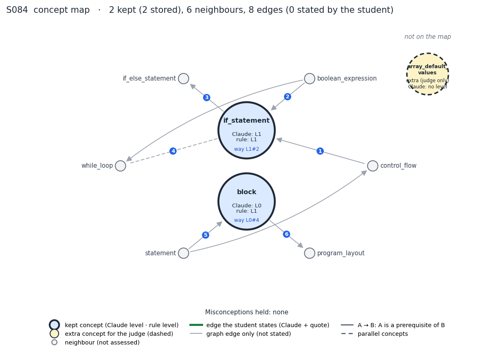

**Triples of the student's concept map** (subject, relation, object, with the logic of each):

| # | Subject | Relation | Object | Logic |
| --- | --- | --- | --- | --- |
| has_level | if_statement | has_level | if_statement@L1 | if_statement@L1#2: Syntax: if (<boolean expression>) <statement or { block }>; the braces are optional when the body is a single statement. The expression must have type boolean (... |
| has_level | block | has_level | block@L0 | block@L0#4: wrong rule: A statement placed after the if statement belongs to its branch, so it runs only when the condition is true. Right rule: The branch ends at its clos... |
| edge 1 | control_flow | prerequisite | if_statement | An if changes the default top-to-bottom flow by running a block only when its condition is true. — graph only: not checked (a neighbour) |
| edge 2 | boolean_expression | prerequisite | if_statement | An if runs its block only when its boolean expression evaluates to true. — graph only: not checked (a neighbour) |
| edge 3 | if_statement | prerequisite | if_else_statement | if-else extends if with a second block that runs exactly when the condition is false. — graph only: not checked (a neighbour) |
| edge 4 | if_statement | parallel | while_loop | if and while have the same form, but if tests its condition once and runs the block at most once, while while tests again after every pass and repeats the block as long as the condition is true. — graph only: not checked (a neighbour) |
| edge 5 | statement | prerequisite | block | A statement block is a sequence of statements, each terminated by a semicolon, enclosed in braces; the body of main() is such a sequence. — graph only: the answer does not state it |
| edge 6 | block | prerequisite | program_layout | Indentation makes the nesting of blocks visible, so the reader can see which statements belong to which block. — graph only: not checked (a neighbour) |


### S088 · final L2 · reference L2

**Question:** (a) What does javac do, and what does java do? (b) After javac Big.java succeeds, what has happened and what has not? (c) Why would compiling and testing in small steps have helped? (d) Plan the first three steps for a program that prints the sum of two command-line numbers.

```java
A student writes all 200 lines of Big.java, then runs  javac Big.java  for the first time and gets 37 error messages.
```

**Student answer:** There is a Big.class file now, but nothing is printed because the program has not run yet.

**Concept scoring and shortlist.** 37 of the 173 concepts scored above 0. Every concept scoring at least 1.0 is shortlisted, best first, top 8; Claude then chooses which of them the answer is about.

| Rank | Concept | Link score | Filter result |
| --- | --- | --- | --- |
| 1 | program_text | 2.75 | **shortlisted** |
| 2 | run | 2.39 | **shortlisted** |
| 3 | compile | 2.02 | **shortlisted** |
| 4 | reading_error_messages | 1.00 | **shortlisted** |
| 5 | array_creation | 0.99 | not shortlisted: below 1.0 |
| 6 | print | 0.66 | not shortlisted: below 1.0 |
| 7 | class_declaration | 0.60 | not shortlisted: below 1.0 |

**Extra concept:** class_declaration (Claude: no level).

**Sent to Claude:** program_text, run, compile, reading_error_messages, class_declaration.

**Claude chose:** run, compile.

**What happened to each shortlisted concept:**

- program_text: Claude did not choose it (no level), so it is not stored
- run: stored; Claude L1
- compile: no graph evidence; Claude L2; reported, not stored
- reading_error_messages: no graph evidence and no level from Claude; not stored

**Claude's verdict, traced to the graph's edge logic:**

| Concept | Claude level | Way id | Edge logic of that way |
| --- | --- | --- | --- |
| run | L1 | run@L1#1 | Running (executing) a program is launching it with java Name so that the Java Virtual Machine follows its instructions. |
| compile | L2 | compile@L2#3 | One compile changes only the file system: it creates or overwrites Name.class; it changes no program variable and prints no program output. |

**Graph edge logic of the levelled concepts** (has_level, misconception and error edges Claude was shown):

| Concept | Edge | Edge logic |
| --- | --- | --- |
| run | run → run@L1 (has_level) | run -> L1 (Unistructural): the answer states one correct rule without applying it (2 ways). |
| run | run → CompileRunsProgram (misconception) | wrong rule: If javac Name.java finishes without errors, the program already works and has run. / right rule: javac only translates Name.java into Name.class; the program runs only with java Name, and run-time errors can still appear then. |
| run | run → AudioProgramHangs (error) | wrong rule: Ends a StdAudio program with no System.exit(0), so the terminal hangs and needs <ctrl-c>. / right rule: In the book's setup, a program that uses StdAudio should end main() with System.exit(0). |
| compile | compile → compile@L2 (has_level) | compile -> L2 (Multistructural): the answer applies the rules of compile to every part of the code, in order (3 ways). |
| compile | compile → CompileRunsProgram (misconception) | wrong rule: If javac Name.java finishes without errors, the program already works and has run. / right rule: javac only translates Name.java into Name.class; the program runs only with java Name, and run-time errors can still appear then. |
| compile | compile → CompilesMeansWorks (misconception) | wrong rule: Code that compiles is code that works. / right rule: Code that compiles can still have run-time and logical errors. |

**Claude's overall level:** L2 (main concept compile). The answer applies the compile rule to this one javac step. It says the step made Big.class and that compiling prints no program output because the program has not run. It does not explain that java Big later loads that Big.class, so it does not reach the relational level.

| Step | What happened |
| --- | --- |
| Step 1. Gates | Gates: none. |
| Step 2. Score every concept | 37 of 173 scored above 0. Shortlisted: program_text = 2.75; run = 2.39; compile = 2.02; reading_error_messages = 1.00. |
| Step 3. Shortlist and Claude's choice | Top 8 at 1.0 or above: program_text, run, compile, reading_error_messages. Claude chose: run, compile. |
| Step 4. Concept map | 1 stored + 5 neighbours. Stored: run. |
| Step 5. Run the code | No value to check. |
| Step 6. LLM judge | Claude gives program_text no level; run L1; compile L2; reading_error_messages no level; class_declaration no level; overall L2. |
| Step 7. Final level | max_level, the highest level among the stored concepts (L0 if one holds a wrong rule) = L2; Claude's overall level was L2. Final L2 (reference L2). |

**Matching check** (hand-checked right concept: compile, run): right concept chosen (compile, run).

**Trace of the student's concept map:**

| Node | Role | Evidence traced from the answer | Rule level | Claude level and level logic |
| --- | --- | --- | --- | --- |
| run | chosen, stored | E1 reference: "run: java executes main in the JVM" (0.498) | L1 | L1 via run@L1#1: L1 (Unistructural): the answer states one correct rule without applying it (2 ways). |
| compile | chosen, not stored | - | - | L2 via compile@L2#3: L2 (Multistructural): the answer applies the rules of compile to every part of the code, in order (3 ways). |
| shortlisted, not chosen | not stored | program_text, reading_error_messages | - | Claude: none |
| neighbours | not assessed | incremental_development, logical_error, testing, compile, run_time_error | - | - |

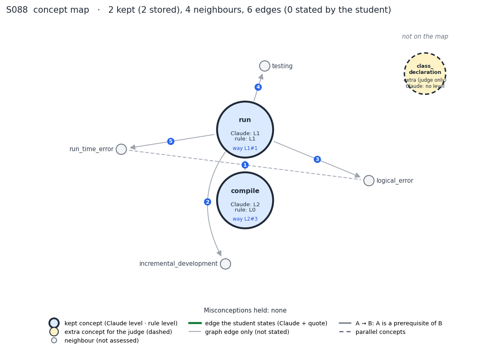

**Triples of the student's concept map** (subject, relation, object, with the logic of each):

| # | Subject | Relation | Object | Logic |
| --- | --- | --- | --- | --- |
| has_level | run | has_level | run@L1 | run@L1#1: Running (executing) a program is launching it with java Name so that the Java Virtual Machine follows its instructions. |
| edge 1 | compile | prerequisite | run | java Name runs the Name.class file that javac produced, so compiling must succeed before the program can run. — graph only: the answer does not state it |
| edge 2 | run | prerequisite | incremental_development | Each small step is run and checked before the next one is added. — graph only: not checked (a neighbour) |
| edge 3 | run | prerequisite | logical_error | A logical error is seen only by running the program and comparing its output with the intended output. — graph only: not checked (a neighbour) |
| edge 4 | run | prerequisite | testing | A program is tested by running it on chosen inputs and comparing what it prints with what it should print. — graph only: not checked (a neighbour) |
| edge 5 | run | prerequisite | run_time_error | A run-time error appears only while java Name executes, after compiling has succeeded. — graph only: not checked (a neighbour) |


### S089 · final L3 · reference L3

**Question:** (a) What does javac do, and what does java do? (b) After javac Big.java succeeds, what has happened and what has not? (c) Why would compiling and testing in small steps have helped? (d) Plan the first three steps for a program that prints the sum of two command-line numbers.

```java
A student writes all 200 lines of Big.java, then runs  javac Big.java  for the first time and gets 37 error messages.
```

**Student answer:** If you compile after every few lines, each error is next to the code you just wrote, so it is easy to find.

**Concept scoring and shortlist.** 25 of the 173 concepts scored above 0. Every concept scoring at least 1.0 is shortlisted, best first, top 8; Claude then chooses which of them the answer is about.

| Rank | Concept | Link score | Filter result |
| --- | --- | --- | --- |
| 1 | compile | 3.68 | **shortlisted** |
| 2 | incremental_development | 2.29 | **shortlisted** |
| 3 | reading_error_messages | 2.06 | **shortlisted** |
| 4 | program_text | 2.04 | **shortlisted** |
| 5 | testing | 1.40 | **shortlisted** |
| 6 | run | 1.04 | **shortlisted** |
| 7 | run_time_error | 0.85 | not shortlisted: below 1.0 |
| 8 | compile_time_error | 0.67 | not shortlisted: below 1.0 |
| 9 | debugging | 0.52 | not shortlisted: below 1.0 |

**Extra concept:** compile_time_error (Claude: no level).

**Sent to Claude:** compile, incremental_development, reading_error_messages, program_text, testing, run, compile_time_error.

**Claude chose:** incremental_development.

**What happened to each shortlisted concept:**

- compile: Claude did not choose it (no level), so it is not stored
- incremental_development: stored; Claude L3
- reading_error_messages: Claude did not choose it (no level), so it is not stored
- program_text: no graph evidence and no level from Claude; not stored
- testing: no graph evidence and no level from Claude; not stored
- run: no graph evidence and no level from Claude; not stored

**Claude's verdict, traced to the graph's edge logic:**

| Concept | Claude level | Way id | Edge logic of that way |
| --- | --- | --- | --- |
| incremental_development | L3 | incremental_development@L3#2 | Small steps make debugging local: the newest change is the first suspect. |

**Graph edge logic of the levelled concepts** (has_level, misconception and error edges Claude was shown):

| Concept | Edge | Edge logic |
| --- | --- | --- |
| incremental_development | incremental_development → incremental_development@L3 (has_level) | incremental development -> L3 (Relational): the answer relates the parts (3 ways). |
| incremental_development | incremental_development → WriteAllThenTest (misconception) | wrong rule: Write the whole program first, then compile and test it all at the end. / right rule: Start with a working program and make small changes, compiling and testing after each one, so an error is always in the last change. |

**Claude's overall level:** L3 (main concept incremental_development). The answer explains why small steps help, and the reason comes from the situation: if you compile after every few lines, any error is in the code you just wrote, so it is easy to find.

| Step | What happened |
| --- | --- |
| Step 1. Gates | Gates: none. |
| Step 2. Score every concept | 25 of 173 scored above 0. Shortlisted: compile = 3.68; incremental_development = 2.29; reading_error_messages = 2.06; program_text = 2.04; testing = 1.40; run = 1.04. |
| Step 3. Shortlist and Claude's choice | Top 8 at 1.0 or above: compile, incremental_development, reading_error_messages, program_text, testing, run. Claude chose: incremental_development. |
| Step 4. Concept map | 1 stored + 2 neighbours. Stored: incremental_development. |
| Step 5. Run the code | No value to check. |
| Step 6. LLM judge | Claude gives compile no level; incremental_development L3; reading_error_messages no level; program_text no level; testing no level; run no level; compile_time_error no level; overall L3. |
| Step 7. Final level | max_level, the highest level among the stored concepts (L0 if one holds a wrong rule) = L3; Claude's overall level was L3. Final L3 (reference L3). |

**Matching check** (hand-checked right concept: incremental_development): right concept chosen (incremental_development).

**Trace of the student's concept map:**

| Node | Role | Evidence traced from the answer | Rule level | Claude level and level logic |
| --- | --- | --- | --- | --- |
| incremental_development | chosen, stored | E1 reference: "incremental development: building a program in small steps from a vers..." (0.649); E2 execution: "Start with a working program and make small changes, compiling and tes..." (0.649); E3 integration: "answers: Why would compiling and testing in small steps have helped?" (1.0) | L3 provisional | L3 via incremental_development@L3#2: L3 (Relational): the answer relates the parts (3 ways). |
| shortlisted, not chosen | not stored | compile, reading_error_messages, program_text, testing, run | - | Claude: none |
| neighbours | not assessed | run, debugging | - | - |

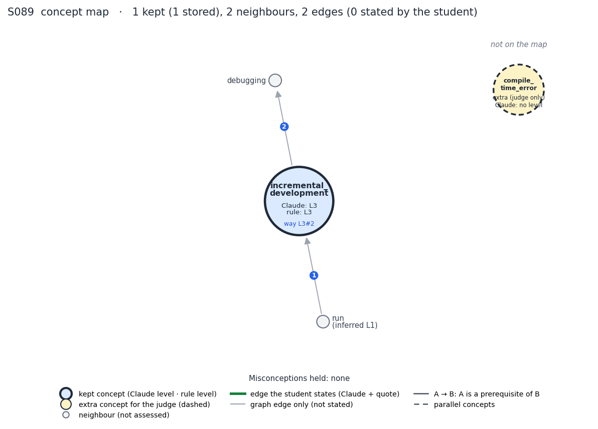

**Triples of the student's concept map** (subject, relation, object, with the logic of each):

| # | Subject | Relation | Object | Logic |
| --- | --- | --- | --- | --- |
| has_level | incremental_development | has_level | incremental_development@L3 | incremental_development@L3#2: Small steps make debugging local: the newest change is the first suspect. |
| edge 1 | run | prerequisite | incremental_development | Each small step is run and checked before the next one is added. — graph only: the answer does not state it |
| edge 2 | incremental_development | prerequisite | debugging | Developing in small steps keeps debugging local: an error is in the change just made. — graph only: not checked (a neighbour) |


### S091 · final L4 · reference L3

**Question:** (a) Name the part public class Hello { ... } and say which file it must be in. (b) What is printed? (c) Why does java Hello start at main, and what happens if main is written as public static void main() ? (d) A classmate wrote System.out.println("Hi there); What happens and why?

```java
public class Hello {
  public static void main(String[] args) {
    // greet
    System.out.print("Hi");
    System.out.println(" there");
  }
}
```

**Student answer:** It will not compile: the string has no closing quote, so Java says unclosed string literal.

**Concept scoring and shortlist.** 46 of the 173 concepts scored above 0. Every concept scoring at least 1.0 is shortlisted, best first, top 8; Claude then chooses which of them the answer is about.

| Rank | Concept | Link score | Filter result |
| --- | --- | --- | --- |
| 1 | string_literal | 5.38 | **shortlisted** |
| 2 | statement | 2.86 | **shortlisted** |
| 3 | println | 2.54 | **shortlisted** |
| 4 | standard_output | 2.52 | **shortlisted** |
| 5 | print | 2.23 | **shortlisted** |
| 6 | method_call | 2.00 | **shortlisted** |
| 7 | empty_statement | 2.00 | **shortlisted** |
| 8 | string_type | 1.92 | **shortlisted** |
| 9 | literal | 1.54 | not shortlisted: only the top 8 are sent |
| 10 | main_method | 1.49 | not shortlisted: only the top 8 are sent |
| 11 | compile | 1.20 | not shortlisted: only the top 8 are sent |

**Extra concept:** compile_time_error (Claude: L3).

**Sent to Claude:** string_literal, statement, println, standard_output, print, method_call, empty_statement, string_type, compile_time_error.

**Claude chose:** string_literal.

**What happened to each shortlisted concept:**

- string_literal: stored; Claude L3
- statement: Claude did not choose it (no level), so it is not stored
- println: Claude did not choose it (no level), so it is not stored
- standard_output: Claude did not choose it (no level), so it is not stored
- print: no graph evidence and no level from Claude; not stored
- method_call: no graph evidence and no level from Claude; not stored
- empty_statement: no graph evidence and no level from Claude; not stored
- string_type: Claude did not choose it (no level), so it is not stored

**Claude's verdict, traced to the graph's edge logic:**

| Concept | Claude level | Way id | Edge logic of that way |
| --- | --- | --- | --- |
| string_literal | L3 | string_literal@L4#2 | rule broken: A String literal is enclosed in a pair of double quotes. Kind: compile-time. Trigger class: a missing closing (or opening) quote; the compiler may get very confused and report errors elsewhere |
| compile_time_error | L3 | compile_time_error@L4#4 | rule broken: A String literal is enclosed in a pair of double quotes. Kind: compile-time. Trigger class: missing closing quote: unclosed string literal, often with confusing follow-on errors |

**Graph edge logic of the levelled concepts** (has_level, misconception and error edges Claude was shown):

| Concept | Edge | Edge logic |
| --- | --- | --- |
| string_literal | string_literal → string_literal@L3 (has_level) | string literal -> L3 (Relational): the answer relates the parts (4 ways). |
| string_literal | string_literal → UnclosedStringLiteral (error) | wrong rule: A string literal can be left without its closing quote. / right rule: A String literal is enclosed in a pair of double quotes. |
| string_literal | string_literal → SingleQuotedString (error) | wrong rule: Writes a string literal in single quotes: 'Hello'. / right rule: String literals use double quotes; single quotes are for one char. |
| string_literal | string_literal → StringLiteralSpansLines (error) | wrong rule: Breaks a string literal across two lines of code. / right rule: String literals must not span more than one line of a program. |
| compile_time_error | compile_time_error → compile_time_error@L3 (has_level) | compile time error -> L3 (Relational): the answer relates the parts (4 ways). |
| compile_time_error | compile_time_error → StatementNeedsNoTerminator (error) | wrong rule: a statement runs without the ; / right rule: Each statement must end with ;, otherwise javac reports ';' expected. |
| compile_time_error | compile_time_error → CompilesMeansWorks (misconception) | wrong rule: Code that compiles is code that works. / right rule: Code that compiles can still have run-time and logical errors. |
| compile_time_error | compile_time_error → UnbalancedBraces (error) | wrong rule: A missing { or } is harmless. / right rule: Every { must be matched by a } so the class body and the method body are well formed. |
| compile_time_error | compile_time_error → UnclosedStringLiteral (error) | wrong rule: A string literal can be left without its closing quote. / right rule: A String literal is enclosed in a pair of double quotes. |

**Claude's overall level:** L3 (main concept string_literal). The student finds the one mistake in the classmate's line (the missing closing quote), names the rule it breaks and correctly predicts the compile-time error 'unclosed string literal'. This locates the mistake for one given failing case, which is L3; the student does not state the general class of trigger needed for L4.

| Step | What happened |
| --- | --- |
| Step 1. Gates | Gates: none. |
| Step 2. Score every concept | 46 of 173 scored above 0. Shortlisted: string_literal = 5.38; statement = 2.86; println = 2.54; standard_output = 2.52; print = 2.23; method_call = 2.00; empty_statement = 2.00; string_type = 1.92. |
| Step 3. Shortlist and Claude's choice | Top 8 at 1.0 or above: string_literal, statement, println, standard_output, print, method_call, empty_statement, string_type. Claude chose: string_literal. |
| Step 4. Concept map | 1 stored + 3 neighbours. Stored: string_literal. |
| Step 5. Run the code | No value to check. |
| Step 6. LLM judge | Claude gives string_literal L3; statement no level; println no level; standard_output no level; print no level; method_call no level; empty_statement no level; string_type no level; compile_time_error L3; overall L3. |
| Step 7. Final level | max_level, the highest level among the stored concepts (L0 if one holds a wrong rule) = L4; Claude's overall level was L3. Final L4 (reference L3). |

**Matching check** (hand-checked right concept: compile_time_error, string_literal): right concept chosen (string_literal).

**Trace of the student's concept map:**

| Node | Role | Evidence traced from the answer | Rule level | Claude level and level logic |
| --- | --- | --- | --- | --- |
| string_literal | chosen, stored | E1 reference: "string literal: "Hello, World" -- the text being printed" (0.595); E4 transfer: "answers: A classmate wrote System.out.println("Hi there); What happens..." (1.0) | L4 provisional | L3 via string_literal@L4#2: L3 (Relational): the answer relates the parts (4 ways). |
| shortlisted, not chosen | not stored | statement, println, standard_output, print, method_call, empty_statement, string_type | - | Claude: none |
| neighbours | not assessed | println, print, escape_sequences | - | - |

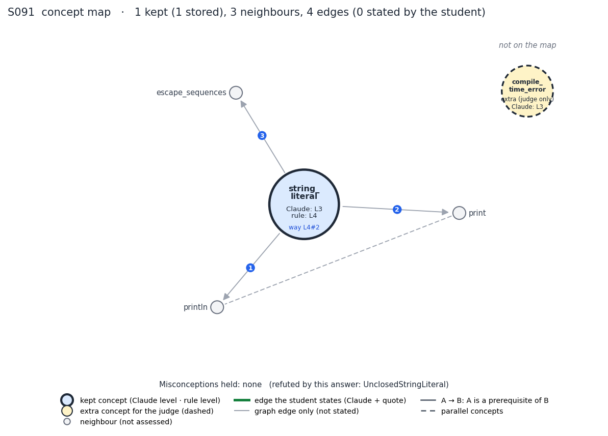

**Triples of the student's concept map** (subject, relation, object, with the logic of each):

| # | Subject | Relation | Object | Logic |
| --- | --- | --- | --- | --- |
| has_level | string_literal | has_level | string_literal@L3 | string_literal@L4#2: rule broken: A String literal is enclosed in a pair of double quotes. Kind: compile-time. Trigger class: a missing closing (or opening) quote; the compiler may... |
| misconception (refuted) | string_literal | misconception | UnclosedStringLiteral | the answer refuted this wrong rule |
| edge 1 | string_literal | prerequisite | println | println("s") outputs exactly the characters between the quotes and then ends the line. — graph only: the answer does not state it |
| edge 2 | string_literal | prerequisite | print | print("s") outputs exactly the characters between the quotes, without the quotes. — graph only: the answer does not state it |
| edge 3 | string_literal | prerequisite | escape_sequences | Escape sequences are written inside string or char literals. — graph only: not checked (a neighbour) |


### S092 · final L0 · reference L0

**Question:** (a) Name the part public class Hello { ... } and say which file it must be in. (b) What is printed? (c) Why does java Hello start at main, and what happens if main is written as public static void main() ? (d) A classmate wrote System.out.println("Hi there); What happens and why?

```java
public class Hello {
  public static void main(String[] args) {
    // greet
    System.out.print("Hi");
    System.out.println(" there");
  }
}
```

**Student answer:** main() without String[] args is fine because the program uses no arguments.

**Concept scoring and shortlist.** 29 of the 173 concepts scored above 0. Every concept scoring at least 1.0 is shortlisted, best first, top 8; Claude then chooses which of them the answer is about.

| Rank | Concept | Link score | Filter result |
| --- | --- | --- | --- |
| 1 | main_method | 4.35 | **shortlisted** |
| 2 | command_line_args | 3.04 | **shortlisted** |
| 3 | array_declaration | 2.00 | **shortlisted** |
| 4 | standard_output | 1.12 | **shortlisted** |
| 5 | print | 1.06 | **shortlisted** |
| 6 | println | 1.00 | **shortlisted** |
| 7 | method_call | 1.00 | **shortlisted** |
| 8 | comment | 1.00 | **shortlisted** |
| 9 | string_type | 1.00 | not shortlisted: only the top 8 are sent |
| 10 | class_declaration | 1.00 | not shortlisted: only the top 8 are sent |
| 11 | empty_statement | 1.00 | not shortlisted: only the top 8 are sent |

**Extra concept:** run (Claude: no level).

**Sent to Claude:** main_method, command_line_args, array_declaration, standard_output, print, println, method_call, comment, run.

**Claude chose:** main_method.

**What happened to each shortlisted concept:**

- main_method: stored; Claude L0
- command_line_args: Claude did not choose it (no level), so it is not stored
- array_declaration: Claude did not choose it (no level), so it is not stored
- standard_output: no graph evidence and no level from Claude; not stored
- print: no graph evidence and no level from Claude; not stored
- println: no graph evidence and no level from Claude; not stored
- method_call: no graph evidence and no level from Claude; not stored
- comment: no graph evidence and no level from Claude; not stored

**Claude's verdict, traced to the graph's edge logic:**

| Concept | Claude level | Way id | Edge logic of that way |
| --- | --- | --- | --- |
| main_method | L0 | main_method@L0#1 | Everyday reading: 'main' sounds like the most important part, and 'void' like empty or invalid. Java rule: main is the entry point that java Name calls; public static void main(String[] args) must be written exactly, and void only... |

**Graph edge logic of the levelled concepts** (has_level, misconception and error edges Claude was shown):

| Concept | Edge | Edge logic |
| --- | --- | --- |
| main_method | main_method → main_method@L0 (has_level) | main method -> L0 (Prestructural): the answer holds a rule that contradicts Java (1 way). |
| main_method | main_method → MainWithoutStringArgs (error) | wrong rule: public static void main() is an acceptable entry point. / right rule: main is written public static void main(String[] args); these keywords and the args parameter are required. |
| main_method | main_method → MissingKeyword (error) | wrong rule: Leaves out a required keyword such as static or class. / right rule: public class Name and public static void main(String[] args) need their keywords, which are required; omitting or misspelling one is an error, usually caught by... |

**Claude's overall level:** L0 (main concept main_method). The student says public static void main() is a fine entry point because the program uses no arguments. That is the MainWithoutStringArgs wrong rule: Java needs public static void main(String[] args) to launch, and without it java Hello reports that no main method was found.

| Step | What happened |
| --- | --- |
| Step 1. Gates | Gates: none. |
| Step 2. Score every concept | 29 of 173 scored above 0. Shortlisted: main_method = 4.35; command_line_args = 3.04; array_declaration = 2.00; standard_output = 1.12; print = 1.06; println = 1.00; method_call = 1.00; comment = 1.00. |
| Step 3. Shortlist and Claude's choice | Top 8 at 1.0 or above: main_method, command_line_args, array_declaration, standard_output, print, println, method_call, comment. Claude chose: main_method. |
| Step 4. Concept map | 1 stored + 3 neighbours. Stored: main_method. |
| Step 5. Run the code | No value to check. |
| Step 6. LLM judge | Claude gives main_method L0; command_line_args no level; array_declaration no level; standard_output no level; print no level; println no level; method_call no level; comment no level; run no level; overall L0. |
| Step 7. Final level | max_level, the highest level among the stored concepts (L0 if one holds a wrong rule) = L0; Claude's overall level was L0. Final L0 (reference L0). |

**Trace of the student's concept map:**

| Node | Role | Evidence traced from the answer | Rule level | Claude level and level logic |
| --- | --- | --- | --- | --- |
| main_method | chosen, stored | E1 reference: "main method: public static void main(String[] args) -- entry point" (0.735); E3 integration: "edge main_method - command_line_args" (1.0) | L3 provisional | L0 via main_method@L0#1: L0 (Prestructural): the answer holds a rule that contradicts Java (1 way). |
| shortlisted, not chosen | not stored | command_line_args, array_declaration, standard_output, print, println, method_call, comment | - | Claude: none |
| neighbours | not assessed | class_declaration, command_line_args, statement | - | - |

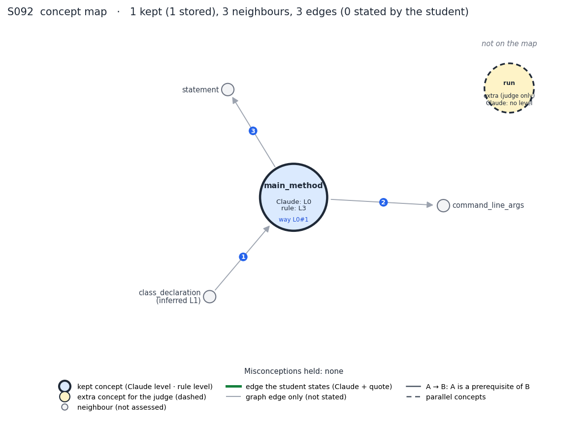

**Triples of the student's concept map** (subject, relation, object, with the logic of each):

| # | Subject | Relation | Object | Logic |
| --- | --- | --- | --- | --- |
| has_level | main_method | has_level | main_method@L0 | main_method@L0#1: Everyday reading: 'main' sounds like the most important part, and 'void' like empty or invalid. Java rule: main is the entry point that java Name calls; public... |
| edge 1 | class_declaration | prerequisite | main_method | main is written inside the class's braces, so java Name looks inside the class Name to find main. — graph only: not checked (a neighbour) |
| edge 2 | main_method | prerequisite | command_line_args | The command-line arguments arrive in main's parameter args, an array of Strings. — graph only: the answer does not state it |
| edge 3 | main_method | prerequisite | statement | Statements are written in main's body, and running the program executes main's statements in order, one by one. — graph only: not checked (a neighbour) |


### S093 · final L3 · reference L3

**Question:** (a) Is this a compile-time, run-time or logical error? (b) What is printed? (c) Why did the compiler not catch it? (d) Fix it so it prints 5.5.

```java
// goal: print the average of 4 and 7
int a = 4, b = 7;
double avg = a + b / 2;
System.out.println(avg);
```

**Student answer:** Use (a + b) / 2.0: parentheses for the order and 2.0 so the division is not integer division.

**Concept scoring and shortlist.** 41 of the 173 concepts scored above 0. Every concept scoring at least 1.0 is shortlisted, best first, top 8; Claude then chooses which of them the answer is about.

| Rank | Concept | Link score | Filter result |
| --- | --- | --- | --- |
| 1 | double | 4.16 | **shortlisted** |
| 2 | integer_division | 3.44 | **shortlisted** |
| 3 | expression | 2.83 | **shortlisted** |
| 4 | int | 2.79 | **shortlisted** |
| 5 | arithmetic_operators | 2.69 | **shortlisted** |
| 6 | explicit_cast | 1.17 | **shortlisted** |
| 7 | primitive_type | 1.17 | **shortlisted** |
| 8 | method_call | 1.07 | **shortlisted** |
| 9 | variable | 1.01 | not shortlisted: only the top 8 are sent |
| 10 | standard_output | 1.00 | not shortlisted: only the top 8 are sent |
| 11 | assignment | 1.00 | not shortlisted: only the top 8 are sent |

**Extra concept:** run_time_error (Claude: no level).

**Sent to Claude:** double, integer_division, expression, int, arithmetic_operators, explicit_cast, primitive_type, method_call, run_time_error.

**Claude chose:** double, integer_division, expression.

**What happened to each shortlisted concept:**

- double: stored; Claude L3
- integer_division: stored; Claude L3
- expression: stored; Claude L3
- int: Claude did not choose it (no level), so it is not stored
- arithmetic_operators: Claude did not choose it (no level), so it is not stored
- explicit_cast: Claude did not choose it (no level), so it is not stored
- primitive_type: no graph evidence and no level from Claude; not stored
- method_call: no graph evidence and no level from Claude; not stored

**Claude's verdict, traced to the graph's edge logic:**

| Concept | Claude level | Way id | Edge logic of that way |
| --- | --- | --- | --- |
| double | L3 | double@L3#1 | Type flow decides the division: with two int operands a / b discards the fraction (10/3 is 3, and double d = 10/3; stores 3.0); if either operand is double the other is promoted and the fraction is kept (10/3.0 is 3.33333333333333... |
| integer_division | L3 | integer_division@L3#2 | Normalizing counts must divide as doubles. With two ints, counts / total truncates to 0 whenever counts < total. |
| expression | L3 | expression@L3#3 | With several operators, precedence and left associativity decide the grouping, and parentheses override both. |

**Graph edge logic of the levelled concepts** (has_level, misconception and error edges Claude was shown):

| Concept | Edge | Edge logic |
| --- | --- | --- |
| double | double → double@L3 (has_level) | double -> L3 (Relational): the answer relates the parts (7 ways). |
| double | double → FloatingPointIsExact (misconception) | wrong rule: Math.sqrt(2) * Math.sqrt(2) == 2 is true. / right rule: A double is an approximation, so the product is close to 2 but not equal to 2. |
| double | double → WholeNumberLiteralIsInt (misconception) | wrong rule: 207. and 2.3e4 are int values because they are whole numbers. / right rule: A decimal point or scientific notation makes the literal a double. |
| integer_division | integer_division → integer_division@L3 (has_level) | integer division -> L3 (Relational): the answer relates the parts (4 ways). |
| integer_division | integer_division → TargetTyping (misconception) | wrong rule: The type of a numerical expression depends on the type expected by the surrounding context, so double d = a / b; keeps the fraction. / right rule: The type of a numerical expression is determined by the expression, so double d = a / b; with int a and b still divides as ints. |
| integer_division | integer_division → IntegerDivisionGivesFraction (misconception) | wrong rule: 10 / 3 evaluates to 3.333.... / right rule: Dividing two ints gives an int: the fractional part is discarded. |
| integer_division | integer_division → CastAfterIntDivision (misconception) | wrong rule: (double) (3 / 5) is 0.6. / right rule: The integer division 3 / 5 = 0 happens before the cast, so the result is 0.0. |
| integer_division | integer_division → LaterDoubleLiteralFixesDivision (misconception) | wrong rule: Changing a later literal to 100.0 fixes an earlier int division. / right rule: The int division happens first; the double must be in the division itself. |
| expression | expression → expression@L3 (has_level) | expression -> L3 (Relational): the answer relates the parts (6 ways). |
| expression | expression → AssignmentNotExpression (misconception) | wrong rule: An assignment cannot be used inside a larger expression, so a condition like (x = read()) != v is not allowed. / right rule: An assignment is an expression whose value is the value assigned, so (x = v) both stores v in x and gives v. |
| expression | expression → NoAtomicExpression (misconception) | wrong rule: A single variable x or a literal on its own is not an expression. / right rule: A single variable or literal is an expression whose value is just that value. |
| expression | expression → ParenthesesOnlyIfArgument (misconception) | wrong rule: () are optional on a no-argument call like println / right rule: A method call always needs parentheses, so an empty line is printed with System.out.println();. |
| expression | expression → VariablesHoldExpressions (misconception) | wrong rule: = stores the expression itself, not its computed value / right rule: y = x + k; stores the value that x + k has at that moment, so later changes to x do not change y. |

**Claude's overall level:** L3 (main concept integer_division). The student finds both faults in the given code (b / 2 is done first, and it is int division because both operands are ints) and fixes them with (a + b) / 2.0 for a reason; fixing one given failing case is L3.

| Step | What happened |
| --- | --- |
| Step 1. Gates | Gates: none. |
| Step 2. Score every concept | 41 of 173 scored above 0. Shortlisted: double = 4.16; integer_division = 3.44; expression = 2.83; int = 2.79; arithmetic_operators = 2.69; explicit_cast = 1.17; primitive_type = 1.17; method_call = 1.07. |
| Step 3. Shortlist and Claude's choice | Top 8 at 1.0 or above: double, integer_division, expression, int, arithmetic_operators, explicit_cast, primitive_type, method_call. Claude chose: double, integer_division, expression. |
| Step 4. Concept map | 3 stored + 13 neighbours. Stored: double, integer_division, expression. |
| Step 5. Run the code | No value to check. |
| Step 6. LLM judge | Claude gives double L3; integer_division L3; expression L3; int no level; arithmetic_operators no level; explicit_cast no level; primitive_type no level; method_call no level; run_time_error no level; overall L3. |
| Step 7. Final level | max_level, the highest level among the stored concepts (L0 if one holds a wrong rule) = L3; Claude's overall level was L3. Final L3 (reference L3). |

**Matching check** (hand-checked right concept: integer_division, operator_precedence): right concept chosen (integer_division).

**Trace of the student's concept map:**

| Node | Role | Evidence traced from the answer | Rule level | Claude level and level logic |
| --- | --- | --- | --- | --- |
| double | chosen, stored | E1 reference: "double: 64-bit floating-point primitive" (0.439); E3 integration: "edge double - int" (1.0) | L3 provisional | L3 via double@L3#1: L3 (Relational): the answer relates the parts (7 ways). |
| integer_division | chosen, stored | E1 reference: "integer division: / on two ints truncates; % is the remainder" (0.681); E2 execution: "Integer division: / applied to two integer operands, giving the whole-..." (0.681); E3 integration: "edge integer_division - arithmetic_operators" (1.0) | L3 provisional | L3 via integer_division@L3#2: L3 (Relational): the answer relates the parts (4 ways). |
| expression | chosen, stored | E1 reference: "expression: anything that evaluates to a value" (0.592); E3 integration: "edge expression - arithmetic_operators" (1.0) | L3 provisional | L3 via expression@L3#3: L3 (Relational): the answer relates the parts (6 ways). |
| shortlisted, not chosen | not stored | int, arithmetic_operators, explicit_cast, primitive_type, method_call | - | Claude: none |
| neighbours | not assessed | primitive_type, arithmetic_operators, variable, floating_point_precision, division_by_zero, boolean, int, char, normalization, remainder_operator, operator_precedence, method_call, comparison_operators | - | - |

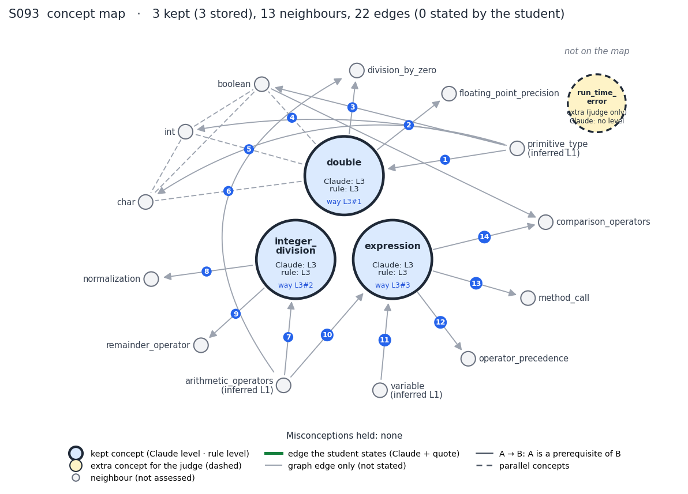

**Triples of the student's concept map** (subject, relation, object, with the logic of each):

| # | Subject | Relation | Object | Logic |
| --- | --- | --- | --- | --- |
| has_level | double | has_level | double@L3 | double@L3#1: Type flow decides the division: with two int operands a / b discards the fraction (10/3 is 3, and double d = 10/3; stores 3.0); if either operand is double the... |
| has_level | integer_division | has_level | integer_division@L3 | integer_division@L3#2: Normalizing counts must divide as doubles. With two ints, counts / total truncates to 0 whenever counts < total. |
| has_level | expression | has_level | expression@L3 | expression@L3#3: With several operators, precedence and left associativity decide the grouping, and parentheses override both. |
| edge 1 | primitive_type | prerequisite | double | double is one of the eight primitive types, the one used for real (floating-point) numbers. — graph only: the answer does not state it |
| edge 2 | double | prerequisite | floating_point_precision | A double approximates real numbers, so its arithmetic is not exact. — graph only: not checked (a neighbour) |
| edge 3 | double | prerequisite | division_by_zero | For doubles, 1.0/0.0 is legal and has the value Infinity; a double result can also be the special value NaN when the calculation is undefined. — graph only: not checked (a neighbour) |
| edge 4 | double | parallel | boolean | A double holds a number with a fractional part; a boolean holds only true or false. — graph only: not checked (a neighbour) |
| edge 5 | int | parallel | double | With two ints, a / b drops the fractional part; if either a or b is a double, a / b keeps the fractional part. — graph only: the answer does not state it |
| edge 6 | double | parallel | char | A double holds a number with a fractional part; a char holds one character code, which is a whole number. — graph only: not checked (a neighbour) |
| edge 7 | arithmetic_operators | prerequisite | integer_division | For ints a and b, / gives the whole quotient q and % gives the remainder r, so that a = b * q + r. — graph only: the answer does not state it |
| edge 8 | integer_division | prerequisite | normalization | Normalising must divide as doubles, because with two ints counts / total truncates to 0 whenever counts < total. — graph only: not checked (a neighbour) |
| edge 9 | integer_division | prerequisite | remainder_operator | % is the companion of integer division: a = (a / b) * b + a % b. — graph only: not checked (a neighbour) |
| edge 10 | arithmetic_operators | prerequisite | expression | An operator combines operand values a and b into a new value, so operators build larger expressions from smaller ones. — graph only: the answer does not state it |
| edge 11 | variable | prerequisite | expression | An expression can be a literal, a variable, or operations on them; we compute with a variable by using its name in an expression. — graph only: not checked (a neighbour) |
| edge 12 | expression | prerequisite | operator_precedence | When an expression has several operators, precedence decides which operands are combined first, and equal-precedence operators go left to right. — graph only: not checked (a neighbour) |
| edge 13 | expression | prerequisite | method_call | Method arguments may be expressions, and a method call can be used in expressions in the same way as variables and literals. — graph only: the answer does not state it |
| edge 14 | expression | prerequisite | comparison_operators | Comparison operators build expressions whose value is a boolean, so one must already know what an expression is to understand a < b. — graph only: not checked (a neighbour) |


### S094 · final L4 · reference L4

**Question:** (a) What is args[0] here, and what is its type? (b) What does java Twice 21 print? (c) Describe the program as a black box: input → output. (d) What happens with java Twice (no argument)?

```java
public class Twice {
  public static void main(String[] args) {
    int n = Integer.parseInt(args[0]);
    System.out.println(args[0] + args[0] + " " + 2 * n);
  }
}
% java Twice 21
```

**Student answer:** It crashes when it runs, because args is empty and args[0] is out of bounds.

**Concept scoring and shortlist.** 67 of the 173 concepts scored above 0. Every concept scoring at least 1.0 is shortlisted, best first, top 8; Claude then chooses which of them the answer is about.

| Rank | Concept | Link score | Filter result |
| --- | --- | --- | --- |
| 1 | command_line_args | 4.24 | **shortlisted** |
| 2 | run | 3.19 | **shortlisted** |
| 3 | array_bounds | 2.38 | **shortlisted** |
| 4 | indexing | 2.00 | **shortlisted** |
| 5 | class_declaration | 2.00 | **shortlisted** |
| 6 | run_time_error | 1.93 | **shortlisted** |
| 7 | parsing | 1.37 | **shortlisted** |
| 8 | block | 1.25 | **shortlisted** |
| 9 | main_method | 1.22 | not shortlisted: only the top 8 are sent |
| 10 | empty_statement | 1.11 | not shortlisted: only the top 8 are sent |
| 11 | array_declaration | 1.07 | not shortlisted: only the top 8 are sent |

**Extra concept:** args_length (Claude: L3).

**Sent to Claude:** command_line_args, run, array_bounds, indexing, class_declaration, run_time_error, parsing, block, args_length.

**Claude chose:** command_line_args, array_bounds, run_time_error.

**What happened to each shortlisted concept:**

- command_line_args: stored; Claude L3
- run: Claude did not choose it (no level), so it is not stored
- array_bounds: stored; Claude L2
- indexing: Claude did not choose it (no level), so it is not stored
- class_declaration: no graph evidence and no level from Claude; not stored
- run_time_error: stored; Claude L2
- parsing: Claude did not choose it (no level), so it is not stored
- block: no graph evidence and no level from Claude; not stored

**Claude's verdict, traced to the graph's edge logic:**

| Concept | Claude level | Way id | Edge logic of that way |
| --- | --- | --- | --- |
| command_line_args | L3 | command_line_args@L3#3 | args.length is the number of arguments typed (0 if none), so valid indices are 0 to args.length-1. |
| array_bounds | L2 | array_bounds@L2#2 | Result: a legal access yields the element. An illegal one yields no value; the program stops with ArrayIndexOutOfBoundsException naming the bad index (old JVMs print ': 10', current ones 'Index 10 out of bounds for length 10'). |
| run_time_error | L2 | run_time_error@L2#2 | Output: any earlier output, then Exception in thread "main" java.lang.<Name>: <detail> at Class.main(Class.java:<line>). |
| args_length | L3 | args_length@L3#1 | args[i] may be read only for i < args.length; with no arguments even args[0] is out of bounds. |

**Graph edge logic of the levelled concepts** (has_level, misconception and error edges Claude was shown):

| Concept | Edge | Edge logic |
| --- | --- | --- |
| command_line_args | command_line_args → command_line_args@L3 (has_level) | command line args -> L3 (Relational): the answer relates the parts (6 ways). |
| command_line_args | command_line_args → ArgsAreNumbers (misconception) | wrong rule: If a number is typed when the program is launched, args[0] is already an int and can be used in arithmetic. / right rule: args[0] is always a String, so Integer.parseInt(args[0]) is needed to get its number. |
| command_line_args | command_line_args → ArgsAlwaysPresent (error) | wrong rule: args[0] can always be read. / right rule: If you run the program without typing the command-line argument it expects, reading args[0] fails with java.lang.ArrayIndexOutOfBoundsException: 0. |
| command_line_args | command_line_args → FirstArgIsArgsOne (error) | wrong rule: The first command-line argument is args[1]. / right rule: Counting starts at 0: the first argument is args[0], the second args[1]. |
| array_bounds | array_bounds → array_bounds@L2 (has_level) | array bounds -> L2 (Multistructural): the answer applies the rules of array bounds to every part of the code, in order (3 ways). |
| array_bounds | array_bounds → OutOfBoundsElementsAreNull (misconception) | wrong rule: Reading a[a.length] just gives null or 0. / right rule: Reading any index outside 0 to a.length - 1 throws ArrayIndexOutOfBoundsException. |
| array_bounds | array_bounds → OffByOneBound (misconception) | wrong rule: < vs <= and 0..n vs 0..n-1 are interchangeable / right rule: for (i = 0; i < n; i++) runs n times with i going up to n - 1; with <= it runs n + 1 times and reaches i = n. |
| run_time_error | run_time_error → run_time_error@L2 (has_level) | run time error -> L2 (Multistructural): the answer applies the rules of run time error to every part of the code, in order (3 ways). |
| run_time_error | run_time_error → CompilesMeansWorks (misconception) | wrong rule: Code that compiles is code that works. / right rule: Code that compiles can still have run-time and logical errors. |
| run_time_error | run_time_error → MainWithoutStringArgs (error) | wrong rule: public static void main() is an acceptable entry point. / right rule: main is written public static void main(String[] args); these keywords and the args parameter are required. |
| run_time_error | run_time_error → NegativeArraySize (error) | wrong rule: new int[n] with a negative n creates an empty array. / right rule: Creating an array with a negative length throws NegativeArraySizeException at run time. |
| run_time_error | run_time_error → ArgsAlwaysPresent (error) | wrong rule: args[0] can always be read. / right rule: If you run the program without typing the command-line argument it expects, reading args[0] fails with java.lang.ArrayIndexOutOfBoundsException: 0. |
| args_length | args_length → args_length@L3 (has_level) | args length -> L3 (Relational): the answer relates the parts (3 ways). |
| args_length | args_length → ArgsAlwaysPresent (error) | wrong rule: args[0] can always be read. / right rule: If you run the program without typing the command-line argument it expects, reading args[0] fails with java.lang.ArrayIndexOutOfBoundsException: 0. |

**Claude's overall level:** L3 (main concept command_line_args). The student links the missing argument (args is empty) to args[0] being out of bounds, which explains why this run fails. That relates the command-line arguments to args' length and is correct.

| Step | What happened |
| --- | --- |
| Step 1. Gates | Gates: none. |
| Step 2. Score every concept | 67 of 173 scored above 0. Shortlisted: command_line_args = 4.24; run = 3.19; array_bounds = 2.38; indexing = 2.00; class_declaration = 2.00; run_time_error = 1.93; parsing = 1.37; block = 1.25. |
| Step 3. Shortlist and Claude's choice | Top 8 at 1.0 or above: command_line_args, run, array_bounds, indexing, class_declaration, run_time_error, parsing, block. Claude chose: command_line_args, array_bounds, run_time_error. |
| Step 4. Concept map | 3 stored + 10 neighbours. Stored: command_line_args, array_bounds, run_time_error. |
| Step 5. Run the code | No value to check. |
| Step 6. LLM judge | Claude gives command_line_args L3; run no level; array_bounds L2; indexing no level; class_declaration no level; run_time_error L2; parsing no level; block no level; args_length L3; overall L3. |
| Step 7. Final level | max_level, the highest level among the stored concepts (L0 if one holds a wrong rule) = L4; Claude's overall level was L3. Final L4 (reference L4). |

**Matching check** (hand-checked right concept: array_bounds, command_line_args): right concept chosen (array_bounds, command_line_args).

**Trace of the student's concept map:**

| Node | Role | Evidence traced from the answer | Rule level | Claude level and level logic |
| --- | --- | --- | --- | --- |
| command_line_args | chosen, stored | E1 reference: "command line args: args[] -- strings passed at launch" (0.59); E4 transfer: "answers: What happens with java Twice (no argument)?" (1.0) | L4 provisional | L3 via command_line_args@L3#3: L3 (Relational): the answer relates the parts (6 ways). |
| array_bounds | chosen, stored | E1 reference: "array bounds: valid indices are 0 .. length-1; otherwise throws" (0.496); E3 integration: "edge array_bounds - indexing" (1.0); E4 transfer: "answers: What happens with java Twice (no argument)?" (1.0) | L4 provisional | L2 via array_bounds@L2#2: L2 (Multistructural): the answer applies the rules of array bounds to every part of the code, in order (3 ways... |
| run_time_error | chosen, stored | E1 reference: "run time error: an error raised while the program executes (e.g. Array..." (0.513); E3 integration: "edge run_time_error - run" (1.0); E4 transfer: "answers: What happens with java Twice (no argument)?" (1.0) | L4 provisional | L2 via run_time_error@L2#2: L2 (Multistructural): the answer applies the rules of run time error to every part of the code, in order (3 wa... |
| shortlisted, not chosen | not stored | run, indexing, class_declaration, parsing, block | - | Claude: none |
| neighbours | not assessed | main_method, indexing, run, standard_input, black_box_model, parsing, args_length, loop_guard, logical_error, compile_time_error | - | - |

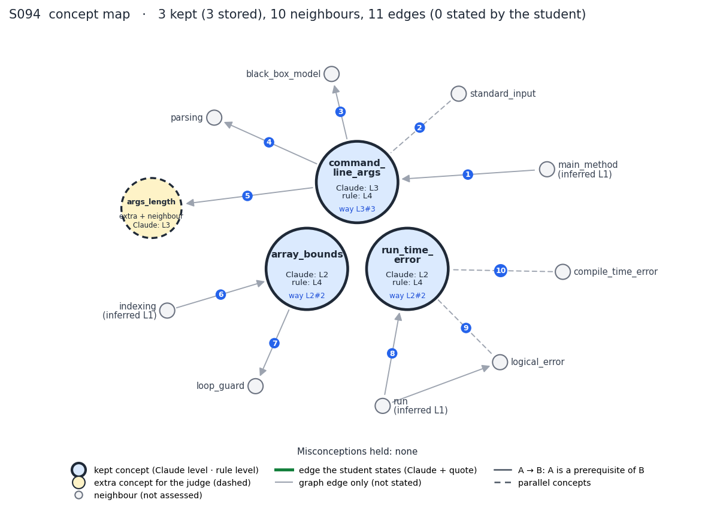

**Triples of the student's concept map** (subject, relation, object, with the logic of each):

| # | Subject | Relation | Object | Logic |
| --- | --- | --- | --- | --- |
| has_level | command_line_args | has_level | command_line_args@L3 | command_line_args@L3#3: args.length is the number of arguments typed (0 if none), so valid indices are 0 to args.length-1. |
| has_level | array_bounds | has_level | array_bounds@L2 | array_bounds@L2#2: Result: a legal access yields the element. An illegal one yields no value; the program stops with ArrayIndexOutOfBoundsException naming the bad index (old JVMs... |
| has_level | run_time_error | has_level | run_time_error@L2 | run_time_error@L2#2: Output: any earlier output, then Exception in thread "main" java.lang.<Name>: <detail> at Class.main(Class.java:<line>). |
| edge 1 | main_method | prerequisite | command_line_args | The command-line arguments arrive in main's parameter args, an array of Strings. — graph only: not checked (a neighbour) |
| edge 2 | standard_input | parallel | command_line_args | Command-line arguments are a fixed number of strings given once when the program starts (args[]); standard input is a stream of any length read while the program runs (StdIn.readInt()). Both arrive as text and must be parsed into numbers. — graph only: not checked (a neighbour) |
| edge 3 | command_line_args | prerequisite | black_box_model | The black-box view treats the command-line argument as the input string and what the program prints as the output string. — graph only: not checked (a neighbour) |
| edge 4 | command_line_args | prerequisite | parsing | args[k] is always a String, so Integer.parseInt(args[k]) is needed before it can be used as a number. — graph only: the answer does not state it |
| edge 5 | command_line_args | prerequisite | args_length | args is the array of command-line arguments. — graph only: the answer does not state it |
| edge 6 | indexing | prerequisite | array_bounds | Valid indexes run from 0 to a.length - 1; any other index throws an exception when it is used. — graph only: the answer does not state it |
| edge 7 | array_bounds | prerequisite | loop_guard | Because an out-of-bounds index stops the program, the while test checks the bounds before the body uses the index. — graph only: not checked (a neighbour) |
| edge 8 | run | prerequisite | run_time_error | A run-time error appears only while java Name executes, after compiling has succeeded. — graph only: the answer does not state it |
| edge 9 | run_time_error | parallel | logical_error | A run-time error stops the program with an exception; a logical error lets it finish with wrong output. — graph only: not checked (a neighbour) |
| edge 10 | compile_time_error | parallel | run_time_error | A compile-time error is found by javac before the program runs; a run-time error is found while it runs. — graph only: not checked (a neighbour) |


### S095 · final L1 · reference L1

**Question:** (a) List the literals and give the type of each. (b) Which of int, double, boolean, char, String is not a primitive type? (c) What is a data type? (d) Make a trace table of a, b and total after each line. (e) In a = b = 5, which assignment happens first, and why can it be one line? (f) What happens if you add int c; System.out.println(c + 1); ? (g) Why use TAX instead of 0.08, and what does TAX = 0.1; later do?

```java
final double TAX = 0.08;
int a, b;
a = b = 5;
double total = a * 2 + 1.5;
total = total + total * TAX;
```

**Student answer:** String; it is a class. The other four are primitive.

**Concept scoring and shortlist.** 41 of the 173 concepts scored above 0. Every concept scoring at least 1.0 is shortlisted, best first, top 8; Claude then chooses which of them the answer is about.

| Rank | Concept | Link score | Filter result |
| --- | --- | --- | --- |
| 1 | primitive_type | 4.14 | **shortlisted** |
| 2 | string_type | 3.35 | **shortlisted** |
| 3 | primitive_vs_reference | 3.19 | **shortlisted** |
| 4 | assignment | 2.00 | **shortlisted** |
| 5 | arithmetic_operators | 2.00 | **shortlisted** |
| 6 | statement | 2.00 | **shortlisted** |
| 7 | expression | 2.00 | **shortlisted** |
| 8 | variable | 2.00 | **shortlisted** |
| 9 | int | 2.00 | not shortlisted: only the top 8 are sent |
| 10 | named_constants | 2.00 | not shortlisted: only the top 8 are sent |
| 11 | double | 2.00 | not shortlisted: only the top 8 are sent |

**Extra concept:** data_type (Claude: no level).

**Sent to Claude:** primitive_type, string_type, primitive_vs_reference, assignment, arithmetic_operators, statement, expression, variable, data_type.

**Claude chose:** primitive_type, string_type.

**What happened to each shortlisted concept:**

- primitive_type: stored; Claude L1
- string_type: stored; Claude L1
- primitive_vs_reference: Claude did not choose it (no level), so it is not stored
- assignment: no graph evidence and no level from Claude; not stored
- arithmetic_operators: no graph evidence and no level from Claude; not stored
- statement: Claude did not choose it (no level), so it is not stored
- expression: no graph evidence and no level from Claude; not stored
- variable: no graph evidence and no level from Claude; not stored

**Claude's verdict, traced to the graph's edge logic:**

| Concept | Claude level | Way id | Edge logic of that way |
| --- | --- | --- | --- |
| primitive_type | L1 | primitive_type@L1#1 | Primitive type: one of Java's eight built-in data types (boolean, char, byte, short, int, long, float, double). Its values are simple values, not objects. |
| string_type | L1 | string_type@L1#1 | String: Java's built-in non-primitive (reference) type for a sequence of characters. |

**Graph edge logic of the levelled concepts** (has_level, misconception and error edges Claude was shown):

| Concept | Edge | Edge logic |
| --- | --- | --- |
| primitive_type | primitive_type → primitive_type@L1 (has_level) | primitive type -> L1 (Unistructural): the answer states one correct rule without applying it (2 ways). |
| primitive_type | primitive_type → StringIsPrimitive (misconception) | wrong rule: String is a primitive type like int. / right rule: String is not a primitive type; it is a class whose values are objects, although Java gives it some built-in support (literals, +). |
| primitive_type | primitive_type → NewArrayHoldsGarbage (misconception) | wrong rule: The slots of a new int[n] hold unpredictable values until assigned. / right rule: new fills every element with a default: 0 for numeric types, false for boolean, null for String and other non-primitive types. |
| string_type | string_type → string_type@L1 (has_level) | string type -> L1 (Unistructural): the answer states one correct rule without applying it (2 ways). |
| string_type | string_type → StringLiteralNoObject (misconception) | wrong rule: "text" is not a String object until new String(...) is called. / right rule: A string literal is already a String object, so "text".length() works directly. |
| string_type | string_type → EqualsComparesReferences (misconception) | wrong rule: s.equals(t) checks whether s and t are the same object. / right rule: s.equals(t) checks whether the two Strings contain the same characters. |
| string_type | string_type → NullIsObject (misconception) | wrong rule: null is an object, so a method can be called on a variable that is null. / right rule: null means the variable refers to no object, so calling a method on it throws an exception. |
| string_type | string_type → ObjectsMustBeNamed (misconception) | wrong rule: An object can only be created by first storing it in a variable. / right rule: An object can be created and used directly without a variable, as in "s".length() or passing new int[n] as an argument. |

**Claude's overall level:** L1 (main concept primitive_type). The student gives the correct answer (String) and supports it with one correct rule: String is a class, so it is not a primitive type. The answer does not trace any code or relate it to anything else.

| Step | What happened |
| --- | --- |
| Step 1. Gates | Gates: none. |
| Step 2. Score every concept | 41 of 173 scored above 0. Shortlisted: primitive_type = 4.14; string_type = 3.35; primitive_vs_reference = 3.19; assignment = 2.00; arithmetic_operators = 2.00; statement = 2.00; expression = 2.00; variable = 2.00. |
| Step 3. Shortlist and Claude's choice | Top 8 at 1.0 or above: primitive_type, string_type, primitive_vs_reference, assignment, arithmetic_operators, statement, expression, variable. Claude chose: primitive_type, string_type. |
| Step 4. Concept map | 2 stored + 9 neighbours. Stored: primitive_type, string_type. |
| Step 5. Run the code | No value to check. |
| Step 6. LLM judge | Claude gives primitive_type L1; string_type L1; primitive_vs_reference no level; assignment no level; arithmetic_operators no level; statement no level; expression no level; variable no level; data_type no level; overall L1. |
| Step 7. Final level | max_level, the highest level among the stored concepts (L0 if one holds a wrong rule) = L1; Claude's overall level was L1. Final L1 (reference L1). |

**Matching check** (hand-checked right concept: primitive_type, primitive_vs_reference, string_type): right concept chosen (primitive_type, string_type).

**Trace of the student's concept map:**

| Node | Role | Evidence traced from the answer | Rule level | Claude level and level logic |
| --- | --- | --- | --- | --- |
| primitive_type | chosen, stored | E1 reference: "primitive type: int, double, boolean, char" (0.58) | L1 | L1 via primitive_type@L1#1: L1 (Unistructural): the answer states one correct rule without applying it (2 ways). |
| string_type | chosen, stored | E1 reference: "string type: String -- a reference type, not a primitive" (0.634) | L1 | L1 via string_type@L1#1: L1 (Unistructural): the answer states one correct rule without applying it (2 ways). |
| shortlisted, not chosen | not stored | primitive_vs_reference, assignment, arithmetic_operators, statement, expression, variable | - | Claude: none |
| neighbours | not assessed | double, boolean, literal, type_conversion, data_type, int, char, primitive_vs_reference, string_concatenation | - | - |

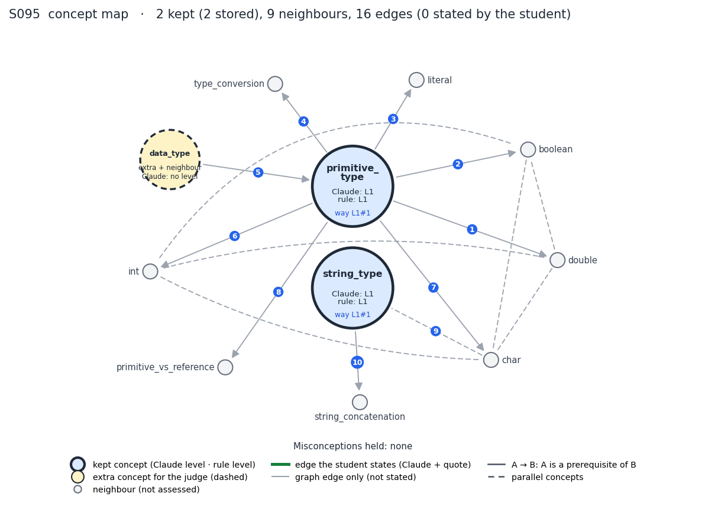

**Triples of the student's concept map** (subject, relation, object, with the logic of each):

| # | Subject | Relation | Object | Logic |
| --- | --- | --- | --- | --- |
| has_level | primitive_type | has_level | primitive_type@L1 | primitive_type@L1#1: Primitive type: one of Java's eight built-in data types (boolean, char, byte, short, int, long, float, double). Its values are simple values, not objects. |
| has_level | string_type | has_level | string_type@L1 | string_type@L1#1: String: Java's built-in non-primitive (reference) type for a sequence of characters. |
| edge 1 | primitive_type | prerequisite | double | double is one of the eight primitive types, the one used for real (floating-point) numbers. — graph only: not checked (a neighbour) |
| edge 2 | primitive_type | prerequisite | boolean | boolean is one of the eight primitive types, the one used for true-false values. — graph only: not checked (a neighbour) |
| edge 3 | primitive_type | prerequisite | literal | A literal is the source-code form of a value of some type, and the way it is written fixes that type: 1234 is an int, 3.14 a double, true a boolean, 'c' a char. — graph only: not checked (a neighbour) |
| edge 4 | primitive_type | prerequisite | type_conversion | Conversion moves a value between primitive types: int to double happens automatically, while double to int needs a cast that drops the fraction. — graph only: not checked (a neighbour) |
| edge 5 | data_type | prerequisite | primitive_type | Java has eight primitive data types (boolean, char, byte, short, int, long, float, double); each, like any data type, is a set of values and a set of operations on those values. — graph only: the answer does not state it |
| edge 6 | primitive_type | prerequisite | int | int is one of the eight primitive types, the one used for integers. — graph only: not checked (a neighbour) |
| edge 7 | primitive_type | prerequisite | char | char is one of the eight primitive types, the one used for single characters. — graph only: not checked (a neighbour) |
| edge 8 | primitive_type | prerequisite | primitive_vs_reference | A variable of a primitive type stores the value itself in its own memory. — graph only: the answer does not state it |
| edge 9 | char | parallel | string_type | 'a' is a char (one 16-bit character code, a primitive); "a" is a String (a sequence of characters, an object). 'a' + 'b' is the int 195, while "a" + "b" is "ab". — graph only: not checked (a neighbour) |
| edge 10 | string_type | prerequisite | string_concatenation | + builds a new String whenever at least one of its operands is a String. — graph only: not checked (a neighbour) |


### S097 · final L1 · reference L1

**Question:** (a) What does \t inside a string do? (b) Give the three lines printed. (c) Why do lines 2 and 3 differ although both use A, 1 and 2? (d) What is the difference between 'A' and "A"? (e) What does char e = c + 2; do?

```java
char c = 'A';
int n = c + 2;
char d = (char) (c + 2);
System.out.println(n + "\t" + d);
System.out.println("A" + 1 + 2);
System.out.println('A' + 1 + "2");
```

**Student answer:** 67, a tab, C; then A12; then 662.

**Concept scoring and shortlist.** 19 of the 173 concepts scored above 0. Every concept scoring at least 1.0 is shortlisted, best first, top 8; Claude then chooses which of them the answer is about.

| Rank | Concept | Link score | Filter result |
| --- | --- | --- | --- |
| 1 | escape_sequences | 1.12 | **shortlisted** |
| 2 | char_arithmetic | 1.10 | **shortlisted** |
| 3 | explicit_cast | 1.01 | **shortlisted** |
| 4 | arithmetic_operators | 1.00 | **shortlisted** |
| 5 | assignment | 1.00 | **shortlisted** |
| 6 | expression | 1.00 | **shortlisted** |
| 7 | statement | 1.00 | **shortlisted** |
| 8 | variable | 1.00 | **shortlisted** |
| 9 | char | 1.00 | not shortlisted: only the top 8 are sent |
| 10 | empty_statement | 1.00 | not shortlisted: only the top 8 are sent |
| 11 | primitive_type | 1.00 | not shortlisted: only the top 8 are sent |

**Extra concept:** command_line_args (Claude: no level).

**Sent to Claude:** escape_sequences, char_arithmetic, explicit_cast, arithmetic_operators, assignment, expression, statement, variable, command_line_args.

**Claude chose:** escape_sequences, char_arithmetic, explicit_cast, arithmetic_operators.

**What happened to each shortlisted concept:**

- escape_sequences: stored; Claude L1
- char_arithmetic: stored; Claude L1
- explicit_cast: stored; Claude L1
- arithmetic_operators: no graph evidence; Claude L1; reported, not stored
- assignment: no graph evidence and no level from Claude; not stored
- expression: no graph evidence and no level from Claude; not stored
- statement: Claude did not choose it (no level), so it is not stored
- variable: no graph evidence and no level from Claude; not stored

**Claude's verdict, traced to the graph's edge logic:**

| Concept | Claude level | Way id | Edge logic of that way |
| --- | --- | --- | --- |
| escape_sequences | L1 | escape_sequences@L1#1 | Escape sequence: a backslash code inside a char or String literal that stands for one special character (\t, \n, \\, \', \"). |
| char_arithmetic | L1 | char_arithmetic@L1#1 | Char arithmetic: applying arithmetic or comparison operators to char values, which act on their Unicode codes. |
| explicit_cast | L1 | explicit_cast@L1#1 | A cast is a unary operator, written (type) expression, that converts a value of one primitive type to another, used when the conversion may lose information. |
| arithmetic_operators | L1 | arithmetic_operators@L1#1 | Arithmetic operators: the binary operators + - * / % that combine two numeric operands into a numeric result. |

**Graph edge logic of the levelled concepts** (has_level, misconception and error edges Claude was shown):

| Concept | Edge | Edge logic |
| --- | --- | --- |
| escape_sequences | escape_sequences → escape_sequences@L1 (has_level) | escape sequences -> L1 (Unistructural): the answer states one correct rule without applying it (2 ways). |
| escape_sequences | escape_sequences → EscapeIsTwoCharacters (misconception) | wrong rule: \t in a string prints a backslash and the letter t. / right rule: A backslash starts an escape sequence, so \t is a single tab character. |
| char_arithmetic | char_arithmetic → char_arithmetic@L1 (has_level) | char arithmetic -> L1 (Unistructural): the answer states one correct rule without applying it (2 ways). |
| char_arithmetic | char_arithmetic → CharNotNumeric (misconception) | wrong rule: char is not a numeric type / right rule: A char is encoded as a 16-bit integer, so arithmetic such as 'b' + 'c' or 'a' + 4 works on the character codes. |
| explicit_cast | explicit_cast → explicit_cast@L1 (has_level) | explicit cast -> L1 (Unistructural): the answer states one correct rule without applying it (2 ways). |
| explicit_cast | explicit_cast → CastRounds (misconception) | wrong rule: (int) 2.7 evaluates to 3. / right rule: A cast to int discards the fractional part (rounds toward zero, so (int) -2.7 is -2); Math.round rounds to the nearest integer. |
| explicit_cast | explicit_cast → CastParsesString (misconception) | wrong rule: (int) args[0] converts the text "34" into the number 34. / right rule: A String argument that represents a number must be converted with a method such as Integer.parseInt. |
| explicit_cast | explicit_cast → CastAfterIntDivision (misconception) | wrong rule: (double) (3 / 5) is 0.6. / right rule: The integer division 3 / 5 = 0 happens before the cast, so the result is 0.0. |
| explicit_cast | explicit_cast → CastAppliesToWholeExpression (misconception) | wrong rule: (int) 2.5 / 0.15 casts the whole quotient to int. / right rule: The cast applies only to what comes right after it, here 2.5. |
| arithmetic_operators | arithmetic_operators → arithmetic_operators@L1 (has_level) | arithmetic operators -> L1 (Unistructural): the answer states one correct rule without applying it (2 ways). |
| arithmetic_operators | arithmetic_operators → CaretIsPower (misconception) | wrong rule: a^2 computes a squared. / right rule: Java has no exponent operator; ^ is exclusive or, and a * a or Math.pow(a, 2) computes a squared. |
| arithmetic_operators | arithmetic_operators → ArithmeticOnNumericStrings (misconception) | wrong rule: "10" - 1 or "6" * "2" works because the strings look like numbers. / right rule: Arithmetic operators other than + are not defined for Strings; a String of digits must first be converted to a number, e.g. with Integer.parseInt. |

**Claude's overall level:** L1 (main concept char_arithmetic). All three printed lines are right, but the student gives no reasons, so this is a bare correct result and stays at L1.

| Step | What happened |
| --- | --- |
| Step 1. Gates | Gates: none. |
| Step 2. Score every concept | 19 of 173 scored above 0. Shortlisted: escape_sequences = 1.12; char_arithmetic = 1.10; explicit_cast = 1.01; arithmetic_operators = 1.00; assignment = 1.00; expression = 1.00; statement = 1.00; variable = 1.00. |
| Step 3. Shortlist and Claude's choice | Top 8 at 1.0 or above: escape_sequences, char_arithmetic, explicit_cast, arithmetic_operators, assignment, expression, statement, variable. Claude chose: escape_sequences, char_arithmetic, explicit_cast, arithmetic_operators. |
| Step 4. Concept map | 3 stored + 7 neighbours. Stored: escape_sequences, char_arithmetic, explicit_cast. |
| Step 5. Run the code | confirmed by the run: prints 67 C; confirmed by the run: prints A12; confirmed by the run: prints 662 |
| Step 6. LLM judge | Claude gives escape_sequences L1; char_arithmetic L1; explicit_cast L1; arithmetic_operators L1; assignment no level; expression no level; statement no level; variable no level; command_line_args no level; overall L1. |
| Step 7. Final level | max_level, the highest level among the stored concepts (L0 if one holds a wrong rule) = L1; Claude's overall level was L1. Final L1 (reference L1). |

**Matching check** (hand-checked right concept: char_arithmetic, escape_sequences): right concept chosen (char_arithmetic, escape_sequences).

**Trace of the student's concept map:**

| Node | Role | Evidence traced from the answer | Rule level | Claude level and level logic |
| --- | --- | --- | --- | --- |
| escape_sequences | chosen, stored | E2 execution: "confirmed by the run: prints 67 C" (1.0) | L2 provisional | L1 via escape_sequences@L1#1: L1 (Unistructural): the answer states one correct rule without applying it (2 ways). |
| char_arithmetic | chosen, stored | E2 execution: "confirmed by the run: prints A12" (1.0) | L2 provisional | L1 via char_arithmetic@L1#1: L1 (Unistructural): the answer states one correct rule without applying it (2 ways). |
| explicit_cast | chosen, stored | E2 execution: "confirmed by the run: prints 662" (1.0) | L2 provisional | L1 via explicit_cast@L1#1: L1 (Unistructural): the answer states one correct rule without applying it (2 ways). |
| arithmetic_operators | chosen, not stored | - | - | L1 via arithmetic_operators@L1#1: L1 (Unistructural): the answer states one correct rule without applying it (2 ways). |
| shortlisted, not chosen | not stored | assignment, expression, statement, variable | - | Claude: none |
| neighbours | not assessed | string_literal, char, type_conversion, math_round, math_random, compound_assignment, widening_conversion | - | - |

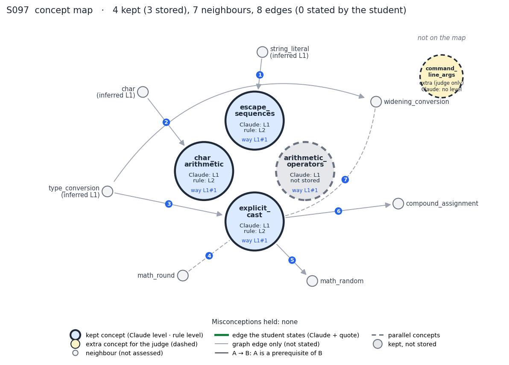

**Triples of the student's concept map** (subject, relation, object, with the logic of each):

| # | Subject | Relation | Object | Logic |
| --- | --- | --- | --- | --- |
| has_level | escape_sequences | has_level | escape_sequences@L1 | escape_sequences@L1#1: Escape sequence: a backslash code inside a char or String literal that stands for one special character (\t, \n, \\, \', \"). |
| has_level | char_arithmetic | has_level | char_arithmetic@L1 | char_arithmetic@L1#1: Char arithmetic: applying arithmetic or comparison operators to char values, which act on their Unicode codes. |
| has_level | explicit_cast | has_level | explicit_cast@L1 | explicit_cast@L1#1: A cast is a unary operator, written (type) expression, that converts a value of one primitive type to another, used when the conversion may lose information. |
| edge 1 | string_literal | prerequisite | escape_sequences | Escape sequences are written inside string or char literals. — graph only: not checked (a neighbour) |
| edge 2 | char | prerequisite | char_arithmetic | Char arithmetic uses the numeric code stored for each char. — graph only: not checked (a neighbour) |
| edge 3 | type_conversion | prerequisite | explicit_cast | A cast is the explicit form of type conversion between primitive types, required when the conversion may lose information (e.g. (int) 2.71828 is 2). — graph only: not checked (a neighbour) |
| edge 4 | math_round | parallel | explicit_cast | (int) 2.71828 truncates toward zero and gives 2; Math.round(2.71828) rounds to the nearest integer and gives 3, as a long that needs (int) to become an int. — graph only: not checked (a neighbour) |
| edge 5 | explicit_cast | prerequisite | math_random | To turn Math.random()'s double in [0, 1) into a random int from 0 to N-1, multiply it by N and cast the result to int. — graph only: not checked (a neighbour) |
| edge 6 | explicit_cast | prerequisite | compound_assignment | x op= e means x = (T)(x op e), where T is the type of x, so the result is cast back to the type of x. — graph only: not checked (a neighbour) |
| edge 7 | widening_conversion | parallel | explicit_cast | Widening (promotion) happens automatically when a value goes to a type with a larger range (int to double) and loses nothing; a narrowing conversion (double to int) is never automatic and needs an explicit cast, which truncates toward zero. — graph only: not checked (a neighbour) |


### S098 · final L4 · reference L3

**Question:** (a) What range of values can an int hold? (b) Give over and big. (c) Give neg and rem. (d) Why is big right but over wrong? (e) Does int x = 2147483648; compile? And int y = -2147483648; ? (f) What is Math.abs(Integer.MIN_VALUE) ? (g) sq was meant to be 3 squared. What is it, and how do you fix it?

```java
int max = Integer.MAX_VALUE;   // 2147483647
int over = max + 1;
long big = max + 1L;
int neg = -7 / 2;
int rem = -7 % 2;
int sq = 3 ^ 2;
```

**Student answer:** Still -2147483648, because +2147483648 does not fit in an int.

**Concept scoring and shortlist.** 42 of the 173 concepts scored above 0. Every concept scoring at least 1.0 is shortlisted, best first, top 8; Claude then chooses which of them the answer is about.

| Rank | Concept | Link score | Filter result |
| --- | --- | --- | --- |
| 1 | int | 4.50 | **shortlisted** |
| 2 | primitive_type | 3.49 | **shortlisted** |
| 3 | int_literal_limit | 3.00 | **shortlisted** |
| 4 | integer_constants | 2.54 | **shortlisted** |
| 5 | arithmetic_operators | 2.38 | **shortlisted** |
| 6 | expression | 2.11 | **shortlisted** |
| 7 | variable | 2.08 | **shortlisted** |
| 8 | running_extreme | 2.00 | **shortlisted** |
| 9 | assignment | 2.00 | not shortlisted: only the top 8 are sent |
| 10 | comment | 2.00 | not shortlisted: only the top 8 are sent |
| 11 | long_type | 1.95 | not shortlisted: only the top 8 are sent |

**Extra concept:** long_type (Claude: no level).

**Sent to Claude:** int, primitive_type, int_literal_limit, integer_constants, arithmetic_operators, expression, variable, running_extreme, long_type.

**Claude chose:** int, integer_constants.

**What happened to each shortlisted concept:**

- int: stored; Claude L2
- primitive_type: Claude did not choose it (no level), so it is not stored
- int_literal_limit: Claude did not choose it (no level), so it is not stored
- integer_constants: no graph evidence; Claude L2; reported, not stored
- arithmetic_operators: Claude did not choose it (no level), so it is not stored
- expression: Claude did not choose it (no level), so it is not stored
- variable: no graph evidence and no level from Claude; not stored
- running_extreme: no graph evidence and no level from Claude; not stored

**Claude's verdict, traced to the graph's edge logic:**

| Concept | Claude level | Way id | Edge logic of that way |
| --- | --- | --- | --- |
| int | L2 | int@L2#3 | An assignment like n = n + 1 changes n by exactly 1, with no rounding. A result outside the range is stored wrapped around. |
| integer_constants | L2 | integer_constants@L2#2 | Type int, value wrapped modulo 2^32: Integer.MAX_VALUE + 1 is -2147483648, Integer.MIN_VALUE - 1 is 2147483647, 2 * Integer.MAX_VALUE is -2, and Math.abs(Integer.MIN_VALUE) is -2147483648. |

**Graph edge logic of the levelled concepts** (has_level, misconception and error edges Claude was shown):

| Concept | Edge | Edge logic |
| --- | --- | --- |
| int | int → int@L2 (has_level) | int -> L2 (Multistructural): the answer applies the rules of int to every part of the code, in order (3 ways). |
| int | int → IntegerDivisionGivesFraction (misconception) | wrong rule: 10 / 3 evaluates to 3.333.... / right rule: Dividing two ints gives an int: the fractional part is discarded. |
| int | int → IntOverflowWidensAutomatically (misconception) | wrong rule: An int result that is too large is automatically stored as a bigger number. / right rule: int arithmetic is 32-bit; a result outside the range wraps around. |
| integer_constants | integer_constants → integer_constants@L2 (has_level) | integer constants -> L2 (Multistructural): the answer applies the rules of integer constants to every part of the code, in order (3 ways). |
| integer_constants | integer_constants → AbsAlwaysNonNegative (misconception) | wrong rule: Math.abs always returns a non-negative number. / right rule: Math.abs(Integer.MIN_VALUE) returns Integer.MIN_VALUE, which is negative. |

**Claude's overall level:** L2 (main concept integer_constants). The student gives the correct result of Math.abs(Integer.MIN_VALUE) and backs it with the int range rule applied to this one value, but does not explain how overflow works or reason beyond this case.

| Step | What happened |
| --- | --- |
| Step 1. Gates | Gates: none. |
| Step 2. Score every concept | 42 of 173 scored above 0. Shortlisted: int = 4.50; primitive_type = 3.49; int_literal_limit = 3.00; integer_constants = 2.54; arithmetic_operators = 2.38; expression = 2.11; variable = 2.08; running_extreme = 2.00. |
| Step 3. Shortlist and Claude's choice | Top 8 at 1.0 or above: int, primitive_type, int_literal_limit, integer_constants, arithmetic_operators, expression, variable, running_extreme. Claude chose: int, integer_constants. |
| Step 4. Concept map | 1 stored + 7 neighbours. Stored: int. |
| Step 5. Run the code | confirmed by the run: Math.abs(Integer.MIN_VALUE) = -2147483648 |
| Step 6. LLM judge | Claude gives int L2; primitive_type no level; int_literal_limit no level; integer_constants L2; arithmetic_operators no level; expression no level; variable no level; running_extreme no level; long_type no level; overall L2. |
| Step 7. Final level | max_level, the highest level among the stored concepts (L0 if one holds a wrong rule) = L4; Claude's overall level was L2. Final L4 (reference L3). |

**Matching check** (hand-checked right concept: int, overflow): right concept chosen (int).

**Trace of the student's concept map:**

| Node | Role | Evidence traced from the answer | Rule level | Claude level and level logic |
| --- | --- | --- | --- | --- |
| int | chosen, stored | E1 reference: "int: 32-bit integer primitive" (0.675); E2 execution: "int values run from -2147483648 to 2147483647. + - * / % take two ints..." (0.675); E3 integration: "edge int - int_literal_limit" (1.0); E4 transfer: "answers: What is Math.abs(Integer.MIN_VALUE) ?" (1.0) | L4 provisional | L2 via int@L2#3: L2 (Multistructural): the answer applies the rules of int to every part of the code, in order (3 ways). |
| integer_constants | chosen, not stored | - | - | L2 via integer_constants@L2#2: L2 (Multistructural): the answer applies the rules of integer constants to every part of the code, in order (3... |
| shortlisted, not chosen | not stored | primitive_type, int_literal_limit, arithmetic_operators, expression, variable, running_extreme | - | Claude: none |
| neighbours | not assessed | primitive_type, double, boolean, long_type, overflow, int_literal_limit, char | - | - |

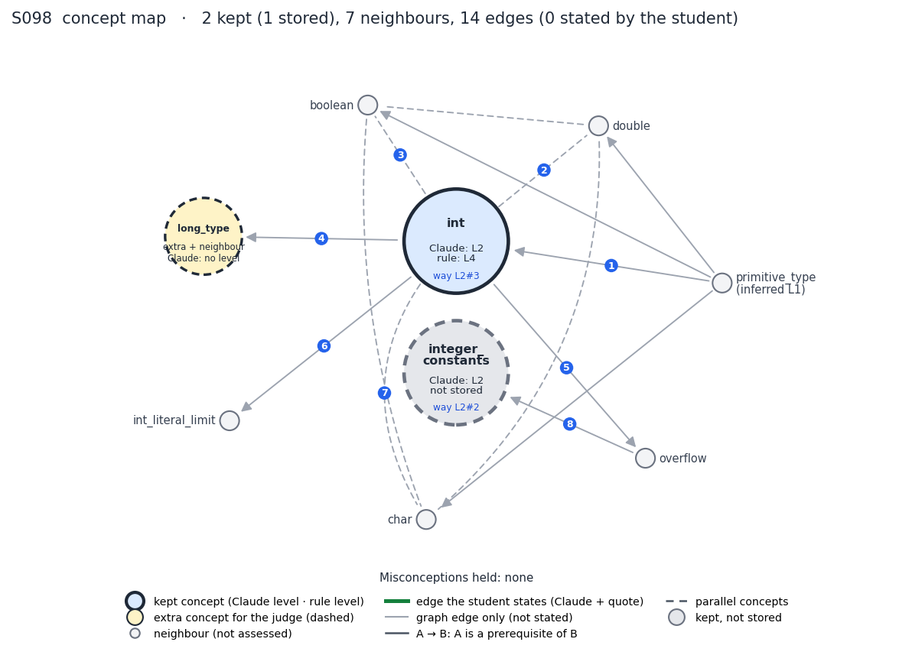

**Triples of the student's concept map** (subject, relation, object, with the logic of each):

| # | Subject | Relation | Object | Logic |
| --- | --- | --- | --- | --- |
| has_level | int | has_level | int@L2 | int@L2#3: An assignment like n = n + 1 changes n by exactly 1, with no rounding. A result outside the range is stored wrapped around. |
| edge 1 | primitive_type | prerequisite | int | int is one of the eight primitive types, the one used for integers. — graph only: the answer does not state it |
| edge 2 | int | parallel | double | With two ints, a / b drops the fractional part; if either a or b is a double, a / b keeps the fractional part. — graph only: not checked (a neighbour) |
| edge 3 | int | parallel | boolean | An int holds an integer and is a numeric type for computing with numbers; a boolean holds only true or false and is used for computing with logical values. — graph only: not checked (a neighbour) |
| edge 4 | int | prerequisite | long_type | long is the wider integer type used when int's range is too small. — graph only: the answer does not state it |
| edge 5 | int | prerequisite | overflow | Overflow happens because an int has a fixed 32-bit range. — graph only: not checked (a neighbour) |
| edge 6 | int | prerequisite | int_literal_limit | The limit on int literals is int's 32-bit range, -2147483648 to 2147483647. — graph only: the answer does not state it |
| edge 7 | int | parallel | char | An int holds a whole number; a char holds one character, which Java stores as its numeric code. — graph only: not checked (a neighbour) |
| edge 8 | overflow | prerequisite | integer_constants | Integer.MAX_VALUE is used to test for overflow: an int result that would go past it wraps around to a negative value. — graph only: not checked (a neighbour) |


### S099 · final L0 · reference L0

**Question:** (a) What number is 6.02e23? (b) Give the first three lines printed. (c) Why is x == 0.3 false, and how should two doubles be compared? (d) What happens at the last line, and how is it different from 1.0 / 0? (e) How do int and double differ for 7 / 2 and 7.0 / 2?

```java
double x = 0.1 + 0.2;
System.out.println(x == 0.3);
System.out.println(1.0 / 0);
System.out.println(6.02e23 > 1e23);
int z = 0;
System.out.println(5 / z);
```

**Student answer:** 6.02e23 is 6.02 times e to the power 23.

**Concept scoring and shortlist.** 18 of the 173 concepts scored above 0. Every concept scoring at least 1.0 is shortlisted, best first, top 8; Claude then chooses which of them the answer is about.

| Rank | Concept | Link score | Filter result |
| --- | --- | --- | --- |
| 1 | scientific_notation | 4.73 | **shortlisted** |
| 2 | double | 3.16 | **shortlisted** |
| 3 | int | 1.00 | **shortlisted** |
| 4 | arithmetic_operators | 1.00 | **shortlisted** |
| 5 | integer_division | 1.00 | **shortlisted** |
| 6 | floating_point_precision | 1.00 | **shortlisted** |
| 7 | primitive_type | 1.00 | **shortlisted** |
| 8 | method_call | 1.00 | **shortlisted** |
| 9 | standard_output | 1.00 | not shortlisted: only the top 8 are sent |
| 10 | variable | 1.00 | not shortlisted: only the top 8 are sent |
| 11 | expression | 1.00 | not shortlisted: only the top 8 are sent |

**Extra concept:** literal (Claude: no level).

**Sent to Claude:** scientific_notation, double, int, arithmetic_operators, integer_division, floating_point_precision, primitive_type, method_call, literal.

**Claude chose:** scientific_notation.

**What happened to each shortlisted concept:**

- scientific_notation: stored; Claude L0
- double: Claude did not choose it (no level), so it is not stored
- int: no graph evidence and no level from Claude; not stored
- arithmetic_operators: no graph evidence and no level from Claude; not stored
- integer_division: no graph evidence and no level from Claude; not stored
- floating_point_precision: no graph evidence and no level from Claude; not stored
- primitive_type: no graph evidence and no level from Claude; not stored
- method_call: no graph evidence and no level from Claude; not stored

**Claude's verdict, traced to the graph's edge logic:**

| Concept | Claude level | Way id | Edge logic of that way |
| --- | --- | --- | --- |
| scientific_notation | L0 | scientific_notation@L0#2 | wrong rule: 6.022E23 means 6.022 times e to the power 23. Right rule: E23 means times 10 to the 23rd; e to a power is computed with Math.exp(23), and the constant e is Math.E. |

**Graph edge logic of the levelled concepts** (has_level, misconception and error edges Claude was shown):

| Concept | Edge | Edge logic |
| --- | --- | --- |
| scientific_notation | scientific_notation → scientific_notation@L0 (has_level) | scientific notation -> L0 (Prestructural): the answer holds a rule that contradicts Java (3 ways). |
| scientific_notation | scientific_notation → ExponentIsPower (misconception) | wrong rule: 6.022E23 means 6.022 times e to the power 23. / right rule: E23 means times 10 to the 23rd. |

**Claude's overall level:** L0 (main concept scientific_notation). The student reads e in 6.02e23 as Euler's number (6.02 × e^23). That is the documented ExponentIsPower misconception: in a Java literal, e means times ten to the power.

| Step | What happened |
| --- | --- |
| Step 1. Gates | Gates: none. |
| Step 2. Score every concept | 18 of 173 scored above 0. Shortlisted: scientific_notation = 4.73; double = 3.16; int = 1.00; arithmetic_operators = 1.00; integer_division = 1.00; floating_point_precision = 1.00; primitive_type = 1.00; method_call = 1.00. |
| Step 3. Shortlist and Claude's choice | Top 8 at 1.0 or above: scientific_notation, double, int, arithmetic_operators, integer_division, floating_point_precision, primitive_type, method_call. Claude chose: scientific_notation. |
| Step 4. Concept map | 1 stored + 1 neighbours. Stored: scientific_notation. |
| Step 5. Run the code | No value to check. |
| Step 6. LLM judge | Claude gives scientific_notation L0; double no level; int no level; arithmetic_operators no level; integer_division no level; floating_point_precision no level; primitive_type no level; method_call no level; literal no level; overall L0. |
| Step 7. Final level | max_level, the highest level among the stored concepts (L0 if one holds a wrong rule) = L0; Claude's overall level was L0. Final L0 (reference L0). |

**Trace of the student's concept map:**

| Node | Role | Evidence traced from the answer | Rule level | Claude level and level logic |
| --- | --- | --- | --- | --- |
| scientific_notation | chosen, stored | E1 reference: "scientific notation: double literals like 6.022E23" (0.74) | L1 | L0 via scientific_notation@L0#2: L0 (Prestructural): the answer holds a rule that contradicts Java (3 ways). |
| shortlisted, not chosen | not stored | double, int, arithmetic_operators, integer_division, floating_point_precision, primitive_type, method_call | - | Claude: none |
| neighbours | not assessed | literal | - | - |

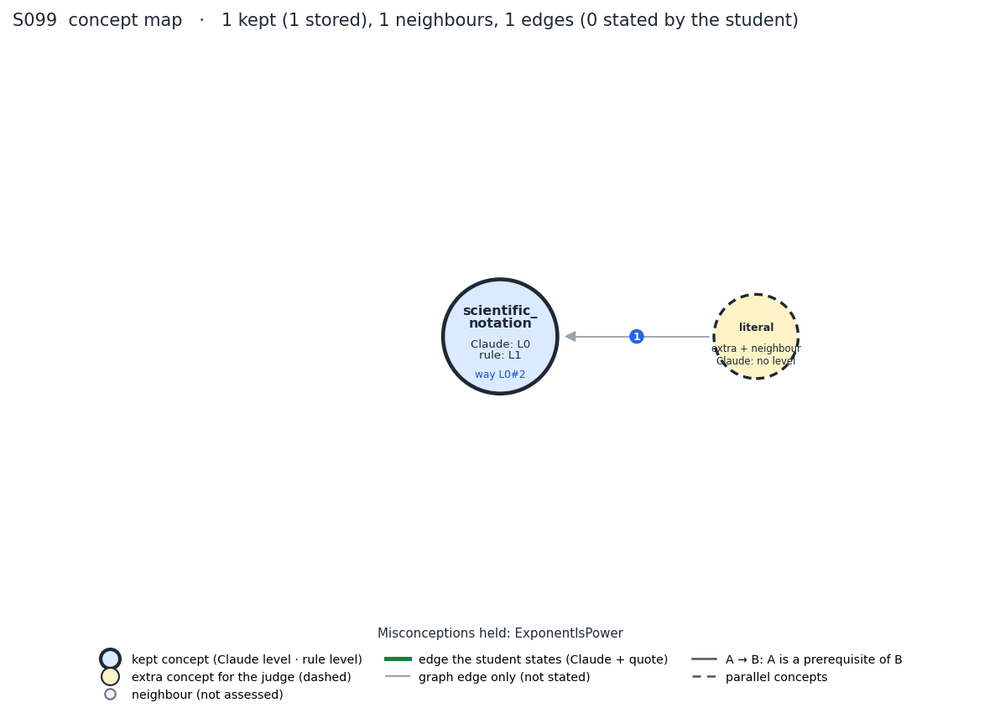

**Triples of the student's concept map** (subject, relation, object, with the logic of each):

| # | Subject | Relation | Object | Logic |
| --- | --- | --- | --- | --- |
| has_level | scientific_notation | has_level | scientific_notation@L0 | scientific_notation@L0#2: wrong rule: 6.022E23 means 6.022 times e to the power 23. Right rule: E23 means times 10 to the 23rd; e to a power is computed with Math.exp(23), and the consta... |
| misconception (held) | scientific_notation | misconception | ExponentIsPower | the answer held this wrong rule |
| edge 1 | literal | prerequisite | scientific_notation | Scientific notation is a form of double literal. — graph only: the answer does not state it |


### S100 · final L0 · reference L0

**Question:** (a) What number is 6.02e23? (b) Give the first three lines printed. (c) Why is x == 0.3 false, and how should two doubles be compared? (d) What happens at the last line, and how is it different from 1.0 / 0? (e) How do int and double differ for 7 / 2 and 7.0 / 2?

```java
double x = 0.1 + 0.2;
System.out.println(x == 0.3);
System.out.println(1.0 / 0);
System.out.println(6.02e23 > 1e23);
int z = 0;
System.out.println(5 / z);
```

**Student answer:** Dividing by zero gives an error.

**Concept scoring and shortlist.** 49 of the 173 concepts scored above 0. Every concept scoring at least 1.0 is shortlisted, best first, top 8; Claude then chooses which of them the answer is about.

| Rank | Concept | Link score | Filter result |
| --- | --- | --- | --- |
| 1 | division_by_zero | 3.45 | **shortlisted** |
| 2 | integer_division | 2.17 | **shortlisted** |
| 3 | int | 1.75 | **shortlisted** |
| 4 | floating_point_precision | 1.53 | **shortlisted** |
| 5 | double | 1.46 | **shortlisted** |
| 6 | expression | 1.40 | **shortlisted** |
| 7 | arithmetic_operators | 1.28 | **shortlisted** |
| 8 | assignment | 1.18 | **shortlisted** |
| 9 | run_time_error | 1.10 | not shortlisted: only the top 8 are sent |
| 10 | empty_statement | 1.03 | not shortlisted: only the top 8 are sent |
| 11 | explicit_cast | 1.00 | not shortlisted: only the top 8 are sent |

**Extra concept:** normalization (Claude: no level).

**Sent to Claude:** division_by_zero, integer_division, int, floating_point_precision, double, expression, arithmetic_operators, assignment, normalization.

**Claude chose:** division_by_zero.

**What happened to each shortlisted concept:**

- division_by_zero: stored; Claude L0
- integer_division: no graph evidence and no level from Claude; not stored
- int: no graph evidence and no level from Claude; not stored
- floating_point_precision: no graph evidence and no level from Claude; not stored
- double: no graph evidence and no level from Claude; not stored
- expression: no graph evidence and no level from Claude; not stored
- arithmetic_operators: no graph evidence and no level from Claude; not stored
- assignment: no graph evidence and no level from Claude; not stored

**Claude's verdict, traced to the graph's edge logic:**

| Concept | Claude level | Way id | Edge logic of that way |
| --- | --- | --- | --- |
| division_by_zero | L0 | division_by_zero@L0#2 | wrong rule: Dividing by zero always stops the program with an error. Right rule: Only integer division (and remainder) by zero throws; 1.0/0.0 is Infinity and 0.0/0.0 is NaN, and the program keeps running. |

**Graph edge logic of the levelled concepts** (has_level, misconception and error edges Claude was shown):

| Concept | Edge | Edge logic |
| --- | --- | --- |
| division_by_zero | division_by_zero → division_by_zero@L0 (has_level) | division by zero -> L0 (Prestructural): the answer holds a rule that contradicts Java (4 ways). |
| division_by_zero | division_by_zero → ZeroDivisionAlwaysCrashes (misconception) | wrong rule: Dividing by zero always stops the program with an error. / right rule: Only integer division by zero generates a run-time exception; 1.0/0.0 is legal and has the value Infinity. |
| division_by_zero | division_by_zero → AverageWithoutZeroGuard (error) | wrong rule: Computes sum / count without checking that count is above 0. / right rule: If no value was read (count is 0), do not compute the average: with int operands sum / count is a division by zero, a run-time exception that stops the program;... |
| division_by_zero | division_by_zero → DivisionByZeroIsCompileError (misconception) | wrong rule: System.out.println(5 / 0); is rejected by the compiler. / right rule: It compiles; the ArithmeticException happens when the program runs. |

**Claude's overall level:** L0 (main concept division_by_zero). The answer gives one blanket rule, 'dividing by zero gives an error', which matches the ZeroDivisionAlwaysCrashes misconception: it makes no distinction between 5 / z, which throws, and 1.0 / 0, which prints Infinity in the run output.

| Step | What happened |
| --- | --- |
| Step 1. Gates | Gates: none. |
| Step 2. Score every concept | 49 of 173 scored above 0. Shortlisted: division_by_zero = 3.45; integer_division = 2.17; int = 1.75; floating_point_precision = 1.53; double = 1.46; expression = 1.40; arithmetic_operators = 1.28; assignment = 1.18. |
| Step 3. Shortlist and Claude's choice | Top 8 at 1.0 or above: division_by_zero, integer_division, int, floating_point_precision, double, expression, arithmetic_operators, assignment. Claude chose: division_by_zero. |
| Step 4. Concept map | 1 stored + 2 neighbours. Stored: division_by_zero. |
| Step 5. Run the code | No value to check. |
| Step 6. LLM judge | Claude gives division_by_zero L0; integer_division no level; int no level; floating_point_precision no level; double no level; expression no level; arithmetic_operators no level; assignment no level; normalization no level; overall L0. |
| Step 7. Final level | max_level, the highest level among the stored concepts (L0 if one holds a wrong rule) = L0; Claude's overall level was L0. Final L0 (reference L0). |

**Trace of the student's concept map:**

| Node | Role | Evidence traced from the answer | Rule level | Claude level and level logic |
| --- | --- | --- | --- | --- |
| division_by_zero | chosen, stored | E1 reference: "division by zero: int division by zero throws; double division gives I..." (0.767) | L1 | L0 via division_by_zero@L0#2: L0 (Prestructural): the answer holds a rule that contradicts Java (4 ways). |
| shortlisted, not chosen | not stored | integer_division, int, floating_point_precision, double, expression, arithmetic_operators, assignment | - | Claude: none |
| neighbours | not assessed | double, arithmetic_operators | - | - |

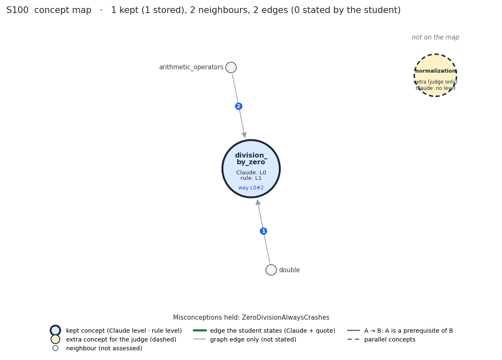

**Triples of the student's concept map** (subject, relation, object, with the logic of each):

| # | Subject | Relation | Object | Logic |
| --- | --- | --- | --- | --- |
| has_level | division_by_zero | has_level | division_by_zero@L0 | division_by_zero@L0#2: wrong rule: Dividing by zero always stops the program with an error. Right rule: Only integer division (and remainder) by zero throws; 1.0/0.0 is Infinity and 0... |
| misconception (held) | division_by_zero | misconception | ZeroDivisionAlwaysCrashes | the answer held this wrong rule |
| edge 1 | double | prerequisite | division_by_zero | For doubles, 1.0/0.0 is legal and has the value Infinity; a double result can also be the special value NaN when the calculation is undefined. — graph only: the answer does not state it |
| edge 2 | arithmetic_operators | prerequisite | division_by_zero | Integer division by zero (1/0) generates a run-time exception, while floating-point 1.0/0.0 is legal and has the value Infinity. — graph only: the answer does not state it |


### S101 · final L1 · reference L1

**Question:** (a) What values can a boolean hold? (b) What does ^ do on two booleans? (c) What is printed? (d) Why does 10 / n not crash? (e) Rewrite b without !( ) using De Morgan. (f) What if && in line 2 were & ?

```java
int n = 0;
boolean a = (n != 0) && (10 / n > 1);
boolean b = !(n > 5 && n < 10);
boolean c = (n > 5) ^ (n < 10);
System.out.println(a + " " + b + " " + c);
```

**Student answer:** It gives true when the two sides are different.

**Concept scoring and shortlist.** 25 of the 173 concepts scored above 0. Every concept scoring at least 1.0 is shortlisted, best first, top 8; Claude then chooses which of them the answer is about.

| Rank | Concept | Link score | Filter result |
| --- | --- | --- | --- |
| 1 | exclusive_or | 4.00 | **shortlisted** |
| 2 | array_aliasing | 1.12 | **shortlisted** |
| 3 | assignment | 1.00 | **shortlisted** |
| 4 | logical_operators | 1.00 | **shortlisted** |
| 5 | boolean | 1.00 | **shortlisted** |
| 6 | short_circuit | 1.00 | **shortlisted** |
| 7 | expression | 1.00 | **shortlisted** |
| 8 | de_morgan | 1.00 | **shortlisted** |
| 9 | variable | 1.00 | not shortlisted: only the top 8 are sent |
| 10 | primitive_type | 1.00 | not shortlisted: only the top 8 are sent |
| 11 | int | 1.00 | not shortlisted: only the top 8 are sent |

**Extra concept:** standard_drawing (Claude: no level).

**Sent to Claude:** exclusive_or, array_aliasing, assignment, logical_operators, boolean, short_circuit, expression, de_morgan, standard_drawing.

**Claude chose:** exclusive_or.

**What happened to each shortlisted concept:**

- exclusive_or: stored; Claude L1
- array_aliasing: no graph evidence and no level from Claude; not stored
- assignment: no graph evidence and no level from Claude; not stored
- logical_operators: no graph evidence and no level from Claude; not stored
- boolean: no graph evidence and no level from Claude; not stored
- short_circuit: no graph evidence and no level from Claude; not stored
- expression: no graph evidence and no level from Claude; not stored
- de_morgan: no graph evidence and no level from Claude; not stored

**Claude's verdict, traced to the graph's edge logic:**

| Concept | Claude level | Way id | Edge logic of that way |
| --- | --- | --- | --- |
| exclusive_or | L1 | exclusive_or@L1#2 | For booleans, a ^ b is true if a and b are different and false if they are the same (equivalent to a != b); both operands are always evaluated. |

**Graph edge logic of the levelled concepts** (has_level, misconception and error edges Claude was shown):

| Concept | Edge | Edge logic |
| --- | --- | --- |
| exclusive_or | exclusive_or → exclusive_or@L1 (has_level) | exclusive or -> L1 (Unistructural): the answer states one correct rule without applying it (2 ways). |
| exclusive_or | exclusive_or → CaretIsPower (misconception) | wrong rule: a^2 computes a squared. / right rule: Java has no exponent operator; ^ is exclusive or, and a * a or Math.pow(a, 2) computes a squared. |

**Claude's overall level:** L1 (main concept exclusive_or). The student correctly states the rule that boolean ^ is true when the two operands differ, but does not apply it to this code's values (n > 5 is false, n < 10 is true, so c is true).

| Step | What happened |
| --- | --- |
| Step 1. Gates | Gates: none. |
| Step 2. Score every concept | 25 of 173 scored above 0. Shortlisted: exclusive_or = 4.00; array_aliasing = 1.12; assignment = 1.00; logical_operators = 1.00; boolean = 1.00; short_circuit = 1.00; expression = 1.00; de_morgan = 1.00. |
| Step 3. Shortlist and Claude's choice | Top 8 at 1.0 or above: exclusive_or, array_aliasing, assignment, logical_operators, boolean, short_circuit, expression, de_morgan. Claude chose: exclusive_or. |
| Step 4. Concept map | 1 stored + 1 neighbours. Stored: exclusive_or. |
| Step 5. Run the code | No value to check. |
| Step 6. LLM judge | Claude gives exclusive_or L1; array_aliasing no level; assignment no level; logical_operators no level; boolean no level; short_circuit no level; expression no level; de_morgan no level; standard_drawing no level; overall L1. |
| Step 7. Final level | max_level, the highest level among the stored concepts (L0 if one holds a wrong rule) = L1; Claude's overall level was L1. Final L1 (reference L1). |

**Matching check** (hand-checked right concept: exclusive_or): right concept chosen (exclusive_or).

**Trace of the student's concept map:**

| Node | Role | Evidence traced from the answer | Rule level | Claude level and level logic |
| --- | --- | --- | --- | --- |
| exclusive_or | chosen, stored | E1 reference: "exclusive or: ^ on booleans is true when the operands differ" (0.38) | L1 | L1 via exclusive_or@L1#2: L1 (Unistructural): the answer states one correct rule without applying it (2 ways). |
| shortlisted, not chosen | not stored | array_aliasing, assignment, logical_operators, boolean, short_circuit, expression, de_morgan | - | Claude: none |
| neighbours | not assessed | logical_operators | - | - |

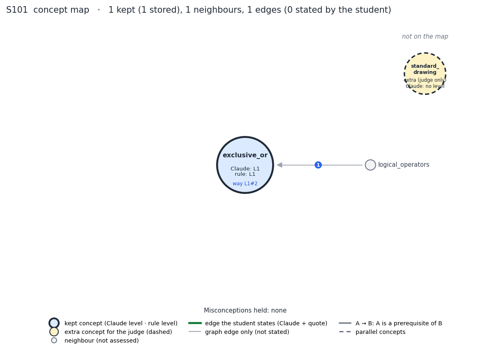

**Triples of the student's concept map** (subject, relation, object, with the logic of each):

| # | Subject | Relation | Object | Logic |
| --- | --- | --- | --- | --- |
| has_level | exclusive_or | has_level | exclusive_or@L1 | exclusive_or@L1#2: For booleans, a ^ b is true if a and b are different and false if they are the same (equivalent to a != b); both operands are always evaluated. |
| edge 1 | logical_operators | prerequisite | exclusive_or | ^ on booleans is another logical operator, defined by a truth table like &&, \|\| and !: true exactly when its operands differ. — graph only: the answer does not state it |


### S103 · final L4 · reference L4

**Question:** (a) What does the API entry static double sqrt(double a) tell you? (b) Give k, h and m. (c) About what is s, and why Math.PI / 6 instead of 30? (d) Which values can die take, and why the + 1? (e) What are (int) 2.7 and Math.round(2.7) ? (f) What does int k2 = Math.round(2.5); do?

```java
double r = Math.random();
int die = (int) (r * 6) + 1;
long k = Math.round(2.5);
double s = Math.sin(Math.PI / 6);
double h = Math.sqrt(16);
int m = Math.max(3, 7);
```

**Student answer:** It does not compile, since round gives a long.

**Concept scoring and shortlist.** 34 of the 173 concepts scored above 0. Every concept scoring at least 1.0 is shortlisted, best first, top 8; Claude then chooses which of them the answer is about.

| Rank | Concept | Link score | Filter result |
| --- | --- | --- | --- |
| 1 | long_type | 4.86 | **shortlisted** |
| 2 | math_round | 3.99 | **shortlisted** |
| 3 | primitive_type | 3.00 | **shortlisted** |
| 4 | explicit_cast | 2.82 | **shortlisted** |
| 5 | math_library | 2.70 | **shortlisted** |
| 6 | compile_time_error | 2.51 | **shortlisted** |
| 7 | int | 2.19 | **shortlisted** |
| 8 | double | 2.17 | **shortlisted** |
| 9 | variable | 2.00 | not shortlisted: only the top 8 are sent |
| 10 | statement | 2.00 | not shortlisted: only the top 8 are sent |
| 11 | math_random | 2.00 | not shortlisted: only the top 8 are sent |

**Extra concept:** type_conversion (Claude: no level).

**Sent to Claude:** long_type, math_round, primitive_type, explicit_cast, math_library, compile_time_error, int, double, type_conversion.

**Claude chose:** long_type, math_round, compile_time_error.

**What happened to each shortlisted concept:**

- long_type: stored; Claude L4
- math_round: stored; Claude L4
- primitive_type: Claude did not choose it (no level), so it is not stored
- explicit_cast: Claude did not choose it (no level), so it is not stored
- math_library: Claude did not choose it (no level), so it is not stored
- compile_time_error: stored; Claude L1
- int: no graph evidence and no level from Claude; not stored
- double: no graph evidence and no level from Claude; not stored

**Claude's verdict, traced to the graph's edge logic:**

| Concept | Claude level | Way id | Edge logic of that way |
| --- | --- | --- | --- |
| long_type | L4 | long_type@L4#3 | rule broken: A long value needs an explicit cast to be stored in an int. Kind: compile-time. Trigger class: int r = Math.round(x); or int n = someLong;: 'possible lossy conversion from long to int'. |
| math_round | L4 | math_round@L4#2 | rule broken: Math.round(double) returns a long, so storing it in an int needs a cast: int n = (int) Math.round(x);. Kind: compile-time. Trigger class: int n = Math.round(x); with a double x (possible lossy conversion from long to... |
| compile_time_error | L1 | compile_time_error@L1#1 | A compile-time error (syntax error) is an error in the source code, caught by javac, that prevents the program from being translated. |

**Graph edge logic of the levelled concepts** (has_level, misconception and error edges Claude was shown):

| Concept | Edge | Edge logic |
| --- | --- | --- |
| long_type | long_type → long_type@L4 (has_level) | long type -> L4 (Extended abstract): the answer reasons beyond the given code (5 ways). |
| long_type | long_type → LargeIntegerLong (misconception) | wrong rule: a large integer literal is automatically long / right rule: A sequence of digits is an int literal only if its value falls within the int range; for larger values the book advises the long type. |
| math_round | math_round → math_round@L4 (has_level) | math round -> L4 (Extended abstract): the answer reasons beyond the given code (4 ways). |
| math_round | math_round → CastRounds (misconception) | wrong rule: (int) 2.7 evaluates to 3. / right rule: A cast to int discards the fractional part (rounds toward zero, so (int) -2.7 is -2); Math.round rounds to the nearest integer. |
| math_round | math_round → DiscardedReturnValue (error) | wrong rule: Writes Math.round(x); on its own line expecting x to be rounded. / right rule: Math.round(x) returns a value; that value has to be stored or used (e.g. long r = Math.round(x);), because the call on its own line does nothing with it. |
| math_round | math_round → RoundReturnsInt (error) | wrong rule: Writes int n = Math.round(x); because Math.round gives an int. / right rule: Math.round(double) returns a long, so storing it in an int needs a cast: int n = (int) Math.round(x); |
| compile_time_error | compile_time_error → compile_time_error@L1 (has_level) | compile time error -> L1 (Unistructural): the answer states one correct rule without applying it (2 ways). |
| compile_time_error | compile_time_error → StatementNeedsNoTerminator (error) | wrong rule: a statement runs without the ; / right rule: Each statement must end with ;, otherwise javac reports ';' expected. |
| compile_time_error | compile_time_error → CompilesMeansWorks (misconception) | wrong rule: Code that compiles is code that works. / right rule: Code that compiles can still have run-time and logical errors. |
| compile_time_error | compile_time_error → UnbalancedBraces (error) | wrong rule: A missing { or } is harmless. / right rule: Every { must be matched by a } so the class body and the method body are well formed. |
| compile_time_error | compile_time_error → UnclosedStringLiteral (error) | wrong rule: A string literal can be left without its closing quote. / right rule: A String literal is enclosed in a pair of double quotes. |

**Claude's overall level:** L4 (main concept math_round). The line asked about is not in the given code, which has long k. The student correctly says the changed line int k2 = Math.round(2.5); will not compile and gives the right reason: Math.round(double) returns a long, which cannot go into an int without a cast.

| Step | What happened |
| --- | --- |
| Step 1. Gates | Gates: none. |
| Step 2. Score every concept | 34 of 173 scored above 0. Shortlisted: long_type = 4.86; math_round = 3.99; primitive_type = 3.00; explicit_cast = 2.82; math_library = 2.70; compile_time_error = 2.51; int = 2.19; double = 2.17. |
| Step 3. Shortlist and Claude's choice | Top 8 at 1.0 or above: long_type, math_round, primitive_type, explicit_cast, math_library, compile_time_error, int, double. Claude chose: long_type, math_round, compile_time_error. |
| Step 4. Concept map | 3 stored + 6 neighbours. Stored: long_type, math_round, compile_time_error. |
| Step 5. Run the code | No value to check. |
| Step 6. LLM judge | Claude gives long_type L4; math_round L4; primitive_type no level; explicit_cast no level; math_library no level; compile_time_error L1; int no level; double no level; type_conversion no level; overall L4. |
| Step 7. Final level | max_level, the highest level among the stored concepts (L0 if one holds a wrong rule) = L4; Claude's overall level was L4. Final L4 (reference L4). |

**Matching check** (hand-checked right concept: long_type, math_round): right concept chosen (long_type, math_round).

**Trace of the student's concept map:**

| Node | Role | Evidence traced from the answer | Rule level | Claude level and level logic |
| --- | --- | --- | --- | --- |
| long_type | chosen, stored | E1 reference: "long type: 64-bit integer type for values beyond the int range" (0.615); E4 transfer: "answers: What does int k2 = Math.round(2.5); do?" (1.0) | L4 provisional | L4 via long_type@L4#3: L4 (Extended abstract): the answer reasons beyond the given code (5 ways). |
| math_round | chosen, stored | E1 reference: "math round: Math.round rounds to the nearest integer and returns a lon..." (0.606); E4 transfer: "answers: What does int k2 = Math.round(2.5); do?" (1.0) | L4 provisional | L4 via math_round@L4#2: L4 (Extended abstract): the answer reasons beyond the given code (4 ways). |
| compile_time_error | chosen, stored | E1 reference: "compile time error: an error javac reports before the program can run..." (0.524); E3 integration: "edge compile_time_error - compile" (1.0); E4 transfer: "answers: What does int k2 = Math.round(2.5); do?" (1.0) | L4 provisional | L1 via compile_time_error@L1#1: L1 (Unistructural): the answer states one correct rule without applying it (2 ways). |
| shortlisted, not chosen | not stored | primitive_type, explicit_cast, math_library, int, double | - | Claude: none |
| neighbours | not assessed | int, math_library, compile, explicit_cast, reading_error_messages, run_time_error | - | - |


**Triples of the student's concept map** (subject, relation, object, with the logic of each):

| # | Subject | Relation | Object | Logic |
| --- | --- | --- | --- | --- |
| has_level | long_type | has_level | long_type@L4 | long_type@L4#3: rule broken: A long value needs an explicit cast to be stored in an int. Kind: compile-time. Trigger class: int r = Math.round(x); or int n = someLong;: 'possib... |
| has_level | math_round | has_level | math_round@L4 | math_round@L4#2: rule broken: Math.round(double) returns a long, so storing it in an int needs a cast: int n = (int) Math.round(x);. Kind: compile-time. Trigger class: int n = M... |
| has_level | compile_time_error | has_level | compile_time_error@L1 | compile_time_error@L1#1: A compile-time error (syntax error) is an error in the source code, caught by javac, that prevents the program from being translated. |
| edge 1 | int | prerequisite | long_type | long is the wider integer type used when int's range is too small. — graph only: the answer does not state it |
| edge 2 | math_library | prerequisite | math_round | Math.round is a Math library method. — graph only: the answer does not state it |
| edge 3 | math_round | parallel | explicit_cast | (int) 2.71828 truncates toward zero and gives 2; Math.round(2.71828) rounds to the nearest integer and gives 3, as a long that needs (int) to become an int. — graph only: the answer does not state it |
| edge 4 | compile | prerequisite | compile_time_error | A compile-time error is reported while javac compiles Name.java, so no Name.class is produced. — graph only: not checked (a neighbour) |
| edge 5 | compile_time_error | prerequisite | reading_error_messages | Reading error messages is how compile-time errors are found and fixed. — graph only: not checked (a neighbour) |
| edge 6 | compile_time_error | parallel | run_time_error | A compile-time error is found by javac before the program runs; a run-time error is found while it runs. — graph only: not checked (a neighbour) |


### S104 · final L2 · reference L2

**Question:** (a) Which line converts automatically, and which needs a cast? (b) Give j, q and r. (c) Why are q and r different? (d) Give p and t. (e) Why is t "71" and not "8"? (f) What does Integer.parseInt("4.2") do?

```java
int i = 7;
double d = i;
int j = (int) 9.99;
double q = (double) (i / 2);
double r = (double) i / 2;
int p = Integer.parseInt("42") + 1;
String t = "" + i + 1;
```

**Student answer:** d = i happens by itself because double is bigger; going from 9.99 to int needs (int).

**Concept scoring and shortlist.** 49 of the 173 concepts scored above 0. Every concept scoring at least 1.0 is shortlisted, best first, top 8; Claude then chooses which of them the answer is about.

| Rank | Concept | Link score | Filter result |
| --- | --- | --- | --- |
| 1 | double | 5.44 | **shortlisted** |
| 2 | int | 3.52 | **shortlisted** |
| 3 | type_conversion | 2.87 | **shortlisted** |
| 4 | explicit_cast | 2.81 | **shortlisted** |
| 5 | primitive_type | 2.18 | **shortlisted** |
| 6 | assignment | 2.04 | **shortlisted** |
| 7 | arithmetic_operators | 1.78 | **shortlisted** |
| 8 | expression | 1.77 | **shortlisted** |
| 9 | variable | 1.10 | not shortlisted: only the top 8 are sent |
| 10 | string_concatenation | 1.00 | not shortlisted: only the top 8 are sent |
| 11 | string_conversion | 1.00 | not shortlisted: only the top 8 are sent |

**Extra concept:** data_type (Claude: no level).

**Sent to Claude:** double, int, type_conversion, explicit_cast, primitive_type, assignment, arithmetic_operators, expression, data_type.

**Claude chose:** type_conversion, explicit_cast.

**What happened to each shortlisted concept:**

- double: Claude did not choose it (no level), so it is not stored
- int: Claude did not choose it (no level), so it is not stored
- type_conversion: stored; Claude L2
- explicit_cast: stored; Claude L1
- primitive_type: Claude did not choose it (no level), so it is not stored
- assignment: Claude did not choose it (no level), so it is not stored
- arithmetic_operators: Claude did not choose it (no level), so it is not stored
- expression: Claude did not choose it (no level), so it is not stored

**Claude's verdict, traced to the graph's edge logic:**

| Concept | Claude level | Way id | Edge logic of that way |
| --- | --- | --- | --- |
| type_conversion | L2 | type_conversion@L2#1 | Innermost subexpressions are evaluated in their own types first; at each binary operator the narrower operand is promoted; a cast converts the single value right after it; at an assignment the final value is converted to the varia... |
| explicit_cast | L1 | explicit_cast@L1#2 | (T) e converts the value of e to type T; a double-to-int cast discards the fraction by rounding toward zero; a cast is required for narrowing conversions; it has higher precedence than arithmetic; casts between boolean and numbers... |

**Graph edge logic of the levelled concepts** (has_level, misconception and error edges Claude was shown):

| Concept | Edge | Edge logic |
| --- | --- | --- |
| type_conversion | type_conversion → type_conversion@L2 (has_level) | type conversion -> L2 (Multistructural): the answer applies the rules of type conversion to every part of the code, in order (3 ways). |
| type_conversion | type_conversion → TargetTyping (misconception) | wrong rule: The type of a numerical expression depends on the type expected by the surrounding context, so double d = a / b; keeps the fraction. / right rule: The type of a numerical expression is determined by the expression, so double d = a / b; with int a and b still divides as ints. |
| type_conversion | type_conversion → NoCastIfSameSize (misconception) | wrong rule: If a variable is at least as big as a value, no cast is needed to assign the value. / right rule: Assigning a double to an int needs a cast even when the value would fit, because a conversion that might involve loss of information leads to a compile-time err... |
| type_conversion | type_conversion → NarrowingAssignmentAllowed (misconception) | wrong rule: A double value can be stored in an int variable like an int in a double. / right rule: int to double is automatic; double to int needs a cast. |
| explicit_cast | explicit_cast → explicit_cast@L1 (has_level) | explicit cast -> L1 (Unistructural): the answer states one correct rule without applying it (2 ways). |
| explicit_cast | explicit_cast → CastRounds (misconception) | wrong rule: (int) 2.7 evaluates to 3. / right rule: A cast to int discards the fractional part (rounds toward zero, so (int) -2.7 is -2); Math.round rounds to the nearest integer. |
| explicit_cast | explicit_cast → CastParsesString (misconception) | wrong rule: (int) args[0] converts the text "34" into the number 34. / right rule: A String argument that represents a number must be converted with a method such as Integer.parseInt. |
| explicit_cast | explicit_cast → CastAfterIntDivision (misconception) | wrong rule: (double) (3 / 5) is 0.6. / right rule: The integer division 3 / 5 = 0 happens before the cast, so the result is 0.0. |
| explicit_cast | explicit_cast → CastAppliesToWholeExpression (misconception) | wrong rule: (int) 2.5 / 0.15 casts the whole quotient to int. / right rule: The cast applies only to what comes right after it, here 2.5. |

**Claude's overall level:** L2 (main concept type_conversion). The student correctly says which two lines convert automatically (d = i) and which needs a cast ((int) 9.99), with a short range-based reason, but does not combine the conversions into one explanation or deal with the other conversion lines.

| Step | What happened |
| --- | --- |
| Step 1. Gates | Gates: none. |
| Step 2. Score every concept | 49 of 173 scored above 0. Shortlisted: double = 5.44; int = 3.52; type_conversion = 2.87; explicit_cast = 2.81; primitive_type = 2.18; assignment = 2.04; arithmetic_operators = 1.78; expression = 1.77. |
| Step 3. Shortlist and Claude's choice | Top 8 at 1.0 or above: double, int, type_conversion, explicit_cast, primitive_type, assignment, arithmetic_operators, expression. Claude chose: type_conversion, explicit_cast. |
| Step 4. Concept map | 2 stored + 6 neighbours. Stored: type_conversion, explicit_cast. |
| Step 5. Run the code | No value to check. |
| Step 6. LLM judge | Claude gives double no level; int no level; type_conversion L2; explicit_cast L1; primitive_type no level; assignment no level; arithmetic_operators no level; expression no level; data_type no level; overall L2. |
| Step 7. Final level | max_level, the highest level among the stored concepts (L0 if one holds a wrong rule) = L2; Claude's overall level was L2. Final L2 (reference L2). |

**Matching check** (hand-checked right concept: explicit_cast, type_conversion): right concept chosen (explicit_cast, type_conversion).

**Trace of the student's concept map:**

| Node | Role | Evidence traced from the answer | Rule level | Claude level and level logic |
| --- | --- | --- | --- | --- |
| type_conversion | chosen, stored | E1 reference: "type conversion: implicit widening and explicit (cast)" (0.544); E3 integration: "edge type_conversion - primitive_type" (1.0) | L3 provisional | L2 via type_conversion@L2#1: L2 (Multistructural): the answer applies the rules of type conversion to every part of the code, in order (3 w... |
| explicit_cast | chosen, stored | E1 reference: "explicit cast: (int) x -- converts between numeric types, truncating t..." (0.557) | L1 | L1 via explicit_cast@L1#2: L1 (Unistructural): the answer states one correct rule without applying it (2 ways). |
| shortlisted, not chosen | not stored | double, int, primitive_type, assignment, arithmetic_operators, expression | - | Claude: none |
| neighbours | not assessed | primitive_type, parsing, widening_conversion, math_round, math_random, compound_assignment | - | - |


**Triples of the student's concept map** (subject, relation, object, with the logic of each):

| # | Subject | Relation | Object | Logic |
| --- | --- | --- | --- | --- |
| has_level | type_conversion | has_level | type_conversion@L2 | type_conversion@L2#1: Innermost subexpressions are evaluated in their own types first; at each binary operator the narrower operand is promoted; a cast converts the single value righ... |
| has_level | explicit_cast | has_level | explicit_cast@L1 | explicit_cast@L1#2: (T) e converts the value of e to type T; a double-to-int cast discards the fraction by rounding toward zero; a cast is required for narrowing conversions; it ha... |
| edge 1 | type_conversion | prerequisite | explicit_cast | A cast is the explicit form of type conversion between primitive types, required when the conversion may lose information (e.g. (int) 2.71828 is 2). — graph only: the answer does not state it |
| edge 2 | primitive_type | prerequisite | type_conversion | Conversion moves a value between primitive types: int to double happens automatically, while double to int needs a cast that drops the fraction. — graph only: the answer does not state it |
| edge 3 | parsing | prerequisite | type_conversion | Integer.parseInt(s) converts the String s into an int; SW later classifies such methods as explicit type conversion. — graph only: not checked (a neighbour) |
| edge 4 | type_conversion | prerequisite | widening_conversion | Widening is the automatic kind of type conversion. — graph only: not checked (a neighbour) |
| edge 5 | widening_conversion | parallel | explicit_cast | Widening (promotion) happens automatically when a value goes to a type with a larger range (int to double) and loses nothing; a narrowing conversion (double to int) is never automatic and needs an explicit cast, which truncates toward zero. — graph only: not checked (a neighbour) |
| edge 6 | math_round | parallel | explicit_cast | (int) 2.71828 truncates toward zero and gives 2; Math.round(2.71828) rounds to the nearest integer and gives 3, as a long that needs (int) to become an int. — graph only: not checked (a neighbour) |
| edge 7 | explicit_cast | prerequisite | math_random | To turn Math.random()'s double in [0, 1) into a random int from 0 to N-1, multiply it by N and cast the result to int. — graph only: not checked (a neighbour) |
| edge 8 | explicit_cast | prerequisite | compound_assignment | x op= e means x = (T)(x op e), where T is the type of x, so the result is cast back to the type of x. — graph only: not checked (a neighbour) |


### S106 · final L2 · reference L2

**Question:** (a) What does "control flow" mean? (b) List what runs, in order, and what is printed. (c) Which step of the pseudocode is missing from the code? (d) In a flowchart of this code, how many paths lead to "done"? (e) Fix the code so that it matches the pseudocode.

```java
// pseudocode: if the score is at least 50 say "pass", otherwise say "fail"; always say "done"
int score = 42;
if (score >= 50) {
  System.out.println("pass");
}
System.out.println("done");
```

**Student answer:** score gets 42, the if test is false so pass is skipped, then done is printed.

**Concept scoring and shortlist.** 50 of the 173 concepts scored above 0. Every concept scoring at least 1.0 is shortlisted, best first, top 8; Claude then chooses which of them the answer is about.

| Rank | Concept | Link score | Filter result |
| --- | --- | --- | --- |
| 1 | if_statement | 3.36 | **shortlisted** |
| 2 | testing | 1.82 | **shortlisted** |
| 3 | empty_statement | 1.24 | **shortlisted** |
| 4 | comparison_operators | 1.24 | **shortlisted** |
| 5 | variable | 1.00 | **shortlisted** |
| 6 | statement | 1.00 | **shortlisted** |
| 7 | block | 1.00 | **shortlisted** |
| 8 | standard_output | 1.00 | **shortlisted** |
| 9 | assignment | 1.00 | not shortlisted: only the top 8 are sent |
| 10 | println | 1.00 | not shortlisted: only the top 8 are sent |
| 11 | run | 1.00 | not shortlisted: only the top 8 are sent |

**Extra concept:** for_loop (Claude: no level).

**Sent to Claude:** if_statement, testing, empty_statement, comparison_operators, variable, statement, block, standard_output, for_loop.

**Claude chose:** if_statement, comparison_operators, variable, statement, standard_output.

**What happened to each shortlisted concept:**

- if_statement: stored; Claude L2
- testing: Claude did not choose it (no level), so it is not stored
- empty_statement: no graph evidence and no level from Claude; not stored
- comparison_operators: no graph evidence; Claude L1; reported, not stored
- variable: no graph evidence; Claude L2; reported, not stored
- statement: no graph evidence; Claude L2; reported, not stored
- block: no graph evidence and no level from Claude; not stored
- standard_output: no graph evidence; Claude L2; reported, not stored

**Claude's verdict, traced to the graph's edge logic:**

| Concept | Claude level | Way id | Edge logic of that way |
| --- | --- | --- | --- |
| if_statement | L2 | if_statement@L2#1 | Evaluate the condition once; if true, execute the body; then, in either case, continue with the statement after the if. |
| comparison_operators | L1 | comparison_operators@L2#2 | The result is a boolean: (2 <= 2) is true, 2 < 2 is false, (x < 3.1) is true for int x = 3; any comparison involving NaN, even NaN == NaN, is false. |
| variable | L2 | variable@L2#3 | Only an assignment or an input read into the variable changes it, and it changes only that variable, replacing the old value. Other variables keep their values. |
| statement | L2 | statement@L2#1 | Statements run one at a time, from first to last; each completes (normally or abruptly) before the next starts. |
| standard_output | L2 | standard_output@L2#2 | The output is the argument's string form. System.out.println(Math.PI) prints 3.141592653589793 (all digits), and println("Sum is " + 1778) prints Sum is 1778 followed by a newline. The methods return void. |

**Graph edge logic of the levelled concepts** (has_level, misconception and error edges Claude was shown):

| Concept | Edge | Edge logic |
| --- | --- | --- |
| if_statement | if_statement → if_statement@L2 (has_level) | if statement -> L2 (Multistructural): the answer applies the rules of if statement to every part of the code, in order (3 ways). |
| if_statement | if_statement → IfIsLoop (misconception) | wrong rule: The if body keeps repeating as long as its condition stays true. / right rule: An if body runs at most once; only a loop repeats its body. |
| if_statement | if_statement → AssignCompares (misconception) | wrong rule: = compares two values instead of assigning / right rule: x = y copies the value of y into x; x == y is what compares them. |
| if_statement | if_statement → MapToBooleanWithIf (misconception) | wrong rule: you need an if to turn a boolean expression into a boolean / right rule: ok = (x > y); stores the result of the comparison directly. |
| if_statement | if_statement → IfRequiresElse (misconception) | wrong rule: Every if statement requires an else. / right rule: An if statement may stand alone; the else part is optional. |
| comparison_operators | comparison_operators → comparison_operators@L1 (has_level) | comparison operators -> L1 (Unistructural): the answer states one correct rule without applying it (2 ways). |
| comparison_operators | comparison_operators → AssignCompares (misconception) | wrong rule: = compares two values instead of assigning / right rule: x = y copies the value of y into x; x == y is what compares them. |
| comparison_operators | comparison_operators → EqualsComparesReferences (misconception) | wrong rule: .equals() compares references, not contents / right rule: s.equals(t) checks whether the two Strings contain the same characters. |
| comparison_operators | comparison_operators → ComparisonWithBooleanLiteral (misconception) | wrong rule: you must write == true / == false to test a boolean / right rule: if (b) already tests b, so writing == true adds nothing. |
| comparison_operators | comparison_operators → ChainedComparison (misconception) | wrong rule: 90 <= grade <= 100 tests whether grade is between 90 and 100. / right rule: a < b < c does not compile (a < b is a boolean); a range test is written 90 <= grade && grade <= 100. |
| variable | variable → variable@L2 (has_level) | variable -> L2 (Multistructural): the answer applies the rules of variable to every part of the code, in order (3 ways). |
| variable | variable → VariablesHoldObjects (misconception) | wrong rule: A String or array variable contains the whole object inside it. / right rule: A reference variable holds only a reference to the object, which is stored separately. |
| variable | variable → VariablesHoldExpressions (misconception) | wrong rule: = stores the expression itself, not its computed value / right rule: y = x + k; stores the value that x + k has at that moment, so later changes to x do not change y. |
| variable | variable → LoopBodyScopeImpliesLoopLifetime (misconception) | wrong rule: a variable declared in the loop body lives across all iterations / right rule: A variable declared inside the body is created anew on every pass and does not keep the previous pass's value. |
| variable | variable → MultiValueVariable (misconception) | wrong rule: A variable can contain more than one value. / right rule: A variable holds exactly one value at a time; assigning a new value replaces the old one. |
| statement | statement → statement@L2 (has_level) | statement -> L2 (Multistructural): the answer applies the rules of statement to every part of the code, in order (3 ways). |
| statement | statement → StatementNeedsNoTerminator (error) | wrong rule: A statement still compiles and runs if the semicolon at its end is left out, or if a stray ; is put right after if (c) or for (...). / right rule: Each statement must end with ;, otherwise javac reports ';' expected. |
| statement | statement → StatementsRunInAnyOrder (misconception) | wrong rule: Statements in a program can run in any order. / right rule: Without control statements, statements run once each, top to bottom. |
| statement | statement → WhitespaceIsSignificant (misconception) | wrong rule: Line breaks and indentation change what the program does, so each statement must be on its own line. / right rule: Java compilers consider all whitespace in program text (outside quotation marks) to be equivalent; layout is for human readers. |
| statement | statement → ProgramLooksAhead (misconception) | wrong rule: The program knows or sees what later lines will do and acts on those goals at the current line, e.g. it stops 'at ten' because it wants to draw a box. / right rule: Each statement executes using only the current state; later lines have no effect until control reaches them. |
| standard_output | standard_output → standard_output@L2 (has_level) | standard output -> L2 (Multistructural): the answer applies the rules of standard output to every part of the code, in order (3 ways). |
| standard_output | standard_output → PrintEqualsPrintln (misconception) | wrong rule: print and println behave the same (no newline difference) / right rule: println ends the line after printing and print does not, so print(s1); print(s2); puts s1 and s2 on the same line. |
| standard_output | standard_output → PrintfAddsNewline (misconception) | wrong rule: printf() ends the line like println(). / right rule: printf() does not add a newline; put \n in the format string to end the line. |
| standard_output | standard_output → RepeatedOutputVariablePrintedOnce (misconception) | wrong rule: An output statement that names the same variable twice (WRITE y, x, y) prints it only once. / right rule: Each expression in the output list is printed, so a repeated variable prints its value each time. |

**Claude's overall level:** L2 (main concept if_statement). The student goes through every statement in order with the value: score gets 42, the condition is false so the body is skipped, and execution moves on to print done. This matches the run output, but it does not state what the code is for, so it is L2, not L3.

| Step | What happened |
| --- | --- |
| Step 1. Gates | Gates: none. |
| Step 2. Score every concept | 50 of 173 scored above 0. Shortlisted: if_statement = 3.36; testing = 1.82; empty_statement = 1.24; comparison_operators = 1.24; variable = 1.00; statement = 1.00; block = 1.00; standard_output = 1.00. |
| Step 3. Shortlist and Claude's choice | Top 8 at 1.0 or above: if_statement, testing, empty_statement, comparison_operators, variable, statement, block, standard_output. Claude chose: if_statement, comparison_operators, variable, statement, standard_output. |
| Step 4. Concept map | 1 stored + 4 neighbours. Stored: if_statement. |
| Step 5. Run the code | confirmed by the run: score = 42 |
| Step 6. LLM judge | Claude gives if_statement L2; testing no level; empty_statement no level; comparison_operators L1; variable L2; statement L2; block no level; standard_output L2; for_loop no level; overall L2. |
| Step 7. Final level | max_level, the highest level among the stored concepts (L0 if one holds a wrong rule) = L2; Claude's overall level was L2. Final L2 (reference L2). |

**Matching check** (hand-checked right concept: if_statement): right concept chosen (if_statement).

**Trace of the student's concept map:**

| Node | Role | Evidence traced from the answer | Rule level | Claude level and level logic |
| --- | --- | --- | --- | --- |
| if_statement | chosen, stored | E1 reference: "if statement: run a block only when the condition holds" (0.489); E2 execution: "confirmed by the run: score = 42" (1.0) | L2 provisional | L2 via if_statement@L2#1: L2 (Multistructural): the answer applies the rules of if statement to every part of the code, in order (3 ways... |
| comparison_operators | chosen, not stored | - | - | L1 via comparison_operators@L2#2: L1 (Unistructural): the answer states one correct rule without applying it (2 ways). |
| variable | chosen, not stored | - | - | L2 via variable@L2#3: L2 (Multistructural): the answer applies the rules of variable to every part of the code, in order (3 ways). |
| statement | chosen, not stored | - | - | L2 via statement@L2#1: L2 (Multistructural): the answer applies the rules of statement to every part of the code, in order (3 ways). |
| standard_output | chosen, not stored | - | - | L2 via standard_output@L2#2: L2 (Multistructural): the answer applies the rules of standard output to every part of the code, in order (3 w... |
| shortlisted, not chosen | not stored | testing, empty_statement, block | - | Claude: none |
| neighbours | not assessed | control_flow, boolean_expression, if_else_statement, while_loop | - | - |


**Triples of the student's concept map** (subject, relation, object, with the logic of each):

| # | Subject | Relation | Object | Logic |
| --- | --- | --- | --- | --- |
| has_level | if_statement | has_level | if_statement@L2 | if_statement@L2#1: Evaluate the condition once; if true, execute the body; then, in either case, continue with the statement after the if. |
| edge 1 | control_flow | prerequisite | if_statement | An if changes the default top-to-bottom flow by running a block only when its condition is true. — graph only: not checked (a neighbour) |
| edge 2 | boolean_expression | prerequisite | if_statement | An if runs its block only when its boolean expression evaluates to true. — graph only: not checked (a neighbour) |
| edge 3 | if_statement | prerequisite | if_else_statement | if-else extends if with a second block that runs exactly when the condition is false. — graph only: not checked (a neighbour) |
| edge 4 | if_statement | parallel | while_loop | if and while have the same form, but if tests its condition once and runs the block at most once, while while tests again after every pass and repeats the block as long as the condition is true. — graph only: not checked (a neighbour) |
| edge 5 | comparison_operators | prerequisite | boolean_expression | A comparison such as x < y produces a boolean result; comparisons together with boolean logic provide the basis for decision-making. — graph only: not checked (a neighbour) |
| edge 6 | statement | prerequisite | control_flow | Control flow is the order in which statements run. — graph only: not checked (a neighbour) |


### S107 · final L0 · reference L0

**Question:** (a) In the template if (<boolean expression>) <statement>, what may replace <boolean expression>? (b) What is printed? (c) Why is positive printed although x is negative? (d) What is printed if x = 5? (e) Fix the code so positive is printed only for positive x. (f) What would happen if the second if were a while?

```java
int x = -3;
if (x > 0);
  System.out.println("positive");
if (x < 0)
  System.out.println("negative");
  System.out.println("checked");
```

**Student answer:** positive is not printed, because x > 0 is false.

**Concept scoring and shortlist.** 51 of the 173 concepts scored above 0. Every concept scoring at least 1.0 is shortlisted, best first, top 8; Claude then chooses which of them the answer is about.

| Rank | Concept | Link score | Filter result |
| --- | --- | --- | --- |
| 1 | if_statement | 2.11 | **shortlisted** |
| 2 | empty_statement | 1.79 | **shortlisted** |
| 3 | assignment | 1.44 | **shortlisted** |
| 4 | statement | 1.33 | **shortlisted** |
| 5 | primitive_type | 1.04 | **shortlisted** |
| 6 | int | 1.01 | **shortlisted** |
| 7 | println | 1.00 | **shortlisted** |
| 8 | method_call | 1.00 | **shortlisted** |
| 9 | standard_output | 1.00 | not shortlisted: only the top 8 are sent |
| 10 | variable | 1.00 | not shortlisted: only the top 8 are sent |
| 11 | string_literal | 1.00 | not shortlisted: only the top 8 are sent |

**Extra concept:** comparison_operators (Claude: L2).

**Sent to Claude:** if_statement, empty_statement, assignment, statement, primitive_type, int, println, method_call, comparison_operators.

**Claude chose:** if_statement, empty_statement.

**What happened to each shortlisted concept:**

- if_statement: stored; Claude L0
- empty_statement: no graph evidence; Claude L0; reported, not stored
- assignment: Claude did not choose it (no level), so it is not stored
- statement: Claude did not choose it (no level), so it is not stored
- primitive_type: no graph evidence and no level from Claude; not stored
- int: no graph evidence and no level from Claude; not stored
- println: no graph evidence and no level from Claude; not stored
- method_call: no graph evidence and no level from Claude; not stored

**Claude's verdict, traced to the graph's edge logic:**

| Concept | Claude level | Way id | Edge logic of that way |
| --- | --- | --- | --- |
| if_statement | L0 | if_statement@L0#1 | Folk meaning: English 'if' (and 'whenever') states a standing rule that stays in force and fires whenever its condition becomes true. A Java if is evaluated once, when control reaches it, and then is 'taken off the books'; changin... |
| empty_statement | L0 | empty_statement@L0#1 | Folk meaning: in English a semicolon just separates or ends a clause, so 'if (x > 0);' still reads as 'if x is positive, do the next thing'. In Java a lone ; is a complete statement that does nothing, and it becomes the whole body... |
| comparison_operators | L2 | comparison_operators@L2#2 | The result is a boolean: (2 <= 2) is true, 2 < 2 is false, (x < 3.1) is true for int x = 3; any comparison involving NaN, even NaN == NaN, is false. |

**Graph edge logic of the levelled concepts** (has_level, misconception and error edges Claude was shown):

| Concept | Edge | Edge logic |
| --- | --- | --- |
| if_statement | if_statement → if_statement@L0 (has_level) | if statement -> L0 (Prestructural): the answer holds a rule that contradicts Java (20 ways). |
| if_statement | if_statement → IfIsLoop (misconception) | wrong rule: The if body keeps repeating as long as its condition stays true. / right rule: An if body runs at most once; only a loop repeats its body. |
| if_statement | if_statement → AssignCompares (misconception) | wrong rule: = compares two values instead of assigning / right rule: x = y copies the value of y into x; x == y is what compares them. |
| if_statement | if_statement → MapToBooleanWithIf (misconception) | wrong rule: you need an if to turn a boolean expression into a boolean / right rule: ok = (x > y); stores the result of the comparison directly. |
| if_statement | if_statement → IfRequiresElse (misconception) | wrong rule: Every if statement requires an else. / right rule: An if statement may stand alone; the else part is optional. |
| empty_statement | empty_statement → empty_statement@L0 (has_level) | empty statement -> L0 (Prestructural): the answer holds a rule that contradicts Java (1 way). |
| empty_statement | empty_statement → SemicolonAfterIfHeader (error) | wrong rule: if (x > 0); System.out.println("positive"); prints only for positive x. / right rule: The ; ends the if with an empty statement, so the next line always runs. |
| empty_statement | empty_statement → SemicolonAfterLoopHeader (error) | wrong rule: Puts a ; right after for (...) or while (...). / right rule: A ; right after the loop header is a null (empty) loop body, so the statements written after it are not repeated by the loop. |
| comparison_operators | comparison_operators → comparison_operators@L2 (has_level) | comparison operators -> L2 (Multistructural): the answer applies the rules of comparison operators to every part of the code, in order (3 ways). |
| comparison_operators | comparison_operators → AssignCompares (misconception) | wrong rule: = compares two values instead of assigning / right rule: x = y copies the value of y into x; x == y is what compares them. |
| comparison_operators | comparison_operators → EqualsComparesReferences (misconception) | wrong rule: .equals() compares references, not contents / right rule: s.equals(t) checks whether the two Strings contain the same characters. |
| comparison_operators | comparison_operators → ComparisonWithBooleanLiteral (misconception) | wrong rule: you must write == true / == false to test a boolean / right rule: if (b) already tests b, so writing == true adds nothing. |
| comparison_operators | comparison_operators → ChainedComparison (misconception) | wrong rule: 90 <= grade <= 100 tests whether grade is between 90 and 100. / right rule: a < b < c does not compile (a < b is a boolean); a range test is written 90 <= grade && grade <= 100. |

**Claude's overall level:** L0 (main concept empty_statement). The student reads `if (x > 0);` as if it still controls the next println, so they say positive is not printed. In Java the lone `;` is the whole body of the if, so the println always runs and positive is printed.

| Step | What happened |
| --- | --- |
| Step 1. Gates | Gates: none. |
| Step 2. Score every concept | 51 of 173 scored above 0. Shortlisted: if_statement = 2.11; empty_statement = 1.79; assignment = 1.44; statement = 1.33; primitive_type = 1.04; int = 1.01; println = 1.00; method_call = 1.00. |
| Step 3. Shortlist and Claude's choice | Top 8 at 1.0 or above: if_statement, empty_statement, assignment, statement, primitive_type, int, println, method_call. Claude chose: if_statement, empty_statement. |
| Step 4. Concept map | 1 stored + 4 neighbours. Stored: if_statement. |
| Step 5. Run the code | stated prints 0; the code prints positive negative checked |
| Step 6. LLM judge | Claude gives if_statement L0; empty_statement L0; assignment no level; statement no level; primitive_type no level; int no level; println no level; method_call no level; comparison_operators L2; overall L0. |
| Step 7. Final level | max_level, the highest level among the stored concepts (L0 if one holds a wrong rule) = L0; Claude's overall level was L0. Final L0 (reference L0). |

**Trace of the student's concept map:**

| Node | Role | Evidence traced from the answer | Rule level | Claude level and level logic |
| --- | --- | --- | --- | --- |
| if_statement | chosen, stored | E1 reference: "if statement: run a block only when the condition holds" (0.478) | L1 | L0 via if_statement@L0#1: L0 (Prestructural): the answer holds a rule that contradicts Java (20 ways). |
| empty_statement | chosen, not stored | - | - | L0 via empty_statement@L0#1: L0 (Prestructural): the answer holds a rule that contradicts Java (1 way). |
| shortlisted, not chosen | not stored | assignment, statement, primitive_type, int, println, method_call | - | Claude: none |
| neighbours | not assessed | control_flow, boolean_expression, if_else_statement, while_loop | - | - |


**Triples of the student's concept map** (subject, relation, object, with the logic of each):

| # | Subject | Relation | Object | Logic |
| --- | --- | --- | --- | --- |
| has_level | if_statement | has_level | if_statement@L0 | if_statement@L0#1: Folk meaning: English 'if' (and 'whenever') states a standing rule that stays in force and fires whenever its condition becomes true. A Java if is evaluated onc... |
| edge 1 | control_flow | prerequisite | if_statement | An if changes the default top-to-bottom flow by running a block only when its condition is true. — graph only: not checked (a neighbour) |
| edge 2 | boolean_expression | prerequisite | if_statement | An if runs its block only when its boolean expression evaluates to true. — graph only: not checked (a neighbour) |
| edge 3 | if_statement | prerequisite | if_else_statement | if-else extends if with a second block that runs exactly when the condition is false. — graph only: not checked (a neighbour) |
| edge 4 | if_statement | parallel | while_loop | if and while have the same form, but if tests its condition once and runs the block at most once, while while tests again after every pass and repeats the block as long as the condition is true. — graph only: not checked (a neighbour) |


### S108 · final L2 · reference L2

**Question:** (a) Which variable drives the loop, and which values does it take? (b) What is total after the loop? (c) Give y, w and x at the end. (d) Can you print i after the loop? Why? (e) Is i -= 4 the same as i = i - 4 ? And i++ as i += 1 ? (f) What is z, and what happens if you write z = z + 0.5; instead?

```java
int total = 0;
for (int i = 10; i > 0; i -= 4) {
  total += i;
}
int x = 5;
int y = x++;
int w = ++x;
int z = 7;
z += 0.5;
```

**Student answer:** y is 5, then x is 6, then ++x makes it 7, so w is 7 and x is 7.

**Concept scoring and shortlist.** 21 of the 173 concepts scored above 0. Every concept scoring at least 1.0 is shortlisted, best first, top 8; Claude then chooses which of them the answer is about.

| Rank | Concept | Link score | Filter result |
| --- | --- | --- | --- |
| 1 | increment_operators | 2.43 | **shortlisted** |
| 2 | assignment | 1.75 | **shortlisted** |
| 3 | variable | 1.41 | **shortlisted** |
| 4 | compound_assignment | 1.27 | **shortlisted** |
| 5 | accumulator_pattern | 1.00 | **shortlisted** |
| 6 | array_aliasing | 1.00 | **shortlisted** |
| 7 | loop_control | 1.00 | **shortlisted** |
| 8 | for_loop | 1.00 | **shortlisted** |
| 9 | loop_variable | 1.00 | not shortlisted: only the top 8 are sent |
| 10 | int | 1.00 | not shortlisted: only the top 8 are sent |
| 11 | primitive_type | 1.00 | not shortlisted: only the top 8 are sent |

**Extra concept:** operator_precedence (Claude: no level).

**Sent to Claude:** increment_operators, assignment, variable, compound_assignment, accumulator_pattern, array_aliasing, loop_control, for_loop, operator_precedence.

**Claude chose:** increment_operators.

**What happened to each shortlisted concept:**

- increment_operators: stored; Claude L2
- assignment: Claude did not choose it (no level), so it is not stored
- variable: Claude did not choose it (no level), so it is not stored
- compound_assignment: Claude did not choose it (no level), so it is not stored
- accumulator_pattern: no graph evidence and no level from Claude; not stored
- array_aliasing: no graph evidence and no level from Claude; not stored
- loop_control: no graph evidence and no level from Claude; not stored
- for_loop: no graph evidence and no level from Claude; not stored

**Claude's verdict, traced to the graph's edge logic:**

| Concept | Claude level | Way id | Edge logic of that way |
| --- | --- | --- | --- |
| increment_operators | L2 | increment_operators@L2#1 | i++: fetch the value of i (that is the expression's value), then store i + 1 into i. ++i: store i + 1 into i, and the new value is the expression's value. Both happen before the rest of the enclosing expression continues. |

**Graph edge logic of the levelled concepts** (has_level, misconception and error edges Claude was shown):

| Concept | Edge | Edge logic |
| --- | --- | --- |
| increment_operators | increment_operators → increment_operators@L2 (has_level) | increment operators -> L2 (Multistructural): the answer applies the rules of increment operators to every part of the code, in order (3 ways). |
| increment_operators | increment_operators → PreIncrementBeforeLoop (misconception) | wrong rule: ++i in the for-update runs before the body each pass / right rule: The update runs after each pass of the body, so with either ++i or i++ the first pass uses i = s. |
| increment_operators | increment_operators → PostIncrementAssignsLater (misconception) | wrong rule: i = i++ increases i by 1. / right rule: i++ evaluates to the old value, so i = i++ stores the old value back. |
| increment_operators | increment_operators → PrePostIncrementSameValue (misconception) | wrong rule: x = i++ and x = ++i store the same value in x. / right rule: Both increment i, but ++i has the value after the increment and i++ the value before. |
| increment_operators | increment_operators → IdiomOverridesCode (misconception) | wrong rule: An array loop processes the whole array from index 0 to length-1 and increments its index at the end of the body, whatever the code says. / right rule: The loop visits exactly the indices that its initialisation, guard and update produce, in the order in which its statements are written. |

**Claude's overall level:** L2 (main concept increment_operators). The student goes through x++ and ++x in order with the values. They correctly show that y gets the old value 5, x becomes 6, and then ++x makes x 7 and gives that new value to w. This applies the rule step by step without stating the code's purpose.

| Step | What happened |
| --- | --- |
| Step 1. Gates | Gates: none. |
| Step 2. Score every concept | 21 of 173 scored above 0. Shortlisted: increment_operators = 2.43; assignment = 1.75; variable = 1.41; compound_assignment = 1.27; accumulator_pattern = 1.00; array_aliasing = 1.00; loop_control = 1.00; for_loop = 1.00. |
| Step 3. Shortlist and Claude's choice | Top 8 at 1.0 or above: increment_operators, assignment, variable, compound_assignment, accumulator_pattern, array_aliasing, loop_control, for_loop. Claude chose: increment_operators. |
| Step 4. Concept map | 1 stored + 4 neighbours. Stored: increment_operators. |
| Step 5. Run the code | confirmed by the run: y = 5 (final); x = 6; w = 7 (final); x = 7 (final) |
| Step 6. LLM judge | Claude gives increment_operators L2; assignment no level; variable no level; compound_assignment no level; accumulator_pattern no level; array_aliasing no level; loop_control no level; for_loop no level; operator_precedence no level; overall L2. |
| Step 7. Final level | max_level, the highest level among the stored concepts (L0 if one holds a wrong rule) = L2; Claude's overall level was L2. Final L2 (reference L2). |

**Matching check** (hand-checked right concept: increment_operators): right concept chosen (increment_operators).

**Trace of the student's concept map:**

| Node | Role | Evidence traced from the answer | Rule level | Claude level and level logic |
| --- | --- | --- | --- | --- |
| increment_operators | chosen, stored | E1 reference: "increment operators: ++ / -- (and +=)" (0.508); E2 execution: "confirmed by the run: y = 5 (final); x = 6; w = 7 (final); x = 7 (fina..." (1.0) | L2 provisional | L2 via increment_operators@L2#1: L2 (Multistructural): the answer applies the rules of increment operators to every part of the code, in order... |
| shortlisted, not chosen | not stored | assignment, variable, compound_assignment, accumulator_pattern, array_aliasing, loop_control, for_loop | - | Claude: none |
| neighbours | not assessed | loop_control, assignment, compound_assignment, side_effect_order | - | - |


**Triples of the student's concept map** (subject, relation, object, with the logic of each):

| # | Subject | Relation | Object | Logic |
| --- | --- | --- | --- | --- |
| has_level | increment_operators | has_level | increment_operators@L2 | increment_operators@L2#1: i++: fetch the value of i (that is the expression's value), then store i + 1 into i. ++i: store i + 1 into i, and the new value is the expression's value. Both... |
| edge 1 | loop_control | prerequisite | increment_operators | The loop update i = i + 1 comes first; ++ (and +=) are then introduced as shorthand for that update. — graph only: the answer does not state it |
| edge 2 | assignment | prerequisite | increment_operators | i++ is shorthand for the assignment i = i + 1. — graph only: the answer does not state it |
| edge 3 | increment_operators | parallel | compound_assignment | i++, ++i and i += 1 all add 1 to i; ++ and -- change a variable only by one and are normally used for integers, while i += k works for any amount and with any arithmetic operator (-=, *=, /=, %=). — graph only: the answer does not state it |
| edge 4 | increment_operators | prerequisite | side_effect_order | The result depends on the value an increment expression evaluates to. — graph only: not checked (a neighbour) |


### S109 · final L4 · reference L4

**Question:** (a) Which if does an else belong to? (b) What is printed? (c) Why is B printed but not C, although t > 10 is true? (d) What is printed for t = 5? (e) Add braces so that cold is printed when t <= 10.

```java
int t = 25;
if (t > 10)
  if (t > 30)
    System.out.println("hot");
else
  System.out.println("cold");
if (t > 30) System.out.println("A");
else if (t > 20) System.out.println("B");
else if (t > 10) System.out.println("C");
```

**Student answer:** Nothing at all, because the outer if fails and the else is part of the inner if.

**Concept scoring and shortlist.** 36 of the 173 concepts scored above 0. Every concept scoring at least 1.0 is shortlisted, best first, top 8; Claude then chooses which of them the answer is about.

| Rank | Concept | Link score | Filter result |
| --- | --- | --- | --- |
| 1 | if_else_statement | 3.75 | **shortlisted** |
| 2 | nested_conditionals | 2.55 | **shortlisted** |
| 3 | assignment | 2.00 | **shortlisted** |
| 4 | if_statement | 1.93 | **shortlisted** |
| 5 | else_if_chain | 1.44 | **shortlisted** |
| 6 | standard_output | 1.22 | **shortlisted** |
| 7 | empty_statement | 1.12 | **shortlisted** |
| 8 | statement | 1.00 | **shortlisted** |
| 9 | array_aliasing | 1.00 | not shortlisted: only the top 8 are sent |
| 10 | variable | 1.00 | not shortlisted: only the top 8 are sent |
| 11 | string_literal | 1.00 | not shortlisted: only the top 8 are sent |

**Extra concept:** continue_statement (Claude: no level).

**Sent to Claude:** if_else_statement, nested_conditionals, assignment, if_statement, else_if_chain, standard_output, empty_statement, statement, continue_statement.

**Claude chose:** if_else_statement, nested_conditionals.

**What happened to each shortlisted concept:**

- if_else_statement: stored; Claude L3
- nested_conditionals: stored; Claude L3
- assignment: no graph evidence and no level from Claude; not stored
- if_statement: Claude did not choose it (no level), so it is not stored
- else_if_chain: no graph evidence and no level from Claude; not stored
- standard_output: no graph evidence and no level from Claude; not stored
- empty_statement: no graph evidence and no level from Claude; not stored
- statement: no graph evidence and no level from Claude; not stored

**Claude's verdict, traced to the graph's edge logic:**

| Concept | Claude level | Way id | Edge logic of that way |
| --- | --- | --- | --- |
| if_else_statement | L3 | if_else_statement@L3#2 | Either branch may itself be an if or if-else, which nests conditionals; without braces an inner else pairs with the innermost if. |
| nested_conditionals | L3 | nested_conditionals@L3#2 | The dangling-else ambiguity arises when ifs are nested without braces: if <e1> if <e2> A else B attaches else to the inner if. |

**Graph edge logic of the levelled concepts** (has_level, misconception and error edges Claude was shown):

| Concept | Edge | Edge logic |
| --- | --- | --- |
| if_else_statement | if_else_statement → if_else_statement@L3 (has_level) | if else statement -> L3 (Relational): the answer relates the parts (5 ways). |
| if_else_statement | if_else_statement → ConditionalIsSequence (misconception) | wrong rule: if (c) A else B is the same as if (c) A followed by if (!c) B. / right rule: In if-else, c is tested once and exactly one of A or B runs, even if A changes the variables that c uses. |
| if_else_statement | if_else_statement → ElseAlwaysExecutes (misconception) | wrong rule: The else branch of an if-else statement always executes. / right rule: The else branch runs only when the if condition is false. |
| if_else_statement | if_else_statement → ElseWithCondition (error) | wrong rule: Writes else (x > 0) with a condition but no if. / right rule: else takes no condition; use else if (x > 0). |
| if_else_statement | if_else_statement → BothBranchesExecute (misconception) | wrong rule: Both the then branch and the else branch run. / right rule: Exactly one of the two branches runs. |
| nested_conditionals | nested_conditionals → nested_conditionals@L3 (has_level) | nested conditionals -> L3 (Relational): the answer relates the parts (4 ways). |
| nested_conditionals | nested_conditionals → MultipleElseIfBranchesRun (misconception) | wrong rule: Every true branch of an else-if chain runs. / right rule: Only the first branch whose condition is true runs. |
| nested_conditionals | nested_conditionals → ElseMatchesIndentation (misconception) | wrong rule: The else belongs to the if it is lined up with. / right rule: The else belongs to the most recent unmatched if, whatever the indentation. |
| nested_conditionals | nested_conditionals → InconsistentIndentation (misconception) | wrong rule: Indents nested blocks inconsistently, so the visual nesting differs from the real nesting. / right rule: Indent consistently, one level deeper for each nested block, so the layout shows the real nesting; the compiler ignores indentation. |
| nested_conditionals | nested_conditionals → NestedIfsInsteadOfLogicalOperators (misconception) | wrong rule: A condition on several values has to be written as nested if statements, one value per if. / right rule: Several conditions combine into one boolean expression with && and \|\|, e.g. if (x == 0 && y == 0). |

**Claude's overall level:** L3 (main concept nested_conditionals). The answer is correct: for t = 5 nothing is printed. The student explains this by relating the nesting to the dangling-else rule: the outer if fails, and the else belongs to the inner if, so the else is skipped too. The student does not trace the else-if chain, but the main reasoning about the nested ifs is correct.

| Step | What happened |
| --- | --- |
| Step 1. Gates | Gates: none. |
| Step 2. Score every concept | 36 of 173 scored above 0. Shortlisted: if_else_statement = 3.75; nested_conditionals = 2.55; assignment = 2.00; if_statement = 1.93; else_if_chain = 1.44; standard_output = 1.22; empty_statement = 1.12; statement = 1.00. |
| Step 3. Shortlist and Claude's choice | Top 8 at 1.0 or above: if_else_statement, nested_conditionals, assignment, if_statement, else_if_chain, standard_output, empty_statement, statement. Claude chose: if_else_statement, nested_conditionals. |
| Step 4. Concept map | 2 stored + 5 neighbours. Stored: if_else_statement, nested_conditionals. |
| Step 5. Run the code | No value to check. |
| Step 6. LLM judge | Claude gives if_else_statement L3; nested_conditionals L3; assignment no level; if_statement no level; else_if_chain no level; standard_output no level; empty_statement no level; statement no level; continue_statement no level; overall L3. |
| Step 7. Final level | max_level, the highest level among the stored concepts (L0 if one holds a wrong rule) = L4; Claude's overall level was L3. Final L4 (reference L4). |

**Matching check** (hand-checked right concept: dangling_else, nested_conditionals): right concept chosen (nested_conditionals).

**Trace of the student's concept map:**

| Node | Role | Evidence traced from the answer | Rule level | Claude level and level logic |
| --- | --- | --- | --- | --- |
| if_else_statement | chosen, stored | E1 reference: "if else statement: choose one of two blocks" (0.565); E4 transfer: "answers: What is printed for t = 5?" (1.0) | L4 provisional | L3 via if_else_statement@L3#2: L3 (Relational): the answer relates the parts (5 ways). |
| nested_conditionals | chosen, stored | E1 reference: "nested conditionals: else-if chains and conditionals inside conditiona..." (0.646); E3 integration: "edge nested_conditionals - if_else_statement" (1.0); E4 transfer: "answers: What is printed for t = 5?" (1.0) | L4 provisional | L3 via nested_conditionals@L3#2: L3 (Relational): the answer relates the parts (4 ways). |
| shortlisted, not chosen | not stored | assignment, if_statement, else_if_chain, standard_output, empty_statement, statement | - | Claude: none |
| neighbours | not assessed | if_statement, else_if_chain, conditional_operator, switch_statement, dangling_else | - | - |


**Triples of the student's concept map** (subject, relation, object, with the logic of each):

| # | Subject | Relation | Object | Logic |
| --- | --- | --- | --- | --- |
| has_level | if_else_statement | has_level | if_else_statement@L3 | if_else_statement@L3#2: Either branch may itself be an if or if-else, which nests conditionals; without braces an inner else pairs with the innermost if. |
| has_level | nested_conditionals | has_level | nested_conditionals@L3 | nested_conditionals@L3#2: The dangling-else ambiguity arises when ifs are nested without braces: if <e1> if <e2> A else B attaches else to the inner if. |
| misconception (refuted) | nested_conditionals | misconception | InnerIfIgnoresOuter | the answer refuted this wrong rule |
| edge 1 | if_else_statement | prerequisite | nested_conditionals | Nesting puts an if or if-else inside a branch of another if-else; an else-if chain is the common case where the else branch is itself an if. — **stated by the student**: "the outer if fails and the else is part of the inner if" |
| edge 2 | if_statement | prerequisite | if_else_statement | if-else extends if with a second block that runs exactly when the condition is false. — graph only: the answer does not state it |
| edge 3 | if_else_statement | prerequisite | else_if_chain | An else-if chain is an if-else whose else part is another if. — graph only: the answer does not state it |
| edge 4 | if_else_statement | prerequisite | conditional_operator | c ? a : b is the expression form of if (c) ... else .... — graph only: not checked (a neighbour) |
| edge 5 | nested_conditionals | parallel | switch_statement | When there are more than two mutually exclusive alternatives, a chain of if-else statements works, but a switch statement provides a direct solution that evaluates one expression against many possible values. — graph only: not checked (a neighbour) |
| edge 6 | nested_conditionals | prerequisite | dangling_else | The dangling else arises when ifs are nested without braces. — graph only: not checked (a neighbour) |


### S110 · final L1 · reference L1

**Question:** (a) Which variable is an accumulator and which is a counter? (b) Give sum and count, and the printed line. (c) What does count tell you? (d) Why is v[0] printed before the second loop? (e) Write a loop that prints 13 in binary (1101). (f) For a Newton square-root loop, why test Math.abs(t - c / t) > 1e-15 * t instead of t != c / t ?

```java
int[] v = {3, 8, 5, 8};
int sum = 0, count = 0;
for (int i = 0; i < v.length; i++) {
  sum += v[i];
  if (v[i] == 8) count++;
}
System.out.print(v[0]);
for (int i = 1; i < v.length; i++) System.out.print(", " + v[i]);
System.out.println();
```

**Student answer:** sum builds a total, count counts.

**Concept scoring and shortlist.** 40 of the 173 concepts scored above 0. Every concept scoring at least 1.0 is shortlisted, best first, top 8; Claude then chooses which of them the answer is about.

| Rank | Concept | Link score | Filter result |
| --- | --- | --- | --- |
| 1 | accumulator_pattern | 4.79 | **shortlisted** |
| 2 | counter_pattern | 3.50 | **shortlisted** |
| 3 | variable | 2.00 | **shortlisted** |
| 4 | standard_output | 1.42 | **shortlisted** |
| 5 | string_concatenation | 1.19 | **shortlisted** |
| 6 | array_traversal | 1.11 | **shortlisted** |
| 7 | for_loop | 1.08 | **shortlisted** |
| 8 | compound_assignment | 1.01 | **shortlisted** |
| 9 | increment_operators | 1.00 | not shortlisted: only the top 8 are sent |
| 10 | int | 1.00 | not shortlisted: only the top 8 are sent |
| 11 | length_field | 1.00 | not shortlisted: only the top 8 are sent |

**Extra concept:** naming_convention (Claude: no level).

**Sent to Claude:** accumulator_pattern, counter_pattern, variable, standard_output, string_concatenation, array_traversal, for_loop, compound_assignment, naming_convention.

**Claude chose:** accumulator_pattern, counter_pattern.

**What happened to each shortlisted concept:**

- accumulator_pattern: stored; Claude L1
- counter_pattern: stored; Claude L1
- variable: no graph evidence and no level from Claude; not stored
- standard_output: Claude did not choose it (no level), so it is not stored
- string_concatenation: no graph evidence and no level from Claude; not stored
- array_traversal: no graph evidence and no level from Claude; not stored
- for_loop: no graph evidence and no level from Claude; not stored
- compound_assignment: no graph evidence and no level from Claude; not stored

**Claude's verdict, traced to the graph's edge logic:**

| Concept | Claude level | Way id | Edge logic of that way |
| --- | --- | --- | --- |
| accumulator_pattern | L1 | accumulator_pattern@L1#1 | An accumulator is a variable used to accumulate results during a traversal, e.g. the running total of a sum. |
| counter_pattern | L1 | counter_pattern@L1#1 | Loop plan (Soloway counter plan): an int variable set to 0 before a loop and increased by 1 on each pass that meets a condition, so it ends holding the number of matches. |

**Graph edge logic of the levelled concepts** (has_level, misconception and error edges Claude was shown):

| Concept | Edge | Edge logic |
| --- | --- | --- |
| accumulator_pattern | accumulator_pattern → accumulator_pattern@L1 (has_level) | accumulator pattern -> L1 (Unistructural): the answer states one correct rule without applying it (2 ways). |
| accumulator_pattern | accumulator_pattern → LoopBodyScopeImpliesLoopLifetime (misconception) | wrong rule: a variable declared in the loop body lives across all iterations / right rule: A variable declared inside the body is created anew on every pass and does not keep the previous pass's value. |
| accumulator_pattern | accumulator_pattern → AccumulatorDeclaredInLoop (error) | wrong rule: Declaring sum inside the loop body keeps a running total across passes. / right rule: The accumulator must be declared and initialised before the loop. |
| accumulator_pattern | accumulator_pattern → VariableRolesInferred (misconception) | wrong rule: The computer recognises that one variable plays two roles, e.g. input value and running total, and keeps the values apart; it knows which variable is the counter and which the sum. / right rule: A variable holds one value at a time; each role (input, counter, running total) needs its own variable and explicit update. |
| accumulator_pattern | accumulator_pattern → StateChangeIgnoredAcrossPasses (misconception) | wrong rule: Values changed by one pass of a loop (other than the loop variable) do not affect later passes. / right rule: Each pass starts from the state left by the previous pass, so a change in one pass carries into the next ones. |
| counter_pattern | counter_pattern → counter_pattern@L1 (has_level) | counter pattern -> L1 (Unistructural): the answer states one correct rule without applying it (2 ways). |
| counter_pattern | counter_pattern → AccumulatorDeclaredInLoop (error) | wrong rule: Declaring sum inside the loop body keeps a running total across passes. / right rule: The accumulator must be declared and initialised before the loop. |
| counter_pattern | counter_pattern → VariableRolesInferred (misconception) | wrong rule: The computer recognises that one variable plays two roles, e.g. input value and running total, and keeps the values apart; it knows which variable is the counter and which the sum. / right rule: A variable holds one value at a time; each role (input, counter, running total) needs its own variable and explicit update. |

**Claude's overall level:** L1 (main concept accumulator_pattern). The answer correctly names sum as the accumulator (it builds a total) and count as the counter, but it does not apply this to the code's lines or values and does not contrast the two updates.

| Step | What happened |
| --- | --- |
| Step 1. Gates | Gates: none. |
| Step 2. Score every concept | 40 of 173 scored above 0. Shortlisted: accumulator_pattern = 4.79; counter_pattern = 3.50; variable = 2.00; standard_output = 1.42; string_concatenation = 1.19; array_traversal = 1.11; for_loop = 1.08; compound_assignment = 1.01. |
| Step 3. Shortlist and Claude's choice | Top 8 at 1.0 or above: accumulator_pattern, counter_pattern, variable, standard_output, string_concatenation, array_traversal, for_loop, compound_assignment. Claude chose: accumulator_pattern, counter_pattern. |
| Step 4. Concept map | 2 stored + 4 neighbours. Stored: accumulator_pattern, counter_pattern. |
| Step 5. Run the code | No value to check. |
| Step 6. LLM judge | Claude gives accumulator_pattern L1; counter_pattern L1; variable no level; standard_output no level; string_concatenation no level; array_traversal no level; for_loop no level; compound_assignment no level; naming_convention no level; overall L1. |
| Step 7. Final level | max_level, the highest level among the stored concepts (L0 if one holds a wrong rule) = L1; Claude's overall level was L1. Final L1 (reference L1). |

**Matching check** (hand-checked right concept: accumulator_pattern, counter_pattern): right concept chosen (accumulator_pattern, counter_pattern).

**Trace of the student's concept map:**

| Node | Role | Evidence traced from the answer | Rule level | Claude level and level logic |
| --- | --- | --- | --- | --- |
| accumulator_pattern | chosen, stored | E1 reference: "accumulator pattern: building up a running total/result" (0.599) | L1 | L1 via accumulator_pattern@L1#1: L1 (Unistructural): the answer states one correct rule without applying it (2 ways). |
| counter_pattern | chosen, stored | E1 reference: "counter pattern: counting occurrences across passes" (0.526) | L1 | L1 via counter_pattern@L1#1: L1 (Unistructural): the answer states one correct rule without applying it (2 ways). |
| shortlisted, not chosen | not stored | variable, standard_output, string_concatenation, array_traversal, for_loop, compound_assignment | - | Claude: none |
| neighbours | not assessed | loop_body, sentinel_loop, running_extreme, monte_carlo_simulation | - | - |


**Triples of the student's concept map** (subject, relation, object, with the logic of each):

| # | Subject | Relation | Object | Logic |
| --- | --- | --- | --- | --- |
| has_level | accumulator_pattern | has_level | accumulator_pattern@L1 | accumulator_pattern@L1#1: An accumulator is a variable used to accumulate results during a traversal, e.g. the running total of a sum. |
| has_level | counter_pattern | has_level | counter_pattern@L1 | counter_pattern@L1#1: Loop plan (Soloway counter plan): an int variable set to 0 before a loop and increased by 1 on each pass that meets a condition, so it ends holding the number o... |
| edge 1 | accumulator_pattern | parallel | counter_pattern | An accumulator adds the current value itself on each pass (sum += x); a counter adds 1 on each pass that matches (count++). — graph only: the answer does not state it |
| edge 2 | loop_body | prerequisite | accumulator_pattern | The accumulator update sum += x sits inside the body, so it runs once on every pass. — graph only: not checked (a neighbour) |
| edge 3 | accumulator_pattern | prerequisite | sentinel_loop | Sum and count are accumulators. — graph only: not checked (a neighbour) |
| edge 4 | running_extreme | parallel | accumulator_pattern | Both make one pass over the values with one variable kept across passes. An accumulator (gatherer role) combines every value into it (sum += a[i]), so it starts at the identity 0.0; a running extreme (most-wanted holder) replaces it only when a better value is found (if (a[i] > max) max = a[i]), so it starts at Double.NEGATIVE_INFINITY or the first value. — graph only: not checked (a neighbour) |
| edge 5 | loop_body | prerequisite | counter_pattern | count++ sits inside the body, usually under an if, so it runs once on every pass that matches. — graph only: not checked (a neighbour) |
| edge 6 | counter_pattern | prerequisite | monte_carlo_simulation | Counting successes is the counter pattern. — graph only: not checked (a neighbour) |


### S111 · final L4 · reference L3

**Question:** (a) What does the program estimate, and how? (b) About what value is printed? (c) If trials goes from 1000 to 1000000, what happens to the run time and to the estimate? (d) How would you test this program? Give two test cases. (e) A classmate always gets 0.0. Their test is (int) Math.random() * 6 + 1 == 6. Find the cause by reasoning.

```java
// estimate the chance that a die shows 6
int trials = 1000, sixes = 0;
for (int t = 0; t < trials; t++) {
  if ((int) (Math.random() * 6) + 1 == 6) sixes++;
}
System.out.println((double) sixes / trials);
```

**Student answer:** The cast happens first, so (int) Math.random() is 0 and the die is always 1. Cast after multiplying.

**Concept scoring and shortlist.** 41 of the 173 concepts scored above 0. Every concept scoring at least 1.0 is shortlisted, best first, top 8; Claude then chooses which of them the answer is about.

| Rank | Concept | Link score | Filter result |
| --- | --- | --- | --- |
| 1 | math_random | 5.43 | **shortlisted** |
| 2 | random_move | 5.23 | **shortlisted** |
| 3 | explicit_cast | 4.93 | **shortlisted** |
| 4 | type_conversion | 4.66 | **shortlisted** |
| 5 | math_library | 3.56 | **shortlisted** |
| 6 | primitive_type | 3.00 | **shortlisted** |
| 7 | int | 3.00 | **shortlisted** |
| 8 | arithmetic_operators | 2.00 | **shortlisted** |
| 9 | assignment | 2.00 | not shortlisted: only the top 8 are sent |
| 10 | increment_operators | 2.00 | not shortlisted: only the top 8 are sent |
| 11 | expression | 2.00 | not shortlisted: only the top 8 are sent |

**Extra concept:** shuffle (Claude: no level).

**Sent to Claude:** math_random, random_move, explicit_cast, type_conversion, math_library, primitive_type, int, arithmetic_operators, shuffle.

**Claude chose:** math_random, explicit_cast.

**What happened to each shortlisted concept:**

- math_random: stored; Claude L3
- random_move: Claude did not choose it (no level), so it is not stored
- explicit_cast: stored; Claude L3
- type_conversion: Claude did not choose it (no level), so it is not stored
- math_library: Claude did not choose it (no level), so it is not stored
- primitive_type: Claude did not choose it (no level), so it is not stored
- int: Claude did not choose it (no level), so it is not stored
- arithmetic_operators: no graph evidence and no level from Claude; not stored

**Claude's verdict, traced to the graph's edge logic:**

| Concept | Claude level | Way id | Edge logic of that way |
| --- | --- | --- | --- |
| math_random | L3 | math_random@L3#2 | Converting to a random int requires the cast to apply to the whole product: (int) (Math.random() * N); (int) Math.random() * N casts first and is always 0. |
| explicit_cast | L3 | explicit_cast@L3#2 | To turn Math.random()'s double into a random int from 0 to N-1, the cast must enclose the product: (int) (Math.random() * N); casting first gives 0. |

**Graph edge logic of the levelled concepts** (has_level, misconception and error edges Claude was shown):

| Concept | Edge | Edge logic |
| --- | --- | --- |
| math_random | math_random → math_random@L3 (has_level) | math random -> L3 (Relational): the answer relates the parts (4 ways). |
| math_random | math_random → RandomCanReturnOne (misconception) | wrong rule: Math.random() can return exactly 1.0. / right rule: Math.random() returns a value in [0, 1): 0 is possible, 1 is not. |
| math_random | math_random → ProbabilityIsPrediction (misconception) | wrong rule: A probability (e.g. 70%) predicts what the next single trial will do. / right rule: A probability describes the long-run frequency over many trials, not one outcome. |
| explicit_cast | explicit_cast → explicit_cast@L3 (has_level) | explicit cast -> L3 (Relational): the answer relates the parts (6 ways). |
| explicit_cast | explicit_cast → CastRounds (misconception) | wrong rule: (int) 2.7 evaluates to 3. / right rule: A cast to int discards the fractional part (rounds toward zero, so (int) -2.7 is -2); Math.round rounds to the nearest integer. |
| explicit_cast | explicit_cast → CastParsesString (misconception) | wrong rule: (int) args[0] converts the text "34" into the number 34. / right rule: A String argument that represents a number must be converted with a method such as Integer.parseInt. |
| explicit_cast | explicit_cast → CastAfterIntDivision (misconception) | wrong rule: (double) (3 / 5) is 0.6. / right rule: The integer division 3 / 5 = 0 happens before the cast, so the result is 0.0. |
| explicit_cast | explicit_cast → CastAppliesToWholeExpression (misconception) | wrong rule: (int) 2.5 / 0.15 casts the whole quotient to int. / right rule: The cast applies only to what comes right after it, here 2.5. |

**Claude's overall level:** L3 (main concept explicit_cast). The student finds the cause of this one failing case: the cast binds to Math.random() before the multiplication, so the value is 0 and the die is always 1. They then fix it by moving the cast after the multiplication, and locating and fixing one given failing case is L3.

| Step | What happened |
| --- | --- |
| Step 1. Gates | Gates: none. |
| Step 2. Score every concept | 41 of 173 scored above 0. Shortlisted: math_random = 5.43; random_move = 5.23; explicit_cast = 4.93; type_conversion = 4.66; math_library = 3.56; primitive_type = 3.00; int = 3.00; arithmetic_operators = 2.00. |
| Step 3. Shortlist and Claude's choice | Top 8 at 1.0 or above: math_random, random_move, explicit_cast, type_conversion, math_library, primitive_type, int, arithmetic_operators. Claude chose: math_random, explicit_cast. |
| Step 4. Concept map | 2 stored + 6 neighbours. Stored: math_random, explicit_cast. |
| Step 5. Run the code | No value to check. |
| Step 6. LLM judge | Claude gives math_random L3; random_move no level; explicit_cast L3; type_conversion no level; math_library no level; primitive_type no level; int no level; arithmetic_operators no level; shuffle no level; overall L3. |
| Step 7. Final level | max_level, the highest level among the stored concepts (L0 if one holds a wrong rule) = L4; Claude's overall level was L3. Final L4 (reference L3). |

**Matching check** (hand-checked right concept: explicit_cast, math_random, operator_precedence): right concept chosen (explicit_cast, math_random).

**Trace of the student's concept map:**

| Node | Role | Evidence traced from the answer | Rule level | Claude level and level logic |
| --- | --- | --- | --- | --- |
| math_random | chosen, stored | E1 reference: "math random: Math.random() and scaling to an int range" (0.66); E2 execution: "In int n = (int) (r * N) with r = Math.random(): the call produces r,..." (0.653); E3 integration: "edge math_random - explicit_cast" (1.0); E4 transfer: "answers: A classmate always gets 0.0. Their test is (int) Math.random(..." (1.0) | L4 provisional | L3 via math_random@L3#2: L3 (Relational): the answer relates the parts (4 ways). |
| explicit_cast | chosen, stored | E1 reference: "explicit cast: (int) x -- converts between numeric types, truncating t..." (0.511); E3 integration: "edge explicit_cast - math_random" (1.0); E4 transfer: "answers: A classmate always gets 0.0. Their test is (int) Math.random(..." (1.0) | L4 provisional | L3 via explicit_cast@L3#2: L3 (Relational): the answer relates the parts (6 ways). |
| shortlisted, not chosen | not stored | random_move, type_conversion, math_library, primitive_type, int, arithmetic_operators | - | Claude: none |
| neighbours | not assessed | math_library, type_conversion, monte_carlo_simulation, math_round, compound_assignment, widening_conversion | - | - |


**Triples of the student's concept map** (subject, relation, object, with the logic of each):

| # | Subject | Relation | Object | Logic |
| --- | --- | --- | --- | --- |
| has_level | math_random | has_level | math_random@L3 | math_random@L3#2: Converting to a random int requires the cast to apply to the whole product: (int) (Math.random() * N); (int) Math.random() * N casts first and is always 0. |
| has_level | explicit_cast | has_level | explicit_cast@L3 | explicit_cast@L3#2: To turn Math.random()'s double into a random int from 0 to N-1, the cast must enclose the product: (int) (Math.random() * N); casting first gives 0. |
| edge 1 | explicit_cast | prerequisite | math_random | To turn Math.random()'s double in [0, 1) into a random int from 0 to N-1, multiply it by N and cast the result to int. — **stated by the student**: "(int) Math.random() is 0 and the die is always 1. Cast after multiplying." |
| edge 2 | math_library | prerequisite | math_random | Math.random() is a Math library method; unlike the others it takes no argument and returns a random double in [0, 1). — graph only: the answer does not state it |
| edge 3 | math_random | prerequisite | monte_carlo_simulation | Each trial uses Math.random(). — graph only: not checked (a neighbour) |
| edge 4 | type_conversion | prerequisite | explicit_cast | A cast is the explicit form of type conversion between primitive types, required when the conversion may lose information (e.g. (int) 2.71828 is 2). — graph only: the answer does not state it |
| edge 5 | math_round | parallel | explicit_cast | (int) 2.71828 truncates toward zero and gives 2; Math.round(2.71828) rounds to the nearest integer and gives 3, as a long that needs (int) to become an int. — graph only: not checked (a neighbour) |
| edge 6 | explicit_cast | prerequisite | compound_assignment | x op= e means x = (T)(x op e), where T is the type of x, so the result is cast back to the type of x. — graph only: not checked (a neighbour) |
| edge 7 | widening_conversion | parallel | explicit_cast | Widening (promotion) happens automatically when a value goes to a type with a larger range (int to double) and loses nothing; a narrowing conversion (double to int) is never automatic and needs an explicit cast, which truncates toward zero. — graph only: not checked (a neighbour) |


### S112 · final L3 · reference L3

**Question:** (a) What does break do inside a loop? (b) What does the first loop print? (c) How do break and continue differ in the first loop? (d) What does the second part print? (e) Swap the two keywords in the first loop (break for even i, continue at 5). What is printed?

```java
int sum = 0;
for (int i = 1; i <= 6; i++) {
  if (i % 2 == 0) continue;
  if (i == 5) break;
  sum += i;
  System.out.print(i + ",");
}
System.out.println(" sum=" + sum);
outer:
for (int r = 0; r < 3; r++)
  for (int c = 0; c < 3; c++) {
    if (c == r) continue outer;
    if (r == 2) break outer;
    System.out.print(r + "" + c + " ");
  }
```

**Student answer:** continue jumps to the next i for the even numbers, break stops the loop completely at 5.

**Concept scoring and shortlist.** 57 of the 173 concepts scored above 0. Every concept scoring at least 1.0 is shortlisted, best first, top 8; Claude then chooses which of them the answer is about.

| Rank | Concept | Link score | Filter result |
| --- | --- | --- | --- |
| 1 | break_statement | 4.63 | **shortlisted** |
| 2 | continue_statement | 4.44 | **shortlisted** |
| 3 | labeled_break | 2.51 | **shortlisted** |
| 4 | statement | 2.00 | **shortlisted** |
| 5 | if_statement | 2.00 | **shortlisted** |
| 6 | arithmetic_operators | 2.00 | **shortlisted** |
| 7 | expression | 2.00 | **shortlisted** |
| 8 | remainder_operator | 2.00 | **shortlisted** |
| 9 | loop_control | 1.61 | not shortlisted: only the top 8 are sent |
| 10 | block | 1.38 | not shortlisted: only the top 8 are sent |
| 11 | for_loop | 1.35 | not shortlisted: only the top 8 are sent |

**Extra concept:** nested_loops (Claude: no level).

**Sent to Claude:** break_statement, continue_statement, labeled_break, statement, if_statement, arithmetic_operators, expression, remainder_operator, nested_loops.

**Claude chose:** break_statement, continue_statement, remainder_operator.

**What happened to each shortlisted concept:**

- break_statement: stored; Claude L2
- continue_statement: stored; Claude L2
- labeled_break: no graph evidence and no level from Claude; not stored
- statement: no graph evidence and no level from Claude; not stored
- if_statement: no graph evidence and no level from Claude; not stored
- arithmetic_operators: no graph evidence and no level from Claude; not stored
- expression: no graph evidence and no level from Claude; not stored
- remainder_operator: no graph evidence; Claude L1; reported, not stored

**Claude's verdict, traced to the graph's edge logic:**

| Concept | Claude level | Way id | Edge logic of that way |
| --- | --- | --- | --- |
| break_statement | L2 | break_statement@L2#1 | When `break` executes: the remaining statements of the body are skipped, the for-loop increment and the condition are not evaluated again, and control continues at the first statement after the loop. In `for (i = 2; i <= N/i; i++)... |
| continue_statement | L2 | continue_statement@L2#1 | Order after continue in `for (init; test; inc) body`: skip the remaining body statements, execute inc, evaluate test, and run the next pass if it is true. In a while loop there is no separate inc, so control goes directly to the t... |
| remainder_operator | L1 | remainder_operator@L1#1 | Remainder operator %: the binary operator that gives the remainder after dividing a by b. |

**Graph edge logic of the levelled concepts** (has_level, misconception and error edges Claude was shown):

| Concept | Edge | Edge logic |
| --- | --- | --- |
| break_statement | break_statement → break_statement@L2 (has_level) | break statement -> L2 (Multistructural): the answer applies the rules of break statement to every part of the code, in order (3 ways). |
| break_statement | break_statement → BreakExitsIf (misconception) | wrong rule: break leaves the if statement it is written in. / right rule: break immediately exits a loop without letting it run to completion, and in a switch it exits the switch body. |
| break_statement | break_statement → BreakIsContinue (misconception) | wrong rule: break starts the next iteration of the loop. / right rule: break exits the loop immediately; continue skips to the next iteration of the loop. |
| break_statement | break_statement → BreakEndsProgram (misconception) | wrong rule: break ends the whole program. / right rule: break ends only the innermost loop (or switch); execution continues after it. |
| break_statement | break_statement → BreakIgnored (misconception) | wrong rule: break has no effect; the loop body just carries on. / right rule: break leaves the innermost loop at once; the rest of the body and later passes do not run. |
| continue_statement | continue_statement → continue_statement@L2 (has_level) | continue statement -> L2 (Multistructural): the answer applies the rules of continue statement to every part of the code, in order (3 ways). |
| continue_statement | continue_statement → ContinueExitsLoop (misconception) | wrong rule: continue ends the loop. / right rule: continue skips the rest of the current pass: control transfers directly to the increment statement for the next iteration of the loop. |
| continue_statement | continue_statement → ContinueIgnored (misconception) | wrong rule: continue means carry on with the rest of the loop body, so it has no effect. / right rule: continue skips the rest of the current iteration. |
| remainder_operator | remainder_operator → remainder_operator@L1 (has_level) | remainder operator -> L1 (Unistructural): the answer states one correct rule without applying it (2 ways). |
| remainder_operator | remainder_operator → RemainderIsQuotient (misconception) | wrong rule: 17 % 5 is 3 (the quotient). / right rule: % returns the remainder, so 17 % 5 is 2. |
| remainder_operator | remainder_operator → NegativeRemainderSign (misconception) | wrong rule: a % b is never negative, and integer division of a negative number rounds down. / right rule: a / b rounds toward 0 and a % b takes the sign of a: -14 / 3 is -4 and -14 % 3 is -2. |

**Claude's overall level:** L2 (main concept continue_statement). The answer correctly applies continue (the even values of i) and break (i == 5) to this loop's values, but it describes each separately and never relates them to each other.

| Step | What happened |
| --- | --- |
| Step 1. Gates | Gates: none. |
| Step 2. Score every concept | 57 of 173 scored above 0. Shortlisted: break_statement = 4.63; continue_statement = 4.44; labeled_break = 2.51; statement = 2.00; if_statement = 2.00; arithmetic_operators = 2.00; expression = 2.00; remainder_operator = 2.00. |
| Step 3. Shortlist and Claude's choice | Top 8 at 1.0 or above: break_statement, continue_statement, labeled_break, statement, if_statement, arithmetic_operators, expression, remainder_operator. Claude chose: break_statement, continue_statement, remainder_operator. |
| Step 4. Concept map | 2 stored + 5 neighbours. Stored: break_statement, continue_statement. |
| Step 5. Run the code | No value to check. |
| Step 6. LLM judge | Claude gives break_statement L2; continue_statement L2; labeled_break no level; statement no level; if_statement no level; arithmetic_operators no level; expression no level; remainder_operator L1; nested_loops no level; overall L2. |
| Step 7. Final level | max_level, the highest level among the stored concepts (L0 if one holds a wrong rule) = L3; Claude's overall level was L2. Final L3 (reference L3). |

**Matching check** (hand-checked right concept: break_statement, continue_statement): right concept chosen (break_statement, continue_statement).

**Trace of the student's concept map:**

| Node | Role | Evidence traced from the answer | Rule level | Claude level and level logic |
| --- | --- | --- | --- | --- |
| break_statement | chosen, stored | E1 reference: "break statement: break -- immediately exits the innermost loop or swit..." (0.654); E2 execution: "break exits the loop immediately; continue is the statement that skips..." (0.654); E3 integration: "answers: How do break and continue differ in the first loop?" (1.0) | L3 provisional | L2 via break_statement@L2#1: L2 (Multistructural): the answer applies the rules of break statement to every part of the code, in order (3 w... |
| continue_statement | chosen, stored | E1 reference: "continue statement: continue -- skips to the next iteration of the inn..." (0.662); E2 execution: "Its effect is on what the loop outputs: `for (int i = 0; i < 5; i++) {..." (0.662); E3 integration: "answers: How do break and continue differ in the first loop?" (1.0) | L3 provisional | L2 via continue_statement@L2#1: L2 (Multistructural): the answer applies the rules of continue statement to every part of the code, in order (... |
| remainder_operator | chosen, not stored | - | - | L1 via remainder_operator@L1#1: L1 (Unistructural): the answer states one correct rule without applying it (2 ways). |
| shortlisted, not chosen | not stored | labeled_break, statement, if_statement, arithmetic_operators, expression | - | Claude: none |
| neighbours | not assessed | while_loop, for_loop, switch_statement, flag_search_loop, labeled_break | - | - |


**Triples of the student's concept map** (subject, relation, object, with the logic of each):

| # | Subject | Relation | Object | Logic |
| --- | --- | --- | --- | --- |
| has_level | break_statement | has_level | break_statement@L2 | break_statement@L2#1: When `break` executes: the remaining statements of the body are skipped, the for-loop increment and the condition are not evaluated again, and control continues... |
| has_level | continue_statement | has_level | continue_statement@L2 | continue_statement@L2#1: Order after continue in `for (init; test; inc) body`: skip the remaining body statements, execute inc, evaluate test, and run the next pass if it is true. In a... |
| edge 1 | break_statement | parallel | continue_statement | break ends the whole loop; continue ends only the current pass. — graph only: the answer does not state it |
| edge 2 | while_loop | prerequisite | break_statement | break immediately exits a loop without letting it run to completion. — graph only: not checked (a neighbour) |
| edge 3 | break_statement | prerequisite | switch_statement | Each case of a switch normally ends with break, which exits the switch body. — graph only: not checked (a neighbour) |
| edge 4 | flag_search_loop | parallel | break_statement | Two ways to stop a search when the item is found: break leaves the loop at once, while a boolean flag is set and tested in the loop condition so the loop ends at its next test. After either, the code must tell the found case from the loop finishing normally. — graph only: not checked (a neighbour) |
| edge 5 | break_statement | prerequisite | labeled_break | Labeled break extends break to an outer loop. — graph only: the answer does not state it |
| edge 6 | for_loop | prerequisite | continue_statement | continue skips the rest of the loop body; in a for loop control goes straight to the increment statement and then the next test. — graph only: not checked (a neighbour) |


### S113 · final L1 · reference L1

**Question:** (a) What is an infinite loop? (b) What is printed? (c) Why does i never reach 10? (d) Does for (double x = 0.0; x != 1.0; x += 0.1) end? (e) How do you stop the running program, and how do you fix the first loop?

```java
int i = 0;
while (i < 10) {
  System.out.print(i);
  i += 0.5;
}
```

**Student answer:** A loop that never stops because its condition stays true.

**Concept scoring and shortlist.** 55 of the 173 concepts scored above 0. Every concept scoring at least 1.0 is shortlisted, best first, top 8; Claude then chooses which of them the answer is about.

| Rank | Concept | Link score | Filter result |
| --- | --- | --- | --- |
| 1 | loop_control | 5.72 | **shortlisted** |
| 2 | infinite_loop | 5.40 | **shortlisted** |
| 3 | while_loop | 3.18 | **shortlisted** |
| 4 | loop_guard | 2.13 | **shortlisted** |
| 5 | block | 1.58 | **shortlisted** |
| 6 | control_flow | 1.47 | **shortlisted** |
| 7 | for_loop | 1.47 | **shortlisted** |
| 8 | if_statement | 1.36 | **shortlisted** |
| 9 | loop_body | 1.35 | not shortlisted: only the top 8 are sent |
| 10 | increment_operators | 1.32 | not shortlisted: only the top 8 are sent |
| 11 | continue_statement | 1.21 | not shortlisted: only the top 8 are sent |

**Extra concept:** convergence_test (Claude: no level).

**Sent to Claude:** loop_control, infinite_loop, while_loop, loop_guard, block, control_flow, for_loop, if_statement, convergence_test.

**Claude chose:** infinite_loop.

**What happened to each shortlisted concept:**

- loop_control: Claude did not choose it (no level), so it is not stored
- infinite_loop: stored; Claude L1
- while_loop: Claude did not choose it (no level), so it is not stored
- loop_guard: Claude did not choose it (no level), so it is not stored
- block: no graph evidence and no level from Claude; not stored
- control_flow: no graph evidence and no level from Claude; not stored
- for_loop: no graph evidence and no level from Claude; not stored
- if_statement: no graph evidence and no level from Claude; not stored

**Claude's verdict, traced to the graph's edge logic:**

| Concept | Claude level | Way id | Edge logic of that way |
| --- | --- | --- | --- |
| infinite_loop | L1 | infinite_loop@L1#1 | Loop bug/behaviour: a loop whose continuation condition never becomes false, so it runs until the program is killed (or overflow intervenes). |

**Graph edge logic of the levelled concepts** (has_level, misconception and error edges Claude was shown):

| Concept | Edge | Edge logic |
| --- | --- | --- |
| infinite_loop | infinite_loop → infinite_loop@L1 (has_level) | infinite loop -> L1 (Unistructural): the answer states one correct rule without applying it (2 ways). |
| infinite_loop | infinite_loop → CompoundAssignmentNoCast (misconception) | wrong rule: x += 0.5 adds one half to an int x. / right rule: x += 0.5 is x = (int) (x + 0.5), so an int x does not change. |
| infinite_loop | infinite_loop → InfiniteLoopUnnoticed (misconception) | wrong rule: a condition that never goes false still terminates / right rule: A while loop stops only when its condition is false at a check, so if no pass changes the variables in the condition, it never stops. |
| infinite_loop | infinite_loop → JavaDetectsInfiniteLoops (misconception) | wrong rule: If my loop never ends, the compiler or Java will warn me. / right rule: Java cannot detect infinite loops in general; you must check that the loop condition eventually becomes false. |
| infinite_loop | infinite_loop → LoopVariableNotUpdated (misconception) | wrong rule: A while loop ends by itself even if nothing in the body changes the variable tested in the condition. / right rule: If no statement in the body changes a variable in the condition, a condition that was true stays true and the loop never ends. |

**Claude's overall level:** L1 (main concept infinite_loop). The student gives a correct general definition of an infinite loop (its condition stays true, so it never stops) but does not apply it to this code, for example by noting that i += 0.5 leaves the int i at 0.

| Step | What happened |
| --- | --- |
| Step 1. Gates | Gates: none. |
| Step 2. Score every concept | 55 of 173 scored above 0. Shortlisted: loop_control = 5.72; infinite_loop = 5.40; while_loop = 3.18; loop_guard = 2.13; block = 1.58; control_flow = 1.47; for_loop = 1.47; if_statement = 1.36. |
| Step 3. Shortlist and Claude's choice | Top 8 at 1.0 or above: loop_control, infinite_loop, while_loop, loop_guard, block, control_flow, for_loop, if_statement. Claude chose: infinite_loop. |
| Step 4. Concept map | 1 stored + 1 neighbours. Stored: infinite_loop. |
| Step 5. Run the code | No value to check. |
| Step 6. LLM judge | Claude gives loop_control no level; infinite_loop L1; while_loop no level; loop_guard no level; block no level; control_flow no level; for_loop no level; if_statement no level; convergence_test no level; overall L1. |
| Step 7. Final level | max_level, the highest level among the stored concepts (L0 if one holds a wrong rule) = L1; Claude's overall level was L1. Final L1 (reference L1). |

**Matching check** (hand-checked right concept: infinite_loop): right concept chosen (infinite_loop).

**Trace of the student's concept map:**

| Node | Role | Evidence traced from the answer | Rule level | Claude level and level logic |
| --- | --- | --- | --- | --- |
| infinite_loop | chosen, stored | E1 reference: "infinite loop: a loop whose condition never becomes false" (0.837) | L1 | L1 via infinite_loop@L1#1: L1 (Unistructural): the answer states one correct rule without applying it (2 ways). |
| shortlisted, not chosen | not stored | loop_control, while_loop, loop_guard, block, control_flow, for_loop, if_statement | - | Claude: none |
| neighbours | not assessed | loop_control | - | - |


**Triples of the student's concept map** (subject, relation, object, with the logic of each):

| # | Subject | Relation | Object | Logic |
| --- | --- | --- | --- | --- |
| has_level | infinite_loop | has_level | infinite_loop@L1 | infinite_loop@L1#1: Loop bug/behaviour: a loop whose continuation condition never becomes false, so it runs until the program is killed (or overflow intervenes). |
| edge 1 | loop_control | prerequisite | infinite_loop | A loop is infinite when its update never moves the condition towards false. — graph only: the answer does not state it |


### S114 · final L3 · reference L3

**Question:** (a) Why is an array called a data structure? (b) After int[] a; alone, can you use a[0]? Why? (c) What is printed? (d) Which indices are valid for a, and why is a.length not one of them? (e) Why can a[0] be printed when a local int x; without a value cannot? (f) Write a check so a program uses args[0] only when an argument was given. (g) What goes wrong in for (int i = 1; i <= a.length; i++) a[i] = i; ?

```java
int[] a;
a = new int[4];
a[1] = 7;
boolean[] seen = new boolean[3];
int[] empty = new int[0];
System.out.println(a[0] + " " + a[1] + " " + a.length + " " + seen[2] + " " + empty.length);
```

**Student answer:** new fills the array with 0s, but a local variable has no value until you give it one.

**Concept scoring and shortlist.** 77 of the 173 concepts scored above 0. Every concept scoring at least 1.0 is shortlisted, best first, top 8; Claude then chooses which of them the answer is about.

| Rank | Concept | Link score | Filter result |
| --- | --- | --- | --- |
| 1 | variable | 4.29 | **shortlisted** |
| 2 | array_creation | 3.38 | **shortlisted** |
| 3 | declaration | 3.29 | **shortlisted** |
| 4 | primitive_type | 2.72 | **shortlisted** |
| 5 | statement | 2.62 | **shortlisted** |
| 6 | array_declaration | 2.53 | **shortlisted** |
| 7 | assignment | 2.43 | **shortlisted** |
| 8 | definite_assignment | 2.29 | **shortlisted** |
| 9 | indexing | 2.29 | not shortlisted: only the top 8 are sent |
| 10 | length_field | 2.21 | not shortlisted: only the top 8 are sent |
| 11 | standard_output | 1.85 | not shortlisted: only the top 8 are sent |

**Extra concept:** array_default_values (Claude: L3).

**Sent to Claude:** variable, array_creation, declaration, primitive_type, statement, array_declaration, assignment, definite_assignment, array_default_values.

**Claude chose:** array_creation, definite_assignment.

**What happened to each shortlisted concept:**

- variable: Claude did not choose it (no level), so it is not stored
- array_creation: stored; Claude L3
- declaration: Claude did not choose it (no level), so it is not stored
- primitive_type: Claude did not choose it (no level), so it is not stored
- statement: no graph evidence and no level from Claude; not stored
- array_declaration: no graph evidence and no level from Claude; not stored
- assignment: no graph evidence and no level from Claude; not stored
- definite_assignment: stored; Claude L3

**Claude's verdict, traced to the graph's edge logic:**

| Concept | Claude level | Way id | Edge logic of that way |
| --- | --- | --- | --- |
| array_creation | L3 | array_creation@L3#3 | Creation is what puts the default value (0, 0.0, false, null) in every slot; each execution of new gives fresh defaults. |
| definite_assignment | L3 | definite_assignment@L3#2 | A local variable has no value until it is assigned: using it first is a compile-time error. An array element is given a default value (0, 0.0, false) when the array is created with new, so it can be read before any assignment. |
| array_default_values | L3 | array_default_values@L3#3 | A local variable has no value until it is assigned: using it first is a compile-time error. An array element is given a default value (0, 0.0, false) when the array is created with new, so it can be read before any assignment. |

**Graph edge logic of the levelled concepts** (has_level, misconception and error edges Claude was shown):

| Concept | Edge | Edge logic |
| --- | --- | --- |
| array_creation | array_creation → array_creation@L3 (has_level) | array creation -> L3 (Relational): the answer relates the parts (8 ways). |
| array_creation | array_creation → ArraysGrow (misconception) | wrong rule: Storing a value at a[n] in an array of length n makes the array grow. / right rule: An array's length is fixed when it is created, so a[n] throws an exception. |
| array_creation | array_creation → ArrayListIsArray (misconception) | wrong rule: an ArrayList is an array (borderline; beyond Chapter 1 CS1) / right rule: An array has a fixed length and uses [] and .length; an ArrayList can grow and uses get, set and size(). |
| array_creation | array_creation → DeclarationCreatesArray (misconception) | wrong rule: int[] a; already makes an array that can be indexed. / right rule: The declaration only names the array; until new (or an initializer) creates it, using a[i] gives a 'variable might not have been initialized' compile-time error... |
| array_creation | array_creation → NegativeArraySize (error) | wrong rule: new int[n] with a negative n creates an empty array. / right rule: Creating an array with a negative length throws NegativeArraySizeException at run time. |
| definite_assignment | definite_assignment → definite_assignment@L3 (has_level) | definite assignment -> L3 (Relational): the answer relates the parts (3 ways). |
| definite_assignment | definite_assignment → LocalVariablesAutoInitialized (misconception) | wrong rule: local variables get a default value on their own / right rule: A local variable has no value until it is assigned, and using it before then does not compile. |
| array_default_values | array_default_values → array_default_values@L3 (has_level) | array default values -> L3 (Relational): the answer relates the parts (4 ways). |
| array_default_values | array_default_values → NewArrayHoldsGarbage (misconception) | wrong rule: The slots of a new int[n] hold unpredictable values until assigned. / right rule: new fills every element with a default: 0 for numeric types, false for boolean, null for String and other non-primitive types. |
| array_default_values | array_default_values → ArrayCreationIsFree (misconception) | wrong rule: Creating a big array with new takes no time because the elements are not set yet. / right rule: Java initializes every element when the array is created, so creation takes time proportional to its length. |

**Claude's overall level:** L3 (main concept array_default_values). The answer correctly explains why a[0] prints: new gives array elements a default 0, while a local variable has no value until it is assigned. This is the parallel relation between array default values and definite assignment.

| Step | What happened |
| --- | --- |
| Step 1. Gates | Gates: none. |
| Step 2. Score every concept | 77 of 173 scored above 0. Shortlisted: variable = 4.29; array_creation = 3.38; declaration = 3.29; primitive_type = 2.72; statement = 2.62; array_declaration = 2.53; assignment = 2.43; definite_assignment = 2.29. |
| Step 3. Shortlist and Claude's choice | Top 8 at 1.0 or above: variable, array_creation, declaration, primitive_type, statement, array_declaration, assignment, definite_assignment. Claude chose: array_creation, definite_assignment. |
| Step 4. Concept map | 2 stored + 8 neighbours. Stored: array_creation, definite_assignment. |
| Step 5. Run the code | No value to check. |
| Step 6. LLM judge | Claude gives variable no level; array_creation L3; declaration no level; primitive_type no level; statement no level; array_declaration no level; assignment no level; definite_assignment L3; array_default_values L3; overall L3. |
| Step 7. Final level | max_level, the highest level among the stored concepts (L0 if one holds a wrong rule) = L3; Claude's overall level was L3. Final L3 (reference L3). |

**Matching check** (hand-checked right concept: array_default_values, definite_assignment): right concept chosen (definite_assignment).

**Trace of the student's concept map:**

| Node | Role | Evidence traced from the answer | Rule level | Claude level and level logic |
| --- | --- | --- | --- | --- |
| array_creation | chosen, stored | E1 reference: "array creation: new int[n] -- allocates n slots" (0.641) | L1 | L3 via array_creation@L3#3: L3 (Relational): the answer relates the parts (8 ways). |
| definite_assignment | chosen, stored | E1 reference: "definite assignment: a local variable must be assigned before it is re..." (0.834); E3 integration: "answers: Why can a[0] be printed when a local int x; without a value c..." (1.0) | L3 provisional | L3 via definite_assignment@L3#2: L3 (Relational): the answer relates the parts (3 ways). |
| shortlisted, not chosen | not stored | variable, declaration, primitive_type, statement, array_declaration, assignment | - | Claude: none |
| neighbours | not assessed | declaration, array_aliasing, array_default_values, array_reference, array_initializer, array_declaration, indexing, length_field | - | - |


**Triples of the student's concept map** (subject, relation, object, with the logic of each):

| # | Subject | Relation | Object | Logic |
| --- | --- | --- | --- | --- |
| has_level | array_creation | has_level | array_creation@L3 | array_creation@L3#3: Creation is what puts the default value (0, 0.0, false, null) in every slot; each execution of new gives fresh defaults. |
| has_level | definite_assignment | has_level | definite_assignment@L3 | definite_assignment@L3#2: A local variable has no value until it is assigned: using it first is a compile-time error. An array element is given a default value (0, 0.0, false) when the a... |
| edge 1 | array_creation | prerequisite | array_aliasing | Because new creates one array and the variable stores only a reference to it, assigning that variable to another makes both names refer to the same array. — graph only: not checked (a neighbour) |
| edge 2 | array_creation | prerequisite | array_default_values | new fills every slot with the type's default value: 0, 0.0, false or null. — **stated by the student**: "new fills the array with 0s" |
| edge 3 | array_creation | prerequisite | array_reference | When an array is created, the array name stores the memory address of its values; a[i] is found by adding i to that address. — graph only: not checked (a neighbour) |
| edge 4 | array_creation | prerequisite | array_initializer | {v0, v1, ..., vk} is a shorthand that creates an array of length k + 1 and fills it in one step. — graph only: not checked (a neighbour) |
| edge 5 | array_declaration | prerequisite | array_creation | double[] a; declares the array name and type; a = new double[N]; then creates the array. — graph only: the answer does not state it |
| edge 6 | array_creation | prerequisite | indexing | An array must be created with new before any of its elements a[i] can be accessed. — graph only: not checked (a neighbour) |
| edge 7 | array_creation | prerequisite | length_field | The size n given to new becomes a.length and stays fixed for the array's lifetime. — graph only: not checked (a neighbour) |
| edge 8 | declaration | prerequisite | definite_assignment | A declared local variable has no defined value until it is assigned, and the compiler rejects any read before that assignment. — graph only: the answer does not state it |
| edge 9 | definite_assignment | parallel | array_default_values | A local variable has no value until it is assigned: using it first is a compile-time error. An array element is given a default value (0, 0.0, false) when the array is created with new, so it can be read before any assignment. — **stated by the student**: "new fills the array with 0s, but a local variable has no value until you give it one" |


### S115 · final L1 · reference L1

**Question:** (a) What does the variable a actually store? (b) What is the first line printed? (c) What does System.out.println(a); show? (d) Give the program state after the while loop. (e) Why did a[0] change, when int x = 4; int y = x; y = 99; would not change x? (f) Why is i < a.length tested before a[i] != 15? (g) If 15 were not in a and the test were a[i] != 15 && i < a.length, what would happen? (h) Change line 2 so b is an independent copy.

```java
int[] a = {4, 8, 15};
int[] b = a;
int[] c = {4, 8, 15};
b[0] = 99;
System.out.println(a[0] + " " + (a == b) + " " + (a == c));
System.out.println(a);
int i = 0;
while (i < a.length && a[i] != 15) i++;
System.out.println(i);
```

**Student answer:** Something like [I@ and a hex code, not the numbers.

**Concept scoring and shortlist.** 36 of the 173 concepts scored above 0. Every concept scoring at least 1.0 is shortlisted, best first, top 8; Claude then chooses which of them the answer is about.

| Rank | Concept | Link score | Filter result |
| --- | --- | --- | --- |
| 1 | printing_array_reference | 2.78 | **shortlisted** |
| 2 | indexing | 2.12 | **shortlisted** |
| 3 | statement | 2.00 | **shortlisted** |
| 4 | standard_output | 2.00 | **shortlisted** |
| 5 | string_concatenation | 2.00 | **shortlisted** |
| 6 | string_literal | 2.00 | **shortlisted** |
| 7 | method_call | 2.00 | **shortlisted** |
| 8 | println | 2.00 | **shortlisted** |
| 9 | empty_statement | 2.00 | not shortlisted: only the top 8 are sent |
| 10 | variable | 1.00 | not shortlisted: only the top 8 are sent |
| 11 | increment_operators | 1.00 | not shortlisted: only the top 8 are sent |

**Extra concept:** literal (Claude: no level).

**Sent to Claude:** printing_array_reference, indexing, statement, standard_output, string_concatenation, string_literal, method_call, println, literal.

**Claude chose:** printing_array_reference.

**What happened to each shortlisted concept:**

- printing_array_reference: stored; Claude L1
- indexing: no graph evidence and no level from Claude; not stored
- statement: no graph evidence and no level from Claude; not stored
- standard_output: no graph evidence and no level from Claude; not stored
- string_concatenation: no graph evidence and no level from Claude; not stored
- string_literal: no graph evidence and no level from Claude; not stored
- method_call: no graph evidence and no level from Claude; not stored
- println: no graph evidence and no level from Claude; not stored

**Claude's verdict, traced to the graph's edge logic:**

| Concept | Claude level | Way id | Edge logic of that way |
| --- | --- | --- | --- |
| printing_array_reference | L1 | printing_array_reference@L1#1 | Identity: printing an array variable outputs the text form of its reference ([I@..., [D@...), not a listing of the elements. |

**Graph edge logic of the levelled concepts** (has_level, misconception and error edges Claude was shown):

| Concept | Edge | Edge logic |
| --- | --- | --- |
| printing_array_reference | printing_array_reference → printing_array_reference@L1 (has_level) | printing array reference -> L1 (Unistructural): the answer states one correct rule without applying it (2 ways). |
| printing_array_reference | printing_array_reference → ArrayPrintsContents (misconception) | wrong rule: System.out.println(a) prints the elements of the array a. / right rule: Printing an array variable prints its memory address (a hexadecimal integer like @f62373), not its elements. |

**Claude's overall level:** L1 (main concept printing_array_reference). The student gives the correct form of the output ("[I@" plus a hex code, not the elements) but doesn't trace how println turns the reference into text, so this is one correct aspect stated without being applied step by step.

| Step | What happened |
| --- | --- |
| Step 1. Gates | Gates: none. |
| Step 2. Score every concept | 36 of 173 scored above 0. Shortlisted: printing_array_reference = 2.78; indexing = 2.12; statement = 2.00; standard_output = 2.00; string_concatenation = 2.00; string_literal = 2.00; method_call = 2.00; println = 2.00. |
| Step 3. Shortlist and Claude's choice | Top 8 at 1.0 or above: printing_array_reference, indexing, statement, standard_output, string_concatenation, string_literal, method_call, println. Claude chose: printing_array_reference. |
| Step 4. Concept map | 1 stored + 1 neighbours. Stored: printing_array_reference. |
| Step 5. Run the code | No value to check. |
| Step 6. LLM judge | Claude gives printing_array_reference L1; indexing no level; statement no level; standard_output no level; string_concatenation no level; string_literal no level; method_call no level; println no level; literal no level; overall L1. |
| Step 7. Final level | max_level, the highest level among the stored concepts (L0 if one holds a wrong rule) = L1; Claude's overall level was L1. Final L1 (reference L1). |

**Matching check** (hand-checked right concept: printing_array_reference): right concept chosen (printing_array_reference).

**Trace of the student's concept map:**

| Node | Role | Evidence traced from the answer | Rule level | Claude level and level logic |
| --- | --- | --- | --- | --- |
| printing_array_reference | chosen, stored | E1 reference: "printing array reference: printing an array variable prints a referenc..." (0.595) | L1 | L1 via printing_array_reference@L1#1: L1 (Unistructural): the answer states one correct rule without applying it (2 ways). |
| shortlisted, not chosen | not stored | indexing, statement, standard_output, string_concatenation, string_literal, method_call, println | - | Claude: none |
| neighbours | not assessed | array_aliasing | - | - |


**Triples of the student's concept map** (subject, relation, object, with the logic of each):

| # | Subject | Relation | Object | Logic |
| --- | --- | --- | --- | --- |
| has_level | printing_array_reference | has_level | printing_array_reference@L1 | printing_array_reference@L1#1: Identity: printing an array variable outputs the text form of its reference ([I@..., [D@...), not a listing of the elements. |
| edge 1 | array_aliasing | parallel | printing_array_reference | Both follow from the array variable holding a reference (memory address): assignment and == act on that reference, and println(a) prints it. — graph only: not checked (a neighbour) |


### S116 · final L3 · reference L4

**Question:** (a) What does {1, 2, 3, 4, 5} do, and what is a.length? (b) Trace the swaps. (c) What is printed? (d) Why does the loop stop at n / 2? (e) Why does x = x * 10 not change the array? (f) Write a loop that multiplies every element by 10.

```java
int[] a = {1, 2, 3, 4, 5};
int n = a.length;
for (int i = 0; i < n / 2; i++) {
  int t = a[i]; a[i] = a[n - 1 - i]; a[n - 1 - i] = t;
}
for (int x : a) { x = x * 10; }
for (int x : a) System.out.print(x + " ");
```

**Student answer:** for (int i = 0; i < a.length; i++) a[i] = a[i] * 10;

**Concept scoring and shortlist.** 95 of the 173 concepts scored above 0. Every concept scoring at least 1.0 is shortlisted, best first, top 8; Claude then chooses which of them the answer is about.

| Rank | Concept | Link score | Filter result |
| --- | --- | --- | --- |
| 1 | indexing | 4.09 | **shortlisted** |
| 2 | array_traversal | 4.01 | **shortlisted** |
| 3 | length_field | 3.88 | **shortlisted** |
| 4 | increment_operators | 3.84 | **shortlisted** |
| 5 | for_loop | 3.60 | **shortlisted** |
| 6 | array_exchange | 3.36 | **shortlisted** |
| 7 | int | 3.21 | **shortlisted** |
| 8 | loop_control | 2.98 | **shortlisted** |
| 9 | assignment | 2.86 | not shortlisted: only the top 8 are sent |
| 10 | variable | 2.72 | not shortlisted: only the top 8 are sent |
| 11 | array_aliasing | 2.32 | not shortlisted: only the top 8 are sent |

**Extra concept:** enhanced_for (Claude: no level).

**Sent to Claude:** indexing, array_traversal, length_field, increment_operators, for_loop, array_exchange, int, loop_control, enhanced_for.

**Claude chose:** indexing, array_traversal, for_loop.

**What happened to each shortlisted concept:**

- indexing: stored; Claude L3
- array_traversal: stored; Claude L3
- length_field: Claude did not choose it (no level), so it is not stored
- increment_operators: Claude did not choose it (no level), so it is not stored
- for_loop: no graph evidence; Claude L3; reported, not stored
- array_exchange: Claude did not choose it (no level), so it is not stored
- int: no graph evidence and no level from Claude; not stored
- loop_control: Claude did not choose it (no level), so it is not stored

**Claude's verdict, traced to the graph's edge logic:**

| Concept | Claude level | Way id | Edge logic of that way |
| --- | --- | --- | --- |
| indexing | L3 | indexing@L3#2 | A traversal uses the loop variable as the index, so the same expression a[i] reaches a different element on each pass. |
| array_traversal | L3 | array_traversal@L3#1 | The loop variable is used as the index, so a[i] reaches a different element on each pass. |
| for_loop | L3 | for_loop@L3#3 | for (int i = 0; i < N; i++) gives i each valid index 0..N-1 exactly once in increasing order, the standard way to process every array element. |

**Graph edge logic of the levelled concepts** (has_level, misconception and error edges Claude was shown):

| Concept | Edge | Edge logic |
| --- | --- | --- |
| indexing | indexing → indexing@L3 (has_level) | indexing -> L3 (Relational): the answer relates the parts (8 ways). |
| indexing | indexing → IndexIsValue (misconception) | wrong rule: i and a[i] are the same thing, so the position is the stored value. / right rule: i is a position; a[i] is the value stored at that position. |
| indexing | indexing → ArrayIndexStartsAtOne (misconception) | wrong rule: The first element of a is a[1]. / right rule: Numbering begins with 0; the first element is a[0]. |
| indexing | indexing → ArrayRangeInclusive (misconception) | wrong rule: new int[n] has slots 0 to n, inclusive. / right rule: The slots are 0 to n - 1. |
| indexing | indexing → ArrayAccessWithParentheses (misconception) | wrong rule: a(i) accesses element i of an array. / right rule: Array elements are accessed with square brackets, a[i]. |
| array_traversal | array_traversal → array_traversal@L3 (has_level) | array traversal -> L3 (Relational): the answer relates the parts (9 ways). |
| array_traversal | array_traversal → OffByOneBound (misconception) | wrong rule: < vs <= and 0..n vs 0..n-1 are interchangeable / right rule: for (i = 0; i < n; i++) runs n times with i going up to n - 1; with <= it runs n + 1 times and reaches i = n. |
| array_traversal | array_traversal → EarlyReturnInLoop (error) | wrong rule: Leaves a traversal loop with return before every element has been processed. / right rule: A result that depends on all elements is known only after the loop ends. |
| array_traversal | array_traversal → WholeArrayArithmetic (misconception) | wrong rule: a = a + b adds the arrays element by element. / right rule: Java has no arithmetic on whole arrays; write a loop that adds a[i] + b[i] for each i. |
| array_traversal | array_traversal → IdiomOverridesCode (misconception) | wrong rule: An array loop processes the whole array from index 0 to length-1 and increments its index at the end of the body, whatever the code says. / right rule: The loop visits exactly the indices that its initialisation, guard and update produce, in the order in which its statements are written. |
| for_loop | for_loop → for_loop@L3 (has_level) | for loop -> L3 (Relational): the answer relates the parts (9 ways). |
| for_loop | for_loop → ForIsConditional (misconception) | wrong rule: The body of a for statement executes at most once. / right rule: The body of a for statement runs once for every pass on which the condition is true, which can be many times. |
| for_loop | for_loop → SemicolonAfterIfHeader (error) | wrong rule: if (x > 0); System.out.println("positive"); prints only for positive x. / right rule: The ; ends the if with an empty statement, so the next line always runs. |
| for_loop | for_loop → MissingBraces (misconception) | wrong rule: Omits braces around a single-statement body of if, for or while. / right rule: Braces are optional for a single-statement body, but using them anyway avoids bugs when statements are added later. |
| for_loop | for_loop → WrongIterationCount (error) | wrong rule: Updates the loop counter so that the loop runs the wrong number of times. / right rule: The init, test and update together decide the number of passes; trace them to check the count. |

**Claude's overall level:** L3 (main concept array_traversal). The question's code uses a for-each loop that assigns only to the copy x, so the array never changes and the output stays 5 4 3 2 1. The student wrote a correct index traversal that writes each a[i] back, which fixes this one given failing case, and fixing one given case is L3 even though the student gives no explanation.

| Step | What happened |
| --- | --- |
| Step 1. Gates | Gates: none. |
| Step 2. Score every concept | 95 of 173 scored above 0. Shortlisted: indexing = 4.09; array_traversal = 4.01; length_field = 3.88; increment_operators = 3.84; for_loop = 3.60; array_exchange = 3.36; int = 3.21; loop_control = 2.98. |
| Step 3. Shortlist and Claude's choice | Top 8 at 1.0 or above: indexing, array_traversal, length_field, increment_operators, for_loop, array_exchange, int, loop_control. Claude chose: indexing, array_traversal, for_loop. |
| Step 4. Concept map | 2 stored + 13 neighbours. Stored: indexing, array_traversal. |
| Step 5. Run the code | the student's code runs; after it: a = [5, 4, 3, 2, 1] -> [50, 40, 30, 20, 10]; output '5 / 4 / 3 / 2 / 1' |
| Step 6. LLM judge | Claude gives indexing L3; array_traversal L3; length_field no level; increment_operators no level; for_loop L3; array_exchange no level; int no level; loop_control no level; enhanced_for no level; overall L3. |
| Step 7. Final level | max_level, the highest level among the stored concepts (L0 if one holds a wrong rule) = L3; Claude's overall level was L3. Final L3 (reference L4). |

**Matching check** (hand-checked right concept: array_traversal): right concept chosen (array_traversal).

**Trace of the student's concept map:**

| Node | Role | Evidence traced from the answer | Rule level | Claude level and level logic |
| --- | --- | --- | --- | --- |
| indexing | chosen, stored | E1 reference: "indexing: a[i] -- 0-based access" (0.492) | L1 | L3 via indexing@L3#2: L3 (Relational): the answer relates the parts (8 ways). |
| array_traversal | chosen, stored | E1 reference: "array traversal: walking the array with an index loop" (0.579); E2 execution: "Java has no arithmetic on whole arrays; write a loop that adds a[i] +..." (0.603) | L2 provisional | L3 via array_traversal@L3#1: L3 (Relational): the answer relates the parts (9 ways). |
| for_loop | chosen, not stored | - | - | L3 via for_loop@L3#3: L3 (Relational): the answer relates the parts (9 ways). |
| shortlisted, not chosen | not stored | length_field, increment_operators, array_exchange, int, loop_control | - | Claude: none |
| neighbours | not assessed | for_loop, array_exchange, array_bounds, array_creation, lookup_table, off_by_one_error, two_dimensional_array, function_plotting, running_extreme, enhanced_for, boolean_flag_array, array_copy, array_reversal | - | - |


**Triples of the student's concept map** (subject, relation, object, with the logic of each):

| # | Subject | Relation | Object | Logic |
| --- | --- | --- | --- | --- |
| has_level | indexing | has_level | indexing@L3 | indexing@L3#2: A traversal uses the loop variable as the index, so the same expression a[i] reaches a different element on each pass. |
| has_level | array_traversal | has_level | array_traversal@L3 | array_traversal@L3#1: The loop variable is used as the index, so a[i] reaches a different element on each pass. |
| edge 1 | indexing | prerequisite | array_traversal | A traversal uses the loop variable i as the index, so a[i] reaches a different element on each pass. — graph only: the answer does not state it |
| edge 2 | indexing | prerequisite | array_exchange | An exchange reads and writes a[i] and a[j] by index. — graph only: the answer does not state it |
| edge 3 | indexing | prerequisite | array_bounds | Valid indexes run from 0 to a.length - 1; any other index throws an exception when it is used. — graph only: not checked (a neighbour) |
| edge 4 | array_creation | prerequisite | indexing | An array must be created with new before any of its elements a[i] can be accessed. — graph only: not checked (a neighbour) |
| edge 5 | indexing | prerequisite | lookup_table | A lookup table is read by index, a[i]. — graph only: not checked (a neighbour) |
| edge 6 | indexing | prerequisite | off_by_one_error | Indices start at 0, so the last element is a[N-1]; misreading this convention is the usual source of off-by-one errors. — graph only: not checked (a neighbour) |
| edge 7 | indexing | prerequisite | two_dimensional_array | A 1-D array uses one index a[i]; a 2-D array uses two, a[i][j], where the first index chooses the row array. — graph only: not checked (a neighbour) |
| edge 8 | for_loop | prerequisite | array_traversal | for (int i = 0; i < a.length; i++) gives i every valid index exactly once, in increasing order. — graph only: the answer does not state it |
| edge 9 | array_traversal | prerequisite | function_plotting | The sample points are kept in arrays and traversed. — graph only: not checked (a neighbour) |
| edge 10 | array_traversal | prerequisite | running_extreme | The running maximum is found by traversing the array once, keeping the largest value seen so far (starting from Double.NEGATIVE_INFINITY). — graph only: not checked (a neighbour) |
| edge 11 | array_traversal | prerequisite | enhanced_for | for (int x : a) is a traversal that hands the body each value a[i] instead of the index i. — graph only: the answer does not state it |
| edge 12 | array_traversal | prerequisite | boolean_flag_array | The sieve traverses isPrime[] to set every flag to true and later traverses it again to count the flags that are still true. — graph only: not checked (a neighbour) |
| edge 13 | array_traversal | prerequisite | array_copy | The elements are copied one at a time by a loop over every index. — graph only: not checked (a neighbour) |
| edge 14 | array_traversal | prerequisite | array_reversal | Reversal traverses only the first half of the array (i < N/2), exchanging each a[i] with its mirror a[N-1-i]. — graph only: not checked (a neighbour) |


### S117 · final L3 · reference L3

**Question:** (a) Why is t needed in the swap? (b) Which values can r take when i = 2 and n = 5? (c) What does the loop do overall? (d) Why are the first m items after the shuffle a sample without replacement? (e) What if r = (int) (Math.random() * n) ?

```java
// Knuth shuffle of String[] a of length n
for (int i = 0; i < n; i++) {
  int r = i + (int) (Math.random() * (n - i));
  String t = a[i]; a[i] = a[r]; a[r] = t;
}
// a sample of m items: a[0] .. a[m - 1] after the shuffle
```

**Student answer:** Otherwise a[i] is overwritten before it is saved.

**Concept scoring and shortlist.** 53 of the 173 concepts scored above 0. Every concept scoring at least 1.0 is shortlisted, best first, top 8; Claude then chooses which of them the answer is about.

| Rank | Concept | Link score | Filter result |
| --- | --- | --- | --- |
| 1 | indexing | 4.36 | **shortlisted** |
| 2 | assignment | 2.66 | **shortlisted** |
| 3 | variable_swap | 2.66 | **shortlisted** |
| 4 | expression | 2.01 | **shortlisted** |
| 5 | arithmetic_operators | 2.00 | **shortlisted** |
| 6 | comment | 2.00 | **shortlisted** |
| 7 | array_exchange | 1.88 | **shortlisted** |
| 8 | variable | 1.59 | **shortlisted** |
| 9 | increment_operators | 1.58 | not shortlisted: only the top 8 are sent |
| 10 | array_declaration | 1.57 | not shortlisted: only the top 8 are sent |
| 11 | array_aliasing | 1.49 | not shortlisted: only the top 8 are sent |

**Extra concept:** increment_operators (Claude: no level).

**Sent to Claude:** indexing, assignment, variable_swap, expression, arithmetic_operators, comment, array_exchange, variable, increment_operators.

**Claude chose:** assignment, variable_swap, array_exchange.

**What happened to each shortlisted concept:**

- indexing: Claude did not choose it (no level), so it is not stored
- assignment: stored; Claude L3
- variable_swap: stored; Claude L3
- expression: no graph evidence and no level from Claude; not stored
- arithmetic_operators: no graph evidence and no level from Claude; not stored
- comment: no graph evidence and no level from Claude; not stored
- array_exchange: no graph evidence; Claude L3; reported, not stored
- variable: no graph evidence and no level from Claude; not stored

**Claude's verdict, traced to the graph's edge logic:**

| Concept | Claude level | Way id | Edge logic of that way |
| --- | --- | --- | --- |
| assignment | L3 | assignment@L3#3 | Exchanging a[i] and a[j] takes three assignments in a fixed order through a temporary, because each assignment overwrites its target. |
| variable_swap | L3 | variable_swap@L3#1 | A swap is three assignments whose order matters, because each one overwrites the old value of its left variable. |
| array_exchange | L3 | array_exchange@L3#2 | Each of the three steps is an ordinary assignment whose left side is a single variable (here an array element), executed in order. |

**Graph edge logic of the levelled concepts** (has_level, misconception and error edges Claude was shown):

| Concept | Edge | Edge logic |
| --- | --- | --- |
| assignment | assignment → assignment@L3 (has_level) | assignment -> L3 (Relational): the answer relates the parts (10 ways). |
| assignment | assignment → VariablesHoldExpressions (misconception) | wrong rule: y = x + k; makes y always equal to x + k, so when x changes later, y changes too. / right rule: y = x + k; stores the value that x + k has at that moment, so later changes to x do not change y. |
| assignment | assignment → AssignCompares (misconception) | wrong rule: x = y checks whether x and y are equal. / right rule: x = y copies the value of y into x; x == y is what compares them. |
| assignment | assignment → AssignmentNotExpression (misconception) | wrong rule: An assignment cannot be used inside a larger expression, so a condition like (x = read()) != v is not allowed. / right rule: An assignment is an expression whose value is the value assigned, so (x = v) both stores v in x and gives v. |
| assignment | assignment → SwapWithoutTemp (misconception) | wrong rule: a[i] = a[j]; a[j] = a[i]; exchanges the two values. / right rule: A temporary variable must save a[i] before it is overwritten. |
| variable_swap | variable_swap → variable_swap@L3 (has_level) | variable swap -> L3 (Relational): the answer relates the parts (2 ways). |
| variable_swap | variable_swap → SwapWithoutTemp (misconception) | wrong rule: a[i] = a[j]; a[j] = a[i]; exchanges the two values. / right rule: A temporary variable must save a[i] before it is overwritten. |
| variable_swap | variable_swap → AssignmentExchangesValues (misconception) | wrong rule: b = a exchanges the values of a and b. / right rule: b = a copies a into b and leaves a unchanged; an exchange needs a temporary variable and three assignments. |
| array_exchange | array_exchange → array_exchange@L3 (has_level) | array exchange -> L3 (Relational): the answer relates the parts (5 ways). |
| array_exchange | array_exchange → SwapWithoutTemp (misconception) | wrong rule: a[i] = a[j]; a[j] = a[i]; exchanges the two values. / right rule: A temporary variable must save a[i] before it is overwritten. |

**Claude's overall level:** L3 (main concept array_exchange). The answer explains why the temporary is needed: the assignment a[i] = a[r] overwrites a[i], so its old value must be saved first. This ties the order of assignments to the exchange, but it does not go on to describe the broken swap or the class of inputs where it fails.

| Step | What happened |
| --- | --- |
| Step 1. Gates | Gates: none. |
| Step 2. Score every concept | 53 of 173 scored above 0. Shortlisted: indexing = 4.36; assignment = 2.66; variable_swap = 2.66; expression = 2.01; arithmetic_operators = 2.00; comment = 2.00; array_exchange = 1.88; variable = 1.59. |
| Step 3. Shortlist and Claude's choice | Top 8 at 1.0 or above: indexing, assignment, variable_swap, expression, arithmetic_operators, comment, array_exchange, variable. Claude chose: assignment, variable_swap, array_exchange. |
| Step 4. Concept map | 2 stored + 8 neighbours. Stored: assignment, variable_swap. |
| Step 5. Run the code | No value to check. |
| Step 6. LLM judge | Claude gives indexing no level; assignment L3; variable_swap L3; expression no level; arithmetic_operators no level; comment no level; array_exchange L3; variable no level; increment_operators no level; overall L3. |
| Step 7. Final level | max_level, the highest level among the stored concepts (L0 if one holds a wrong rule) = L3; Claude's overall level was L3. Final L3 (reference L3). |

**Matching check** (hand-checked right concept: variable_swap): right concept chosen (variable_swap).

**Trace of the student's concept map:**

| Node | Role | Evidence traced from the answer | Rule level | Claude level and level logic |
| --- | --- | --- | --- | --- |
| assignment | chosen, stored | E1 reference: "assignment: = stores the computed value of the right side" (0.816); E3 integration: "answers: Why is t needed in the swap?" (1.0) | L3 provisional | L3 via assignment@L3#3: L3 (Relational): the answer relates the parts (10 ways). |
| variable_swap | chosen, stored | E1 reference: "variable swap: exchanging two variables needs a temporary" (0.816); E3 integration: "answers: Why is t needed in the swap?" (1.0) | L3 provisional | L3 via variable_swap@L3#1: L3 (Relational): the answer relates the parts (2 ways). |
| array_exchange | chosen, not stored | - | - | L3 via array_exchange@L3#2: L3 (Relational): the answer relates the parts (5 ways). |
| shortlisted, not chosen | not stored | indexing, expression, arithmetic_operators, comment, variable | - | Claude: none |
| neighbours | not assessed | variable, declaration, program_trace, array_exchange, chained_assignment, increment_operators, compound_assignment, comparison_operators | - | - |


**Triples of the student's concept map** (subject, relation, object, with the logic of each):

| # | Subject | Relation | Object | Logic |
| --- | --- | --- | --- | --- |
| has_level | assignment | has_level | assignment@L3 | assignment@L3#3: Exchanging a[i] and a[j] takes three assignments in a fixed order through a temporary, because each assignment overwrites its target. |
| has_level | variable_swap | has_level | variable_swap@L3 | variable_swap@L3#1: A swap is three assignments whose order matters, because each one overwrites the old value of its left variable. |
| edge 1 | assignment | prerequisite | variable_swap | The three assignments int t = a; a = b; b = t; exchange the values of a and b, as a trace of the variable values after each statement shows. — graph only: the answer does not state it |
| edge 2 | assignment | prerequisite | array_exchange | The exchange is three assignments in a fixed order through a temporary variable. — **stated by the student**: "Otherwise a[i] is overwritten before it is saved." |
| edge 3 | variable | prerequisite | assignment | Assignment needs a declared variable on its left side to store the computed value into. — graph only: the answer does not state it |
| edge 4 | declaration | prerequisite | assignment | A variable must be declared before an assignment can store a value into it. — graph only: not checked (a neighbour) |
| edge 5 | assignment | prerequisite | program_trace | A trace records the value each variable holds after each assignment statement runs. — graph only: not checked (a neighbour) |
| edge 6 | assignment | prerequisite | chained_assignment | An assignment such as x = y is treated as an expression: it assigns the value of y to x and evaluates to that value. — graph only: not checked (a neighbour) |
| edge 7 | assignment | prerequisite | increment_operators | i++ is shorthand for the assignment i = i + 1. — graph only: the answer does not state it |
| edge 8 | assignment | prerequisite | compound_assignment | x op= e is shorthand for the assignment x = x op e. — graph only: not checked (a neighbour) |
| edge 9 | assignment | parallel | comparison_operators | x = y stores the value of y in x (a statement with a side effect); x == y only tests whether the two values are equal and gives a boolean. Writing = where == is meant is a compile error with int operands and a silent bug with boolean operands. — graph only: not checked (a neighbour) |


### S118 · final L3 · reference L1

**Question:** (a) What is months used for? (b) What is printed, and why m - 1? (c) What does fact[] trade, and what is gained? (d) Why does the table stop at 20? (e) Replace an if-else chain that turns 1 to 7 into day names.

```java
String[] months = {"Jan", "Feb", "Mar", "Apr"};
int m = 3;
System.out.println(months[m - 1]);
long[] fact = new long[21];
fact[0] = 1;
for (int i = 1; i <= 20; i++) fact[i] = fact[i - 1] * i;
```

**Student answer:** It is a table to look up a month name from its number.

**Concept scoring and shortlist.** 27 of the 173 concepts scored above 0. Every concept scoring at least 1.0 is shortlisted, best first, top 8; Claude then chooses which of them the answer is about.

| Rank | Concept | Link score | Filter result |
| --- | --- | --- | --- |
| 1 | lookup_table | 4.69 | **shortlisted** |
| 2 | variable | 2.04 | **shortlisted** |
| 3 | assignment | 2.00 | **shortlisted** |
| 4 | array_declaration | 2.00 | **shortlisted** |
| 5 | indexing | 2.00 | **shortlisted** |
| 6 | array_aliasing | 2.00 | **shortlisted** |
| 7 | array_initializer | 2.00 | **shortlisted** |
| 8 | arithmetic_operators | 2.00 | **shortlisted** |
| 9 | for_loop | 2.00 | not shortlisted: only the top 8 are sent |
| 10 | primitive_type | 2.00 | not shortlisted: only the top 8 are sent |
| 11 | increment_operators | 2.00 | not shortlisted: only the top 8 are sent |

**Extra concept:** space_time_tradeoff (Claude: no level).

**Sent to Claude:** lookup_table, variable, assignment, array_declaration, indexing, array_aliasing, array_initializer, arithmetic_operators, space_time_tradeoff.

**Claude chose:** lookup_table.

**What happened to each shortlisted concept:**

- lookup_table: stored; Claude L3
- variable: no graph evidence and no level from Claude; not stored
- assignment: no graph evidence and no level from Claude; not stored
- array_declaration: no graph evidence and no level from Claude; not stored
- indexing: no graph evidence and no level from Claude; not stored
- array_aliasing: no graph evidence and no level from Claude; not stored
- array_initializer: no graph evidence and no level from Claude; not stored
- arithmetic_operators: no graph evidence and no level from Claude; not stored

**Claude's verdict, traced to the graph's edge logic:**

| Concept | Claude level | Way id | Edge logic of that way |
| --- | --- | --- | --- |
| lookup_table | L3 | lookup_table@L3#3 | Plan/role: the table is a fixed value (Sajaniemi). It replaces long if-else chains or repeated computation with one indexed read. |

**Graph edge logic of the levelled concepts** (has_level, misconception and error edges Claude was shown):

| Concept | Edge | Edge logic |
| --- | --- | --- |
| lookup_table | lookup_table → lookup_table@L3 (has_level) | lookup table -> L3 (Relational): the answer relates the parts (3 ways). |
| lookup_table | lookup_table → ArrayIndexStartsAtOne (misconception) | wrong rule: The first element of a is a[1]. / right rule: Numbering begins with 0; the first element is a[0]. |

**Claude's overall level:** L3 (main concept lookup_table). In one correct sentence the student says what the months array is for: a table that turns a month number into its name. This matches what months[m - 1] does, printing Mar for m = 3.

| Step | What happened |
| --- | --- |
| Step 1. Gates | Gates: none. |
| Step 2. Score every concept | 27 of 173 scored above 0. Shortlisted: lookup_table = 4.69; variable = 2.04; assignment = 2.00; array_declaration = 2.00; indexing = 2.00; array_aliasing = 2.00; array_initializer = 2.00; arithmetic_operators = 2.00. |
| Step 3. Shortlist and Claude's choice | Top 8 at 1.0 or above: lookup_table, variable, assignment, array_declaration, indexing, array_aliasing, array_initializer, arithmetic_operators. Claude chose: lookup_table. |
| Step 4. Concept map | 1 stored + 2 neighbours. Stored: lookup_table. |
| Step 5. Run the code | No value to check. |
| Step 6. LLM judge | Claude gives lookup_table L3; variable no level; assignment no level; array_declaration no level; indexing no level; array_aliasing no level; array_initializer no level; arithmetic_operators no level; space_time_tradeoff no level; overall L3. |
| Step 7. Final level | max_level, the highest level among the stored concepts (L0 if one holds a wrong rule) = L3; Claude's overall level was L3. Final L3 (reference L1). |

**Matching check** (hand-checked right concept: lookup_table): right concept chosen (lookup_table).

**Trace of the student's concept map:**

| Node | Role | Evidence traced from the answer | Rule level | Claude level and level logic |
| --- | --- | --- | --- | --- |
| lookup_table | chosen, stored | E1 reference: "lookup table: an array of precomputed values or names indexed by posit..." (0.573) | L1 | L3 via lookup_table@L3#3: L3 (Relational): the answer relates the parts (3 ways). |
| shortlisted, not chosen | not stored | variable, assignment, array_declaration, indexing, array_aliasing, array_initializer, arithmetic_operators | - | Claude: none |
| neighbours | not assessed | indexing, space_time_tradeoff | - | - |


**Triples of the student's concept map** (subject, relation, object, with the logic of each):

| # | Subject | Relation | Object | Logic |
| --- | --- | --- | --- | --- |
| has_level | lookup_table | has_level | lookup_table@L3 | lookup_table@L3#3: Plan/role: the table is a fixed value (Sajaniemi). It replaces long if-else chains or repeated computation with one indexed read. |
| edge 1 | indexing | prerequisite | lookup_table | A lookup table is read by index, a[i]. — graph only: the answer does not state it |
| edge 2 | lookup_table | prerequisite | space_time_tradeoff | Saving precomputed values in an array trades memory for time: each value is computed once and then looked up. — graph only: the answer does not state it |


### S119 · final L1 · reference L1

**Question:** (a) What does composite[k] mean, and what is it at the start? (b) What is printed? (c) Why is the array size n + 1? (d) What if the array were new boolean[n] ? (e) Use a boolean[] to count the distinct values in {3, 1, 3, 2, 1} (values 0 to 9).

```java
int n = 20;
boolean[] composite = new boolean[n + 1];
for (int i = 2; i * i <= n; i++)
  if (!composite[i])
    for (int j = i * i; j <= n; j += i) composite[j] = true;
for (int i = 2; i <= n; i++) if (!composite[i]) System.out.print(i + " ");
```

**Student answer:** It marks whether k is not prime; everything starts as false.

**Concept scoring and shortlist.** 37 of the 173 concepts scored above 0. Every concept scoring at least 1.0 is shortlisted, best first, top 8; Claude then chooses which of them the answer is about.

| Rank | Concept | Link score | Filter result |
| --- | --- | --- | --- |
| 1 | boolean_flag_array | 2.19 | **shortlisted** |
| 2 | if_statement | 2.00 | **shortlisted** |
| 3 | comparison_operators | 2.00 | **shortlisted** |
| 4 | loop_control | 2.00 | **shortlisted** |
| 5 | empty_statement | 2.00 | **shortlisted** |
| 6 | variable | 2.00 | **shortlisted** |
| 7 | assignment | 2.00 | **shortlisted** |
| 8 | expression | 2.00 | **shortlisted** |
| 9 | logical_operators | 2.00 | not shortlisted: only the top 8 are sent |
| 10 | statement | 2.00 | not shortlisted: only the top 8 are sent |
| 11 | standard_output | 2.00 | not shortlisted: only the top 8 are sent |

**Extra concept:** break_statement (Claude: no level).

**Sent to Claude:** boolean_flag_array, if_statement, comparison_operators, loop_control, empty_statement, variable, assignment, expression, break_statement.

**Claude chose:** boolean_flag_array.

**What happened to each shortlisted concept:**

- boolean_flag_array: no graph evidence; Claude L1; reported, not stored
- if_statement: no graph evidence and no level from Claude; not stored
- comparison_operators: no graph evidence and no level from Claude; not stored
- loop_control: no graph evidence and no level from Claude; not stored
- empty_statement: no graph evidence and no level from Claude; not stored
- variable: no graph evidence and no level from Claude; not stored
- assignment: no graph evidence and no level from Claude; not stored
- expression: no graph evidence and no level from Claude; not stored

**Claude's verdict, traced to the graph's edge logic:**

| Concept | Claude level | Way id | Edge logic of that way |
| --- | --- | --- | --- |
| boolean_flag_array | L1 | boolean_flag_array@L1#1 | Identity: a boolean array indexed by value, in which flag[v] records whether v has been seen or has a property. |

**Graph edge logic of the levelled concepts** (has_level, misconception and error edges Claude was shown):

| Concept | Edge | Edge logic |
| --- | --- | --- |
| boolean_flag_array | boolean_flag_array → boolean_flag_array@L1 (has_level) | boolean flag array -> L1 (Unistructural): the answer states one correct rule without applying it (2 ways). |
| boolean_flag_array | boolean_flag_array → OffByOneBound (misconception) | wrong rule: < vs <= and 0..n vs 0..n-1 are interchangeable / right rule: for (i = 0; i < n; i++) runs n times with i going up to n - 1; with <= it runs n + 1 times and reaches i = n. |
| boolean_flag_array | boolean_flag_array → NewArrayHoldsGarbage (misconception) | wrong rule: The slots of a new int[n] hold unpredictable values until assigned. / right rule: new fills every element with a default: 0 for numeric types, false for boolean, null for String and other non-primitive types. |

**Claude's overall level:** L1 (main concept boolean_flag_array). Both facts are right: composite[k] flags that k is not prime, and every flag starts as false. But they are two separate statements that the answer never applies to this code's values or connects to how the sieve works.

| Step | What happened |
| --- | --- |
| Step 1. Gates | Gates: none. |
| Step 2. Score every concept | 37 of 173 scored above 0. Shortlisted: boolean_flag_array = 2.19; if_statement = 2.00; comparison_operators = 2.00; loop_control = 2.00; empty_statement = 2.00; variable = 2.00; assignment = 2.00; expression = 2.00. |
| Step 3. Shortlist and Claude's choice | Top 8 at 1.0 or above: boolean_flag_array, if_statement, comparison_operators, loop_control, empty_statement, variable, assignment, expression. Claude chose: boolean_flag_array. |
| Step 4. Concept map | 0 stored + 0 neighbours. Stored: none. |
| Step 5. Run the code | No value to check. |
| Step 6. LLM judge | Claude gives boolean_flag_array L1; if_statement no level; comparison_operators no level; loop_control no level; empty_statement no level; variable no level; assignment no level; expression no level; break_statement no level; overall L1. |
| Step 7. Final level | max_level, the highest level among the stored concepts (L0 if one holds a wrong rule) = L1; Claude's overall level was L1. Final L1 (reference L1). |

**Matching check** (hand-checked right concept: boolean_flag_array): right concept chosen (boolean_flag_array).

**Trace of the student's concept map:**

| Node | Role | Evidence traced from the answer | Rule level | Claude level and level logic |
| --- | --- | --- | --- | --- |
| boolean_flag_array | chosen, not stored | - | - | L1 via boolean_flag_array@L1#1: L1 (Unistructural): the answer states one correct rule without applying it (2 ways). |
| shortlisted, not chosen | not stored | if_statement, comparison_operators, loop_control, empty_statement, variable, assignment, expression | - | Claude: none |


**Triples of the student's concept map** (subject, relation, object, with the logic of each):

| # | Subject | Relation | Object | Logic |
| --- | --- | --- | --- | --- |
| edge 1 | array_default_values | prerequisite | boolean_flag_array | new boolean[n] starts every flag at false. — graph only: not checked (a neighbour) |
| edge 2 | array_traversal | prerequisite | boolean_flag_array | The sieve traverses isPrime[] to set every flag to true and later traverses it again to count the flags that are still true. — graph only: not checked (a neighbour) |


### S120 · final L4 · reference L4

**Question:** (a) What is a[1], and what is a[1][0]? (b) How many dimensions and how many ints does cube have? What is cube.length? (c) What is c? (d) Why is c not {{0, 2}, {3, 0}}? (e) In what order does an i-then-j loop visit a? (f) Would b × a give the same c?

```java
int[][] a = {{1, 2}, {3, 4}};
int[][] b = {{0, 1}, {1, 0}};
int[][] c = new int[2][2];
for (int i = 0; i < 2; i++)
  for (int j = 0; j < 2; j++)
    for (int k = 0; k < 2; k++)
      c[i][j] += a[i][k] * b[k][j];
int[][][] cube = new int[2][3][4];
```

**Student answer:** No, b times a is 3 4 / 1 2, so the order matters.

**Concept scoring and shortlist.** 30 of the 173 concepts scored above 0. Every concept scoring at least 1.0 is shortlisted, best first, top 8; Claude then chooses which of them the answer is about.

| Rank | Concept | Link score | Filter result |
| --- | --- | --- | --- |
| 1 | integer_division | 2.32 | **shortlisted** |
| 2 | arithmetic_operators | 2.07 | **shortlisted** |
| 3 | expression | 2.00 | **shortlisted** |
| 4 | variable | 1.31 | **shortlisted** |
| 5 | array_aliasing | 1.11 | **shortlisted** |
| 6 | assignment | 1.00 | **shortlisted** |
| 7 | primitive_type | 1.00 | **shortlisted** |
| 8 | int | 1.00 | **shortlisted** |
| 9 | statement | 1.00 | not shortlisted: only the top 8 are sent |
| 10 | array_initializer | 1.00 | not shortlisted: only the top 8 are sent |
| 11 | block | 1.00 | not shortlisted: only the top 8 are sent |

**Extra concept:** identifier (Claude: no level).

**Sent to Claude:** integer_division, arithmetic_operators, expression, variable, array_aliasing, assignment, primitive_type, int, identifier.

**Claude chose:** arithmetic_operators.

**What happened to each shortlisted concept:**

- integer_division: Claude did not choose it (no level), so it is not stored
- arithmetic_operators: stored; Claude L2
- expression: Claude did not choose it (no level), so it is not stored
- variable: Claude did not choose it (no level), so it is not stored
- array_aliasing: no graph evidence and no level from Claude; not stored
- assignment: no graph evidence and no level from Claude; not stored
- primitive_type: no graph evidence and no level from Claude; not stored
- int: no graph evidence and no level from Claude; not stored

**Claude's verdict, traced to the graph's edge logic:**

| Concept | Claude level | Way id | Edge logic of that way |
| --- | --- | --- | --- |
| arithmetic_operators | L2 | arithmetic_operators@L2#2 | With ints, 17 / 3 is 5 and 17 % 3 is 2. With doubles, 5.0 / 3.0 is 1.6666666666666667. With mixed operands, the int is promoted first (10 / 3.0 is 3.333...). |

**Graph edge logic of the levelled concepts** (has_level, misconception and error edges Claude was shown):

| Concept | Edge | Edge logic |
| --- | --- | --- |
| arithmetic_operators | arithmetic_operators → arithmetic_operators@L2 (has_level) | arithmetic operators -> L2 (Multistructural): the answer applies the rules of arithmetic operators to every part of the code, in order (3 ways). |
| arithmetic_operators | arithmetic_operators → CaretIsPower (misconception) | wrong rule: a^2 computes a squared. / right rule: Java has no exponent operator; ^ is exclusive or, and a * a or Math.pow(a, 2) computes a squared. |
| arithmetic_operators | arithmetic_operators → ArithmeticOnNumericStrings (misconception) | wrong rule: "10" - 1 or "6" * "2" works because the strings look like numbers. / right rule: Arithmetic operators other than + are not defined for Strings; a String of digits must first be converted to a number, e.g. with Integer.parseInt. |

**Claude's overall level:** L2 (main concept arithmetic_operators). The student correctly works out the swapped product b×a as {{3,4},{1,2}}, which differs from c = {{2,1},{4,3}}, and concludes that order matters; this is a value result for changed code without reasoning about what is conserved, so it is L2, not L4.

| Step | What happened |
| --- | --- |
| Step 1. Gates | Gates: none. |
| Step 2. Score every concept | 30 of 173 scored above 0. Shortlisted: integer_division = 2.32; arithmetic_operators = 2.07; expression = 2.00; variable = 1.31; array_aliasing = 1.11; assignment = 1.00; primitive_type = 1.00; int = 1.00. |
| Step 3. Shortlist and Claude's choice | Top 8 at 1.0 or above: integer_division, arithmetic_operators, expression, variable, array_aliasing, assignment, primitive_type, int. Claude chose: arithmetic_operators. |
| Step 4. Concept map | 1 stored + 4 neighbours. Stored: arithmetic_operators. |
| Step 5. Run the code | No value to check. |
| Step 6. LLM judge | Claude gives integer_division no level; arithmetic_operators L2; expression no level; variable no level; array_aliasing no level; assignment no level; primitive_type no level; int no level; identifier no level; overall L2. |
| Step 7. Final level | max_level, the highest level among the stored concepts (L0 if one holds a wrong rule) = L4; Claude's overall level was L2. Final L4 (reference L4). |

**Matching check** (hand-checked right concept: matrix_operations): right concept not chosen.

**Trace of the student's concept map:**

| Node | Role | Evidence traced from the answer | Rule level | Claude level and level logic |
| --- | --- | --- | --- | --- |
| arithmetic_operators | chosen, stored | E1 reference: "arithmetic operators: + - * / %" (0.418); E3 integration: "edge arithmetic_operators - expression" (1.0); E4 transfer: "answers: Would b × a give the same c?" (1.0) | L4 provisional | L2 via arithmetic_operators@L2#2: L2 (Multistructural): the answer applies the rules of arithmetic operators to every part of the code, in order... |
| shortlisted, not chosen | not stored | integer_division, expression, variable, array_aliasing, assignment, primitive_type, int | - | Claude: none |
| neighbours | not assessed | string_concatenation, division_by_zero, expression, integer_division | - | - |


**Triples of the student's concept map** (subject, relation, object, with the logic of each):

| # | Subject | Relation | Object | Logic |
| --- | --- | --- | --- | --- |
| has_level | arithmetic_operators | has_level | arithmetic_operators@L2 | arithmetic_operators@L2#2: With ints, 17 / 3 is 5 and 17 % 3 is 2. With doubles, 5.0 / 3.0 is 1.6666666666666667. With mixed operands, the int is promoted first (10 / 3.0 is 3.333...). |
| edge 1 | string_concatenation | parallel | arithmetic_operators | + adds when both operands are numbers and concatenates when either operand is a String, converting the other operand to a String. It is left-associative, so 1 + 2 + "3" is "33" but "1" + 2 + 3 is "123". — graph only: not checked (a neighbour) |
| edge 2 | arithmetic_operators | prerequisite | division_by_zero | Integer division by zero (1/0) generates a run-time exception, while floating-point 1.0/0.0 is legal and has the value Infinity. — graph only: not checked (a neighbour) |
| edge 3 | arithmetic_operators | prerequisite | expression | An operator combines operand values a and b into a new value, so operators build larger expressions from smaller ones. — graph only: the answer does not state it |
| edge 4 | arithmetic_operators | prerequisite | integer_division | For ints a and b, / gives the whole quotient q and % gives the remainder r, so that a = b * q + r. — graph only: the answer does not state it |


### S121 · final L1 · reference L1

**Question:** (a) What does it mean that standard input is a stream? (b) What are age, rest and name? (c) Why is rest empty? (d) A program asks "Again? (y/n)" in a loop. Can it know how many rounds it will run before it starts?

```java
// the user types:  42<Enter>  then  Ann Lee<Enter>
int age = StdIn.readInt();
String rest = StdIn.readLine();
String name = StdIn.readLine();
```

**Student answer:** 42, an empty string, and "Ann Lee".

**Concept scoring and shortlist.** 13 of the 173 concepts scored above 0. Every concept scoring at least 1.0 is shortlisted, best first, top 8; Claude then chooses which of them the answer is about.

| Rank | Concept | Link score | Filter result |
| --- | --- | --- | --- |
| 1 | string_type | 3.00 | **shortlisted** |
| 2 | string_literal | 2.13 | **shortlisted** |
| 3 | primitive_type | 2.00 | **shortlisted** |
| 4 | token_vs_line_input | 2.00 | **shortlisted** |
| 5 | variable | 2.00 | **shortlisted** |
| 6 | empty_statement | 2.00 | **shortlisted** |
| 7 | standard_input | 2.00 | **shortlisted** |
| 8 | int | 2.00 | **shortlisted** |
| 9 | assignment | 2.00 | not shortlisted: only the top 8 are sent |
| 10 | statement | 2.00 | not shortlisted: only the top 8 are sent |
| 11 | comment | 1.00 | not shortlisted: only the top 8 are sent |

**Extra concept:** string_conversion (Claude: no level).

**Sent to Claude:** string_type, string_literal, primitive_type, token_vs_line_input, variable, empty_statement, standard_input, int, string_conversion.

**Claude chose:** token_vs_line_input.

**What happened to each shortlisted concept:**

- string_type: Claude did not choose it (no level), so it is not stored
- string_literal: Claude did not choose it (no level), so it is not stored
- primitive_type: no graph evidence and no level from Claude; not stored
- token_vs_line_input: no graph evidence; Claude L1; reported, not stored
- variable: no graph evidence and no level from Claude; not stored
- empty_statement: no graph evidence and no level from Claude; not stored
- standard_input: no graph evidence and no level from Claude; not stored
- int: no graph evidence and no level from Claude; not stored

**Claude's verdict, traced to the graph's edge logic:**

| Concept | Claude level | Way id | Edge logic of that way |
| --- | --- | --- | --- |
| token_vs_line_input | L1 | token_vs_line_input@L1#1 | StdIn's read methods come in two categories: token-based (readInt, readDouble, readString, ... separated by whitespace) and line- or text-based (readLine, readAll). |

**Graph edge logic of the levelled concepts** (has_level, misconception and error edges Claude was shown):

| Concept | Edge | Edge logic |
| --- | --- | --- |
| token_vs_line_input | token_vs_line_input → token_vs_line_input@L1 (has_level) | token vs line input -> L1 (Unistructural): the answer states one correct rule without applying it (2 ways). |
| token_vs_line_input | token_vs_line_input → NextLineAfterNextInt (misconception) | wrong rule: A line read after a number read returns the next line typed. / right rule: The number read leaves the newline, so the line read returns "" unless the newline is consumed first. |

**Claude's overall level:** L1 (main concept token_vs_line_input). The student gives the right three values (42, "", "Ann Lee") but doesn't explain why readLine returns an empty string after readInt, so this is a bare correct result, which is L1.

| Step | What happened |
| --- | --- |
| Step 1. Gates | Gates: none. |
| Step 2. Score every concept | 13 of 173 scored above 0. Shortlisted: string_type = 3.00; string_literal = 2.13; primitive_type = 2.00; token_vs_line_input = 2.00; variable = 2.00; empty_statement = 2.00; standard_input = 2.00; int = 2.00. |
| Step 3. Shortlist and Claude's choice | Top 8 at 1.0 or above: string_type, string_literal, primitive_type, token_vs_line_input, variable, empty_statement, standard_input, int. Claude chose: token_vs_line_input. |
| Step 4. Concept map | 0 stored + 0 neighbours. Stored: none. |
| Step 5. Run the code | confirmed by the run: age = 42 (final); rest = "" (final); name = "Ann Lee" (final) |
| Step 6. LLM judge | Claude gives string_type no level; string_literal no level; primitive_type no level; token_vs_line_input L1; variable no level; empty_statement no level; standard_input no level; int no level; string_conversion no level; overall L1. |
| Step 7. Final level | max_level, the highest level among the stored concepts (L0 if one holds a wrong rule) = L1; Claude's overall level was L1. Final L1 (reference L1). |

**Matching check** (hand-checked right concept: standard_input, token_vs_line_input): right concept chosen (token_vs_line_input).

**Trace of the student's concept map:**

| Node | Role | Evidence traced from the answer | Rule level | Claude level and level logic |
| --- | --- | --- | --- | --- |
| token_vs_line_input | chosen, not stored | - | - | L1 via token_vs_line_input@L1#1: L1 (Unistructural): the answer states one correct rule without applying it (2 ways). |
| shortlisted, not chosen | not stored | string_type, string_literal, primitive_type, variable, empty_statement, standard_input, int | - | Claude: none |


**Triples of the student's concept map** (subject, relation, object, with the logic of each):

| # | Subject | Relation | Object | Logic |
| --- | --- | --- | --- | --- |
| edge 1 | standard_input | prerequisite | token_vs_line_input | They are standard-input operations. — graph only: the answer does not state it |


### S122 · final L3 · reference L3

**Question:** (a) What does it mean that standard input is a stream? (b) What are age, rest and name? (c) Why is rest empty? (d) A program asks "Again? (y/n)" in a loop. Can it know how many rounds it will run before it starts?

```java
// the user types:  42<Enter>  then  Ann Lee<Enter>
int age = StdIn.readInt();
String rest = StdIn.readLine();
String name = StdIn.readLine();
```

**Student answer:** readInt takes 42 but not the Enter, so readLine just finishes that line.

**Concept scoring and shortlist.** 38 of the 173 concepts scored above 0. Every concept scoring at least 1.0 is shortlisted, best first, top 8; Claude then chooses which of them the answer is about.

| Rank | Concept | Link score | Filter result |
| --- | --- | --- | --- |
| 1 | token_vs_line_input | 4.60 | **shortlisted** |
| 2 | standard_input | 3.69 | **shortlisted** |
| 3 | statement | 2.00 | **shortlisted** |
| 4 | variable | 2.00 | **shortlisted** |
| 5 | empty_statement | 2.00 | **shortlisted** |
| 6 | assignment | 2.00 | **shortlisted** |
| 7 | string_type | 2.00 | **shortlisted** |
| 8 | int | 1.09 | **shortlisted** |
| 9 | comment | 1.00 | not shortlisted: only the top 8 are sent |
| 10 | primitive_type | 1.00 | not shortlisted: only the top 8 are sent |
| 11 | end_of_input | 0.84 | not shortlisted: below 1.0 |

**Extra concept:** interactive_input (Claude: no level).

**Sent to Claude:** token_vs_line_input, standard_input, statement, variable, empty_statement, assignment, string_type, int, interactive_input.

**Claude chose:** token_vs_line_input, standard_input.

**What happened to each shortlisted concept:**

- token_vs_line_input: stored; Claude L3
- standard_input: stored; Claude L2
- statement: no graph evidence and no level from Claude; not stored
- variable: no graph evidence and no level from Claude; not stored
- empty_statement: no graph evidence and no level from Claude; not stored
- assignment: no graph evidence and no level from Claude; not stored
- string_type: no graph evidence and no level from Claude; not stored
- int: no graph evidence and no level from Claude; not stored

**Claude's verdict, traced to the graph's edge logic:**

| Concept | Claude level | Way id | Edge logic of that way |
| --- | --- | --- | --- |
| token_vs_line_input | L3 | token_vs_line_input@L3#1 | Both kinds of call share the single StdIn position, so a token read changes what the next readLine returns. Mixing them needs care. |
| standard_input | L2 | standard_input@L2#3 | One read moves the input position past one token and returns its value. Assigning that value overwrites the variable's previous value. No other variable changes. |

**Graph edge logic of the levelled concepts** (has_level, misconception and error edges Claude was shown):

| Concept | Edge | Edge logic |
| --- | --- | --- |
| token_vs_line_input | token_vs_line_input → token_vs_line_input@L3 (has_level) | token vs line input -> L3 (Relational): the answer relates the parts (2 ways). |
| token_vs_line_input | token_vs_line_input → NextLineAfterNextInt (misconception) | wrong rule: A line read after a number read returns the next line typed. / right rule: The number read leaves the newline, so the line read returns "" unless the newline is consumed first. |
| standard_input | standard_input → standard_input@L2 (has_level) | standard input -> L2 (Multistructural): the answer applies the rules of standard input to every part of the code, in order (3 ways). |
| standard_input | standard_input → StdInRereads (misconception) | wrong rule: Calling StdIn.readInt() twice returns the same value twice. / right rule: The program consumes values when it reads them, so each call returns the next value. |
| standard_input | standard_input → NextLineAfterNextInt (misconception) | wrong rule: A line read after a number read returns the next line typed. / right rule: The number read leaves the newline, so the line read returns "" unless the newline is consumed first. |
| standard_input | standard_input → InputTypeMismatch (error) | wrong rule: StdIn.readInt() accepts any typed text such as abc or 12.2. / right rule: If the next token is not an int (e.g. abc, 12.2, true), StdIn.readInt() throws a NumberFormatException at run time (Scanner.nextInt throws InputMismatchExceptio... |
| standard_input | standard_input → ReadPastEndOfInput (error) | wrong rule: Calls StdIn.readInt() again after the input has run out. / right rule: Reading after standard input is exhausted is a run-time error; test StdIn.isEmpty() before each read. |

**Claude's overall level:** L3 (main concept token_vs_line_input). The student says readInt consumes 42 and leaves the Enter, so the next readLine only finishes that same line. That is a correct causal link between the token read and the line read through their shared input position, and it explains why rest is empty without tracing the code value by value.

| Step | What happened |
| --- | --- |
| Step 1. Gates | Gates: none. |
| Step 2. Score every concept | 38 of 173 scored above 0. Shortlisted: token_vs_line_input = 4.60; standard_input = 3.69; statement = 2.00; variable = 2.00; empty_statement = 2.00; assignment = 2.00; string_type = 2.00; int = 1.09. |
| Step 3. Shortlist and Claude's choice | Top 8 at 1.0 or above: token_vs_line_input, standard_input, statement, variable, empty_statement, assignment, string_type, int. Claude chose: token_vs_line_input, standard_input. |
| Step 4. Concept map | 2 stored + 9 neighbours. Stored: token_vs_line_input, standard_input. |
| Step 5. Run the code | No value to check. |
| Step 6. LLM judge | Claude gives token_vs_line_input L3; standard_input L2; statement no level; variable no level; empty_statement no level; assignment no level; string_type no level; int no level; interactive_input no level; overall L3. |
| Step 7. Final level | max_level, the highest level among the stored concepts (L0 if one holds a wrong rule) = L3; Claude's overall level was L3. Final L3 (reference L3). |

**Matching check** (hand-checked right concept: token_vs_line_input): right concept chosen (token_vs_line_input).

**Trace of the student's concept map:**

| Node | Role | Evidence traced from the answer | Rule level | Claude level and level logic |
| --- | --- | --- | --- | --- |
| token_vs_line_input | chosen, stored | E1 reference: "token vs line input: reading tokens (readInt) versus whole lines (read..." (0.49); E3 integration: "answers: Why is rest empty?" (1.0) | L3 provisional | L3 via token_vs_line_input@L3#1: L3 (Relational): the answer relates the parts (2 ways). |
| standard_input | chosen, stored | E1 reference: "standard input: StdIn -- reading a stream of values" (0.534); E3 integration: "edge standard_input - token_vs_line_input" (1.0) | L3 provisional | L2 via standard_input@L2#3: L2 (Multistructural): the answer applies the rules of standard input to every part of the code, in order (3 wa... |
| shortlisted, not chosen | not stored | statement, variable, empty_statement, assignment, string_type, int | - | Claude: none |
| neighbours | not assessed | stream_model, input_format, command_line_args, interactive_input, read_loop_idiom, standard_drawing, redirection, input_graph, standard_output | - | - |


**Triples of the student's concept map** (subject, relation, object, with the logic of each):

| # | Subject | Relation | Object | Logic |
| --- | --- | --- | --- | --- |
| has_level | token_vs_line_input | has_level | token_vs_line_input@L3 | token_vs_line_input@L3#1: Both kinds of call share the single StdIn position, so a token read changes what the next readLine returns. Mixing them needs care. |
| has_level | standard_input | has_level | standard_input@L2 | standard_input@L2#3: One read moves the input position past one token and returns its value. Assigning that value overwrites the variable's previous value. No other variable changes... |
| edge 1 | standard_input | prerequisite | token_vs_line_input | They are standard-input operations. — graph only: the answer does not state it |
| edge 2 | stream_model | prerequisite | standard_input | StdIn reads a stream: values arrive in order and each value is consumed once. — graph only: not checked (a neighbour) |
| edge 3 | standard_input | prerequisite | input_format | Input format rules apply to every StdIn read. — graph only: not checked (a neighbour) |
| edge 4 | standard_input | parallel | command_line_args | Command-line arguments are a fixed number of strings given once when the program starts (args[]); standard input is a stream of any length read while the program runs (StdIn.readInt()). Both arrive as text and must be parsed into numbers. — graph only: not checked (a neighbour) |
| edge 5 | standard_input | prerequisite | interactive_input | Standard input can be read at any time while the program runs, so the user can type values that change its control flow during execution. — graph only: the answer does not state it |
| edge 6 | standard_input | prerequisite | read_loop_idiom | The read loop repeats StdIn reads until StdIn.isEmpty() returns true. — graph only: not checked (a neighbour) |
| edge 7 | standard_input | parallel | standard_drawing | Like StdIn, StdDraw is a library downloaded from the booksite; StdIn brings values into the program, while StdDraw produces drawings as output. — graph only: not checked (a neighbour) |
| edge 8 | standard_input | prerequisite | redirection | < file makes the contents of the file the standard input stream. — graph only: not checked (a neighbour) |
| edge 9 | standard_input | prerequisite | input_graph | The graph is read from standard input: first the number of pages n, then the link pairs i j. — graph only: not checked (a neighbour) |
| edge 10 | standard_input | parallel | standard_output | StdIn takes values in from the input stream; StdOut sends values out to the output stream. — graph only: not checked (a neighbour) |


### S123 · final L3 · reference L4

**Question:** (a) What does it mean that standard input is a stream? (b) What are age, rest and name? (c) Why is rest empty? (d) A program asks "Again? (y/n)" in a loop. Can it know how many rounds it will run before it starts?

```java
// the user types:  42<Enter>  then  Ann Lee<Enter>
int age = StdIn.readInt();
String rest = StdIn.readLine();
String name = StdIn.readLine();
```

**Student answer:** No, the user decides each time, while it is running.

**Concept scoring and shortlist.** 19 of the 173 concepts scored above 0. Every concept scoring at least 1.0 is shortlisted, best first, top 8; Claude then chooses which of them the answer is about.

| Rank | Concept | Link score | Filter result |
| --- | --- | --- | --- |
| 1 | interactive_input | 4.09 | **shortlisted** |
| 2 | variable | 1.05 | **shortlisted** |
| 3 | run | 1.02 | **shortlisted** |
| 4 | while_loop | 1.00 | **shortlisted** |
| 5 | statement | 1.00 | **shortlisted** |
| 6 | standard_input | 1.00 | **shortlisted** |
| 7 | assignment | 1.00 | **shortlisted** |
| 8 | counter_pattern | 1.00 | **shortlisted** |
| 9 | comment | 1.00 | not shortlisted: only the top 8 are sent |
| 10 | empty_statement | 1.00 | not shortlisted: only the top 8 are sent |
| 11 | expression | 1.00 | not shortlisted: only the top 8 are sent |

**Extra concept:** if_statement (Claude: no level).

**Sent to Claude:** interactive_input, variable, run, while_loop, statement, standard_input, assignment, counter_pattern, if_statement.

**Claude chose:** interactive_input.

**What happened to each shortlisted concept:**

- interactive_input: stored; Claude L3
- variable: no graph evidence and no level from Claude; not stored
- run: no graph evidence and no level from Claude; not stored
- while_loop: Claude did not choose it (no level), so it is not stored
- statement: no graph evidence and no level from Claude; not stored
- standard_input: no graph evidence and no level from Claude; not stored
- assignment: no graph evidence and no level from Claude; not stored
- counter_pattern: no graph evidence and no level from Claude; not stored

**Claude's verdict, traced to the graph's edge logic:**

| Concept | Claude level | Way id | Edge logic of that way |
| --- | --- | --- | --- |
| interactive_input | L3 | interactive_input@L3#1 | Because a StdIn read can run at any point, a read placed inside the game loop lets each reply choose the branch taken in that round. |

**Graph edge logic of the levelled concepts** (has_level, misconception and error edges Claude was shown):

| Concept | Edge | Edge logic |
| --- | --- | --- |
| interactive_input | interactive_input → interactive_input@L3 (has_level) | interactive input -> L3 (Relational): the answer relates the parts (2 ways). |
| interactive_input | interactive_input → InputFixedBeforeRun (misconception) | wrong rule: All input to a program is fixed before it starts running. / right rule: With interactive input the user can change the control flow while the program is executing. |

**Claude's overall level:** L3 (main concept interactive_input). The answer says the number of rounds can't be known ahead of time because the user decides while the program runs. That ties each reply to whether the loop goes on, which is the correct right-rule against InputFixedBeforeRun, linked to the loop's control flow.

| Step | What happened |
| --- | --- |
| Step 1. Gates | Gates: none. |
| Step 2. Score every concept | 19 of 173 scored above 0. Shortlisted: interactive_input = 4.09; variable = 1.05; run = 1.02; while_loop = 1.00; statement = 1.00; standard_input = 1.00; assignment = 1.00; counter_pattern = 1.00. |
| Step 3. Shortlist and Claude's choice | Top 8 at 1.0 or above: interactive_input, variable, run, while_loop, statement, standard_input, assignment, counter_pattern. Claude chose: interactive_input. |
| Step 4. Concept map | 1 stored + 1 neighbours. Stored: interactive_input. |
| Step 5. Run the code | No value to check. |
| Step 6. LLM judge | Claude gives interactive_input L3; variable no level; run no level; while_loop no level; statement no level; standard_input no level; assignment no level; counter_pattern no level; if_statement no level; overall L3. |
| Step 7. Final level | max_level, the highest level among the stored concepts (L0 if one holds a wrong rule) = L3; Claude's overall level was L3. Final L3 (reference L4). |

**Matching check** (hand-checked right concept: interactive_input): right concept chosen (interactive_input).

**Trace of the student's concept map:**

| Node | Role | Evidence traced from the answer | Rule level | Claude level and level logic |
| --- | --- | --- | --- | --- |
| interactive_input | chosen, stored | E1 reference: "interactive input: the user's input can change the program's control f..." (0.422) | L1 | L3 via interactive_input@L3#1: L3 (Relational): the answer relates the parts (2 ways). |
| shortlisted, not chosen | not stored | variable, run, while_loop, statement, standard_input, assignment, counter_pattern | - | Claude: none |
| neighbours | not assessed | standard_input | - | - |


**Triples of the student's concept map** (subject, relation, object, with the logic of each):

| # | Subject | Relation | Object | Logic |
| --- | --- | --- | --- | --- |
| has_level | interactive_input | has_level | interactive_input@L3 | interactive_input@L3#1: Because a StdIn read can run at any point, a read placed inside the game loop lets each reply choose the branch taken in that round. |
| edge 1 | standard_input | prerequisite | interactive_input | Standard input can be read at any time while the program runs, so the user can type values that change its control flow during execution. — graph only: the answer does not state it |


### S124 · final L1 · reference L1

**Question:** (a) What makes this program a filter? (b) What is in clean.txt? (c) What does each part of the command connect? (d) The numbers change every week. What do you change?

```java
// Filter: copy only the non-negative numbers from standard input to standard output
while (!StdIn.isEmpty()) {
  int v = StdIn.readInt();
  if (v >= 0) StdOut.print(v + " ");
}
% java RandomInts 6 | java Filter > clean.txt     (RandomInts printed: 4 -1 7 -3 0 2)
```

**Student answer:** It reads from standard input and writes to standard output.

**Concept scoring and shortlist.** 49 of the 173 concepts scored above 0. Every concept scoring at least 1.0 is shortlisted, best first, top 8; Claude then chooses which of them the answer is about.

| Rank | Concept | Link score | Filter result |
| --- | --- | --- | --- |
| 1 | standard_output | 3.88 | **shortlisted** |
| 2 | standard_input | 3.40 | **shortlisted** |
| 3 | filter | 1.82 | **shortlisted** |
| 4 | piping | 1.77 | **shortlisted** |
| 5 | redirection | 1.47 | **shortlisted** |
| 6 | end_of_input | 1.40 | **shortlisted** |
| 7 | variable | 1.13 | **shortlisted** |
| 8 | statement | 1.07 | **shortlisted** |
| 9 | assignment | 1.03 | not shortlisted: only the top 8 are sent |
| 10 | read_loop_idiom | 1.00 | not shortlisted: only the top 8 are sent |
| 11 | run | 1.00 | not shortlisted: only the top 8 are sent |

**Extra concept:** formatted_output (Claude: no level).

**Sent to Claude:** standard_output, standard_input, filter, piping, redirection, end_of_input, variable, statement, formatted_output.

**Claude chose:** filter.

**What happened to each shortlisted concept:**

- standard_output: Claude did not choose it (no level), so it is not stored
- standard_input: Claude did not choose it (no level), so it is not stored
- filter: stored; Claude L1
- piping: Claude did not choose it (no level), so it is not stored
- redirection: no graph evidence and no level from Claude; not stored
- end_of_input: no graph evidence and no level from Claude; not stored
- variable: no graph evidence and no level from Claude; not stored
- statement: no graph evidence and no level from Claude; not stored

**Claude's verdict, traced to the graph's edge logic:**

| Concept | Claude level | Way id | Edge logic of that way |
| --- | --- | --- | --- |
| filter | L1 | filter@L1#2 | A filter reads from standard input and writes to standard output, classically writing a subsequence of its input (e.g. RangeFilter keeps the values between lo and hi). |

**Graph edge logic of the levelled concepts** (has_level, misconception and error edges Claude was shown):

| Concept | Edge | Edge logic |
| --- | --- | --- |
| filter | filter → filter@L1 (has_level) | filter -> L1 (Unistructural): the answer states one correct rule without applying it (2 ways). |
| filter | filter → RedirectionIsArgument (misconception) | wrong rule: a redirected file shows up in args[] / right rule: With < data.txt the operating system implements the standard input stream by reading from the file; the program just reads standard input and has no dependence... |
| filter | filter → NegativeNotFiltered (error) | wrong rule: Adds negative rainfall values to the total. / right rule: Values outside the range of interest must be filtered out (for example with if (t >= lo && t <= hi)) before they are processed. |

**Claude's overall level:** L1 (main concept filter). The student gives the general definition of a filter (it reads standard input and writes standard output) but never applies it to this code: nothing about the non-negative test, the read loop or the pipeline is mentioned.

| Step | What happened |
| --- | --- |
| Step 1. Gates | Gates: none. |
| Step 2. Score every concept | 49 of 173 scored above 0. Shortlisted: standard_output = 3.88; standard_input = 3.40; filter = 1.82; piping = 1.77; redirection = 1.47; end_of_input = 1.40; variable = 1.13; statement = 1.07. |
| Step 3. Shortlist and Claude's choice | Top 8 at 1.0 or above: standard_output, standard_input, filter, piping, redirection, end_of_input, variable, statement. Claude chose: filter. |
| Step 4. Concept map | 1 stored + 1 neighbours. Stored: filter. |
| Step 5. Run the code | No value to check. |
| Step 6. LLM judge | Claude gives standard_output no level; standard_input no level; filter L1; piping no level; redirection no level; end_of_input no level; variable no level; statement no level; formatted_output no level; overall L1. |
| Step 7. Final level | max_level, the highest level among the stored concepts (L0 if one holds a wrong rule) = L1; Claude's overall level was L1. Final L1 (reference L1). |

**Matching check** (hand-checked right concept: filter): right concept chosen (filter).

**Trace of the student's concept map:**

| Node | Role | Evidence traced from the answer | Rule level | Claude level and level logic |
| --- | --- | --- | --- | --- |
| filter | chosen, stored | E1 reference: "filter: a program that reads standard input and writes standard output" (0.606) | L1 | L1 via filter@L1#2: L1 (Unistructural): the answer states one correct rule without applying it (2 ways). |
| shortlisted, not chosen | not stored | standard_output, standard_input, piping, redirection, end_of_input, variable, statement | - | Claude: none |
| neighbours | not assessed | piping | - | - |


**Triples of the student's concept map** (subject, relation, object, with the logic of each):

| # | Subject | Relation | Object | Logic |
| --- | --- | --- | --- | --- |
| has_level | filter | has_level | filter@L1 | filter@L1#2: A filter reads from standard input and writes to standard output, classically writing a subsequence of its input (e.g. RangeFilter keeps the values between lo a... |
| edge 1 | piping | prerequisite | filter | A filter converts a standard input stream to a standard output stream, and piping is the mechanism that connects filters together. — graph only: the answer does not state it |


### S125 · final L4 · reference L4

**Question:** (a) Name the steps of each animation frame. (b) How many line segments are drawn, and between which x values? (c) Is the plot the exact sine curve? How do you make it closer? (d) Does mousePressed() wait for a click? (e) What happens without StdDraw.clear()?

```java
StdDraw.setXscale(0, Math.PI);
int N = 4;
double[] x = new double[N + 1], y = new double[N + 1];
for (int i = 0; i <= N; i++) { x[i] = Math.PI * i / N; y[i] = Math.sin(x[i]); }
for (int i = 0; i < N; i++) StdDraw.line(x[i], y[i], x[i + 1], y[i + 1]);
// animation
while (true) {
  StdDraw.clear();
  if (StdDraw.mousePressed()) StdDraw.filledCircle(StdDraw.mouseX(), StdDraw.mouseY(), 0.05);
  StdDraw.show(20);
}
```

**Student answer:** The circles are never erased, so you get a trail.

**Concept scoring and shortlist.** 32 of the 173 concepts scored above 0. Every concept scoring at least 1.0 is shortlisted, best first, top 8; Claude then chooses which of them the answer is about.

| Rank | Concept | Link score | Filter result |
| --- | --- | --- | --- |
| 1 | drawing_shapes | 3.00 | **shortlisted** |
| 2 | coordinate_scaling | 2.00 | **shortlisted** |
| 3 | standard_drawing | 2.00 | **shortlisted** |
| 4 | for_loop | 2.00 | **shortlisted** |
| 5 | animation | 2.00 | **shortlisted** |
| 6 | mouse_interaction | 2.00 | **shortlisted** |
| 7 | loop_control | 2.00 | **shortlisted** |
| 8 | statement | 2.00 | **shortlisted** |
| 9 | if_statement | 2.00 | not shortlisted: only the top 8 are sent |
| 10 | increment_operators | 2.00 | not shortlisted: only the top 8 are sent |
| 11 | loop_variable | 2.00 | not shortlisted: only the top 8 are sent |

**Extra concept:** flowchart (Claude: no level).

**Sent to Claude:** drawing_shapes, coordinate_scaling, standard_drawing, for_loop, animation, mouse_interaction, loop_control, statement, flowchart.

**Claude chose:** animation.

**What happened to each shortlisted concept:**

- drawing_shapes: Claude did not choose it (no level), so it is not stored
- coordinate_scaling: no graph evidence and no level from Claude; not stored
- standard_drawing: no graph evidence and no level from Claude; not stored
- for_loop: no graph evidence and no level from Claude; not stored
- animation: no graph evidence; Claude L4; reported, not stored
- mouse_interaction: no graph evidence and no level from Claude; not stored
- loop_control: no graph evidence and no level from Claude; not stored
- statement: no graph evidence and no level from Claude; not stored

**Claude's verdict, traced to the graph's edge logic:**

| Concept | Claude level | Way id | Edge logic of that way |
| --- | --- | --- | --- |
| animation | L4 | animation@L4#1 | Changing the pause dt changes the speed but not the path. Removing clear() leaves a track of the ball (Exercise 1.5.34). Dropping show(t) and its pause makes the image flicker. |

**Graph edge logic of the levelled concepts** (has_level, misconception and error edges Claude was shown):

| Concept | Edge | Edge logic |
| --- | --- | --- |
| animation | animation → animation@L4 (has_level) | animation -> L4 (Extended abstract): the answer reasons beyond the given code (5 ways). |
| animation | animation → DrawWithoutShow (misconception) | wrong rule: With double buffering on, each drawing command appears on screen immediately. / right rule: By default each drawing command appears at once; after StdDraw.show(t) turns animation mode on, drawing is collected and appears only at the next show(t), which... |

**Claude's overall level:** L4 (main concept animation). The question asks about code that has been changed: StdDraw.clear() is removed. The student gives the reason (circles are no longer erased) and correctly predicts the effect (a trail builds up), which is the change-prediction way of animation at L4.

| Step | What happened |
| --- | --- |
| Step 1. Gates | Gates: none. |
| Step 2. Score every concept | 32 of 173 scored above 0. Shortlisted: drawing_shapes = 3.00; coordinate_scaling = 2.00; standard_drawing = 2.00; for_loop = 2.00; animation = 2.00; mouse_interaction = 2.00; loop_control = 2.00; statement = 2.00. |
| Step 3. Shortlist and Claude's choice | Top 8 at 1.0 or above: drawing_shapes, coordinate_scaling, standard_drawing, for_loop, animation, mouse_interaction, loop_control, statement. Claude chose: animation. |
| Step 4. Concept map | 0 stored + 0 neighbours. Stored: none. |
| Step 5. Run the code | No value to check. |
| Step 6. LLM judge | Claude gives drawing_shapes no level; coordinate_scaling no level; standard_drawing no level; for_loop no level; animation L4; mouse_interaction no level; loop_control no level; statement no level; flowchart no level; overall L4. |
| Step 7. Final level | max_level, the highest level among the stored concepts (L0 if one holds a wrong rule) = L4; Claude's overall level was L4. Final L4 (reference L4). |

**Matching check** (hand-checked right concept: animation): right concept chosen (animation).

**Trace of the student's concept map:**

| Node | Role | Evidence traced from the answer | Rule level | Claude level and level logic |
| --- | --- | --- | --- | --- |
| animation | chosen, not stored | - | - | L4 via animation@L4#1: L4 (Extended abstract): the answer reasons beyond the given code (5 ways). |
| shortlisted, not chosen | not stored | drawing_shapes, coordinate_scaling, standard_drawing, for_loop, mouse_interaction, loop_control, statement | - | Claude: none |


**Triples of the student's concept map** (subject, relation, object, with the logic of each):

| # | Subject | Relation | Object | Logic |
| --- | --- | --- | --- | --- |
| edge 1 | animation | prerequisite | mouse_interaction | Mouse checks run inside the animation loop. — graph only: the answer does not state it |
| edge 2 | standard_drawing | prerequisite | animation | Animation uses StdDraw's clear() and show() methods to make dynamic changes to the image on the screen. — graph only: the answer does not state it |
| edge 3 | while_loop | prerequisite | animation | BouncingBall repeats erase, draw at the new position, and show with a pause inside a while (true) loop. — graph only: not checked (a neighbour) |


### S126 · final L3 · reference L3

**Question:** (a) What does the array a hold? (b) How many samples does a hold? (c) What changes if 0.5 becomes 0.9? If hz becomes 880? (d) Will hz = 30000 play correctly? (e) It plays, but the terminal does not come back. Why?

```java
int SR = 44100;
double hz = 440.0, duration = 1.0;
int n = (int) (SR * duration);
double[] a = new double[n + 1];
for (int i = 0; i <= n; i++) a[i] = 0.5 * Math.sin(2 * Math.PI * i * hz / SR);
StdAudio.play(a);
```

**Student answer:** You need System.exit(0) at the end of main.

**Concept scoring and shortlist.** 31 of the 173 concepts scored above 0. Every concept scoring at least 1.0 is shortlisted, best first, top 8; Claude then chooses which of them the answer is about.

| Rank | Concept | Link score | Filter result |
| --- | --- | --- | --- |
| 1 | standard_audio | 4.17 | **shortlisted** |
| 2 | for_loop | 1.00 | **shortlisted** |
| 3 | expression | 1.00 | **shortlisted** |
| 4 | variable | 1.00 | **shortlisted** |
| 5 | loop_control | 1.00 | **shortlisted** |
| 6 | empty_statement | 1.00 | **shortlisted** |
| 7 | loop_variable | 1.00 | **shortlisted** |
| 8 | array_declaration | 1.00 | **shortlisted** |
| 9 | statement | 1.00 | not shortlisted: only the top 8 are sent |
| 10 | comparison_operators | 1.00 | not shortlisted: only the top 8 are sent |
| 11 | array_creation | 1.00 | not shortlisted: only the top 8 are sent |

**Extra concept:** end_of_input (Claude: no level).

**Sent to Claude:** standard_audio, for_loop, expression, variable, loop_control, empty_statement, loop_variable, array_declaration, end_of_input.

**Claude chose:** standard_audio.

**What happened to each shortlisted concept:**

- standard_audio: stored; Claude L3
- for_loop: no graph evidence and no level from Claude; not stored
- expression: no graph evidence and no level from Claude; not stored
- variable: no graph evidence and no level from Claude; not stored
- loop_control: no graph evidence and no level from Claude; not stored
- empty_statement: no graph evidence and no level from Claude; not stored
- loop_variable: no graph evidence and no level from Claude; not stored
- array_declaration: no graph evidence and no level from Claude; not stored

**Claude's verdict, traced to the graph's edge logic:**

| Concept | Claude level | Way id | Edge logic of that way |
| --- | --- | --- | --- |
| standard_audio | L3 | standard_audio@L4#2 | rule broken: In the book's setup a StdAudio program should end main() with System.exit(0). Kind: silent logic error. Trigger class: A StdAudio program without System.exit(0): after the sound ends, the terminal does not return to a... |

**Graph edge logic of the levelled concepts** (has_level, misconception and error edges Claude was shown):

| Concept | Edge | Edge logic |
| --- | --- | --- |
| standard_audio | standard_audio → standard_audio@L3 (has_level) | standard audio -> L3 (Relational): the answer relates the parts (3 ways). |
| standard_audio | standard_audio → AmplitudeIsPitch (misconception) | wrong rule: Making the sample values larger raises the pitch of the note. / right rule: The amplitude (y-value) corresponds to the volume; the frequency sets the pitch. |
| standard_audio | standard_audio → StdLibraryNotInDirectory (error) | wrong rule: Uses StdIn (or StdDraw/StdAudio) without StdIn.java in the working directory. / right rule: The Std* libraries are not built into Java; StdIn.java etc. must be in the same directory (or on the classpath), otherwise Java reports NoClassDefFoundError. |
| standard_audio | standard_audio → AnyFrequencyPlayable (misconception) | wrong rule: A sine wave of any frequency, e.g. 30,000 Hz, plays correctly with StdAudio. / right rule: With 44,100 samples per second the highest frequency that can be reproduced is the Nyquist frequency, 22,050 Hz. |
| standard_audio | standard_audio → AudioProgramHangs (error) | wrong rule: Ends a StdAudio program with no System.exit(0), so the terminal hangs and needs <ctrl-c>. / right rule: In the book's setup, a program that uses StdAudio should end main() with System.exit(0). |

**Claude's overall level:** L3 (main concept standard_audio). The student gives the right fix for this one hanging program (end main with System.exit(0)) but does not explain why the terminal hangs or name the general class of programs that hang, so by the boundary rule this is L3, not L4.

| Step | What happened |
| --- | --- |
| Step 1. Gates | Gates: none. |
| Step 2. Score every concept | 31 of 173 scored above 0. Shortlisted: standard_audio = 4.17; for_loop = 1.00; expression = 1.00; variable = 1.00; loop_control = 1.00; empty_statement = 1.00; loop_variable = 1.00; array_declaration = 1.00. |
| Step 3. Shortlist and Claude's choice | Top 8 at 1.0 or above: standard_audio, for_loop, expression, variable, loop_control, empty_statement, loop_variable, array_declaration. Claude chose: standard_audio. |
| Step 4. Concept map | 1 stored + 2 neighbours. Stored: standard_audio. |
| Step 5. Run the code | No value to check. |
| Step 6. LLM judge | Claude gives standard_audio L3; for_loop no level; expression no level; variable no level; loop_control no level; empty_statement no level; loop_variable no level; array_declaration no level; end_of_input no level; overall L3. |
| Step 7. Final level | max_level, the highest level among the stored concepts (L0 if one holds a wrong rule) = L3; Claude's overall level was L3. Final L3 (reference L3). |

**Matching check** (hand-checked right concept: standard_audio): right concept chosen (standard_audio).

**Trace of the student's concept map:**

| Node | Role | Evidence traced from the answer | Rule level | Claude level and level logic |
| --- | --- | --- | --- | --- |
| standard_audio | chosen, stored | E1 reference: "standard audio: StdAudio: sound as an array of samples" (0.216) | L1 | L3 via standard_audio@L4#2: L3 (Relational): the answer relates the parts (3 ways). |
| shortlisted, not chosen | not stored | for_loop, expression, variable, loop_control, empty_statement, loop_variable, array_declaration | - | Claude: none |
| neighbours | not assessed | function_plotting, math_library | - | - |


**Triples of the student's concept map** (subject, relation, object, with the logic of each):

| # | Subject | Relation | Object | Logic |
| --- | --- | --- | --- | --- |
| has_level | standard_audio | has_level | standard_audio@L3 | standard_audio@L4#2: rule broken: In the book's setup a StdAudio program should end main() with System.exit(0). Kind: silent logic error. Trigger class: A StdAudio program without S... |
| edge 1 | function_plotting | prerequisite | standard_audio | A sound wave is sampled at regular intervals exactly as a function is sampled for plotting, giving the array of samples that StdAudio plays. — graph only: not checked (a neighbour) |
| edge 2 | math_library | prerequisite | standard_audio | To play a tone, each sample a[i] of the sound array is computed with Math.sin at evenly spaced times. — graph only: not checked (a neighbour) |


### S127 · final L2 · reference L1

**Question:** (a) Which page is dangling? (b) Give row 1 of p. (c) What row does page 2 get, and why? (d) Why add .10 / N to every entry? (e) Without the 10% jump, what can happen with a group of pages that only link to each other?

```java
// 3 pages; links 0→1, 1→0, 1→2; page 2 has no outgoing links
// 90-10 rule:  p[i][j] = .90 * counts[i][j] / outDegree[i] + .10 / N
```

**Student answer:** Page 2, it links nowhere.

**Concept scoring and shortlist.** 9 of the 173 concepts scored above 0. Every concept scoring at least 1.0 is shortlisted, best first, top 8; Claude then chooses which of them the answer is about.

| Rank | Concept | Link score | Filter result |
| --- | --- | --- | --- |
| 1 | input_graph | 2.50 | **shortlisted** |
| 2 | comment | 2.00 | **shortlisted** |
| 3 | dangling_pages | 1.54 | **shortlisted** |
| 4 | transition_matrix | 1.00 | **shortlisted** |
| 5 | indexing | 1.00 | **shortlisted** |
| 6 | arithmetic_operators | 1.00 | **shortlisted** |
| 7 | two_dimensional_array | 1.00 | **shortlisted** |
| 8 | expression | 1.00 | **shortlisted** |
| 9 | teleportation | 0.25 | not shortlisted: below 1.0 |

**Extra concept:** teleportation (Claude: no level).

**Sent to Claude:** input_graph, comment, dangling_pages, transition_matrix, indexing, arithmetic_operators, two_dimensional_array, expression, teleportation.

**Claude chose:** dangling_pages.

**What happened to each shortlisted concept:**

- input_graph: Claude did not choose it (no level), so it is not stored
- comment: no graph evidence and no level from Claude; not stored
- dangling_pages: stored; Claude L2
- transition_matrix: no graph evidence and no level from Claude; not stored
- indexing: no graph evidence and no level from Claude; not stored
- arithmetic_operators: no graph evidence and no level from Claude; not stored
- two_dimensional_array: no graph evidence and no level from Claude; not stored
- expression: no graph evidence and no level from Claude; not stored

**Claude's verdict, traced to the graph's edge logic:**

| Concept | Claude level | Way id | Edge logic of that way |
| --- | --- | --- | --- |
| dangling_pages | L2 | dangling_pages@L2#2 | A dangling page's row is N equal entries 1/N (for N = 5, 0.20000 each), summing to 1. |

**Graph edge logic of the levelled concepts** (has_level, misconception and error edges Claude was shown):

| Concept | Edge | Edge logic |
| --- | --- | --- |
| dangling_pages | dangling_pages → dangling_pages@L2 (has_level) | dangling pages -> L2 (Multistructural): the answer applies the rules of dangling pages to every part of the code, in order (3 ways). |
| dangling_pages | dangling_pages → RowsNeedNotSumToOne (misconception) | wrong rule: A page with no outgoing links can have an all-zero row. / right rule: Each row is a probability distribution; a page with no links is made equally likely to move to every page. |

**Claude's overall level:** L2 (main concept dangling_pages). The student uses the graph's values to pick out the correct page (page 2) and gives a short reason (it has no outgoing links), so this is the dangling-page definition applied to this code. That is L2, not just stating the rule (L1).

| Step | What happened |
| --- | --- |
| Step 1. Gates | Gates: none. |
| Step 2. Score every concept | 9 of 173 scored above 0. Shortlisted: input_graph = 2.50; comment = 2.00; dangling_pages = 1.54; transition_matrix = 1.00; indexing = 1.00; arithmetic_operators = 1.00; two_dimensional_array = 1.00; expression = 1.00. |
| Step 3. Shortlist and Claude's choice | Top 8 at 1.0 or above: input_graph, comment, dangling_pages, transition_matrix, indexing, arithmetic_operators, two_dimensional_array, expression. Claude chose: dangling_pages. |
| Step 4. Concept map | 1 stored + 1 neighbours. Stored: dangling_pages. |
| Step 5. Run the code | No value to check. |
| Step 6. LLM judge | Claude gives input_graph no level; comment no level; dangling_pages L2; transition_matrix no level; indexing no level; arithmetic_operators no level; two_dimensional_array no level; expression no level; teleportation no level; overall L2. |
| Step 7. Final level | max_level, the highest level among the stored concepts (L0 if one holds a wrong rule) = L2; Claude's overall level was L2. Final L2 (reference L1). |

**Matching check** (hand-checked right concept: dangling_pages): right concept chosen (dangling_pages).

**Trace of the student's concept map:**

| Node | Role | Evidence traced from the answer | Rule level | Claude level and level logic |
| --- | --- | --- | --- | --- |
| dangling_pages | chosen, stored | E1 reference: "dangling pages: pages with no outgoing links" (0.535) | L1 | L2 via dangling_pages@L2#2: L2 (Multistructural): the answer applies the rules of dangling pages to every part of the code, in order (3 wa... |
| shortlisted, not chosen | not stored | input_graph, comment, transition_matrix, indexing, arithmetic_operators, two_dimensional_array, expression | - | Claude: none |
| neighbours | not assessed | transition_matrix | - | - |


**Triples of the student's concept map** (subject, relation, object, with the logic of each):

| # | Subject | Relation | Object | Logic |
| --- | --- | --- | --- | --- |
| has_level | dangling_pages | has_level | dangling_pages@L2 | dangling_pages@L2#2: A dangling page's row is N equal entries 1/N (for N = 5, 0.20000 each), summing to 1. |
| edge 1 | transition_matrix | prerequisite | dangling_pages | Transition assumes that every page has an outgoing link; Exercise 1.6.3 handles a page with no outgoing links by filling its row of the transition matrix with 1/N. — graph only: the answer does not state it |


### S129 · final L4 · reference L4

**Question:** (a) Which page is dangling? (b) Give row 1 of p. (c) What row does page 2 get, and why? (d) Why add .10 / N to every entry? (e) Without the 10% jump, what can happen with a group of pages that only link to each other?

```java
// 3 pages; links 0→1, 1→0, 1→2; page 2 has no outgoing links
// 90-10 rule:  p[i][j] = .90 * counts[i][j] / outDegree[i] + .10 / N
```

**Student answer:** The surfer gets trapped in that group and the other pages get rank 0.

**Concept scoring and shortlist.** 17 of the 173 concepts scored above 0. Every concept scoring at least 1.0 is shortlisted, best first, top 8; Claude then chooses which of them the answer is about.

| Rank | Concept | Link score | Filter result |
| --- | --- | --- | --- |
| 1 | input_graph | 2.04 | **shortlisted** |
| 2 | expression | 2.00 | **shortlisted** |
| 3 | comment | 2.00 | **shortlisted** |
| 4 | arithmetic_operators | 2.00 | **shortlisted** |
| 5 | two_models | 1.42 | **shortlisted** |
| 6 | markov_chain | 1.32 | **shortlisted** |
| 7 | transition_matrix | 1.25 | **shortlisted** |
| 8 | dangling_pages | 1.17 | **shortlisted** |
| 9 | indexing | 1.00 | not shortlisted: only the top 8 are sent |
| 10 | remainder_operator | 1.00 | not shortlisted: only the top 8 are sent |
| 11 | two_dimensional_array | 1.00 | not shortlisted: only the top 8 are sent |

**Extra concept:** frequency_counting (Claude: no level).

**Sent to Claude:** input_graph, expression, comment, arithmetic_operators, two_models, markov_chain, transition_matrix, dangling_pages, frequency_counting.

**Claude chose:** markov_chain.

**What happened to each shortlisted concept:**

- input_graph: Claude did not choose it (no level), so it is not stored
- expression: no graph evidence and no level from Claude; not stored
- comment: no graph evidence and no level from Claude; not stored
- arithmetic_operators: no graph evidence and no level from Claude; not stored
- two_models: Claude did not choose it (no level), so it is not stored
- markov_chain: stored; Claude L4
- transition_matrix: Claude did not choose it (no level), so it is not stored
- dangling_pages: no graph evidence and no level from Claude; not stored

**Claude's verdict, traced to the graph's edge logic:**

| Concept | Claude level | Way id | Edge logic of that way |
| --- | --- | --- | --- |
| markov_chain | L4 | markov_chain@L4#4 | rule broken: The chain must mix for start-independent ranks. Kind: silent logic error. Trigger class: No random leap and a spider trap: the surfer gets stuck and results depend on where it starts. |

**Graph edge logic of the levelled concepts** (has_level, misconception and error edges Claude was shown):

| Concept | Edge | Edge logic |
| --- | --- | --- |
| markov_chain | markov_chain → markov_chain@L4 (has_level) | markov chain -> L4 (Extended abstract): the answer reasons beyond the given code (4 ways). |
| markov_chain | markov_chain → StartPageMatters (misconception) | wrong rule: The page ranks depend on which page the surfer starts from. / right rule: For the random-surfer chain the long-run probabilities do not depend on the starting page. |

**Claude's overall level:** L4 (main concept markov_chain). The student reasons about code that has been changed (the random jump removed). They say correctly that a closed group of pages traps the surfer and that every other page gets rank 0, which means the chain no longer mixes.

| Step | What happened |
| --- | --- |
| Step 1. Gates | Gates: none. |
| Step 2. Score every concept | 17 of 173 scored above 0. Shortlisted: input_graph = 2.04; expression = 2.00; comment = 2.00; arithmetic_operators = 2.00; two_models = 1.42; markov_chain = 1.32; transition_matrix = 1.25; dangling_pages = 1.17. |
| Step 3. Shortlist and Claude's choice | Top 8 at 1.0 or above: input_graph, expression, comment, arithmetic_operators, two_models, markov_chain, transition_matrix, dangling_pages. Claude chose: markov_chain. |
| Step 4. Concept map | 1 stored + 3 neighbours. Stored: markov_chain. |
| Step 5. Run the code | No value to check. |
| Step 6. LLM judge | Claude gives input_graph no level; expression no level; comment no level; arithmetic_operators no level; two_models no level; markov_chain L4; transition_matrix no level; dangling_pages no level; frequency_counting no level; overall L4. |
| Step 7. Final level | max_level, the highest level among the stored concepts (L0 if one holds a wrong rule) = L4; Claude's overall level was L4. Final L4 (reference L4). |

**Matching check** (hand-checked right concept: teleportation): right concept not chosen.

**Trace of the student's concept map:**

| Node | Role | Evidence traced from the answer | Rule level | Claude level and level logic |
| --- | --- | --- | --- | --- |
| markov_chain | chosen, stored | E1 reference: "markov chain: random process where the next state depends only on the..." (0.519); E4 transfer: "answers: Without the 10% jump, what can happen with a group of pages t..." (1.0) | L1 | L4 via markov_chain@L4#4: L4 (Extended abstract): the answer reasons beyond the given code (4 ways). |
| shortlisted, not chosen | not stored | input_graph, expression, comment, arithmetic_operators, two_models, transition_matrix, dangling_pages | - | Claude: none |
| neighbours | not assessed | two_models, power_method, transition_matrix | - | - |


**Triples of the student's concept map** (subject, relation, object, with the logic of each):

| # | Subject | Relation | Object | Logic |
| --- | --- | --- | --- | --- |
| has_level | markov_chain | has_level | markov_chain@L4 | markov_chain@L4#4: rule broken: The chain must mix for start-independent ranks. Kind: silent logic error. Trigger class: No random leap and a spider trap: the surfer gets stuck an... |
| misconception (held) | markov_chain | misconception | StartPageMatters | the answer held this wrong rule |
| edge 1 | markov_chain | prerequisite | power_method | Each multiplication advances the chain's probabilities by one move. — graph only: not checked (a neighbour) |
| edge 2 | transition_matrix | prerequisite | markov_chain | The transition matrix specifies the probability of each move, and the random process those probabilities define is a Markov chain. — graph only: the answer does not state it |


### S132 · final L0 · reference L0

**Question:** (a) List the literals and give the type of each. (b) Which of int, double, boolean, char, String is not a primitive type? (c) What is a data type? (d) Make a trace table of a, b and total after each line. (e) In a = b = 5, which assignment happens first, and why can it be one line? (f) What happens if you add int c; System.out.println(c + 1); ? (g) Why use TAX instead of 0.08, and what does TAX = 0.1; later do?

```java
final double TAX = 0.08;
int a, b;
a = b = 5;
double total = a * 2 + 1.5;
total = total + total * TAX;
```

**Student answer:** a and b are 5 and total is 11.5; after the last line total is still 11.5, because it already has a value.

**Concept scoring and shortlist.** 34 of the 173 concepts scored above 0. Every concept scoring at least 1.0 is shortlisted, best first, top 8; Claude then chooses which of them the answer is about.

| Rank | Concept | Link score | Filter result |
| --- | --- | --- | --- |
| 1 | double | 3.00 | **shortlisted** |
| 2 | accumulator_pattern | 2.60 | **shortlisted** |
| 3 | variable | 1.32 | **shortlisted** |
| 4 | arithmetic_operators | 1.24 | **shortlisted** |
| 5 | assignment | 1.15 | **shortlisted** |
| 6 | array_aliasing | 1.12 | **shortlisted** |
| 7 | int | 1.02 | **shortlisted** |
| 8 | expression | 1.00 | **shortlisted** |
| 9 | chained_assignment | 1.00 | not shortlisted: only the top 8 are sent |
| 10 | named_constants | 1.00 | not shortlisted: only the top 8 are sent |
| 11 | statement | 1.00 | not shortlisted: only the top 8 are sent |

**Extra concept:** widening_conversion (Claude: no level).

**Sent to Claude:** double, accumulator_pattern, variable, arithmetic_operators, assignment, array_aliasing, int, expression, widening_conversion.

**Claude chose:** variable, assignment.

**What happened to each shortlisted concept:**

- double: Claude did not choose it (no level), so it is not stored
- accumulator_pattern: Claude did not choose it (no level), so it is not stored
- variable: stored; Claude L0
- arithmetic_operators: Claude did not choose it (no level), so it is not stored
- assignment: no graph evidence; Claude L0; reported, not stored
- array_aliasing: no graph evidence and no level from Claude; not stored
- int: no graph evidence and no level from Claude; not stored
- expression: no graph evidence and no level from Claude; not stored

**Claude's verdict, traced to the graph's edge logic:**

| Concept | Claude level | Way id | Edge logic of that way |
| --- | --- | --- | --- |
| variable | L0 | variable@L0#5 | wrong rule: A variable keeps its first value after a new assignment (the static model). Right rule: Each assignment or read replaces the variable's current value. |
| assignment | L0 | assignment@L0#1 | In maths, = states a symmetric, lasting equality (a = b means b = a, and x = x + 5 is false). In Java, = is a one-time, directed action: evaluate the right side, then store the result in the variable on the left. |

**Graph edge logic of the levelled concepts** (has_level, misconception and error edges Claude was shown):

| Concept | Edge | Edge logic |
| --- | --- | --- |
| variable | variable → variable@L0 (has_level) | variable -> L0 (Prestructural): the answer holds a rule that contradicts Java (16 ways). |
| variable | variable → VariablesHoldObjects (misconception) | wrong rule: A String or array variable contains the whole object inside it. / right rule: A reference variable holds only a reference to the object, which is stored separately. |
| variable | variable → VariablesHoldExpressions (misconception) | wrong rule: = stores the expression itself, not its computed value / right rule: y = x + k; stores the value that x + k has at that moment, so later changes to x do not change y. |
| variable | variable → LoopBodyScopeImpliesLoopLifetime (misconception) | wrong rule: a variable declared in the loop body lives across all iterations / right rule: A variable declared inside the body is created anew on every pass and does not keep the previous pass's value. |
| variable | variable → MultiValueVariable (misconception) | wrong rule: A variable can contain more than one value. / right rule: A variable holds exactly one value at a time; assigning a new value replaces the old one. |
| assignment | assignment → assignment@L0 (has_level) | assignment -> L0 (Prestructural): the answer holds a rule that contradicts Java (13 ways). |
| assignment | assignment → VariablesHoldExpressions (misconception) | wrong rule: y = x + k; makes y always equal to x + k, so when x changes later, y changes too. / right rule: y = x + k; stores the value that x + k has at that moment, so later changes to x do not change y. |
| assignment | assignment → AssignCompares (misconception) | wrong rule: x = y checks whether x and y are equal. / right rule: x = y copies the value of y into x; x == y is what compares them. |
| assignment | assignment → AssignmentNotExpression (misconception) | wrong rule: An assignment cannot be used inside a larger expression, so a condition like (x = read()) != v is not allowed. / right rule: An assignment is an expression whose value is the value assigned, so (x = v) both stores v in x and gives v. |
| assignment | assignment → SwapWithoutTemp (misconception) | wrong rule: a[i] = a[j]; a[j] = a[i]; exchanges the two values. / right rule: A temporary variable must save a[i] before it is overwritten. |

**Claude's overall level:** L0 (main concept variable). The student traces a, b and the first total correctly, but then says the last assignment leaves total at 11.5 'because it already has a value'; this is the static-variable rule, which contradicts Java (total becomes 12.42).

| Step | What happened |
| --- | --- |
| Step 1. Gates | Gates: none. |
| Step 2. Score every concept | 34 of 173 scored above 0. Shortlisted: double = 3.00; accumulator_pattern = 2.60; variable = 1.32; arithmetic_operators = 1.24; assignment = 1.15; array_aliasing = 1.12; int = 1.02; expression = 1.00. |
| Step 3. Shortlist and Claude's choice | Top 8 at 1.0 or above: double, accumulator_pattern, variable, arithmetic_operators, assignment, array_aliasing, int, expression. Claude chose: variable, assignment. |
| Step 4. Concept map | 1 stored + 6 neighbours. Stored: variable. |
| Step 5. Run the code | confirmed by the run: total = 11.5; stated total = 11.5 (final); the code gives total = 12.42 |
| Step 6. LLM judge | Claude gives double no level; accumulator_pattern no level; variable L0; arithmetic_operators no level; assignment L0; array_aliasing no level; int no level; expression no level; widening_conversion no level; overall L0. |
| Step 7. Final level | max_level, the highest level among the stored concepts (L0 if one holds a wrong rule) = L0; Claude's overall level was L0. Final L0 (reference L0). |

**Matching check** (hand-checked right concept: assignment): right concept chosen (assignment).

**Trace of the student's concept map:**

| Node | Role | Evidence traced from the answer | Rule level | Claude level and level logic |
| --- | --- | --- | --- | --- |
| variable | chosen, stored | E1 reference: "variable: a named, typed box that holds a value" (0.481); E2 execution: "confirmed by the run: total = 11.5" (1.0) | L2 provisional | L0 via variable@L0#5: L0 (Prestructural): the answer holds a rule that contradicts Java (16 ways). |
| assignment | chosen, not stored | - | - | L0 via assignment@L0#1: L0 (Prestructural): the answer holds a rule that contradicts Java (13 ways). |
| shortlisted, not chosen | not stored | double, accumulator_pattern, arithmetic_operators, array_aliasing, int, expression | - | Claude: none |
| neighbours | not assessed | literal, identifier, expression, naming_convention, program_state, assignment | - | - |


**Triples of the student's concept map** (subject, relation, object, with the logic of each):

| # | Subject | Relation | Object | Logic |
| --- | --- | --- | --- | --- |
| has_level | variable | has_level | variable@L0 | variable@L0#5: wrong rule: A variable keeps its first value after a new assignment (the static model). Right rule: Each assignment or read replaces the variable's current valu... |
| edge 1 | variable | prerequisite | assignment | Assignment needs a declared variable on its left side to store the computed value into. — graph only: the answer does not state it |
| edge 2 | literal | prerequisite | variable | A variable of type t is given a value of type t, often written as a literal. — graph only: not checked (a neighbour) |
| edge 3 | identifier | prerequisite | variable | Every variable is named by an identifier that follows the naming rules. — graph only: not checked (a neighbour) |
| edge 4 | variable | prerequisite | expression | An expression can be a literal, a variable, or operations on them; we compute with a variable by using its name in an expression. — graph only: the answer does not state it |
| edge 5 | variable | prerequisite | naming_convention | Each variable gets a name; the convention says the name should describe what the variable holds. — graph only: not checked (a neighbour) |
| edge 6 | variable | prerequisite | program_state | Without arrays, a program's state is the values of its variables plus the next statement to run. — graph only: not checked (a neighbour) |


### S133 · final L0 · reference L0

**Question:** (a) List the literals and give the type of each. (b) Which of int, double, boolean, char, String is not a primitive type? (c) What is a data type? (d) Make a trace table of a, b and total after each line. (e) In a = b = 5, which assignment happens first, and why can it be one line? (f) What happens if you add int c; System.out.println(c + 1); ? (g) Why use TAX instead of 0.08, and what does TAX = 0.1; later do?

```java
final double TAX = 0.08;
int a, b;
a = b = 5;
double total = a * 2 + 1.5;
total = total + total * TAX;
```

**Student answer:** int c; declares c, so c is 0.

**Concept scoring and shortlist.** 56 of the 173 concepts scored above 0. Every concept scoring at least 1.0 is shortlisted, best first, top 8; Claude then chooses which of them the answer is about.

| Rank | Concept | Link score | Filter result |
| --- | --- | --- | --- |
| 1 | declaration | 3.87 | **shortlisted** |
| 2 | int | 3.47 | **shortlisted** |
| 3 | variable | 3.17 | **shortlisted** |
| 4 | primitive_type | 2.27 | **shortlisted** |
| 5 | assignment | 1.57 | **shortlisted** |
| 6 | named_constants | 1.44 | **shortlisted** |
| 7 | expression | 1.22 | **shortlisted** |
| 8 | chained_assignment | 1.15 | **shortlisted** |
| 9 | statement | 1.08 | not shortlisted: only the top 8 are sent |
| 10 | arithmetic_operators | 1.01 | not shortlisted: only the top 8 are sent |
| 11 | double | 1.00 | not shortlisted: only the top 8 are sent |

**Extra concept:** double (Claude: no level).

**Sent to Claude:** declaration, int, variable, primitive_type, assignment, named_constants, expression, chained_assignment, double.

**Claude chose:** declaration.

**What happened to each shortlisted concept:**

- declaration: stored; Claude L0
- int: Claude did not choose it (no level), so it is not stored
- variable: Claude did not choose it (no level), so it is not stored
- primitive_type: Claude did not choose it (no level), so it is not stored
- assignment: Claude did not choose it (no level), so it is not stored
- named_constants: no graph evidence and no level from Claude; not stored
- expression: Claude did not choose it (no level), so it is not stored
- chained_assignment: no graph evidence and no level from Claude; not stored

**Claude's verdict, traced to the graph's edge logic:**

| Concept | Claude level | Way id | Edge logic of that way |
| --- | --- | --- | --- |
| declaration | L0 | declaration@L0#5 | wrong rule: local variables get a default value on their own. Right rule: A local variable has no value until it is assigned, and using it before then does not compile. |

**Graph edge logic of the levelled concepts** (has_level, misconception and error edges Claude was shown):

| Concept | Edge | Edge logic |
| --- | --- | --- |
| declaration | declaration → declaration@L0 (has_level) | declaration -> L0 (Prestructural): the answer holds a rule that contradicts Java (5 ways). |
| declaration | declaration → RedeclareToReassign (error) | wrong rule: Writes int x = 5; ... int x = 10; to change x. / right rule: A declaration gives a variable its name and type; a later change of value is an assignment statement such as x = 10;, not a second declaration. |
| declaration | declaration → DeclarationWithoutType (error) | wrong rule: Writes name = value; to declare a new variable. / right rule: A declaration needs a type: type name = value; |
| declaration | declaration → UndeclaredOrRenamedVariable (error) | wrong rule: Uses a variable that was never declared, or under a different name (studentTotal vs total). / right rule: Every variable must be declared, and used with exactly the declared name. |
| declaration | declaration → AnyValueInAnyVariable (misconception) | wrong rule: A variable declared int can hold 2.5 or "hi"; the type is only a label. / right rule: A data type is a set of values and a set of operations defined on them, so an int variable holds only int values. |

**Claude's overall level:** L0 (main concept declaration). The student says that declaring the local variable c gives it the value 0, but in Java a local variable has no value until it is assigned, so c + 1 does not compile.

| Step | What happened |
| --- | --- |
| Step 1. Gates | Gates: none. |
| Step 2. Score every concept | 56 of 173 scored above 0. Shortlisted: declaration = 3.87; int = 3.47; variable = 3.17; primitive_type = 2.27; assignment = 1.57; named_constants = 1.44; expression = 1.22; chained_assignment = 1.15. |
| Step 3. Shortlist and Claude's choice | Top 8 at 1.0 or above: declaration, int, variable, primitive_type, assignment, named_constants, expression, chained_assignment. Claude chose: declaration. |
| Step 4. Concept map | 1 stored + 4 neighbours. Stored: declaration. |
| Step 5. Run the code | No value to check. |
| Step 6. LLM judge | Claude gives declaration L0; int no level; variable no level; primitive_type no level; assignment no level; named_constants no level; expression no level; chained_assignment no level; double no level; overall L0. |
| Step 7. Final level | max_level, the highest level among the stored concepts (L0 if one holds a wrong rule) = L0; Claude's overall level was L0. Final L0 (reference L0). |

**Matching check** (hand-checked right concept: declaration, definite_assignment): right concept chosen (declaration).

**Trace of the student's concept map:**

| Node | Role | Evidence traced from the answer | Rule level | Claude level and level logic |
| --- | --- | --- | --- | --- |
| declaration | chosen, stored | E1 reference: "declaration: int x; -- introduces a variable name and its type" (0.479); E2 execution: "A declaration produces no value and no output." (0.618) | L2 provisional | L0 via declaration@L0#5: L0 (Prestructural): the answer holds a rule that contradicts Java (5 ways). |
| shortlisted, not chosen | not stored | int, variable, primitive_type, assignment, named_constants, expression, chained_assignment | - | Claude: none |
| neighbours | not assessed | identifier, definite_assignment, assignment, named_constants | - | - |


**Triples of the student's concept map** (subject, relation, object, with the logic of each):

| # | Subject | Relation | Object | Logic |
| --- | --- | --- | --- | --- |
| has_level | declaration | has_level | declaration@L0 | declaration@L0#5: wrong rule: local variables get a default value on their own. Right rule: A local variable has no value until it is assigned, and using it before then does not... |
| edge 1 | identifier | prerequisite | declaration | A declaration pairs a type with an identifier, e.g. int count;. — graph only: not checked (a neighbour) |
| edge 2 | declaration | prerequisite | definite_assignment | A declared local variable has no defined value until it is assigned, and the compiler rejects any read before that assignment. — graph only: not checked (a neighbour) |
| edge 3 | declaration | prerequisite | assignment | A variable must be declared before an assignment can store a value into it. — graph only: the answer does not state it |
| edge 4 | declaration | prerequisite | named_constants | A constant is a declaration marked final. — graph only: the answer does not state it |


### S134 · final L0 · reference L0

**Question:** Explain in plain English what these three lines do.

```java
int t = a;
a = b;
b = t;
```

**Student answer:** After t = a and a = b, a is b. Then b = t means b equals a, so both are b.

**Concept scoring and shortlist.** 31 of the 173 concepts scored above 0. Every concept scoring at least 1.0 is shortlisted, best first, top 8; Claude then chooses which of them the answer is about.

| Rank | Concept | Link score | Filter result |
| --- | --- | --- | --- |
| 1 | assignment | 3.13 | **shortlisted** |
| 2 | array_aliasing | 2.54 | **shortlisted** |
| 3 | variable_swap | 1.50 | **shortlisted** |
| 4 | variable | 1.48 | **shortlisted** |
| 5 | array_copy | 1.30 | **shortlisted** |
| 6 | primitive_type | 1.00 | **shortlisted** |
| 7 | statement | 1.00 | **shortlisted** |
| 8 | int | 1.00 | **shortlisted** |
| 9 | comparison_operators | 0.79 | not shortlisted: below 1.0 |
| 10 | string_type | 0.78 | not shortlisted: below 1.0 |
| 11 | loop_guard | 0.74 | not shortlisted: below 1.0 |

**Extra concept:** chained_assignment (Claude: no level).

**Sent to Claude:** assignment, array_aliasing, variable_swap, variable, array_copy, primitive_type, statement, int, chained_assignment.

**Claude chose:** assignment, variable_swap.

**What happened to each shortlisted concept:**

- assignment: stored; Claude L0
- array_aliasing: Claude did not choose it (no level), so it is not stored
- variable_swap: stored; Claude L0
- variable: no graph evidence and no level from Claude; not stored
- array_copy: no graph evidence and no level from Claude; not stored
- primitive_type: no graph evidence and no level from Claude; not stored
- statement: no graph evidence and no level from Claude; not stored
- int: no graph evidence and no level from Claude; not stored

**Claude's verdict, traced to the graph's edge logic:**

| Concept | Claude level | Way id | Edge logic of that way |
| --- | --- | --- | --- |
| assignment | L0 | assignment@L0#2 | wrong rule: = stores the expression itself, not its computed value. Right rule: y = x + k; stores the value that x + k has at that moment, so later changes to x do not change y. |
| variable_swap | L0 | variable_swap@L0#1 | In everyday life two people swap objects at the same moment, hand to hand, and 'b = a' sounds like 'a and b are now the same thing'. Java statements run one at a time, so the first assignment destroys a value unless it was first s... |

**Graph edge logic of the levelled concepts** (has_level, misconception and error edges Claude was shown):

| Concept | Edge | Edge logic |
| --- | --- | --- |
| assignment | assignment → assignment@L0 (has_level) | assignment -> L0 (Prestructural): the answer holds a rule that contradicts Java (13 ways). |
| assignment | assignment → VariablesHoldExpressions (misconception) | wrong rule: y = x + k; makes y always equal to x + k, so when x changes later, y changes too. / right rule: y = x + k; stores the value that x + k has at that moment, so later changes to x do not change y. |
| assignment | assignment → AssignCompares (misconception) | wrong rule: x = y checks whether x and y are equal. / right rule: x = y copies the value of y into x; x == y is what compares them. |
| assignment | assignment → AssignmentNotExpression (misconception) | wrong rule: An assignment cannot be used inside a larger expression, so a condition like (x = read()) != v is not allowed. / right rule: An assignment is an expression whose value is the value assigned, so (x = v) both stores v in x and gives v. |
| assignment | assignment → SwapWithoutTemp (misconception) | wrong rule: a[i] = a[j]; a[j] = a[i]; exchanges the two values. / right rule: A temporary variable must save a[i] before it is overwritten. |
| variable_swap | variable_swap → variable_swap@L0 (has_level) | variable swap -> L0 (Prestructural): the answer holds a rule that contradicts Java (4 ways). |
| variable_swap | variable_swap → SwapWithoutTemp (misconception) | wrong rule: a[i] = a[j]; a[j] = a[i]; exchanges the two values. / right rule: A temporary variable must save a[i] before it is overwritten. |
| variable_swap | variable_swap → AssignmentExchangesValues (misconception) | wrong rule: b = a exchanges the values of a and b. / right rule: b = a copies a into b and leaves a unchanged; an exchange needs a temporary variable and three assignments. |

**Claude's overall level:** L0 (main concept variable_swap). The student says t holds the variable a itself rather than the value a had when t = a ran, so they conclude both variables end up as b and miss that the three lines swap a and b.

| Step | What happened |
| --- | --- |
| Step 1. Gates | Gates: none. |
| Step 2. Score every concept | 31 of 173 scored above 0. Shortlisted: assignment = 3.13; array_aliasing = 2.54; variable_swap = 1.50; variable = 1.48; array_copy = 1.30; primitive_type = 1.00; statement = 1.00; int = 1.00. |
| Step 3. Shortlist and Claude's choice | Top 8 at 1.0 or above: assignment, array_aliasing, variable_swap, variable, array_copy, primitive_type, statement, int. Claude chose: assignment, variable_swap. |
| Step 4. Concept map | 2 stored + 8 neighbours. Stored: assignment, variable_swap. |
| Step 5. Run the code | No value to check. |
| Step 6. LLM judge | Claude gives assignment L0; array_aliasing no level; variable_swap L0; variable no level; array_copy no level; primitive_type no level; statement no level; int no level; chained_assignment no level; overall L0. |
| Step 7. Final level | max_level, the highest level among the stored concepts (L0 if one holds a wrong rule) = L0; Claude's overall level was L0. Final L0 (reference L0). |

**Matching check** (hand-checked right concept: assignment, variable_swap): right concept chosen (assignment, variable_swap).

**Trace of the student's concept map:**

| Node | Role | Evidence traced from the answer | Rule level | Claude level and level logic |
| --- | --- | --- | --- | --- |
| assignment | chosen, stored | E1 reference: "assignment: = stores the computed value of the right side" (0.495) | L1 | L0 via assignment@L0#2: L0 (Prestructural): the answer holds a rule that contradicts Java (13 ways). |
| variable_swap | chosen, stored | E1 reference: "variable swap: exchanging two variables needs a temporary" (0.674); E2 execution: "int t = a; a = b; b = t; exchanges a and b." (0.689); E3 integration: "edge variable_swap - assignment" (1.0) | L3 provisional | L0 via variable_swap@L0#1: L0 (Prestructural): the answer holds a rule that contradicts Java (4 ways). |
| shortlisted, not chosen | not stored | array_aliasing, variable, array_copy, primitive_type, statement, int | - | Claude: none |
| neighbours | not assessed | program_trace, array_exchange, chained_assignment, increment_operators, compound_assignment, variable, declaration, comparison_operators | - | - |


**Triples of the student's concept map** (subject, relation, object, with the logic of each):

| # | Subject | Relation | Object | Logic |
| --- | --- | --- | --- | --- |
| has_level | assignment | has_level | assignment@L0 | assignment@L0#2: wrong rule: = stores the expression itself, not its computed value. Right rule: y = x + k; stores the value that x + k has at that moment, so later changes to x... |
| has_level | variable_swap | has_level | variable_swap@L0 | variable_swap@L0#1: In everyday life two people swap objects at the same moment, hand to hand, and 'b = a' sounds like 'a and b are now the same thing'. Java statements run one at... |
| edge 1 | assignment | prerequisite | variable_swap | The three assignments int t = a; a = b; b = t; exchange the values of a and b, as a trace of the variable values after each statement shows. — graph only: the answer does not state it |
| edge 2 | assignment | prerequisite | program_trace | A trace records the value each variable holds after each assignment statement runs. — graph only: not checked (a neighbour) |
| edge 3 | assignment | prerequisite | array_exchange | The exchange is three assignments in a fixed order through a temporary variable. — graph only: not checked (a neighbour) |
| edge 4 | assignment | prerequisite | chained_assignment | An assignment such as x = y is treated as an expression: it assigns the value of y to x and evaluates to that value. — graph only: the answer does not state it |
| edge 5 | assignment | prerequisite | increment_operators | i++ is shorthand for the assignment i = i + 1. — graph only: not checked (a neighbour) |
| edge 6 | assignment | prerequisite | compound_assignment | x op= e is shorthand for the assignment x = x op e. — graph only: not checked (a neighbour) |
| edge 7 | variable | prerequisite | assignment | Assignment needs a declared variable on its left side to store the computed value into. — graph only: the answer does not state it |
| edge 8 | declaration | prerequisite | assignment | A variable must be declared before an assignment can store a value into it. — graph only: not checked (a neighbour) |
| edge 9 | assignment | parallel | comparison_operators | x = y stores the value of y in x (a statement with a side effect); x == y only tests whether the two values are equal and gives a boolean. Writing = where == is meant is a compile error with int operands and a silent bug with boolean operands. — graph only: not checked (a neighbour) |


### S135 · final L0 · reference L0

**Question:** (a) What values can a boolean hold? (b) What does ^ do on two booleans? (c) What is printed? (d) Why does 10 / n not crash? (e) Rewrite b without !( ) using De Morgan. (f) What if && in line 2 were & ?

```java
int n = 0;
boolean a = (n != 0) && (10 / n > 1);
boolean b = !(n > 5 && n < 10);
boolean c = (n > 5) ^ (n < 10);
System.out.println(a + " " + b + " " + c);
```

**Student answer:** You could write b as !(5 < n < 10).

**Concept scoring and shortlist.** 26 of the 173 concepts scored above 0. Every concept scoring at least 1.0 is shortlisted, best first, top 8; Claude then chooses which of them the answer is about.

| Rank | Concept | Link score | Filter result |
| --- | --- | --- | --- |
| 1 | de_morgan | 3.06 | **shortlisted** |
| 2 | variable | 1.46 | **shortlisted** |
| 3 | logical_operators | 1.20 | **shortlisted** |
| 4 | short_circuit | 1.13 | **shortlisted** |
| 5 | string_concatenation | 1.02 | **shortlisted** |
| 6 | assignment | 1.00 | **shortlisted** |
| 7 | arithmetic_operators | 1.00 | **shortlisted** |
| 8 | expression | 1.00 | **shortlisted** |
| 9 | string_conversion | 1.00 | not shortlisted: only the top 8 are sent |
| 10 | exclusive_or | 1.00 | not shortlisted: only the top 8 are sent |
| 11 | method_call | 1.00 | not shortlisted: only the top 8 are sent |

**Extra concept:** boolean_expression (Claude: L0).

**Sent to Claude:** de_morgan, variable, logical_operators, short_circuit, string_concatenation, assignment, arithmetic_operators, expression, boolean_expression.

**Claude chose:** de_morgan.

**What happened to each shortlisted concept:**

- de_morgan: stored; Claude L0
- variable: Claude did not choose it (no level), so it is not stored
- logical_operators: no graph evidence and no level from Claude; not stored
- short_circuit: no graph evidence and no level from Claude; not stored
- string_concatenation: no graph evidence and no level from Claude; not stored
- assignment: no graph evidence and no level from Claude; not stored
- arithmetic_operators: no graph evidence and no level from Claude; not stored
- expression: no graph evidence and no level from Claude; not stored

**Claude's verdict, traced to the graph's edge logic:**

| Concept | Claude level | Way id | Edge logic of that way |
| --- | --- | --- | --- |
| de_morgan | L0 | de_morgan@L0#1 | Folk meaning: 'not (A and B)' is read as 'not A and not B', the way a minus sign is distributed over a sum in algebra without changing the operator. Java (Boolean logic) rule: negating a compound condition negates each term and al... |
| boolean_expression | L0 | boolean_expression@L0#1 | Folk meaning: maths writes a range as 90 <= grade <= 100 and English says 'if x is 1 or 2'. Java rule: each comparison is a separate boolean expression and they must be joined explicitly: 90 <= grade && grade <= 100, x == 1 \|\| x =... |

**Graph edge logic of the levelled concepts** (has_level, misconception and error edges Claude was shown):

| Concept | Edge | Edge logic |
| --- | --- | --- |
| de_morgan | de_morgan → de_morgan@L0 (has_level) | de morgan -> L0 (Prestructural): the answer holds a rule that contradicts Java (3 ways). |
| de_morgan | de_morgan → NegationDistributesUnchanged (misconception) | wrong rule: !(a && b) is the same as !a && !b. / right rule: !(a && b) is !a \|\| !b (De Morgan). |
| boolean_expression | boolean_expression → boolean_expression@L0 (has_level) | boolean expression -> L0 (Prestructural): the answer holds a rule that contradicts Java (9 ways). |
| boolean_expression | boolean_expression → ComparisonWithBooleanLiteral (misconception) | wrong rule: To test a boolean b you must write if (b == true). / right rule: if (b) already tests b, so writing == true adds nothing. |
| boolean_expression | boolean_expression → MapToBooleanWithIf (misconception) | wrong rule: To store whether x > y in a boolean you need if (x > y) ok = true; else ok = false;. / right rule: ok = (x > y); stores the result of the comparison directly. |
| boolean_expression | boolean_expression → MapToBooleanWithConditionalOperator (misconception) | wrong rule: To get a boolean from x > y you need ok = (x > y) ? true : false;. / right rule: ok = (x > y); already gives the boolean, so the ? : is unnecessary. |
| boolean_expression | boolean_expression → ChainedComparison (misconception) | wrong rule: 90 <= grade <= 100 tests whether grade is between 90 and 100. / right rule: a < b < c does not compile (a < b is a boolean); a range test is written 90 <= grade && grade <= 100. |

**Claude's overall level:** L0 (main concept de_morgan). The student rewrites b as the maths-style range !(5 < n < 10), which does not compile in Java, and keeps the !( ) instead of applying De Morgan, so the answer uses a rule that goes against Java.

| Step | What happened |
| --- | --- |
| Step 1. Gates | Gates: none. |
| Step 2. Score every concept | 26 of 173 scored above 0. Shortlisted: de_morgan = 3.06; variable = 1.46; logical_operators = 1.20; short_circuit = 1.13; string_concatenation = 1.02; assignment = 1.00; arithmetic_operators = 1.00; expression = 1.00. |
| Step 3. Shortlist and Claude's choice | Top 8 at 1.0 or above: de_morgan, variable, logical_operators, short_circuit, string_concatenation, assignment, arithmetic_operators, expression. Claude chose: de_morgan. |
| Step 4. Concept map | 1 stored + 1 neighbours. Stored: de_morgan. |
| Step 5. Run the code | No value to check. |
| Step 6. LLM judge | Claude gives de_morgan L0; variable no level; logical_operators no level; short_circuit no level; string_concatenation no level; assignment no level; arithmetic_operators no level; expression no level; boolean_expression L0; overall L0. |
| Step 7. Final level | max_level, the highest level among the stored concepts (L0 if one holds a wrong rule) = L0; Claude's overall level was L0. Final L0 (reference L0). |

**Matching check** (hand-checked right concept: de_morgan): right concept chosen (de_morgan).

**Trace of the student's concept map:**

| Node | Role | Evidence traced from the answer | Rule level | Claude level and level logic |
| --- | --- | --- | --- | --- |
| de_morgan | chosen, stored | E1 reference: "de morgan: !(a && b) == !a \|\| !b and !(a \|\| b) == !a && !b" (0.614); E2 execution: "!(A && B) is equivalent to !A \|\| !B, and !(A \|\| B) is equivalent to !A..." (0.614) | L2 provisional | L0 via de_morgan@L0#1: L0 (Prestructural): the answer holds a rule that contradicts Java (3 ways). |
| shortlisted, not chosen | not stored | variable, logical_operators, short_circuit, string_concatenation, assignment, arithmetic_operators, expression | - | Claude: none |
| neighbours | not assessed | logical_operators | - | - |


**Triples of the student's concept map** (subject, relation, object, with the logic of each):

| # | Subject | Relation | Object | Logic |
| --- | --- | --- | --- | --- |
| has_level | de_morgan | has_level | de_morgan@L0 | de_morgan@L0#1: Folk meaning: 'not (A and B)' is read as 'not A and not B', the way a minus sign is distributed over a sum in algebra without changing the operator. Java (Boole... |
| edge 1 | logical_operators | prerequisite | de_morgan | De Morgan's laws rewrite expressions built from && , \|\| and !. — graph only: the answer does not state it |


### S136 · final L3 · reference L1

**Question:** What is the output? Explain when the loop stops.

```java
int i = 1;
boolean isDone = false;
while (i < 100 && !isDone) {
  System.out.print(i + " ");
  if (i % 5 == 0) { isDone = true; }
  i = i + 3;
}
```

**Student answer:** isDone = (i % 5 == 0); would do the same as the if.

**Concept scoring and shortlist.** 61 of the 173 concepts scored above 0. Every concept scoring at least 1.0 is shortlisted, best first, top 8; Claude then chooses which of them the answer is about.

| Rank | Concept | Link score | Filter result |
| --- | --- | --- | --- |
| 1 | if_statement | 3.52 | **shortlisted** |
| 2 | assignment | 2.28 | **shortlisted** |
| 3 | remainder_operator | 2.04 | **shortlisted** |
| 4 | arithmetic_operators | 2.02 | **shortlisted** |
| 5 | expression | 2.00 | **shortlisted** |
| 6 | int | 1.44 | **shortlisted** |
| 7 | short_circuit | 1.31 | **shortlisted** |
| 8 | variable | 1.26 | **shortlisted** |
| 9 | while_loop | 1.17 | not shortlisted: only the top 8 are sent |
| 10 | loop_control | 1.07 | not shortlisted: only the top 8 are sent |
| 11 | empty_statement | 1.04 | not shortlisted: only the top 8 are sent |

**Extra concept:** boolean_expression (Claude: L3).

**Sent to Claude:** if_statement, assignment, remainder_operator, arithmetic_operators, expression, int, short_circuit, variable, boolean_expression.

**Claude chose:** none.

**What happened to each shortlisted concept:**

- if_statement: Claude did not choose it (no level), so it is not stored
- assignment: no graph evidence and no level from Claude; not stored
- remainder_operator: no graph evidence and no level from Claude; not stored
- arithmetic_operators: no graph evidence and no level from Claude; not stored
- expression: no graph evidence and no level from Claude; not stored
- int: no graph evidence and no level from Claude; not stored
- short_circuit: no graph evidence and no level from Claude; not stored
- variable: no graph evidence and no level from Claude; not stored

**Claude's verdict, traced to the graph's edge logic:**

| Concept | Claude level | Way id | Edge logic of that way |
| --- | --- | --- | --- |
| boolean_expression | L3 | boolean_expression@L3#3 | The if statement evaluates its boolean expression once and runs its block only when the value is true; the expression must have type boolean, so if (x = 5) with int x does not compile. |

**Graph edge logic of the levelled concepts** (has_level, misconception and error edges Claude was shown):

| Concept | Edge | Edge logic |
| --- | --- | --- |
| boolean_expression | boolean_expression → boolean_expression@L3 (has_level) | boolean expression -> L3 (Relational): the answer relates the parts (7 ways). |
| boolean_expression | boolean_expression → ComparisonWithBooleanLiteral (misconception) | wrong rule: To test a boolean b you must write if (b == true). / right rule: if (b) already tests b, so writing == true adds nothing. |
| boolean_expression | boolean_expression → MapToBooleanWithIf (misconception) | wrong rule: To store whether x > y in a boolean you need if (x > y) ok = true; else ok = false;. / right rule: ok = (x > y); stores the result of the comparison directly. |
| boolean_expression | boolean_expression → MapToBooleanWithConditionalOperator (misconception) | wrong rule: To get a boolean from x > y you need ok = (x > y) ? true : false;. / right rule: ok = (x > y); already gives the boolean, so the ? : is unnecessary. |
| boolean_expression | boolean_expression → ChainedComparison (misconception) | wrong rule: 90 <= grade <= 100 tests whether grade is between 90 and 100. / right rule: a < b < c does not compile (a < b is a boolean); a range test is written 90 <= grade && grade <= 100. |

**Claude's overall level:** L3 (main concept boolean_expression). The answer skips the output and the stop condition the question asks for. It only claims, with no reason given, that storing the condition directly in isDone would do the same as the if. That claim is correct for this code but is a familiar rewrite with no stated reasoning, so it is graded as a relation within the given code (L3), not L4.

| Step | What happened |
| --- | --- |
| Step 1. Gates | Gates: none. |
| Step 2. Score every concept | 61 of 173 scored above 0. Shortlisted: if_statement = 3.52; assignment = 2.28; remainder_operator = 2.04; arithmetic_operators = 2.02; expression = 2.00; int = 1.44; short_circuit = 1.31; variable = 1.26. |
| Step 3. Shortlist and Claude's choice | Top 8 at 1.0 or above: if_statement, assignment, remainder_operator, arithmetic_operators, expression, int, short_circuit, variable. Claude chose: none. |
| Step 4. Concept map | 0 stored + 0 neighbours. Stored: none. |
| Step 5. Run the code | No value to check. |
| Step 6. LLM judge | Claude gives if_statement no level; assignment no level; remainder_operator no level; arithmetic_operators no level; expression no level; int no level; short_circuit no level; variable no level; boolean_expression L3; overall L3. |
| Step 7. Final level | max_level, the highest level among the stored concepts (L0 if one holds a wrong rule) = L3; Claude's overall level was L3. Final L3 (reference L1). |

**Matching check** (hand-checked right concept: assignment, if_statement): right concept not chosen.

**Trace of the student's concept map:**

| Node | Role | Evidence traced from the answer | Rule level | Claude level and level logic |
| --- | --- | --- | --- | --- |
| shortlisted, not chosen | not stored | if_statement, assignment, remainder_operator, arithmetic_operators, expression, int, short_circuit, variable | - | Claude: none |


**Triples of the student's concept map** (subject, relation, object, with the logic of each):

| # | Subject | Relation | Object | Logic |
| --- | --- | --- | --- | --- |
| edge 1 | boolean_expression | prerequisite | if_statement | An if runs its block only when its boolean expression evaluates to true. — graph only: the answer does not state it |
| edge 2 | control_flow | prerequisite | if_statement | An if changes the default top-to-bottom flow by running a block only when its condition is true. — graph only: not checked (a neighbour) |
| edge 3 | if_statement | prerequisite | if_else_statement | if-else extends if with a second block that runs exactly when the condition is false. — graph only: not checked (a neighbour) |
| edge 4 | if_statement | parallel | while_loop | if and while have the same form, but if tests its condition once and runs the block at most once, while while tests again after every pass and repeats the block as long as the condition is true. — graph only: not checked (a neighbour) |
| edge 5 | assignment | prerequisite | array_exchange | The exchange is three assignments in a fixed order through a temporary variable. — graph only: not checked (a neighbour) |
| edge 6 | assignment | prerequisite | chained_assignment | An assignment such as x = y is treated as an expression: it assigns the value of y to x and evaluates to that value. — graph only: not checked (a neighbour) |
| edge 7 | assignment | parallel | comparison_operators | x = y stores the value of y in x (a statement with a side effect); x == y only tests whether the two values are equal and gives a boolean. Writing = where == is meant is a compile error with int operands and a silent bug with boolean operands. — graph only: not checked (a neighbour) |
| edge 8 | assignment | prerequisite | compound_assignment | x op= e is shorthand for the assignment x = x op e. — graph only: not checked (a neighbour) |
| edge 9 | declaration | prerequisite | assignment | A variable must be declared before an assignment can store a value into it. — graph only: not checked (a neighbour) |
| edge 10 | assignment | prerequisite | increment_operators | i++ is shorthand for the assignment i = i + 1. — graph only: not checked (a neighbour) |
| edge 11 | assignment | prerequisite | program_trace | A trace records the value each variable holds after each assignment statement runs. — graph only: not checked (a neighbour) |
| edge 12 | variable | prerequisite | assignment | Assignment needs a declared variable on its left side to store the computed value into. — graph only: the answer does not state it |
| edge 13 | assignment | prerequisite | variable_swap | The three assignments int t = a; a = b; b = t; exchange the values of a and b, as a trace of the variable values after each statement shows. — graph only: not checked (a neighbour) |
| edge 14 | integer_division | prerequisite | remainder_operator | % is the companion of integer division: a = (a / b) * b + a % b. — graph only: not checked (a neighbour) |


### S137 · final L0 · reference L0

**Question:** What is the exact output, including line breaks? Explain how you got it.

```java
System.out.print("Welcome to Java. This is ");
System.out.println("A nice programming language ");
System.out.print("that I have to learn.");
```

**Student answer:** System.out.println("x is 5"); sets x to 5.

**Concept scoring and shortlist.** 49 of the 173 concepts scored above 0. Every concept scoring at least 1.0 is shortlisted, best first, top 8; Claude then chooses which of them the answer is about.

| Rank | Concept | Link score | Filter result |
| --- | --- | --- | --- |
| 1 | println | 4.26 | **shortlisted** |
| 2 | method_call | 3.02 | **shortlisted** |
| 3 | standard_output | 2.94 | **shortlisted** |
| 4 | string_literal | 2.00 | **shortlisted** |
| 5 | print | 1.62 | **shortlisted** |
| 6 | empty_statement | 1.38 | **shortlisted** |
| 7 | statement | 1.21 | **shortlisted** |
| 8 | string_conversion | 1.05 | **shortlisted** |
| 9 | break_statement | 1.00 | not shortlisted: only the top 8 are sent |
| 10 | logical_error | 0.88 | not shortlisted: below 1.0 |
| 11 | expression | 0.87 | not shortlisted: below 1.0 |

**Extra concept:** logical_error (Claude: no level).

**Sent to Claude:** println, method_call, standard_output, string_literal, print, empty_statement, statement, string_conversion, logical_error.

**Claude chose:** println, standard_output, string_literal.

**What happened to each shortlisted concept:**

- println: stored; Claude L0
- method_call: Claude did not choose it (no level), so it is not stored
- standard_output: stored; Claude L0
- string_literal: stored; Claude L0
- print: no graph evidence and no level from Claude; not stored
- empty_statement: Claude did not choose it (no level), so it is not stored
- statement: Claude did not choose it (no level), so it is not stored
- string_conversion: Claude did not choose it (no level), so it is not stored

**Claude's verdict, traced to the graph's edge logic:**

| Concept | Claude level | Way id | Edge logic of that way |
| --- | --- | --- | --- |
| println | L0 | println@L0#1 | Everyday reading: 'println' is just 'print', and 'new line' is something you do before writing. Java rule: println(x) prints x and then ends the line; println() alone just ends the line. |
| standard_output | L0 | standard_output@L0#1 | Novices take output text literally, as if it acted on the program: printing "The value of X is 1" is read as setting X to 1. They also take 'print' to mean producing a finished line. In Java, print only appends characters to the o... |
| string_literal | L0 | string_literal@L0#1 | Everyday reading: quotation marks are just decoration, and spacing inside them is tidied up like ordinary text; single and double quotes mean the same thing. Java rule: characters within double quotes are taken literally (every sp... |

**Graph edge logic of the levelled concepts** (has_level, misconception and error edges Claude was shown):

| Concept | Edge | Edge logic |
| --- | --- | --- |
| println | println → println@L0 (has_level) | println -> L0 (Prestructural): the answer holds a rule that contradicts Java (6 ways). |
| println | println → ParenthesesOnlyIfArgument (misconception) | wrong rule: println with nothing to print can be written System.out.println; without the parentheses. / right rule: A method call always needs parentheses, so an empty line is printed with System.out.println();. |
| println | println → PrintEqualsPrintln (misconception) | wrong rule: print and println do the same thing, so print(s1); print(s2); puts s1 and s2 on separate lines. / right rule: println ends the line after printing and print does not, so print(s1); print(s2); puts s1 and s2 on the same line. |
| println | println → IdentifierCaseInsensitive (misconception) | wrong rule: System.out.Println and System.out.println name the same method. / right rule: Java is case-sensitive: names of variables, methods and classes that differ only in capitalization are different names. |
| println | println → PrintWithoutFinalNewline (error) | wrong rule: Ends the output with print and expects it to appear right away. / right rule: Finish a line of print calls with println; some systems hold print output until a newline is printed. |
| standard_output | standard_output → standard_output@L0 (has_level) | standard output -> L0 (Prestructural): the answer holds a rule that contradicts Java (5 ways). |
| standard_output | standard_output → PrintEqualsPrintln (misconception) | wrong rule: print and println behave the same (no newline difference) / right rule: println ends the line after printing and print does not, so print(s1); print(s2); puts s1 and s2 on the same line. |
| standard_output | standard_output → PrintfAddsNewline (misconception) | wrong rule: printf() ends the line like println(). / right rule: printf() does not add a newline; put \n in the format string to end the line. |
| standard_output | standard_output → RepeatedOutputVariablePrintedOnce (misconception) | wrong rule: An output statement that names the same variable twice (WRITE y, x, y) prints it only once. / right rule: Each expression in the output list is printed, so a repeated variable prints its value each time. |
| string_literal | string_literal → string_literal@L0 (has_level) | string literal -> L0 (Prestructural): the answer holds a rule that contradicts Java (1 way). |
| string_literal | string_literal → UnclosedStringLiteral (error) | wrong rule: A string literal can be left without its closing quote. / right rule: A String literal is enclosed in a pair of double quotes. |
| string_literal | string_literal → SingleQuotedString (error) | wrong rule: Writes a string literal in single quotes: 'Hello'. / right rule: String literals use double quotes; single quotes are for one char. |
| string_literal | string_literal → StringLiteralSpansLines (error) | wrong rule: Breaks a string literal across two lines of code. / right rule: String literals must not span more than one line of a program. |

**Claude's overall level:** L0 (main concept standard_output). The student treats printed text as if it acted on the program: they say println("x is 5") sets x to 5. That is the documented everyday misreading of output, and it ignores the actual print/println output of the given code.

| Step | What happened |
| --- | --- |
| Step 1. Gates | Gates: none. |
| Step 2. Score every concept | 49 of 173 scored above 0. Shortlisted: println = 4.26; method_call = 3.02; standard_output = 2.94; string_literal = 2.00; print = 1.62; empty_statement = 1.38; statement = 1.21; string_conversion = 1.05. |
| Step 3. Shortlist and Claude's choice | Top 8 at 1.0 or above: println, method_call, standard_output, string_literal, print, empty_statement, statement, string_conversion. Claude chose: println, standard_output, string_literal. |
| Step 4. Concept map | 3 stored + 8 neighbours. Stored: println, standard_output, string_literal. |
| Step 5. Run the code | stated x = 5 (final); the code has no variable x, so nothing sets it |
| Step 6. LLM judge | Claude gives println L0; method_call no level; standard_output L0; string_literal L0; print no level; empty_statement no level; statement no level; string_conversion no level; logical_error no level; overall L0. |
| Step 7. Final level | max_level, the highest level among the stored concepts (L0 if one holds a wrong rule) = L0; Claude's overall level was L0. Final L0 (reference L0). |

**Matching check** (hand-checked right concept: assignment, println): right concept chosen (println).

**Trace of the student's concept map:**

| Node | Role | Evidence traced from the answer | Rule level | Claude level and level logic |
| --- | --- | --- | --- | --- |
| println | chosen, stored | E1 reference: "println: System.out.println -- output with a trailing newline" (0.618); E2 execution: "System.out.println is a library method that prints its argument follow..." (0.601) | L2 provisional | L0 via println@L0#1: L0 (Prestructural): the answer holds a rule that contradicts Java (6 ways). |
| standard_output | chosen, stored | E1 reference: "standard output: StdOut / System.out" (0.621); E2 execution: "Every expression in the output is printed, so System.out.println(y + "..." (0.621) | L2 provisional | L0 via standard_output@L0#1: L0 (Prestructural): the answer holds a rule that contradicts Java (5 ways). |
| string_literal | chosen, stored | E1 reference: "string literal: "Hello, World" -- the text being printed" (0.326) | L1 | L0 via string_literal@L0#1: L0 (Prestructural): the answer holds a rule that contradicts Java (1 way). |
| shortlisted, not chosen | not stored | method_call, print, empty_statement, statement, string_conversion | - | Claude: none |
| neighbours | not assessed | statement, stream_model, formatted_output, print, standard_input, standard_drawing, redirection, escape_sequences | - | - |


**Triples of the student's concept map** (subject, relation, object, with the logic of each):

| # | Subject | Relation | Object | Logic |
| --- | --- | --- | --- | --- |
| has_level | println | has_level | println@L0 | println@L0#1: Everyday reading: 'println' is just 'print', and 'new line' is something you do before writing. Java rule: println(x) prints x and then ends the line; println()... |
| has_level | standard_output | has_level | standard_output@L0 | standard_output@L0#1: Novices take output text literally, as if it acted on the program: printing "The value of X is 1" is read as setting X to 1. They also take 'print' to mean prod... |
| has_level | string_literal | has_level | string_literal@L0 | string_literal@L0#1: Everyday reading: quotation marks are just decoration, and spacing inside them is tidied up like ordinary text; single and double quotes mean the same thing. Ja... |
| edge 1 | string_literal | prerequisite | println | println("s") outputs exactly the characters between the quotes and then ends the line. — graph only: the answer does not state it |
| edge 2 | statement | prerequisite | println | System.out.println(s); is itself a statement, so its line of output appears at its own place in the sequence. — graph only: the answer does not state it |
| edge 3 | println | parallel | formatted_output | println prints each number with all its digits and ends the line; printf formats each value by its conversion code and starts a new line only when \n is in the format string. — graph only: not checked (a neighbour) |
| edge 4 | print | parallel | println | print leaves the cursor on the same line after printing; println moves the cursor to the next line after printing. — graph only: the answer does not state it |
| edge 5 | stream_model | prerequisite | standard_output | StdOut writes a stream: each print appends its text to the end of the output. — graph only: not checked (a neighbour) |
| edge 6 | standard_output | prerequisite | formatted_output | printf writes to standard output, like print, but formats each value first. — graph only: not checked (a neighbour) |
| edge 7 | standard_input | parallel | standard_output | StdIn takes values in from the input stream; StdOut sends values out to the output stream. — graph only: not checked (a neighbour) |
| edge 8 | standard_output | parallel | standard_drawing | StdOut writes text to the output stream; StdDraw draws shapes at (x, y) coordinates in a window. — graph only: not checked (a neighbour) |
| edge 9 | standard_output | prerequisite | redirection | > file sends everything written to standard output into the file instead of the screen. — graph only: not checked (a neighbour) |
| edge 10 | string_literal | prerequisite | print | print("s") outputs exactly the characters between the quotes, without the quotes. — graph only: the answer does not state it |
| edge 11 | string_literal | prerequisite | escape_sequences | Escape sequences are written inside string or char literals. — graph only: not checked (a neighbour) |


### S138 · final L1 · reference L0

**Question:** What is printed for the input 4 -2 6 99999 3? (b) What if the first value is 99999?

```java
int sum = 0, count = 0;
int v = StdIn.readInt();
while (v != 99999) {
  if (v >= 0) { sum += v; count++; }
  v = StdIn.readInt();
}
if (count > 0) { StdOut.println((double) sum / count); }
```

**Student answer:** Add v to sum first, then check if it was negative and subtract it again.

**Concept scoring and shortlist.** 31 of the 173 concepts scored above 0. Every concept scoring at least 1.0 is shortlisted, best first, top 8; Claude then chooses which of them the answer is about.

| Rank | Concept | Link score | Filter result |
| --- | --- | --- | --- |
| 1 | accumulator_pattern | 2.21 | **shortlisted** |
| 2 | increment_operators | 1.16 | **shortlisted** |
| 3 | compound_assignment | 1.15 | **shortlisted** |
| 4 | standard_output | 1.08 | **shortlisted** |
| 5 | int | 1.04 | **shortlisted** |
| 6 | empty_statement | 1.01 | **shortlisted** |
| 7 | if_statement | 1.00 | **shortlisted** |
| 8 | while_loop | 1.00 | **shortlisted** |
| 9 | expression | 1.00 | not shortlisted: only the top 8 are sent |
| 10 | explicit_cast | 1.00 | not shortlisted: only the top 8 are sent |
| 11 | loop_control | 1.00 | not shortlisted: only the top 8 are sent |

**Extra concept:** read_loop_idiom (Claude: no level).

**Sent to Claude:** accumulator_pattern, increment_operators, compound_assignment, standard_output, int, empty_statement, if_statement, while_loop, read_loop_idiom.

**Claude chose:** accumulator_pattern, if_statement.

**What happened to each shortlisted concept:**

- accumulator_pattern: stored; Claude L1
- increment_operators: no graph evidence and no level from Claude; not stored
- compound_assignment: no graph evidence and no level from Claude; not stored
- standard_output: no graph evidence and no level from Claude; not stored
- int: no graph evidence and no level from Claude; not stored
- empty_statement: no graph evidence and no level from Claude; not stored
- if_statement: no graph evidence; Claude L1; reported, not stored
- while_loop: no graph evidence and no level from Claude; not stored

**Claude's verdict, traced to the graph's edge logic:**

| Concept | Claude level | Way id | Edge logic of that way |
| --- | --- | --- | --- |
| accumulator_pattern | L1 | accumulator_pattern@L1#1 | An accumulator is a variable used to accumulate results during a traversal, e.g. the running total of a sum. |
| if_statement | L1 | if_statement@L1#1 | The if statement is a conditional (selection) statement: it runs a statement or block only when a boolean condition is true. |

**Graph edge logic of the levelled concepts** (has_level, misconception and error edges Claude was shown):

| Concept | Edge | Edge logic |
| --- | --- | --- |
| accumulator_pattern | accumulator_pattern → accumulator_pattern@L1 (has_level) | accumulator pattern -> L1 (Unistructural): the answer states one correct rule without applying it (2 ways). |
| accumulator_pattern | accumulator_pattern → LoopBodyScopeImpliesLoopLifetime (misconception) | wrong rule: a variable declared in the loop body lives across all iterations / right rule: A variable declared inside the body is created anew on every pass and does not keep the previous pass's value. |
| accumulator_pattern | accumulator_pattern → AccumulatorDeclaredInLoop (error) | wrong rule: Declaring sum inside the loop body keeps a running total across passes. / right rule: The accumulator must be declared and initialised before the loop. |
| accumulator_pattern | accumulator_pattern → VariableRolesInferred (misconception) | wrong rule: The computer recognises that one variable plays two roles, e.g. input value and running total, and keeps the values apart; it knows which variable is the counter and which the sum. / right rule: A variable holds one value at a time; each role (input, counter, running total) needs its own variable and explicit update. |
| accumulator_pattern | accumulator_pattern → StateChangeIgnoredAcrossPasses (misconception) | wrong rule: Values changed by one pass of a loop (other than the loop variable) do not affect later passes. / right rule: Each pass starts from the state left by the previous pass, so a change in one pass carries into the next ones. |
| if_statement | if_statement → if_statement@L1 (has_level) | if statement -> L1 (Unistructural): the answer states one correct rule without applying it (2 ways). |
| if_statement | if_statement → IfIsLoop (misconception) | wrong rule: The if body keeps repeating as long as its condition stays true. / right rule: An if body runs at most once; only a loop repeats its body. |
| if_statement | if_statement → AssignCompares (misconception) | wrong rule: = compares two values instead of assigning / right rule: x = y copies the value of y into x; x == y is what compares them. |
| if_statement | if_statement → MapToBooleanWithIf (misconception) | wrong rule: you need an if to turn a boolean expression into a boolean / right rule: ok = (x > y); stores the result of the comparison directly. |
| if_statement | if_statement → IfRequiresElse (misconception) | wrong rule: Every if statement requires an else. / right rule: An if statement may stand alone; the else part is optional. |

**Claude's overall level:** L1 (main concept accumulator_pattern). The answer does not say what is printed for either input; instead it proposes adding v to sum and then subtracting it back if v is negative, which correctly describes one part of the accumulator update but is not applied to the values, does not mention count or the sentinel, and does not reach the output 5.0 or the empty output when the first value is 99999.

| Step | What happened |
| --- | --- |
| Step 1. Gates | Gates: none. |
| Step 2. Score every concept | 31 of 173 scored above 0. Shortlisted: accumulator_pattern = 2.21; increment_operators = 1.16; compound_assignment = 1.15; standard_output = 1.08; int = 1.04; empty_statement = 1.01; if_statement = 1.00; while_loop = 1.00. |
| Step 3. Shortlist and Claude's choice | Top 8 at 1.0 or above: accumulator_pattern, increment_operators, compound_assignment, standard_output, int, empty_statement, if_statement, while_loop. Claude chose: accumulator_pattern, if_statement. |
| Step 4. Concept map | 1 stored + 4 neighbours. Stored: accumulator_pattern. |
| Step 5. Run the code | No value to check. |
| Step 6. LLM judge | Claude gives accumulator_pattern L1; increment_operators no level; compound_assignment no level; standard_output no level; int no level; empty_statement no level; if_statement L1; while_loop no level; read_loop_idiom no level; overall L1. |
| Step 7. Final level | max_level, the highest level among the stored concepts (L0 if one holds a wrong rule) = L1; Claude's overall level was L1. Final L1 (reference L0). |

**Matching check** (hand-checked right concept: accumulator_pattern): right concept chosen (accumulator_pattern).

**Trace of the student's concept map:**

| Node | Role | Evidence traced from the answer | Rule level | Claude level and level logic |
| --- | --- | --- | --- | --- |
| accumulator_pattern | chosen, stored | E1 reference: "accumulator pattern: building up a running total/result" (0.454) | L1 | L1 via accumulator_pattern@L1#1: L1 (Unistructural): the answer states one correct rule without applying it (2 ways). |
| if_statement | chosen, not stored | - | - | L1 via if_statement@L1#1: L1 (Unistructural): the answer states one correct rule without applying it (2 ways). |
| shortlisted, not chosen | not stored | increment_operators, compound_assignment, standard_output, int, empty_statement, while_loop | - | Claude: none |
| neighbours | not assessed | loop_body, sentinel_loop, counter_pattern, running_extreme | - | - |


**Triples of the student's concept map** (subject, relation, object, with the logic of each):

| # | Subject | Relation | Object | Logic |
| --- | --- | --- | --- | --- |
| has_level | accumulator_pattern | has_level | accumulator_pattern@L1 | accumulator_pattern@L1#1: An accumulator is a variable used to accumulate results during a traversal, e.g. the running total of a sum. |
| edge 1 | loop_body | prerequisite | accumulator_pattern | The accumulator update sum += x sits inside the body, so it runs once on every pass. — graph only: not checked (a neighbour) |
| edge 2 | accumulator_pattern | prerequisite | sentinel_loop | Sum and count are accumulators. — graph only: not checked (a neighbour) |
| edge 3 | accumulator_pattern | parallel | counter_pattern | An accumulator adds the current value itself on each pass (sum += x); a counter adds 1 on each pass that matches (count++). — graph only: not checked (a neighbour) |
| edge 4 | running_extreme | parallel | accumulator_pattern | Both make one pass over the values with one variable kept across passes. An accumulator (gatherer role) combines every value into it (sum += a[i]), so it starts at the identity 0.0; a running extreme (most-wanted holder) replaces it only when a better value is found (if (a[i] > max) max = a[i]), so it starts at Double.NEGATIVE_INFINITY or the first value. — graph only: not checked (a neighbour) |


### S139 · final L0 · reference L0

**Question:** Describe what appears in the default window.

```java
StdDraw.square(0.5, 0.5, 0.25);
StdDraw.point(256, 256);
```

**Student answer:** The square uses 0.5 as the centre, but the point uses pixels, so both are in the middle.

**Concept scoring and shortlist.** 12 of the 173 concepts scored above 0. Every concept scoring at least 1.0 is shortlisted, best first, top 8; Claude then chooses which of them the answer is about.

| Rank | Concept | Link score | Filter result |
| --- | --- | --- | --- |
| 1 | drawing_shapes | 2.03 | **shortlisted** |
| 2 | double | 2.00 | **shortlisted** |
| 3 | standard_drawing | 1.73 | **shortlisted** |
| 4 | coordinate_scaling | 1.52 | **shortlisted** |
| 5 | statement | 1.00 | **shortlisted** |
| 6 | empty_statement | 1.00 | **shortlisted** |
| 7 | math_round | 0.41 | not shortlisted: below 1.0 |
| 8 | convergence_test | 0.25 | not shortlisted: below 1.0 |
| 9 | explicit_cast | 0.16 | not shortlisted: below 1.0 |

**Extra concept:** math_round (Claude: no level).

**Sent to Claude:** drawing_shapes, double, standard_drawing, coordinate_scaling, statement, empty_statement, math_round.

**Claude chose:** drawing_shapes, standard_drawing, coordinate_scaling.

**What happened to each shortlisted concept:**

- drawing_shapes: no graph evidence; Claude L1; reported, not stored
- double: Claude did not choose it (no level), so it is not stored
- standard_drawing: stored; Claude L0
- coordinate_scaling: stored; Claude L0
- statement: no graph evidence and no level from Claude; not stored
- empty_statement: no graph evidence and no level from Claude; not stored

**Claude's verdict, traced to the graph's edge logic:**

| Concept | Claude level | Way id | Edge logic of that way |
| --- | --- | --- | --- |
| drawing_shapes | L1 | drawing_shapes@L1#1 | Shape commands are StdDraw drawing methods: circle, square and polygon, each with a filled version, plus text and pen color. |
| standard_drawing | L0 | standard_drawing@L0#2 | wrong rule: StdDraw.point(256, 256) draws in the middle of the default window. Right rule: The default window is 512-by-512 pixels, but coordinates are in the unit square, so the middle is (0.5, 0.5). (256, 256) is far off the can... |
| coordinate_scaling | L0 | coordinate_scaling@L0#2 | wrong rule: StdDraw.point(256, 256) draws in the middle of the default window. Right rule: In the default unit square the middle is (0.5, 0.5). Use setXscale(0, 512) and setYscale(0, 512) to work in pixel-like units. |

**Graph edge logic of the levelled concepts** (has_level, misconception and error edges Claude was shown):

| Concept | Edge | Edge logic |
| --- | --- | --- |
| drawing_shapes | drawing_shapes → drawing_shapes@L1 (has_level) | drawing shapes -> L1 (Unistructural): the answer states one correct rule without applying it (2 ways). |
| drawing_shapes | drawing_shapes → SquareArgIsSide (misconception) | wrong rule: StdDraw.square(x, y, r) draws a square with side length r. / right rule: The square has side length 2r, centred on (x, y). |
| standard_drawing | standard_drawing → standard_drawing@L0 (has_level) | standard drawing -> L0 (Prestructural): the answer holds a rule that contradicts Java (4 ways). |
| standard_drawing | standard_drawing → DrawWithoutShow (misconception) | wrong rule: With double buffering on, each drawing command appears on screen immediately. / right rule: By default each drawing command appears at once; after StdDraw.show(t) turns animation mode on, drawing is collected and appears only at the next show(t), which... |
| standard_drawing | standard_drawing → PixelCoordinates (misconception) | wrong rule: StdDraw.point(256, 256) draws in the middle of the default window. / right rule: The default coordinate scale is the unit square, so the middle is (0.5, 0.5). |
| standard_drawing | standard_drawing → StdLibraryNotInDirectory (error) | wrong rule: Uses StdIn (or StdDraw/StdAudio) without StdIn.java in the working directory. / right rule: The Std* libraries are not built into Java; StdIn.java etc. must be in the same directory (or on the classpath), otherwise Java reports NoClassDefFoundError. |
| coordinate_scaling | coordinate_scaling → coordinate_scaling@L0 (has_level) | coordinate scaling -> L0 (Prestructural): the answer holds a rule that contradicts Java (3 ways). |
| coordinate_scaling | coordinate_scaling → PixelCoordinates (misconception) | wrong rule: StdDraw.point(256, 256) draws in the middle of the default window. / right rule: The default coordinate scale is the unit square, so the middle is (0.5, 0.5). |

**Claude's overall level:** L0 (main concept standard_drawing). The student claims point(256, 256) is in the middle because it 'uses pixels'. That is the documented PixelCoordinates misconception: in the default unit square, (256, 256) is far outside the visible canvas.

| Step | What happened |
| --- | --- |
| Step 1. Gates | Gates: none. |
| Step 2. Score every concept | 12 of 173 scored above 0. Shortlisted: drawing_shapes = 2.03; double = 2.00; standard_drawing = 1.73; coordinate_scaling = 1.52; statement = 1.00; empty_statement = 1.00. |
| Step 3. Shortlist and Claude's choice | Top 8 at 1.0 or above: drawing_shapes, double, standard_drawing, coordinate_scaling, statement, empty_statement. Claude chose: drawing_shapes, standard_drawing, coordinate_scaling. |
| Step 4. Concept map | 2 stored + 5 neighbours. Stored: standard_drawing, coordinate_scaling. |
| Step 5. Run the code | No value to check. |
| Step 6. LLM judge | Claude gives drawing_shapes L1; double no level; standard_drawing L0; coordinate_scaling L0; statement no level; empty_statement no level; math_round no level; overall L0. |
| Step 7. Final level | max_level, the highest level among the stored concepts (L0 if one holds a wrong rule) = L0; Claude's overall level was L0. Final L0 (reference L0). |

**Matching check** (hand-checked right concept: coordinate_scaling, standard_drawing): right concept chosen (coordinate_scaling, standard_drawing).

**Trace of the student's concept map:**

| Node | Role | Evidence traced from the answer | Rule level | Claude level and level logic |
| --- | --- | --- | --- | --- |
| drawing_shapes | chosen, not stored | - | - | L1 via drawing_shapes@L1#1: L1 (Unistructural): the answer states one correct rule without applying it (2 ways). |
| standard_drawing | chosen, stored | E1 reference: "standard drawing: StdDraw -- graphical output (book-specific)" (0.581) | L1 | L0 via standard_drawing@L0#2: L0 (Prestructural): the answer holds a rule that contradicts Java (4 ways). |
| coordinate_scaling | chosen, stored | E1 reference: "coordinate scaling: StdDraw's unit square and setXscale/setYscale" (0.779); E2 execution: "In the default unit square the middle is (0.5, 0.5)." (0.779) | L2 provisional | L0 via coordinate_scaling@L0#2: L0 (Prestructural): the answer holds a rule that contradicts Java (3 ways). |
| shortlisted, not chosen | not stored | double, statement, empty_statement | - | Claude: none |
| neighbours | not assessed | animation, drawing_shapes, standard_input, standard_output, function_plotting | - | - |


**Triples of the student's concept map** (subject, relation, object, with the logic of each):

| # | Subject | Relation | Object | Logic |
| --- | --- | --- | --- | --- |
| has_level | standard_drawing | has_level | standard_drawing@L0 | standard_drawing@L0#2: wrong rule: StdDraw.point(256, 256) draws in the middle of the default window. Right rule: The default window is 512-by-512 pixels, but coordinates are in the u... |
| has_level | coordinate_scaling | has_level | coordinate_scaling@L0 | coordinate_scaling@L0#2: wrong rule: StdDraw.point(256, 256) draws in the middle of the default window. Right rule: In the default unit square the middle is (0.5, 0.5). Use setXscale(0,... |
| edge 1 | standard_drawing | prerequisite | drawing_shapes | Shape commands are StdDraw drawing commands. — graph only: the answer does not state it |
| edge 2 | standard_drawing | prerequisite | coordinate_scaling | Scaling sets the coordinate system StdDraw uses. — graph only: the answer does not state it |
| edge 3 | standard_drawing | prerequisite | animation | Animation uses StdDraw's clear() and show() methods to make dynamic changes to the image on the screen. — graph only: not checked (a neighbour) |
| edge 4 | standard_input | parallel | standard_drawing | Like StdIn, StdDraw is a library downloaded from the booksite; StdIn brings values into the program, while StdDraw produces drawings as output. — graph only: not checked (a neighbour) |
| edge 5 | standard_output | parallel | standard_drawing | StdOut writes text to the output stream; StdDraw draws shapes at (x, y) coordinates in a window. — graph only: not checked (a neighbour) |
| edge 6 | coordinate_scaling | prerequisite | function_plotting | Before plotting, the x-scale is set to the interval and the y-scale to the range of function values so the curve fits the canvas. — graph only: not checked (a neighbour) |


### S140 · final L0 · reference L0

**Question:** A classmate says every number here is a magic number and must become a named constant. Is that right?

```java
double area = 3.14159 * r * r;
for (int i = 0; i < n; i++) {
  total = total + 1;
}
```

**Student answer:** Writing 3.14159 in the formula is just as clear as a name.

**Concept scoring and shortlist.** 35 of the 173 concepts scored above 0. Every concept scoring at least 1.0 is shortlisted, best first, top 8; Claude then chooses which of them the answer is about.

| Rank | Concept | Link score | Filter result |
| --- | --- | --- | --- |
| 1 | double | 3.40 | **shortlisted** |
| 2 | named_constants | 1.70 | **shortlisted** |
| 3 | arithmetic_operators | 1.23 | **shortlisted** |
| 4 | variable | 1.15 | **shortlisted** |
| 5 | assignment | 1.09 | **shortlisted** |
| 6 | long_type | 1.08 | **shortlisted** |
| 7 | int | 1.00 | **shortlisted** |
| 8 | expression | 1.00 | **shortlisted** |
| 9 | primitive_type | 1.00 | not shortlisted: only the top 8 are sent |
| 10 | array_aliasing | 1.00 | not shortlisted: only the top 8 are sent |
| 11 | accumulator_pattern | 1.00 | not shortlisted: only the top 8 are sent |

**Extra concept:** math_round (Claude: no level).

**Sent to Claude:** double, named_constants, arithmetic_operators, variable, assignment, long_type, int, expression, math_round.

**Claude chose:** named_constants.

**What happened to each shortlisted concept:**

- double: Claude did not choose it (no level), so it is not stored
- named_constants: no graph evidence; Claude L0; reported, not stored
- arithmetic_operators: no graph evidence and no level from Claude; not stored
- variable: no graph evidence and no level from Claude; not stored
- assignment: no graph evidence and no level from Claude; not stored
- long_type: Claude did not choose it (no level), so it is not stored
- int: no graph evidence and no level from Claude; not stored
- expression: no graph evidence and no level from Claude; not stored

**Claude's verdict, traced to the graph's edge logic:**

| Concept | Claude level | Way id | Edge logic of that way |
| --- | --- | --- | --- |
| named_constants | L0 | named_constants@L0#1 | In everyday speech a 'constant' is just a number that stays the same in the problem, and a capitalized name looks official. In Java a value is constant only if its variable is declared final, which the compiler enforces; naming it... |

**Graph edge logic of the levelled concepts** (has_level, misconception and error edges Claude was shown):

| Concept | Edge | Edge logic |
| --- | --- | --- |
| named_constants | named_constants → named_constants@L0 (has_level) | named constants -> L0 (Prestructural): the answer holds a rule that contradicts Java (1 way). |
| named_constants | named_constants → MagicNumbers (misconception) | wrong rule: Writing 7 or 0.0825 directly in formulas is as clear as using a named constant. / right rule: Give fixed values a final, UPPER_CASE name and use the name. |
| named_constants | named_constants → AssignToFinal (error) | wrong rule: Assigns a new value to a variable declared final. / right rule: A final variable cannot be reassigned after it is initialized; the compiler reports an error. |

**Claude's overall level:** L0 (main concept named_constants). The answer says a literal 3.14159 in the formula is as clear as a name, which is the MagicNumbers wrong rule, and it never considers the loop's 0 and 1, which are not magic numbers.

| Step | What happened |
| --- | --- |
| Step 1. Gates | Gates: none. |
| Step 2. Score every concept | 35 of 173 scored above 0. Shortlisted: double = 3.40; named_constants = 1.70; arithmetic_operators = 1.23; variable = 1.15; assignment = 1.09; long_type = 1.08; int = 1.00; expression = 1.00. |
| Step 3. Shortlist and Claude's choice | Top 8 at 1.0 or above: double, named_constants, arithmetic_operators, variable, assignment, long_type, int, expression. Claude chose: named_constants. |
| Step 4. Concept map | 0 stored + 0 neighbours. Stored: none. |
| Step 5. Run the code | No value to check. |
| Step 6. LLM judge | Claude gives double no level; named_constants L0; arithmetic_operators no level; variable no level; assignment no level; long_type no level; int no level; expression no level; math_round no level; overall L0. |
| Step 7. Final level | max_level, the highest level among the stored concepts (L0 if one holds a wrong rule) = L0; Claude's overall level was L0. Final L0 (reference L0). |

**Trace of the student's concept map:**

| Node | Role | Evidence traced from the answer | Rule level | Claude level and level logic |
| --- | --- | --- | --- | --- |
| named_constants | chosen, not stored | - | - | L0 via named_constants@L0#1: L0 (Prestructural): the answer holds a rule that contradicts Java (1 way). |
| shortlisted, not chosen | not stored | double, arithmetic_operators, variable, assignment, long_type, int, expression | - | Claude: none |


**Triples of the student's concept map** (subject, relation, object, with the logic of each):

| # | Subject | Relation | Object | Logic |
| --- | --- | --- | --- | --- |
| edge 1 | declaration | prerequisite | named_constants | A constant is a declaration marked final. — graph only: not checked (a neighbour) |
| edge 2 | naming_convention | prerequisite | named_constants | Constants have their own naming convention. — graph only: not checked (a neighbour) |


### S141 · final L0 · reference L0

**Question:** Is this legal Java? Is it good style?

```java
if (x > 0) count++;
```

**Student answer:** Braces are pointless, I never write them.

**Concept scoring and shortlist.** 10 of the 173 concepts scored above 0. Every concept scoring at least 1.0 is shortlisted, best first, top 8; Claude then chooses which of them the answer is about.

| Rank | Concept | Link score | Filter result |
| --- | --- | --- | --- |
| 1 | if_statement | 1.11 | **shortlisted** |
| 2 | block | 1.00 | **shortlisted** |
| 3 | statement | 1.00 | **shortlisted** |
| 4 | increment_operators | 1.00 | **shortlisted** |
| 5 | counter_pattern | 1.00 | **shortlisted** |
| 6 | syntax_template | 1.00 | not shortlisted: below 1.0 |
| 7 | loop_body | 0.04 | not shortlisted: below 1.0 |
| 8 | for_loop | 0.04 | not shortlisted: below 1.0 |

**Extra concept:** syntax_template (Claude: no level).

**Sent to Claude:** if_statement, block, statement, increment_operators, counter_pattern, syntax_template.

**Claude chose:** block.

**What happened to each shortlisted concept:**

- if_statement: no graph evidence and no level from Claude; not stored
- block: stored; Claude L0
- statement: no graph evidence and no level from Claude; not stored
- increment_operators: no graph evidence and no level from Claude; not stored
- counter_pattern: no graph evidence and no level from Claude; not stored

**Claude's verdict, traced to the graph's edge logic:**

| Concept | Claude level | Way id | Edge logic of that way |
| --- | --- | --- | --- |
| block | L0 | block@L0#1 | Everyday/visual reading: indentation or line position tells you what belongs together, as in an outline. Java rule: only braces delimit a block; indentation is ignored, and without braces an if or loop body is just the next single... |

**Graph edge logic of the levelled concepts** (has_level, misconception and error edges Claude was shown):

| Concept | Edge | Edge logic |
| --- | --- | --- |
| block | block → block@L0 (has_level) | block -> L0 (Prestructural): the answer holds a rule that contradicts Java (6 ways). |
| block | block → UnbalancedBraces (error) | wrong rule: A missing { or } is harmless. / right rule: Every { must be matched by a } so the class body and the method body are well formed. |
| block | block → MissingBraces (misconception) | wrong rule: Omits braces around a single-statement body of if, for or while. / right rule: Braces are optional for a single-statement body, but using them anyway avoids bugs when statements are added later. |
| block | block → LocalVarOutsideScope (misconception) | wrong rule: A variable declared inside a block can be used anywhere in the program, like a global. / right rule: A local variable exists only from its declaration to the end of its block. |
| block | block → InconsistentIndentation (misconception) | wrong rule: Indents nested blocks inconsistently, so the visual nesting differs from the real nesting. / right rule: Indent consistently, one level deeper for each nested block, so the layout shows the real nesting; the compiler ignores indentation. |

**Claude's overall level:** L0 (main concept block). The answer calls braces pointless and says the student never writes them, which matches the MissingBraces misconception; it contradicts the rule that only braces group several statements into one body.

| Step | What happened |
| --- | --- |
| Step 1. Gates | Gates: none. |
| Step 2. Score every concept | 10 of 173 scored above 0. Shortlisted: if_statement = 1.11; block = 1.00; statement = 1.00; increment_operators = 1.00; counter_pattern = 1.00. |
| Step 3. Shortlist and Claude's choice | Top 8 at 1.0 or above: if_statement, block, statement, increment_operators, counter_pattern. Claude chose: block. |
| Step 4. Concept map | 1 stored + 2 neighbours. Stored: block. |
| Step 5. Run the code | No value to check. |
| Step 6. LLM judge | Claude gives if_statement no level; block L0; statement no level; increment_operators no level; counter_pattern no level; syntax_template no level; overall L0. |
| Step 7. Final level | max_level, the highest level among the stored concepts (L0 if one holds a wrong rule) = L0; Claude's overall level was L0. Final L0 (reference L0). |

**Trace of the student's concept map:**

| Node | Role | Evidence traced from the answer | Rule level | Claude level and level logic |
| --- | --- | --- | --- | --- |
| block | chosen, stored | E1 reference: "block: { ... } grouping statements" (0.37) | L1 | L0 via block@L0#1: L0 (Prestructural): the answer holds a rule that contradicts Java (6 ways). |
| shortlisted, not chosen | not stored | if_statement, statement, increment_operators, counter_pattern | - | Claude: none |
| neighbours | not assessed | statement, program_layout | - | - |


**Triples of the student's concept map** (subject, relation, object, with the logic of each):

| # | Subject | Relation | Object | Logic |
| --- | --- | --- | --- | --- |
| has_level | block | has_level | block@L0 | block@L0#1: Everyday/visual reading: indentation or line position tells you what belongs together, as in an outline. Java rule: only braces delimit a block; indentation is... |
| edge 1 | statement | prerequisite | block | A statement block is a sequence of statements, each terminated by a semicolon, enclosed in braces; the body of main() is such a sequence. — graph only: the answer does not state it |
| edge 2 | block | prerequisite | program_layout | Indentation makes the nesting of blocks visible, so the reader can see which statements belong to which block. — graph only: not checked (a neighbour) |


### S142 · final L0 · reference L0

**Question:** A student says this is wrong because it has no parentheses. Is it? What is r?

```java
int a = 1, b = 2, c = 3;
int r = a + b * c;
```

**Student answer:** Every expression must be fully in parentheses, otherwise Java guesses the order.

**Concept scoring and shortlist.** 82 of the 173 concepts scored above 0. Every concept scoring at least 1.0 is shortlisted, best first, top 8; Claude then chooses which of them the answer is about.

| Rank | Concept | Link score | Filter result |
| --- | --- | --- | --- |
| 1 | expression | 3.02 | **shortlisted** |
| 2 | primitive_type | 1.58 | **shortlisted** |
| 3 | arithmetic_operators | 1.55 | **shortlisted** |
| 4 | statement | 1.42 | **shortlisted** |
| 5 | variable | 1.17 | **shortlisted** |
| 6 | int | 1.14 | **shortlisted** |
| 7 | if_else_statement | 1.04 | **shortlisted** |
| 8 | assignment | 1.00 | **shortlisted** |
| 9 | array_aliasing | 1.00 | not shortlisted: only the top 8 are sent |
| 10 | operator_precedence | 0.88 | not shortlisted: below 1.0 |
| 11 | short_circuit | 0.70 | not shortlisted: below 1.0 |

**Extra concept:** operator_precedence (Claude: L0).

**Sent to Claude:** expression, primitive_type, arithmetic_operators, statement, variable, int, if_else_statement, assignment, operator_precedence.

**Claude chose:** expression.

**What happened to each shortlisted concept:**

- expression: stored; Claude L0
- primitive_type: no graph evidence and no level from Claude; not stored
- arithmetic_operators: no graph evidence and no level from Claude; not stored
- statement: no graph evidence and no level from Claude; not stored
- variable: no graph evidence and no level from Claude; not stored
- int: no graph evidence and no level from Claude; not stored
- if_else_statement: Claude did not choose it (no level), so it is not stored
- assignment: no graph evidence and no level from Claude; not stored

**Claude's verdict, traced to the graph's edge logic:**

| Concept | Claude level | Way id | Edge logic of that way |
| --- | --- | --- | --- |
| expression | L0 | expression@L0#1 | In maths an expression such as 7/2 or x + y names an exact number, and 'expression' means a formula with operators. In Java, any code that evaluates to a typed value is an expression, including a lone literal or variable, and with... |
| operator_precedence | L0 | operator_precedence@L0#1 | School order of operations (PEMDAS/BODMAS) covers only arithmetic, so novices read other operators left to right as in English, or treat ^ as a power. Java's precedence table also places casts above * / %, comparisons below + -, &... |

**Graph edge logic of the levelled concepts** (has_level, misconception and error edges Claude was shown):

| Concept | Edge | Edge logic |
| --- | --- | --- |
| expression | expression → expression@L0 (has_level) | expression -> L0 (Prestructural): the answer holds a rule that contradicts Java (9 ways). |
| expression | expression → AssignmentNotExpression (misconception) | wrong rule: An assignment cannot be used inside a larger expression, so a condition like (x = read()) != v is not allowed. / right rule: An assignment is an expression whose value is the value assigned, so (x = v) both stores v in x and gives v. |
| expression | expression → NoAtomicExpression (misconception) | wrong rule: A single variable x or a literal on its own is not an expression. / right rule: A single variable or literal is an expression whose value is just that value. |
| expression | expression → ParenthesesOnlyIfArgument (misconception) | wrong rule: () are optional on a no-argument call like println / right rule: A method call always needs parentheses, so an empty line is printed with System.out.println();. |
| expression | expression → VariablesHoldExpressions (misconception) | wrong rule: = stores the expression itself, not its computed value / right rule: y = x + k; stores the value that x + k has at that moment, so later changes to x do not change y. |
| operator_precedence | operator_precedence → operator_precedence@L0 (has_level) | operator precedence -> L0 (Prestructural): the answer holds a rule that contradicts Java (7 ways). |
| operator_precedence | operator_precedence → ArithmeticPlusPrecedes (misconception) | wrong rule: In "s" + a + b, the numbers a and b are added first and their sum is joined to s. / right rule: Both uses of + have the same precedence and are evaluated left to right, so "s" + a + b joins a and then b as text; only "s" + (a + b) adds them first. |
| operator_precedence | operator_precedence → MissingClarifyingParentheses (misconception) | wrong rule: Writes compound expressions such as a + b * c / d - e % f with no parentheses, relying on the reader to know precedence. / right rule: When writing compound expressions, be explicit and indicate with parentheses which operators should be evaluated first. |
| operator_precedence | operator_precedence → StringPlusLeftToRight (misconception) | wrong rule: 2 + 3 + "bc" and "bc" + 2 + 3 give the same text. / right rule: + is evaluated left to right: 2 + 3 + "bc" is "5bc" but "bc" + 2 + 3 is "bc23". |
| operator_precedence | operator_precedence → WrongOperatorOrder (misconception) | wrong rule: G * m1 * m2 / r * r divides by r squared. / right rule: * and / are applied left to right, so it divides by r and then multiplies by r; use / (r * r). |

**Claude's overall level:** L0 (main concept operator_precedence). The student says Java 'guesses the order' without parentheses, but Java has fixed precedence rules: * binds tighter than +, so the code compiles and r = 1 + (2 * 3) = 7. The student's rule contradicts Java, and the answer never gives r.

| Step | What happened |
| --- | --- |
| Step 1. Gates | Gates: none. |
| Step 2. Score every concept | 82 of 173 scored above 0. Shortlisted: expression = 3.02; primitive_type = 1.58; arithmetic_operators = 1.55; statement = 1.42; variable = 1.17; int = 1.14; if_else_statement = 1.04; assignment = 1.00. |
| Step 3. Shortlist and Claude's choice | Top 8 at 1.0 or above: expression, primitive_type, arithmetic_operators, statement, variable, int, if_else_statement, assignment. Claude chose: expression. |
| Step 4. Concept map | 1 stored + 5 neighbours. Stored: expression. |
| Step 5. Run the code | No value to check. |
| Step 6. LLM judge | Claude gives expression L0; primitive_type no level; arithmetic_operators no level; statement no level; variable no level; int no level; if_else_statement no level; assignment no level; operator_precedence L0; overall L0. |
| Step 7. Final level | max_level, the highest level among the stored concepts (L0 if one holds a wrong rule) = L0; Claude's overall level was L0. Final L0 (reference L0). |

**Trace of the student's concept map:**

| Node | Role | Evidence traced from the answer | Rule level | Claude level and level logic |
| --- | --- | --- | --- | --- |
| expression | chosen, stored | E1 reference: "expression: anything that evaluates to a value" (0.656) | L1 | L0 via expression@L0#1: L0 (Prestructural): the answer holds a rule that contradicts Java (9 ways). |
| shortlisted, not chosen | not stored | primitive_type, arithmetic_operators, statement, variable, int, if_else_statement, assignment | - | Claude: none |
| neighbours | not assessed | arithmetic_operators, operator_precedence, method_call, variable, comparison_operators | - | - |


**Triples of the student's concept map** (subject, relation, object, with the logic of each):

| # | Subject | Relation | Object | Logic |
| --- | --- | --- | --- | --- |
| has_level | expression | has_level | expression@L0 | expression@L0#1: In maths an expression such as 7/2 or x + y names an exact number, and 'expression' means a formula with operators. In Java, any code that evaluates to a typed... |
| edge 1 | arithmetic_operators | prerequisite | expression | An operator combines operand values a and b into a new value, so operators build larger expressions from smaller ones. — graph only: the answer does not state it |
| edge 2 | expression | prerequisite | operator_precedence | When an expression has several operators, precedence decides which operands are combined first, and equal-precedence operators go left to right. — graph only: the answer does not state it |
| edge 3 | expression | prerequisite | method_call | Method arguments may be expressions, and a method call can be used in expressions in the same way as variables and literals. — graph only: not checked (a neighbour) |
| edge 4 | variable | prerequisite | expression | An expression can be a literal, a variable, or operations on them; we compute with a variable by using its name in an expression. — graph only: the answer does not state it |
| edge 5 | expression | prerequisite | comparison_operators | Comparison operators build expressions whose value is a boolean, so one must already know what an expression is to understand a < b. — graph only: not checked (a neighbour) |


### S143 · final L1 · reference L0

**Question:** Is the indentation a problem? What is printed for score = 50?

```java
if (score > 90)
    System.out.println("A");
        System.out.println("great");
```

**Student answer:** Indentation does not matter, I indent however I like.

**Concept scoring and shortlist.** 11 of the 173 concepts scored above 0. Every concept scoring at least 1.0 is shortlisted, best first, top 8; Claude then chooses which of them the answer is about.

| Rank | Concept | Link score | Filter result |
| --- | --- | --- | --- |
| 1 | program_layout | 3.24 | **shortlisted** |
| 2 | if_statement | 2.00 | **shortlisted** |
| 3 | statement | 1.00 | **shortlisted** |
| 4 | empty_statement | 1.00 | **shortlisted** |
| 5 | println | 1.00 | **shortlisted** |
| 6 | standard_output | 1.00 | **shortlisted** |
| 7 | method_call | 1.00 | **shortlisted** |
| 8 | assignment | 1.00 | **shortlisted** |
| 9 | string_literal | 1.00 | not shortlisted: only the top 8 are sent |
| 10 | nested_conditionals | 0.60 | not shortlisted: below 1.0 |
| 11 | dangling_else | 0.60 | not shortlisted: below 1.0 |

**Extra concept:** block (Claude: no level).

**Sent to Claude:** program_layout, if_statement, statement, empty_statement, println, standard_output, method_call, assignment, block.

**Claude chose:** program_layout.

**What happened to each shortlisted concept:**

- program_layout: stored; Claude L1
- if_statement: no graph evidence and no level from Claude; not stored
- statement: no graph evidence and no level from Claude; not stored
- empty_statement: no graph evidence and no level from Claude; not stored
- println: no graph evidence and no level from Claude; not stored
- standard_output: no graph evidence and no level from Claude; not stored
- method_call: no graph evidence and no level from Claude; not stored
- assignment: no graph evidence and no level from Claude; not stored

**Claude's verdict, traced to the graph's edge logic:**

| Concept | Claude level | Way id | Edge logic of that way |
| --- | --- | --- | --- |
| program_layout | L1 | program_layout@L1#2 | Whitespace is needed only to separate adjacent words; otherwise all whitespace is equivalent, so the whole HelloWorld program can be written on one line; by convention, indent consistently to show nesting. |

**Graph edge logic of the levelled concepts** (has_level, misconception and error edges Claude was shown):

| Concept | Edge | Edge logic |
| --- | --- | --- |
| program_layout | program_layout → program_layout@L1 (has_level) | program layout -> L1 (Unistructural): the answer states one correct rule without applying it (2 ways). |
| program_layout | program_layout → InconsistentIndentation (misconception) | wrong rule: Indents nested blocks inconsistently, so the visual nesting differs from the real nesting. / right rule: Indent consistently, one level deeper for each nested block, so the layout shows the real nesting; the compiler ignores indentation. |
| program_layout | program_layout → WhitespaceIsSignificant (misconception) | wrong rule: Line breaks and indentation change what the program does, so each statement must be on its own line. / right rule: Java compilers consider all whitespace in program text (outside quotation marks) to be equivalent; layout is for human readers. |

**Claude's overall level:** L1 (main concept program_layout). The student states one correct rule (the compiler ignores indentation) but does not apply it to this code: they don't say that only the first println belongs to the braceless if, and they don't predict the output for score = 50.

| Step | What happened |
| --- | --- |
| Step 1. Gates | Gates: none. |
| Step 2. Score every concept | 11 of 173 scored above 0. Shortlisted: program_layout = 3.24; if_statement = 2.00; statement = 1.00; empty_statement = 1.00; println = 1.00; standard_output = 1.00; method_call = 1.00; assignment = 1.00. |
| Step 3. Shortlist and Claude's choice | Top 8 at 1.0 or above: program_layout, if_statement, statement, empty_statement, println, standard_output, method_call, assignment. Claude chose: program_layout. |
| Step 4. Concept map | 1 stored + 1 neighbours. Stored: program_layout. |
| Step 5. Run the code | No value to check. |
| Step 6. LLM judge | Claude gives program_layout L1; if_statement no level; statement no level; empty_statement no level; println no level; standard_output no level; method_call no level; assignment no level; block no level; overall L1. |
| Step 7. Final level | max_level, the highest level among the stored concepts (L0 if one holds a wrong rule) = L1; Claude's overall level was L1. Final L1 (reference L0). |

**Trace of the student's concept map:**

| Node | Role | Evidence traced from the answer | Rule level | Claude level and level logic |
| --- | --- | --- | --- | --- |
| program_layout | chosen, stored | E1 reference: "program layout: one statement per line and indentation that shows nest..." (0.46) | L1 | L1 via program_layout@L1#2: L1 (Unistructural): the answer states one correct rule without applying it (2 ways). |
| shortlisted, not chosen | not stored | if_statement, statement, empty_statement, println, standard_output, method_call, assignment | - | Claude: none |
| neighbours | not assessed | block | - | - |


**Triples of the student's concept map** (subject, relation, object, with the logic of each):

| # | Subject | Relation | Object | Logic |
| --- | --- | --- | --- | --- |
| has_level | program_layout | has_level | program_layout@L1 | program_layout@L1#2: Whitespace is needed only to separate adjacent words; otherwise all whitespace is equivalent, so the whole HelloWorld program can be written on one line; by con... |
| edge 1 | block | prerequisite | program_layout | Indentation makes the nesting of blocks visible, so the reader can see which statements belong to which block. — graph only: the answer does not state it |


### S145 · final L0 · reference L0

**Question:** Does it compile and run? Is anything wrong?

```java
// saved as hello.java
public class hello {
  public static void main(String[] args) { System.out.println("hi"); }
}
```

**Student answer:** I can rename the file to Greeting.java and keep public class hello.

**Concept scoring and shortlist.** 14 of the 173 concepts scored above 0. Every concept scoring at least 1.0 is shortlisted, best first, top 8; Claude then chooses which of them the answer is about.

| Rank | Concept | Link score | Filter result |
| --- | --- | --- | --- |
| 1 | class_declaration | 5.18 | **shortlisted** |
| 2 | program_text | 3.16 | **shortlisted** |
| 3 | compile | 1.50 | **shortlisted** |
| 4 | run | 1.15 | **shortlisted** |
| 5 | main_method | 1.00 | **shortlisted** |
| 6 | println | 1.00 | **shortlisted** |
| 7 | method_call | 1.00 | **shortlisted** |
| 8 | standard_output | 1.00 | **shortlisted** |
| 9 | string_literal | 1.00 | not shortlisted: only the top 8 are sent |
| 10 | comment | 1.00 | not shortlisted: only the top 8 are sent |
| 11 | array_declaration | 1.00 | not shortlisted: only the top 8 are sent |

**Extra concept:** compile_time_error (Claude: no level).

**Sent to Claude:** class_declaration, program_text, compile, run, main_method, println, method_call, standard_output, compile_time_error.

**Claude chose:** class_declaration, program_text.

**What happened to each shortlisted concept:**

- class_declaration: stored; Claude L0
- program_text: stored; Claude L0
- compile: no graph evidence and no level from Claude; not stored
- run: no graph evidence and no level from Claude; not stored
- main_method: no graph evidence and no level from Claude; not stored
- println: no graph evidence and no level from Claude; not stored
- method_call: no graph evidence and no level from Claude; not stored
- standard_output: no graph evidence and no level from Claude; not stored

**Claude's verdict, traced to the graph's edge logic:**

| Concept | Claude level | Way id | Edge logic of that way |
| --- | --- | --- | --- |
| class_declaration | L0 | class_declaration@L0#2 | wrong rule: The class name and the file name are independent. Right rule: public class Name must be saved in a file named Name.java. |
| program_text | L0 | program_text@L0#2 | wrong rule: The class name and the file name are independent, so public class HelloWorld can be saved as hello.java or Program.java. Right rule: A public class Name must be saved in a file called exactly Name.java (same spelling a... |

**Graph edge logic of the levelled concepts** (has_level, misconception and error edges Claude was shown):

| Concept | Edge | Edge logic |
| --- | --- | --- |
| class_declaration | class_declaration → class_declaration@L0 (has_level) | class declaration -> L0 (Prestructural): the answer holds a rule that contradicts Java (3 ways). |
| class_declaration | class_declaration → ClassNameMatchesFile (misconception) | wrong rule: The class can have any name; the file name does not need to match it. / right rule: A public class Name must be saved in a file called Name.java. |
| class_declaration | class_declaration → UnbalancedBraces (error) | wrong rule: A missing { or } is harmless. / right rule: Every { must be matched by a } so the class body and the method body are well formed. |
| class_declaration | class_declaration → MissingKeyword (error) | wrong rule: Leaves out a required keyword such as static or class. / right rule: public class Name and public static void main(String[] args) need their keywords, which are required; omitting or misspelling one is an error, usually caught by... |
| program_text | program_text → program_text@L0 (has_level) | program text -> L0 (Prestructural): the answer holds a rule that contradicts Java (4 ways). |
| program_text | program_text → ClassNameMatchesFile (misconception) | wrong rule: class name and filename are independent / right rule: A public class Name must be saved in a file called Name.java. |
| program_text | program_text → ComputerFillsInIntent (misconception) | wrong rule: The computer fills in omitted steps or values that the programmer meant, e.g. REPEAT 4 [FORWARD 30] draws a square without a turn command. / right rule: The computer executes only what the code states; every needed step and value must be written. |

**Claude's overall level:** L0 (main concept program_text). The student says the file can be renamed to Greeting.java while keeping public class hello, so they treat the file name and the public class name as independent, which contradicts Java's rule that public class hello must be saved in hello.java.

| Step | What happened |
| --- | --- |
| Step 1. Gates | Gates: none. |
| Step 2. Score every concept | 14 of 173 scored above 0. Shortlisted: class_declaration = 5.18; program_text = 3.16; compile = 1.50; run = 1.15; main_method = 1.00; println = 1.00; method_call = 1.00; standard_output = 1.00. |
| Step 3. Shortlist and Claude's choice | Top 8 at 1.0 or above: class_declaration, program_text, compile, run, main_method, println, method_call, standard_output. Claude chose: class_declaration, program_text. |
| Step 4. Concept map | 2 stored + 3 neighbours. Stored: class_declaration, program_text. |
| Step 5. Run the code | No value to check. |
| Step 6. LLM judge | Claude gives class_declaration L0; program_text L0; compile no level; run no level; main_method no level; println no level; method_call no level; standard_output no level; compile_time_error no level; overall L0. |
| Step 7. Final level | max_level, the highest level among the stored concepts (L0 if one holds a wrong rule) = L0; Claude's overall level was L0. Final L0 (reference L0). |

**Trace of the student's concept map:**

| Node | Role | Evidence traced from the answer | Rule level | Claude level and level logic |
| --- | --- | --- | --- | --- |
| class_declaration | chosen, stored | E1 reference: "class declaration: public class Name { ... } -- the outer container" (0.694) | L1 | L0 via class_declaration@L0#2: L0 (Prestructural): the answer holds a rule that contradicts Java (3 ways). |
| program_text | chosen, stored | E1 reference: "program text: the source file; class name must match the filename" (0.69) | L1 | L0 via program_text@L0#2: L0 (Prestructural): the answer holds a rule that contradicts Java (4 ways). |
| shortlisted, not chosen | not stored | compile, run, main_method, println, method_call, standard_output | - | Claude: none |
| neighbours | not assessed | main_method, compile, comment | - | - |


**Triples of the student's concept map** (subject, relation, object, with the logic of each):

| # | Subject | Relation | Object | Logic |
| --- | --- | --- | --- | --- |
| has_level | class_declaration | has_level | class_declaration@L0 | class_declaration@L0#2: wrong rule: The class name and the file name are independent. Right rule: public class Name must be saved in a file named Name.java. |
| has_level | program_text | has_level | program_text@L0 | program_text@L0#2: wrong rule: The class name and the file name are independent, so public class HelloWorld can be saved as hello.java or Program.java. Right rule: A public class... |
| edge 1 | program_text | prerequisite | class_declaration | The source file Name.java holds the public class, and that class must be named Name. — graph only: the answer does not state it |
| edge 2 | class_declaration | prerequisite | main_method | main is written inside the class's braces, so java Name looks inside the class Name to find main. — graph only: the answer does not state it |
| edge 3 | program_text | prerequisite | compile | javac takes the program file Name.java as input and translates it into Name.class. — graph only: the answer does not state it |
| edge 4 | program_text | prerequisite | comment | Comments are part of the program text in Name.java but are ignored when it is compiled. — graph only: not checked (a neighbour) |


### S149 · final L4 · reference L4

**Question:** Print all elements row by row, separated by spaces, one row per line; it must work for any 2-D array.

```java
(writing task) void print2DArray(double[][] a)
```

**Student answer:** For a 3 × 3 board I would use a[0].length, but for any 2-D array I need a[i].length.

**Concept scoring and shortlist.** 38 of the 173 concepts scored above 0. Every concept scoring at least 1.0 is shortlisted, best first, top 8; Claude then chooses which of them the answer is about.

| Rank | Concept | Link score | Filter result |
| --- | --- | --- | --- |
| 1 | two_dimensional_array | 6.24 | **shortlisted** |
| 2 | length_field | 4.68 | **shortlisted** |
| 3 | indexing | 3.68 | **shortlisted** |
| 4 | arithmetic_operators | 3.00 | **shortlisted** |
| 5 | expression | 3.00 | **shortlisted** |
| 6 | multidimensional_array | 1.53 | **shortlisted** |
| 7 | row_major_order | 1.40 | **shortlisted** |
| 8 | ragged_array | 1.30 | **shortlisted** |
| 9 | matrix_operations | 1.24 | not shortlisted: only the top 8 are sent |
| 10 | array_declaration | 1.07 | not shortlisted: only the top 8 are sent |
| 11 | array_default_values | 1.03 | not shortlisted: only the top 8 are sent |

**Extra concept:** array_default_values (Claude: no level).

**Sent to Claude:** two_dimensional_array, length_field, indexing, arithmetic_operators, expression, multidimensional_array, row_major_order, ragged_array, array_default_values.

**Claude chose:** length_field, ragged_array.

**What happened to each shortlisted concept:**

- two_dimensional_array: Claude did not choose it (no level), so it is not stored
- length_field: stored; Claude L1
- indexing: Claude did not choose it (no level), so it is not stored
- arithmetic_operators: Claude did not choose it (no level), so it is not stored
- expression: Claude did not choose it (no level), so it is not stored
- multidimensional_array: Claude did not choose it (no level), so it is not stored
- row_major_order: no graph evidence and no level from Claude; not stored
- ragged_array: no graph evidence; Claude L1; reported, not stored

**Claude's verdict, traced to the graph's edge logic:**

| Concept | Claude level | Way id | Edge logic of that way |
| --- | --- | --- | --- |
| length_field | L1 | length_field@L1#2 | Declarative: the length of array a is written a.length (no parentheses); it equals the size given at creation, may be zero, cannot be assigned, and the last element is a[a.length-1]. |
| ragged_array | L1 | ragged_array@L1#2 | Declarative: there is no requirement that rows have the same length. Process row i up to a[i].length: for (i < a.length) for (j < a[i].length). |

**Graph edge logic of the levelled concepts** (has_level, misconception and error edges Claude was shown):

| Concept | Edge | Edge logic |
| --- | --- | --- |
| length_field | length_field → length_field@L1 (has_level) | length field -> L1 (Unistructural): the answer states one correct rule without applying it (2 ways). |
| length_field | length_field → ArrayHasLengthMethod (misconception) | wrong rule: The size of an array is found by calling a.length(). / right rule: An array's size is the field a.length, written without parentheses. |
| length_field | length_field → ArrayLengthCannotBeZero (misconception) | wrong rule: An array cannot have length 0. / right rule: new int[0] is a legal array of length 0. |
| ragged_array | ragged_array → ragged_array@L1 (has_level) | ragged array -> L1 (Unistructural): the answer states one correct rule without applying it (2 ways). |
| ragged_array | ragged_array → RaggedRowsSameLength (misconception) | wrong rule: All rows of a 2-D array have the same length, so one N works for every row. / right rule: Rows may differ in length; use a[i].length for row i. |
| ragged_array | ragged_array → NoJaggedArrays (misconception) | wrong rule: multi-dimensional arrays must be rectangular / right rule: Each row a[i] is its own array, so rows can have different lengths a[i].length. |

**Claude's overall level:** L1 (main concept ragged_array). The student correctly says that a general printing method must bound each row by a[i].length rather than a[0].length, but never says why (that rows can have different lengths) and gives no loop or trace, so this is one correct rule stated without being applied.

| Step | What happened |
| --- | --- |
| Step 1. Gates | Gates: none. |
| Step 2. Score every concept | 38 of 173 scored above 0. Shortlisted: two_dimensional_array = 6.24; length_field = 4.68; indexing = 3.68; arithmetic_operators = 3.00; expression = 3.00; multidimensional_array = 1.53; row_major_order = 1.40; ragged_array = 1.30. |
| Step 3. Shortlist and Claude's choice | Top 8 at 1.0 or above: two_dimensional_array, length_field, indexing, arithmetic_operators, expression, multidimensional_array, row_major_order, ragged_array. Claude chose: length_field, ragged_array. |
| Step 4. Concept map | 1 stored + 2 neighbours. Stored: length_field. |
| Step 5. Run the code | No value to check. |
| Step 6. LLM judge | Claude gives two_dimensional_array no level; length_field L1; indexing no level; arithmetic_operators no level; expression no level; multidimensional_array no level; row_major_order no level; ragged_array L1; array_default_values no level; overall L1. |
| Step 7. Final level | max_level, the highest level among the stored concepts (L0 if one holds a wrong rule) = L4; Claude's overall level was L1. Final L4 (reference L4). |

**Trace of the student's concept map:**

| Node | Role | Evidence traced from the answer | Rule level | Claude level and level logic |
| --- | --- | --- | --- | --- |
| length_field | chosen, stored | E1 reference: "length field: a.length is a field, not a method" (0.404); E4 transfer: "change predicted" (1.0) | L4 provisional | L1 via length_field@L1#2: L1 (Unistructural): the answer states one correct rule without applying it (2 ways). |
| ragged_array | chosen, not stored | - | - | L1 via ragged_array@L1#2: L1 (Unistructural): the answer states one correct rule without applying it (2 ways). |
| shortlisted, not chosen | not stored | two_dimensional_array, indexing, arithmetic_operators, expression, multidimensional_array, row_major_order | - | Claude: none |
| neighbours | not assessed | array_creation, args_length | - | - |


**Triples of the student's concept map** (subject, relation, object, with the logic of each):

| # | Subject | Relation | Object | Logic |
| --- | --- | --- | --- | --- |
| has_level | length_field | has_level | length_field@L1 | length_field@L1#2: Declarative: the length of array a is written a.length (no parentheses); it equals the size given at creation, may be zero, cannot be assigned, and the last ele... |
| edge 1 | array_creation | prerequisite | length_field | The size n given to new becomes a.length and stays fixed for the array's lifetime. — graph only: not checked (a neighbour) |
| edge 2 | length_field | prerequisite | args_length | args is an ordinary String array, so args.length is its length field and counts the command-line arguments. — graph only: not checked (a neighbour) |


### S150 · final L2 · reference L3

**Question:** Show three different statements that add 1 to count and store the result in count.

```java
(writing task) int variable count already exists
```

**Student answer:** System.out.println(count + 1) shows one more, but count + 1 on its own line does not change count.

**Concept scoring and shortlist.** 63 of the 173 concepts scored above 0. Every concept scoring at least 1.0 is shortlisted, best first, top 8; Claude then chooses which of them the answer is about.

| Rank | Concept | Link score | Filter result |
| --- | --- | --- | --- |
| 1 | println | 4.06 | **shortlisted** |
| 2 | standard_output | 3.04 | **shortlisted** |
| 3 | counter_pattern | 2.71 | **shortlisted** |
| 4 | expression | 2.62 | **shortlisted** |
| 5 | method_call | 2.48 | **shortlisted** |
| 6 | int | 2.44 | **shortlisted** |
| 7 | arithmetic_operators | 2.00 | **shortlisted** |
| 8 | primitive_type | 2.00 | **shortlisted** |
| 9 | statement | 1.07 | not shortlisted: only the top 8 are sent |
| 10 | variable | 1.00 | not shortlisted: only the top 8 are sent |
| 11 | continue_statement | 0.81 | not shortlisted: below 1.0 |

**Extra concept:** statement (Claude: no level).

**Sent to Claude:** println, standard_output, counter_pattern, expression, method_call, int, arithmetic_operators, primitive_type, statement.

**Claude chose:** println, counter_pattern, expression.

**What happened to each shortlisted concept:**

- println: stored; Claude L2
- standard_output: Claude did not choose it (no level), so it is not stored
- counter_pattern: stored; Claude L1
- expression: stored; Claude L2
- method_call: Claude did not choose it (no level), so it is not stored
- int: Claude did not choose it (no level), so it is not stored
- arithmetic_operators: Claude did not choose it (no level), so it is not stored
- primitive_type: no graph evidence and no level from Claude; not stored

**Claude's verdict, traced to the graph's edge logic:**

| Concept | Claude level | Way id | Edge logic of that way |
| --- | --- | --- | --- |
| println | L2 | println@L2#3 | One call appends the text and a line separator to the output; the cursor ends at the start of the next line; no variable changes and nothing is returned. |
| counter_pattern | L1 | counter_pattern@L1#1 | Loop plan (Soloway counter plan): an int variable set to 0 before a loop and increased by 1 on each pass that meets a condition, so it ends holding the number of matches. |
| expression | L2 | expression@L2#3 | Evaluating an expression changes no variable unless it contains an assignment, ++/-- or a method with side effects. The value goes to the enclosing statement, and an expression statement discards it. |

**Graph edge logic of the levelled concepts** (has_level, misconception and error edges Claude was shown):

| Concept | Edge | Edge logic |
| --- | --- | --- |
| println | println → println@L2 (has_level) | println -> L2 (Multistructural): the answer applies the rules of println to every part of the code, in order (3 ways). |
| println | println → ParenthesesOnlyIfArgument (misconception) | wrong rule: println with nothing to print can be written System.out.println; without the parentheses. / right rule: A method call always needs parentheses, so an empty line is printed with System.out.println();. |
| println | println → PrintEqualsPrintln (misconception) | wrong rule: print and println do the same thing, so print(s1); print(s2); puts s1 and s2 on separate lines. / right rule: println ends the line after printing and print does not, so print(s1); print(s2); puts s1 and s2 on the same line. |
| println | println → IdentifierCaseInsensitive (misconception) | wrong rule: System.out.Println and System.out.println name the same method. / right rule: Java is case-sensitive: names of variables, methods and classes that differ only in capitalization are different names. |
| println | println → PrintWithoutFinalNewline (error) | wrong rule: Ends the output with print and expects it to appear right away. / right rule: Finish a line of print calls with println; some systems hold print output until a newline is printed. |
| counter_pattern | counter_pattern → counter_pattern@L1 (has_level) | counter pattern -> L1 (Unistructural): the answer states one correct rule without applying it (2 ways). |
| counter_pattern | counter_pattern → AccumulatorDeclaredInLoop (error) | wrong rule: Declaring sum inside the loop body keeps a running total across passes. / right rule: The accumulator must be declared and initialised before the loop. |
| counter_pattern | counter_pattern → VariableRolesInferred (misconception) | wrong rule: The computer recognises that one variable plays two roles, e.g. input value and running total, and keeps the values apart; it knows which variable is the counter and which the sum. / right rule: A variable holds one value at a time; each role (input, counter, running total) needs its own variable and explicit update. |
| expression | expression → expression@L2 (has_level) | expression -> L2 (Multistructural): the answer applies the rules of expression to every part of the code, in order (3 ways). |
| expression | expression → AssignmentNotExpression (misconception) | wrong rule: An assignment cannot be used inside a larger expression, so a condition like (x = read()) != v is not allowed. / right rule: An assignment is an expression whose value is the value assigned, so (x = v) both stores v in x and gives v. |
| expression | expression → NoAtomicExpression (misconception) | wrong rule: A single variable x or a literal on its own is not an expression. / right rule: A single variable or literal is an expression whose value is just that value. |
| expression | expression → ParenthesesOnlyIfArgument (misconception) | wrong rule: () are optional on a no-argument call like println / right rule: A method call always needs parentheses, so an empty line is printed with System.out.println();. |
| expression | expression → VariablesHoldExpressions (misconception) | wrong rule: = stores the expression itself, not its computed value / right rule: y = x + k; stores the value that x + k has at that moment, so later changes to x do not change y. |

**Claude's overall level:** L1 (main concept counter_pattern). The answer gives none of the three requested statements (count = count + 1; count += 1; count++;) and offers only one correct point: printing or evaluating count + 1 does not change count.

| Step | What happened |
| --- | --- |
| Step 1. Gates | Gates: none. |
| Step 2. Score every concept | 63 of 173 scored above 0. Shortlisted: println = 4.06; standard_output = 3.04; counter_pattern = 2.71; expression = 2.62; method_call = 2.48; int = 2.44; arithmetic_operators = 2.00; primitive_type = 2.00. |
| Step 3. Shortlist and Claude's choice | Top 8 at 1.0 or above: println, standard_output, counter_pattern, expression, method_call, int, arithmetic_operators, primitive_type. Claude chose: println, counter_pattern, expression. |
| Step 4. Concept map | 3 stored + 12 neighbours. Stored: println, counter_pattern, expression. |
| Step 5. Run the code | No value to check. |
| Step 6. LLM judge | Claude gives println L2; standard_output no level; counter_pattern L1; expression L2; method_call no level; int no level; arithmetic_operators no level; primitive_type no level; statement no level; overall L1. |
| Step 7. Final level | max_level, the highest level among the stored concepts (L0 if one holds a wrong rule) = L2; Claude's overall level was L1. Final L2 (reference L3). |

**Trace of the student's concept map:**

| Node | Role | Evidence traced from the answer | Rule level | Claude level and level logic |
| --- | --- | --- | --- | --- |
| println | chosen, stored | E1 reference: "println: System.out.println -- output with a trailing newline" (0.595) | L1 | L2 via println@L2#3: L2 (Multistructural): the answer applies the rules of println to every part of the code, in order (3 ways). |
| counter_pattern | chosen, stored | E1 reference: "counter pattern: counting occurrences across passes" (0.511) | L1 | L1 via counter_pattern@L1#1: L1 (Unistructural): the answer states one correct rule without applying it (2 ways). |
| expression | chosen, stored | E1 reference: "expression: anything that evaluates to a value" (0.554) | L1 | L2 via expression@L2#3: L2 (Multistructural): the answer applies the rules of expression to every part of the code, in order (3 ways). |
| shortlisted, not chosen | not stored | standard_output, method_call, int, arithmetic_operators, primitive_type | - | Claude: none |
| neighbours | not assessed | string_literal, statement, formatted_output, print, loop_body, monte_carlo_simulation, accumulator_pattern, arithmetic_operators, operator_precedence, method_call, variable, comparison_operators | - | - |


**Triples of the student's concept map** (subject, relation, object, with the logic of each):

| # | Subject | Relation | Object | Logic |
| --- | --- | --- | --- | --- |
| has_level | println | has_level | println@L2 | println@L2#3: One call appends the text and a line separator to the output; the cursor ends at the start of the next line; no variable changes and nothing is returned. |
| has_level | counter_pattern | has_level | counter_pattern@L1 | counter_pattern@L1#1: Loop plan (Soloway counter plan): an int variable set to 0 before a loop and increased by 1 on each pass that meets a condition, so it ends holding the number o... |
| has_level | expression | has_level | expression@L2 | expression@L2#3: Evaluating an expression changes no variable unless it contains an assignment, ++/-- or a method with side effects. The value goes to the enclosing statement, a... |
| edge 1 | string_literal | prerequisite | println | println("s") outputs exactly the characters between the quotes and then ends the line. — graph only: not checked (a neighbour) |
| edge 2 | statement | prerequisite | println | System.out.println(s); is itself a statement, so its line of output appears at its own place in the sequence. — graph only: the answer does not state it |
| edge 3 | println | parallel | formatted_output | println prints each number with all its digits and ends the line; printf formats each value by its conversion code and starts a new line only when \n is in the format string. — graph only: not checked (a neighbour) |
| edge 4 | print | parallel | println | print leaves the cursor on the same line after printing; println moves the cursor to the next line after printing. — graph only: not checked (a neighbour) |
| edge 5 | loop_body | prerequisite | counter_pattern | count++ sits inside the body, usually under an if, so it runs once on every pass that matches. — graph only: not checked (a neighbour) |
| edge 6 | counter_pattern | prerequisite | monte_carlo_simulation | Counting successes is the counter pattern. — graph only: not checked (a neighbour) |
| edge 7 | accumulator_pattern | parallel | counter_pattern | An accumulator adds the current value itself on each pass (sum += x); a counter adds 1 on each pass that matches (count++). — graph only: not checked (a neighbour) |
| edge 8 | arithmetic_operators | prerequisite | expression | An operator combines operand values a and b into a new value, so operators build larger expressions from smaller ones. — graph only: the answer does not state it |
| edge 9 | expression | prerequisite | operator_precedence | When an expression has several operators, precedence decides which operands are combined first, and equal-precedence operators go left to right. — graph only: not checked (a neighbour) |
| edge 10 | expression | prerequisite | method_call | Method arguments may be expressions, and a method call can be used in expressions in the same way as variables and literals. — graph only: the answer does not state it |
| edge 11 | variable | prerequisite | expression | An expression can be a literal, a variable, or operations on them; we compute with a variable by using its name in an expression. — graph only: not checked (a neighbour) |
| edge 12 | expression | prerequisite | comparison_operators | Comparison operators build expressions whose value is a boolean, so one must already know what an expression is to understand a < b. — graph only: not checked (a neighbour) |


### S156 · final L1 · reference L1

**Question:** Give the exact output. Explain.

```java
for (int i = 1; i < 4; i++) {
  for (int j = 1; j <= i; j++) {
    System.out.printf("%d ", j);
  }
  System.out.println();
}
```

**Student answer:** When i is 3 it prints 1 2 3.

**Concept scoring and shortlist.** 32 of the 173 concepts scored above 0. Every concept scoring at least 1.0 is shortlisted, best first, top 8; Claude then chooses which of them the answer is about.

| Rank | Concept | Link score | Filter result |
| --- | --- | --- | --- |
| 1 | nested_loops | 1.48 | **shortlisted** |
| 2 | assignment | 1.25 | **shortlisted** |
| 3 | formatted_output | 1.21 | **shortlisted** |
| 4 | increment_operators | 1.13 | **shortlisted** |
| 5 | print | 1.00 | **shortlisted** |
| 6 | println | 1.00 | **shortlisted** |
| 7 | standard_output | 1.00 | **shortlisted** |
| 8 | variable | 1.00 | **shortlisted** |
| 9 | statement | 1.00 | not shortlisted: only the top 8 are sent |
| 10 | int | 1.00 | not shortlisted: only the top 8 are sent |
| 11 | primitive_type | 1.00 | not shortlisted: only the top 8 are sent |

**Extra concept:** char_arithmetic (Claude: no level).

**Sent to Claude:** nested_loops, assignment, formatted_output, increment_operators, print, println, standard_output, variable, char_arithmetic.

**Claude chose:** nested_loops.

**What happened to each shortlisted concept:**

- nested_loops: stored; Claude L1
- assignment: Claude did not choose it (no level), so it is not stored
- formatted_output: Claude did not choose it (no level), so it is not stored
- increment_operators: no graph evidence and no level from Claude; not stored
- print: Claude did not choose it (no level), so it is not stored
- println: no graph evidence and no level from Claude; not stored
- standard_output: no graph evidence and no level from Claude; not stored
- variable: no graph evidence and no level from Claude; not stored

**Claude's verdict, traced to the graph's edge logic:**

| Concept | Claude level | Way id | Edge logic of that way |
| --- | --- | --- | --- |
| nested_loops | L1 | nested_loops@L1#1 | Nested loops are a loop inside the body of another loop: the outer loop and the inner loop. |

**Graph edge logic of the levelled concepts** (has_level, misconception and error edges Claude was shown):

| Concept | Edge | Edge logic |
| --- | --- | --- |
| nested_loops | nested_loops → nested_loops@L1 (has_level) | nested loops -> L1 (Unistructural): the answer states one correct rule without applying it (2 ways). |
| nested_loops | nested_loops → NestedLoopsSequential (misconception) | wrong rule: The outer loop runs completely, then the inner loop runs completely. / right rule: The inner loop runs all its passes during each single pass of the outer loop. |
| nested_loops | nested_loops → InnerOuterSwapped (misconception) | wrong rule: The inner loop's variable changes more slowly than the outer loop's. / right rule: The inner loop runs all its passes for each single pass of the outer loop. |
| nested_loops | nested_loops → InconsistentIndentation (misconception) | wrong rule: Indents nested blocks inconsistently, so the visual nesting differs from the real nesting. / right rule: Indent consistently, one level deeper for each nested block, so the layout shows the real nesting; the compiler ignores indentation. |
| nested_loops | nested_loops → BracelessMultiStatementBody (error) | wrong rule: Indenting several statements under an if or for makes them all part of its body, even without braces. / right rule: Without braces only the first statement belongs to the if/for; the rest run once, after it. |

**Claude's overall level:** L1 (main concept nested_loops). The answer correctly gives one row (the last outer pass, i = 3) but not the full output, and it does not explain how the two loops work together across all passes.

| Step | What happened |
| --- | --- |
| Step 1. Gates | Gates: none. |
| Step 2. Score every concept | 32 of 173 scored above 0. Shortlisted: nested_loops = 1.48; assignment = 1.25; formatted_output = 1.21; increment_operators = 1.13; print = 1.00; println = 1.00; standard_output = 1.00; variable = 1.00. |
| Step 3. Shortlist and Claude's choice | Top 8 at 1.0 or above: nested_loops, assignment, formatted_output, increment_operators, print, println, standard_output, variable. Claude chose: nested_loops. |
| Step 4. Concept map | 1 stored + 4 neighbours. Stored: nested_loops. |
| Step 5. Run the code | No value to check. |
| Step 6. LLM judge | Claude gives nested_loops L1; assignment no level; formatted_output no level; increment_operators no level; print no level; println no level; standard_output no level; variable no level; char_arithmetic no level; overall L1. |
| Step 7. Final level | max_level, the highest level among the stored concepts (L0 if one holds a wrong rule) = L1; Claude's overall level was L1. Final L1 (reference L1). |

**Trace of the student's concept map:**

| Node | Role | Evidence traced from the answer | Rule level | Claude level and level logic |
| --- | --- | --- | --- | --- |
| nested_loops | chosen, stored | E1 reference: "nested loops: a loop inside a loop" (0.52) | L1 | L1 via nested_loops@L1#1: L1 (Unistructural): the answer states one correct rule without applying it (2 ways). |
| shortlisted, not chosen | not stored | assignment, formatted_output, increment_operators, print, println, standard_output, variable | - | Claude: none |
| neighbours | not assessed | for_loop, row_major_order, matrix_operations, labeled_break | - | - |


**Triples of the student's concept map** (subject, relation, object, with the logic of each):

| # | Subject | Relation | Object | Logic |
| --- | --- | --- | --- | --- |
| has_level | nested_loops | has_level | nested_loops@L1 | nested_loops@L1#1: Nested loops are a loop inside the body of another loop: the outer loop and the inner loop. |
| edge 1 | for_loop | prerequisite | nested_loops | In nested loops the inner for runs its complete set of passes for every single pass of the outer for. — graph only: not checked (a neighbour) |
| edge 2 | nested_loops | prerequisite | row_major_order | Which loop is outside decides whether the entries are processed row by row or column by column. — graph only: not checked (a neighbour) |
| edge 3 | nested_loops | prerequisite | matrix_operations | Matrix addition uses two nested loops over i and j, and matrix multiplication adds a third inner loop over k to compute each dot product c[i][j]. — graph only: not checked (a neighbour) |
| edge 4 | nested_loops | prerequisite | labeled_break | A labeled break is needed only when a loop is nested inside another and the inner loop must end the outer one. — graph only: not checked (a neighbour) |


### S164 · final L0 · reference L0

**Question:** Convert the switch into an if-else-if statement.

```java
switch (value) {
case 1: result = 30; break;
case 2:
case 3: result = -10; break;
default: result = 5; break;
}
```

**Student answer:** if (value == 1) result = 30; elif (value == 2 \|\| value == 3) result = -10; else result = 5;

**Concept scoring and shortlist.** 64 of the 173 concepts scored above 0. Every concept scoring at least 1.0 is shortlisted, best first, top 8; Claude then chooses which of them the answer is about.

| Rank | Concept | Link score | Filter result |
| --- | --- | --- | --- |
| 1 | if_else_statement | 4.64 | **shortlisted** |
| 2 | if_statement | 3.89 | **shortlisted** |
| 3 | logical_operators | 3.67 | **shortlisted** |
| 4 | statement | 3.00 | **shortlisted** |
| 5 | assignment | 2.64 | **shortlisted** |
| 6 | short_circuit | 2.58 | **shortlisted** |
| 7 | array_aliasing | 2.03 | **shortlisted** |
| 8 | switch_statement | 2.00 | **shortlisted** |
| 9 | type_conversion | 1.24 | not shortlisted: only the top 8 are sent |
| 10 | arithmetic_operators | 1.17 | not shortlisted: only the top 8 are sent |
| 11 | expression | 1.13 | not shortlisted: only the top 8 are sent |

**Extra concept:** side_effect_order (Claude: no level).

**Sent to Claude:** if_else_statement, if_statement, logical_operators, statement, assignment, short_circuit, array_aliasing, switch_statement, side_effect_order.

**Claude chose:** if_else_statement, logical_operators, switch_statement.

**What happened to each shortlisted concept:**

- if_else_statement: stored; Claude L3
- if_statement: Claude did not choose it (no level), so it is not stored
- logical_operators: stored; Claude L3
- statement: Claude did not choose it (no level), so it is not stored
- assignment: Claude did not choose it (no level), so it is not stored
- short_circuit: Claude did not choose it (no level), so it is not stored
- array_aliasing: Claude did not choose it (no level), so it is not stored
- switch_statement: no graph evidence; Claude L3; reported, not stored

**Claude's verdict, traced to the graph's edge logic:**

| Concept | Claude level | Way id | Edge logic of that way |
| --- | --- | --- | --- |
| if_else_statement | L3 | if_else_statement@L3#4 | An else-if chain is an if-else whose else part is another if-else, repeated; the final else catches all remaining cases. |
| logical_operators | L3 | logical_operators@L3#1 | Combining boolean sub-expressions with &&, \|\| and ! yields another boolean expression, so arbitrarily complex conditions can be built with parentheses. |
| switch_statement | L3 | switch_statement@L3#1 | A switch replaces an if-else chain only when every test is `expr == constant` on the same expression. Range tests such as the income-bracket chain (`income < 47450`) must stay an if-else chain. |

**Graph edge logic of the levelled concepts** (has_level, misconception and error edges Claude was shown):

| Concept | Edge | Edge logic |
| --- | --- | --- |
| if_else_statement | if_else_statement → if_else_statement@L3 (has_level) | if else statement -> L3 (Relational): the answer relates the parts (5 ways). |
| if_else_statement | if_else_statement → ConditionalIsSequence (misconception) | wrong rule: if (c) A else B is the same as if (c) A followed by if (!c) B. / right rule: In if-else, c is tested once and exactly one of A or B runs, even if A changes the variables that c uses. |
| if_else_statement | if_else_statement → ElseAlwaysExecutes (misconception) | wrong rule: The else branch of an if-else statement always executes. / right rule: The else branch runs only when the if condition is false. |
| if_else_statement | if_else_statement → ElseWithCondition (error) | wrong rule: Writes else (x > 0) with a condition but no if. / right rule: else takes no condition; use else if (x > 0). |
| if_else_statement | if_else_statement → BothBranchesExecute (misconception) | wrong rule: Both the then branch and the else branch run. / right rule: Exactly one of the two branches runs. |
| logical_operators | logical_operators → logical_operators@L3 (has_level) | logical operators -> L3 (Relational): the answer relates the parts (7 ways). |
| logical_operators | logical_operators → NoSingleLogicAnd (misconception) | wrong rule: & only works on bits, so p & q cannot be used with booleans. / right rule: Java also has a & operator, which the book does not use; logical and is written &&. |
| logical_operators | logical_operators → BooleanPrecedence (misconception) | wrong rule: a \|\| b && c is evaluated left to right as (a \|\| b) && c. / right rule: && binds tighter than \|\|, so it is a \|\| (b && c). |
| logical_operators | logical_operators → NestedIfsInsteadOfLogicalOperators (misconception) | wrong rule: A condition on several values has to be written as nested if statements, one value per if. / right rule: Several conditions combine into one boolean expression with && and \|\|, e.g. if (x == 0 && y == 0). |
| logical_operators | logical_operators → SingleAmpersandForAnd (misconception) | wrong rule: & and \| are the same as && and \|\| for conditions, so either can be used. / right rule: && and \|\| skip the right operand when the left decides the result; & and \| always evaluate both, which fails when the right side depends on the left (e.g. x !=... |
| switch_statement | switch_statement → switch_statement@L3 (has_level) | switch statement -> L3 (Relational): the answer relates the parts (3 ways). |
| switch_statement | switch_statement → SwitchNoFallThrough (misconception) | wrong rule: After the matching case runs, the switch ends even without break. / right rule: Without break, statements in switch blocks fall through into the following cases. |

**Claude's overall level:** L3 (main concept switch_statement). The student turns the switch into an equivalent else-if chain, deduced from the code: case 1 becomes the first test, the case 2 to case 3 fall-through becomes one \|\| condition, and default becomes the final else; the branch logic is correct, but 'elif' is Python, not Java, so the code would not compile.

| Step | What happened |
| --- | --- |
| Step 1. Gates | Gates: none. |
| Step 2. Score every concept | 64 of 173 scored above 0. Shortlisted: if_else_statement = 4.64; if_statement = 3.89; logical_operators = 3.67; statement = 3.00; assignment = 2.64; short_circuit = 2.58; array_aliasing = 2.03; switch_statement = 2.00. |
| Step 3. Shortlist and Claude's choice | Top 8 at 1.0 or above: if_else_statement, if_statement, logical_operators, statement, assignment, short_circuit, array_aliasing, switch_statement. Claude chose: if_else_statement, logical_operators, switch_statement. |
| Step 4. Concept map | 2 stored + 10 neighbours. Stored: if_else_statement, logical_operators. |
| Step 5. Run the code | stated result = 5 (final); the code gives result = 30; confirmed by the run: result = 30 (final); stated result = -10 (final); the code gives result = 30 |
| Step 6. LLM judge | Claude gives if_else_statement L3; if_statement no level; logical_operators L3; statement no level; assignment no level; short_circuit no level; array_aliasing no level; switch_statement L3; side_effect_order no level; overall L3. |
| Step 7. Final level | max_level, the highest level among the stored concepts (L0 if one holds a wrong rule) = L0; Claude's overall level was L3. Final L0 (reference L0). |

**Trace of the student's concept map:**

| Node | Role | Evidence traced from the answer | Rule level | Claude level and level logic |
| --- | --- | --- | --- | --- |
| if_else_statement | chosen, stored | E1 reference: "if else statement: choose one of two blocks" (0.494) | L1 | L3 via if_else_statement@L3#4: L3 (Relational): the answer relates the parts (5 ways). |
| logical_operators | chosen, stored | E1 reference: "logical operators: && \|\| !" (0.564) | L1 | L3 via logical_operators@L3#1: L3 (Relational): the answer relates the parts (7 ways). |
| switch_statement | chosen, not stored | - | - | L3 via switch_statement@L3#1: L3 (Relational): the answer relates the parts (3 ways). |
| shortlisted, not chosen | not stored | if_statement, statement, assignment, short_circuit, array_aliasing | - | Claude: none |
| neighbours | not assessed | nested_conditionals, else_if_chain, conditional_operator, if_statement, boolean, exclusive_or, boolean_expression, de_morgan, short_circuit, comparison_operators | - | - |


**Triples of the student's concept map** (subject, relation, object, with the logic of each):

| # | Subject | Relation | Object | Logic |
| --- | --- | --- | --- | --- |
| has_level | if_else_statement | has_level | if_else_statement@L3 | if_else_statement@L3#4: An else-if chain is an if-else whose else part is another if-else, repeated; the final else catches all remaining cases. |
| has_level | logical_operators | has_level | logical_operators@L3 | logical_operators@L3#1: Combining boolean sub-expressions with &&, \|\| and ! yields another boolean expression, so arbitrarily complex conditions can be built with parentheses. |
| edge 1 | if_else_statement | prerequisite | nested_conditionals | Nesting puts an if or if-else inside a branch of another if-else; an else-if chain is the common case where the else branch is itself an if. — graph only: not checked (a neighbour) |
| edge 2 | if_else_statement | prerequisite | else_if_chain | An else-if chain is an if-else whose else part is another if. — graph only: not checked (a neighbour) |
| edge 3 | if_else_statement | prerequisite | conditional_operator | c ? a : b is the expression form of if (c) ... else .... — graph only: not checked (a neighbour) |
| edge 4 | if_statement | prerequisite | if_else_statement | if-else extends if with a second block that runs exactly when the condition is false. — graph only: the answer does not state it |
| edge 5 | boolean | prerequisite | logical_operators | &&, \|\| and ! are the operations defined on the boolean type: they take booleans and give a boolean. — graph only: not checked (a neighbour) |
| edge 6 | logical_operators | prerequisite | exclusive_or | ^ on booleans is another logical operator, defined by a truth table like &&, \|\| and !: true exactly when its operands differ. — graph only: not checked (a neighbour) |
| edge 7 | logical_operators | prerequisite | boolean_expression | &&, \|\| and ! combine conditions p and q into one larger condition that is still true or false. — graph only: not checked (a neighbour) |
| edge 8 | logical_operators | prerequisite | de_morgan | De Morgan's laws rewrite expressions built from && , \|\| and !. — graph only: not checked (a neighbour) |
| edge 9 | logical_operators | prerequisite | short_circuit | && and \|\| evaluate their second operand only when the first has not already decided the result (false && x is false, true \|\| x is true). — graph only: the answer does not state it |
| edge 10 | comparison_operators | parallel | logical_operators | Relational operators compare two numbers to give a boolean; logical operators combine booleans into one boolean. — graph only: not checked (a neighbour) |
| edge 11 | nested_conditionals | parallel | switch_statement | When there are more than two mutually exclusive alternatives, a chain of if-else statements works, but a switch statement provides a direct solution that evaluates one expression against many possible values. — graph only: not checked (a neighbour) |


### S169 · final L3 · reference L3

**Question:** Put the lines in order so the program prints 1 + 2 + … + n once. Explain your order.

```java
Lines (shuffled):
A  sum += i;
B  int sum = 0;
C  for (int i = 1; i <= n; i++) {
D  }
E  System.out.println(sum);
```

**Student answer:** B C A D E: sum has to start at 0 before the loop, be added to in every pass, and be printed once after the loop.

**Concept scoring and shortlist.** 97 of the 173 concepts scored above 0. Every concept scoring at least 1.0 is shortlisted, best first, top 8; Claude then chooses which of them the answer is about.

| Rank | Concept | Link score | Filter result |
| --- | --- | --- | --- |
| 1 | accumulator_pattern | 3.89 | **shortlisted** |
| 2 | loop_scope | 2.96 | **shortlisted** |
| 3 | for_loop | 2.28 | **shortlisted** |
| 4 | compound_assignment | 1.67 | **shortlisted** |
| 5 | loop_variable | 1.63 | **shortlisted** |
| 6 | loop_control | 1.55 | **shortlisted** |
| 7 | increment_operators | 1.50 | **shortlisted** |
| 8 | block | 1.47 | **shortlisted** |
| 9 | int | 1.45 | not shortlisted: only the top 8 are sent |
| 10 | assignment | 1.40 | not shortlisted: only the top 8 are sent |
| 11 | empty_statement | 1.35 | not shortlisted: only the top 8 are sent |

**Extra concept:** logical_error (Claude: no level).

**Sent to Claude:** accumulator_pattern, loop_scope, for_loop, compound_assignment, loop_variable, loop_control, increment_operators, block, logical_error.

**Claude chose:** accumulator_pattern.

**What happened to each shortlisted concept:**

- accumulator_pattern: stored; Claude L3
- loop_scope: Claude did not choose it (no level), so it is not stored
- for_loop: Claude did not choose it (no level), so it is not stored
- compound_assignment: no graph evidence and no level from Claude; not stored
- loop_variable: no graph evidence and no level from Claude; not stored
- loop_control: no graph evidence and no level from Claude; not stored
- increment_operators: no graph evidence and no level from Claude; not stored
- block: no graph evidence and no level from Claude; not stored

**Claude's verdict, traced to the graph's edge logic:**

| Concept | Claude level | Way id | Edge logic of that way |
| --- | --- | --- | --- |
| accumulator_pattern | L3 | accumulator_pattern@L3#1 | The update sum += x sits inside the body so it runs once per pass, while the declaration and initialization stay before the loop. |

**Graph edge logic of the levelled concepts** (has_level, misconception and error edges Claude was shown):

| Concept | Edge | Edge logic |
| --- | --- | --- |
| accumulator_pattern | accumulator_pattern → accumulator_pattern@L3 (has_level) | accumulator pattern -> L3 (Relational): the answer relates the parts (5 ways). |
| accumulator_pattern | accumulator_pattern → LoopBodyScopeImpliesLoopLifetime (misconception) | wrong rule: a variable declared in the loop body lives across all iterations / right rule: A variable declared inside the body is created anew on every pass and does not keep the previous pass's value. |
| accumulator_pattern | accumulator_pattern → AccumulatorDeclaredInLoop (error) | wrong rule: Declaring sum inside the loop body keeps a running total across passes. / right rule: The accumulator must be declared and initialised before the loop. |
| accumulator_pattern | accumulator_pattern → VariableRolesInferred (misconception) | wrong rule: The computer recognises that one variable plays two roles, e.g. input value and running total, and keeps the values apart; it knows which variable is the counter and which the sum. / right rule: A variable holds one value at a time; each role (input, counter, running total) needs its own variable and explicit update. |
| accumulator_pattern | accumulator_pattern → StateChangeIgnoredAcrossPasses (misconception) | wrong rule: Values changed by one pass of a loop (other than the loop variable) do not affect later passes. / right rule: Each pass starts from the state left by the previous pass, so a change in one pass carries into the next ones. |

**Claude's overall level:** L3 (main concept accumulator_pattern). The order B C A D E is correct, and the student explains it by tying each accumulator statement to where it sits around the loop: start at 0 before it, add on every pass, print once after it. That relates the accumulator to the loop body, which is the relational (L3) way, not a line-by-line trace.

| Step | What happened |
| --- | --- |
| Step 1. Gates | Gates: none. |
| Step 2. Score every concept | 97 of 173 scored above 0. Shortlisted: accumulator_pattern = 3.89; loop_scope = 2.96; for_loop = 2.28; compound_assignment = 1.67; loop_variable = 1.63; loop_control = 1.55; increment_operators = 1.50; block = 1.47. |
| Step 3. Shortlist and Claude's choice | Top 8 at 1.0 or above: accumulator_pattern, loop_scope, for_loop, compound_assignment, loop_variable, loop_control, increment_operators, block. Claude chose: accumulator_pattern. |
| Step 4. Concept map | 1 stored + 4 neighbours. Stored: accumulator_pattern. |
| Step 5. Run the code | No value to check. |
| Step 6. LLM judge | Claude gives accumulator_pattern L3; loop_scope no level; for_loop no level; compound_assignment no level; loop_variable no level; loop_control no level; increment_operators no level; block no level; logical_error no level; overall L3. |
| Step 7. Final level | max_level, the highest level among the stored concepts (L0 if one holds a wrong rule) = L3; Claude's overall level was L3. Final L3 (reference L3). |

**Trace of the student's concept map:**

| Node | Role | Evidence traced from the answer | Rule level | Claude level and level logic |
| --- | --- | --- | --- | --- |
| accumulator_pattern | chosen, stored | E1 reference: "accumulator pattern: building up a running total/result" (0.693); E2 execution: "Before the loop: total = initial value." (0.693) | L2 provisional | L3 via accumulator_pattern@L3#1: L3 (Relational): the answer relates the parts (5 ways). |
| shortlisted, not chosen | not stored | loop_scope, for_loop, compound_assignment, loop_variable, loop_control, increment_operators, block | - | Claude: none |
| neighbours | not assessed | loop_body, sentinel_loop, counter_pattern, running_extreme | - | - |


**Triples of the student's concept map** (subject, relation, object, with the logic of each):

| # | Subject | Relation | Object | Logic |
| --- | --- | --- | --- | --- |
| has_level | accumulator_pattern | has_level | accumulator_pattern@L3 | accumulator_pattern@L3#1: The update sum += x sits inside the body so it runs once per pass, while the declaration and initialization stay before the loop. |
| edge 1 | loop_body | prerequisite | accumulator_pattern | The accumulator update sum += x sits inside the body, so it runs once on every pass. — graph only: not checked (a neighbour) |
| edge 2 | accumulator_pattern | prerequisite | sentinel_loop | Sum and count are accumulators. — graph only: not checked (a neighbour) |
| edge 3 | accumulator_pattern | parallel | counter_pattern | An accumulator adds the current value itself on each pass (sum += x); a counter adds 1 on each pass that matches (count++). — graph only: not checked (a neighbour) |
| edge 4 | running_extreme | parallel | accumulator_pattern | Both make one pass over the values with one variable kept across passes. An accumulator (gatherer role) combines every value into it (sum += a[i]), so it starts at the identity 0.0; a running extreme (most-wanted holder) replaces it only when a better value is found (if (a[i] > max) max = a[i]), so it starts at Double.NEGATIVE_INFINITY or the first value. — graph only: not checked (a neighbour) |

