# Results: code-only subgraph for each scenario

Stage 1 reads only the scenario's code. Every concept node below was found by a regex stored on that concept node of the knowledge graph; the subgraph is then the knowledge graph's edges between those concepts, their misconception and error nodes and edges, and their level nodes L0..L4 with the has_level edges. Figures: `figures/<sid>.png`.


## Summary

| scenario | concept nodes | concept edges | misconception edges | misconception nodes | level nodes | pieces | edges traced | misconception nodes |
|---|---|---|---|---|---|---|---|---|
| S000 | 4 | 2 | 18 | 17 | 20 | 2 | `pre:declaration->definite_assignment`, `pre:statement->println` | `AnyValueInAnyVariable`, `ComputerFillsInIntent`, `DeclarationWithoutType`, `DeclaredVariableHasNoMemory`, `IdentifierCaseInsensitive`, `LocalVariablesAutoInitialized`, `ParenthesesOnlyIfArgument`, `PrintEqualsPrintln`, `PrintNewLineFirst`, `PrintWithoutFinalNewline`, `PrintedTextIsExecuted`, `ProgramLooksAhead`, `RedeclareToReassign`, `StatementNeedsNoTerminator`, `StatementsRunInAnyOrder`, `UndeclaredOrRenamedVariable`, `WhitespaceIsSignificant` |
| S001 | 4 | 5 | 18 | 15 | 20 | 1 | `par:print~println`, `pre:statement->print`, `pre:statement->println`, `pre:string_literal->print`, `pre:string_literal->println` | `ComputerFillsInIntent`, `IdentifierCaseInsensitive`, `ParenthesesOnlyIfArgument`, `PrintEqualsPrintln`, `PrintNewLineFirst`, `PrintWithoutFinalNewline`, `PrintedTextIsExecuted`, `ProgramLooksAhead`, `RepeatedOutputVariablePrintedOnce`, `SingleQuotedString`, `StatementNeedsNoTerminator`, `StatementsRunInAnyOrder`, `StringLiteralSpansLines`, `UnclosedStringLiteral`, `WhitespaceIsSignificant` |
| S007 | 17 | 14 | 141 | 104 | 85 | 3 | `par:assignment~comparison_operators`, `par:println~formatted_output`, `pre:assignment->increment_operators`, `pre:comparison_operators->boolean_expression`, `pre:expression->comparison_operators`, `pre:for_loop->loop_scope`, `pre:for_loop->nested_loops`, `pre:loop_control->for_loop`, `pre:loop_control->increment_operators`, `pre:loop_variable->loop_control`, `pre:standard_output->formatted_output`, `pre:statement->control_flow`, `pre:statement->println`, `pre:string_literal->println` | `AccumulatorDeclaredInLoop`, `ArithmeticInsteadOfBoolean`, `AssignCompares`, `AssignToFinal`, `AssignmentAddsToTarget`, `AssignmentCopiesObject`, `AssignmentEmptiesSource`, `AssignmentExchangesValues`, `AssignmentIsEquation`, `AssignmentNotExpression`, `AssignmentOppositeDirection`, `BodyChangeIgnoredByCondition`, `BracelessMultiStatementBody`, `ChainedComparison`, `CodeAfterIfSkipped`, `ComparisonWithBooleanLiteral`, `ComputerFillsInIntent`, `DoubleLoopIndexCount`, `ElseWithCondition`, `EmptyInnerLoopSkipsRest`, `EqualityOperatorComparesObjectsValues`, `EqualsComparesReferences`, `ExpressionOnLeftOfAssignment`, `FalseConditionRestartsProgram`, `FalseLoopRepeatsNextCode`, `FieldWidthIsIntegerDigits`, `ForCommaSeparators`, `ForInitRepeats`, `ForIsConditional`, `ForLoopPartSkipped`, `ForUpdateBeforeBody`, `ForVariableScopeBeyondLoop`, `ForWhileNotInterchangeable`, `IdentifierCaseInsensitive`, `IdiomOverridesCode`, `IfConditionWatched`, `IfInLoopUnchecked`, `IfWaitsForCondition`, `InconsistentIndentation`, `IncrementByTwo`, `InfiniteLoopUnnoticed`, `InnerCounterOverwritesOuter`, `InnerOuterSwapped`, `LessGreaterSwapped`, `LocalVarOutsideScope`, `LoopBodyAlwaysOnce`, `LoopBodyScopeImpliesLoopLifetime`, `LoopBodyStatementOutsideLoop`, `LoopCountIsStatementCount`, `LoopForOneTimeTest`, `LoopHeaderIsEquations`, `LoopImpliedByOneTest`, `LoopOutputSameEachPass`, `LoopRunsStatementsSeparately`, `LoopStepAlwaysOne`, `LoopUpdateChangesDirection`, `LoopVariableLifetimeScope`, `LoopVariableLimitsValues`, `ManyDigitsMeanAccurate`, `MapToBooleanWithConditionalOperator`, `MapToBooleanWithIf`, `MissingBraces`, `NestedIfsInsteadOfLogicalOperators`, `NestedLoopsLockstep`, `NestedLoopsSequential`, `NoAtomicExpression`, `NoShortCircuit`, `OffByOneBound`, `OuterLoopIgnored`, `OutsideInMethodNesting`, `ParenthesesOnlyIfArgument`, `PostIncrementAssignsLater`, `PreIncrementBeforeLoop`, `PrePostIncrementSameValue`, `PrintEqualsPrintln`, `PrintNewLineFirst`, `PrintWithoutFinalNewline`, `PrintedTextIsExecuted`, `PrintfAddsNewline`, `PrintfAnyConversion`, `ProgramEndsAfterLoop`, `ProgramLooksAhead`, `RedeclareToReassign`, `RepeatedOutputVariablePrintedOnce`, `ReturnDoesNotExitLoop`, `ReversedRelationalOperator`, `SemicolonAfterIfHeader`, `SemicolonAfterLoopHeader`, `SingleIterationInsteadOfLoop`, `SingleQuotedString`, `StateChangeIgnoredAcrossPasses`, `StatementAfterLoopInBody`, `StatementNeedsNoTerminator`, `StatementsRunInAnyOrder`, `StringLiteralSpansLines`, `StringRelationalComparison`, `SwapWithoutTemp`, `TargetTyping`, `UnclosedStringLiteral`, `VariableKeepsOldValue`, `VariablesHoldExpressions`, `WhileStopsMidBody`, `WhitespaceIsSignificant`, `WrongIterationCount` |
| S008 | 19 | 16 | 141 | 108 | 95 | 4 | `par:assignment~comparison_operators`, `par:comparison_operators~logical_operators`, `pre:arithmetic_operators->expression`, `pre:assignment->increment_operators`, `pre:boolean_expression->if_statement`, `pre:comparison_operators->boolean_expression`, `pre:control_flow->if_statement`, `pre:expression->comparison_operators`, `pre:expression->operator_precedence`, `pre:if_statement->if_else_statement`, `pre:logical_operators->boolean_expression`, `pre:logical_operators->short_circuit`, `pre:loop_control->increment_operators`, `pre:loop_variable->loop_control`, `pre:standard_output->formatted_output`, `pre:statement->control_flow` | `ArithmeticInsteadOfBoolean`, `ArithmeticOnNumericStrings`, `ArithmeticPlusPrecedes`, `AssignCompares`, `AssignToFinal`, `AssignmentAddsToTarget`, `AssignmentCopiesObject`, `AssignmentEmptiesSource`, `AssignmentExchangesValues`, `AssignmentIsEquation`, `AssignmentNotExpression`, `AssignmentOppositeDirection`, `BodyChangeIgnoredByCondition`, `BooleanPrecedence`, `BothBranchesExecute`, `BracelessMultiStatementBody`, `BranchChosenByIntent`, `CaretIsPower`, `CastAppliesToWholeExpression`, `ChainedComparison`, `CodeAfterIfSkipped`, `ComparisonWithBooleanLiteral`, `ComputerFillsInIntent`, `ConditionalIsSequence`, `CurlyIfCondition`, `DoWhileTestsFirst`, `DoubleLoopIndexCount`, `DuplicateCodeInBranches`, `ElseAlwaysExecutes`, `ElseWithCondition`, `EqualityOperatorComparesObjectsValues`, `EqualsComparesReferences`, `ExpressionOnLeftOfAssignment`, `FalseConditionEndsProgram`, `FalseConditionRestartsProgram`, `FalseLoopRepeatsNextCode`, `FieldWidthIsIntegerDigits`, `ForInitRepeats`, `ForLoopPartSkipped`, `ForUpdateBeforeBody`, `IdiomOverridesCode`, `IfConditionCheckedInHindsight`, `IfConditionWatched`, `IfInLoopUnchecked`, `IfIsLoop`, `IfRequiresElse`, `IfWaitsForCondition`, `IncrementByTwo`, `InfiniteLoopUnnoticed`, `LessGreaterSwapped`, `LoopBodyAlwaysOnce`, `LoopBodyStatementOutsideLoop`, `LoopCountIsStatementCount`, `LoopForOneTimeTest`, `LoopHeaderIsEquations`, `LoopImpliedByOneTest`, `LoopOutputSameEachPass`, `LoopRunsStatementsSeparately`, `LoopStepAlwaysOne`, `LoopUpdateChangesDirection`, `LoopVariableLifetimeScope`, `LoopVariableLimitsValues`, `ManyDigitsMeanAccurate`, `MapToBooleanWithConditionalOperator`, `MapToBooleanWithIf`, `MissingBraces`, `MissingClarifyingParentheses`, `NestedIfsInsteadOfLogicalOperators`, `NextStatementIsElse`, `NoAtomicExpression`, `NoShortCircuit`, `NoSingleLogicAnd`, `OffByOneBound`, `OutsideInMethodNesting`, `ParenthesesOnlyIfArgument`, `PostIncrementAssignsLater`, `PreIncrementBeforeLoop`, `PrePostIncrementSameValue`, `PrintEqualsPrintln`, `PrintedTextIsExecuted`, `PrintfAddsNewline`, `PrintfAnyConversion`, `ProgramEndsAfterLoop`, `ProgramLooksAhead`, `RedeclareToReassign`, `RemainderIsSubtraction`, `RepeatedOutputVariablePrintedOnce`, `ReturnDoesNotExitLoop`, `ReversedRelationalOperator`, `SemicolonAfterIfHeader`, `SequentialIfsAreNested`, `SingleAmpersandForAnd`, `StateChangeIgnoredAcrossPasses`, `StatementAfterIfInBranch`, `StatementAfterLoopInBody`, `StatementNeedsNoTerminator`, `StatementsRunInAnyOrder`, `StringPlusLeftToRight`, `StringRelationalComparison`, `SwapWithoutTemp`, `TargetTyping`, `ThenAlwaysExecutes`, `VariableKeepsOldValue`, `VariablesHoldExpressions`, `WhileStopsMidBody`, `WhitespaceIsSignificant`, `WrongIterationCount`, `WrongOperatorOrder` |
| S021 | 12 | 10 | 87 | 69 | 60 | 2 | `pre:arithmetic_operators->expression`, `pre:boolean_expression->if_statement`, `pre:comparison_operators->boolean_expression`, `pre:control_flow->if_statement`, `pre:expression->comparison_operators`, `pre:if_else_statement->nested_conditionals`, `pre:if_statement->if_else_statement`, `pre:statement->control_flow`, `pre:statement->print`, `pre:string_literal->print` | `ArithmeticInsteadOfBoolean`, `ArithmeticOnNumericStrings`, `AssignCompares`, `AssignmentIsEquation`, `AssignmentNotExpression`, `BothBranchesExecute`, `BracelessMultiStatementBody`, `BranchChosenByIntent`, `CaretIsPower`, `ChainedComparison`, `CodeAfterIfSkipped`, `ComparisonWithBooleanLiteral`, `ComputerFillsInIntent`, `ConditionalIsSequence`, `CurlyIfCondition`, `DuplicateCodeInBranches`, `ElseAlwaysExecutes`, `ElseMatchesIndentation`, `ElseWithCondition`, `EqualityOperatorComparesObjectsValues`, `EqualsComparesReferences`, `ExpressionOnLeftOfAssignment`, `FalseConditionEndsProgram`, `FalseConditionRestartsProgram`, `FalseLoopRepeatsNextCode`, `IfConditionCheckedInHindsight`, `IfConditionWatched`, `IfInLoopUnchecked`, `IfIsLoop`, `IfRequiresElse`, `IfWaitsForCondition`, `InconsistentIndentation`, `InnerIfIgnoresOuter`, `LessGreaterSwapped`, `LoopForOneTimeTest`, `LoopImpliedByOneTest`, `MapToBooleanWithConditionalOperator`, `MapToBooleanWithIf`, `MissingBraces`, `MultipleElseIfBranchesRun`, `NegativeRemainderSign`, `NestedIfsInsteadOfLogicalOperators`, `NextStatementIsElse`, `NoAtomicExpression`, `NoShortCircuit`, `OutsideInMethodNesting`, `ParenthesesOnlyIfArgument`, `PrintWithoutFinalNewline`, `PrintedTextIsExecuted`, `ProgramEndsAfterLoop`, `ProgramLooksAhead`, `RemainderIsQuotient`, `RemainderIsSubtraction`, `RepeatedOutputVariablePrintedOnce`, `ReturnDoesNotExitLoop`, `ReversedRelationalOperator`, `SemicolonAfterIfHeader`, `SequentialIfsAreNested`, `SingleQuotedString`, `StatementAfterIfInBranch`, `StatementNeedsNoTerminator`, `StatementsRunInAnyOrder`, `StringLiteralSpansLines`, `StringRelationalComparison`, `TargetTyping`, `ThenAlwaysExecutes`, `UnclosedStringLiteral`, `VariablesHoldExpressions`, `WhitespaceIsSignificant` |
| S026 | 2 | 1 | 17 | 15 | 10 | 1 | `pre:assignment->variable_swap` | `AssignCompares`, `AssignToFinal`, `AssignmentAddsToTarget`, `AssignmentCopiesObject`, `AssignmentEmptiesSource`, `AssignmentExchangesValues`, `AssignmentIsEquation`, `AssignmentNotExpression`, `AssignmentOppositeDirection`, `ExpressionOnLeftOfAssignment`, `PrintedTextIsExecuted`, `RedeclareToReassign`, `SwapWithoutTemp`, `VariableKeepsOldValue`, `VariablesHoldExpressions` |
| S047 | 2 | 1 | 7 | 6 | 10 | 1 | `pre:standard_output->formatted_output` | `FieldWidthIsIntegerDigits`, `ManyDigitsMeanAccurate`, `PrintEqualsPrintln`, `PrintfAddsNewline`, `PrintfAnyConversion`, `RepeatedOutputVariablePrintedOnce` |
| S052 | 8 | 7 | 17 | 16 | 40 | 2 | `par:standard_input~command_line_args`, `par:standard_input~standard_output`, `pre:command_line_args->black_box_model`, `pre:redirection->data_driven_code`, `pre:redirection->piping`, `pre:standard_input->redirection`, `pre:standard_output->redirection` | `ArgsAlwaysPresent`, `ArgsAreNumbers`, `AudioProgramHangs`, `CompileRunsProgram`, `FirstArgIsArgsOne`, `InputReadOnceBeforeLoop`, `InputTypeMismatch`, `NextLineAfterNextInt`, `PrintEqualsPrintln`, `PrintfAddsNewline`, `ReadPastEndOfInput`, `RedirectionIsArgument`, `RepeatedOutputVariablePrintedOnce`, `RereadIntoVariableInvalid`, `StdInRereads`, `StdLibraryNotInDirectory` |
| S057 | 26 | 22 | 167 | 120 | 130 | 4 | `par:assignment~comparison_operators`, `pre:arithmetic_operators->expression`, `pre:arithmetic_operators->integer_division`, `pre:array_creation->array_default_values`, `pre:array_creation->array_initializer`, `pre:array_creation->indexing`, `pre:array_declaration->array_creation`, `pre:assignment->increment_operators`, `pre:comparison_operators->boolean_expression`, `pre:data_type->data_structure`, `pre:data_type->primitive_type`, `pre:expression->comparison_operators`, `pre:for_loop->array_traversal`, `pre:for_loop->loop_scope`, `pre:indexing->array_traversal`, `pre:integer_division->normalization`, `pre:loop_control->for_loop`, `pre:loop_control->increment_operators`, `pre:loop_variable->loop_control`, `pre:primitive_type->type_conversion`, `pre:statement->control_flow`, `pre:type_conversion->widening_conversion` | `AccumulatorDeclaredInLoop`, `AllDoublesToAvoidDivision`, `AnyValueInAnyVariable`, `ArithmeticInsteadOfBoolean`, `ArithmeticOnNumericStrings`, `ArrayAccessWithParentheses`, `ArrayAllocationWithoutNew`, `ArrayBracketCountIsLength`, `ArrayCreationIsFree`, `ArrayElementNotVariable`, `ArrayElementsUntyped`, `ArrayIndexStartsAtOne`, `ArrayInitializerContentsInBrackets`, `ArrayLengthCannotBeZero`, `ArrayListIsArray`, `ArrayRangeInclusive`, `ArrayUseScansAllCells`, `ArraysGrow`, `AssignCompares`, `AssignToFinal`, `AssignmentAddsToTarget`, `AssignmentCopiesObject`, `AssignmentEmptiesSource`, `AssignmentExchangesValues`, `AssignmentIsEquation`, `AssignmentNotExpression`, `AssignmentOppositeDirection`, `BodyChangeIgnoredByCondition`, `BracelessMultiStatementBody`, `CaretIsPower`, `CastAfterIntDivision`, `ChainedComparison`, `CodeAfterIfSkipped`, `ComparisonWithBooleanLiteral`, `ComputerFillsInIntent`, `DeclarationCreatesArray`, `DoubleLoopIndexCount`, `EarlyReturnInLoop`, `ElementBoundToOldIndex`, `ElementNameIsWholeArray`, `ElseWithCondition`, `EqualityOperatorComparesObjectsValues`, `EqualsComparesReferences`, `ExpressionOnLeftOfAssignment`, `FalseConditionRestartsProgram`, `FalseLoopRepeatsNextCode`, `ForCommaSeparators`, `ForInitRepeats`, `ForIsConditional`, `ForLoopPartSkipped`, `ForUpdateBeforeBody`, `ForVariableScopeBeyondLoop`, `ForWhileNotInterchangeable`, `IdiomOverridesCode`, `IfConditionWatched`, `IfInLoopUnchecked`, `IfWaitsForCondition`, `IncrementByTwo`, `IndexIsValue`, `InfiniteLoopUnnoticed`, `IntegerDivisionGivesFraction`, `IntegerProbability`, `LaterDoubleLiteralFixesDivision`, `LessGreaterSwapped`, `LocalVarOutsideScope`, `LoopBodyAlwaysOnce`, `LoopBodyScopeImpliesLoopLifetime`, `LoopBodyStatementOutsideLoop`, `LoopCountIsStatementCount`, `LoopForOneTimeTest`, `LoopHeaderIsEquations`, `LoopImpliedByOneTest`, `LoopOutputSameEachPass`, `LoopRunsStatementsSeparately`, `LoopStepAlwaysOne`, `LoopUpdateChangesDirection`, `LoopVariableLifetimeScope`, `LoopVariableLimitsValues`, `MapToBooleanWithConditionalOperator`, `MapToBooleanWithIf`, `MissingBraces`, `NarrowingAssignmentAllowed`, `NegativeArraySize`, `NegativeRemainderSign`, `NestedIfsInsteadOfLogicalOperators`, `NewArrayHoldsGarbage`, `NoAtomicExpression`, `NoCastIfSameSize`, `NoShortCircuit`, `OffByOneBound`, `OutsideInMethodNesting`, `ParenthesesOnlyIfArgument`, `PostIncrementAssignsLater`, `PreIncrementBeforeLoop`, `PrePostIncrementSameValue`, `PrintedTextIsExecuted`, `ProgramEndsAfterLoop`, `ProgramLooksAhead`, `RedeclareToReassign`, `RemainderIsSubtraction`, `ReturnDoesNotExitLoop`, `ReversedRelationalOperator`, `RowsNeedNotSumToOne`, `SemicolonAfterIfHeader`, `SemicolonAfterLoopHeader`, `SingleIterationInsteadOfLoop`, `StateChangeIgnoredAcrossPasses`, `StatementAfterLoopInBody`, `StatementNeedsNoTerminator`, `StatementsRunInAnyOrder`, `StringIsPrimitive`, `StringRelationalComparison`, `SwapWithoutTemp`, `TargetTyping`, `VariableKeepsOldValue`, `VariablesHoldExpressions`, `WhileStopsMidBody`, `WhitespaceIsSignificant`, `WholeArrayArithmetic`, `WrongIterationCount` |
| S134 | 2 | 1 | 17 | 15 | 10 | 1 | `pre:assignment->variable_swap` | `AssignCompares`, `AssignToFinal`, `AssignmentAddsToTarget`, `AssignmentCopiesObject`, `AssignmentEmptiesSource`, `AssignmentExchangesValues`, `AssignmentIsEquation`, `AssignmentNotExpression`, `AssignmentOppositeDirection`, `ExpressionOnLeftOfAssignment`, `PrintedTextIsExecuted`, `RedeclareToReassign`, `SwapWithoutTemp`, `VariableKeepsOldValue`, `VariablesHoldExpressions` |
| S137 | 4 | 5 | 18 | 15 | 20 | 1 | `par:print~println`, `pre:statement->print`, `pre:statement->println`, `pre:string_literal->print`, `pre:string_literal->println` | `ComputerFillsInIntent`, `IdentifierCaseInsensitive`, `ParenthesesOnlyIfArgument`, `PrintEqualsPrintln`, `PrintNewLineFirst`, `PrintWithoutFinalNewline`, `PrintedTextIsExecuted`, `ProgramLooksAhead`, `RepeatedOutputVariablePrintedOnce`, `SingleQuotedString`, `StatementNeedsNoTerminator`, `StatementsRunInAnyOrder`, `StringLiteralSpansLines`, `UnclosedStringLiteral`, `WhitespaceIsSignificant` |
| T001 | 7 | 5 | 30 | 27 | 35 | 2 | `par:string_concatenation~arithmetic_operators`, `pre:arithmetic_operators->expression`, `pre:statement->println`, `pre:string_concatenation->string_conversion`, `pre:string_literal->println` | `ArithmeticOnNumericStrings`, `ArithmeticPlusPrecedes`, `AssignmentIsEquation`, `AssignmentNotExpression`, `CaretIsPower`, `ComputerFillsInIntent`, `ExpressionOnLeftOfAssignment`, `IdentifierCaseInsensitive`, `NoAtomicExpression`, `OutsideInMethodNesting`, `ParenthesesOnlyIfArgument`, `PrintEqualsPrintln`, `PrintNewLineFirst`, `PrintWithoutFinalNewline`, `PrintedTextIsExecuted`, `ProgramLooksAhead`, `RemainderIsSubtraction`, `SingleQuotedString`, `StatementNeedsNoTerminator`, `StatementsRunInAnyOrder`, `StringLiteralSpansLines`, `StringPlusLeftToRight`, `StringPlusStringifiesExpression`, `TargetTyping`, `UnclosedStringLiteral`, `VariablesHoldExpressions`, `WhitespaceIsSignificant` |
| T002 | 8 | 5 | 35 | 30 | 40 | 3 | `pre:arithmetic_operators->expression`, `pre:arithmetic_operators->integer_division`, `pre:primitive_type->type_conversion`, `pre:statement->println`, `pre:type_conversion->widening_conversion` | `AllDoublesToAvoidDivision`, `ArithmeticOnNumericStrings`, `AssignmentIsEquation`, `AssignmentNotExpression`, `CaretIsPower`, `CastAfterIntDivision`, `ComputerFillsInIntent`, `ExpressionOnLeftOfAssignment`, `IdentifierCaseInsensitive`, `IntegerDivisionGivesFraction`, `LaterDoubleLiteralFixesDivision`, `NarrowingAssignmentAllowed`, `NegativeRemainderSign`, `NewArrayHoldsGarbage`, `NoAtomicExpression`, `NoCastIfSameSize`, `OutsideInMethodNesting`, `ParenthesesOnlyIfArgument`, `PrintEqualsPrintln`, `PrintNewLineFirst`, `PrintWithoutFinalNewline`, `PrintedTextIsExecuted`, `ProgramLooksAhead`, `RemainderIsSubtraction`, `StatementNeedsNoTerminator`, `StatementsRunInAnyOrder`, `StringIsPrimitive`, `TargetTyping`, `VariablesHoldExpressions`, `WhitespaceIsSignificant` |
| T003 | 9 | 8 | 87 | 67 | 45 | 1 | `par:assignment~comparison_operators`, `pre:boolean_expression->if_statement`, `pre:comparison_operators->boolean_expression`, `pre:control_flow->if_statement`, `pre:expression->comparison_operators`, `pre:statement->control_flow`, `pre:statement->println`, `pre:string_literal->println` | `ArithmeticInsteadOfBoolean`, `AssignCompares`, `AssignToFinal`, `AssignmentAddsToTarget`, `AssignmentCopiesObject`, `AssignmentEmptiesSource`, `AssignmentExchangesValues`, `AssignmentIsEquation`, `AssignmentNotExpression`, `AssignmentOppositeDirection`, `BracelessMultiStatementBody`, `BranchChosenByIntent`, `ChainedComparison`, `CodeAfterIfSkipped`, `ComparisonWithBooleanLiteral`, `ComputerFillsInIntent`, `CurlyIfCondition`, `ElseWithCondition`, `EqualityOperatorComparesObjectsValues`, `EqualsComparesReferences`, `ExpressionOnLeftOfAssignment`, `FalseConditionEndsProgram`, `FalseConditionRestartsProgram`, `FalseLoopRepeatsNextCode`, `IdentifierCaseInsensitive`, `IfConditionCheckedInHindsight`, `IfConditionWatched`, `IfInLoopUnchecked`, `IfIsLoop`, `IfRequiresElse`, `IfWaitsForCondition`, `LessGreaterSwapped`, `LoopForOneTimeTest`, `LoopImpliedByOneTest`, `MapToBooleanWithConditionalOperator`, `MapToBooleanWithIf`, `MissingBraces`, `NestedIfsInsteadOfLogicalOperators`, `NextStatementIsElse`, `NoAtomicExpression`, `NoShortCircuit`, `OutsideInMethodNesting`, `ParenthesesOnlyIfArgument`, `PrintEqualsPrintln`, `PrintNewLineFirst`, `PrintWithoutFinalNewline`, `PrintedTextIsExecuted`, `ProgramEndsAfterLoop`, `ProgramLooksAhead`, `RedeclareToReassign`, `ReturnDoesNotExitLoop`, `ReversedRelationalOperator`, `SemicolonAfterIfHeader`, `SequentialIfsAreNested`, `SingleQuotedString`, `StatementAfterIfInBranch`, `StatementNeedsNoTerminator`, `StatementsRunInAnyOrder`, `StringLiteralSpansLines`, `StringRelationalComparison`, `SwapWithoutTemp`, `TargetTyping`, `ThenAlwaysExecutes`, `UnclosedStringLiteral`, `VariableKeepsOldValue`, `VariablesHoldExpressions`, `WhitespaceIsSignificant` |
| T004 | 6 | 4 | 31 | 27 | 30 | 2 | `pre:arithmetic_operators->expression`, `pre:arithmetic_operators->integer_division`, `pre:integer_division->remainder_operator`, `pre:statement->println` | `AllDoublesToAvoidDivision`, `ArithmeticOnNumericStrings`, `AssignmentIsEquation`, `AssignmentNotExpression`, `CaretIsPower`, `CastAfterIntDivision`, `ComputerFillsInIntent`, `ExpressionOnLeftOfAssignment`, `IdentifierCaseInsensitive`, `IntegerDivisionGivesFraction`, `LaterDoubleLiteralFixesDivision`, `NegativeRemainderSign`, `NoAtomicExpression`, `OutsideInMethodNesting`, `ParenthesesOnlyIfArgument`, `PrintEqualsPrintln`, `PrintNewLineFirst`, `PrintWithoutFinalNewline`, `PrintedTextIsExecuted`, `ProgramLooksAhead`, `RemainderIsQuotient`, `RemainderIsSubtraction`, `StatementNeedsNoTerminator`, `StatementsRunInAnyOrder`, `TargetTyping`, `VariablesHoldExpressions`, `WhitespaceIsSignificant` |
| T005 | 19 | 16 | 155 | 108 | 95 | 3 | `par:assignment~comparison_operators`, `par:string_concatenation~arithmetic_operators`, `pre:arithmetic_operators->expression`, `pre:assignment->increment_operators`, `pre:boolean_expression->if_statement`, `pre:comparison_operators->boolean_expression`, `pre:control_flow->if_statement`, `pre:expression->comparison_operators`, `pre:for_loop->loop_scope`, `pre:loop_control->for_loop`, `pre:loop_control->increment_operators`, `pre:loop_variable->loop_control`, `pre:statement->control_flow`, `pre:statement->print`, `pre:string_concatenation->string_conversion`, `pre:string_literal->print` | `AccumulatorDeclaredInLoop`, `ArithmeticInsteadOfBoolean`, `ArithmeticOnNumericStrings`, `ArithmeticPlusPrecedes`, `AssignCompares`, `AssignToFinal`, `AssignmentAddsToTarget`, `AssignmentCopiesObject`, `AssignmentEmptiesSource`, `AssignmentExchangesValues`, `AssignmentIsEquation`, `AssignmentNotExpression`, `AssignmentOppositeDirection`, `BodyChangeIgnoredByCondition`, `BracelessMultiStatementBody`, `BranchChosenByIntent`, `CaretIsPower`, `ChainedComparison`, `CodeAfterIfSkipped`, `ComparisonWithBooleanLiteral`, `ComputerFillsInIntent`, `CurlyIfCondition`, `DoubleLoopIndexCount`, `ElseWithCondition`, `EqualityOperatorComparesObjectsValues`, `EqualsComparesReferences`, `ExpressionOnLeftOfAssignment`, `FalseConditionEndsProgram`, `FalseConditionRestartsProgram`, `FalseLoopRepeatsNextCode`, `ForCommaSeparators`, `ForInitRepeats`, `ForIsConditional`, `ForLoopPartSkipped`, `ForUpdateBeforeBody`, `ForVariableScopeBeyondLoop`, `ForWhileNotInterchangeable`, `IdiomOverridesCode`, `IfConditionCheckedInHindsight`, `IfConditionWatched`, `IfInLoopUnchecked`, `IfIsLoop`, `IfRequiresElse`, `IfWaitsForCondition`, `IncrementByTwo`, `InfiniteLoopUnnoticed`, `LessGreaterSwapped`, `LocalVarOutsideScope`, `LoopBodyAlwaysOnce`, `LoopBodyScopeImpliesLoopLifetime`, `LoopBodyStatementOutsideLoop`, `LoopCountIsStatementCount`, `LoopForOneTimeTest`, `LoopHeaderIsEquations`, `LoopImpliedByOneTest`, `LoopOutputSameEachPass`, `LoopRunsStatementsSeparately`, `LoopStepAlwaysOne`, `LoopUpdateChangesDirection`, `LoopVariableLifetimeScope`, `LoopVariableLimitsValues`, `MapToBooleanWithConditionalOperator`, `MapToBooleanWithIf`, `MissingBraces`, `NegativeRemainderSign`, `NestedIfsInsteadOfLogicalOperators`, `NextStatementIsElse`, `NoAtomicExpression`, `NoShortCircuit`, `OffByOneBound`, `OutsideInMethodNesting`, `ParenthesesOnlyIfArgument`, `PostIncrementAssignsLater`, `PreIncrementBeforeLoop`, `PrePostIncrementSameValue`, `PrintWithoutFinalNewline`, `PrintedTextIsExecuted`, `ProgramEndsAfterLoop`, `ProgramLooksAhead`, `RedeclareToReassign`, `RemainderIsQuotient`, `RemainderIsSubtraction`, `RepeatedOutputVariablePrintedOnce`, `ReturnDoesNotExitLoop`, `ReversedRelationalOperator`, `SemicolonAfterIfHeader`, `SemicolonAfterLoopHeader`, `SequentialIfsAreNested`, `SingleIterationInsteadOfLoop`, `SingleQuotedString`, `StateChangeIgnoredAcrossPasses`, `StatementAfterIfInBranch`, `StatementAfterLoopInBody`, `StatementNeedsNoTerminator`, `StatementsRunInAnyOrder`, `StringLiteralSpansLines`, `StringPlusLeftToRight`, `StringPlusStringifiesExpression`, `StringRelationalComparison`, `SwapWithoutTemp`, `TargetTyping`, `ThenAlwaysExecutes`, `UnclosedStringLiteral`, `VariableKeepsOldValue`, `VariablesHoldExpressions`, `WhileStopsMidBody`, `WhitespaceIsSignificant`, `WrongIterationCount` |
| T006 | 13 | 10 | 119 | 87 | 65 | 3 | `par:assignment~comparison_operators`, `pre:assignment->increment_operators`, `pre:comparison_operators->boolean_expression`, `pre:expression->comparison_operators`, `pre:for_loop->loop_scope`, `pre:loop_control->for_loop`, `pre:loop_control->increment_operators`, `pre:loop_variable->loop_control`, `pre:statement->control_flow`, `pre:statement->print` | `AccumulatorDeclaredInLoop`, `ArithmeticInsteadOfBoolean`, `AssignCompares`, `AssignToFinal`, `AssignmentAddsToTarget`, `AssignmentCopiesObject`, `AssignmentEmptiesSource`, `AssignmentExchangesValues`, `AssignmentIsEquation`, `AssignmentNotExpression`, `AssignmentOppositeDirection`, `BodyChangeIgnoredByCondition`, `BracelessMultiStatementBody`, `ChainedComparison`, `CodeAfterIfSkipped`, `ComparisonWithBooleanLiteral`, `ComputerFillsInIntent`, `DoubleLoopIndexCount`, `ElseWithCondition`, `EqualityOperatorComparesObjectsValues`, `EqualsComparesReferences`, `ExpressionOnLeftOfAssignment`, `FalseConditionRestartsProgram`, `FalseLoopRepeatsNextCode`, `ForCommaSeparators`, `ForInitRepeats`, `ForIsConditional`, `ForLoopPartSkipped`, `ForUpdateBeforeBody`, `ForVariableScopeBeyondLoop`, `ForWhileNotInterchangeable`, `IdiomOverridesCode`, `IfConditionWatched`, `IfInLoopUnchecked`, `IfWaitsForCondition`, `IncrementByTwo`, `InfiniteLoopUnnoticed`, `LessGreaterSwapped`, `LocalVarOutsideScope`, `LoopBodyAlwaysOnce`, `LoopBodyScopeImpliesLoopLifetime`, `LoopBodyStatementOutsideLoop`, `LoopCountIsStatementCount`, `LoopForOneTimeTest`, `LoopHeaderIsEquations`, `LoopImpliedByOneTest`, `LoopOutputSameEachPass`, `LoopRunsStatementsSeparately`, `LoopStepAlwaysOne`, `LoopUpdateChangesDirection`, `LoopVariableLifetimeScope`, `LoopVariableLimitsValues`, `MapToBooleanWithConditionalOperator`, `MapToBooleanWithIf`, `MissingBraces`, `NestedIfsInsteadOfLogicalOperators`, `NoAtomicExpression`, `NoShortCircuit`, `OffByOneBound`, `OutsideInMethodNesting`, `ParenthesesOnlyIfArgument`, `PostIncrementAssignsLater`, `PreIncrementBeforeLoop`, `PrePostIncrementSameValue`, `PrintWithoutFinalNewline`, `PrintedTextIsExecuted`, `ProgramEndsAfterLoop`, `ProgramLooksAhead`, `RedeclareToReassign`, `RepeatedOutputVariablePrintedOnce`, `ReturnDoesNotExitLoop`, `ReversedRelationalOperator`, `SemicolonAfterIfHeader`, `SemicolonAfterLoopHeader`, `SingleIterationInsteadOfLoop`, `StateChangeIgnoredAcrossPasses`, `StatementAfterLoopInBody`, `StatementNeedsNoTerminator`, `StatementsRunInAnyOrder`, `StringRelationalComparison`, `SwapWithoutTemp`, `TargetTyping`, `VariableKeepsOldValue`, `VariablesHoldExpressions`, `WhileStopsMidBody`, `WhitespaceIsSignificant`, `WrongIterationCount` |
| T007 | 17 | 14 | 152 | 105 | 85 | 3 | `par:assignment~comparison_operators`, `pre:arithmetic_operators->expression`, `pre:assignment->increment_operators`, `pre:boolean_expression->if_statement`, `pre:comparison_operators->boolean_expression`, `pre:control_flow->if_statement`, `pre:expression->comparison_operators`, `pre:for_loop->loop_scope`, `pre:loop_body->counter_pattern`, `pre:loop_control->for_loop`, `pre:loop_control->increment_operators`, `pre:loop_variable->loop_control`, `pre:statement->control_flow`, `pre:statement->println` | `AccumulatorDeclaredInLoop`, `ArithmeticInsteadOfBoolean`, `ArithmeticOnNumericStrings`, `AssignCompares`, `AssignToFinal`, `AssignmentAddsToTarget`, `AssignmentCopiesObject`, `AssignmentEmptiesSource`, `AssignmentExchangesValues`, `AssignmentIsEquation`, `AssignmentNotExpression`, `AssignmentOppositeDirection`, `BodyChangeIgnoredByCondition`, `BracelessMultiStatementBody`, `BranchChosenByIntent`, `CaretIsPower`, `ChainedComparison`, `CodeAfterIfSkipped`, `ComparisonWithBooleanLiteral`, `ComputerFillsInIntent`, `CurlyIfCondition`, `DoubleLoopIndexCount`, `ElseWithCondition`, `EqualityOperatorComparesObjectsValues`, `EqualsComparesReferences`, `ExpressionOnLeftOfAssignment`, `FalseConditionEndsProgram`, `FalseConditionRestartsProgram`, `FalseLoopRepeatsNextCode`, `ForCommaSeparators`, `ForInitRepeats`, `ForIsConditional`, `ForLoopPartSkipped`, `ForUpdateBeforeBody`, `ForVariableScopeBeyondLoop`, `ForWhileNotInterchangeable`, `IdentifierCaseInsensitive`, `IdiomOverridesCode`, `IfConditionCheckedInHindsight`, `IfConditionWatched`, `IfInLoopUnchecked`, `IfIsLoop`, `IfRequiresElse`, `IfWaitsForCondition`, `IncrementByTwo`, `InfiniteLoopUnnoticed`, `LessGreaterSwapped`, `LocalVarOutsideScope`, `LoopBodyAlwaysOnce`, `LoopBodyScopeImpliesLoopLifetime`, `LoopBodyStatementOutsideLoop`, `LoopCountIsStatementCount`, `LoopForOneTimeTest`, `LoopHeaderIsEquations`, `LoopImpliedByOneTest`, `LoopOutputSameEachPass`, `LoopRunsStatementsSeparately`, `LoopStepAlwaysOne`, `LoopUpdateChangesDirection`, `LoopVariableLifetimeScope`, `LoopVariableLimitsValues`, `MapToBooleanWithConditionalOperator`, `MapToBooleanWithIf`, `MissingBraces`, `NegativeRemainderSign`, `NestedIfsInsteadOfLogicalOperators`, `NextStatementIsElse`, `NoAtomicExpression`, `NoShortCircuit`, `OffByOneBound`, `OutsideInMethodNesting`, `ParenthesesOnlyIfArgument`, `PostIncrementAssignsLater`, `PreIncrementBeforeLoop`, `PrePostIncrementSameValue`, `PrintEqualsPrintln`, `PrintNewLineFirst`, `PrintWithoutFinalNewline`, `PrintedTextIsExecuted`, `ProgramEndsAfterLoop`, `ProgramLooksAhead`, `RedeclareToReassign`, `RemainderIsQuotient`, `RemainderIsSubtraction`, `ReturnDoesNotExitLoop`, `ReversedRelationalOperator`, `SemicolonAfterIfHeader`, `SemicolonAfterLoopHeader`, `SequentialIfsAreNested`, `SingleIterationInsteadOfLoop`, `StateChangeIgnoredAcrossPasses`, `StatementAfterIfInBranch`, `StatementAfterLoopInBody`, `StatementNeedsNoTerminator`, `StatementsRunInAnyOrder`, `StringRelationalComparison`, `SwapWithoutTemp`, `TargetTyping`, `ThenAlwaysExecutes`, `VariableKeepsOldValue`, `VariableRolesInferred`, `VariablesHoldExpressions`, `WhileStopsMidBody`, `WhitespaceIsSignificant`, `WrongIterationCount` |
| T008 | 12 | 11 | 102 | 79 | 60 | 1 | `par:assignment~comparison_operators`, `pre:arithmetic_operators->expression`, `pre:arithmetic_operators->integer_division`, `pre:boolean_expression->if_statement`, `pre:comparison_operators->boolean_expression`, `pre:control_flow->if_statement`, `pre:expression->comparison_operators`, `pre:if_statement->if_else_statement`, `pre:statement->control_flow`, `pre:statement->println`, `pre:string_literal->println` | `AllDoublesToAvoidDivision`, `ArithmeticInsteadOfBoolean`, `ArithmeticOnNumericStrings`, `AssignCompares`, `AssignToFinal`, `AssignmentAddsToTarget`, `AssignmentCopiesObject`, `AssignmentEmptiesSource`, `AssignmentExchangesValues`, `AssignmentIsEquation`, `AssignmentNotExpression`, `AssignmentOppositeDirection`, `BothBranchesExecute`, `BracelessMultiStatementBody`, `BranchChosenByIntent`, `CaretIsPower`, `CastAfterIntDivision`, `ChainedComparison`, `CodeAfterIfSkipped`, `ComparisonWithBooleanLiteral`, `ComputerFillsInIntent`, `ConditionalIsSequence`, `CurlyIfCondition`, `DuplicateCodeInBranches`, `ElseAlwaysExecutes`, `ElseWithCondition`, `EqualityOperatorComparesObjectsValues`, `EqualsComparesReferences`, `ExpressionOnLeftOfAssignment`, `FalseConditionEndsProgram`, `FalseConditionRestartsProgram`, `FalseLoopRepeatsNextCode`, `IdentifierCaseInsensitive`, `IfConditionCheckedInHindsight`, `IfConditionWatched`, `IfInLoopUnchecked`, `IfIsLoop`, `IfRequiresElse`, `IfWaitsForCondition`, `IntegerDivisionGivesFraction`, `LaterDoubleLiteralFixesDivision`, `LessGreaterSwapped`, `LoopForOneTimeTest`, `LoopImpliedByOneTest`, `MapToBooleanWithConditionalOperator`, `MapToBooleanWithIf`, `MissingBraces`, `NegativeRemainderSign`, `NestedIfsInsteadOfLogicalOperators`, `NextStatementIsElse`, `NoAtomicExpression`, `NoShortCircuit`, `OutsideInMethodNesting`, `ParenthesesOnlyIfArgument`, `PrintEqualsPrintln`, `PrintNewLineFirst`, `PrintWithoutFinalNewline`, `PrintedTextIsExecuted`, `ProgramEndsAfterLoop`, `ProgramLooksAhead`, `RedeclareToReassign`, `RemainderIsSubtraction`, `ReturnDoesNotExitLoop`, `ReversedRelationalOperator`, `SemicolonAfterIfHeader`, `SequentialIfsAreNested`, `SingleQuotedString`, `StatementAfterIfInBranch`, `StatementNeedsNoTerminator`, `StatementsRunInAnyOrder`, `StringLiteralSpansLines`, `StringRelationalComparison`, `SwapWithoutTemp`, `TargetTyping`, `ThenAlwaysExecutes`, `UnclosedStringLiteral`, `VariableKeepsOldValue`, `VariablesHoldExpressions`, `WhitespaceIsSignificant` |
| T009 | 9 | 8 | 88 | 69 | 45 | 1 | `par:assignment~comparison_operators`, `pre:assignment->increment_operators`, `pre:boolean_expression->if_statement`, `pre:comparison_operators->boolean_expression`, `pre:control_flow->if_statement`, `pre:expression->comparison_operators`, `pre:statement->control_flow`, `pre:statement->println` | `ArithmeticInsteadOfBoolean`, `AssignCompares`, `AssignToFinal`, `AssignmentAddsToTarget`, `AssignmentCopiesObject`, `AssignmentEmptiesSource`, `AssignmentExchangesValues`, `AssignmentIsEquation`, `AssignmentNotExpression`, `AssignmentOppositeDirection`, `BracelessMultiStatementBody`, `BranchChosenByIntent`, `ChainedComparison`, `CodeAfterIfSkipped`, `ComparisonWithBooleanLiteral`, `ComputerFillsInIntent`, `CurlyIfCondition`, `ElseWithCondition`, `EqualityOperatorComparesObjectsValues`, `EqualsComparesReferences`, `ExpressionOnLeftOfAssignment`, `FalseConditionEndsProgram`, `FalseConditionRestartsProgram`, `FalseLoopRepeatsNextCode`, `IdentifierCaseInsensitive`, `IdiomOverridesCode`, `IfConditionCheckedInHindsight`, `IfConditionWatched`, `IfInLoopUnchecked`, `IfIsLoop`, `IfRequiresElse`, `IfWaitsForCondition`, `IncrementByTwo`, `LessGreaterSwapped`, `LoopForOneTimeTest`, `LoopImpliedByOneTest`, `MapToBooleanWithConditionalOperator`, `MapToBooleanWithIf`, `MissingBraces`, `NestedIfsInsteadOfLogicalOperators`, `NextStatementIsElse`, `NoAtomicExpression`, `NoShortCircuit`, `OutsideInMethodNesting`, `ParenthesesOnlyIfArgument`, `PostIncrementAssignsLater`, `PreIncrementBeforeLoop`, `PrePostIncrementSameValue`, `PrintEqualsPrintln`, `PrintNewLineFirst`, `PrintWithoutFinalNewline`, `PrintedTextIsExecuted`, `ProgramEndsAfterLoop`, `ProgramLooksAhead`, `RedeclareToReassign`, `ReturnDoesNotExitLoop`, `ReversedRelationalOperator`, `SemicolonAfterIfHeader`, `SequentialIfsAreNested`, `StatementAfterIfInBranch`, `StatementNeedsNoTerminator`, `StatementsRunInAnyOrder`, `StringRelationalComparison`, `SwapWithoutTemp`, `TargetTyping`, `ThenAlwaysExecutes`, `VariableKeepsOldValue`, `VariablesHoldExpressions`, `WhitespaceIsSignificant` |
| T010 | 9 | 8 | 87 | 67 | 45 | 1 | `par:assignment~comparison_operators`, `pre:boolean_expression->if_statement`, `pre:comparison_operators->boolean_expression`, `pre:control_flow->if_statement`, `pre:expression->comparison_operators`, `pre:statement->control_flow`, `pre:statement->println`, `pre:string_literal->println` | `ArithmeticInsteadOfBoolean`, `AssignCompares`, `AssignToFinal`, `AssignmentAddsToTarget`, `AssignmentCopiesObject`, `AssignmentEmptiesSource`, `AssignmentExchangesValues`, `AssignmentIsEquation`, `AssignmentNotExpression`, `AssignmentOppositeDirection`, `BracelessMultiStatementBody`, `BranchChosenByIntent`, `ChainedComparison`, `CodeAfterIfSkipped`, `ComparisonWithBooleanLiteral`, `ComputerFillsInIntent`, `CurlyIfCondition`, `ElseWithCondition`, `EqualityOperatorComparesObjectsValues`, `EqualsComparesReferences`, `ExpressionOnLeftOfAssignment`, `FalseConditionEndsProgram`, `FalseConditionRestartsProgram`, `FalseLoopRepeatsNextCode`, `IdentifierCaseInsensitive`, `IfConditionCheckedInHindsight`, `IfConditionWatched`, `IfInLoopUnchecked`, `IfIsLoop`, `IfRequiresElse`, `IfWaitsForCondition`, `LessGreaterSwapped`, `LoopForOneTimeTest`, `LoopImpliedByOneTest`, `MapToBooleanWithConditionalOperator`, `MapToBooleanWithIf`, `MissingBraces`, `NestedIfsInsteadOfLogicalOperators`, `NextStatementIsElse`, `NoAtomicExpression`, `NoShortCircuit`, `OutsideInMethodNesting`, `ParenthesesOnlyIfArgument`, `PrintEqualsPrintln`, `PrintNewLineFirst`, `PrintWithoutFinalNewline`, `PrintedTextIsExecuted`, `ProgramEndsAfterLoop`, `ProgramLooksAhead`, `RedeclareToReassign`, `ReturnDoesNotExitLoop`, `ReversedRelationalOperator`, `SemicolonAfterIfHeader`, `SequentialIfsAreNested`, `SingleQuotedString`, `StatementAfterIfInBranch`, `StatementNeedsNoTerminator`, `StatementsRunInAnyOrder`, `StringLiteralSpansLines`, `StringRelationalComparison`, `SwapWithoutTemp`, `TargetTyping`, `ThenAlwaysExecutes`, `UnclosedStringLiteral`, `VariableKeepsOldValue`, `VariablesHoldExpressions`, `WhitespaceIsSignificant` |
| T011 | 18 | 15 | 134 | 97 | 90 | 3 | `par:assignment~comparison_operators`, `par:string_concatenation~arithmetic_operators`, `pre:arithmetic_operators->expression`, `pre:assignment->increment_operators`, `pre:comparison_operators->boolean_expression`, `pre:expression->comparison_operators`, `pre:for_loop->loop_scope`, `pre:loop_body->accumulator_pattern`, `pre:loop_control->for_loop`, `pre:loop_control->increment_operators`, `pre:loop_variable->loop_control`, `pre:statement->control_flow`, `pre:statement->print`, `pre:string_concatenation->string_conversion`, `pre:string_literal->print` | `AccumulatorDeclaredInLoop`, `ArithmeticInsteadOfBoolean`, `ArithmeticOnNumericStrings`, `ArithmeticPlusPrecedes`, `AssignCompares`, `AssignToFinal`, `AssignmentAddsToTarget`, `AssignmentCopiesObject`, `AssignmentEmptiesSource`, `AssignmentExchangesValues`, `AssignmentIsEquation`, `AssignmentNotExpression`, `AssignmentOppositeDirection`, `BodyChangeIgnoredByCondition`, `BracelessMultiStatementBody`, `CaretIsPower`, `ChainedComparison`, `CodeAfterIfSkipped`, `ComparisonWithBooleanLiteral`, `ComputerFillsInIntent`, `DoubleLoopIndexCount`, `ElseWithCondition`, `EqualityOperatorComparesObjectsValues`, `EqualsComparesReferences`, `ExpressionOnLeftOfAssignment`, `FalseConditionRestartsProgram`, `FalseLoopRepeatsNextCode`, `ForCommaSeparators`, `ForInitRepeats`, `ForIsConditional`, `ForLoopPartSkipped`, `ForUpdateBeforeBody`, `ForVariableScopeBeyondLoop`, `ForWhileNotInterchangeable`, `IdiomOverridesCode`, `IfConditionWatched`, `IfInLoopUnchecked`, `IfWaitsForCondition`, `IncrementByTwo`, `InfiniteLoopUnnoticed`, `LessGreaterSwapped`, `LocalVarOutsideScope`, `LoopBodyAlwaysOnce`, `LoopBodyScopeImpliesLoopLifetime`, `LoopBodyStatementOutsideLoop`, `LoopCountIsStatementCount`, `LoopForOneTimeTest`, `LoopHeaderIsEquations`, `LoopImpliedByOneTest`, `LoopOutputSameEachPass`, `LoopRunsStatementsSeparately`, `LoopStepAlwaysOne`, `LoopUpdateChangesDirection`, `LoopVariableLifetimeScope`, `LoopVariableLimitsValues`, `MapToBooleanWithConditionalOperator`, `MapToBooleanWithIf`, `MissingBraces`, `NestedIfsInsteadOfLogicalOperators`, `NoAtomicExpression`, `NoShortCircuit`, `OffByOneBound`, `OutsideInMethodNesting`, `ParenthesesOnlyIfArgument`, `PostIncrementAssignsLater`, `PreIncrementBeforeLoop`, `PrePostIncrementSameValue`, `PrintWithoutFinalNewline`, `PrintedTextIsExecuted`, `ProgramEndsAfterLoop`, `ProgramLooksAhead`, `RedeclareToReassign`, `RemainderIsSubtraction`, `RepeatedOutputVariablePrintedOnce`, `ReturnDoesNotExitLoop`, `ReversedRelationalOperator`, `SemicolonAfterIfHeader`, `SemicolonAfterLoopHeader`, `SingleIterationInsteadOfLoop`, `SingleQuotedString`, `StateChangeIgnoredAcrossPasses`, `StatementAfterLoopInBody`, `StatementNeedsNoTerminator`, `StatementsRunInAnyOrder`, `StringLiteralSpansLines`, `StringPlusLeftToRight`, `StringPlusStringifiesExpression`, `StringRelationalComparison`, `SwapWithoutTemp`, `TargetTyping`, `UnclosedStringLiteral`, `VariableKeepsOldValue`, `VariableRolesInferred`, `VariablesHoldExpressions`, `WhileStopsMidBody`, `WhitespaceIsSignificant`, `WrongIterationCount` |
| T012 | 16 | 13 | 135 | 98 | 80 | 3 | `par:assignment~comparison_operators`, `pre:arithmetic_operators->expression`, `pre:arithmetic_operators->integer_division`, `pre:assignment->increment_operators`, `pre:comparison_operators->boolean_expression`, `pre:expression->comparison_operators`, `pre:for_loop->loop_scope`, `pre:loop_body->accumulator_pattern`, `pre:loop_control->for_loop`, `pre:loop_control->increment_operators`, `pre:loop_variable->loop_control`, `pre:statement->control_flow`, `pre:statement->println` | `AccumulatorDeclaredInLoop`, `AllDoublesToAvoidDivision`, `ArithmeticInsteadOfBoolean`, `ArithmeticOnNumericStrings`, `AssignCompares`, `AssignToFinal`, `AssignmentAddsToTarget`, `AssignmentCopiesObject`, `AssignmentEmptiesSource`, `AssignmentExchangesValues`, `AssignmentIsEquation`, `AssignmentNotExpression`, `AssignmentOppositeDirection`, `BodyChangeIgnoredByCondition`, `BracelessMultiStatementBody`, `CaretIsPower`, `CastAfterIntDivision`, `ChainedComparison`, `CodeAfterIfSkipped`, `ComparisonWithBooleanLiteral`, `ComputerFillsInIntent`, `DoubleLoopIndexCount`, `ElseWithCondition`, `EqualityOperatorComparesObjectsValues`, `EqualsComparesReferences`, `ExpressionOnLeftOfAssignment`, `FalseConditionRestartsProgram`, `FalseLoopRepeatsNextCode`, `ForCommaSeparators`, `ForInitRepeats`, `ForIsConditional`, `ForLoopPartSkipped`, `ForUpdateBeforeBody`, `ForVariableScopeBeyondLoop`, `ForWhileNotInterchangeable`, `IdentifierCaseInsensitive`, `IdiomOverridesCode`, `IfConditionWatched`, `IfInLoopUnchecked`, `IfWaitsForCondition`, `IncrementByTwo`, `InfiniteLoopUnnoticed`, `IntegerDivisionGivesFraction`, `LaterDoubleLiteralFixesDivision`, `LessGreaterSwapped`, `LocalVarOutsideScope`, `LoopBodyAlwaysOnce`, `LoopBodyScopeImpliesLoopLifetime`, `LoopBodyStatementOutsideLoop`, `LoopCountIsStatementCount`, `LoopForOneTimeTest`, `LoopHeaderIsEquations`, `LoopImpliedByOneTest`, `LoopOutputSameEachPass`, `LoopRunsStatementsSeparately`, `LoopStepAlwaysOne`, `LoopUpdateChangesDirection`, `LoopVariableLifetimeScope`, `LoopVariableLimitsValues`, `MapToBooleanWithConditionalOperator`, `MapToBooleanWithIf`, `MissingBraces`, `NegativeRemainderSign`, `NestedIfsInsteadOfLogicalOperators`, `NoAtomicExpression`, `NoShortCircuit`, `OffByOneBound`, `OutsideInMethodNesting`, `ParenthesesOnlyIfArgument`, `PostIncrementAssignsLater`, `PreIncrementBeforeLoop`, `PrePostIncrementSameValue`, `PrintEqualsPrintln`, `PrintNewLineFirst`, `PrintWithoutFinalNewline`, `PrintedTextIsExecuted`, `ProgramEndsAfterLoop`, `ProgramLooksAhead`, `RedeclareToReassign`, `RemainderIsSubtraction`, `ReturnDoesNotExitLoop`, `ReversedRelationalOperator`, `SemicolonAfterIfHeader`, `SemicolonAfterLoopHeader`, `SingleIterationInsteadOfLoop`, `StateChangeIgnoredAcrossPasses`, `StatementAfterLoopInBody`, `StatementNeedsNoTerminator`, `StatementsRunInAnyOrder`, `StringRelationalComparison`, `SwapWithoutTemp`, `TargetTyping`, `VariableKeepsOldValue`, `VariableRolesInferred`, `VariablesHoldExpressions`, `WhileStopsMidBody`, `WhitespaceIsSignificant`, `WrongIterationCount` |
| T013 | 10 | 10 | 64 | 51 | 50 | 2 | `par:assignment~comparison_operators`, `par:comparison_operators~logical_operators`, `pre:boolean->comparison_operators`, `pre:boolean->logical_operators`, `pre:comparison_operators->boolean_expression`, `pre:expression->comparison_operators`, `pre:expression->operator_precedence`, `pre:logical_operators->boolean_expression`, `pre:logical_operators->short_circuit`, `pre:statement->println` | `ArithmeticInsteadOfBoolean`, `ArithmeticPlusPrecedes`, `AssignCompares`, `AssignToFinal`, `AssignmentAddsToTarget`, `AssignmentCopiesObject`, `AssignmentEmptiesSource`, `AssignmentExchangesValues`, `AssignmentIsEquation`, `AssignmentNotExpression`, `AssignmentOppositeDirection`, `BooleanIsNumber`, `BooleanPrecedence`, `CastAppliesToWholeExpression`, `ChainedComparison`, `ComparisonWithBooleanLiteral`, `ComputerFillsInIntent`, `ElseWithCondition`, `EqualityOperatorComparesObjectsValues`, `EqualsComparesReferences`, `ExpressionOnLeftOfAssignment`, `IdentifierCaseInsensitive`, `LessGreaterSwapped`, `LoopForOneTimeTest`, `MapToBooleanWithConditionalOperator`, `MapToBooleanWithIf`, `MissingClarifyingParentheses`, `NestedIfsInsteadOfLogicalOperators`, `NoAtomicExpression`, `NoShortCircuit`, `NoSingleLogicAnd`, `OutsideInMethodNesting`, `ParenthesesOnlyIfArgument`, `PrintEqualsPrintln`, `PrintNewLineFirst`, `PrintWithoutFinalNewline`, `PrintedTextIsExecuted`, `ProgramLooksAhead`, `RedeclareToReassign`, `ReversedRelationalOperator`, `SingleAmpersandForAnd`, `StatementNeedsNoTerminator`, `StatementsRunInAnyOrder`, `StringPlusLeftToRight`, `StringRelationalComparison`, `SwapWithoutTemp`, `TargetTyping`, `VariableKeepsOldValue`, `VariablesHoldExpressions`, `WhitespaceIsSignificant`, `WrongOperatorOrder` |
| T014 | 14 | 10 | 123 | 89 | 70 | 4 | `par:assignment~comparison_operators`, `pre:assignment->compound_assignment`, `pre:comparison_operators->boolean_expression`, `pre:expression->comparison_operators`, `pre:for_loop->loop_scope`, `pre:loop_body->accumulator_pattern`, `pre:loop_control->for_loop`, `pre:loop_variable->loop_control`, `pre:statement->control_flow`, `pre:statement->println` | `AccumulatorDeclaredInLoop`, `ArithmeticInsteadOfBoolean`, `AssignCompares`, `AssignToFinal`, `AssignmentAddsToTarget`, `AssignmentCopiesObject`, `AssignmentEmptiesSource`, `AssignmentExchangesValues`, `AssignmentIsEquation`, `AssignmentNotExpression`, `AssignmentOppositeDirection`, `BodyChangeIgnoredByCondition`, `BracelessMultiStatementBody`, `ChainedComparison`, `CodeAfterIfSkipped`, `ComparisonWithBooleanLiteral`, `CompoundAssignmentNoCast`, `CompoundSubtractIsAssignNegative`, `ComputerFillsInIntent`, `DoubleLoopIndexCount`, `ElseWithCondition`, `EqualityOperatorComparesObjectsValues`, `EqualsComparesReferences`, `ExpressionOnLeftOfAssignment`, `FalseConditionRestartsProgram`, `FalseLoopRepeatsNextCode`, `ForCommaSeparators`, `ForInitRepeats`, `ForIsConditional`, `ForLoopPartSkipped`, `ForUpdateBeforeBody`, `ForVariableScopeBeyondLoop`, `ForWhileNotInterchangeable`, `IdentifierCaseInsensitive`, `IdiomOverridesCode`, `IfConditionWatched`, `IfInLoopUnchecked`, `IfWaitsForCondition`, `InfiniteLoopUnnoticed`, `LessGreaterSwapped`, `LocalVarOutsideScope`, `LoopBodyAlwaysOnce`, `LoopBodyScopeImpliesLoopLifetime`, `LoopBodyStatementOutsideLoop`, `LoopCountIsStatementCount`, `LoopForOneTimeTest`, `LoopHeaderIsEquations`, `LoopImpliedByOneTest`, `LoopOutputSameEachPass`, `LoopRunsStatementsSeparately`, `LoopStepAlwaysOne`, `LoopUpdateChangesDirection`, `LoopVariableLifetimeScope`, `LoopVariableLimitsValues`, `MapToBooleanWithConditionalOperator`, `MapToBooleanWithIf`, `MissingBraces`, `NestedIfsInsteadOfLogicalOperators`, `NoAtomicExpression`, `NoShortCircuit`, `OffByOneBound`, `OutsideInMethodNesting`, `ParenthesesOnlyIfArgument`, `PreIncrementBeforeLoop`, `PrintEqualsPrintln`, `PrintNewLineFirst`, `PrintWithoutFinalNewline`, `PrintedTextIsExecuted`, `ProgramEndsAfterLoop`, `ProgramLooksAhead`, `RedeclareToReassign`, `ReturnDoesNotExitLoop`, `ReversedRelationalOperator`, `SemicolonAfterIfHeader`, `SemicolonAfterLoopHeader`, `SingleIterationInsteadOfLoop`, `StateChangeIgnoredAcrossPasses`, `StatementAfterLoopInBody`, `StatementNeedsNoTerminator`, `StatementsRunInAnyOrder`, `StringRelationalComparison`, `SwapWithoutTemp`, `TargetTyping`, `VariableKeepsOldValue`, `VariableRolesInferred`, `VariablesHoldExpressions`, `WhileStopsMidBody`, `WhitespaceIsSignificant`, `WrongIterationCount` |
| T015 | 8 | 5 | 50 | 41 | 40 | 3 | `par:assignment~comparison_operators`, `pre:expression->comparison_operators`, `pre:statement->println`, `pre:string_concatenation->string_conversion`, `pre:string_literal->println` | `ArithmeticPlusPrecedes`, `AssignCompares`, `AssignToFinal`, `AssignmentAddsToTarget`, `AssignmentCopiesObject`, `AssignmentEmptiesSource`, `AssignmentExchangesValues`, `AssignmentIsEquation`, `AssignmentNotExpression`, `AssignmentOppositeDirection`, `ChainedComparison`, `ComparisonWithBooleanLiteral`, `ComputerFillsInIntent`, `EqualityOperatorComparesObjectsValues`, `EqualsComparesReferences`, `ExpressionOnLeftOfAssignment`, `IdentifierCaseInsensitive`, `LessGreaterSwapped`, `NoAtomicExpression`, `OutsideInMethodNesting`, `ParenthesesOnlyIfArgument`, `PrintEqualsPrintln`, `PrintNewLineFirst`, `PrintWithoutFinalNewline`, `PrintedTextIsExecuted`, `ProgramLooksAhead`, `RedeclareToReassign`, `ReversedRelationalOperator`, `SingleQuotedString`, `StatementNeedsNoTerminator`, `StatementsRunInAnyOrder`, `StringLiteralSpansLines`, `StringPlusLeftToRight`, `StringPlusStringifiesExpression`, `StringRelationalComparison`, `SwapWithoutTemp`, `TargetTyping`, `UnclosedStringLiteral`, `VariableKeepsOldValue`, `VariablesHoldExpressions`, `WhitespaceIsSignificant` |
| T016 | 4 | 5 | 18 | 15 | 20 | 1 | `par:print~println`, `pre:statement->print`, `pre:statement->println`, `pre:string_literal->print`, `pre:string_literal->println` | `ComputerFillsInIntent`, `IdentifierCaseInsensitive`, `ParenthesesOnlyIfArgument`, `PrintEqualsPrintln`, `PrintNewLineFirst`, `PrintWithoutFinalNewline`, `PrintedTextIsExecuted`, `ProgramLooksAhead`, `RepeatedOutputVariablePrintedOnce`, `SingleQuotedString`, `StatementNeedsNoTerminator`, `StatementsRunInAnyOrder`, `StringLiteralSpansLines`, `UnclosedStringLiteral`, `WhitespaceIsSignificant` |
| T017 | 5 | 2 | 25 | 23 | 25 | 3 | `pre:arithmetic_operators->expression`, `pre:statement->println` | `ArithmeticOnNumericStrings`, `AssignmentIsEquation`, `AssignmentNotExpression`, `CaretIsPower`, `ComputerFillsInIntent`, `ExpressionOnLeftOfAssignment`, `IdentifierCaseInsensitive`, `NegativeRemainderSign`, `NoAtomicExpression`, `OutsideInMethodNesting`, `ParenthesesOnlyIfArgument`, `PrintEqualsPrintln`, `PrintNewLineFirst`, `PrintWithoutFinalNewline`, `PrintedTextIsExecuted`, `ProgramLooksAhead`, `RemainderIsQuotient`, `RemainderIsSubtraction`, `StatementNeedsNoTerminator`, `StatementsRunInAnyOrder`, `TargetTyping`, `VariablesHoldExpressions`, `WhitespaceIsSignificant` |
| T018 | 13 | 12 | 119 | 93 | 65 | 2 | `par:assignment~comparison_operators`, `pre:assignment->increment_operators`, `pre:boolean_expression->while_loop`, `pre:comparison_operators->boolean_expression`, `pre:expression->comparison_operators`, `pre:loop_control->increment_operators`, `pre:loop_variable->loop_control`, `pre:statement->control_flow`, `pre:statement->println`, `pre:string_literal->println`, `pre:while_loop->loop_body`, `pre:while_loop->loop_variable` | `ArithmeticInsteadOfBoolean`, `AssignCompares`, `AssignToFinal`, `AssignmentAddsToTarget`, `AssignmentCopiesObject`, `AssignmentEmptiesSource`, `AssignmentExchangesValues`, `AssignmentIsEquation`, `AssignmentNotExpression`, `AssignmentOppositeDirection`, `BodyChangeIgnoredByCondition`, `BracelessMultiStatementBody`, `ChainedComparison`, `CodeAfterIfSkipped`, `ComparisonWithBooleanLiteral`, `ComputerFillsInIntent`, `DoubleLoopIndexCount`, `ElseWithCondition`, `EqualityOperatorComparesObjectsValues`, `EqualsComparesReferences`, `ExpressionOnLeftOfAssignment`, `FalseConditionRestartsProgram`, `FalseLoopRepeatsNextCode`, `ForInitRepeats`, `ForLoopPartSkipped`, `ForUpdateBeforeBody`, `ForWhileNotInterchangeable`, `IdentifierCaseInsensitive`, `IdiomOverridesCode`, `IfConditionWatched`, `IfInLoopUnchecked`, `IfIsLoop`, `IfWaitsForCondition`, `IncrementByTwo`, `InfiniteLoopUnnoticed`, `JavaDetectsInfiniteLoops`, `LessGreaterSwapped`, `LoopBodyAlwaysOnce`, `LoopBodyStatementOutsideLoop`, `LoopConditionValidatedLater`, `LoopCountByIntent`, `LoopCountIsStatementCount`, `LoopForOneTimeTest`, `LoopHeaderIsEquations`, `LoopIgnoresCodeBefore`, `LoopImpliedByOneTest`, `LoopOutputSameEachPass`, `LoopRunsStatementsSeparately`, `LoopStepAlwaysOne`, `LoopTerminatingCondition`, `LoopUpdateChangesDirection`, `LoopVariableLifetimeScope`, `LoopVariableLimitsValues`, `LoopVariableNotUpdated`, `MapToBooleanWithConditionalOperator`, `MapToBooleanWithIf`, `MissingBraces`, `NestedIfsInsteadOfLogicalOperators`, `NoAtomicExpression`, `NoShortCircuit`, `OffByOneBound`, `OutsideInMethodNesting`, `ParenthesesOnlyIfArgument`, `PostIncrementAssignsLater`, `PreIncrementBeforeLoop`, `PrePostIncrementSameValue`, `PrintEqualsPrintln`, `PrintNewLineFirst`, `PrintWithoutFinalNewline`, `PrintedTextIsExecuted`, `ProgramEndsAfterLoop`, `ProgramLooksAhead`, `RedeclareToReassign`, `ReturnDoesNotExitLoop`, `ReversedRelationalOperator`, `SemicolonAfterIfHeader`, `SemicolonAfterLoopHeader`, `SingleIterationInsteadOfLoop`, `SingleQuotedString`, `StateChangeIgnoredAcrossPasses`, `StatementAfterLoopInBody`, `StatementNeedsNoTerminator`, `StatementsRunInAnyOrder`, `StringLiteralSpansLines`, `StringRelationalComparison`, `SwapWithoutTemp`, `TargetTyping`, `UnclosedStringLiteral`, `VariableKeepsOldValue`, `VariablesHoldExpressions`, `WhileStopsMidBody`, `WhitespaceIsSignificant`, `WrongIterationCount` |
| T019 | 6 | 3 | 42 | 36 | 30 | 3 | `pre:arithmetic_operators->expression`, `pre:assignment->increment_operators`, `pre:statement->println` | `ArithmeticOnNumericStrings`, `AssignCompares`, `AssignToFinal`, `AssignmentAddsToTarget`, `AssignmentCopiesObject`, `AssignmentEmptiesSource`, `AssignmentExchangesValues`, `AssignmentIsEquation`, `AssignmentNotExpression`, `AssignmentOppositeDirection`, `CaretIsPower`, `ComputerFillsInIntent`, `ExpressionOnLeftOfAssignment`, `IdentifierCaseInsensitive`, `IdiomOverridesCode`, `IncrementByTwo`, `NoAtomicExpression`, `OutsideInMethodNesting`, `ParenthesesOnlyIfArgument`, `PostIncrementAssignsLater`, `PreIncrementBeforeLoop`, `PrePostIncrementSameValue`, `PrintEqualsPrintln`, `PrintNewLineFirst`, `PrintWithoutFinalNewline`, `PrintedTextIsExecuted`, `ProgramLooksAhead`, `RedeclareToReassign`, `RemainderIsSubtraction`, `StatementNeedsNoTerminator`, `StatementsRunInAnyOrder`, `SwapWithoutTemp`, `TargetTyping`, `VariableKeepsOldValue`, `VariablesHoldExpressions`, `WhitespaceIsSignificant` |
| T020 | 10 | 9 | 93 | 71 | 50 | 1 | `par:assignment~comparison_operators`, `pre:boolean_expression->if_statement`, `pre:comparison_operators->boolean_expression`, `pre:control_flow->if_statement`, `pre:expression->comparison_operators`, `pre:if_statement->if_else_statement`, `pre:statement->control_flow`, `pre:statement->println`, `pre:string_literal->println` | `ArithmeticInsteadOfBoolean`, `AssignCompares`, `AssignToFinal`, `AssignmentAddsToTarget`, `AssignmentCopiesObject`, `AssignmentEmptiesSource`, `AssignmentExchangesValues`, `AssignmentIsEquation`, `AssignmentNotExpression`, `AssignmentOppositeDirection`, `BothBranchesExecute`, `BracelessMultiStatementBody`, `BranchChosenByIntent`, `ChainedComparison`, `CodeAfterIfSkipped`, `ComparisonWithBooleanLiteral`, `ComputerFillsInIntent`, `ConditionalIsSequence`, `CurlyIfCondition`, `DuplicateCodeInBranches`, `ElseAlwaysExecutes`, `ElseWithCondition`, `EqualityOperatorComparesObjectsValues`, `EqualsComparesReferences`, `ExpressionOnLeftOfAssignment`, `FalseConditionEndsProgram`, `FalseConditionRestartsProgram`, `FalseLoopRepeatsNextCode`, `IdentifierCaseInsensitive`, `IfConditionCheckedInHindsight`, `IfConditionWatched`, `IfInLoopUnchecked`, `IfIsLoop`, `IfRequiresElse`, `IfWaitsForCondition`, `LessGreaterSwapped`, `LoopForOneTimeTest`, `LoopImpliedByOneTest`, `MapToBooleanWithConditionalOperator`, `MapToBooleanWithIf`, `MissingBraces`, `NestedIfsInsteadOfLogicalOperators`, `NextStatementIsElse`, `NoAtomicExpression`, `NoShortCircuit`, `OutsideInMethodNesting`, `ParenthesesOnlyIfArgument`, `PrintEqualsPrintln`, `PrintNewLineFirst`, `PrintWithoutFinalNewline`, `PrintedTextIsExecuted`, `ProgramEndsAfterLoop`, `ProgramLooksAhead`, `RedeclareToReassign`, `ReturnDoesNotExitLoop`, `ReversedRelationalOperator`, `SemicolonAfterIfHeader`, `SequentialIfsAreNested`, `SingleQuotedString`, `StatementAfterIfInBranch`, `StatementNeedsNoTerminator`, `StatementsRunInAnyOrder`, `StringLiteralSpansLines`, `StringRelationalComparison`, `SwapWithoutTemp`, `TargetTyping`, `ThenAlwaysExecutes`, `UnclosedStringLiteral`, `VariableKeepsOldValue`, `VariablesHoldExpressions`, `WhitespaceIsSignificant` |

## S000

```java
int count;
System.out.println(count);
```

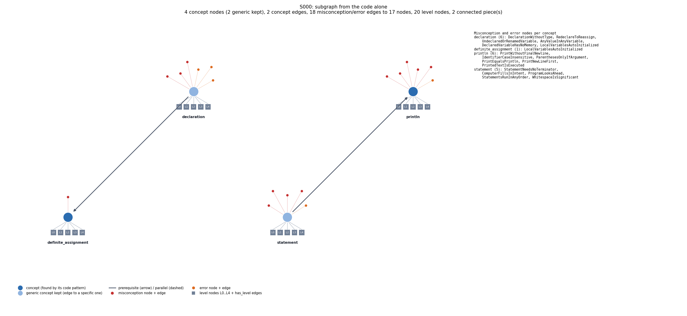

**Concept nodes (4)**: `declaration` (generic), `definite_assignment`, `println`, `statement` (generic)


**Concept edges traced (2)**

| edge | logic |
|---|---|
| `pre:declaration->definite_assignment` | A declared local variable has no defined value until it is assigned, and the compiler rejects any read before that assignment. |
| `pre:statement->println` | System.out.println(s); is itself a statement, so its line of output appears at its own place in the sequence. |

**Misconception and error nodes (17) via 18 edges**: `AnyValueInAnyVariable`, `ComputerFillsInIntent`, `DeclarationWithoutType`, `DeclaredVariableHasNoMemory`, `IdentifierCaseInsensitive`, `LocalVariablesAutoInitialized`, `ParenthesesOnlyIfArgument`, `PrintEqualsPrintln`, `PrintNewLineFirst`, `PrintWithoutFinalNewline`, `PrintedTextIsExecuted`, `ProgramLooksAhead`, `RedeclareToReassign`, `StatementNeedsNoTerminator`, `StatementsRunInAnyOrder`, `UndeclaredOrRenamedVariable`, `WhitespaceIsSignificant`

**Level nodes**: 20 (L0..L4 for each concept), **has_level edges**: 20, **level→misconception links**: 20, **connected pieces**: 2

Notes: concept nodes form 2 pieces (the KG has no edge between them): declaration,definite_assignment | println,statement


## S001

```java
System.out.print("Welcome to Java. This is ");
System.out.println("A nice programming language ");
System.out.print("that I have to learn.");
```


**Concept nodes (4)**: `print`, `println`, `statement` (generic), `string_literal` (generic)


**Concept edges traced (5)**

| edge | logic |
|---|---|
| `par:print~println` | print leaves the cursor on the same line after printing; println moves the cursor to the next line after printing. |
| `pre:statement->print` | System.out.print(s); is itself a statement, so it runs at its own place in the sequence of statements. |
| `pre:statement->println` | System.out.println(s); is itself a statement, so its line of output appears at its own place in the sequence. |
| `pre:string_literal->print` | print("s") outputs exactly the characters between the quotes, without the quotes. |
| `pre:string_literal->println` | println("s") outputs exactly the characters between the quotes and then ends the line. |

**Misconception and error nodes (15) via 18 edges**: `ComputerFillsInIntent`, `IdentifierCaseInsensitive`, `ParenthesesOnlyIfArgument`, `PrintEqualsPrintln`, `PrintNewLineFirst`, `PrintWithoutFinalNewline`, `PrintedTextIsExecuted`, `ProgramLooksAhead`, `RepeatedOutputVariablePrintedOnce`, `SingleQuotedString`, `StatementNeedsNoTerminator`, `StatementsRunInAnyOrder`, `StringLiteralSpansLines`, `UnclosedStringLiteral`, `WhitespaceIsSignificant`

**Level nodes**: 20 (L0..L4 for each concept), **has_level edges**: 20, **level→misconception links**: 16, **connected pieces**: 1


## S007

```java
for (int i = 3; i >= 0; i--) {
  for (int j = i; j > 0; j--) {
    System.out.printf("%d ", j);
  }
  System.out.println();
}
```

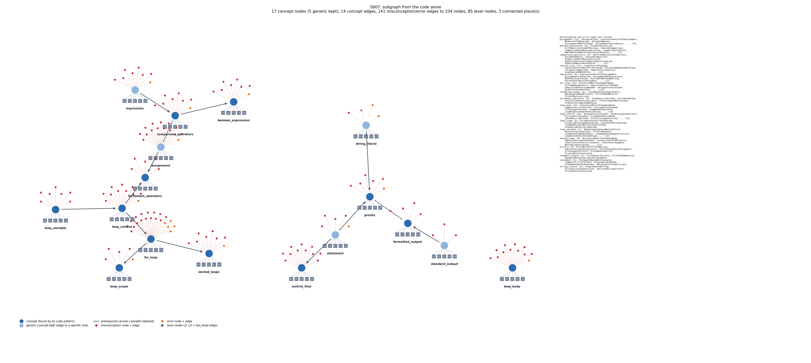

**Concept nodes (17)**: `assignment` (generic), `boolean_expression`, `comparison_operators`, `control_flow`, `expression` (generic), `for_loop`, `formatted_output`, `increment_operators`, `loop_body`, `loop_control`, `loop_scope`, `loop_variable`, `nested_loops`, `println`, `standard_output` (generic), `statement` (generic), `string_literal` (generic)


**Concept edges traced (14)**

| edge | logic |
|---|---|
| `par:assignment~comparison_operators` | x = y stores the value of y in x (a statement with a side effect); x == y only tests whether the two values are equal and gives a boolean. Writing = where == is meant is a compile error with int operands and a silent bug with boolean operands. |
| `par:println~formatted_output` | println prints each number with all its digits and ends the line; printf formats each value by its conversion code and starts a new line only when \n is in the format string. |
| `pre:assignment->increment_operators` | i++ is shorthand for the assignment i = i + 1. |
| `pre:comparison_operators->boolean_expression` | A comparison such as x < y produces a boolean result; comparisons together with boolean logic provide the basis for decision-making. |
| `pre:expression->comparison_operators` | Comparison operators build expressions whose value is a boolean, so one must already know what an expression is to understand a < b. |
| `pre:for_loop->loop_scope` | A variable declared in the for header exists only from its declaration to the end of the for statement's block. |
| `pre:for_loop->nested_loops` | In nested loops the inner for runs its complete set of passes for every single pass of the outer for. |
| `pre:loop_control->for_loop` | The for header is exactly the three control slots, and the body runs after the test and before the update on each pass. |
| `pre:loop_control->increment_operators` | The loop update i = i + 1 comes first; ++ (and +=) are then introduced as shorthand for that update. |
| `pre:loop_variable->loop_control` | The init, condition and update all act on the loop variable: the init sets it, the condition tests it, the update changes it. |
| `pre:standard_output->formatted_output` | printf writes to standard output, like print, but formats each value first. |
| `pre:statement->control_flow` | Control flow is the order in which statements run. |
| `pre:statement->println` | System.out.println(s); is itself a statement, so its line of output appears at its own place in the sequence. |
| `pre:string_literal->println` | println("s") outputs exactly the characters between the quotes and then ends the line. |

**Misconception and error nodes (104) via 141 edges**: `AccumulatorDeclaredInLoop`, `ArithmeticInsteadOfBoolean`, `AssignCompares`, `AssignToFinal`, `AssignmentAddsToTarget`, `AssignmentCopiesObject`, `AssignmentEmptiesSource`, `AssignmentExchangesValues`, `AssignmentIsEquation`, `AssignmentNotExpression`, `AssignmentOppositeDirection`, `BodyChangeIgnoredByCondition`, `BracelessMultiStatementBody`, `ChainedComparison`, `CodeAfterIfSkipped`, `ComparisonWithBooleanLiteral`, `ComputerFillsInIntent`, `DoubleLoopIndexCount`, `ElseWithCondition`, `EmptyInnerLoopSkipsRest`, `EqualityOperatorComparesObjectsValues`, `EqualsComparesReferences`, `ExpressionOnLeftOfAssignment`, `FalseConditionRestartsProgram`, `FalseLoopRepeatsNextCode`, `FieldWidthIsIntegerDigits`, `ForCommaSeparators`, `ForInitRepeats`, `ForIsConditional`, `ForLoopPartSkipped`, `ForUpdateBeforeBody`, `ForVariableScopeBeyondLoop`, `ForWhileNotInterchangeable`, `IdentifierCaseInsensitive`, `IdiomOverridesCode`, `IfConditionWatched`, `IfInLoopUnchecked`, `IfWaitsForCondition`, `InconsistentIndentation`, `IncrementByTwo`, `InfiniteLoopUnnoticed`, `InnerCounterOverwritesOuter`, `InnerOuterSwapped`, `LessGreaterSwapped`, `LocalVarOutsideScope`, `LoopBodyAlwaysOnce`, `LoopBodyScopeImpliesLoopLifetime`, `LoopBodyStatementOutsideLoop`, `LoopCountIsStatementCount`, `LoopForOneTimeTest`, `LoopHeaderIsEquations`, `LoopImpliedByOneTest`, `LoopOutputSameEachPass`, `LoopRunsStatementsSeparately`, `LoopStepAlwaysOne`, `LoopUpdateChangesDirection`, `LoopVariableLifetimeScope`, `LoopVariableLimitsValues`, `ManyDigitsMeanAccurate`, `MapToBooleanWithConditionalOperator`, `MapToBooleanWithIf`, `MissingBraces`, `NestedIfsInsteadOfLogicalOperators`, `NestedLoopsLockstep`, `NestedLoopsSequential`, `NoAtomicExpression`, `NoShortCircuit`, `OffByOneBound`, `OuterLoopIgnored`, `OutsideInMethodNesting`, `ParenthesesOnlyIfArgument`, `PostIncrementAssignsLater`, `PreIncrementBeforeLoop`, `PrePostIncrementSameValue`, `PrintEqualsPrintln`, `PrintNewLineFirst`, `PrintWithoutFinalNewline`, `PrintedTextIsExecuted`, `PrintfAddsNewline`, `PrintfAnyConversion`, `ProgramEndsAfterLoop`, `ProgramLooksAhead`, `RedeclareToReassign`, `RepeatedOutputVariablePrintedOnce`, `ReturnDoesNotExitLoop`, `ReversedRelationalOperator`, `SemicolonAfterIfHeader`, `SemicolonAfterLoopHeader`, `SingleIterationInsteadOfLoop`, `SingleQuotedString`, `StateChangeIgnoredAcrossPasses`, `StatementAfterLoopInBody`, `StatementNeedsNoTerminator`, `StatementsRunInAnyOrder`, `StringLiteralSpansLines`, `StringRelationalComparison`, `SwapWithoutTemp`, `TargetTyping`, `UnclosedStringLiteral`, `VariableKeepsOldValue`, `VariablesHoldExpressions`, `WhileStopsMidBody`, `WhitespaceIsSignificant`, `WrongIterationCount`

**Level nodes**: 85 (L0..L4 for each concept), **has_level edges**: 85, **level→misconception links**: 145, **connected pieces**: 3

Notes: concept nodes form 3 pieces (the KG has no edge between them): assignment,boolean_expression,comparison_operators,expression,for_loop,increment_operators,loop_control,loop_scope,loop_variable,nested_loops | control_flow,formatted_output,println,standard_output,statement,string_literal | loop_body


## S008

```java
int num = 8, num1 = num + 1, num2 = num1 + 3;
int i = num;
do {
  if (i != num1 && i != num2) {
    System.out.printf("%d, ", i);
  } else {
    num2--;
  }
  i++;
} while (i < 14);
```

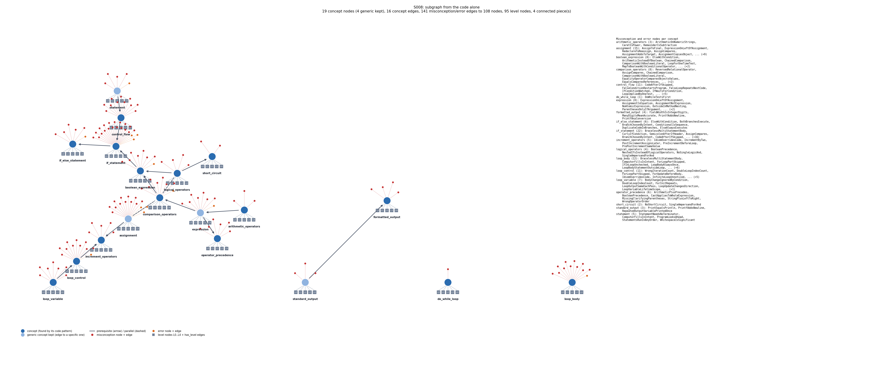

**Concept nodes (19)**: `arithmetic_operators`, `assignment` (generic), `boolean_expression`, `comparison_operators`, `control_flow`, `do_while_loop`, `expression` (generic), `formatted_output`, `if_else_statement`, `if_statement`, `increment_operators`, `logical_operators`, `loop_body`, `loop_control`, `loop_variable`, `operator_precedence`, `short_circuit`, `standard_output` (generic), `statement` (generic)


**Concept edges traced (16)**

| edge | logic |
|---|---|
| `par:assignment~comparison_operators` | x = y stores the value of y in x (a statement with a side effect); x == y only tests whether the two values are equal and gives a boolean. Writing = where == is meant is a compile error with int operands and a silent bug with boolean operands. |
| `par:comparison_operators~logical_operators` | Relational operators compare two numbers to give a boolean; logical operators combine booleans into one boolean. |
| `pre:arithmetic_operators->expression` | An operator combines operand values a and b into a new value, so operators build larger expressions from smaller ones. |
| `pre:assignment->increment_operators` | i++ is shorthand for the assignment i = i + 1. |
| `pre:boolean_expression->if_statement` | An if runs its block only when its boolean expression evaluates to true. |
| `pre:comparison_operators->boolean_expression` | A comparison such as x < y produces a boolean result; comparisons together with boolean logic provide the basis for decision-making. |
| `pre:control_flow->if_statement` | An if changes the default top-to-bottom flow by running a block only when its condition is true. |
| `pre:expression->comparison_operators` | Comparison operators build expressions whose value is a boolean, so one must already know what an expression is to understand a < b. |
| `pre:expression->operator_precedence` | When an expression has several operators, precedence decides which operands are combined first, and equal-precedence operators go left to right. |
| `pre:if_statement->if_else_statement` | if-else extends if with a second block that runs exactly when the condition is false. |
| `pre:logical_operators->boolean_expression` | &&, // and ! combine conditions p and q into one larger condition that is still true or false. |
| `pre:logical_operators->short_circuit` | && and // evaluate their second operand only when the first has not already decided the result (false && x is false, true // x is true). |
| `pre:loop_control->increment_operators` | The loop update i = i + 1 comes first; ++ (and +=) are then introduced as shorthand for that update. |
| `pre:loop_variable->loop_control` | The init, condition and update all act on the loop variable: the init sets it, the condition tests it, the update changes it. |
| `pre:standard_output->formatted_output` | printf writes to standard output, like print, but formats each value first. |
| `pre:statement->control_flow` | Control flow is the order in which statements run. |

**Misconception and error nodes (108) via 141 edges**: `ArithmeticInsteadOfBoolean`, `ArithmeticOnNumericStrings`, `ArithmeticPlusPrecedes`, `AssignCompares`, `AssignToFinal`, `AssignmentAddsToTarget`, `AssignmentCopiesObject`, `AssignmentEmptiesSource`, `AssignmentExchangesValues`, `AssignmentIsEquation`, `AssignmentNotExpression`, `AssignmentOppositeDirection`, `BodyChangeIgnoredByCondition`, `BooleanPrecedence`, `BothBranchesExecute`, `BracelessMultiStatementBody`, `BranchChosenByIntent`, `CaretIsPower`, `CastAppliesToWholeExpression`, `ChainedComparison`, `CodeAfterIfSkipped`, `ComparisonWithBooleanLiteral`, `ComputerFillsInIntent`, `ConditionalIsSequence`, `CurlyIfCondition`, `DoWhileTestsFirst`, `DoubleLoopIndexCount`, `DuplicateCodeInBranches`, `ElseAlwaysExecutes`, `ElseWithCondition`, `EqualityOperatorComparesObjectsValues`, `EqualsComparesReferences`, `ExpressionOnLeftOfAssignment`, `FalseConditionEndsProgram`, `FalseConditionRestartsProgram`, `FalseLoopRepeatsNextCode`, `FieldWidthIsIntegerDigits`, `ForInitRepeats`, `ForLoopPartSkipped`, `ForUpdateBeforeBody`, `IdiomOverridesCode`, `IfConditionCheckedInHindsight`, `IfConditionWatched`, `IfInLoopUnchecked`, `IfIsLoop`, `IfRequiresElse`, `IfWaitsForCondition`, `IncrementByTwo`, `InfiniteLoopUnnoticed`, `LessGreaterSwapped`, `LoopBodyAlwaysOnce`, `LoopBodyStatementOutsideLoop`, `LoopCountIsStatementCount`, `LoopForOneTimeTest`, `LoopHeaderIsEquations`, `LoopImpliedByOneTest`, `LoopOutputSameEachPass`, `LoopRunsStatementsSeparately`, `LoopStepAlwaysOne`, `LoopUpdateChangesDirection`, `LoopVariableLifetimeScope`, `LoopVariableLimitsValues`, `ManyDigitsMeanAccurate`, `MapToBooleanWithConditionalOperator`, `MapToBooleanWithIf`, `MissingBraces`, `MissingClarifyingParentheses`, `NestedIfsInsteadOfLogicalOperators`, `NextStatementIsElse`, `NoAtomicExpression`, `NoShortCircuit`, `NoSingleLogicAnd`, `OffByOneBound`, `OutsideInMethodNesting`, `ParenthesesOnlyIfArgument`, `PostIncrementAssignsLater`, `PreIncrementBeforeLoop`, `PrePostIncrementSameValue`, `PrintEqualsPrintln`, `PrintedTextIsExecuted`, `PrintfAddsNewline`, `PrintfAnyConversion`, `ProgramEndsAfterLoop`, `ProgramLooksAhead`, `RedeclareToReassign`, `RemainderIsSubtraction`, `RepeatedOutputVariablePrintedOnce`, `ReturnDoesNotExitLoop`, `ReversedRelationalOperator`, `SemicolonAfterIfHeader`, `SequentialIfsAreNested`, `SingleAmpersandForAnd`, `StateChangeIgnoredAcrossPasses`, `StatementAfterIfInBranch`, `StatementAfterLoopInBody`, `StatementNeedsNoTerminator`, `StatementsRunInAnyOrder`, `StringPlusLeftToRight`, `StringRelationalComparison`, `SwapWithoutTemp`, `TargetTyping`, `ThenAlwaysExecutes`, `VariableKeepsOldValue`, `VariablesHoldExpressions`, `WhileStopsMidBody`, `WhitespaceIsSignificant`, `WrongIterationCount`, `WrongOperatorOrder`

**Level nodes**: 95 (L0..L4 for each concept), **has_level edges**: 95, **level→misconception links**: 161, **connected pieces**: 4

Notes: concept nodes form 4 pieces (the KG has no edge between them): arithmetic_operators,assignment,boolean_expression,comparison_operators,control_flow,expression,if_else_statement,if_statement,increment_operators,logical_operators,loop_control,loop_variable,operator_precedence,short_circuit,statement | do_while_loop | formatted_output,standard_output | loop_body


## S021

```java
System.out.print("A");
if (x % 2 == 0) {
  System.out.print("B");
  if (x % 5 == 2) { System.out.print("C"); } else { System.out.print("D"); }
} else {
  if (x % 5 == 2) { System.out.print("E"); } else { System.out.print("F"); }
  System.out.print("G");
}
```

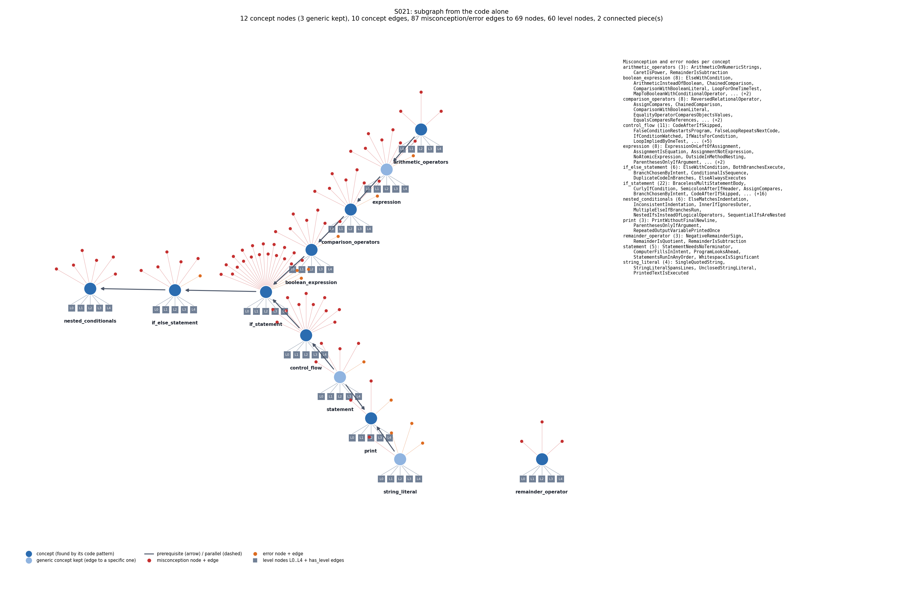

**Concept nodes (12)**: `arithmetic_operators`, `boolean_expression`, `comparison_operators`, `control_flow`, `expression` (generic), `if_else_statement`, `if_statement`, `nested_conditionals`, `print`, `remainder_operator`, `statement` (generic), `string_literal` (generic)


**Concept edges traced (10)**

| edge | logic |
|---|---|
| `pre:arithmetic_operators->expression` | An operator combines operand values a and b into a new value, so operators build larger expressions from smaller ones. |
| `pre:boolean_expression->if_statement` | An if runs its block only when its boolean expression evaluates to true. |
| `pre:comparison_operators->boolean_expression` | A comparison such as x < y produces a boolean result; comparisons together with boolean logic provide the basis for decision-making. |
| `pre:control_flow->if_statement` | An if changes the default top-to-bottom flow by running a block only when its condition is true. |
| `pre:expression->comparison_operators` | Comparison operators build expressions whose value is a boolean, so one must already know what an expression is to understand a < b. |
| `pre:if_else_statement->nested_conditionals` | Nesting puts an if or if-else inside a branch of another if-else; an else-if chain is the common case where the else branch is itself an if. |
| `pre:if_statement->if_else_statement` | if-else extends if with a second block that runs exactly when the condition is false. |
| `pre:statement->control_flow` | Control flow is the order in which statements run. |
| `pre:statement->print` | System.out.print(s); is itself a statement, so it runs at its own place in the sequence of statements. |
| `pre:string_literal->print` | print("s") outputs exactly the characters between the quotes, without the quotes. |

**Misconception and error nodes (69) via 87 edges**: `ArithmeticInsteadOfBoolean`, `ArithmeticOnNumericStrings`, `AssignCompares`, `AssignmentIsEquation`, `AssignmentNotExpression`, `BothBranchesExecute`, `BracelessMultiStatementBody`, `BranchChosenByIntent`, `CaretIsPower`, `ChainedComparison`, `CodeAfterIfSkipped`, `ComparisonWithBooleanLiteral`, `ComputerFillsInIntent`, `ConditionalIsSequence`, `CurlyIfCondition`, `DuplicateCodeInBranches`, `ElseAlwaysExecutes`, `ElseMatchesIndentation`, `ElseWithCondition`, `EqualityOperatorComparesObjectsValues`, `EqualsComparesReferences`, `ExpressionOnLeftOfAssignment`, `FalseConditionEndsProgram`, `FalseConditionRestartsProgram`, `FalseLoopRepeatsNextCode`, `IfConditionCheckedInHindsight`, `IfConditionWatched`, `IfInLoopUnchecked`, `IfIsLoop`, `IfRequiresElse`, `IfWaitsForCondition`, `InconsistentIndentation`, `InnerIfIgnoresOuter`, `LessGreaterSwapped`, `LoopForOneTimeTest`, `LoopImpliedByOneTest`, `MapToBooleanWithConditionalOperator`, `MapToBooleanWithIf`, `MissingBraces`, `MultipleElseIfBranchesRun`, `NegativeRemainderSign`, `NestedIfsInsteadOfLogicalOperators`, `NextStatementIsElse`, `NoAtomicExpression`, `NoShortCircuit`, `OutsideInMethodNesting`, `ParenthesesOnlyIfArgument`, `PrintWithoutFinalNewline`, `PrintedTextIsExecuted`, `ProgramEndsAfterLoop`, `ProgramLooksAhead`, `RemainderIsQuotient`, `RemainderIsSubtraction`, `RepeatedOutputVariablePrintedOnce`, `ReturnDoesNotExitLoop`, `ReversedRelationalOperator`, `SemicolonAfterIfHeader`, `SequentialIfsAreNested`, `SingleQuotedString`, `StatementAfterIfInBranch`, `StatementNeedsNoTerminator`, `StatementsRunInAnyOrder`, `StringLiteralSpansLines`, `StringRelationalComparison`, `TargetTyping`, `ThenAlwaysExecutes`, `UnclosedStringLiteral`, `VariablesHoldExpressions`, `WhitespaceIsSignificant`

**Level nodes**: 60 (L0..L4 for each concept), **has_level edges**: 60, **level→misconception links**: 91, **connected pieces**: 2

Notes: concept nodes form 2 pieces (the KG has no edge between them): arithmetic_operators,boolean_expression,comparison_operators,control_flow,expression,if_else_statement,if_statement,nested_conditionals,print,statement,string_literal | remainder_operator


## S026

```java
int t = a;
a = b;
b = t;
```

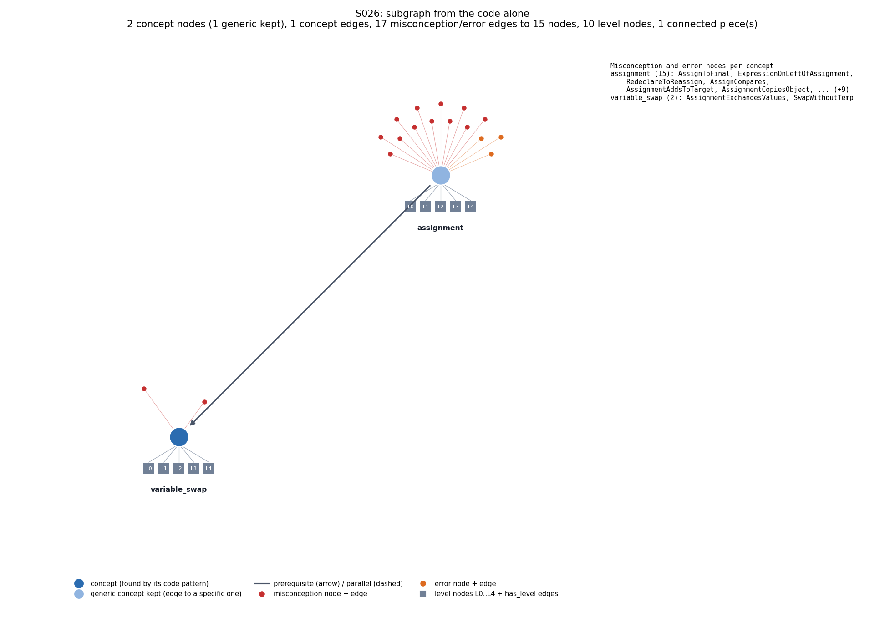

**Concept nodes (2)**: `assignment` (generic), `variable_swap`


**Concept edges traced (1)**

| edge | logic |
|---|---|
| `pre:assignment->variable_swap` | The three assignments int t = a; a = b; b = t; exchange the values of a and b, as a trace of the variable values after each statement shows. |

**Misconception and error nodes (15) via 17 edges**: `AssignCompares`, `AssignToFinal`, `AssignmentAddsToTarget`, `AssignmentCopiesObject`, `AssignmentEmptiesSource`, `AssignmentExchangesValues`, `AssignmentIsEquation`, `AssignmentNotExpression`, `AssignmentOppositeDirection`, `ExpressionOnLeftOfAssignment`, `PrintedTextIsExecuted`, `RedeclareToReassign`, `SwapWithoutTemp`, `VariableKeepsOldValue`, `VariablesHoldExpressions`

**Level nodes**: 10 (L0..L4 for each concept), **has_level edges**: 10, **level→misconception links**: 17, **connected pieces**: 1


## S047

```java
double price = 3.14159;
System.out.printf("%6.2f", price);
System.out.printf("|%d items%n", 4);
```

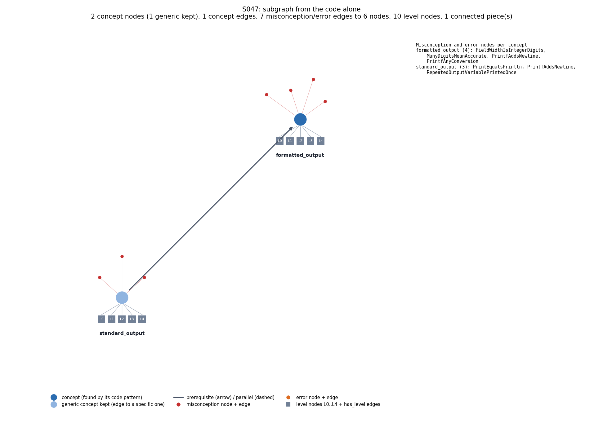

**Concept nodes (2)**: `formatted_output`, `standard_output` (generic)


**Concept edges traced (1)**

| edge | logic |
|---|---|
| `pre:standard_output->formatted_output` | printf writes to standard output, like print, but formats each value first. |

**Misconception and error nodes (6) via 7 edges**: `FieldWidthIsIntegerDigits`, `ManyDigitsMeanAccurate`, `PrintEqualsPrintln`, `PrintfAddsNewline`, `PrintfAnyConversion`, `RepeatedOutputVariablePrintedOnce`

**Level nodes**: 10 (L0..L4 for each concept), **has_level edges**: 10, **level→misconception links**: 11, **connected pieces**: 1


## S052

```java
% java RandomSeq 5 > data.txt
% java Average < data.txt
% java RandomSeq 5 | java Average
(RandomSeq N prints N random numbers; Average reads numbers from standard input and prints their average)
```

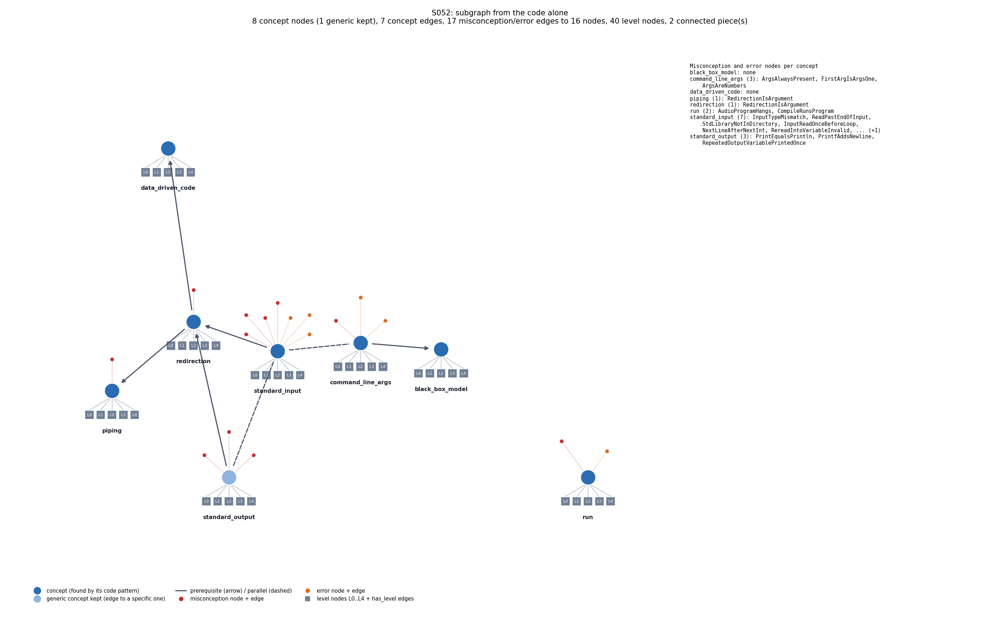

**Concept nodes (8)**: `black_box_model`, `command_line_args`, `data_driven_code`, `piping`, `redirection`, `run`, `standard_input`, `standard_output` (generic)


**Concept edges traced (7)**

| edge | logic |
|---|---|
| `par:standard_input~command_line_args` | Command-line arguments are a fixed number of strings given once when the program starts (args[]); standard input is a stream of any length read while the program runs (StdIn.readInt()). Both arrive as text and must be parsed into numbers. |
| `par:standard_input~standard_output` | StdIn takes values in from the input stream; StdOut sends values out to the output stream. |
| `pre:command_line_args->black_box_model` | The black-box view treats the command-line argument as the input string and what the program prints as the output string. |
| `pre:redirection->data_driven_code` | Redirecting a file to standard input lets the same program process different data files without being changed. |
| `pre:redirection->piping` | A pipe A / B connects A's standard output directly to B's standard input, with no file in between. |
| `pre:standard_input->redirection` | < file makes the contents of the file the standard input stream. |
| `pre:standard_output->redirection` | > file sends everything written to standard output into the file instead of the screen. |

**Misconception and error nodes (16) via 17 edges**: `ArgsAlwaysPresent`, `ArgsAreNumbers`, `AudioProgramHangs`, `CompileRunsProgram`, `FirstArgIsArgsOne`, `InputReadOnceBeforeLoop`, `InputTypeMismatch`, `NextLineAfterNextInt`, `PrintEqualsPrintln`, `PrintfAddsNewline`, `ReadPastEndOfInput`, `RedirectionIsArgument`, `RepeatedOutputVariablePrintedOnce`, `RereadIntoVariableInvalid`, `StdInRereads`, `StdLibraryNotInDirectory`

**Level nodes**: 40 (L0..L4 for each concept), **has_level edges**: 40, **level→misconception links**: 23, **connected pieces**: 2

Notes: concept nodes form 2 pieces (the KG has no edge between them): black_box_model,command_line_args,data_driven_code,piping,redirection,standard_input,standard_output | run


## S057

```java
int[] counts = {0, 0, 2, 2, 1};
int outDegree = 5;
double[] p = new double[5];
for (int j = 0; j < 5; j++) {
  p[j] = counts[j] / outDegree;
}
```

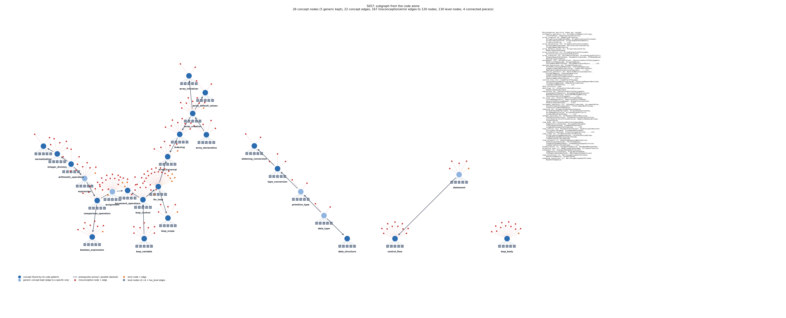

**Concept nodes (26)**: `arithmetic_operators`, `array_creation`, `array_declaration`, `array_default_values`, `array_initializer`, `array_traversal`, `assignment` (generic), `boolean_expression`, `comparison_operators`, `control_flow`, `data_structure`, `data_type` (generic), `expression` (generic), `for_loop`, `increment_operators`, `indexing`, `integer_division`, `loop_body`, `loop_control`, `loop_scope`, `loop_variable`, `normalization`, `primitive_type` (generic), `statement` (generic), `type_conversion`, `widening_conversion`


**Concept edges traced (22)**

| edge | logic |
|---|---|
| `par:assignment~comparison_operators` | x = y stores the value of y in x (a statement with a side effect); x == y only tests whether the two values are equal and gives a boolean. Writing = where == is meant is a compile error with int operands and a silent bug with boolean operands. |
| `pre:arithmetic_operators->expression` | An operator combines operand values a and b into a new value, so operators build larger expressions from smaller ones. |
| `pre:arithmetic_operators->integer_division` | For ints a and b, / gives the whole quotient q and % gives the remainder r, so that a = b * q + r. |
| `pre:array_creation->array_default_values` | new fills every slot with the type's default value: 0, 0.0, false or null. |
| `pre:array_creation->array_initializer` | {v0, v1, ..., vk} is a shorthand that creates an array of length k + 1 and fills it in one step. |
| `pre:array_creation->indexing` | An array must be created with new before any of its elements a[i] can be accessed. |
| `pre:array_declaration->array_creation` | double[] a; declares the array name and type; a = new double[N]; then creates the array. |
| `pre:assignment->increment_operators` | i++ is shorthand for the assignment i = i + 1. |
| `pre:comparison_operators->boolean_expression` | A comparison such as x < y produces a boolean result; comparisons together with boolean logic provide the basis for decision-making. |
| `pre:data_type->data_structure` | A data structure organizes many values of a data type; the array holds a sequence of values of one type. |
| `pre:data_type->primitive_type` | Java has eight primitive data types (boolean, char, byte, short, int, long, float, double); each, like any data type, is a set of values and a set of operations on those values. |
| `pre:expression->comparison_operators` | Comparison operators build expressions whose value is a boolean, so one must already know what an expression is to understand a < b. |
| `pre:for_loop->array_traversal` | for (int i = 0; i < a.length; i++) gives i every valid index exactly once, in increasing order. |
| `pre:for_loop->loop_scope` | A variable declared in the for header exists only from its declaration to the end of the for statement's block. |
| `pre:indexing->array_traversal` | A traversal uses the loop variable i as the index, so a[i] reaches a different element on each pass. |
| `pre:integer_division->normalization` | Normalising must divide as doubles, because with two ints counts / total truncates to 0 whenever counts < total. |
| `pre:loop_control->for_loop` | The for header is exactly the three control slots, and the body runs after the test and before the update on each pass. |
| `pre:loop_control->increment_operators` | The loop update i = i + 1 comes first; ++ (and +=) are then introduced as shorthand for that update. |
| `pre:loop_variable->loop_control` | The init, condition and update all act on the loop variable: the init sets it, the condition tests it, the update changes it. |
| `pre:primitive_type->type_conversion` | Conversion moves a value between primitive types: int to double happens automatically, while double to int needs a cast that drops the fraction. |
| `pre:statement->control_flow` | Control flow is the order in which statements run. |
| `pre:type_conversion->widening_conversion` | Widening is the automatic kind of type conversion. |

**Misconception and error nodes (120) via 167 edges**: `AccumulatorDeclaredInLoop`, `AllDoublesToAvoidDivision`, `AnyValueInAnyVariable`, `ArithmeticInsteadOfBoolean`, `ArithmeticOnNumericStrings`, `ArrayAccessWithParentheses`, `ArrayAllocationWithoutNew`, `ArrayBracketCountIsLength`, `ArrayCreationIsFree`, `ArrayElementNotVariable`, `ArrayElementsUntyped`, `ArrayIndexStartsAtOne`, `ArrayInitializerContentsInBrackets`, `ArrayLengthCannotBeZero`, `ArrayListIsArray`, `ArrayRangeInclusive`, `ArrayUseScansAllCells`, `ArraysGrow`, `AssignCompares`, `AssignToFinal`, `AssignmentAddsToTarget`, `AssignmentCopiesObject`, `AssignmentEmptiesSource`, `AssignmentExchangesValues`, `AssignmentIsEquation`, `AssignmentNotExpression`, `AssignmentOppositeDirection`, `BodyChangeIgnoredByCondition`, `BracelessMultiStatementBody`, `CaretIsPower`, `CastAfterIntDivision`, `ChainedComparison`, `CodeAfterIfSkipped`, `ComparisonWithBooleanLiteral`, `ComputerFillsInIntent`, `DeclarationCreatesArray`, `DoubleLoopIndexCount`, `EarlyReturnInLoop`, `ElementBoundToOldIndex`, `ElementNameIsWholeArray`, `ElseWithCondition`, `EqualityOperatorComparesObjectsValues`, `EqualsComparesReferences`, `ExpressionOnLeftOfAssignment`, `FalseConditionRestartsProgram`, `FalseLoopRepeatsNextCode`, `ForCommaSeparators`, `ForInitRepeats`, `ForIsConditional`, `ForLoopPartSkipped`, `ForUpdateBeforeBody`, `ForVariableScopeBeyondLoop`, `ForWhileNotInterchangeable`, `IdiomOverridesCode`, `IfConditionWatched`, `IfInLoopUnchecked`, `IfWaitsForCondition`, `IncrementByTwo`, `IndexIsValue`, `InfiniteLoopUnnoticed`, `IntegerDivisionGivesFraction`, `IntegerProbability`, `LaterDoubleLiteralFixesDivision`, `LessGreaterSwapped`, `LocalVarOutsideScope`, `LoopBodyAlwaysOnce`, `LoopBodyScopeImpliesLoopLifetime`, `LoopBodyStatementOutsideLoop`, `LoopCountIsStatementCount`, `LoopForOneTimeTest`, `LoopHeaderIsEquations`, `LoopImpliedByOneTest`, `LoopOutputSameEachPass`, `LoopRunsStatementsSeparately`, `LoopStepAlwaysOne`, `LoopUpdateChangesDirection`, `LoopVariableLifetimeScope`, `LoopVariableLimitsValues`, `MapToBooleanWithConditionalOperator`, `MapToBooleanWithIf`, `MissingBraces`, `NarrowingAssignmentAllowed`, `NegativeArraySize`, `NegativeRemainderSign`, `NestedIfsInsteadOfLogicalOperators`, `NewArrayHoldsGarbage`, `NoAtomicExpression`, `NoCastIfSameSize`, `NoShortCircuit`, `OffByOneBound`, `OutsideInMethodNesting`, `ParenthesesOnlyIfArgument`, `PostIncrementAssignsLater`, `PreIncrementBeforeLoop`, `PrePostIncrementSameValue`, `PrintedTextIsExecuted`, `ProgramEndsAfterLoop`, `ProgramLooksAhead`, `RedeclareToReassign`, `RemainderIsSubtraction`, `ReturnDoesNotExitLoop`, `ReversedRelationalOperator`, `RowsNeedNotSumToOne`, `SemicolonAfterIfHeader`, `SemicolonAfterLoopHeader`, `SingleIterationInsteadOfLoop`, `StateChangeIgnoredAcrossPasses`, `StatementAfterLoopInBody`, `StatementNeedsNoTerminator`, `StatementsRunInAnyOrder`, `StringIsPrimitive`, `StringRelationalComparison`, `SwapWithoutTemp`, `TargetTyping`, `VariableKeepsOldValue`, `VariablesHoldExpressions`, `WhileStopsMidBody`, `WhitespaceIsSignificant`, `WholeArrayArithmetic`, `WrongIterationCount`

**Level nodes**: 130 (L0..L4 for each concept), **has_level edges**: 130, **level→misconception links**: 193, **connected pieces**: 4

Notes: concept nodes form 4 pieces (the KG has no edge between them): arithmetic_operators,array_creation,array_declaration,array_default_values,array_initializer,array_traversal,assignment,boolean_expression,comparison_operators,expression,for_loop,increment_operators,indexing,integer_division,loop_control,loop_scope,loop_variable,normalization | control_flow,statement | data_structure,data_type,primitive_type,type_conversion,widening_conversion | loop_body


## S134

```java
int t = a;
a = b;
b = t;
```


**Concept nodes (2)**: `assignment` (generic), `variable_swap`


**Concept edges traced (1)**

| edge | logic |
|---|---|
| `pre:assignment->variable_swap` | The three assignments int t = a; a = b; b = t; exchange the values of a and b, as a trace of the variable values after each statement shows. |

**Misconception and error nodes (15) via 17 edges**: `AssignCompares`, `AssignToFinal`, `AssignmentAddsToTarget`, `AssignmentCopiesObject`, `AssignmentEmptiesSource`, `AssignmentExchangesValues`, `AssignmentIsEquation`, `AssignmentNotExpression`, `AssignmentOppositeDirection`, `ExpressionOnLeftOfAssignment`, `PrintedTextIsExecuted`, `RedeclareToReassign`, `SwapWithoutTemp`, `VariableKeepsOldValue`, `VariablesHoldExpressions`

**Level nodes**: 10 (L0..L4 for each concept), **has_level edges**: 10, **level→misconception links**: 17, **connected pieces**: 1


## S137

```java
System.out.print("Welcome to Java. This is ");
System.out.println("A nice programming language ");
System.out.print("that I have to learn.");
```


**Concept nodes (4)**: `print`, `println`, `statement` (generic), `string_literal` (generic)


**Concept edges traced (5)**

| edge | logic |
|---|---|
| `par:print~println` | print leaves the cursor on the same line after printing; println moves the cursor to the next line after printing. |
| `pre:statement->print` | System.out.print(s); is itself a statement, so it runs at its own place in the sequence of statements. |
| `pre:statement->println` | System.out.println(s); is itself a statement, so its line of output appears at its own place in the sequence. |
| `pre:string_literal->print` | print("s") outputs exactly the characters between the quotes, without the quotes. |
| `pre:string_literal->println` | println("s") outputs exactly the characters between the quotes and then ends the line. |

**Misconception and error nodes (15) via 18 edges**: `ComputerFillsInIntent`, `IdentifierCaseInsensitive`, `ParenthesesOnlyIfArgument`, `PrintEqualsPrintln`, `PrintNewLineFirst`, `PrintWithoutFinalNewline`, `PrintedTextIsExecuted`, `ProgramLooksAhead`, `RepeatedOutputVariablePrintedOnce`, `SingleQuotedString`, `StatementNeedsNoTerminator`, `StatementsRunInAnyOrder`, `StringLiteralSpansLines`, `UnclosedStringLiteral`, `WhitespaceIsSignificant`

**Level nodes**: 20 (L0..L4 for each concept), **has_level edges**: 20, **level→misconception links**: 16, **connected pieces**: 1


## T001

```java
int a = 2, b = 3;
System.out.println("Sum: " + a + b);
```

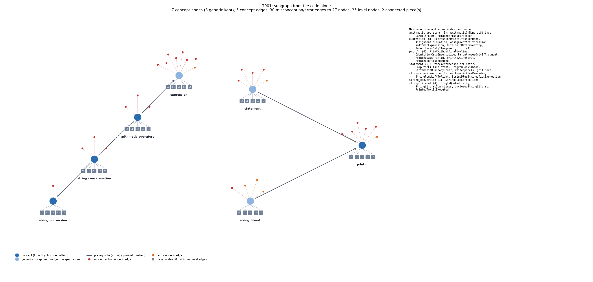

**Concept nodes (7)**: `arithmetic_operators`, `expression` (generic), `println`, `statement` (generic), `string_concatenation`, `string_conversion`, `string_literal` (generic)


**Concept edges traced (5)**

| edge | logic |
|---|---|
| `par:string_concatenation~arithmetic_operators` | + adds when both operands are numbers and concatenates when either operand is a String, converting the other operand to a String. It is left-associative, so 1 + 2 + "3" is "33" but "1" + 2 + 3 is "123". |
| `pre:arithmetic_operators->expression` | An operator combines operand values a and b into a new value, so operators build larger expressions from smaller ones. |
| `pre:statement->println` | System.out.println(s); is itself a statement, so its line of output appears at its own place in the sequence. |
| `pre:string_concatenation->string_conversion` | When one operand of + is a String, Java converts the other operand to a String before concatenating. |
| `pre:string_literal->println` | println("s") outputs exactly the characters between the quotes and then ends the line. |

**Misconception and error nodes (27) via 30 edges**: `ArithmeticOnNumericStrings`, `ArithmeticPlusPrecedes`, `AssignmentIsEquation`, `AssignmentNotExpression`, `CaretIsPower`, `ComputerFillsInIntent`, `ExpressionOnLeftOfAssignment`, `IdentifierCaseInsensitive`, `NoAtomicExpression`, `OutsideInMethodNesting`, `ParenthesesOnlyIfArgument`, `PrintEqualsPrintln`, `PrintNewLineFirst`, `PrintWithoutFinalNewline`, `PrintedTextIsExecuted`, `ProgramLooksAhead`, `RemainderIsSubtraction`, `SingleQuotedString`, `StatementNeedsNoTerminator`, `StatementsRunInAnyOrder`, `StringLiteralSpansLines`, `StringPlusLeftToRight`, `StringPlusStringifiesExpression`, `TargetTyping`, `UnclosedStringLiteral`, `VariablesHoldExpressions`, `WhitespaceIsSignificant`

**Level nodes**: 35 (L0..L4 for each concept), **has_level edges**: 35, **level→misconception links**: 33, **connected pieces**: 2

Notes: concept nodes form 2 pieces (the KG has no edge between them): arithmetic_operators,expression,string_concatenation,string_conversion | println,statement,string_literal


## T002

```java
int a = 7, b = 2;
double r = a / b;
System.out.println(r);
```

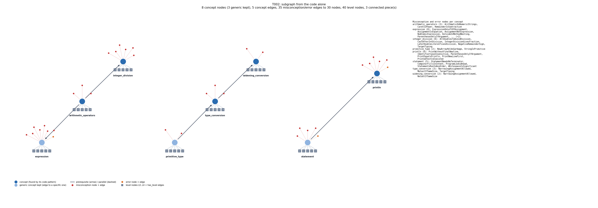

**Concept nodes (8)**: `arithmetic_operators`, `expression` (generic), `integer_division`, `primitive_type` (generic), `println`, `statement` (generic), `type_conversion`, `widening_conversion`


**Concept edges traced (5)**

| edge | logic |
|---|---|
| `pre:arithmetic_operators->expression` | An operator combines operand values a and b into a new value, so operators build larger expressions from smaller ones. |
| `pre:arithmetic_operators->integer_division` | For ints a and b, / gives the whole quotient q and % gives the remainder r, so that a = b * q + r. |
| `pre:primitive_type->type_conversion` | Conversion moves a value between primitive types: int to double happens automatically, while double to int needs a cast that drops the fraction. |
| `pre:statement->println` | System.out.println(s); is itself a statement, so its line of output appears at its own place in the sequence. |
| `pre:type_conversion->widening_conversion` | Widening is the automatic kind of type conversion. |

**Misconception and error nodes (30) via 35 edges**: `AllDoublesToAvoidDivision`, `ArithmeticOnNumericStrings`, `AssignmentIsEquation`, `AssignmentNotExpression`, `CaretIsPower`, `CastAfterIntDivision`, `ComputerFillsInIntent`, `ExpressionOnLeftOfAssignment`, `IdentifierCaseInsensitive`, `IntegerDivisionGivesFraction`, `LaterDoubleLiteralFixesDivision`, `NarrowingAssignmentAllowed`, `NegativeRemainderSign`, `NewArrayHoldsGarbage`, `NoAtomicExpression`, `NoCastIfSameSize`, `OutsideInMethodNesting`, `ParenthesesOnlyIfArgument`, `PrintEqualsPrintln`, `PrintNewLineFirst`, `PrintWithoutFinalNewline`, `PrintedTextIsExecuted`, `ProgramLooksAhead`, `RemainderIsSubtraction`, `StatementNeedsNoTerminator`, `StatementsRunInAnyOrder`, `StringIsPrimitive`, `TargetTyping`, `VariablesHoldExpressions`, `WhitespaceIsSignificant`

**Level nodes**: 40 (L0..L4 for each concept), **has_level edges**: 40, **level→misconception links**: 46, **connected pieces**: 3

Notes: concept nodes form 3 pieces (the KG has no edge between them): arithmetic_operators,expression,integer_division | primitive_type,type_conversion,widening_conversion | println,statement


## T003

```java
int x = 1;
if (x > 5) {
  System.out.println("big");
}
x = 10;
System.out.println(x);
```


**Concept nodes (9)**: `assignment` (generic), `boolean_expression`, `comparison_operators`, `control_flow`, `expression` (generic), `if_statement`, `println`, `statement` (generic), `string_literal` (generic)


**Concept edges traced (8)**

| edge | logic |
|---|---|
| `par:assignment~comparison_operators` | x = y stores the value of y in x (a statement with a side effect); x == y only tests whether the two values are equal and gives a boolean. Writing = where == is meant is a compile error with int operands and a silent bug with boolean operands. |
| `pre:boolean_expression->if_statement` | An if runs its block only when its boolean expression evaluates to true. |
| `pre:comparison_operators->boolean_expression` | A comparison such as x < y produces a boolean result; comparisons together with boolean logic provide the basis for decision-making. |
| `pre:control_flow->if_statement` | An if changes the default top-to-bottom flow by running a block only when its condition is true. |
| `pre:expression->comparison_operators` | Comparison operators build expressions whose value is a boolean, so one must already know what an expression is to understand a < b. |
| `pre:statement->control_flow` | Control flow is the order in which statements run. |
| `pre:statement->println` | System.out.println(s); is itself a statement, so its line of output appears at its own place in the sequence. |
| `pre:string_literal->println` | println("s") outputs exactly the characters between the quotes and then ends the line. |

**Misconception and error nodes (67) via 87 edges**: `ArithmeticInsteadOfBoolean`, `AssignCompares`, `AssignToFinal`, `AssignmentAddsToTarget`, `AssignmentCopiesObject`, `AssignmentEmptiesSource`, `AssignmentExchangesValues`, `AssignmentIsEquation`, `AssignmentNotExpression`, `AssignmentOppositeDirection`, `BracelessMultiStatementBody`, `BranchChosenByIntent`, `ChainedComparison`, `CodeAfterIfSkipped`, `ComparisonWithBooleanLiteral`, `ComputerFillsInIntent`, `CurlyIfCondition`, `ElseWithCondition`, `EqualityOperatorComparesObjectsValues`, `EqualsComparesReferences`, `ExpressionOnLeftOfAssignment`, `FalseConditionEndsProgram`, `FalseConditionRestartsProgram`, `FalseLoopRepeatsNextCode`, `IdentifierCaseInsensitive`, `IfConditionCheckedInHindsight`, `IfConditionWatched`, `IfInLoopUnchecked`, `IfIsLoop`, `IfRequiresElse`, `IfWaitsForCondition`, `LessGreaterSwapped`, `LoopForOneTimeTest`, `LoopImpliedByOneTest`, `MapToBooleanWithConditionalOperator`, `MapToBooleanWithIf`, `MissingBraces`, `NestedIfsInsteadOfLogicalOperators`, `NextStatementIsElse`, `NoAtomicExpression`, `NoShortCircuit`, `OutsideInMethodNesting`, `ParenthesesOnlyIfArgument`, `PrintEqualsPrintln`, `PrintNewLineFirst`, `PrintWithoutFinalNewline`, `PrintedTextIsExecuted`, `ProgramEndsAfterLoop`, `ProgramLooksAhead`, `RedeclareToReassign`, `ReturnDoesNotExitLoop`, `ReversedRelationalOperator`, `SemicolonAfterIfHeader`, `SequentialIfsAreNested`, `SingleQuotedString`, `StatementAfterIfInBranch`, `StatementNeedsNoTerminator`, `StatementsRunInAnyOrder`, `StringLiteralSpansLines`, `StringRelationalComparison`, `SwapWithoutTemp`, `TargetTyping`, `ThenAlwaysExecutes`, `UnclosedStringLiteral`, `VariableKeepsOldValue`, `VariablesHoldExpressions`, `WhitespaceIsSignificant`

**Level nodes**: 45 (L0..L4 for each concept), **has_level edges**: 45, **level→misconception links**: 84, **connected pieces**: 1


## T004

```java
int n = 17;
System.out.println(n / 5);
System.out.println(n % 5);
```

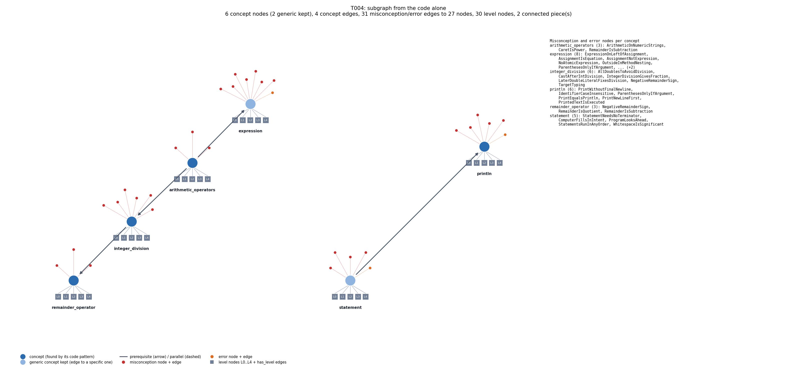

**Concept nodes (6)**: `arithmetic_operators`, `expression` (generic), `integer_division`, `println`, `remainder_operator`, `statement` (generic)


**Concept edges traced (4)**

| edge | logic |
|---|---|
| `pre:arithmetic_operators->expression` | An operator combines operand values a and b into a new value, so operators build larger expressions from smaller ones. |
| `pre:arithmetic_operators->integer_division` | For ints a and b, / gives the whole quotient q and % gives the remainder r, so that a = b * q + r. |
| `pre:integer_division->remainder_operator` | % is the companion of integer division: a = (a / b) * b + a % b. |
| `pre:statement->println` | System.out.println(s); is itself a statement, so its line of output appears at its own place in the sequence. |

**Misconception and error nodes (27) via 31 edges**: `AllDoublesToAvoidDivision`, `ArithmeticOnNumericStrings`, `AssignmentIsEquation`, `AssignmentNotExpression`, `CaretIsPower`, `CastAfterIntDivision`, `ComputerFillsInIntent`, `ExpressionOnLeftOfAssignment`, `IdentifierCaseInsensitive`, `IntegerDivisionGivesFraction`, `LaterDoubleLiteralFixesDivision`, `NegativeRemainderSign`, `NoAtomicExpression`, `OutsideInMethodNesting`, `ParenthesesOnlyIfArgument`, `PrintEqualsPrintln`, `PrintNewLineFirst`, `PrintWithoutFinalNewline`, `PrintedTextIsExecuted`, `ProgramLooksAhead`, `RemainderIsQuotient`, `RemainderIsSubtraction`, `StatementNeedsNoTerminator`, `StatementsRunInAnyOrder`, `TargetTyping`, `VariablesHoldExpressions`, `WhitespaceIsSignificant`

**Level nodes**: 30 (L0..L4 for each concept), **has_level edges**: 30, **level→misconception links**: 37, **connected pieces**: 2

Notes: concept nodes form 2 pieces (the KG has no edge between them): arithmetic_operators,expression,integer_division,remainder_operator | println,statement


## T005

```java
for (int i = 1; i <= 10; i++) {
  if (i % 3 == 0) {
    System.out.print(i + " ");
  }
}
```

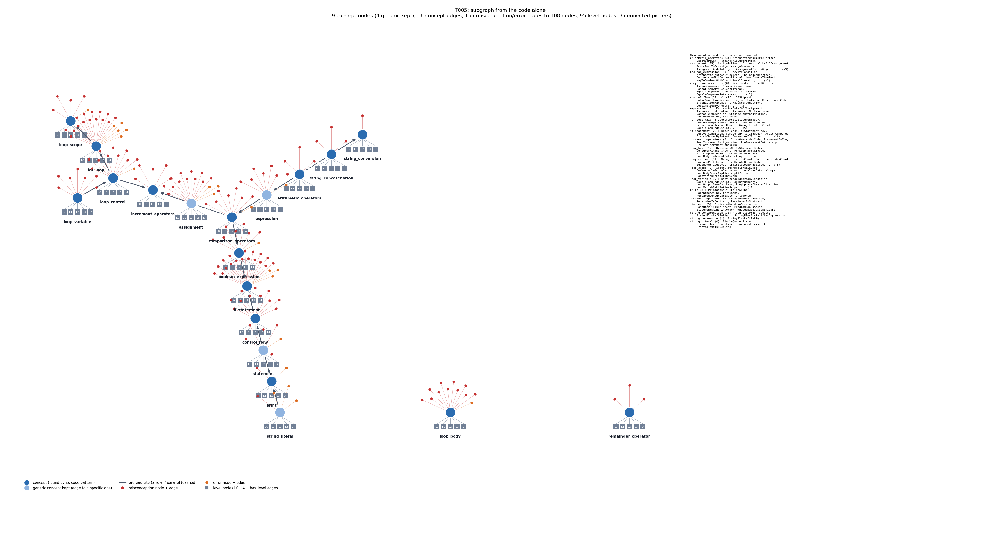

**Concept nodes (19)**: `arithmetic_operators`, `assignment` (generic), `boolean_expression`, `comparison_operators`, `control_flow`, `expression` (generic), `for_loop`, `if_statement`, `increment_operators`, `loop_body`, `loop_control`, `loop_scope`, `loop_variable`, `print`, `remainder_operator`, `statement` (generic), `string_concatenation`, `string_conversion`, `string_literal` (generic)


**Concept edges traced (16)**

| edge | logic |
|---|---|
| `par:assignment~comparison_operators` | x = y stores the value of y in x (a statement with a side effect); x == y only tests whether the two values are equal and gives a boolean. Writing = where == is meant is a compile error with int operands and a silent bug with boolean operands. |
| `par:string_concatenation~arithmetic_operators` | + adds when both operands are numbers and concatenates when either operand is a String, converting the other operand to a String. It is left-associative, so 1 + 2 + "3" is "33" but "1" + 2 + 3 is "123". |
| `pre:arithmetic_operators->expression` | An operator combines operand values a and b into a new value, so operators build larger expressions from smaller ones. |
| `pre:assignment->increment_operators` | i++ is shorthand for the assignment i = i + 1. |
| `pre:boolean_expression->if_statement` | An if runs its block only when its boolean expression evaluates to true. |
| `pre:comparison_operators->boolean_expression` | A comparison such as x < y produces a boolean result; comparisons together with boolean logic provide the basis for decision-making. |
| `pre:control_flow->if_statement` | An if changes the default top-to-bottom flow by running a block only when its condition is true. |
| `pre:expression->comparison_operators` | Comparison operators build expressions whose value is a boolean, so one must already know what an expression is to understand a < b. |
| `pre:for_loop->loop_scope` | A variable declared in the for header exists only from its declaration to the end of the for statement's block. |
| `pre:loop_control->for_loop` | The for header is exactly the three control slots, and the body runs after the test and before the update on each pass. |
| `pre:loop_control->increment_operators` | The loop update i = i + 1 comes first; ++ (and +=) are then introduced as shorthand for that update. |
| `pre:loop_variable->loop_control` | The init, condition and update all act on the loop variable: the init sets it, the condition tests it, the update changes it. |
| `pre:statement->control_flow` | Control flow is the order in which statements run. |
| `pre:statement->print` | System.out.print(s); is itself a statement, so it runs at its own place in the sequence of statements. |
| `pre:string_concatenation->string_conversion` | When one operand of + is a String, Java converts the other operand to a String before concatenating. |
| `pre:string_literal->print` | print("s") outputs exactly the characters between the quotes, without the quotes. |

**Misconception and error nodes (108) via 155 edges**: `AccumulatorDeclaredInLoop`, `ArithmeticInsteadOfBoolean`, `ArithmeticOnNumericStrings`, `ArithmeticPlusPrecedes`, `AssignCompares`, `AssignToFinal`, `AssignmentAddsToTarget`, `AssignmentCopiesObject`, `AssignmentEmptiesSource`, `AssignmentExchangesValues`, `AssignmentIsEquation`, `AssignmentNotExpression`, `AssignmentOppositeDirection`, `BodyChangeIgnoredByCondition`, `BracelessMultiStatementBody`, `BranchChosenByIntent`, `CaretIsPower`, `ChainedComparison`, `CodeAfterIfSkipped`, `ComparisonWithBooleanLiteral`, `ComputerFillsInIntent`, `CurlyIfCondition`, `DoubleLoopIndexCount`, `ElseWithCondition`, `EqualityOperatorComparesObjectsValues`, `EqualsComparesReferences`, `ExpressionOnLeftOfAssignment`, `FalseConditionEndsProgram`, `FalseConditionRestartsProgram`, `FalseLoopRepeatsNextCode`, `ForCommaSeparators`, `ForInitRepeats`, `ForIsConditional`, `ForLoopPartSkipped`, `ForUpdateBeforeBody`, `ForVariableScopeBeyondLoop`, `ForWhileNotInterchangeable`, `IdiomOverridesCode`, `IfConditionCheckedInHindsight`, `IfConditionWatched`, `IfInLoopUnchecked`, `IfIsLoop`, `IfRequiresElse`, `IfWaitsForCondition`, `IncrementByTwo`, `InfiniteLoopUnnoticed`, `LessGreaterSwapped`, `LocalVarOutsideScope`, `LoopBodyAlwaysOnce`, `LoopBodyScopeImpliesLoopLifetime`, `LoopBodyStatementOutsideLoop`, `LoopCountIsStatementCount`, `LoopForOneTimeTest`, `LoopHeaderIsEquations`, `LoopImpliedByOneTest`, `LoopOutputSameEachPass`, `LoopRunsStatementsSeparately`, `LoopStepAlwaysOne`, `LoopUpdateChangesDirection`, `LoopVariableLifetimeScope`, `LoopVariableLimitsValues`, `MapToBooleanWithConditionalOperator`, `MapToBooleanWithIf`, `MissingBraces`, `NegativeRemainderSign`, `NestedIfsInsteadOfLogicalOperators`, `NextStatementIsElse`, `NoAtomicExpression`, `NoShortCircuit`, `OffByOneBound`, `OutsideInMethodNesting`, `ParenthesesOnlyIfArgument`, `PostIncrementAssignsLater`, `PreIncrementBeforeLoop`, `PrePostIncrementSameValue`, `PrintWithoutFinalNewline`, `PrintedTextIsExecuted`, `ProgramEndsAfterLoop`, `ProgramLooksAhead`, `RedeclareToReassign`, `RemainderIsQuotient`, `RemainderIsSubtraction`, `RepeatedOutputVariablePrintedOnce`, `ReturnDoesNotExitLoop`, `ReversedRelationalOperator`, `SemicolonAfterIfHeader`, `SemicolonAfterLoopHeader`, `SequentialIfsAreNested`, `SingleIterationInsteadOfLoop`, `SingleQuotedString`, `StateChangeIgnoredAcrossPasses`, `StatementAfterIfInBranch`, `StatementAfterLoopInBody`, `StatementNeedsNoTerminator`, `StatementsRunInAnyOrder`, `StringLiteralSpansLines`, `StringPlusLeftToRight`, `StringPlusStringifiesExpression`, `StringRelationalComparison`, `SwapWithoutTemp`, `TargetTyping`, `ThenAlwaysExecutes`, `UnclosedStringLiteral`, `VariableKeepsOldValue`, `VariablesHoldExpressions`, `WhileStopsMidBody`, `WhitespaceIsSignificant`, `WrongIterationCount`

**Level nodes**: 95 (L0..L4 for each concept), **has_level edges**: 95, **level→misconception links**: 160, **connected pieces**: 3

Notes: concept nodes form 3 pieces (the KG has no edge between them): arithmetic_operators,assignment,boolean_expression,comparison_operators,control_flow,expression,for_loop,if_statement,increment_operators,loop_control,loop_scope,loop_variable,print,statement,string_concatenation,string_conversion,string_literal | loop_body | remainder_operator


## T006

```java
for (int i = 0; i <= 3; i++) {
  System.out.print(i);
}
```

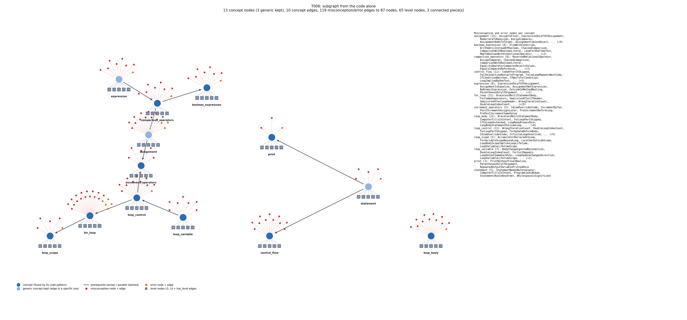

**Concept nodes (13)**: `assignment` (generic), `boolean_expression`, `comparison_operators`, `control_flow`, `expression` (generic), `for_loop`, `increment_operators`, `loop_body`, `loop_control`, `loop_scope`, `loop_variable`, `print`, `statement` (generic)


**Concept edges traced (10)**

| edge | logic |
|---|---|
| `par:assignment~comparison_operators` | x = y stores the value of y in x (a statement with a side effect); x == y only tests whether the two values are equal and gives a boolean. Writing = where == is meant is a compile error with int operands and a silent bug with boolean operands. |
| `pre:assignment->increment_operators` | i++ is shorthand for the assignment i = i + 1. |
| `pre:comparison_operators->boolean_expression` | A comparison such as x < y produces a boolean result; comparisons together with boolean logic provide the basis for decision-making. |
| `pre:expression->comparison_operators` | Comparison operators build expressions whose value is a boolean, so one must already know what an expression is to understand a < b. |
| `pre:for_loop->loop_scope` | A variable declared in the for header exists only from its declaration to the end of the for statement's block. |
| `pre:loop_control->for_loop` | The for header is exactly the three control slots, and the body runs after the test and before the update on each pass. |
| `pre:loop_control->increment_operators` | The loop update i = i + 1 comes first; ++ (and +=) are then introduced as shorthand for that update. |
| `pre:loop_variable->loop_control` | The init, condition and update all act on the loop variable: the init sets it, the condition tests it, the update changes it. |
| `pre:statement->control_flow` | Control flow is the order in which statements run. |
| `pre:statement->print` | System.out.print(s); is itself a statement, so it runs at its own place in the sequence of statements. |

**Misconception and error nodes (87) via 119 edges**: `AccumulatorDeclaredInLoop`, `ArithmeticInsteadOfBoolean`, `AssignCompares`, `AssignToFinal`, `AssignmentAddsToTarget`, `AssignmentCopiesObject`, `AssignmentEmptiesSource`, `AssignmentExchangesValues`, `AssignmentIsEquation`, `AssignmentNotExpression`, `AssignmentOppositeDirection`, `BodyChangeIgnoredByCondition`, `BracelessMultiStatementBody`, `ChainedComparison`, `CodeAfterIfSkipped`, `ComparisonWithBooleanLiteral`, `ComputerFillsInIntent`, `DoubleLoopIndexCount`, `ElseWithCondition`, `EqualityOperatorComparesObjectsValues`, `EqualsComparesReferences`, `ExpressionOnLeftOfAssignment`, `FalseConditionRestartsProgram`, `FalseLoopRepeatsNextCode`, `ForCommaSeparators`, `ForInitRepeats`, `ForIsConditional`, `ForLoopPartSkipped`, `ForUpdateBeforeBody`, `ForVariableScopeBeyondLoop`, `ForWhileNotInterchangeable`, `IdiomOverridesCode`, `IfConditionWatched`, `IfInLoopUnchecked`, `IfWaitsForCondition`, `IncrementByTwo`, `InfiniteLoopUnnoticed`, `LessGreaterSwapped`, `LocalVarOutsideScope`, `LoopBodyAlwaysOnce`, `LoopBodyScopeImpliesLoopLifetime`, `LoopBodyStatementOutsideLoop`, `LoopCountIsStatementCount`, `LoopForOneTimeTest`, `LoopHeaderIsEquations`, `LoopImpliedByOneTest`, `LoopOutputSameEachPass`, `LoopRunsStatementsSeparately`, `LoopStepAlwaysOne`, `LoopUpdateChangesDirection`, `LoopVariableLifetimeScope`, `LoopVariableLimitsValues`, `MapToBooleanWithConditionalOperator`, `MapToBooleanWithIf`, `MissingBraces`, `NestedIfsInsteadOfLogicalOperators`, `NoAtomicExpression`, `NoShortCircuit`, `OffByOneBound`, `OutsideInMethodNesting`, `ParenthesesOnlyIfArgument`, `PostIncrementAssignsLater`, `PreIncrementBeforeLoop`, `PrePostIncrementSameValue`, `PrintWithoutFinalNewline`, `PrintedTextIsExecuted`, `ProgramEndsAfterLoop`, `ProgramLooksAhead`, `RedeclareToReassign`, `RepeatedOutputVariablePrintedOnce`, `ReturnDoesNotExitLoop`, `ReversedRelationalOperator`, `SemicolonAfterIfHeader`, `SemicolonAfterLoopHeader`, `SingleIterationInsteadOfLoop`, `StateChangeIgnoredAcrossPasses`, `StatementAfterLoopInBody`, `StatementNeedsNoTerminator`, `StatementsRunInAnyOrder`, `StringRelationalComparison`, `SwapWithoutTemp`, `TargetTyping`, `VariableKeepsOldValue`, `VariablesHoldExpressions`, `WhileStopsMidBody`, `WhitespaceIsSignificant`, `WrongIterationCount`

**Level nodes**: 65 (L0..L4 for each concept), **has_level edges**: 65, **level→misconception links**: 124, **connected pieces**: 3

Notes: concept nodes form 3 pieces (the KG has no edge between them): assignment,boolean_expression,comparison_operators,expression,for_loop,increment_operators,loop_control,loop_scope,loop_variable | control_flow,print,statement | loop_body


## T007

```java
int count = 0;
for (int i = 0; i < 4; i++) {
  if (i % 2 == 0) {
    count++;
  }
}
System.out.println(count);
```

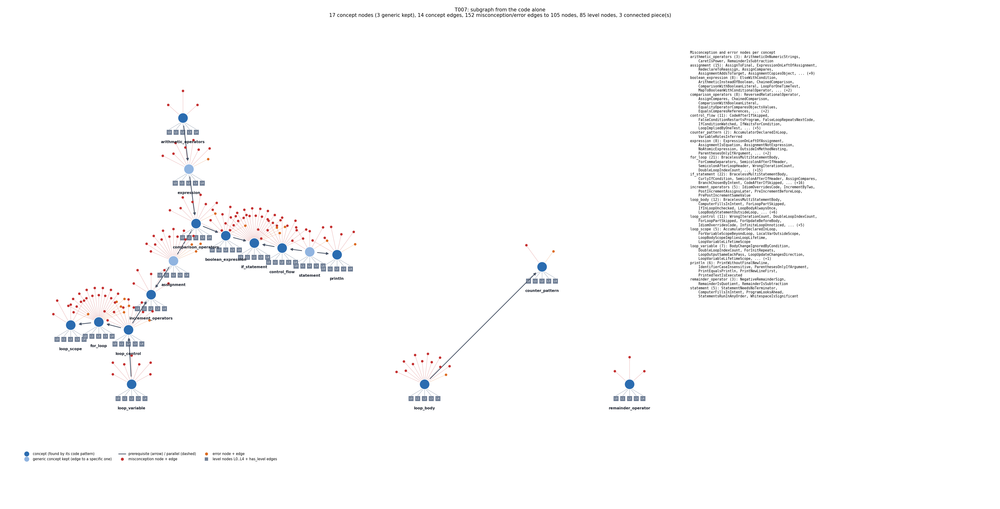

**Concept nodes (17)**: `arithmetic_operators`, `assignment` (generic), `boolean_expression`, `comparison_operators`, `control_flow`, `counter_pattern`, `expression` (generic), `for_loop`, `if_statement`, `increment_operators`, `loop_body`, `loop_control`, `loop_scope`, `loop_variable`, `println`, `remainder_operator`, `statement` (generic)


**Concept edges traced (14)**

| edge | logic |
|---|---|
| `par:assignment~comparison_operators` | x = y stores the value of y in x (a statement with a side effect); x == y only tests whether the two values are equal and gives a boolean. Writing = where == is meant is a compile error with int operands and a silent bug with boolean operands. |
| `pre:arithmetic_operators->expression` | An operator combines operand values a and b into a new value, so operators build larger expressions from smaller ones. |
| `pre:assignment->increment_operators` | i++ is shorthand for the assignment i = i + 1. |
| `pre:boolean_expression->if_statement` | An if runs its block only when its boolean expression evaluates to true. |
| `pre:comparison_operators->boolean_expression` | A comparison such as x < y produces a boolean result; comparisons together with boolean logic provide the basis for decision-making. |
| `pre:control_flow->if_statement` | An if changes the default top-to-bottom flow by running a block only when its condition is true. |
| `pre:expression->comparison_operators` | Comparison operators build expressions whose value is a boolean, so one must already know what an expression is to understand a < b. |
| `pre:for_loop->loop_scope` | A variable declared in the for header exists only from its declaration to the end of the for statement's block. |
| `pre:loop_body->counter_pattern` | count++ sits inside the body, usually under an if, so it runs once on every pass that matches. |
| `pre:loop_control->for_loop` | The for header is exactly the three control slots, and the body runs after the test and before the update on each pass. |
| `pre:loop_control->increment_operators` | The loop update i = i + 1 comes first; ++ (and +=) are then introduced as shorthand for that update. |
| `pre:loop_variable->loop_control` | The init, condition and update all act on the loop variable: the init sets it, the condition tests it, the update changes it. |
| `pre:statement->control_flow` | Control flow is the order in which statements run. |
| `pre:statement->println` | System.out.println(s); is itself a statement, so its line of output appears at its own place in the sequence. |

**Misconception and error nodes (105) via 152 edges**: `AccumulatorDeclaredInLoop`, `ArithmeticInsteadOfBoolean`, `ArithmeticOnNumericStrings`, `AssignCompares`, `AssignToFinal`, `AssignmentAddsToTarget`, `AssignmentCopiesObject`, `AssignmentEmptiesSource`, `AssignmentExchangesValues`, `AssignmentIsEquation`, `AssignmentNotExpression`, `AssignmentOppositeDirection`, `BodyChangeIgnoredByCondition`, `BracelessMultiStatementBody`, `BranchChosenByIntent`, `CaretIsPower`, `ChainedComparison`, `CodeAfterIfSkipped`, `ComparisonWithBooleanLiteral`, `ComputerFillsInIntent`, `CurlyIfCondition`, `DoubleLoopIndexCount`, `ElseWithCondition`, `EqualityOperatorComparesObjectsValues`, `EqualsComparesReferences`, `ExpressionOnLeftOfAssignment`, `FalseConditionEndsProgram`, `FalseConditionRestartsProgram`, `FalseLoopRepeatsNextCode`, `ForCommaSeparators`, `ForInitRepeats`, `ForIsConditional`, `ForLoopPartSkipped`, `ForUpdateBeforeBody`, `ForVariableScopeBeyondLoop`, `ForWhileNotInterchangeable`, `IdentifierCaseInsensitive`, `IdiomOverridesCode`, `IfConditionCheckedInHindsight`, `IfConditionWatched`, `IfInLoopUnchecked`, `IfIsLoop`, `IfRequiresElse`, `IfWaitsForCondition`, `IncrementByTwo`, `InfiniteLoopUnnoticed`, `LessGreaterSwapped`, `LocalVarOutsideScope`, `LoopBodyAlwaysOnce`, `LoopBodyScopeImpliesLoopLifetime`, `LoopBodyStatementOutsideLoop`, `LoopCountIsStatementCount`, `LoopForOneTimeTest`, `LoopHeaderIsEquations`, `LoopImpliedByOneTest`, `LoopOutputSameEachPass`, `LoopRunsStatementsSeparately`, `LoopStepAlwaysOne`, `LoopUpdateChangesDirection`, `LoopVariableLifetimeScope`, `LoopVariableLimitsValues`, `MapToBooleanWithConditionalOperator`, `MapToBooleanWithIf`, `MissingBraces`, `NegativeRemainderSign`, `NestedIfsInsteadOfLogicalOperators`, `NextStatementIsElse`, `NoAtomicExpression`, `NoShortCircuit`, `OffByOneBound`, `OutsideInMethodNesting`, `ParenthesesOnlyIfArgument`, `PostIncrementAssignsLater`, `PreIncrementBeforeLoop`, `PrePostIncrementSameValue`, `PrintEqualsPrintln`, `PrintNewLineFirst`, `PrintWithoutFinalNewline`, `PrintedTextIsExecuted`, `ProgramEndsAfterLoop`, `ProgramLooksAhead`, `RedeclareToReassign`, `RemainderIsQuotient`, `RemainderIsSubtraction`, `ReturnDoesNotExitLoop`, `ReversedRelationalOperator`, `SemicolonAfterIfHeader`, `SemicolonAfterLoopHeader`, `SequentialIfsAreNested`, `SingleIterationInsteadOfLoop`, `StateChangeIgnoredAcrossPasses`, `StatementAfterIfInBranch`, `StatementAfterLoopInBody`, `StatementNeedsNoTerminator`, `StatementsRunInAnyOrder`, `StringRelationalComparison`, `SwapWithoutTemp`, `TargetTyping`, `ThenAlwaysExecutes`, `VariableKeepsOldValue`, `VariableRolesInferred`, `VariablesHoldExpressions`, `WhileStopsMidBody`, `WhitespaceIsSignificant`, `WrongIterationCount`

**Level nodes**: 85 (L0..L4 for each concept), **has_level edges**: 85, **level→misconception links**: 155, **connected pieces**: 3

Notes: concept nodes form 3 pieces (the KG has no edge between them): arithmetic_operators,assignment,boolean_expression,comparison_operators,control_flow,expression,for_loop,if_statement,increment_operators,loop_control,loop_scope,loop_variable,println,statement | counter_pattern,loop_body | remainder_operator


## T008

```java
int x = 10;
if (x > 3) {
  System.out.println("A");
} else {
  System.out.println("B");
}
System.out.println(x / 4);
```

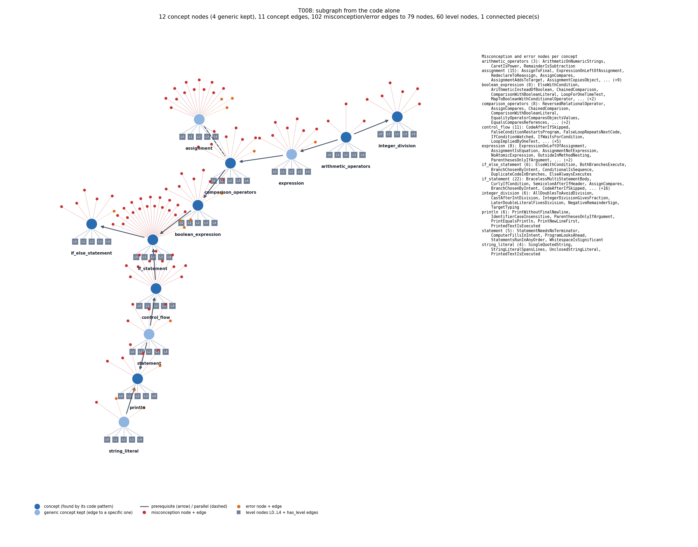

**Concept nodes (12)**: `arithmetic_operators`, `assignment` (generic), `boolean_expression`, `comparison_operators`, `control_flow`, `expression` (generic), `if_else_statement`, `if_statement`, `integer_division`, `println`, `statement` (generic), `string_literal` (generic)


**Concept edges traced (11)**

| edge | logic |
|---|---|
| `par:assignment~comparison_operators` | x = y stores the value of y in x (a statement with a side effect); x == y only tests whether the two values are equal and gives a boolean. Writing = where == is meant is a compile error with int operands and a silent bug with boolean operands. |
| `pre:arithmetic_operators->expression` | An operator combines operand values a and b into a new value, so operators build larger expressions from smaller ones. |
| `pre:arithmetic_operators->integer_division` | For ints a and b, / gives the whole quotient q and % gives the remainder r, so that a = b * q + r. |
| `pre:boolean_expression->if_statement` | An if runs its block only when its boolean expression evaluates to true. |
| `pre:comparison_operators->boolean_expression` | A comparison such as x < y produces a boolean result; comparisons together with boolean logic provide the basis for decision-making. |
| `pre:control_flow->if_statement` | An if changes the default top-to-bottom flow by running a block only when its condition is true. |
| `pre:expression->comparison_operators` | Comparison operators build expressions whose value is a boolean, so one must already know what an expression is to understand a < b. |
| `pre:if_statement->if_else_statement` | if-else extends if with a second block that runs exactly when the condition is false. |
| `pre:statement->control_flow` | Control flow is the order in which statements run. |
| `pre:statement->println` | System.out.println(s); is itself a statement, so its line of output appears at its own place in the sequence. |
| `pre:string_literal->println` | println("s") outputs exactly the characters between the quotes and then ends the line. |

**Misconception and error nodes (79) via 102 edges**: `AllDoublesToAvoidDivision`, `ArithmeticInsteadOfBoolean`, `ArithmeticOnNumericStrings`, `AssignCompares`, `AssignToFinal`, `AssignmentAddsToTarget`, `AssignmentCopiesObject`, `AssignmentEmptiesSource`, `AssignmentExchangesValues`, `AssignmentIsEquation`, `AssignmentNotExpression`, `AssignmentOppositeDirection`, `BothBranchesExecute`, `BracelessMultiStatementBody`, `BranchChosenByIntent`, `CaretIsPower`, `CastAfterIntDivision`, `ChainedComparison`, `CodeAfterIfSkipped`, `ComparisonWithBooleanLiteral`, `ComputerFillsInIntent`, `ConditionalIsSequence`, `CurlyIfCondition`, `DuplicateCodeInBranches`, `ElseAlwaysExecutes`, `ElseWithCondition`, `EqualityOperatorComparesObjectsValues`, `EqualsComparesReferences`, `ExpressionOnLeftOfAssignment`, `FalseConditionEndsProgram`, `FalseConditionRestartsProgram`, `FalseLoopRepeatsNextCode`, `IdentifierCaseInsensitive`, `IfConditionCheckedInHindsight`, `IfConditionWatched`, `IfInLoopUnchecked`, `IfIsLoop`, `IfRequiresElse`, `IfWaitsForCondition`, `IntegerDivisionGivesFraction`, `LaterDoubleLiteralFixesDivision`, `LessGreaterSwapped`, `LoopForOneTimeTest`, `LoopImpliedByOneTest`, `MapToBooleanWithConditionalOperator`, `MapToBooleanWithIf`, `MissingBraces`, `NegativeRemainderSign`, `NestedIfsInsteadOfLogicalOperators`, `NextStatementIsElse`, `NoAtomicExpression`, `NoShortCircuit`, `OutsideInMethodNesting`, `ParenthesesOnlyIfArgument`, `PrintEqualsPrintln`, `PrintNewLineFirst`, `PrintWithoutFinalNewline`, `PrintedTextIsExecuted`, `ProgramEndsAfterLoop`, `ProgramLooksAhead`, `RedeclareToReassign`, `RemainderIsSubtraction`, `ReturnDoesNotExitLoop`, `ReversedRelationalOperator`, `SemicolonAfterIfHeader`, `SequentialIfsAreNested`, `SingleQuotedString`, `StatementAfterIfInBranch`, `StatementNeedsNoTerminator`, `StatementsRunInAnyOrder`, `StringLiteralSpansLines`, `StringRelationalComparison`, `SwapWithoutTemp`, `TargetTyping`, `ThenAlwaysExecutes`, `UnclosedStringLiteral`, `VariableKeepsOldValue`, `VariablesHoldExpressions`, `WhitespaceIsSignificant`

**Level nodes**: 60 (L0..L4 for each concept), **has_level edges**: 60, **level→misconception links**: 103, **connected pieces**: 1


## T009

```java
int n = 2;
if (n < 5) {
  System.out.println(n);
  n++;
}
```

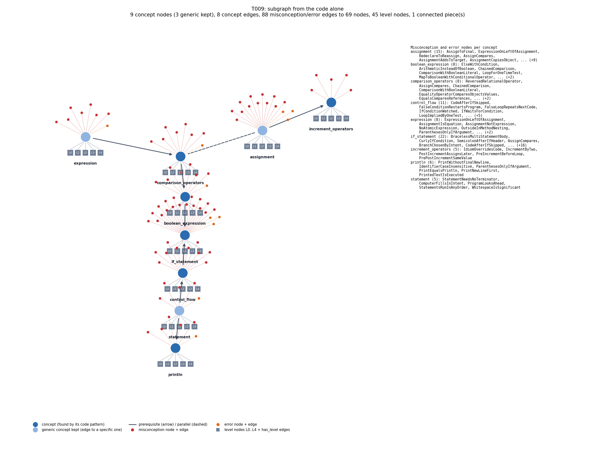

**Concept nodes (9)**: `assignment` (generic), `boolean_expression`, `comparison_operators`, `control_flow`, `expression` (generic), `if_statement`, `increment_operators`, `println`, `statement` (generic)


**Concept edges traced (8)**

| edge | logic |
|---|---|
| `par:assignment~comparison_operators` | x = y stores the value of y in x (a statement with a side effect); x == y only tests whether the two values are equal and gives a boolean. Writing = where == is meant is a compile error with int operands and a silent bug with boolean operands. |
| `pre:assignment->increment_operators` | i++ is shorthand for the assignment i = i + 1. |
| `pre:boolean_expression->if_statement` | An if runs its block only when its boolean expression evaluates to true. |
| `pre:comparison_operators->boolean_expression` | A comparison such as x < y produces a boolean result; comparisons together with boolean logic provide the basis for decision-making. |
| `pre:control_flow->if_statement` | An if changes the default top-to-bottom flow by running a block only when its condition is true. |
| `pre:expression->comparison_operators` | Comparison operators build expressions whose value is a boolean, so one must already know what an expression is to understand a < b. |
| `pre:statement->control_flow` | Control flow is the order in which statements run. |
| `pre:statement->println` | System.out.println(s); is itself a statement, so its line of output appears at its own place in the sequence. |

**Misconception and error nodes (69) via 88 edges**: `ArithmeticInsteadOfBoolean`, `AssignCompares`, `AssignToFinal`, `AssignmentAddsToTarget`, `AssignmentCopiesObject`, `AssignmentEmptiesSource`, `AssignmentExchangesValues`, `AssignmentIsEquation`, `AssignmentNotExpression`, `AssignmentOppositeDirection`, `BracelessMultiStatementBody`, `BranchChosenByIntent`, `ChainedComparison`, `CodeAfterIfSkipped`, `ComparisonWithBooleanLiteral`, `ComputerFillsInIntent`, `CurlyIfCondition`, `ElseWithCondition`, `EqualityOperatorComparesObjectsValues`, `EqualsComparesReferences`, `ExpressionOnLeftOfAssignment`, `FalseConditionEndsProgram`, `FalseConditionRestartsProgram`, `FalseLoopRepeatsNextCode`, `IdentifierCaseInsensitive`, `IdiomOverridesCode`, `IfConditionCheckedInHindsight`, `IfConditionWatched`, `IfInLoopUnchecked`, `IfIsLoop`, `IfRequiresElse`, `IfWaitsForCondition`, `IncrementByTwo`, `LessGreaterSwapped`, `LoopForOneTimeTest`, `LoopImpliedByOneTest`, `MapToBooleanWithConditionalOperator`, `MapToBooleanWithIf`, `MissingBraces`, `NestedIfsInsteadOfLogicalOperators`, `NextStatementIsElse`, `NoAtomicExpression`, `NoShortCircuit`, `OutsideInMethodNesting`, `ParenthesesOnlyIfArgument`, `PostIncrementAssignsLater`, `PreIncrementBeforeLoop`, `PrePostIncrementSameValue`, `PrintEqualsPrintln`, `PrintNewLineFirst`, `PrintWithoutFinalNewline`, `PrintedTextIsExecuted`, `ProgramEndsAfterLoop`, `ProgramLooksAhead`, `RedeclareToReassign`, `ReturnDoesNotExitLoop`, `ReversedRelationalOperator`, `SemicolonAfterIfHeader`, `SequentialIfsAreNested`, `StatementAfterIfInBranch`, `StatementNeedsNoTerminator`, `StatementsRunInAnyOrder`, `StringRelationalComparison`, `SwapWithoutTemp`, `TargetTyping`, `ThenAlwaysExecutes`, `VariableKeepsOldValue`, `VariablesHoldExpressions`, `WhitespaceIsSignificant`

**Level nodes**: 45 (L0..L4 for each concept), **has_level edges**: 45, **level→misconception links**: 91, **connected pieces**: 1


## T010

```java
int t = 30;
if (t > 25) {
  System.out.println("hot");
}
System.out.println("done");
```

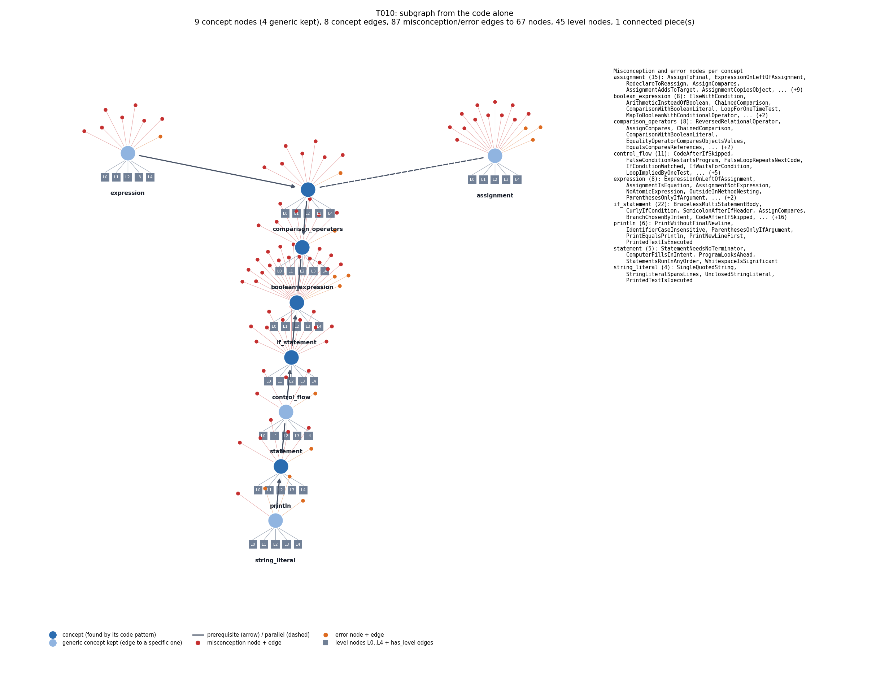

**Concept nodes (9)**: `assignment` (generic), `boolean_expression`, `comparison_operators`, `control_flow`, `expression` (generic), `if_statement`, `println`, `statement` (generic), `string_literal` (generic)


**Concept edges traced (8)**

| edge | logic |
|---|---|
| `par:assignment~comparison_operators` | x = y stores the value of y in x (a statement with a side effect); x == y only tests whether the two values are equal and gives a boolean. Writing = where == is meant is a compile error with int operands and a silent bug with boolean operands. |
| `pre:boolean_expression->if_statement` | An if runs its block only when its boolean expression evaluates to true. |
| `pre:comparison_operators->boolean_expression` | A comparison such as x < y produces a boolean result; comparisons together with boolean logic provide the basis for decision-making. |
| `pre:control_flow->if_statement` | An if changes the default top-to-bottom flow by running a block only when its condition is true. |
| `pre:expression->comparison_operators` | Comparison operators build expressions whose value is a boolean, so one must already know what an expression is to understand a < b. |
| `pre:statement->control_flow` | Control flow is the order in which statements run. |
| `pre:statement->println` | System.out.println(s); is itself a statement, so its line of output appears at its own place in the sequence. |
| `pre:string_literal->println` | println("s") outputs exactly the characters between the quotes and then ends the line. |

**Misconception and error nodes (67) via 87 edges**: `ArithmeticInsteadOfBoolean`, `AssignCompares`, `AssignToFinal`, `AssignmentAddsToTarget`, `AssignmentCopiesObject`, `AssignmentEmptiesSource`, `AssignmentExchangesValues`, `AssignmentIsEquation`, `AssignmentNotExpression`, `AssignmentOppositeDirection`, `BracelessMultiStatementBody`, `BranchChosenByIntent`, `ChainedComparison`, `CodeAfterIfSkipped`, `ComparisonWithBooleanLiteral`, `ComputerFillsInIntent`, `CurlyIfCondition`, `ElseWithCondition`, `EqualityOperatorComparesObjectsValues`, `EqualsComparesReferences`, `ExpressionOnLeftOfAssignment`, `FalseConditionEndsProgram`, `FalseConditionRestartsProgram`, `FalseLoopRepeatsNextCode`, `IdentifierCaseInsensitive`, `IfConditionCheckedInHindsight`, `IfConditionWatched`, `IfInLoopUnchecked`, `IfIsLoop`, `IfRequiresElse`, `IfWaitsForCondition`, `LessGreaterSwapped`, `LoopForOneTimeTest`, `LoopImpliedByOneTest`, `MapToBooleanWithConditionalOperator`, `MapToBooleanWithIf`, `MissingBraces`, `NestedIfsInsteadOfLogicalOperators`, `NextStatementIsElse`, `NoAtomicExpression`, `NoShortCircuit`, `OutsideInMethodNesting`, `ParenthesesOnlyIfArgument`, `PrintEqualsPrintln`, `PrintNewLineFirst`, `PrintWithoutFinalNewline`, `PrintedTextIsExecuted`, `ProgramEndsAfterLoop`, `ProgramLooksAhead`, `RedeclareToReassign`, `ReturnDoesNotExitLoop`, `ReversedRelationalOperator`, `SemicolonAfterIfHeader`, `SequentialIfsAreNested`, `SingleQuotedString`, `StatementAfterIfInBranch`, `StatementNeedsNoTerminator`, `StatementsRunInAnyOrder`, `StringLiteralSpansLines`, `StringRelationalComparison`, `SwapWithoutTemp`, `TargetTyping`, `ThenAlwaysExecutes`, `UnclosedStringLiteral`, `VariableKeepsOldValue`, `VariablesHoldExpressions`, `WhitespaceIsSignificant`

**Level nodes**: 45 (L0..L4 for each concept), **has_level edges**: 45, **level→misconception links**: 84, **connected pieces**: 1


## T011

```java
for (int i = 0; i < 6; i++) {
  System.out.print(i + " ");
  i = i + 2;
}
```

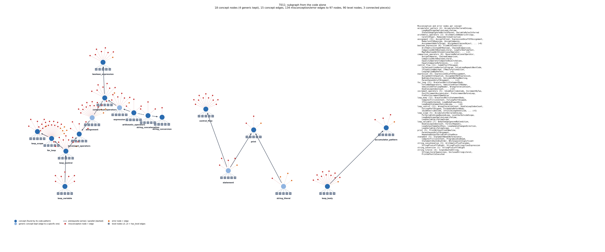

**Concept nodes (18)**: `accumulator_pattern`, `arithmetic_operators`, `assignment` (generic), `boolean_expression`, `comparison_operators`, `control_flow`, `expression` (generic), `for_loop`, `increment_operators`, `loop_body`, `loop_control`, `loop_scope`, `loop_variable`, `print`, `statement` (generic), `string_concatenation`, `string_conversion`, `string_literal` (generic)


**Concept edges traced (15)**

| edge | logic |
|---|---|
| `par:assignment~comparison_operators` | x = y stores the value of y in x (a statement with a side effect); x == y only tests whether the two values are equal and gives a boolean. Writing = where == is meant is a compile error with int operands and a silent bug with boolean operands. |
| `par:string_concatenation~arithmetic_operators` | + adds when both operands are numbers and concatenates when either operand is a String, converting the other operand to a String. It is left-associative, so 1 + 2 + "3" is "33" but "1" + 2 + 3 is "123". |
| `pre:arithmetic_operators->expression` | An operator combines operand values a and b into a new value, so operators build larger expressions from smaller ones. |
| `pre:assignment->increment_operators` | i++ is shorthand for the assignment i = i + 1. |
| `pre:comparison_operators->boolean_expression` | A comparison such as x < y produces a boolean result; comparisons together with boolean logic provide the basis for decision-making. |
| `pre:expression->comparison_operators` | Comparison operators build expressions whose value is a boolean, so one must already know what an expression is to understand a < b. |
| `pre:for_loop->loop_scope` | A variable declared in the for header exists only from its declaration to the end of the for statement's block. |
| `pre:loop_body->accumulator_pattern` | The accumulator update sum += x sits inside the body, so it runs once on every pass. |
| `pre:loop_control->for_loop` | The for header is exactly the three control slots, and the body runs after the test and before the update on each pass. |
| `pre:loop_control->increment_operators` | The loop update i = i + 1 comes first; ++ (and +=) are then introduced as shorthand for that update. |
| `pre:loop_variable->loop_control` | The init, condition and update all act on the loop variable: the init sets it, the condition tests it, the update changes it. |
| `pre:statement->control_flow` | Control flow is the order in which statements run. |
| `pre:statement->print` | System.out.print(s); is itself a statement, so it runs at its own place in the sequence of statements. |
| `pre:string_concatenation->string_conversion` | When one operand of + is a String, Java converts the other operand to a String before concatenating. |
| `pre:string_literal->print` | print("s") outputs exactly the characters between the quotes, without the quotes. |

**Misconception and error nodes (97) via 134 edges**: `AccumulatorDeclaredInLoop`, `ArithmeticInsteadOfBoolean`, `ArithmeticOnNumericStrings`, `ArithmeticPlusPrecedes`, `AssignCompares`, `AssignToFinal`, `AssignmentAddsToTarget`, `AssignmentCopiesObject`, `AssignmentEmptiesSource`, `AssignmentExchangesValues`, `AssignmentIsEquation`, `AssignmentNotExpression`, `AssignmentOppositeDirection`, `BodyChangeIgnoredByCondition`, `BracelessMultiStatementBody`, `CaretIsPower`, `ChainedComparison`, `CodeAfterIfSkipped`, `ComparisonWithBooleanLiteral`, `ComputerFillsInIntent`, `DoubleLoopIndexCount`, `ElseWithCondition`, `EqualityOperatorComparesObjectsValues`, `EqualsComparesReferences`, `ExpressionOnLeftOfAssignment`, `FalseConditionRestartsProgram`, `FalseLoopRepeatsNextCode`, `ForCommaSeparators`, `ForInitRepeats`, `ForIsConditional`, `ForLoopPartSkipped`, `ForUpdateBeforeBody`, `ForVariableScopeBeyondLoop`, `ForWhileNotInterchangeable`, `IdiomOverridesCode`, `IfConditionWatched`, `IfInLoopUnchecked`, `IfWaitsForCondition`, `IncrementByTwo`, `InfiniteLoopUnnoticed`, `LessGreaterSwapped`, `LocalVarOutsideScope`, `LoopBodyAlwaysOnce`, `LoopBodyScopeImpliesLoopLifetime`, `LoopBodyStatementOutsideLoop`, `LoopCountIsStatementCount`, `LoopForOneTimeTest`, `LoopHeaderIsEquations`, `LoopImpliedByOneTest`, `LoopOutputSameEachPass`, `LoopRunsStatementsSeparately`, `LoopStepAlwaysOne`, `LoopUpdateChangesDirection`, `LoopVariableLifetimeScope`, `LoopVariableLimitsValues`, `MapToBooleanWithConditionalOperator`, `MapToBooleanWithIf`, `MissingBraces`, `NestedIfsInsteadOfLogicalOperators`, `NoAtomicExpression`, `NoShortCircuit`, `OffByOneBound`, `OutsideInMethodNesting`, `ParenthesesOnlyIfArgument`, `PostIncrementAssignsLater`, `PreIncrementBeforeLoop`, `PrePostIncrementSameValue`, `PrintWithoutFinalNewline`, `PrintedTextIsExecuted`, `ProgramEndsAfterLoop`, `ProgramLooksAhead`, `RedeclareToReassign`, `RemainderIsSubtraction`, `RepeatedOutputVariablePrintedOnce`, `ReturnDoesNotExitLoop`, `ReversedRelationalOperator`, `SemicolonAfterIfHeader`, `SemicolonAfterLoopHeader`, `SingleIterationInsteadOfLoop`, `SingleQuotedString`, `StateChangeIgnoredAcrossPasses`, `StatementAfterLoopInBody`, `StatementNeedsNoTerminator`, `StatementsRunInAnyOrder`, `StringLiteralSpansLines`, `StringPlusLeftToRight`, `StringPlusStringifiesExpression`, `StringRelationalComparison`, `SwapWithoutTemp`, `TargetTyping`, `UnclosedStringLiteral`, `VariableKeepsOldValue`, `VariableRolesInferred`, `VariablesHoldExpressions`, `WhileStopsMidBody`, `WhitespaceIsSignificant`, `WrongIterationCount`

**Level nodes**: 90 (L0..L4 for each concept), **has_level edges**: 90, **level→misconception links**: 141, **connected pieces**: 3

Notes: concept nodes form 3 pieces (the KG has no edge between them): accumulator_pattern,loop_body | arithmetic_operators,assignment,boolean_expression,comparison_operators,expression,for_loop,increment_operators,loop_control,loop_scope,loop_variable,string_concatenation,string_conversion | control_flow,print,statement,string_literal


## T012

```java
int sum = 0;
for (int i = 1; i <= 4; i++) {
  sum = sum + i;
}
System.out.println(sum / 4);
```

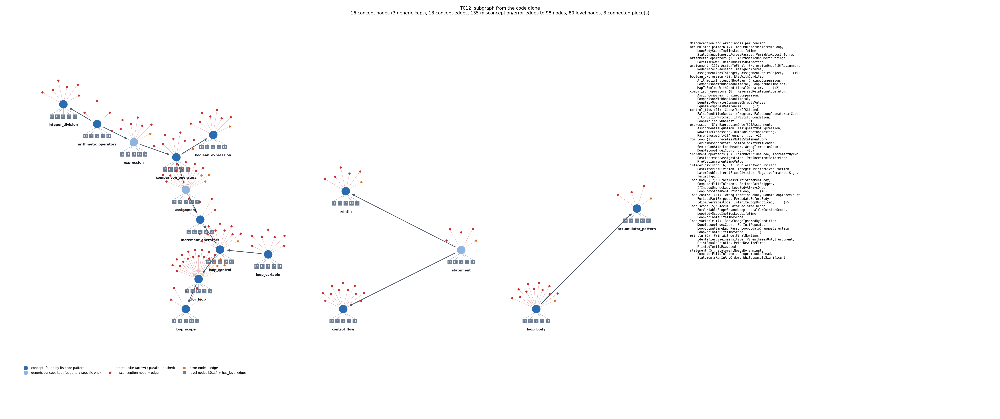

**Concept nodes (16)**: `accumulator_pattern`, `arithmetic_operators`, `assignment` (generic), `boolean_expression`, `comparison_operators`, `control_flow`, `expression` (generic), `for_loop`, `increment_operators`, `integer_division`, `loop_body`, `loop_control`, `loop_scope`, `loop_variable`, `println`, `statement` (generic)


**Concept edges traced (13)**

| edge | logic |
|---|---|
| `par:assignment~comparison_operators` | x = y stores the value of y in x (a statement with a side effect); x == y only tests whether the two values are equal and gives a boolean. Writing = where == is meant is a compile error with int operands and a silent bug with boolean operands. |
| `pre:arithmetic_operators->expression` | An operator combines operand values a and b into a new value, so operators build larger expressions from smaller ones. |
| `pre:arithmetic_operators->integer_division` | For ints a and b, / gives the whole quotient q and % gives the remainder r, so that a = b * q + r. |
| `pre:assignment->increment_operators` | i++ is shorthand for the assignment i = i + 1. |
| `pre:comparison_operators->boolean_expression` | A comparison such as x < y produces a boolean result; comparisons together with boolean logic provide the basis for decision-making. |
| `pre:expression->comparison_operators` | Comparison operators build expressions whose value is a boolean, so one must already know what an expression is to understand a < b. |
| `pre:for_loop->loop_scope` | A variable declared in the for header exists only from its declaration to the end of the for statement's block. |
| `pre:loop_body->accumulator_pattern` | The accumulator update sum += x sits inside the body, so it runs once on every pass. |
| `pre:loop_control->for_loop` | The for header is exactly the three control slots, and the body runs after the test and before the update on each pass. |
| `pre:loop_control->increment_operators` | The loop update i = i + 1 comes first; ++ (and +=) are then introduced as shorthand for that update. |
| `pre:loop_variable->loop_control` | The init, condition and update all act on the loop variable: the init sets it, the condition tests it, the update changes it. |
| `pre:statement->control_flow` | Control flow is the order in which statements run. |
| `pre:statement->println` | System.out.println(s); is itself a statement, so its line of output appears at its own place in the sequence. |

**Misconception and error nodes (98) via 135 edges**: `AccumulatorDeclaredInLoop`, `AllDoublesToAvoidDivision`, `ArithmeticInsteadOfBoolean`, `ArithmeticOnNumericStrings`, `AssignCompares`, `AssignToFinal`, `AssignmentAddsToTarget`, `AssignmentCopiesObject`, `AssignmentEmptiesSource`, `AssignmentExchangesValues`, `AssignmentIsEquation`, `AssignmentNotExpression`, `AssignmentOppositeDirection`, `BodyChangeIgnoredByCondition`, `BracelessMultiStatementBody`, `CaretIsPower`, `CastAfterIntDivision`, `ChainedComparison`, `CodeAfterIfSkipped`, `ComparisonWithBooleanLiteral`, `ComputerFillsInIntent`, `DoubleLoopIndexCount`, `ElseWithCondition`, `EqualityOperatorComparesObjectsValues`, `EqualsComparesReferences`, `ExpressionOnLeftOfAssignment`, `FalseConditionRestartsProgram`, `FalseLoopRepeatsNextCode`, `ForCommaSeparators`, `ForInitRepeats`, `ForIsConditional`, `ForLoopPartSkipped`, `ForUpdateBeforeBody`, `ForVariableScopeBeyondLoop`, `ForWhileNotInterchangeable`, `IdentifierCaseInsensitive`, `IdiomOverridesCode`, `IfConditionWatched`, `IfInLoopUnchecked`, `IfWaitsForCondition`, `IncrementByTwo`, `InfiniteLoopUnnoticed`, `IntegerDivisionGivesFraction`, `LaterDoubleLiteralFixesDivision`, `LessGreaterSwapped`, `LocalVarOutsideScope`, `LoopBodyAlwaysOnce`, `LoopBodyScopeImpliesLoopLifetime`, `LoopBodyStatementOutsideLoop`, `LoopCountIsStatementCount`, `LoopForOneTimeTest`, `LoopHeaderIsEquations`, `LoopImpliedByOneTest`, `LoopOutputSameEachPass`, `LoopRunsStatementsSeparately`, `LoopStepAlwaysOne`, `LoopUpdateChangesDirection`, `LoopVariableLifetimeScope`, `LoopVariableLimitsValues`, `MapToBooleanWithConditionalOperator`, `MapToBooleanWithIf`, `MissingBraces`, `NegativeRemainderSign`, `NestedIfsInsteadOfLogicalOperators`, `NoAtomicExpression`, `NoShortCircuit`, `OffByOneBound`, `OutsideInMethodNesting`, `ParenthesesOnlyIfArgument`, `PostIncrementAssignsLater`, `PreIncrementBeforeLoop`, `PrePostIncrementSameValue`, `PrintEqualsPrintln`, `PrintNewLineFirst`, `PrintWithoutFinalNewline`, `PrintedTextIsExecuted`, `ProgramEndsAfterLoop`, `ProgramLooksAhead`, `RedeclareToReassign`, `RemainderIsSubtraction`, `ReturnDoesNotExitLoop`, `ReversedRelationalOperator`, `SemicolonAfterIfHeader`, `SemicolonAfterLoopHeader`, `SingleIterationInsteadOfLoop`, `StateChangeIgnoredAcrossPasses`, `StatementAfterLoopInBody`, `StatementNeedsNoTerminator`, `StatementsRunInAnyOrder`, `StringRelationalComparison`, `SwapWithoutTemp`, `TargetTyping`, `VariableKeepsOldValue`, `VariableRolesInferred`, `VariablesHoldExpressions`, `WhileStopsMidBody`, `WhitespaceIsSignificant`, `WrongIterationCount`

**Level nodes**: 80 (L0..L4 for each concept), **has_level edges**: 80, **level→misconception links**: 143, **connected pieces**: 3

Notes: concept nodes form 3 pieces (the KG has no edge between them): accumulator_pattern,loop_body | arithmetic_operators,assignment,boolean_expression,comparison_operators,expression,for_loop,increment_operators,integer_division,loop_control,loop_scope,loop_variable | control_flow,println,statement


## T013

```java
int age = 15;
boolean teen = age >= 13 && age <= 19;
System.out.println(teen);
```

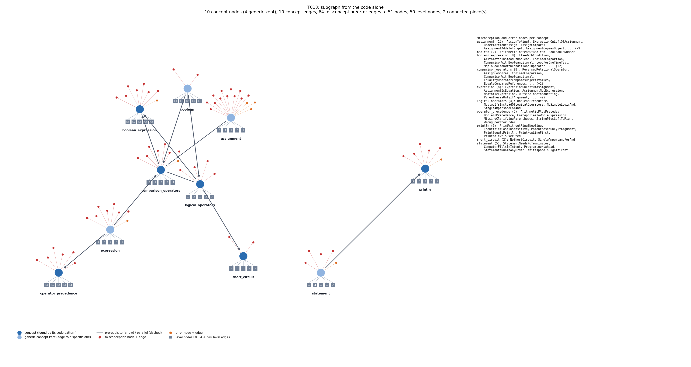

**Concept nodes (10)**: `assignment` (generic), `boolean` (generic), `boolean_expression`, `comparison_operators`, `expression` (generic), `logical_operators`, `operator_precedence`, `println`, `short_circuit`, `statement` (generic)


**Concept edges traced (10)**

| edge | logic |
|---|---|
| `par:assignment~comparison_operators` | x = y stores the value of y in x (a statement with a side effect); x == y only tests whether the two values are equal and gives a boolean. Writing = where == is meant is a compile error with int operands and a silent bug with boolean operands. |
| `par:comparison_operators~logical_operators` | Relational operators compare two numbers to give a boolean; logical operators combine booleans into one boolean. |
| `pre:boolean->comparison_operators` | A comparison such as a < b takes two numbers and produces a boolean result. |
| `pre:boolean->logical_operators` | &&, // and ! are the operations defined on the boolean type: they take booleans and give a boolean. |
| `pre:comparison_operators->boolean_expression` | A comparison such as x < y produces a boolean result; comparisons together with boolean logic provide the basis for decision-making. |
| `pre:expression->comparison_operators` | Comparison operators build expressions whose value is a boolean, so one must already know what an expression is to understand a < b. |
| `pre:expression->operator_precedence` | When an expression has several operators, precedence decides which operands are combined first, and equal-precedence operators go left to right. |
| `pre:logical_operators->boolean_expression` | &&, // and ! combine conditions p and q into one larger condition that is still true or false. |
| `pre:logical_operators->short_circuit` | && and // evaluate their second operand only when the first has not already decided the result (false && x is false, true // x is true). |
| `pre:statement->println` | System.out.println(s); is itself a statement, so its line of output appears at its own place in the sequence. |

**Misconception and error nodes (51) via 64 edges**: `ArithmeticInsteadOfBoolean`, `ArithmeticPlusPrecedes`, `AssignCompares`, `AssignToFinal`, `AssignmentAddsToTarget`, `AssignmentCopiesObject`, `AssignmentEmptiesSource`, `AssignmentExchangesValues`, `AssignmentIsEquation`, `AssignmentNotExpression`, `AssignmentOppositeDirection`, `BooleanIsNumber`, `BooleanPrecedence`, `CastAppliesToWholeExpression`, `ChainedComparison`, `ComparisonWithBooleanLiteral`, `ComputerFillsInIntent`, `ElseWithCondition`, `EqualityOperatorComparesObjectsValues`, `EqualsComparesReferences`, `ExpressionOnLeftOfAssignment`, `IdentifierCaseInsensitive`, `LessGreaterSwapped`, `LoopForOneTimeTest`, `MapToBooleanWithConditionalOperator`, `MapToBooleanWithIf`, `MissingClarifyingParentheses`, `NestedIfsInsteadOfLogicalOperators`, `NoAtomicExpression`, `NoShortCircuit`, `NoSingleLogicAnd`, `OutsideInMethodNesting`, `ParenthesesOnlyIfArgument`, `PrintEqualsPrintln`, `PrintNewLineFirst`, `PrintWithoutFinalNewline`, `PrintedTextIsExecuted`, `ProgramLooksAhead`, `RedeclareToReassign`, `ReversedRelationalOperator`, `SingleAmpersandForAnd`, `StatementNeedsNoTerminator`, `StatementsRunInAnyOrder`, `StringPlusLeftToRight`, `StringRelationalComparison`, `SwapWithoutTemp`, `TargetTyping`, `VariableKeepsOldValue`, `VariablesHoldExpressions`, `WhitespaceIsSignificant`, `WrongOperatorOrder`

**Level nodes**: 50 (L0..L4 for each concept), **has_level edges**: 50, **level→misconception links**: 73, **connected pieces**: 2

Notes: concept nodes form 2 pieces (the KG has no edge between them): assignment,boolean,boolean_expression,comparison_operators,expression,logical_operators,operator_precedence,short_circuit | println,statement


## T014

```java
int total = 0;
for (int i = 2; i <= 8; i += 2) {
  total += i;
}
System.out.println(total);
```

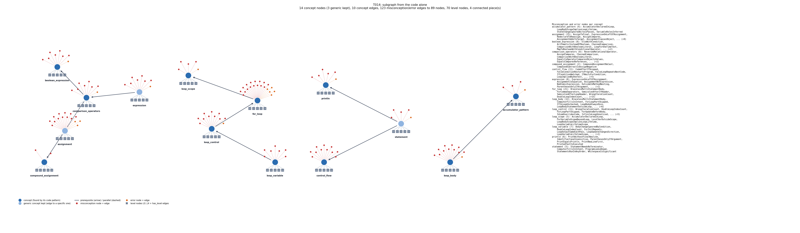

**Concept nodes (14)**: `accumulator_pattern`, `assignment` (generic), `boolean_expression`, `comparison_operators`, `compound_assignment`, `control_flow`, `expression` (generic), `for_loop`, `loop_body`, `loop_control`, `loop_scope`, `loop_variable`, `println`, `statement` (generic)


**Concept edges traced (10)**

| edge | logic |
|---|---|
| `par:assignment~comparison_operators` | x = y stores the value of y in x (a statement with a side effect); x == y only tests whether the two values are equal and gives a boolean. Writing = where == is meant is a compile error with int operands and a silent bug with boolean operands. |
| `pre:assignment->compound_assignment` | x op= e is shorthand for the assignment x = x op e. |
| `pre:comparison_operators->boolean_expression` | A comparison such as x < y produces a boolean result; comparisons together with boolean logic provide the basis for decision-making. |
| `pre:expression->comparison_operators` | Comparison operators build expressions whose value is a boolean, so one must already know what an expression is to understand a < b. |
| `pre:for_loop->loop_scope` | A variable declared in the for header exists only from its declaration to the end of the for statement's block. |
| `pre:loop_body->accumulator_pattern` | The accumulator update sum += x sits inside the body, so it runs once on every pass. |
| `pre:loop_control->for_loop` | The for header is exactly the three control slots, and the body runs after the test and before the update on each pass. |
| `pre:loop_variable->loop_control` | The init, condition and update all act on the loop variable: the init sets it, the condition tests it, the update changes it. |
| `pre:statement->control_flow` | Control flow is the order in which statements run. |
| `pre:statement->println` | System.out.println(s); is itself a statement, so its line of output appears at its own place in the sequence. |

**Misconception and error nodes (89) via 123 edges**: `AccumulatorDeclaredInLoop`, `ArithmeticInsteadOfBoolean`, `AssignCompares`, `AssignToFinal`, `AssignmentAddsToTarget`, `AssignmentCopiesObject`, `AssignmentEmptiesSource`, `AssignmentExchangesValues`, `AssignmentIsEquation`, `AssignmentNotExpression`, `AssignmentOppositeDirection`, `BodyChangeIgnoredByCondition`, `BracelessMultiStatementBody`, `ChainedComparison`, `CodeAfterIfSkipped`, `ComparisonWithBooleanLiteral`, `CompoundAssignmentNoCast`, `CompoundSubtractIsAssignNegative`, `ComputerFillsInIntent`, `DoubleLoopIndexCount`, `ElseWithCondition`, `EqualityOperatorComparesObjectsValues`, `EqualsComparesReferences`, `ExpressionOnLeftOfAssignment`, `FalseConditionRestartsProgram`, `FalseLoopRepeatsNextCode`, `ForCommaSeparators`, `ForInitRepeats`, `ForIsConditional`, `ForLoopPartSkipped`, `ForUpdateBeforeBody`, `ForVariableScopeBeyondLoop`, `ForWhileNotInterchangeable`, `IdentifierCaseInsensitive`, `IdiomOverridesCode`, `IfConditionWatched`, `IfInLoopUnchecked`, `IfWaitsForCondition`, `InfiniteLoopUnnoticed`, `LessGreaterSwapped`, `LocalVarOutsideScope`, `LoopBodyAlwaysOnce`, `LoopBodyScopeImpliesLoopLifetime`, `LoopBodyStatementOutsideLoop`, `LoopCountIsStatementCount`, `LoopForOneTimeTest`, `LoopHeaderIsEquations`, `LoopImpliedByOneTest`, `LoopOutputSameEachPass`, `LoopRunsStatementsSeparately`, `LoopStepAlwaysOne`, `LoopUpdateChangesDirection`, `LoopVariableLifetimeScope`, `LoopVariableLimitsValues`, `MapToBooleanWithConditionalOperator`, `MapToBooleanWithIf`, `MissingBraces`, `NestedIfsInsteadOfLogicalOperators`, `NoAtomicExpression`, `NoShortCircuit`, `OffByOneBound`, `OutsideInMethodNesting`, `ParenthesesOnlyIfArgument`, `PreIncrementBeforeLoop`, `PrintEqualsPrintln`, `PrintNewLineFirst`, `PrintWithoutFinalNewline`, `PrintedTextIsExecuted`, `ProgramEndsAfterLoop`, `ProgramLooksAhead`, `RedeclareToReassign`, `ReturnDoesNotExitLoop`, `ReversedRelationalOperator`, `SemicolonAfterIfHeader`, `SemicolonAfterLoopHeader`, `SingleIterationInsteadOfLoop`, `StateChangeIgnoredAcrossPasses`, `StatementAfterLoopInBody`, `StatementNeedsNoTerminator`, `StatementsRunInAnyOrder`, `StringRelationalComparison`, `SwapWithoutTemp`, `TargetTyping`, `VariableKeepsOldValue`, `VariableRolesInferred`, `VariablesHoldExpressions`, `WhileStopsMidBody`, `WhitespaceIsSignificant`, `WrongIterationCount`

**Level nodes**: 70 (L0..L4 for each concept), **has_level edges**: 70, **level→misconception links**: 128, **connected pieces**: 4

Notes: concept nodes form 4 pieces (the KG has no edge between them): accumulator_pattern,loop_body | assignment,boolean_expression,comparison_operators,compound_assignment,expression | control_flow,println,statement | for_loop,loop_control,loop_scope,loop_variable


## T015

```java
int a = 3;
int b = 9;
a = b;
System.out.println(a + " " + b);
System.out.println(a == b);
```

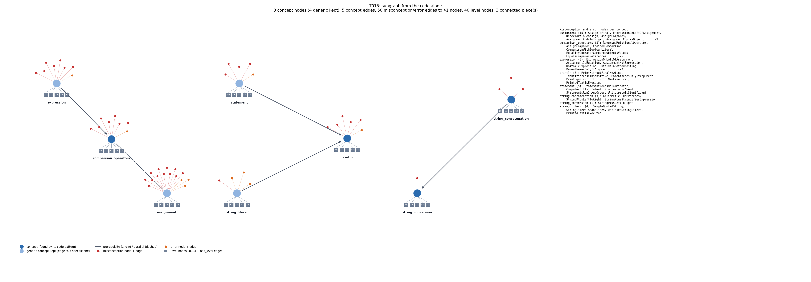

**Concept nodes (8)**: `assignment` (generic), `comparison_operators`, `expression` (generic), `println`, `statement` (generic), `string_concatenation`, `string_conversion`, `string_literal` (generic)


**Concept edges traced (5)**

| edge | logic |
|---|---|
| `par:assignment~comparison_operators` | x = y stores the value of y in x (a statement with a side effect); x == y only tests whether the two values are equal and gives a boolean. Writing = where == is meant is a compile error with int operands and a silent bug with boolean operands. |
| `pre:expression->comparison_operators` | Comparison operators build expressions whose value is a boolean, so one must already know what an expression is to understand a < b. |
| `pre:statement->println` | System.out.println(s); is itself a statement, so its line of output appears at its own place in the sequence. |
| `pre:string_concatenation->string_conversion` | When one operand of + is a String, Java converts the other operand to a String before concatenating. |
| `pre:string_literal->println` | println("s") outputs exactly the characters between the quotes and then ends the line. |

**Misconception and error nodes (41) via 50 edges**: `ArithmeticPlusPrecedes`, `AssignCompares`, `AssignToFinal`, `AssignmentAddsToTarget`, `AssignmentCopiesObject`, `AssignmentEmptiesSource`, `AssignmentExchangesValues`, `AssignmentIsEquation`, `AssignmentNotExpression`, `AssignmentOppositeDirection`, `ChainedComparison`, `ComparisonWithBooleanLiteral`, `ComputerFillsInIntent`, `EqualityOperatorComparesObjectsValues`, `EqualsComparesReferences`, `ExpressionOnLeftOfAssignment`, `IdentifierCaseInsensitive`, `LessGreaterSwapped`, `NoAtomicExpression`, `OutsideInMethodNesting`, `ParenthesesOnlyIfArgument`, `PrintEqualsPrintln`, `PrintNewLineFirst`, `PrintWithoutFinalNewline`, `PrintedTextIsExecuted`, `ProgramLooksAhead`, `RedeclareToReassign`, `ReversedRelationalOperator`, `SingleQuotedString`, `StatementNeedsNoTerminator`, `StatementsRunInAnyOrder`, `StringLiteralSpansLines`, `StringPlusLeftToRight`, `StringPlusStringifiesExpression`, `StringRelationalComparison`, `SwapWithoutTemp`, `TargetTyping`, `UnclosedStringLiteral`, `VariableKeepsOldValue`, `VariablesHoldExpressions`, `WhitespaceIsSignificant`

**Level nodes**: 40 (L0..L4 for each concept), **has_level edges**: 40, **level→misconception links**: 51, **connected pieces**: 3

Notes: concept nodes form 3 pieces (the KG has no edge between them): assignment,comparison_operators,expression | println,statement,string_literal | string_concatenation,string_conversion


## T016

```java
System.out.print("Hi ");
System.out.print("there");
System.out.println("!");
System.out.println("Bye");
```

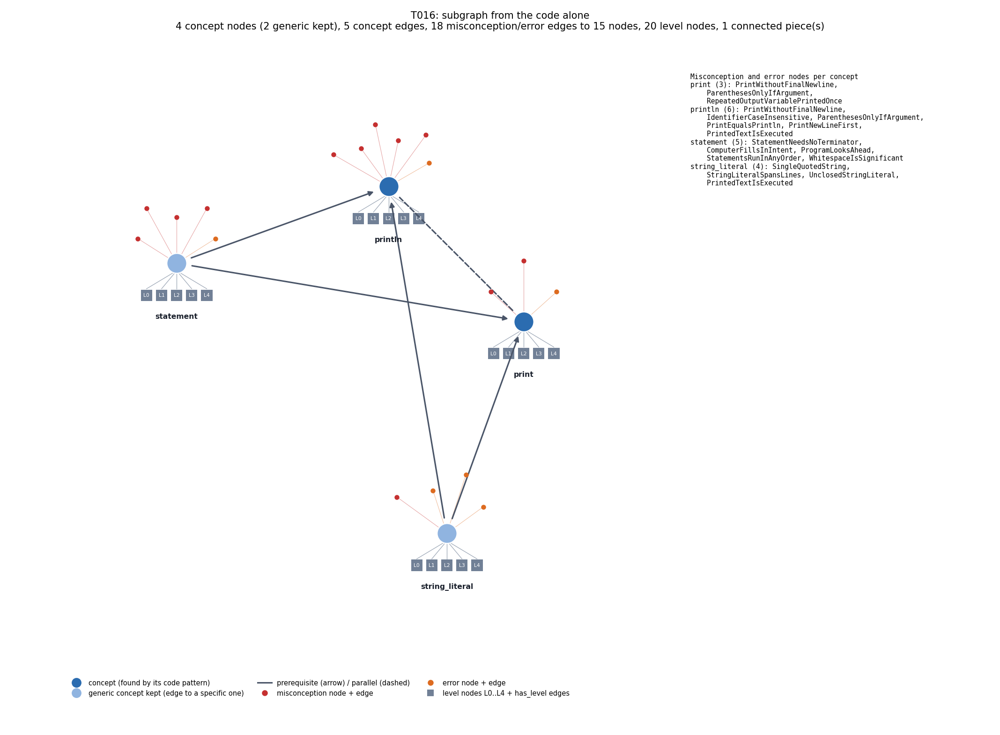

**Concept nodes (4)**: `print`, `println`, `statement` (generic), `string_literal` (generic)


**Concept edges traced (5)**

| edge | logic |
|---|---|
| `par:print~println` | print leaves the cursor on the same line after printing; println moves the cursor to the next line after printing. |
| `pre:statement->print` | System.out.print(s); is itself a statement, so it runs at its own place in the sequence of statements. |
| `pre:statement->println` | System.out.println(s); is itself a statement, so its line of output appears at its own place in the sequence. |
| `pre:string_literal->print` | print("s") outputs exactly the characters between the quotes, without the quotes. |
| `pre:string_literal->println` | println("s") outputs exactly the characters between the quotes and then ends the line. |

**Misconception and error nodes (15) via 18 edges**: `ComputerFillsInIntent`, `IdentifierCaseInsensitive`, `ParenthesesOnlyIfArgument`, `PrintEqualsPrintln`, `PrintNewLineFirst`, `PrintWithoutFinalNewline`, `PrintedTextIsExecuted`, `ProgramLooksAhead`, `RepeatedOutputVariablePrintedOnce`, `SingleQuotedString`, `StatementNeedsNoTerminator`, `StatementsRunInAnyOrder`, `StringLiteralSpansLines`, `UnclosedStringLiteral`, `WhitespaceIsSignificant`

**Level nodes**: 20 (L0..L4 for each concept), **has_level edges**: 20, **level→misconception links**: 16, **connected pieces**: 1


## T017

```java
int a = 13;
System.out.println(a % 5);
```

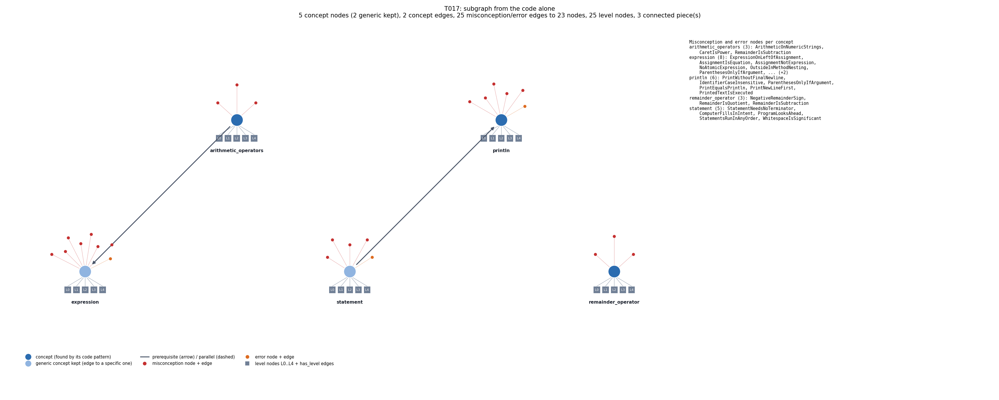

**Concept nodes (5)**: `arithmetic_operators`, `expression` (generic), `println`, `remainder_operator`, `statement` (generic)


**Concept edges traced (2)**

| edge | logic |
|---|---|
| `pre:arithmetic_operators->expression` | An operator combines operand values a and b into a new value, so operators build larger expressions from smaller ones. |
| `pre:statement->println` | System.out.println(s); is itself a statement, so its line of output appears at its own place in the sequence. |

**Misconception and error nodes (23) via 25 edges**: `ArithmeticOnNumericStrings`, `AssignmentIsEquation`, `AssignmentNotExpression`, `CaretIsPower`, `ComputerFillsInIntent`, `ExpressionOnLeftOfAssignment`, `IdentifierCaseInsensitive`, `NegativeRemainderSign`, `NoAtomicExpression`, `OutsideInMethodNesting`, `ParenthesesOnlyIfArgument`, `PrintEqualsPrintln`, `PrintNewLineFirst`, `PrintWithoutFinalNewline`, `PrintedTextIsExecuted`, `ProgramLooksAhead`, `RemainderIsQuotient`, `RemainderIsSubtraction`, `StatementNeedsNoTerminator`, `StatementsRunInAnyOrder`, `TargetTyping`, `VariablesHoldExpressions`, `WhitespaceIsSignificant`

**Level nodes**: 25 (L0..L4 for each concept), **has_level edges**: 25, **level→misconception links**: 29, **connected pieces**: 3

Notes: concept nodes form 3 pieces (the KG has no edge between them): arithmetic_operators,expression | println,statement | remainder_operator


## T018

```java
int count = 3;
while (count > 0) {
  System.out.println(count);
  count--;
}
System.out.println("Go!");
```

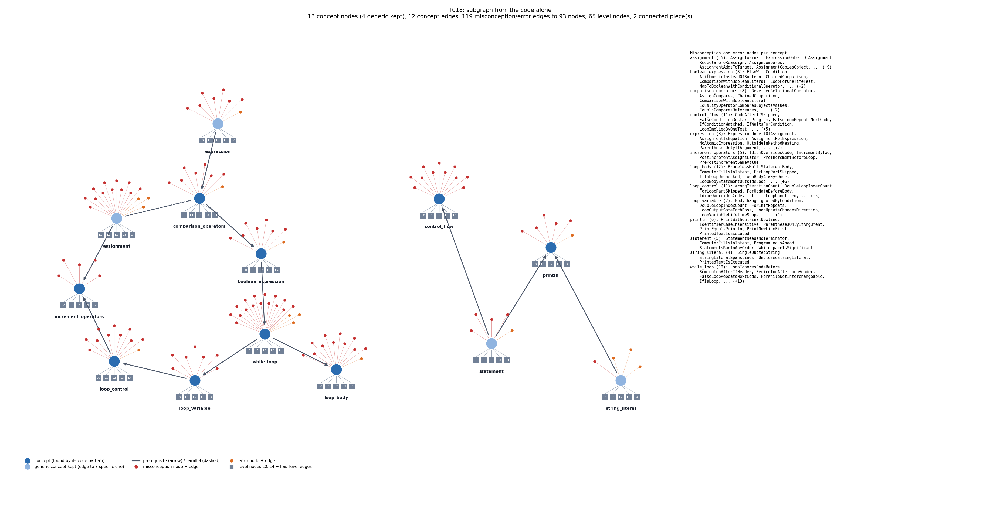

**Concept nodes (13)**: `assignment` (generic), `boolean_expression`, `comparison_operators`, `control_flow`, `expression` (generic), `increment_operators`, `loop_body`, `loop_control`, `loop_variable`, `println`, `statement` (generic), `string_literal` (generic), `while_loop`


**Concept edges traced (12)**

| edge | logic |
|---|---|
| `par:assignment~comparison_operators` | x = y stores the value of y in x (a statement with a side effect); x == y only tests whether the two values are equal and gives a boolean. Writing = where == is meant is a compile error with int operands and a silent bug with boolean operands. |
| `pre:assignment->increment_operators` | i++ is shorthand for the assignment i = i + 1. |
| `pre:boolean_expression->while_loop` | A while tests its boolean condition before every pass and stops the first time it evaluates to false. |
| `pre:comparison_operators->boolean_expression` | A comparison such as x < y produces a boolean result; comparisons together with boolean logic provide the basis for decision-making. |
| `pre:expression->comparison_operators` | Comparison operators build expressions whose value is a boolean, so one must already know what an expression is to understand a < b. |
| `pre:loop_control->increment_operators` | The loop update i = i + 1 comes first; ++ (and +=) are then introduced as shorthand for that update. |
| `pre:loop_variable->loop_control` | The init, condition and update all act on the loop variable: the init sets it, the condition tests it, the update changes it. |
| `pre:statement->control_flow` | Control flow is the order in which statements run. |
| `pre:statement->println` | System.out.println(s); is itself a statement, so its line of output appears at its own place in the sequence. |
| `pre:string_literal->println` | println("s") outputs exactly the characters between the quotes and then ends the line. |
| `pre:while_loop->loop_body` | The loop body is the block of statements that a while (or for) loop repeats on each pass. |
| `pre:while_loop->loop_variable` | A loop variable is a counter that the loop initializes, tests in its condition and increments on each pass. |

**Misconception and error nodes (93) via 119 edges**: `ArithmeticInsteadOfBoolean`, `AssignCompares`, `AssignToFinal`, `AssignmentAddsToTarget`, `AssignmentCopiesObject`, `AssignmentEmptiesSource`, `AssignmentExchangesValues`, `AssignmentIsEquation`, `AssignmentNotExpression`, `AssignmentOppositeDirection`, `BodyChangeIgnoredByCondition`, `BracelessMultiStatementBody`, `ChainedComparison`, `CodeAfterIfSkipped`, `ComparisonWithBooleanLiteral`, `ComputerFillsInIntent`, `DoubleLoopIndexCount`, `ElseWithCondition`, `EqualityOperatorComparesObjectsValues`, `EqualsComparesReferences`, `ExpressionOnLeftOfAssignment`, `FalseConditionRestartsProgram`, `FalseLoopRepeatsNextCode`, `ForInitRepeats`, `ForLoopPartSkipped`, `ForUpdateBeforeBody`, `ForWhileNotInterchangeable`, `IdentifierCaseInsensitive`, `IdiomOverridesCode`, `IfConditionWatched`, `IfInLoopUnchecked`, `IfIsLoop`, `IfWaitsForCondition`, `IncrementByTwo`, `InfiniteLoopUnnoticed`, `JavaDetectsInfiniteLoops`, `LessGreaterSwapped`, `LoopBodyAlwaysOnce`, `LoopBodyStatementOutsideLoop`, `LoopConditionValidatedLater`, `LoopCountByIntent`, `LoopCountIsStatementCount`, `LoopForOneTimeTest`, `LoopHeaderIsEquations`, `LoopIgnoresCodeBefore`, `LoopImpliedByOneTest`, `LoopOutputSameEachPass`, `LoopRunsStatementsSeparately`, `LoopStepAlwaysOne`, `LoopTerminatingCondition`, `LoopUpdateChangesDirection`, `LoopVariableLifetimeScope`, `LoopVariableLimitsValues`, `LoopVariableNotUpdated`, `MapToBooleanWithConditionalOperator`, `MapToBooleanWithIf`, `MissingBraces`, `NestedIfsInsteadOfLogicalOperators`, `NoAtomicExpression`, `NoShortCircuit`, `OffByOneBound`, `OutsideInMethodNesting`, `ParenthesesOnlyIfArgument`, `PostIncrementAssignsLater`, `PreIncrementBeforeLoop`, `PrePostIncrementSameValue`, `PrintEqualsPrintln`, `PrintNewLineFirst`, `PrintWithoutFinalNewline`, `PrintedTextIsExecuted`, `ProgramEndsAfterLoop`, `ProgramLooksAhead`, `RedeclareToReassign`, `ReturnDoesNotExitLoop`, `ReversedRelationalOperator`, `SemicolonAfterIfHeader`, `SemicolonAfterLoopHeader`, `SingleIterationInsteadOfLoop`, `SingleQuotedString`, `StateChangeIgnoredAcrossPasses`, `StatementAfterLoopInBody`, `StatementNeedsNoTerminator`, `StatementsRunInAnyOrder`, `StringLiteralSpansLines`, `StringRelationalComparison`, `SwapWithoutTemp`, `TargetTyping`, `UnclosedStringLiteral`, `VariableKeepsOldValue`, `VariablesHoldExpressions`, `WhileStopsMidBody`, `WhitespaceIsSignificant`, `WrongIterationCount`

**Level nodes**: 65 (L0..L4 for each concept), **has_level edges**: 65, **level→misconception links**: 122, **connected pieces**: 2

Notes: concept nodes form 2 pieces (the KG has no edge between them): assignment,boolean_expression,comparison_operators,expression,increment_operators,loop_body,loop_control,loop_variable,while_loop | control_flow,println,statement,string_literal


## T019

```java
int i = 5;
int x = i++;
System.out.println(x + i);
```

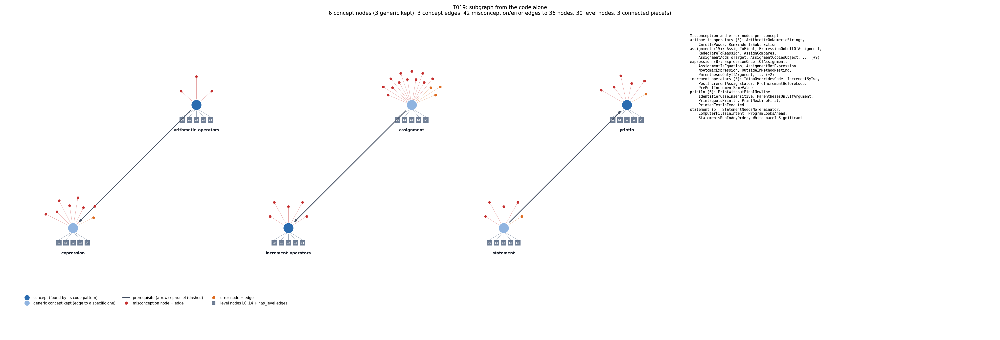

**Concept nodes (6)**: `arithmetic_operators`, `assignment` (generic), `expression` (generic), `increment_operators`, `println`, `statement` (generic)


**Concept edges traced (3)**

| edge | logic |
|---|---|
| `pre:arithmetic_operators->expression` | An operator combines operand values a and b into a new value, so operators build larger expressions from smaller ones. |
| `pre:assignment->increment_operators` | i++ is shorthand for the assignment i = i + 1. |
| `pre:statement->println` | System.out.println(s); is itself a statement, so its line of output appears at its own place in the sequence. |

**Misconception and error nodes (36) via 42 edges**: `ArithmeticOnNumericStrings`, `AssignCompares`, `AssignToFinal`, `AssignmentAddsToTarget`, `AssignmentCopiesObject`, `AssignmentEmptiesSource`, `AssignmentExchangesValues`, `AssignmentIsEquation`, `AssignmentNotExpression`, `AssignmentOppositeDirection`, `CaretIsPower`, `ComputerFillsInIntent`, `ExpressionOnLeftOfAssignment`, `IdentifierCaseInsensitive`, `IdiomOverridesCode`, `IncrementByTwo`, `NoAtomicExpression`, `OutsideInMethodNesting`, `ParenthesesOnlyIfArgument`, `PostIncrementAssignsLater`, `PreIncrementBeforeLoop`, `PrePostIncrementSameValue`, `PrintEqualsPrintln`, `PrintNewLineFirst`, `PrintWithoutFinalNewline`, `PrintedTextIsExecuted`, `ProgramLooksAhead`, `RedeclareToReassign`, `RemainderIsSubtraction`, `StatementNeedsNoTerminator`, `StatementsRunInAnyOrder`, `SwapWithoutTemp`, `TargetTyping`, `VariableKeepsOldValue`, `VariablesHoldExpressions`, `WhitespaceIsSignificant`

**Level nodes**: 30 (L0..L4 for each concept), **has_level edges**: 30, **level→misconception links**: 45, **connected pieces**: 3

Notes: concept nodes form 3 pieces (the KG has no edge between them): arithmetic_operators,expression | assignment,increment_operators | println,statement


## T020

```java
int score = 72;
if (score >= 70) {
  System.out.println("pass");
} else {
  System.out.println("fail");
}
```

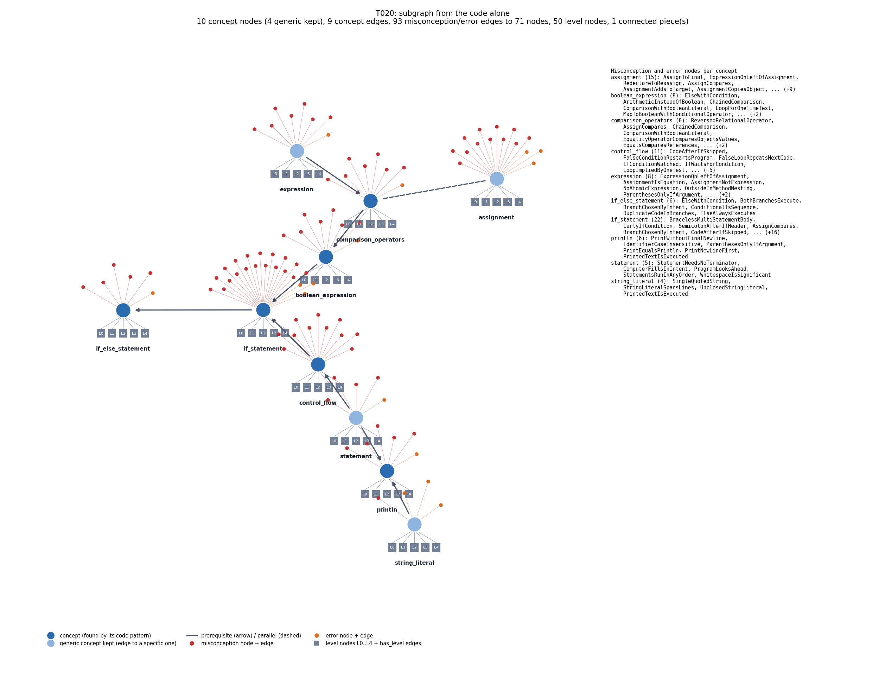

**Concept nodes (10)**: `assignment` (generic), `boolean_expression`, `comparison_operators`, `control_flow`, `expression` (generic), `if_else_statement`, `if_statement`, `println`, `statement` (generic), `string_literal` (generic)


**Concept edges traced (9)**

| edge | logic |
|---|---|
| `par:assignment~comparison_operators` | x = y stores the value of y in x (a statement with a side effect); x == y only tests whether the two values are equal and gives a boolean. Writing = where == is meant is a compile error with int operands and a silent bug with boolean operands. |
| `pre:boolean_expression->if_statement` | An if runs its block only when its boolean expression evaluates to true. |
| `pre:comparison_operators->boolean_expression` | A comparison such as x < y produces a boolean result; comparisons together with boolean logic provide the basis for decision-making. |
| `pre:control_flow->if_statement` | An if changes the default top-to-bottom flow by running a block only when its condition is true. |
| `pre:expression->comparison_operators` | Comparison operators build expressions whose value is a boolean, so one must already know what an expression is to understand a < b. |
| `pre:if_statement->if_else_statement` | if-else extends if with a second block that runs exactly when the condition is false. |
| `pre:statement->control_flow` | Control flow is the order in which statements run. |
| `pre:statement->println` | System.out.println(s); is itself a statement, so its line of output appears at its own place in the sequence. |
| `pre:string_literal->println` | println("s") outputs exactly the characters between the quotes and then ends the line. |

**Misconception and error nodes (71) via 93 edges**: `ArithmeticInsteadOfBoolean`, `AssignCompares`, `AssignToFinal`, `AssignmentAddsToTarget`, `AssignmentCopiesObject`, `AssignmentEmptiesSource`, `AssignmentExchangesValues`, `AssignmentIsEquation`, `AssignmentNotExpression`, `AssignmentOppositeDirection`, `BothBranchesExecute`, `BracelessMultiStatementBody`, `BranchChosenByIntent`, `ChainedComparison`, `CodeAfterIfSkipped`, `ComparisonWithBooleanLiteral`, `ComputerFillsInIntent`, `ConditionalIsSequence`, `CurlyIfCondition`, `DuplicateCodeInBranches`, `ElseAlwaysExecutes`, `ElseWithCondition`, `EqualityOperatorComparesObjectsValues`, `EqualsComparesReferences`, `ExpressionOnLeftOfAssignment`, `FalseConditionEndsProgram`, `FalseConditionRestartsProgram`, `FalseLoopRepeatsNextCode`, `IdentifierCaseInsensitive`, `IfConditionCheckedInHindsight`, `IfConditionWatched`, `IfInLoopUnchecked`, `IfIsLoop`, `IfRequiresElse`, `IfWaitsForCondition`, `LessGreaterSwapped`, `LoopForOneTimeTest`, `LoopImpliedByOneTest`, `MapToBooleanWithConditionalOperator`, `MapToBooleanWithIf`, `MissingBraces`, `NestedIfsInsteadOfLogicalOperators`, `NextStatementIsElse`, `NoAtomicExpression`, `NoShortCircuit`, `OutsideInMethodNesting`, `ParenthesesOnlyIfArgument`, `PrintEqualsPrintln`, `PrintNewLineFirst`, `PrintWithoutFinalNewline`, `PrintedTextIsExecuted`, `ProgramEndsAfterLoop`, `ProgramLooksAhead`, `RedeclareToReassign`, `ReturnDoesNotExitLoop`, `ReversedRelationalOperator`, `SemicolonAfterIfHeader`, `SequentialIfsAreNested`, `SingleQuotedString`, `StatementAfterIfInBranch`, `StatementNeedsNoTerminator`, `StatementsRunInAnyOrder`, `StringLiteralSpansLines`, `StringRelationalComparison`, `SwapWithoutTemp`, `TargetTyping`, `ThenAlwaysExecutes`, `UnclosedStringLiteral`, `VariableKeepsOldValue`, `VariablesHoldExpressions`, `WhitespaceIsSignificant`

**Level nodes**: 50 (L0..L4 for each concept), **has_level edges**: 50, **level→misconception links**: 91, **connected pieces**: 1
