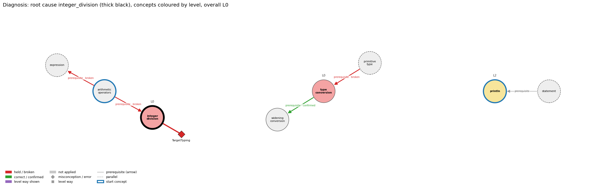

# Think on the Graph: run MY09

This page explains, stage by stage, how the algorithm reached its result for this scenario. Each stage says what it does, why, and what its terms mean, and then shows one of the outputs of that stage from this run. Every output of every stage (all edges offered, all scores and labels, the figures) is in `MY09.ipynb` and `report.html`; the interactive graph is `MY09_G.html`.

## Input

Program:
```java
int a = 6;
int b = 2;
double d = a / b;
System.out.println(d);
```
**Question.** What does this program print, and why?

**Student's answer.** It prints 3.0. Because d is a double, Java knows the result should have decimals, so it does the division a / b with decimals and gets 3.0.

**What the program really does.** Both operands are ints, so `a / b` is integer division: 6 / 2 is 3. The int 3 is then widened to 3.0 when it is stored in d. The program prints `3.0`. The type of d does not change how the division is done.

## Result

- **Wrong rules held:** TargetTyping at `integer_division`
- **Root cause:** `integer_division` / TargetTyping
- **Overall level:** L0
- **Level per concept:** `integer_division` L0, `println` L2, `type_conversion` L0

**Check of this result (read by hand, 2026-11-13).** The diagnosis matches the answer: the printed value is right, but the reason given is the wrong rule (TargetTyping).

## The idea

The method is *Think on the Graph*. A language model is not asked "what is wrong with this answer?". Instead the program walks a **knowledge graph** of Java and asks the model only small questions about one edge at a time, each of which must be tied to the student's own words. The graph has three kinds of node: **concept** nodes (for example `integer_division`), **misconception** and **error** nodes (a wrong rule a student may believe, or a rule broken in a program), and five **level** nodes for every concept (L0 to L4). Its edges are: **prerequisite** (A must be understood before B), **parallel** (A and B are learned side by side), **misconception / error** (from a concept to a wrong rule; the edge stores the wrong rule and, as its *twin*, the right rule), and **has_level** (from a concept to one of its levels; the edge stores the *ways* a student can show that level, each with an exact rule).

Two numbers control the walk: the **width N = 3** (how many options survive each choice) and the **depth D = 3** (how many rounds the walk may take). The model here is `claude-opus-5-5`; it is used in stage 3 only.

## Stage 1. From the code to a subgraph G (no model)

This stage reads only the program, never the student's answer. Its job is to decide which part of the knowledge graph this scenario is allowed to use.

**1.1 Mask the code.** The code is **masked**: the inside of every string literal and every comment is replaced by spaces of the same length. Masking matters because the next step matches patterns: the word `for` inside a printed sentence must not count as a for loop. Lengths and line numbers stay the same, so a match can still be reported by line.

*One of the outputs at this stage:* this program has no string literal or comment, so the masked code equals the original.

**1.2 Tag concepts.** Every concept node stores a *reader block*: regular expressions that describe how the concept looks in Java, in several *channels* (code patterns, signals, operator symbols, type names, and command patterns for `java` / `javac` lines). All of them are run over the masked code. Each match is a **hit**: which channel and pattern, the matched text, and the line. A concept with at least one hit is **tagged**. There is nothing learned here; the patterns in the graph are the whole "model".

*One of the outputs at this stage:* `integer_division` is tagged: its signal `int_vars_two_decls_div` matches `int a = 6; int b = 2; double d = a / b` on line 1.

**1.3 Handle generic concepts.** The graph marks some concepts **generic**: they are so basic (statement, expression, assignment, a literal, `int`) that their pattern fires on almost any line of Java. If all of them were kept, every program would seem to be "about" them and the diagnosis would drift to vague places. So a tagged generic concept is kept only when the code ties it to something specific: the graph has a prerequisite or parallel edge between it and a non-generic tagged concept, or one of its *decisive* signals fired (a pattern that by itself shows the concept is the point of the code). A kept generic concept stays marked generic: the walk can reach it and it can get a level, but it cannot be a starting point by itself, and a wrong-rule label on it is treated as a shadow of a more specific one (stage 4).

*One of the outputs at this stage:* 8 concepts are tagged and kept, 3 of them generic (`expression`, `primitive_type`, `statement`).

**1.4 Cut out the subgraph G.** G consists of the kept concepts, the graph's prerequisite and parallel edges whose two ends are both kept, every misconception and error edge of those concepts, and their level nodes with all their ways. From here on the algorithm sees only G, so it can only name wrong rules that belong to concepts the code really contains. The concepts of G fall into **pieces** (groups joined by edges); the graph has no edge between two pieces, so the walk never crosses from one to another.

*One of the outputs at this stage:* G has 5 concept edges, 35 misconception / error edges and 40 level edges, in 3 pieces (sizes 3, 3, 2).

## Stage 2. Clauses and start concepts (no model)

**2.1 Split the answer into clauses.** A **clause** is one statement the student makes. The answer is cut at sentence ends, at ';', and before 'because' and 'so' (a reason and its conclusion are separate claims); a remark in parentheses becomes its own clause. The clauses are numbered c1, c2, … This numbering is what keeps the model honest later: every label it gives must name the clause numbers it rests on, so each finding points at words the student actually wrote.

*One of the outputs at this stage:* 3 clauses. c1: “It prints 3.0” c2: “Because d is a double, Java knows the result should have decimals” …

**2.2 Choose the start concepts.** The walk has to begin somewhere; these are the **start concepts** (in Think on the Graph, the *topic entities*). The candidates are the non-generic concepts of G, plus a generic one when the answer itself repeats the code text that tagged it (for example the student writes `=`). If there are more than N, they are ranked by **BM25**, the standard search-engine score: it compares the words of the answer with the words of a concept's text (its name and the texts of its edges), counting shared words, giving rare words more weight and long texts less. The top N = 3 are the start concepts. No model is used, so the same answer always starts at the same place.

*One of the outputs at this stage:* `integer_division` scores 21.26, the highest of 6 candidates; `expression` is 4th with 6.67 and is left out. Start concepts: `integer_division`, `println`, `arithmetic_operators`.

## Stage 3. The traversal: walking G (the model is asked here)

The walk is a **beam search**. "Beam" means that at every choice only the best N = 3 options are followed, so the work stays small even when a concept has dozens of edges. It proceeds in rounds called **depths**, at most D = 3 of them plus one closing round. Throughout, the algorithm keeps four things: the **current concepts** (where it is now), the **paths** (the edges it has kept), the **evidence** (every edge that received a label, kept or not), and the set of edges it has already offered, so nothing is judged twice.

At each depth, for each current concept, the following happens.

**3.1 Edge search (no model).** The edges of the concept are collected as **candidates**. A concept that has just been entered is read *inwards*: its misconception and error edges (the wrong rules a student could hold about it) and its **level ways** (each way of each level is treated as an edge of its own, whose text is the way's exact rule). These are two separate *families*. A concept that has already been read inwards is read *outwards*: its prerequisite and parallel edges to other concepts in the same piece. So depth 1 asks "what does the answer show about these concepts?" and the later depths ask "which neighbouring concepts does that involve?".

*One of the outputs at this stage:* at `integer_division`, 6 misconception / error edges and 16 level ways are offered when it is entered, and 1 concept edges when it is read outwards.

**3.2 Prune (model, first question).** There are usually far more candidates than can be judged carefully, so they are first **pruned**. The model sees the program, the question, the answer and the text of each candidate edge of one family, and returns at most N of them with a relevance score. The scores are rescaled so they add up to 1: this is the **prune score**, the share of relevance the model gives to that edge. Each family is pruned separately, so a level way never pushes out a misconception or the other way round. Edge ids the model invents are ignored.

*One of the outputs at this stage:* at `integer_division` the misconception family is pruned to: TargetTyping 0.70, IntegerDivisionGivesFraction 0.20, CastAfterIntDivision 0.10.

**3.3 Label (model, second question).** Each edge that survived is now read against the numbered clauses and gets a **label**. For a misconception or error edge: **held** (the student's words state this wrong rule), **correct** (they state the right rule, its twin) or **not applied** (the answer says nothing about it). For a level way: **shown** or not applied. For a way above L2 the question also gives where the way stops (its boundary, stored in the graph) and whether the words must be correct, and the model may answer **wrong** (the student does this kind of thing, but what is said contradicts Java); a wrong way is not shown. For a prerequisite or parallel edge: **confirmed** (the answer carries the rule from one concept into the other) or **broken** (it fails to). The misconception edges of one concept are judged together in a single question, because the same sentence can fit several wrong rules and the model should give *held* only to the one the student really claims. With the label the model must return the **clause numbers** it rests on and a **confidence** from 0 to 1. A label with no clause is discarded. This is the safeguard of the method: the model never diagnoses from its own knowledge; every label is attached to one edge of G and to the student's words.

*One of the outputs at this stage:* TargetTyping at `integer_division` is labelled **held** on clauses 2, 3 (“Because d is a double, Java knows the result should have decimals; so it does the divisio…”) with confidence 0.92. The rule on that edge: “The type of a numerical expression depends on the type expected by the surrounding context, so double d = a / b; keeps the fraction.”

**3.4 Score and keep.** The **score** of a labelled edge is prune score × confidence: an edge counts for much only if it was both relevant and confidently labelled. The edges are then ranked in **tiers**. Tier 0 is a held misconception or a broken edge: these are findings about a fault and are always kept. Tier 1 is a held error. Tier 2 is everything that only confirms understanding (correct, confirmed, shown); these fill whatever is left of the N = 3 places, best score first. Kept edges are added to the paths. Every edge with a label other than *not applied*, kept or not, is added to the evidence, because the levels in stage 6 are read from all of it.

*One of the outputs at this stage:* the score of TargetTyping is 0.70 × 0.92 = 0.64. At depth 1 the kept edges are: TargetTyping (held, tier 0, 0.64); L0 way “inconsistent trace” (shown, tier 2, 0.48); L2 way “output prediction” (shown, tier 2, 0.30).

**3.5 Move to the next concepts.** Three things decide where the walk goes next. A kept prerequisite or parallel edge leads to the concept at its other end; that concept is **entered** and will be read inwards at the next depth, so it gets misconceptions and a level of its own. A concept with a held misconception stays current, so that its prerequisites are examined: the fault may begin further back. And any entered concept whose outward edges have not been read yet stays current until they are.

*One of the outputs at this stage:* `uncovered clauses bring in: expression (0.29), type_conversion (0.29), widening_conversion (0.28)`.

**3.6 Stop test (no model).** After each depth two checks are made. The **graph check**: has every entered concept had both its inward and its outward edges read? The **clause coverage** check: is every clause covered by at least one labelled rule edge (a level way does not count here, since it describes how the student reads the code, not which rule a clause applies)? If both hold, the walk stops as *sufficient*. If some clauses are still uncovered, they are matched by BM25 against the concepts not visited yet and the best N are entered. Otherwise the walk continues to depth D = 3, followed by one **closing round** in which the concepts entered last have their inward edges read, so that no concept is left half-read. The model's replies are cached by the exact text of the question, so running the same scenario again gives the same result without asking again.

*One of the outputs at this stage:* the walk stopped at depth 4 because no concept was left to go to. At the end 2 of 3 clauses were covered. The model was asked 18 prune questions and 32 label questions in all.

## Stage 4. From labels to faults (rules, no model)

The walk leaves a set of labelled edges. Each kept edge labelled *held* is a candidate **fault**, but one wrong sentence usually lights up several edges, so fixed rules remove the double counting. Nothing is deleted from the record; the rules only decide what counts as a fault. They run in the order below. Two labels rest on the **same words** when they name at least one clause in common; this is known exactly, because in 3.3 every label came with its clause numbers.

**4.1 Collect the candidates.** From the paths (the edges kept in 3.4) take every edge labelled *held* and every edge labelled *broken*. These are the candidates.

*One of the outputs at this stage:* 3 kept edges labelled held: TargetTyping at `integer_division`, TargetTyping at `expression`, TargetTyping at `type_conversion`; 3 labelled broken: arithmetic_operators → integer_division, arithmetic_operators → expression, primitive_type → type_conversion.

**4.2 An error beside a misconception.** A misconception is a wrong belief; an error node is the visible result of a belief in a program. If a concept has a held misconception and also a held error, the error is moved to the evidence list and is not counted. A held error on a concept with no held misconception stays a candidate.

*One of the outputs at this stage:* no concept has both, so nothing is moved.

**4.3 Two wrong rules on one concept.** The candidates are sorted by score, best first. If two misconceptions are held on the same concept and rest on the same words, both stay (a student can hold several), and the weaker one is marked as sharing its evidence with the stronger one.

*One of the outputs at this stage:* no two held misconceptions on one concept rest on the same words.

**4.4 One fault, one place.** The graph can attach the same misconception to more than one concept, and gives each attachment a **role**: *primary* (the concept whose rule the misconception violates) or *context* (a concept where it also shows up). If the same misconception is held at two concepts: when exactly one of them is primary, the candidate at the other concept is dropped; otherwise, when one concept is a prerequisite of the other, the candidate at the prerequisite is dropped, so the fault is filed at the concept that depends on it.

*One of the outputs at this stage:* TargetTyping at `expression` is dropped and stays at `integer_division` (the graph marks that concept as primary for it); TargetTyping at `type_conversion` is dropped and stays at `integer_division` (the graph marks that concept as primary for it).

**4.5 Shadows.** One wrong sentence is often labelled twice: once at the concept it is really about, and once more at a broader concept nearby. The second label is a **shadow**: a second reading of the same words, not a second fault. Without this step the broader label would count as a fault of its own and, because it sits further back in the graph, stage 5 would take it as the root cause.

A held misconception X is a shadow of another held misconception Y when both conditions hold:

1. **X has no words of its own.** Every clause that X points at, Y points at too.
2. **X sits in a broader place than Y.** One of these is true:
   - (a) *the same misconception in the wrong place:* X and Y are the same misconception, Y is at the concept the graph marks as primary for it, and X is not;
   - (b) *a general concept:* X is on a generic concept, one that nearly every program has (such as `expression` or `statement`), and Y is on a specific one;
   - (c) *a prerequisite:* the concept of X is something the concept of Y is built on (a prerequisite of it, directly or several steps back), and the model was not more confident about X than about Y.

The labels are tested in a fixed order: those on generic concepts first, then those not at their primary concept, then from low to high confidence. A label found to be a shadow is taken out before the next one is tested. So the specific, confident label is the one that stays. Every held misconception of stage 3 is tested, also one that 3.4 did not keep or 4.4 dropped.

A shadow stays in the output, in the list `shadowed`. It is not a fault, cannot be the root cause and does not set its concept to L0.

*One of the outputs at this stage:*

- TargetTyping at `expression` (clauses 2, 3) is a shadow of TargetTyping at `integer_division` (clauses 2, 3) by (a): the same misconception, and `integer_division` is its primary concept (already dropped in 4.4)
- TargetTyping at `type_conversion` (clauses 2, 3) is a shadow of TargetTyping at `integer_division` (clauses 2, 3) by (a): the same misconception, and `integer_division` is its primary concept (already dropped in 4.4)

**4.6 Broken edges.** A broken prerequisite edge A → B says the student did not carry the rule of A into B. If it rests on the same words as a held misconception, it is that misconception's **consequence** and is not counted. Otherwise it is counted as a fault at B, the concept that failed to use its prerequisite (for a broken parallel edge, which has no direction, at the concept from which the walk read it).

*One of the outputs at this stage:* arithmetic_operators → integer_division is a consequence of TargetTyping; arithmetic_operators → expression is a consequence of TargetTyping; primitive_type → type_conversion is a consequence of TargetTyping.

**Result of stage 4 in this run:** one fault is counted.

- **TargetTyping** at `integer_division`. The student's words: “Because d is a double, Java knows the result should have decimals; so it does the division a / b with decimals and gets 3.0”. The wrong rule in the graph: “The type of a numerical expression depends on the type expected by the surrounding context, so double d = a / b; keeps the fraction.” The right rule: “The type of a numerical expression is determined by the expression, so double d = a / b; with int a and b still divides as ints.”

## Stage 5. Root cause (rule, no model)

Several concepts may carry a fault, and the **root cause** is the one to teach first. The rule uses the prerequisite edges of G: an edge A → B says A must be understood before B, so a fault in A explains a fault in B, and the search goes backwards along these edges (from a concept to what it depends on).

**5.1 Mark the concepts with a fault.** These are the concepts with a counted held misconception or error after stage 4, and the concepts at which a broken edge was counted in 4.6.

*One of the outputs at this stage:* held: `integer_division`.

**5.2 Walk back from each one.** Starting at each concept with a held fault, visit all its prerequisites, then their prerequisites, and so on, as far as the subgraph goes. Each time a visited concept is itself marked in 5.1, it replaces the starting concept as the **candidate**. If none is marked, the starting concept is its own candidate.

*One of the outputs at this stage:* from `integer_division` the walk visits `arithmetic_operators`, none of them is marked, so the candidate is `integer_division`.

**5.3 Choose among the candidates.** The candidate with the fewest prerequisites of its own in the subgraph is the **root cause**: it stands furthest back. At a tie, the one whose held label the model gave the higher confidence is taken. If that is equal too, the candidate found first stays (the starting concepts are taken in alphabetical order); this does not happen in any of the 40 runs.

*One of the outputs at this stage:* there is one candidate, so the root cause is `integer_division` with TargetTyping.

## Stage 6. Level of each concept (rule, no model)

Every concept has five **levels**, taken from the SOLO taxonomy: **L0** prestructural (the answer holds a rule that contradicts Java, or reads the code in an everyday sense), **L1** unistructural (it states one correct rule without applying it), **L2** multistructural (it applies the rules to the code step by step), **L3** relational (it relates the parts to each other and to the purpose of the whole), **L4** extended abstract (it reasons beyond the given code: predicts a change, transfers, diagnoses). Each level has **ways**, concrete things a student does at that level, such as "output prediction" at L2 or "predict a change" at L4.

The model is never asked for a level. In stage 3 it only said whether a way was *shown*; the level is read from where that way sits in the graph, in two steps.

**6.1 Gather the evidence per concept.** Take every concept that appears in the evidence of stage 3 (kept in 3.4 or not). For each one collect two lists: the misconceptions held on it that are not shadows, and the ways shown on it. A shown way above L2 is counted only if two things hold: the model's confidence in it is above 0.60, and its clauses are not all clauses that a held misconception rests on. So a weak yes, or a wrong sentence already counted as a misconception, cannot lift a concept to L3 or L4.

*One of the outputs at this stage:* 7 concepts appear in the evidence: `arithmetic_operators`, `expression`, `integer_division`, `primitive_type`, `println`, `type_conversion`, `widening_conversion`.

**6.2 Apply the first rule that fits.**

- (a) A misconception is held on the concept: the level is **L0**. The entry names the misconception.
- (b) Ways are shown and all of them are L0 ways (everyday reading, inconsistent trace): the level is **L0**.
- (c) Ways are shown and at least one is above L0: the level is the **highest** one shown. The levels build on each other (an answer that relates the parts has also applied the rules), so a lower way shown beside it is only listed.
- (d) Nothing is held and no way is shown: the concept gets no level.

A held error node is not a misconception, so rule (a) does not apply to it.

*One of the outputs at this stage:*

| Concept | Level | Rule | Why |
|---|---|---|---|
| `arithmetic_operators` | none | (d) | nothing held, no way shown |
| `expression` | none | (d) | only a shadow is held; answered wrong: L3 “relation to neighbour” |
| `integer_division` | L0 | (a) | holds TargetTyping |
| `primitive_type` | none | (d) | nothing held, no counted way; answered wrong: L3 “relation to neighbour” |
| `println` | L2 | (c) | ways shown: L2 “output prediction” |
| `type_conversion` | L0 | (b) | ways shown: L0 “everyday reading”; answered wrong: L4 “diagnose an error” |
| `widening_conversion` | none | (d) | nothing held, no counted way; answered wrong: L4 “diagnose an error” |

## Stage 7. Overall level (rule, no model)

One level is reported for the whole answer.

**7.1 With a root cause.** The overall level is the level stage 6 gave to the root concept: the student stands where the fault begins, however well the rest is handled.

**7.2 Without a fault.** The levels of stage 6 are sorted from high to low and the one in the middle is taken: with n levels, the one at position (n − 1) ÷ 2, rounded down and counted from 0. So one weak or one strong concept does not decide for the whole answer.

*One of the outputs at this stage:* 7.1 applies: the root cause is `integer_division` and its level is L0, so the overall level is **L0**.

## The final picture


