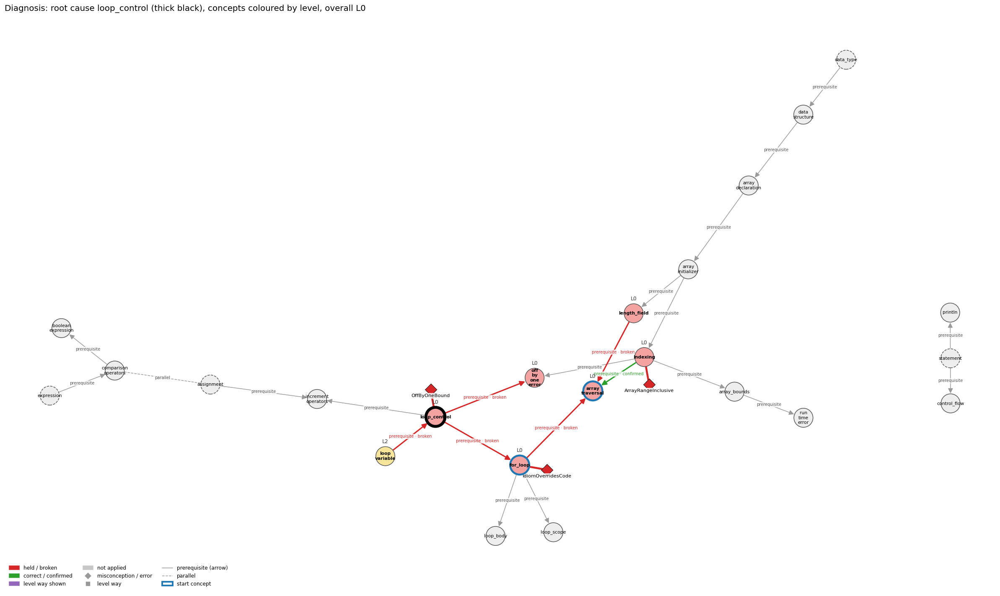

# Think on the Graph: run MY18

This page explains, stage by stage, how the algorithm reached its result for this scenario. Each stage says what it does, why, and what its terms mean, and then shows one of the outputs of that stage from this run. Every output of every stage (all edges offered, all scores and labels, the figures) is in `MY18.ipynb` and `report.html`; the interactive graph is `MY18_G.html`.

## Input

Program:
```java
int[] a = {5, 10, 15};
for (int i = 0; i <= a.length; i++) {
    System.out.println(a[i]);
}
```
**Question.** Explain which indexes the loop visits and why

**Student's answer.** i goes from 0 to a.length. Using <= or < makes no difference here, because both go through the whole array, so it visits each element once.

**What the program really does.** With `i <= a.length` the loop visits the indexes 0, 1, 2 and 3. Index 3 does not exist, so after printing 5, 10, 15 the program stops with ArrayIndexOutOfBoundsException. `<` and `<=` are not the same here.

## Result

- **Wrong rules held:** ArrayRangeInclusive at `indexing`, OffByOneBound at `loop_control`, IdiomOverridesCode at `for_loop`
- **Root cause:** `loop_control` / OffByOneBound
- **Overall level:** L0
- **Level per concept:** `array_traversal` L0, `for_loop` L0, `indexing` L0, `length_field` L0, `loop_control` L0, `loop_variable` L3, `off_by_one_error` L0

**Check of this result (read by hand, 2026-11-14).** The root cause matches the answer: OffByOneBound ("i < n and i <= n mean the same"), now filed at `loop_control`. ArrayRangeInclusive at `indexing` and IdiomOverridesCode at `for_loop` are held on the same clauses: they are the same belief seen from the array (index a.length exists) and from the loop (it covers the whole array whatever the code says), so they are weaker findings than the root.

## The idea

The method is *Think on the Graph*. A language model is not asked "what is wrong with this answer?". Instead the program walks a **knowledge graph** of Java and asks the model only small questions about one edge at a time, each of which must be tied to the student's own words. The graph has three kinds of node: **concept** nodes (for example `integer_division`), **misconception** and **error** nodes (a wrong rule a student may believe, or a rule broken in a program), and five **level** nodes for every concept (L0 to L4). Its edges are: **prerequisite** (A must be understood before B), **parallel** (A and B are learned side by side), **misconception / error** (from a concept to a wrong rule; the edge stores the wrong rule and, as its *twin*, the right rule), and **has_level** (from a concept to one of its levels; the edge stores the *ways* a student can show that level, each with an exact rule).

Two numbers control the walk: the **width N = 3** (how many options survive each choice) and the **depth D = 3** (how many rounds the walk may take). The model here is `claude-opus-5-5`; it is used in stage 3 only.

## Stage 1. From the code to a subgraph G (no model)

This stage reads only the program, never the student's answer. Its job is to decide which part of the knowledge graph this scenario is allowed to use.

**1.1 Mask the code.** The code is **masked**: the inside of every string literal and every comment is replaced by spaces of the same length. Masking matters because the next step matches patterns: the word `for` inside a printed sentence must not count as a for loop. Lengths and line numbers stay the same, so a match can still be reported by line.

*One of the outputs at this stage:* this program has no string literal or comment, so the masked code equals the original.

**1.2 Tag concepts.** Every concept node stores a *reader block*: regular expressions that describe how the concept looks in Java, in several *channels* (code patterns, signals, operator symbols, type names). All of them are run over the masked code. Each match is a **hit**: which channel and pattern, the matched text, and the line. A concept with at least one hit is **tagged**. There is nothing learned here; the patterns in the graph are the whole "model".

*One of the outputs at this stage:* `loop_control` is tagged: its signal `for_header` matches `for (int i = 0; i <= a.length; i++)` on line 2.

**1.3 Handle generic concepts.** The graph marks some concepts **generic**: they are so basic (statement, expression, assignment, a literal, `int`) that their pattern fires on almost any line of Java. If all of them were kept, every program would seem to be "about" them and the diagnosis would drift to vague places. So a tagged generic concept is kept only when the code ties it to something specific: the graph has a prerequisite or parallel edge between it and a non-generic tagged concept, or one of its *decisive* signals fired (a pattern that by itself shows the concept is the point of the code). A kept generic concept stays marked generic: the walk can reach it and it can get a level, but it cannot be a starting point by itself, and a wrong-rule label on it is treated as a shadow of a more specific one (stage 4).

*One of the outputs at this stage:* 23 concepts are tagged and kept, 4 of them generic (`assignment`, `data_type`, `expression`, `statement`).

**1.4 Cut out the subgraph G.** G consists of the kept concepts, the graph's prerequisite and parallel edges whose two ends are both kept, every misconception and error edge of those concepts, and their level nodes with all their ways. From here on the algorithm sees only G, so it can only name wrong rules that belong to concepts the code really contains. The concepts of G fall into **pieces** (groups joined by edges); the graph has no edge between two pieces, so the walk never crosses from one to another.

*One of the outputs at this stage:* G has 23 concept edges, 159 misconception / error edges and 115 level edges, in 2 pieces (sizes 20, 3).

## Stage 2. Clauses and start concepts (no model)

**2.1 Split the answer into clauses.** A **clause** is one statement the student makes. The answer is cut at sentence ends, at ';', and before 'because' and 'so' (a reason and its conclusion are separate claims); a remark in parentheses becomes its own clause. The clauses are numbered c1, c2, … This numbering is what keeps the model honest later: every label it gives must name the clause numbers it rests on, so each finding points at words the student actually wrote.

*One of the outputs at this stage:* 4 clauses. c1: “i goes from 0 to a.length” c2: “Using <= or < makes no difference here” …

**2.2 Choose the start concepts.** The walk has to begin somewhere; these are the **start concepts** (in Think on the Graph, the *topic entities*). The candidates are the non-generic concepts of G, plus a generic one when the answer itself repeats the code text that tagged it (for example the student writes `=`). If there are more than N, they are ranked by **BM25**, the standard search-engine score: it compares the words of the answer with the words of a concept's text (its name and the texts of its edges), counting shared words, giving rare words more weight and long texts less. The top N = 3 are the start concepts. No model is used, so the same answer always starts at the same place.

*One of the outputs at this stage:* `array_traversal` scores 22.33, the highest of 20 candidates; `indexing` is 4th with 14.08 and is left out. Start concepts: `array_traversal`, `loop_control`, `for_loop`.

## Stage 3. The traversal: walking G (the model is asked here)

The walk is a **beam search**. "Beam" means that at every choice only the best N = 3 options are followed, so the work stays small even when a concept has dozens of edges. It proceeds in rounds called **depths**, at most D = 3 of them plus one closing round. Throughout, the algorithm keeps four things: the **current concepts** (where it is now), the **paths** (the edges it has kept), the **evidence** (every edge that received a label, kept or not), and the set of edges it has already offered, so nothing is judged twice.

At each depth, for each current concept, the following happens.

**3.1 Edge search (no model).** The edges of the concept are collected as **candidates**. A concept that has just been entered is read *inwards*: its misconception and error edges (the wrong rules a student could hold about it) and its **level ways** (each way of each level is treated as an edge of its own, whose text is the way's exact rule). These are two separate *families*. A concept that has already been read inwards is read *outwards*: its prerequisite and parallel edges to other concepts in the same piece. So depth 1 asks "what does the answer show about these concepts?" and the later depths ask "which neighbouring concepts does that involve?".

*One of the outputs at this stage:* at `loop_control`, 11 misconception / error edges and 19 level ways are offered when it is entered, and 4 concept edges when it is read outwards.

**3.2 Prune (model, first question).** There are usually far more candidates than can be judged carefully, so they are first **pruned**. The model sees the program, the question, the answer and the text of each candidate edge of one family, and returns at most N of them with a relevance score. The scores are rescaled so they add up to 1: this is the **prune score**, the share of relevance the model gives to that edge. Each family is pruned separately, so a level way never pushes out a misconception or the other way round. Edge ids the model invents are ignored.

*One of the outputs at this stage:* at `loop_control` the misconception family is pruned to: OffByOneBound 0.60, IdiomOverridesCode 0.25, WrongIterationCount 0.15.

**3.3 Label (model, second question).** Each edge that survived is now read against the numbered clauses and gets a **label**. For a misconception or error edge: **held** (the student's words state this wrong rule), **correct** (they state the right rule, its twin) or **not applied** (the answer says nothing about it). For a level way: **shown** or not applied. For a prerequisite or parallel edge: **confirmed** (the answer carries the rule from one concept into the other) or **broken** (it fails to). The misconception edges of one concept are judged together in a single question, because the same sentence can fit several wrong rules and the model should give *held* only to the one the student really claims. With the label the model must return the **clause numbers** it rests on and a **confidence** from 0 to 1. A label with no clause is discarded. This is the safeguard of the method: the model never diagnoses from its own knowledge; every label is attached to one edge of G and to the student's words.

*One of the outputs at this stage:* OffByOneBound at `loop_control` is labelled **held** on clauses 1, 2, 3 (“i goes from 0 to a.length; Using <= or < makes no difference here; because both go throug…”) with confidence 0.92. The rule on that edge: “i < n and i <= n mean the same, so the loop runs until i equals n and the last pass can use a[n].”

**3.4 Score and keep.** The **score** of a labelled edge is prune score × confidence: an edge counts for much only if it was both relevant and confidently labelled. The edges are then ranked in **tiers**. Tier 0 is a held misconception or a broken edge: these are findings about a fault and are always kept. Tier 1 is a held error. Tier 2 is everything that only confirms understanding (correct, confirmed, shown); these fill whatever is left of the N = 3 places, best score first. Kept edges are added to the paths. Every labelled edge, kept or not, is added to the evidence, because the levels in stage 6 are read from all of it.

*One of the outputs at this stage:* the score of OffByOneBound is 0.60 × 0.92 = 0.55. At depth 1 the kept edges are: OffByOneBound (held, tier 0, 0.57); OffByOneBound (held, tier 0, 0.55); IdiomOverridesCode (held, tier 0, 0.54); IdiomOverridesCode (held, tier 0, 0.19).

**3.5 Move to the next concepts.** Three things decide where the walk goes next. A kept prerequisite or parallel edge leads to the concept at its other end; that concept is **entered** and will be read inwards at the next depth, so it gets misconceptions and a level of its own. A concept with a held misconception stays current, so that its prerequisites are examined: the fault may begin further back. And any entered concept whose outward edges have not been read yet stays current until they are.

*One of the outputs at this stage:* `reached across pre:loop_control->off_by_one_error, entered next: off_by_one_error`.

**3.6 Stop test (no model).** After each depth two checks are made. The **graph check**: has every entered concept had both its inward and its outward edges read? The **clause coverage** check: is every clause covered by at least one labelled rule edge (a level way does not count here, since it describes how the student reads the code, not which rule a clause applies)? If both hold, the walk stops as *sufficient*. If some clauses are still uncovered, they are matched by BM25 against the concepts not visited yet and the best N are entered. Otherwise the walk continues to depth D = 3, followed by one **closing round** in which the concepts entered last have their inward edges read, so that no concept is left half-read. The model's replies are cached by the exact text of the question, so running the same scenario again gives the same result without asking again.

*One of the outputs at this stage:* the walk stopped at depth 4 because the depth limit was reached. At the end 4 of 4 clauses were covered. The model was asked 20 prune questions and 40 label questions in all.

## Stage 4. Counting each mistake once (rules, no model)

**What this stage answers:** how many mistakes did the student really make, and at which concept does each one belong?

**Why it is needed.** Stage 3 checks every concept on its own. So one wrong sentence of the student is usually flagged several times: at the concept it is really about, and again at related concepts. A flag here means an edge that stage 3 labelled *held* (the student follows that wrong rule) or *broken* (the student did not carry a rule from one concept to the next). Stage 4 goes through the flags with fixed rules and decides which ones count as a **mistake**. Nothing is deleted: a flag that is not counted stays in the record, marked as a repeat.

| What stage 3 flagged | What stage 4 does with it |
|---|---|
| The same wrong rule at two linked concepts | Counts it once, at the concept the wrong rule is really about |
| A wrong rule at a more basic or more general concept, shown by the same words as a more specific one | Treats it as a repeat of the specific one (the output calls it a **shadow**) |
| A wrong belief, and beside it an error node (the visible result of that belief in a program) | Counts the belief; the error is kept as evidence for it |
| A broken link between two concepts, shown by the same words as a wrong belief | Treats it as a result of that belief (a **consequence**), not as a second mistake |
| A broken link with words of its own | Counts it as a mistake at the concept the link leads to |

**In this run.** 3 mistakes are counted:

- **ArrayRangeInclusive** at `indexing`. The student's words: “i goes from 0 to a.length; Using <= or < makes no difference here; because both go through the whole array”. The wrong rule in the graph: “new int[n] has slots 0 to n, inclusive.” The right rule: “The slots are 0 to n - 1.”
- **OffByOneBound** at `loop_control`. The student's words: “i goes from 0 to a.length; Using <= or < makes no difference here; because both go through the whole array”. The wrong rule in the graph: “i < n and i <= n mean the same, so the loop runs until i equals n and the last pass can use a[n].” The right rule: “for (i = 0; i < n; i++) runs n times with i going up to n - 1; with <= it runs n + 1 times and reaches i = n.”
- **IdiomOverridesCode** at `for_loop`. The student's words: “Using <= or < makes no difference here; because both go through the whole array; so it visits each element once”. The wrong rule in the graph: “An array loop processes the whole array from index 0 to length-1 and increments its index at the end of the body, whatever the code says.” The right rule: “The loop visits exactly the indices that its initialisation, guard and update produce, in the order in which its statements are written.”

Flagged by stage 3 but not counted a second time:

- OffByOneBound at `array_traversal` (the same wrong rule at a linked concept)
- OffByOneBound at `off_by_one_error` (the same wrong rule at a linked concept)
- IdiomOverridesCode at `loop_control` (a repeat of IdiomOverridesCode, shown by the same words)
- 5 broken links (loop_control → off_by_one_error, length_field → array_traversal, for_loop → array_traversal, loop_variable → loop_control, loop_control → for_loop), each a result of a counted mistake

## Stage 5. Where the mistake starts: the root cause (rule, no model)

**What this stage answers:** if a teacher can fix only one thing first, which concept should it be?

Concepts build on each other: the graph says which concept must be understood before another (its **prerequisite**). A mistake in a prerequisite explains mistakes in what is built on it. So the rule is:

1. Start at each concept that has a counted mistake.
2. Go back along its prerequisites. If a prerequisite also has a counted mistake, move back to it.
3. The concept furthest back is the **root cause**. If two are equally far back, the one the model was more sure about is taken.

With only one counted mistake, its concept is the root cause.

**In this run.** Concepts with a counted mistake: `for_loop` (1 prerequisite in the subgraph, model confidence 0.90); `indexing` (1 prerequisite in the subgraph, model confidence 0.90); `loop_control` (1 prerequisite in the subgraph, model confidence 0.92). The root cause is `loop_control` with OffByOneBound.

## Stage 6. How well each concept is understood: the levels (rule, no model)

**What this stage answers:** for each concept the answer touched, how deep is the student's understanding?

The scale has five levels (from the SOLO taxonomy):

| Level | In plain words |
|---|---|
| L0 | Holds a rule that contradicts Java, or reads the code in an everyday sense |
| L1 | States one correct rule, without applying it |
| L2 | Applies the rules to the code step by step |
| L3 | Relates the parts to each other and to the purpose of the whole |
| L4 | Reasons beyond the given code: predicts a change, transfers, diagnoses |

In the graph every level of a concept lists **ways**: concrete things a student at that level does, for example "output prediction" at L2. In stage 3 the model only said which ways the answer *shows*. It was never asked for a level. The level follows by rule:

1. A concept with a counted mistake (a held misconception that is not a repeat) is **L0**.
2. Otherwise the concept gets the **highest** level among the ways shown, because the levels build on each other.
3. A concept with no mistake and no way shown gets no level.

**In this run.**

| Concept | Level | Why |
|---|---|---|
| `array_traversal` | L0 | holds OffByOneBound |
| `for_loop` | L0 | holds IdiomOverridesCode |
| `indexing` | L0 | holds ArrayRangeInclusive |
| `length_field` | L0 | ways shown: L0 “inconsistent trace”, L0 “everyday reading” |
| `loop_control` | L0 | holds OffByOneBound |
| `loop_variable` | L3 | ways shown: L0 “everyday reading”, L2 “output prediction”, L3 “relation to neighbour” |
| `off_by_one_error` | L0 | holds OffByOneBound |

## Stage 7. One level for the whole answer (rule, no model)

**What this stage answers:** where does the student stand overall?

- If there is a root cause, the overall level is the level of the root concept: the student stands where the mistake begins, however well the rest is handled.
- If there is no mistake, the levels of stage 6 are sorted from high to low and the middle one is taken, so one weak or one strong concept does not decide for the whole answer.

**In this run.** The root cause is `loop_control` and its level is L0, so the overall level is **L0**.

## The final picture


