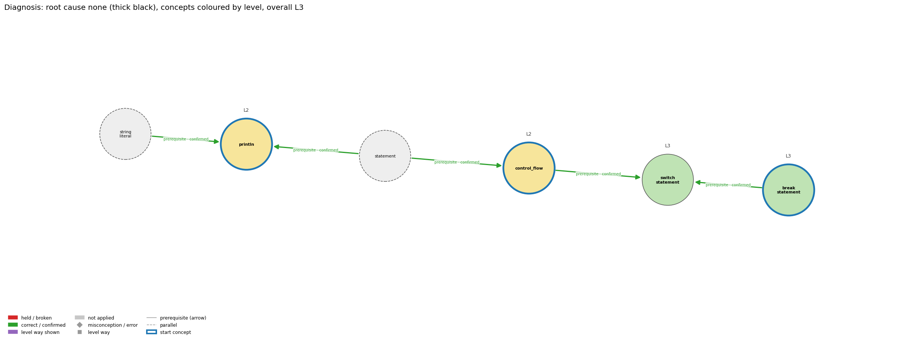

# Think on the Graph: run MY31

This page explains, stage by stage, how the algorithm reached its result for this scenario. Each stage says what it does, why, and what its terms mean, and then shows one of the outputs of that stage from this run. Every output of every stage (all edges offered, all scores and labels, the figures) is in `MY31.ipynb` and `report.html`; the interactive graph is `MY31_G.html`.

## Input

Program:
```java
int day = 2;
switch (day) {
    case 1: System.out.println("Mon");
    case 2: System.out.println("Tue");
    case 3: System.out.println("Wed");
            break;
    default: System.out.println("?");
}
```
**Question.** What is printed? Explain step by step what happens after case 2 matches.

**Student's answer.** Tue, then Wed. Case 2 has no break, so it carries on into case 3 and stops at the break there. Mon and ? are never reached.

**What the program really does.** case 2 matches and prints Tue. There is no break, so it falls into case 3 and prints Wed, and the break there ends the switch. The program prints `Tue` and `Wed`. The student's answer is correct.

## Result

- **Wrong rules held:** none
- **Root cause:** none
- **Overall level:** L3
- **Level per concept:** `break_statement` L3, `control_flow` L4, `println` L3, `switch_statement` L3

**Check of this result (read by hand, 2026-11-13).** The diagnosis matches the answer: nothing is held.

## The idea

The method is *Think on the Graph*. A language model is not asked "what is wrong with this answer?". Instead the program walks a **knowledge graph** of Java and asks the model only small questions about one edge at a time, each of which must be tied to the student's own words. The graph has three kinds of node: **concept** nodes (for example `integer_division`), **misconception** and **error** nodes (a wrong rule a student may believe, or a rule broken in a program), and five **level** nodes for every concept (L0 to L4). Its edges are: **prerequisite** (A must be understood before B), **parallel** (A and B are learned side by side), **misconception / error** (from a concept to a wrong rule; the edge stores the wrong rule and, as its *twin*, the right rule), and **has_level** (from a concept to one of its levels; the edge stores the *ways* a student can show that level, each with an exact rule).

Two numbers control the walk: the **width N = 3** (how many options survive each choice) and the **depth D = 3** (how many rounds the walk may take). The model here is `claude-opus-5-5`; it is used in stage 3 only.

## Stage 1. From the code to a subgraph G (no model)

This stage reads only the program, never the student's answer. Its job is to decide which part of the knowledge graph this scenario is allowed to use.

**1.1 Mask the code.** The code is **masked**: the inside of every string literal and every comment is replaced by spaces of the same length. Masking matters because the next step matches patterns: the word `for` inside a printed sentence must not count as a for loop. Lengths and line numbers stay the same, so a match can still be reported by line.

*One of the outputs at this stage:* the line `case 1: System.out.println("Mon");` is seen by the patterns as `case 1: System.out.println(" ");`.

**1.2 Tag concepts.** Every concept node stores a *reader block*: regular expressions that describe how the concept looks in Java, in several *channels* (code patterns, signals, operator symbols, type names). All of them are run over the masked code. Each match is a **hit**: which channel and pattern, the matched text, and the line. A concept with at least one hit is **tagged**. There is nothing learned here; the patterns in the graph are the whole "model".

*One of the outputs at this stage:* `control_flow` is tagged: its pattern `\b(?:if|while|for|switch)\s*\(` matches `switch (` on line 2.

**1.3 Handle generic concepts.** The graph marks some concepts **generic**: they are so basic (statement, expression, assignment, a literal, `int`) that their pattern fires on almost any line of Java. If all of them were kept, every program would seem to be "about" them and the diagnosis would drift to vague places. So a tagged generic concept is kept only when the code ties it to something specific: the graph has a prerequisite or parallel edge between it and a non-generic tagged concept, or one of its *decisive* signals fired (a pattern that by itself shows the concept is the point of the code). A kept generic concept stays marked generic: the walk can reach it and it can get a level, but it cannot be a starting point by itself, and a wrong-rule label on it is treated as a shadow of a more specific one (stage 4).

*One of the outputs at this stage:* 6 concepts are tagged and kept, 2 of them generic (`statement`, `string_literal`).

**1.4 Cut out the subgraph G.** G consists of the kept concepts, the graph's prerequisite and parallel edges whose two ends are both kept, every misconception and error edge of those concepts, and their level nodes with all their ways. From here on the algorithm sees only G, so it can only name wrong rules that belong to concepts the code really contains. The concepts of G fall into **pieces** (groups joined by edges); the graph has no edge between two pieces, so the walk never crosses from one to another.

*One of the outputs at this stage:* G has 5 concept edges, 31 misconception / error edges and 30 level edges, in 1 piece.

## Stage 2. Clauses and start concepts (no model)

**2.1 Split the answer into clauses.** A **clause** is one statement the student makes. The answer is cut at sentence ends, at ';', and before 'because' and 'so' (a reason and its conclusion are separate claims); a remark in parentheses becomes its own clause. The clauses are numbered c1, c2, … This numbering is what keeps the model honest later: every label it gives must name the clause numbers it rests on, so each finding points at words the student actually wrote.

*One of the outputs at this stage:* 5 clauses. c1: “Tue, then Wed” c2: “Case 2 has no break” …

**2.2 Choose the start concepts.** The walk has to begin somewhere; these are the **start concepts** (in Think on the Graph, the *topic entities*). The candidates are the non-generic concepts of G, plus a generic one when the answer itself repeats the code text that tagged it (for example the student writes `=`). If there are more than N, they are ranked by **BM25**, the standard search-engine score: it compares the words of the answer with the words of a concept's text (its name and the texts of its edges), counting shared words, giving rare words more weight and long texts less. The top N = 3 are the start concepts. No model is used, so the same answer always starts at the same place.

*One of the outputs at this stage:* `break_statement` scores 10.60, the highest of 4 candidates; `switch_statement` is 4th with 6.52 and is left out. Start concepts: `break_statement`, `control_flow`, `println`.

## Stage 3. The traversal: walking G (the model is asked here)

The walk is a **beam search**. "Beam" means that at every choice only the best N = 3 options are followed, so the work stays small even when a concept has dozens of edges. It proceeds in rounds called **depths**, at most D = 3 of them plus one closing round. Throughout, the algorithm keeps four things: the **current concepts** (where it is now), the **paths** (the edges it has kept), the **evidence** (every edge that received a label, kept or not), and the set of edges it has already offered, so nothing is judged twice.

At each depth, for each current concept, the following happens.

**3.1 Edge search (no model).** The edges of the concept are collected as **candidates**. A concept that has just been entered is read *inwards*: its misconception and error edges (the wrong rules a student could hold about it) and its **level ways** (each way of each level is treated as an edge of its own, whose text is the way's exact rule). These are two separate *families*. A concept that has already been read inwards is read *outwards*: its prerequisite and parallel edges to other concepts in the same piece. So depth 1 asks "what does the answer show about these concepts?" and the later depths ask "which neighbouring concepts does that involve?".

*One of the outputs at this stage:* at `break_statement`, 4 misconception / error edges and 19 level ways are offered when it is entered, and 1 concept edges when it is read outwards.

**3.2 Prune (model, first question).** There are usually far more candidates than can be judged carefully, so they are first **pruned**. The model sees the program, the question, the answer and the text of each candidate edge of one family, and returns at most N of them with a relevance score. The scores are rescaled so they add up to 1: this is the **prune score**, the share of relevance the model gives to that edge. Each family is pruned separately, so a level way never pushes out a misconception or the other way round. Edge ids the model invents are ignored.

*One of the outputs at this stage:* at `break_statement` the level ways family is pruned to: L3 way “relation to neighbour” 0.60, L2 way “line by line trace” 0.20, L1 way “states the rule” 0.20.

**3.3 Label (model, second question).** Each edge that survived is now read against the numbered clauses and gets a **label**. For a misconception or error edge: **held** (the student's words state this wrong rule), **correct** (they state the right rule, its twin) or **not applied** (the answer says nothing about it). For a level way: **shown** or not applied. For a prerequisite or parallel edge: **confirmed** (the answer carries the rule from one concept into the other) or **broken** (it fails to). The misconception edges of one concept are judged together in a single question, because the same sentence can fit several wrong rules and the model should give *held* only to the one the student really claims. With the label the model must return the **clause numbers** it rests on and a **confidence** from 0 to 1. A label with no clause is discarded. This is the safeguard of the method: the model never diagnoses from its own knowledge; every label is attached to one edge of G and to the student's words.

*One of the outputs at this stage:* L3 way “relation to neighbour” at `break_statement` is labelled **shown** on clauses 2, 3 (“Case 2 has no break; so it carries on into case 3 and stops at the break there”) with confidence 0.93. The rule on that edge: “In a switch, break ends the switch body; without it, execution falls through into the next case. A break inside a switch that is inside a loop exits…”

**3.4 Score and keep.** The **score** of a labelled edge is prune score × confidence: an edge counts for much only if it was both relevant and confidently labelled. The edges are then ranked in **tiers**. Tier 0 is a held misconception or a broken edge: these are findings about a fault and are always kept. Tier 1 is a held error. Tier 2 is everything that only confirms understanding (correct, confirmed, shown); these fill whatever is left of the N = 3 places, best score first. Kept edges are added to the paths. Every labelled edge, kept or not, is added to the evidence, because the levels in stage 6 are read from all of it.

*One of the outputs at this stage:* the score of L3 way “relation to neighbour” is 0.60 × 0.93 = 0.56. At depth 1 the kept edges are: L3 way “relation to neighbour” (shown, tier 2, 0.56); BreakIgnored (correct, tier 2, 0.36); L2 way “output prediction” (shown, tier 2, 0.36).

**3.5 Move to the next concepts.** Three things decide where the walk goes next. A kept prerequisite or parallel edge leads to the concept at its other end; that concept is **entered** and will be read inwards at the next depth, so it gets misconceptions and a level of its own. A concept with a held misconception stays current, so that its prerequisites are examined: the fault may begin further back. And any entered concept whose outward edges have not been read yet stays current until they are.

*One of the outputs at this stage:* `uncovered clauses bring in: switch_statement (0.96)`.

**3.6 Stop test (no model).** After each depth two checks are made. The **graph check**: has every entered concept had both its inward and its outward edges read? The **clause coverage** check: is every clause covered by at least one labelled rule edge (a level way does not count here, since it describes how the student reads the code, not which rule a clause applies)? If both hold, the walk stops as *sufficient*. If some clauses are still uncovered, they are matched by BM25 against the concepts not visited yet and the best N are entered. Otherwise the walk continues to depth D = 3, followed by one **closing round** in which the concepts entered last have their inward edges read, so that no concept is left half-read. The model's replies are cached by the exact text of the question, so running the same scenario again gives the same result without asking again.

*One of the outputs at this stage:* the walk stopped at depth 2 because every clause was covered and no entered concept had an unread edge. At the end 5 of 5 clauses were covered. The model was asked 11 prune questions and 21 label questions in all.

## Stage 4. Counting each mistake once (rules, no model)

**What this stage answers:** how many mistakes did the student really make, and where does each one belong?

Stage 3 looks at each concept separately, so one wrong sentence is often marked at several concepts. Stage 4 removes these repeats in six steps. Nothing is deleted: a repeat stays in the output, marked as a repeat.

**4.1 Collect.** Take every kept edge that stage 3 labelled *held* (the student follows a wrong rule) or *broken* (the student did not carry a rule from one concept to the next).

*One of the outputs at this stage:* 0 held; 0 broken.

**4.2 An error next to a belief.** A misconception is a wrong belief. An error node is what a belief causes in a program. If a concept has both held, only the belief is counted; the error is kept as evidence.

*One of the outputs at this stage:* no concept has both.

**4.3 Two wrong rules, same words.** If two misconceptions on one concept are shown by the same clauses, both stay. The weaker one is marked as sharing its words with the stronger one.

*One of the outputs at this stage:* this does not occur.

**4.4 The same misconception at two concepts.** It is counted once. The graph says which concept a misconception mainly belongs to (its *primary* concept), and it stays there. If the graph does not decide, it stays at the concept that depends on the other one.

*One of the outputs at this stage:* this does not occur.

**4.5 Shadows.** A held label is a **shadow** when it has no clause of its own (all its clauses also belong to a stronger label) and one of these is true:

- (a) it is the same misconception as the stronger label, but not at its primary concept;
- (b) it sits on a generic concept, such as `expression` or `statement`;
- (c) it sits on a prerequisite of the stronger label's concept, and the model was not more sure about it.

A shadow is not counted, cannot be the root cause and sets no level.

*One of the outputs at this stage:* there is no shadow.

**4.6 Broken links.** A broken link A → B that rests on the same clauses as a held misconception is a result of that misconception and is not counted. Otherwise it is counted as a mistake at B.

*One of the outputs at this stage:* no link is broken.

**Result of stage 4:** no mistake is counted. The 4 misconception / error edges that received a label were all labelled *correct*.

## Stage 5. Where the mistake starts: the root cause (rule, no model)

**What this stage answers:** which concept should be taught first?

Concepts build on each other: A → B means A must be understood before B (A is a **prerequisite** of B). A mistake in A explains a mistake in B, so this stage looks backwards.

**5.1 List the concepts with a counted mistake.**

*One of the outputs at this stage:* none.

**5.2 Go back from each one.** Visit its prerequisites, then their prerequisites, to the end. If one of them is also on the list, it becomes the **candidate**. If none is, the starting concept is the candidate.

*One of the outputs at this stage:* there is nothing to start from.

**5.3 Choose.** The candidate with the fewest prerequisites of its own stands furthest back: it is the **root cause**. At a tie, the one the model was more sure about is taken.

*One of the outputs at this stage:* no mistake is counted, so there is no root cause.

## Stage 6. How well each concept is understood: the levels (rule, no model)

**What this stage answers:** how deep is the student's understanding of each concept?

| Level | In plain words |
|---|---|
| L0 | Holds a rule that contradicts Java, or reads the code in an everyday sense |
| L1 | States one correct rule, without applying it |
| L2 | Applies the rules to the code step by step |
| L3 | Relates the parts to each other and to the purpose of the whole |
| L4 | Reasons beyond the given code: predicts a change, transfers, diagnoses |

Each level of a concept has **ways**: things a student at that level does, such as "output prediction" at L2. The model never gives a level. In 3.3 it only said which ways the answer shows.

**6.1 Gather.** For every concept that got a label in stage 3, list the misconceptions held on it (shadows left out) and the ways shown on it.

*One of the outputs at this stage:* 6 concepts: `break_statement`, `control_flow`, `println`, `statement`, `string_literal`, `switch_statement`.

**6.2 Give the level.** The first rule that fits is used:

- (a) a misconception is held: **L0**;
- (b) only L0 ways are shown: **L0**;
- (c) a way above L0 is shown: the **highest** level shown, because each level includes the ones below it;
- (d) nothing is held and no way is shown: no level.

A held error is not a misconception, so (a) does not apply to it.

*One of the outputs at this stage:*

| Concept | Level | Rule | Why |
|---|---|---|---|
| `break_statement` | L3 | (c) | ways shown: L1 “states the rule”, L2 “line by line trace”, L3 “relation to neighbour” |
| `control_flow` | L4 | (c) | ways shown: L2 “output prediction”, L2 “line by line trace”, L4 “transfer to a new program” |
| `println` | L3 | (c) | ways shown: L2 “output prediction”, L3 “relation to neighbour”, L3 “relation to neighbour” |
| `statement` | none | (d) | nothing held, no way shown |
| `string_literal` | none | (d) | nothing held, no way shown |
| `switch_statement` | L3 | (c) | ways shown: L2 “line by line trace”, L2 “output prediction”, L3 “relation to neighbour” |

## Stage 7. One level for the whole answer (rule, no model)

**What this stage answers:** where does the student stand overall?

**7.1 With a root cause:** the overall level is the level of the root concept. The student stands where the mistake begins.

**7.2 With no mistake:** the levels of stage 6 are sorted from high to low and the middle one is taken (of an even number, the higher of the two middle ones), so one weak or one strong concept does not decide.

*One of the outputs at this stage:* 7.2: the levels from high to low are L4, L3, L3, L3; the middle one (number 2 of 4) is **L3**.

## The final picture


